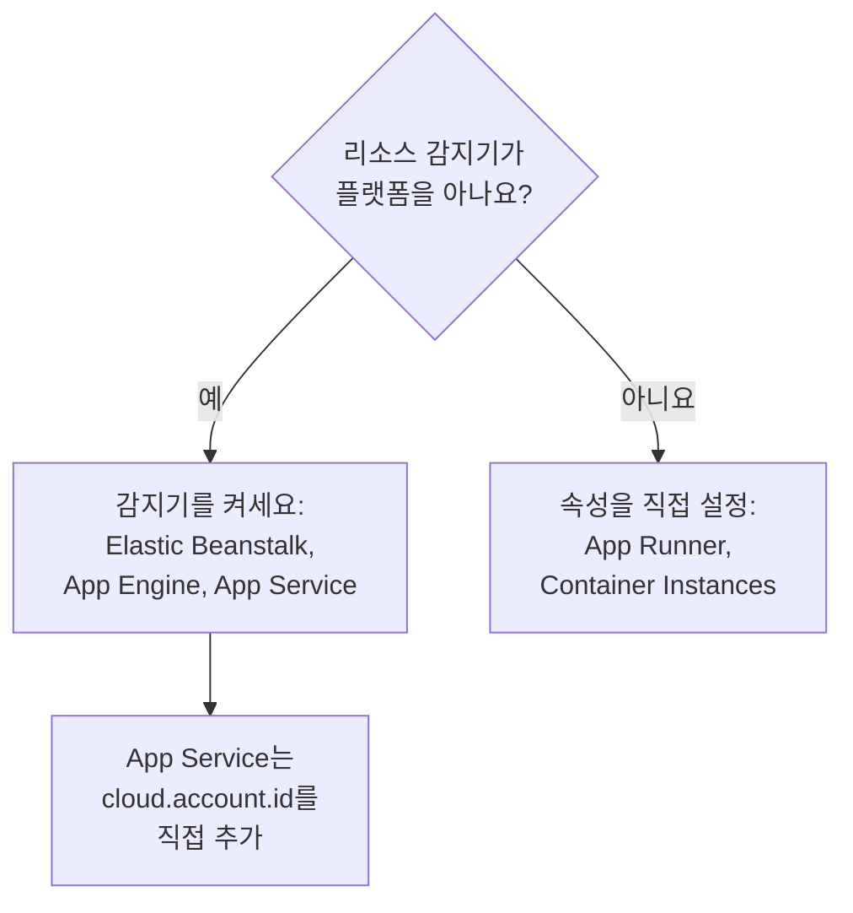

# 기타 클라우드 플랫폼

전용 페이지가 없는 관리형 플랫폼을 설정합니다. AWS Elastic Beanstalk, AWS App Runner, Google App Engine, Azure App Service, Azure Container Instances가 해당합니다. 규칙은 모든 플랫폼에서 같습니다. 관리형 `cloud.platform`과 `cloud.account.id`, `cloud.region`을 가진 텔레메트리는 플랫폼, 계정, 리전마다 하나의 **Cloud Environment**에 들어가고, 인스턴스 식별자에 따라 실행 중인 각 인스턴스가 **인스턴스**에 한 행씩 표시됩니다.

:::cards
- [AWS Elastic Beanstalk](#aws-elastic-beanstalk): 각 인스턴스의 Collector와 Beanstalk 및 EC2 감지기.
- [AWS App Runner](#aws-app-runner): 직접 설정하는 속성과 Secrets Manager에서 가져오는 토큰.
- [Google App Engine](#google-app-engine): GCP 감지기와 `app.yaml`에 두는 설정.
- [Azure App Service](#azure-app-service): Azure 감지기, Key Vault 참조, 직접 설정하는 구독.
- [Azure Container Instances](#azure-container-instances): 직접 설정하는 속성과 보안 변수로 넘기는 토큰.
:::

## 플랫폼별로 필요한 것

이 플랫폼들의 차이는 `cloud.*` 속성을 누가 설정하는지, 그리고 클라우드 콘솔의 어디에서 설정하는지입니다:



| 플랫폼 | `cloud.platform` | `cloud.*`를 채우는 주체 | 인스턴스 식별자 |
| ------------------------- | --------------------------- | ------------------------------------------------------------------------------------------ | ----------------------------------------------------------- |
| AWS Elastic Beanstalk | `aws_elastic_beanstalk` | Collector의 `elastic_beanstalk` 및 `ec2` 감지기, Node.js의 `aws` | `host.id`(배포의 `service.instance.id`는 제거) |
| AWS App Runner | `aws_app_runner` | 직접 설정(감지기 없음) | `host.name` |
| Google App Engine | `gcp_app_engine` | `gcp` 감지기(Collector와 모든 SDK) | `faas.instance` |
| Azure App Service | `azure_app_service` | Collector의 `azureappservice`, Node.js와 .NET의 `azure` 감지기. `cloud.account.id`는 직접 설정 | `service.instance.id`, 그다음 `host.id` |
| Azure Container Instances | `azure_container_instances` | 직접 설정(감지기 없음) | `host.name` |

아래의 모든 섹션에는 **프로젝트 설정 → 텔레메트리 및 APM → 수집 키**에서 만든 **서버** 수집 키와, OpenTelemetry SDK로 계측한 애플리케이션이 필요합니다. OneUptime을 자체 호스팅한다면 `https://oneuptime.com/otlp`를 `https://YOUR-ONEUPTIME-HOST/otlp`로 바꾸세요.

> [!IMPORTANT]
> 이 모든 플랫폼에서 토큰은 시크릿입니다. 각 섹션에서 해당 플랫폼의 시크릿 저장소를 안내합니다. 일반 환경 변수에 입력한 토큰은 앱 구성을 읽을 수 있는 누구나 읽을 수 있습니다.

## AWS Elastic Beanstalk

`cloud.platform`: `aws_elastic_beanstalk`. Beanstalk 감지기는 인스턴스의 `/var/elasticbeanstalk/xray/environment.conf`를 읽고 `cloud.platform`, `service.instance.id`, `service.version`, 환경 이름을 설정합니다. 계정과 리전은 모르므로, 이를 알고 `host.id`도 설정하는 EC2 감지기와 함께 쓰세요.

각 인스턴스에서 다음 구성으로 OpenTelemetry Collector를 실행합니다:

```yaml title="config.yaml"
receivers:
  otlp:
    protocols:
      http:
        endpoint: 0.0.0.0:4318
      grpc:
        endpoint: 0.0.0.0:4317
processors:
  # elastic_beanstalk sets cloud.platform and service.instance.id; ec2 adds
  # cloud.account.id, cloud.region and host.id. The first detector to set an
  # attribute wins, so elastic_beanstalk comes first.
  resourcedetection:
    detectors: [env, elastic_beanstalk, ec2]
    timeout: 5s
  # The Beanstalk detector's service.instance.id is the deployment ID, shared
  # by every instance of a deployment: drop it, so that ec2's host.id names
  # each instance.
  resource:
    attributes:
      - key: service.instance.id
        action: delete
  batch: {}
exporters:
  otlphttp/oneuptime:
    endpoint: https://oneuptime.com/otlp
    headers:
      x-oneuptime-token: ${env:ONEUPTIME_TOKEN}
service:
  pipelines:
    traces:
      receivers: [otlp]
      processors: [resourcedetection, resource, batch]
      exporters: [otlphttp/oneuptime]
    metrics:
      receivers: [otlp]
      processors: [resourcedetection, resource, batch]
      exporters: [otlphttp/oneuptime]
    logs:
      receivers: [otlp]
      processors: [resourcedetection, resource, batch]
      exporters: [otlphttp/oneuptime]
```

:::steps
1. 토큰을 Secrets Manager에 저장합니다: `aws secretsmanager create-secret --name oneuptime/ingestion-token --secret-string "YOUR_TELEMETRY_INGESTION_TOKEN"`. Beanstalk의 환경 속성은 시크릿 저장소가 아니라 환경 구성에 보관되므로, 대신 플랫폼 후크에서 인스턴스 프로필로 시크릿을 읽습니다. 인스턴스 프로필에는 그 시크릿에 대한 `secretsmanager:GetSecretValue`가 필요합니다.
2. `.platform/hooks/postdeploy/`(또는 `.ebextensions`)의 스크립트에서 Collector를 설치합니다. `otelcol-contrib` 패키지를 위의 구성으로 쓰고, 시크릿을 환경에 `ONEUPTIME_TOKEN`으로 넘깁니다.
3. **AWS Console → Elastic Beanstalk → Environments → your environment → Configuration**.
4. **Updates, monitoring, and logging** 범주에서 **Edit**를 클릭하고 **Environment properties**까지 스크롤합니다. `OTEL_SERVICE_NAME`, 값이 `http://localhost:4318`인 `OTEL_EXPORTER_OTLP_ENDPOINT`, 값이 `http/protobuf`인 `OTEL_EXPORTER_OTLP_PROTOCOL`을 추가합니다.
5. **Apply**를 클릭합니다. Beanstalk가 새 속성으로 애플리케이션을 다시 시작합니다.
:::

Node.js 애플리케이션은 Collector를 생략할 수 있습니다. SDK의 감지기에 Beanstalk와 EC2가 포함되어 있기 때문입니다. `OTEL_EXPORTER_OTLP_ENDPOINT`를 `https://oneuptime.com/otlp`로, `OTEL_EXPORTER_OTLP_HEADERS`를 `x-oneuptime-token=YOUR_TELEMETRY_INGESTION_TOKEN`으로 설정하고 `OTEL_NODE_RESOURCE_DETECTORS=env,host,os,aws`를 지정합니다. 이 경우 토큰은 환경 속성에 들어갑니다. 나중에 트레이스의 리소스 속성을 확인하세요. `cloud.platform`이 `aws_ec2`라면 사용 중인 SDK 버전에서 EC2 감지기가 우선한 것이며, 확실한 방법은 Collector입니다.

**네트워킹:** 프라이빗 서브넷의 인스턴스에는 NAT 게이트웨이가 필요하고, 인스턴스 보안 그룹은 OneUptime 호스트로 가는 TCP 443 아웃바운드를 허용해야 합니다.

## AWS App Runner

`cloud.platform`: `aws_app_runner`. 감지기가 없으므로 속성을 직접 설정합니다. App Runner는 Secrets Manager(또는 SSM Parameter Store)의 시크릿을 환경 변수에 넣을 수 있습니다.

```bash
OTEL_SERVICE_NAME=checkout-api
OTEL_EXPORTER_OTLP_ENDPOINT=https://oneuptime.com/otlp
OTEL_EXPORTER_OTLP_PROTOCOL=http/protobuf
# From Secrets Manager: the secret holds the whole header.
OTEL_EXPORTER_OTLP_HEADERS=x-oneuptime-token=YOUR_TELEMETRY_INGESTION_TOKEN
OTEL_RESOURCE_ATTRIBUTES=cloud.provider=aws,cloud.platform=aws_app_runner,cloud.region=us-east-1,cloud.account.id=123456789012
OTEL_NODE_RESOURCE_DETECTORS=env,host,os
```

리전과 계정 ID는 자신의 값으로 바꾸세요. `host` 감지기가 `host.name`(컨테이너의 호스트 이름)을 제공하는데, 이 값은 App Runner 인스턴스마다 다르며 OneUptime은 이것으로 인스턴스 이름을 정합니다.

:::steps
1. 헤더 전체를 Secrets Manager에 저장합니다: `aws secretsmanager create-secret --name oneuptime/otlp-headers --secret-string "x-oneuptime-token=YOUR_TELEMETRY_INGESTION_TOKEN"`. App Runner는 시크릿 값을 그대로 변수에 넣습니다.
2. **AWS Console → App Runner → Services → your service → Configuration → Configure service**(**Configuration** 탭에서 **Edit** 클릭).
3. **Environment variables**에서 위의 일반 값마다 **Add environment variable**을 클릭합니다.
4. `OTEL_EXPORTER_OTLP_HEADERS`를 **Source: Secrets Manager**와 시크릿의 ARN으로 추가합니다. **Security → Instance role**에서는 그 시크릿에 대한 `secretsmanager:GetSecretValue`가 있는 역할을 고르세요. 이미지를 가져오는 액세스 역할이 아니라 인스턴스 역할입니다.
5. **Save changes**를 클릭합니다. App Runner가 새 버전을 배포합니다.
:::

**네트워킹:** VPC 커넥터가 없는 서비스는 인터넷에 바로 닿습니다. **Outgoing network traffic: Custom VPC**에서는 아웃바운드 트래픽이 VPC를 거치므로, NAT 게이트웨이와 OneUptime 호스트로 가는 TCP 443을 허용하는 보안 그룹 아웃바운드 규칙이 필요합니다.

## Google App Engine

`cloud.platform`: `gcp_app_engine`. GCP 감지기는 `GAE_SERVICE`, `GAE_VERSION`, `GAE_INSTANCE`와 메타데이터 서버로 App Engine 표준 환경과 가변형 환경을 인식합니다. 그리고 `cloud.account.id`(프로젝트), `cloud.region`, `faas.name`, `faas.version`, `faas.instance`를 설정합니다. Cloud Run과 마찬가지로 `faas.name` 때문에 각 App Engine 서비스가 **서버리스 함수**에도 나타나고, 환경은 프로젝트와 리전을 묶습니다.

| 언어 | GCP 감지기 켜기 |
| -------- | ------------------------------------------------------------------------------------------------------------------- |
| Node.js | `OTEL_NODE_RESOURCE_DETECTORS=env,host,os,gcp` |
| Python | `pip install opentelemetry-resourcedetector-gcp` 후 `OTEL_EXPERIMENTAL_RESOURCE_DETECTORS=gcp_resource_detector` |
| Java | `-Dotel.resource.providers.gcp.enabled=true` |
| Go | `go.opentelemetry.io/contrib/detectors/gcp` → `gcp.NewDetector()` |
| .NET | `OpenTelemetry.Resources.Gcp` → `.AddGcpDetector()` |

App Engine 콘솔에는 환경 변수 편집기가 없습니다. 환경 변수는 `app.yaml`에 있습니다.

```yaml title="app.yaml"
runtime: nodejs22
env_variables:
  OTEL_SERVICE_NAME: checkout-api
  OTEL_EXPORTER_OTLP_ENDPOINT: https://oneuptime.com/otlp
  OTEL_EXPORTER_OTLP_PROTOCOL: http/protobuf
  OTEL_NODE_RESOURCE_DETECTORS: env,host,os,gcp
  # Do not commit the real value. Template it in CI, or read the secret at
  # start-up with the Secret Manager client instead.
  OTEL_EXPORTER_OTLP_HEADERS: x-oneuptime-token=YOUR_TELEMETRY_INGESTION_TOKEN
```

:::steps
1. 헤더 전체를 Secret Manager에 저장합니다: `printf '%s' "x-oneuptime-token=YOUR_TELEMETRY_INGESTION_TOKEN" | gcloud secrets create oneuptime-otlp-headers --data-file=-`. App Engine 서비스 계정(`my-project@appspot.gserviceaccount.com`)에 그 시크릿에 대한 `roles/secretmanager.secretAccessor`를 부여합니다.
2. 배포 파이프라인에서 시크릿을 `app.yaml`에 넣고, 커밋하는 파일에는 자리 표시자를 남겨 두세요. 또는 시작할 때 `projects/PROJECT_ID/secrets/oneuptime-otlp-headers/versions/latest`를 읽어 코드에서 익스포터의 `headers` 옵션에 넘깁니다.
3. `gcloud app deploy`로 배포합니다. 콘솔에서 **App Engine → Versions**에는 새 버전이, **App Engine → Services**에는 **서버리스 함수**에 나타나는 서비스가 표시됩니다.
:::

**네트워킹:** App Engine 표준 환경은 인터넷에 바로 닿습니다. 가변형 환경의 인스턴스는 VPC 안에 있으므로, 서브넷에 외부 IP가 없다면 Cloud NAT와 OneUptime 호스트로 가는 TCP 443을 허용하는 방화벽 이그레스 규칙이 필요합니다.

## Azure App Service

`cloud.platform`: `azure_app_service`. Node.js와 .NET용 Azure 감지기, 그리고 Collector의 `azureappservice` 감지기는 App Service가 설정하는 `WEBSITE_*` 변수를 읽습니다. 그리고 `cloud.platform`, `cloud.region`, `service.instance.id`(`WEBSITE_INSTANCE_ID`에서), `deployment.environment`(슬롯), `host.id`를 채웁니다. 어느 것도 `cloud.account.id`는 설정하지 않으므로 구독 ID를 직접 추가하세요. 그렇지 않으면 환경 키의 계정 부분이 비게 됩니다.

```bash
OTEL_SERVICE_NAME=checkout-api
OTEL_EXPORTER_OTLP_ENDPOINT=https://oneuptime.com/otlp
OTEL_EXPORTER_OTLP_PROTOCOL=http/protobuf
# The Key Vault reference, which resolves to the whole header.
OTEL_EXPORTER_OTLP_HEADERS=@Microsoft.KeyVault(SecretUri=https://my-vault.vault.azure.net/secrets/oneuptime-otlp-headers/)
OTEL_RESOURCE_ATTRIBUTES=cloud.account.id=00000000-0000-0000-0000-000000000000
# Node.js:
OTEL_NODE_RESOURCE_DETECTORS=env,host,os,azure
```

SDK 감지기는 플랫폼을 점이 들어간 `azure.app_service`로 씁니다. OneUptime은 받을 때 이를 `azure_app_service`로 바꿉니다. .NET에서는 `OpenTelemetry.Resources.Azure`를 추가하고 `.ConfigureResource(r => r.AddAzureAppServiceDetector())`를 호출합니다. 다른 언어에서는 `OTEL_RESOURCE_ATTRIBUTES`에 `cloud.provider=azure,cloud.platform=azure_app_service,cloud.region=<region>`을 추가하고, `service.instance.id`는 코드에서 `WEBSITE_INSTANCE_ID`로 가져옵니다.

:::steps
1. 앱의 시스템 할당 관리 ID를 켜고(**Settings → Identity**), 자격 증명 모음에 대한 **Key Vault Secrets User**를 부여합니다. 헤더 전체 `x-oneuptime-token=YOUR_TELEMETRY_INGESTION_TOKEN`을 시크릿 `oneuptime-otlp-headers`로 저장합니다.
2. **Azure portal → App Services → your app → Settings → Environment variables**(이전 포털에서는 **Configuration → Application settings**).
3. 위의 각 변수를 **+ Add**로 추가합니다. `OTEL_EXPORTER_OTLP_HEADERS`의 값은 Key Vault 참조입니다.
4. **Apply**를 클릭한 다음 **Confirm**을 클릭합니다. 앱이 새 설정으로 다시 시작됩니다. 배포 슬롯마다 설정이 따로 있으므로, 한 슬롯만 텔레메트리를 보내야 한다면 토큰을 **deployment slot setting**으로 표시하세요.
:::

**네트워킹:** **VNet integration**과 **Route All**을 켜지 않았다면 App Service는 인터넷에 바로 닿습니다. 켰다면 VNet에 NAT 게이트웨이나, OneUptime 호스트로 가는 TCP 443을 허용하는 방화벽으로의 경로가 필요합니다.

## Azure Container Instances

`cloud.platform`: `azure_container_instances`. 감지기가 없으므로 속성을 직접 설정합니다. 컨테이너 그룹의 환경 변수는 만들 때 고정되므로, 하나를 바꾸려면 그룹을 다시 만들어야 합니다. `az container show`가 토큰을 반환하지 않도록 `--secure-environment-variables`로 넘기세요:

```bash
az container create \
  --resource-group my-rg \
  --name checkout-api \
  --image myregistry.azurecr.io/checkout-api:1.4.2 \
  --location eastus \
  --environment-variables \
    OTEL_SERVICE_NAME=checkout-api \
    OTEL_EXPORTER_OTLP_ENDPOINT=https://oneuptime.com/otlp \
    OTEL_EXPORTER_OTLP_PROTOCOL=http/protobuf \
    "OTEL_RESOURCE_ATTRIBUTES=cloud.provider=azure,cloud.platform=azure_container_instances,cloud.region=eastus,cloud.account.id=00000000-0000-0000-0000-000000000000" \
    OTEL_NODE_RESOURCE_DETECTORS=env,host,os \
  --secure-environment-variables \
    "OTEL_EXPORTER_OTLP_HEADERS=x-oneuptime-token=YOUR_TELEMETRY_INGESTION_TOKEN"
```

`host` 감지기의 `host.name`(컨테이너 그룹의 호스트 이름)이 인스턴스 이름이 됩니다. 컨테이너 그룹은 ECS 태스크처럼 여러 컨테이너를 실행하므로 여기서도 사이드카 Collector를 쓸 수 있습니다. [Azure Container Apps](/docs/telemetry/cloud-azure-container-apps)의 `detectors: [env]`와 `OTEL_RESOURCE_ATTRIBUTES` 조합을 쓰세요. 이 사이드카가 그룹 식별자를 가진 `container.cpu.utilization`과 `container.memory.usage`를 보내면 **CPU**와 **메모리** 타일도 채워집니다.

:::steps
1. **Azure portal → Container Instances → + Create**. **Basics** 탭에서 리소스 그룹, 이름, 리전, 이미지를 입력합니다.
2. **Advanced** 탭의 **Environment variables**에서 각 변수를 추가합니다. `OTEL_EXPORTER_OTLP_HEADERS`는 포털과 API에 값이 보이지 않도록 **Mark as secure**를 **Yes**로 설정합니다.
3. **Review + create**를 클릭한 다음 **Create**를 클릭합니다. 나중에 변수를 바꾸려면 그룹을 삭제하고 다시 만드세요.
:::

**네트워킹:** 공용 IP가 있는 컨테이너 그룹은 인터넷에 바로 닿습니다. VNet 서브넷에 있는 그룹은 VNet 경로로만 나갈 수 있으므로, NAT 게이트웨이를 추가하거나 방화벽이나 NSG에서 OneUptime 호스트로 가는 TCP 443을 허용하세요.

## 연결 확인하기

어떤 플랫폼을 설정했든 먼저 토큰을 확인한 다음 환경을 찾으세요:

```bash
curl -i https://oneuptime.com/otlp/v1/validate \
  -H "x-oneuptime-token: YOUR_TELEMETRY_INGESTION_TOKEN"
```

`200`과 `"valid": true`는 토큰이 받아들여졌다는 뜻입니다. `401`은 토큰을 알 수 없거나, 취소되었거나, 비활성화되었거나, 만료되었다는 뜻입니다. 첫 스팬, 로그 또는 메트릭이 도착하고 1분 안에 플랫폼, 리전, 계정을 딴 이름으로 환경이 **클라우드 → All Environments**에 나타납니다.

## 문제 해결

:::details Beanstalk 인스턴스가 호스트에 나타남
EC2 감지기의 `cloud.platform=aws_ec2`가 우선했습니다. 속성을 먼저 설정한 감지기가 우선하므로 `detectors`에서 `elastic_beanstalk`를 `ec2`보다 앞에 두세요. Collector가 없으면 Node.js SDK도 EC2 감지기를 우선할 수 있습니다. Collector를 실행하세요.
:::

:::details 모든 Beanstalk 인스턴스가 인스턴스의 한 행을 함께 씀
Beanstalk 감지기의 `service.instance.id`는 배포 ID라서 한 배포의 모든 인스턴스가 공유하며, `host.id`보다 먼저 읽힙니다. 이를 제거하는 `resource` 프로세서를 모든 파이프라인에 두세요.
:::

:::details App Service 앱이 401을 받음
Key Vault 참조가 확인되지 않아 App Service가 `@Microsoft.KeyVault(...)` 텍스트를 그대로 헤더로 넘겼습니다. 앱의 관리 ID에 자격 증명 모음에 대한 **Key Vault Secrets User**를 부여하고, 시크릿에 헤더 전체 `x-oneuptime-token=...`이 들어 있는지 확인하세요.
:::

:::details App Service 환경의 계정 부분이 비어 있음
App Service 감지기 중 어느 것도 `cloud.account.id`를 설정하지 않습니다. 모든 앱의 `OTEL_RESOURCE_ATTRIBUTES`에 구독 ID를 추가하세요. 이 값이 있는 텔레메트리와 없는 텔레메트리는 두 환경으로 나뉩니다.
:::

:::details Container Instances 변수를 바꿔도 반영되지 않음
컨테이너 그룹의 환경 변수는 만들 때 고정됩니다. 그룹을 삭제하고 새 값으로 다시 만드세요.
:::

나머지, 특히 환경이 **호스트**에 나타나거나, **서버리스 함수**에만 나타나거나(GCP 감지기가 없는 App Engine), 두 번 나타나는(`cloud.account.id`를 일부 배포에만 설정한) 경우는 [클라우드 문제 해결](/docs/telemetry/cloud-troubleshooting)을 참고하세요.

## 다음 단계

:::cards
- [클라우드 환경](/docs/telemetry/cloud-environments): 환경과 인스턴스를 식별하는 방법.
- [클라우드 문제 해결](/docs/telemetry/cloud-troubleshooting): 모든 플랫폼에 공통인 장애.
- [서버리스 함수](/docs/telemetry/serverless-functions): Lambda, Cloud Functions, Azure Functions.
- [클라우드 리소스(IaaS 및 PaaS)](/docs/telemetry/cloud-resources): 클라우드 자체 모니터링에서 가져오는, 앱 주변의 리소스.
:::
