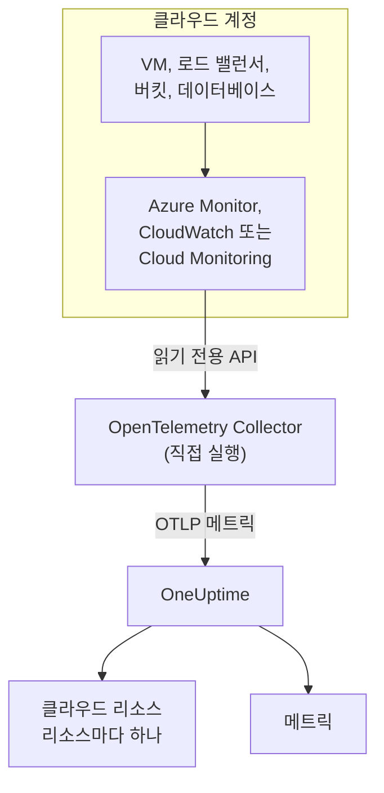
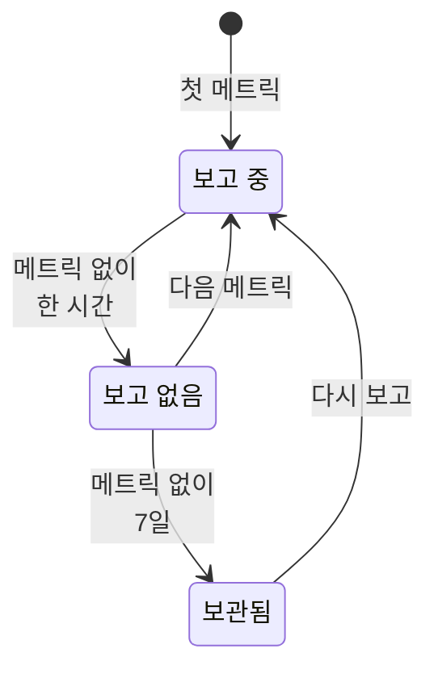

# 클라우드 리소스(IaaS 및 PaaS)

**Cloud Resources**에는 AWS, Azure, Google Cloud 계정의 IaaS와 PaaS 리소스가 나열됩니다. 가상 머신, 디스크, 로드 밸런서, 버킷, 관리형 데이터베이스, 캐시, 큐, API 게이트웨이 등입니다. 각 리소스에는 전용 페이지가 있어 유형, 리전, 계정, 공급자가 붙인 고유 ID, 공급자가 게시하는 모든 메트릭이 표시되며, OneUptime의 다른 리소스처럼 소유자와 레이블을 붙일 수 있습니다. 리소스는 **클라우드 → 모든 리소스**에 있습니다.

:::cards
- [Azure 연결하기](#azure-연결하기): 구독의 모든 리소스를 Azure Monitor에서 읽습니다.
- [AWS 연결하기](#aws-연결하기): CloudWatch를 폴링하거나, Amazon Data Firehose로 스트리밍합니다.
- [Google Cloud 연결하기](#google-cloud-연결하기): 프로젝트의 서비스를 Cloud Monitoring에서 읽습니다.
- [리소스를 식별하는 방법](#리소스를-식별하는-방법): OneUptime이 인식하는 모든 리소스 유형(공급자별).
:::

## 작동 방식



- **공급자는 이미 리소스를 측정하고 있습니다.** Azure Monitor, Amazon CloudWatch, Google Cloud Monitoring은 사용자를 위해 실행하는 모든 리소스의 메트릭을 게시합니다.
- **직접 실행하는 Collector가 이를 읽습니다.** 그 모니터링 서비스에 대한 읽기 전용 권한을 가진 OpenTelemetry Collector가 메트릭을 OneUptime으로 내보냅니다. 리소스에는 아무것도 설치하지 않으며, OneUptime은 클라우드 자격 증명을 보관하지 않습니다. 자격 증명은 사용자 환경에서 실행되는 Collector가 보관합니다.
- **각 리소스는 첫 메트릭과 함께 나타납니다.** OneUptime은 각 데이터 포인트가 어느 리소스에 관한 것인지 판단하고, 처음 볼 때 클라우드 리소스를 만듭니다.

클라우드 리소스는 클라우드가 나타나는 여러 곳 중 하나입니다:

| 실행하는 것 | 나타나는 곳 | 방법 |
| --- | --- | --- |
| ECS, Cloud Run, Container Apps, App Service 등의 컨테이너 | **클라우드 → All Environments** | 워크로드 자체의 텔레메트리(`cloud.platform` 기준). [클라우드 환경](/docs/telemetry/cloud-environments)을 참고하세요 |
| 공급자가 모니터링하는 모든 IaaS·PaaS 리소스 | **클라우드 → 모든 리소스** | Collector가 읽는 공급자의 모니터링 API. 이 페이지입니다 |
| OpenTelemetry Collector가 설치된 가상 머신 | **호스트** | 호스트 자체의 메트릭과 로그. [호스트 OpenTelemetry 수집기](/docs/telemetry/host-otel-collector)를 참고하세요 |
| 애플리케이션이 쓰는 큐와 토픽 | **Queues** | 스팬과 같은 클라우드 메트릭. [큐](/docs/telemetry/queues)를 참고하세요 |

하나의 리소스가 여러 곳에 나타날 수 있습니다. Collector가 설치된 가상 머신은 **호스트**이며, 그 플랫폼 메트릭(하이퍼바이저가 보는 CPU 크레딧, 디스크, 네트워크) 덕분에 **클라우드 리소스**이기도 합니다. SQS 큐는 **Queue**이자 **클라우드 리소스**입니다. 각 보기는 그 데이터 원본이 아는 것을 보여 줍니다.

## 시작하기 전에

- **수집 키.** **프로젝트 설정 → 텔레메트리 및 APM → 수집 키**에서 **서버** 키를 만듭니다. 아래의 Collector는 구성 파일이 아니라 환경 변수 `ONEUPTIME_TOKEN`에서 키를 읽습니다.
- **OpenTelemetry Collector를 실행할 곳**: `otelcol-contrib` 배포판(이미지 `otel/opentelemetry-collector-contrib`)을 클라우드 공급자와 OneUptime으로 아웃바운드 접근이 되는 곳에서 실행합니다. 작은 VM, 컨테이너, Kubernetes 클러스터 중 어느 것이든 되며, Collector 하나로 여러 계정과 공급자를 읽을 수 있습니다.
- **공급자 모니터링 API에 대한 읽기 권한.** 아래 각 공급자의 첫 단계에서 만듭니다.

> [!TIP]
> 같은 단계가 토큰이 채워진 상태로 대시보드에도 있습니다. 첫 리소스가 도착하기 전에는 **클라우드 → 모든 리소스**에, 그 뒤에는 각 리소스의 **문서** 탭(그 리소스의 공급자 안내가 열림)에 있습니다.

OneUptime을 자체 호스팅한다면 `https://oneuptime.com/otlp`를 `https://YOUR-ONEUPTIME-HOST/otlp`로 바꾸세요.

## Azure 연결하기

`azure_monitor` 수신기는 구독의 리소스를 나열하고 1분마다 그 플랫폼 메트릭을 읽습니다. `services` 목록이 없으면 모든 리소스 유형을 읽으므로, 구독의 모든 리소스가 클라우드 리소스가 됩니다.

:::steps
### Monitoring Reader 서비스 주체 만들기

**Monitoring Reader**는 메트릭을 읽고 리소스를 나열할 수 있지만, 아무것도 바꿀 수 없습니다:

```bash
az ad sp create-for-rbac \
  --name oneuptime-cloud-collector \
  --role "Monitoring Reader" \
  --scopes /subscriptions/<SUBSCRIPTION_ID>
```

명령은 `appId`(클라이언트 ID), `password`(클라이언트 시크릿), `tenant`를 출력합니다. 같은 서비스 주체에 다른 구독에서도 이 역할을 주면 같은 Collector로 그 구독도 읽을 수 있습니다.

### Azure Monitor 수신기 구성하기

다음 내용을 `config.yaml`로 저장합니다:

```yaml
extensions:
  azure_auth:
    service_principal:
      tenant_id: ${env:AZURE_TENANT_ID}
      client_id: ${env:AZURE_CLIENT_ID}
      client_secret: ${env:AZURE_CLIENT_SECRET}

receivers:
  azure_monitor:
    subscription_ids: ["${env:AZURE_SUBSCRIPTION_ID}"]
    auth:
      authenticator: azure_auth
    collection_interval: 60s
    # No `services` list: every resource type in the subscription.
    # Series Azure returns per metric and resource (default 10).
    maximum_number_of_records_per_resource: 50

processors:
  batch: {}

exporters:
  otlphttp/oneuptime:
    endpoint: https://oneuptime.com/otlp
    headers:
      x-oneuptime-token: ${env:ONEUPTIME_TOKEN}

service:
  extensions: [azure_auth]
  pipelines:
    metrics:
      receivers: [azure_monitor]
      processors: [batch]
      exporters: [otlphttp/oneuptime]
```

### Azure용 Collector 실행하기

```bash
docker run -d --name oneuptime-cloud-collector --restart unless-stopped \
  -e ONEUPTIME_TOKEN=YOUR_TELEMETRY_INGESTION_TOKEN \
  -e AZURE_TENANT_ID=<TENANT> \
  -e AZURE_CLIENT_ID=<APP_ID> \
  -e AZURE_CLIENT_SECRET=<PASSWORD> \
  -e AZURE_SUBSCRIPTION_ID=<SUBSCRIPTION_ID> \
  -v "$(pwd)/config.yaml:/etc/otelcol-contrib/config.yaml" \
  otel/opentelemetry-collector-contrib:latest
```

몇 분 안에 리소스가 **클라우드 → 모든 리소스**에 나타납니다.
:::

`azure_monitor` 수신기의 옵션:

| 옵션 | 하는 일 |
| --- | --- |
| `resource_groups`, `services`, `resource_tags` | 읽는 범위를 줄입니다. 리소스 그룹, Resource Manager 유형(`Microsoft.Compute/virtualMachines`), 또는 리소스가 가져야 할 태그의 목록입니다 |
| `metrics` | 각 리소스 유형을 지정한 메트릭과 집계로 제한합니다. 유형을 지정하면 그 유형은 지정한 메트릭만 읽습니다 |
| `discover_subscriptions: true` | `subscription_ids` 대신 서비스 주체가 볼 수 있는 모든 구독을 읽습니다 |
| `maximum_number_of_records_per_resource` | Azure가 메트릭과 리소스마다 반환하는 시계열 수(기본값 10). 값이 많은 차원으로 메트릭이 나뉠 때 높이세요 |
| `use_batch_api: true` | 큰 구독용입니다. 수신기는 리소스와 메트릭 20개 묶음마다 Resource Manager를 한 번 호출하는데, Resource Manager는 시간당 약 12,000회 읽기만 허용합니다. 배치 API는 Azure Monitor 데이터 평면에서 호출당 최대 50개 리소스를 읽으며, 그 한도는 훨씬 높습니다 |
| `cache_resources` | 수신기가 리소스를 나열하는 간격(초). 기본값은 하루 한 번입니다. Collector가 시작된 뒤 만든 리소스는 나타나기까지 최대 하루가 걸릴 수 있으니, 바로 나열하려면 Collector를 다시 시작하세요 |

## AWS 연결하기

CloudWatch 메트릭은 다음 두 방법 중 하나로 OneUptime에 도달합니다:

| | Polling | Metric Streams |
| --- | --- | --- |
| 방법 | Collector의 `aws_cloudwatch` 수신기가 CloudWatch에 요청 | CloudWatch가 Amazon Data Firehose를 통해 Collector의 `awsfirehose` 수신기로 푸시 |
| AWS 쪽에 필요한 것 | 자격 증명만 | 리전마다 Firehose 스트림과 메트릭 스트림 |
| AWS에서 Collector에 닿을 수 있어야 함 | 아니요 | 예, 포트 443의 HTTPS로 |
| 지연 | 10~20분 | 몇 분 |
| 적합한 경우 | 대부분의 계정 | 큰 계정 |

### aws_cloudwatch 수신기로 폴링하기

:::steps
#### Collector가 CloudWatch를 읽도록 허용하기

Collector가 실행되는 역할(EC2 인스턴스 프로필, ECS 태스크 역할, EKS 서비스 계정) 또는 Collector에 액세스 키를 건네는 IAM 사용자에게 다음 정책을 연결하세요:

```json
{
  "Version": "2012-10-17",
  "Statement": [
    {
      "Effect": "Allow",
      "Action": [
        "cloudwatch:ListMetrics",
        "cloudwatch:GetMetricData",
        "sts:GetCallerIdentity"
      ],
      "Resource": "*"
    }
  ]
}
```

`sts:GetCallerIdentity`가 있으면 수신기가 계정 ID를 보고할 수 있으며, 각 리소스의 ARN에는 계정 ID가 필요합니다.

#### CloudWatch 수신기 구성하기

수신기 하나는 리전 하나의 네임스페이스 하나를 읽으므로, 원하는 네임스페이스와 리전마다 수신기를 추가하세요. 이 예시는 흔히 쓰는 것들을 읽습니다. `config.yaml`로 저장하세요:

```yaml
receivers:
  aws_cloudwatch/ec2:
    region: ${env:AWS_REGION}
    metrics:
      collection_interval: 5m
      period: 5m
      delay: 10m
      discovery:
        filters:
          namespace: AWS/EC2
        # Metrics read per scrape, at most. Each costs 4 GetMetricData queries.
        limit: 1000
  aws_cloudwatch/ebs:
    region: ${env:AWS_REGION}
    metrics:
      collection_interval: 5m
      period: 5m
      delay: 10m
      discovery:
        filters:
          namespace: AWS/EBS
        # Metrics read per scrape, at most. Each costs 4 GetMetricData queries.
        limit: 1000
  aws_cloudwatch/applicationelb:
    region: ${env:AWS_REGION}
    metrics:
      collection_interval: 5m
      period: 5m
      delay: 10m
      discovery:
        filters:
          namespace: AWS/ApplicationELB
        # Metrics read per scrape, at most. Each costs 4 GetMetricData queries.
        limit: 1000
  aws_cloudwatch/rds:
    region: ${env:AWS_REGION}
    metrics:
      collection_interval: 5m
      period: 5m
      delay: 10m
      discovery:
        filters:
          namespace: AWS/RDS
        # Metrics read per scrape, at most. Each costs 4 GetMetricData queries.
        limit: 1000
  aws_cloudwatch/lambda:
    region: ${env:AWS_REGION}
    metrics:
      collection_interval: 5m
      period: 5m
      delay: 10m
      discovery:
        filters:
          namespace: AWS/Lambda
        # Metrics read per scrape, at most. Each costs 4 GetMetricData queries.
        limit: 1000
  aws_cloudwatch/dynamodb:
    region: ${env:AWS_REGION}
    metrics:
      collection_interval: 5m
      period: 5m
      delay: 10m
      discovery:
        filters:
          namespace: AWS/DynamoDB
        # Metrics read per scrape, at most. Each costs 4 GetMetricData queries.
        limit: 1000

processors:
  batch: {}

exporters:
  otlphttp/oneuptime:
    endpoint: https://oneuptime.com/otlp
    headers:
      x-oneuptime-token: ${env:ONEUPTIME_TOKEN}

service:
  pipelines:
    metrics:
      receivers: [aws_cloudwatch/ec2, aws_cloudwatch/ebs, aws_cloudwatch/applicationelb, aws_cloudwatch/rds, aws_cloudwatch/lambda, aws_cloudwatch/dynamodb]
      processors: [batch]
      exporters: [otlphttp/oneuptime]
```

#### CloudWatch용 Collector 실행하기

```bash
docker run -d --name oneuptime-cloud-collector --restart unless-stopped \
  -e ONEUPTIME_TOKEN=YOUR_TELEMETRY_INGESTION_TOKEN \
  -e AWS_REGION=us-east-1 \
  -e AWS_ACCESS_KEY_ID=<ACCESS_KEY_ID> \
  -e AWS_SECRET_ACCESS_KEY=<SECRET_ACCESS_KEY> \
  -v "$(pwd)/config.yaml:/etc/otelcol-contrib/config.yaml" \
  otel/opentelemetry-collector-contrib:latest
```

역할이 있는 EC2 인스턴스, ECS 태스크, EKS 파드에서는 두 키 변수를 빼세요.
:::

- **`stats`는 설정하지 마세요.** 그러면 각 메트릭을 기간마다 요약 하나로 읽습니다. 통계 네 개에 `GetMetricData` 쿼리 네 개이며, AWS는 `GetMetricData`를 요청한 메트릭마다 과금합니다. `discovery.limit`은 수신기가 수집 한 번에 읽는 메트릭 수를 제한하고(꼭 설정하세요. 수신기 자체의 기본값은 100입니다), `collection_interval`을 길게 하면 덜 자주 읽습니다.
- **데이터는 늦게 도착합니다.** `delay`는 CloudWatch가 기간을 게시하기를 기다리므로, 데이터 포인트는 측정한 시각보다 10~20분 늦게 도착하고, 리소스는 20분쯤 안에 나타납니다.

### CloudWatch Metric Streams로 스트리밍하기

:::steps
#### Firehose 수신기 구성하기

Collector에는 주소에 맞는 인증서가 필요합니다. Firehose는 포트 443의 `https://`로만 전달합니다. 다음 내용을 `config.yaml`로 저장합니다:

```yaml
extensions:
  awscloudwatchmetricstreams_encoding:
    format: opentelemetry1.0

receivers:
  awsfirehose:
    # Firehose delivers to HTTPS on port 443 only: expose this port as
    # 443, for example behind a load balancer.
    endpoint: 0.0.0.0:4433
    encoding: awscloudwatchmetricstreams_encoding
    access_key: ${env:FIREHOSE_ACCESS_KEY}
    tls:
      cert_file: /etc/otelcol-contrib/tls/server.crt
      key_file: /etc/otelcol-contrib/tls/server.key

processors:
  batch: {}

exporters:
  otlphttp/oneuptime:
    endpoint: https://oneuptime.com/otlp
    headers:
      x-oneuptime-token: ${env:ONEUPTIME_TOKEN}

service:
  extensions: [awscloudwatchmetricstreams_encoding]
  pipelines:
    metrics:
      receivers: [awsfirehose]
      processors: [batch]
      exporters: [otlphttp/oneuptime]
```

#### Firehose용 Collector 실행하기

```bash
docker run -d --name oneuptime-cloud-collector --restart unless-stopped \
  -e ONEUPTIME_TOKEN=YOUR_TELEMETRY_INGESTION_TOKEN \
  -e FIREHOSE_ACCESS_KEY=<A_LONG_RANDOM_SECRET> \
  -p 4433:4433 \
  -v "$(pwd)/tls:/etc/otelcol-contrib/tls:ro" \
  -v "$(pwd)/config.yaml:/etc/otelcol-contrib/config.yaml" \
  otel/opentelemetry-collector-contrib:latest
```

인증서와 그 키는 `tls/`에 `server.crt`와 `server.key`로 둡니다. 포트 4433을 로드 밸런서처럼 443에서 응답하는 것 뒤에 게시하세요.

#### Firehose 스트림과 메트릭 스트림 만들기

1. **Amazon Data Firehose → Create Firehose stream**: 원본은 **Direct PUT**, 대상은 **HTTP Endpoint**입니다. 엔드포인트 URL은 Collector의 `https://` 주소이고, 액세스 키는 `FIREHOSE_ACCESS_KEY`입니다. 전달에 실패한 데이터를 둘 S3 버킷을 고르거나 만드세요.
2. **CloudWatch → Metrics → Streams → Create metric stream**: 포함할 네임스페이스(또는 전체), Firehose 스트림, 출력 형식 **OpenTelemetry 1.0**을 지정합니다.
3. 리전마다 반복하세요. 메트릭 스트림은 자기 리전의 메트릭만 전달합니다.
:::

AWS는 메트릭 스트림이 전달한 메트릭 업데이트마다 과금하고 Firehose 데이터 요금도 붙으므로, 필요한 네임스페이스만 포함하세요. **JSON** 형식(인코딩 확장의 `format: json`)의 스트림도 같은 리소스를 가리키지만, 각 네임스페이스를 `service.name`에도 기록하므로 모든 네임스페이스가 **서비스**에도 나타납니다. **OpenTelemetry 1.0**을 쓰세요.

## Google Cloud 연결하기

`googlecloudmonitoring` 수신기는 프로젝트 하나에 대해 `metrics_list`가 지정한 메트릭 유형을 읽습니다.

:::steps
### Monitoring Viewer 서비스 계정 만들기

**Monitoring Viewer**는 메트릭을 읽을 수 있지만, 아무것도 바꿀 수 없습니다:

```bash
gcloud iam service-accounts create oneuptime-cloud-collector \
  --project <PROJECT_ID>

gcloud projects add-iam-policy-binding <PROJECT_ID> \
  --member "serviceAccount:oneuptime-cloud-collector@<PROJECT_ID>.iam.gserviceaccount.com" \
  --role roles/monitoring.viewer

gcloud iam service-accounts keys create key.json \
  --iam-account oneuptime-cloud-collector@<PROJECT_ID>.iam.gserviceaccount.com
```

Google Cloud 안에서 Collector를 실행한다면 키를 만드는 대신 이 서비스 계정으로 실행하세요.

### Cloud Monitoring 수신기 구성하기

각 필터는 서비스 하나의 모든 메트릭 유형을 읽습니다. 다음 내용을 `config.yaml`로 저장합니다:

```yaml
receivers:
  googlecloudmonitoring:
    project_id: ${env:GCP_PROJECT_ID}
    collection_interval: 2m
    # Only the metric types these filters list are read.
    metrics_list:
      - metric_descriptor_filter: 'metric.type = starts_with("compute.googleapis.com/")'
      - metric_descriptor_filter: 'metric.type = starts_with("cloudsql.googleapis.com/")'
      - metric_descriptor_filter: 'metric.type = starts_with("loadbalancing.googleapis.com/")'
      - metric_descriptor_filter: 'metric.type = starts_with("storage.googleapis.com/")'
      - metric_descriptor_filter: 'metric.type = starts_with("redis.googleapis.com/")'
      - metric_descriptor_filter: 'metric.type = starts_with("run.googleapis.com/")'

processors:
  batch: {}

exporters:
  otlphttp/oneuptime:
    endpoint: https://oneuptime.com/otlp
    headers:
      x-oneuptime-token: ${env:ONEUPTIME_TOKEN}

service:
  pipelines:
    metrics:
      receivers: [googlecloudmonitoring]
      processors: [batch]
      exporters: [otlphttp/oneuptime]
```

### Google Cloud용 Collector 실행하기

```bash
docker run -d --name oneuptime-cloud-collector --restart unless-stopped \
  -e ONEUPTIME_TOKEN=YOUR_TELEMETRY_INGESTION_TOKEN \
  -e GCP_PROJECT_ID=<PROJECT_ID> \
  -e GOOGLE_APPLICATION_CREDENTIALS=/etc/otelcol-contrib/key.json \
  -v "$(pwd)/key.json:/etc/otelcol-contrib/key.json:ro" \
  -v "$(pwd)/config.yaml:/etc/otelcol-contrib/config.yaml" \
  otel/opentelemetry-collector-contrib:latest
```
:::

- **목록은 Collector가 시작될 때 읽힙니다:** 바꾼 뒤에는 다시 시작하세요. `metric_name: compute.googleapis.com/instance/cpu/utilization`은 서비스의 모든 유형 대신 한 유형만 읽습니다.
- **수신기 하나는 프로젝트 하나를 읽습니다:** 프로젝트마다 수신기를 추가하세요.
- **읽기에는 비용과 할당량이 있습니다.** 메트릭 유형마다 수집 간격마다 Cloud Monitoring API 읽기가 한 번 일어납니다. Google Cloud 자체 메트릭을 읽는 것은 API의 월간 무료 한도 안에서는 무료이며, `collection_interval`을 길게 하면 큰 프로젝트도 그 한도와 분당 할당량 안에 머뭅니다.

## 파이프라인에서 리소스 감지 빼기

> [!WARNING]
> 클라우드 모니터링을 읽는 파이프라인에 `resourcedetection` 프로세서를 추가하지 마세요. 이 프로세서가 Collector 머신 자체의 `host.name`과 `os.type`을 모든 데이터 포인트에 붙이면, OneUptime이 클라우드의 메트릭을 **호스트**의 그 머신 아래에도 기록합니다. 자기 호스트도 모니터링하는 Collector라면 별도의 파이프라인에서 하세요.

## 리소스를 식별하는 방법

이 수신기들이 보내는 데이터 포인트는 각각 리소스 하나를 가리키며, OneUptime은 클라우드 리소스를 바뀔 수 있는 이름이 아니라 그 리소스의 식별자에 연결합니다. 식별자는 대소문자를 구분하지 않고 비교하므로, 두 가지 표기로 보고된 리소스도 하나의 리소스입니다.

### Azure

모든 데이터 포인트에는 리소스의 Azure 리소스 ID(`azuremonitor.resource_id`)가 있으므로, 수신기가 읽는 모든 리소스가 클라우드 리소스가 됩니다. 아래 유형은 알아보기 쉬운 이름으로, 그 밖의 유형은 Resource Manager 유형으로 표시됩니다. 리소스 ID, 리전, 구독, 리소스 그룹이 모두 리소스에 표시됩니다.

:::details 알아보기 쉬운 이름으로 표시되는 Azure 리소스 유형
| 리소스 유형 | 표시 이름 | 모델 |
| --- | --- | --- |
| `Microsoft.Compute/virtualMachines` | Virtual Machine | IaaS |
| `Microsoft.Compute/virtualMachineScaleSets` | Virtual Machine Scale Set | IaaS |
| `Microsoft.Compute/disks` | Managed Disk | IaaS |
| `Microsoft.Network/loadBalancers` | Load Balancer | IaaS |
| `Microsoft.Network/applicationGateways` | Application Gateway | IaaS |
| `Microsoft.Network/publicIPAddresses` | Public IP Address | IaaS |
| `Microsoft.Network/natGateways` | NAT Gateway | IaaS |
| `Microsoft.Network/virtualNetworkGateways` | Virtual Network Gateway | IaaS |
| `Microsoft.Network/expressRouteCircuits` | ExpressRoute Circuit | IaaS |
| `Microsoft.Network/azureFirewalls` | Azure Firewall | IaaS |
| `Microsoft.Network/frontdoors` | Front Door (classic) | IaaS |
| `Microsoft.Cdn/profiles` | Front Door and CDN Profile | IaaS |
| `Microsoft.Network/trafficmanagerprofiles` | Traffic Manager Profile | IaaS |
| `Microsoft.Network/networkInterfaces` | Network Interface | IaaS |
| `Microsoft.Network/virtualNetworks` | Virtual Network | IaaS |
| `Microsoft.Network/privateEndpoints` | Private Endpoint | IaaS |
| `Microsoft.Network/dnszones` | DNS Zone | IaaS |
| `Microsoft.Network/bastionHosts` | Bastion | IaaS |
| `Microsoft.Storage/storageAccounts` | Storage Account | IaaS |
| `Microsoft.RecoveryServices/vaults` | Recovery Services Vault | PaaS |
| `Microsoft.Web/sites` | App Service or Function App | PaaS |
| `Microsoft.Web/serverfarms` | App Service Plan | PaaS |
| `Microsoft.Web/staticSites` | Static Web App | PaaS |
| `Microsoft.App/containerApps` | Container App | PaaS |
| `Microsoft.App/managedEnvironments` | Container Apps Environment | PaaS |
| `Microsoft.ContainerInstance/containerGroups` | Container Instance | PaaS |
| `Microsoft.ContainerService/managedClusters` | AKS Cluster | PaaS |
| `Microsoft.ContainerRegistry/registries` | Container Registry | PaaS |
| `Microsoft.SignalRService/SignalR` | SignalR Service | PaaS |
| `Microsoft.Sql/servers/databases` | SQL Database | PaaS |
| `Microsoft.Sql/servers/elasticpools` | SQL Elastic Pool | PaaS |
| `Microsoft.Sql/managedInstances` | SQL Managed Instance | PaaS |
| `Microsoft.DBforPostgreSQL/flexibleServers` | PostgreSQL Flexible Server | PaaS |
| `Microsoft.DBforMySQL/flexibleServers` | MySQL Flexible Server | PaaS |
| `Microsoft.DocumentDB/databaseAccounts` | Cosmos DB Account | PaaS |
| `Microsoft.Cache/redis` | Azure Cache for Redis | PaaS |
| `Microsoft.Cache/redisEnterprise` | Azure Managed Redis | PaaS |
| `Microsoft.ServiceBus/namespaces` | Service Bus Namespace | PaaS |
| `Microsoft.EventHub/namespaces` | Event Hubs Namespace | PaaS |
| `Microsoft.EventGrid/topics` | Event Grid Topic | PaaS |
| `Microsoft.EventGrid/systemTopics` | Event Grid System Topic | PaaS |
| `Microsoft.EventGrid/namespaces` | Event Grid Namespace | PaaS |
| `Microsoft.ApiManagement/service` | API Management | PaaS |
| `Microsoft.Logic/workflows` | Logic App | PaaS |
| `Microsoft.DataFactory/factories` | Data Factory | PaaS |
| `Microsoft.Synapse/workspaces` | Synapse Workspace | PaaS |
| `Microsoft.Kusto/clusters` | Data Explorer Cluster | PaaS |
| `Microsoft.StreamAnalytics/streamingjobs` | Stream Analytics Job | PaaS |
| `Microsoft.CognitiveServices/accounts` | Azure AI Services or OpenAI | PaaS |
| `Microsoft.Search/searchServices` | AI Search Service | PaaS |
| `Microsoft.MachineLearningServices/workspaces` | Machine Learning Workspace | PaaS |
| `Microsoft.KeyVault/vaults` | Key Vault | PaaS |
| `Microsoft.Insights/components` | Application Insights | PaaS |
| `Microsoft.OperationalInsights/workspaces` | Log Analytics Workspace | PaaS |
| `Microsoft.Automation/automationAccounts` | Automation Account | PaaS |
| `Microsoft.Devices/IotHubs` | IoT Hub | PaaS |
:::

### AWS

CloudWatch 메트릭은 네임스페이스에 따라 달라지는 차원으로 리소스를 가리킵니다. **식별 기준**에 있는 차원을 가진 데이터 포인트는 그 계정, 리전과 함께 해당 리소스의 것입니다. 추가 차원은 시계열을 좁힐 뿐 리소스를 바꾸지 않습니다(Application Load Balancer의 대상 그룹별 시계열은 로드 밸런서의 것입니다). 리소스가 아닌 것(`InstanceType`, `DatabaseClass`, 계정 전체 합계)으로 집계된 데이터 포인트는 리소스를 가리키지 않으므로 발견되지 않습니다. 목록에 없는 네임스페이스도 마찬가지지만, 그 메트릭은 여전히 **메트릭**에 도착합니다.

각 리소스는 메트릭으로 ARN을 완전히 알 수 있으면 ARN으로 표시되고, 그렇지 않으면(Auto Scaling 그룹의 ARN에는 어떤 메트릭도 보고하지 않는 UUID가 들어 있습니다) 네임스페이스와 차원으로 표시됩니다.

:::details CloudWatch 네임스페이스와 리소스를 식별하는 차원
| 네임스페이스 | 식별 기준 | 표시 이름 | 리소스 유형 | 모델 |
| --- | --- | --- | --- | --- |
| `AWS/EC2` | `InstanceId` | EC2 Instance | `AWS::EC2::Instance` | IaaS |
| `AWS/EC2` | `AutoScalingGroupName` (without `InstanceId`) | Auto Scaling Group | `AWS::AutoScaling::AutoScalingGroup` | IaaS |
| `AWS/AutoScaling` | `AutoScalingGroupName` | Auto Scaling Group | `AWS::AutoScaling::AutoScalingGroup` | IaaS |
| `AWS/EBS` | `VolumeId` | EBS Volume | `AWS::EC2::Volume` | IaaS |
| `AWS/ELB` | `LoadBalancerName` | Classic Load Balancer | `AWS::ElasticLoadBalancing::LoadBalancer` | IaaS |
| `AWS/ApplicationELB` | `LoadBalancer` | Elastic Load Balancer (ALB, NLB, GWLB) | `AWS::ElasticLoadBalancingV2::LoadBalancer` | IaaS |
| `AWS/NetworkELB` | `LoadBalancer` | Elastic Load Balancer (ALB, NLB, GWLB) | `AWS::ElasticLoadBalancingV2::LoadBalancer` | IaaS |
| `AWS/GatewayELB` | `LoadBalancer` | Elastic Load Balancer (ALB, NLB, GWLB) | `AWS::ElasticLoadBalancingV2::LoadBalancer` | IaaS |
| `AWS/NATGateway` | `NatGatewayId` | NAT Gateway | `AWS::EC2::NatGateway` | IaaS |
| `AWS/TransitGateway` | `TransitGateway` | Transit Gateway | `AWS::EC2::TransitGateway` | IaaS |
| `AWS/VPN` | `VpnId` | Site-to-Site VPN Connection | `AWS::EC2::VPNConnection` | IaaS |
| `AWS/DX` | `ConnectionId` | Direct Connect Connection | `AWS::DirectConnect::Connection` | IaaS |
| `AWS/CloudFront` | `DistributionId` | CloudFront Distribution | `AWS::CloudFront::Distribution` | IaaS |
| `AWS/GlobalAccelerator` | `Accelerator` (without `Listener`, `EndpointGroup`) | Global Accelerator | `AWS::GlobalAccelerator::Accelerator` | IaaS |
| `AWS/Route53` | `HealthCheckId` | Route 53 Health Check | `AWS::Route53::HealthCheck` | IaaS |
| `AWS/NetworkFirewall` | `FirewallName` | Network Firewall | `AWS::NetworkFirewall::Firewall` | IaaS |
| `AWS/WAFV2` | `WebACL` (without `Rule`, `RuleGroup`) | WAF Web ACL | `AWS::WAFv2::WebACL` | PaaS |
| `AWS/S3` | `BucketName` | S3 Bucket | `AWS::S3::Bucket` | IaaS |
| `AWS/EFS` | `FileSystemId` | EFS File System | `AWS::EFS::FileSystem` | IaaS |
| `AWS/FSx` | `FileSystemId` | FSx File System | `AWS::FSx::FileSystem` | IaaS |
| `AWS/ECS` | `ClusterName` + `ServiceName` | ECS Service | `AWS::ECS::Service` | PaaS |
| `AWS/ECS` | `ClusterName` (without `ServiceName`) | ECS Cluster | `AWS::ECS::Cluster` | PaaS |
| `AWS/AppRunner` | `ServiceName` | App Runner Service | `AWS::AppRunner::Service` | PaaS |
| `AWS/ElasticBeanstalk` | `EnvironmentName` | Elastic Beanstalk Environment | `AWS::ElasticBeanstalk::Environment` | PaaS |
| `AWS/Lambda` | `FunctionName` | Lambda Function | `AWS::Lambda::Function` | PaaS |
| `AWS/States` | `StateMachineArn` | Step Functions State Machine | `AWS::StepFunctions::StateMachine` | PaaS |
| `AWS/RDS` | `DBInstanceIdentifier` | RDS DB Instance | `AWS::RDS::DBInstance` | PaaS |
| `AWS/RDS` | `DBClusterIdentifier` (without `DBInstanceIdentifier`) | Aurora / RDS DB Cluster | `AWS::RDS::DBCluster` | PaaS |
| `AWS/DocDB` | `DBInstanceIdentifier` | DocumentDB Instance | `AWS::DocDB::DBInstance` | PaaS |
| `AWS/DocDB` | `DBClusterIdentifier` (without `DBInstanceIdentifier`) | DocumentDB Cluster | `AWS::DocDB::DBCluster` | PaaS |
| `AWS/Neptune` | `DBInstanceIdentifier` | Neptune Instance | `AWS::Neptune::DBInstance` | PaaS |
| `AWS/Neptune` | `DBClusterIdentifier` (without `DBInstanceIdentifier`) | Neptune Cluster | `AWS::Neptune::DBCluster` | PaaS |
| `AWS/DynamoDB` | `TableName` | DynamoDB Table | `AWS::DynamoDB::Table` | PaaS |
| `AWS/ElastiCache` | `CacheClusterId` | ElastiCache Cluster | `AWS::ElastiCache::CacheCluster` | PaaS |
| `AWS/ElastiCache` | `ReplicationGroupId` (without `CacheClusterId`) | ElastiCache Replication Group | `AWS::ElastiCache::ReplicationGroup` | PaaS |
| `AWS/ElastiCache` | `clusterId` (without `CacheClusterId`) | ElastiCache Serverless Cache | `AWS::ElastiCache::ServerlessCache` | PaaS |
| `AWS/MemoryDB` | `ClusterName` | MemoryDB Cluster | `AWS::MemoryDB::Cluster` | PaaS |
| `AWS/Redshift` | `ClusterIdentifier` | Redshift Cluster | `AWS::Redshift::Cluster` | PaaS |
| `AWS/ES` | `DomainName` | OpenSearch Domain | `AWS::OpenSearchService::Domain` | PaaS |
| `AWS/SQS` | `QueueName` | SQS Queue | `AWS::SQS::Queue` | PaaS |
| `AWS/SNS` | `TopicName` | SNS Topic | `AWS::SNS::Topic` | PaaS |
| `AWS/Kinesis` | `StreamName` | Kinesis Data Stream | `AWS::Kinesis::Stream` | PaaS |
| `AWS/Firehose` | `DeliveryStreamName` | Data Firehose Stream | `AWS::KinesisFirehose::DeliveryStream` | PaaS |
| `AWS/AmazonMQ` | `Broker` | Amazon MQ Broker | `AWS::AmazonMQ::Broker` | PaaS |
| `AWS/Kafka` | `Cluster Name` | MSK Cluster | `AWS::MSK::Cluster` | PaaS |
| `AWS/Events` | `RuleName` | EventBridge Rule | `AWS::Events::Rule` | PaaS |
| `AWS/ApiGateway` | `ApiName` | API Gateway REST API | `AWS::ApiGateway::RestApi` | PaaS |
| `AWS/ApiGateway` | `ApiId` (without `ApiName`) | API Gateway HTTP or WebSocket API | `AWS::ApiGatewayV2::Api` | PaaS |
| `AWS/AppSync` | `GraphQLAPIId` | AppSync GraphQL API | `AWS::AppSync::GraphQLApi` | PaaS |
| `AWS/CertificateManager` | `CertificateArn` | ACM Certificate | `AWS::CertificateManager::Certificate` | PaaS |
| `AWS/KMS` | `KeyId` | KMS Key | `AWS::KMS::Key` | PaaS |
| `AWS/Cognito` | `UserPool` | Cognito User Pool | `AWS::Cognito::UserPool` | PaaS |
| `AWS/SageMaker` | `EndpointName` | SageMaker Endpoint | `AWS::SageMaker::Endpoint` | PaaS |
| `AWS/Logs` | `LogGroupName` | CloudWatch Log Group | `AWS::Logs::LogGroup` | PaaS |
:::

### Google Cloud

Cloud Monitoring은 각 메트릭의 모니터링 대상 리소스를 유형과 레이블로 나타냅니다. 아래 유형의 데이터 포인트는 나열된 레이블로 식별되는 해당 리소스의 것이며, 리소스의 다른 레이블이나 메타데이터 레이블 때문에 리소스가 나뉘지 않습니다. Kubernetes 유형(`k8s_container`, `k8s_pod`, …)은 [Kubernetes](/docs/telemetry/kubernetes-agent) 제품에 맡깁니다.

:::details Cloud Monitoring 리소스 유형과 이를 식별하는 레이블
| 모니터링 대상 리소스 유형 | 식별 기준 | 표시 이름 | 모델 |
| --- | --- | --- | --- |
| `gce_instance` | `project_id`, `zone`, `instance_id` | Compute Engine VM Instance | IaaS |
| `instance_group` | `project_id`, `location`, `instance_group_id` | Instance Group | IaaS |
| `gcs_bucket` | `project_id`, `bucket_name` | Cloud Storage Bucket | IaaS |
| `filestore_instance` | `project_id`, `location`, `instance_name` | Filestore Instance | IaaS |
| `https_lb_rule` | `project_id`, `url_map_name` | External Application Load Balancer | IaaS |
| `internal_http_lb_rule` | `project_id`, `region`, `url_map_name` | Internal Application Load Balancer | IaaS |
| `vpn_gateway` | `project_id`, `region`, `gateway_id` | Cloud VPN Gateway | IaaS |
| `nat_gateway` | `project_id`, `region`, `router_id`, `gateway_name` | Cloud NAT Gateway | IaaS |
| `gce_router` | `project_id`, `region`, `router_id` | Cloud Router | IaaS |
| `cloudsql_database` | `project_id`, `database_id` | Cloud SQL Instance | PaaS |
| `alloydb.googleapis.com/Instance` | `resource_container`, `location`, `cluster_id`, `instance_id` | AlloyDB Instance | PaaS |
| `redis_instance` | `project_id`, `region`, `instance_id` | Memorystore for Redis Instance | PaaS |
| `spanner_instance` | `project_id`, `instance_id` | Spanner Instance | PaaS |
| `bigtable_table` | `project_id`, `instance` | Bigtable Instance | PaaS |
| `bigquery_dataset` | `project_id`, `dataset_id` | BigQuery Dataset | PaaS |
| `cloud_function` | `project_id`, `region`, `function_name` | Cloud Run Function | PaaS |
| `cloud_run_revision` | `project_id`, `location`, `service_name` | Cloud Run Service | PaaS |
| `cloud_run_job` | `project_id`, `location`, `job_name` | Cloud Run Job | PaaS |
| `gae_app` | `project_id`, `module_id` | App Engine Service | PaaS |
| `pubsub_topic` | `project_id`, `topic_id` | Pub/Sub Topic | PaaS |
| `pubsub_subscription` | `project_id`, `subscription_id` | Pub/Sub Subscription | PaaS |
| `cloud_tasks_queue` | `project_id`, `location`, `queue_id` | Cloud Tasks Queue | PaaS |
| `cloud_composer_environment` | `project_id`, `location`, `environment_name` | Cloud Composer Environment | PaaS |
| `dataproc_cluster` | `project_id`, `region`, `cluster_name` | Dataproc Cluster | PaaS |
| `aiplatform.googleapis.com/Endpoint` | `resource_container`, `location`, `endpoint_id` | Vertex AI Endpoint | PaaS |
:::

### 이름

리소스 이름은 공급자가 부르는 이름(`vm-prod-01`, `checkout`, `orders`)을 따릅니다. 이름은 프로젝트 안에서 고유하지만 공급자의 이름은 그렇지 않습니다. 두 구독에 각각 `web-01`이 있을 수 있고, App Service 계획과 그 앱이 둘 다 `checkout`일 수 있습니다. 그래서 이미 쓰인 이름의 리소스는 유형, 그다음 리소스 그룹이나 리전, 그다음 계정을 붙인 이름을 받습니다: `web-01 (Virtual Machine, rg-prod)`. 어떤 리소스든 **설정** 탭에서 이름을 바꿀 수 있습니다. 메트릭은 이름이 아니라 식별자로 연결됩니다.

## 상태, 보관, 한도



- **보고 중**은 공급자가 지난 한 시간 안에 그 리소스의 메트릭을 보냈다는 뜻이며, 메트릭 없이 한 시간이 지나면 **보고 없음**이 됩니다. 아무도 호출하지 않은 Key Vault나, CloudWatch가 스토리지 메트릭을 하루에 한 번만 게시하는 버킷처럼 원래 조용한 리소스도 있으며, 이런 리소스는 다음 데이터 포인트와 함께 돌아옵니다.
- **7일 동안 메트릭을 보내지 않는** 리소스는 자동으로 보관됩니다. Auto Scaling 그룹이 교체한 인스턴스, 삭제된 볼륨, 사라진 버킷 등입니다. 레이블, 소유자, 기록은 **클라우드 → 고급 → 보관됨**에 남고, 다시 보고하는 즉시 저절로 복원됩니다. 직접 보관한 리소스는 보관된 상태로 남고, 조용한 동안 복원한 리소스는 보고할 때까지 목록에 남습니다.
- 공급자가 아직 보고하는 리소스를 삭제해도 소용이 없습니다. 다음 메트릭으로 다시 발견됩니다. 대신 보관하세요.
- 프로젝트에 보관되지 않은 활성 리소스가 **5,000**개가 되면 발견 과정이 리소스 만들기를 멈추고 경고를 기록합니다. 보관된 리소스는 세지 않습니다.

자체 호스팅 설치에서는 앱의 환경 변수로 이 값을 바꿀 수 있습니다:

| 변수 | 기본값 | 의미 |
| --- | --- | --- |
| `CLOUD_RESOURCE_AUTO_ARCHIVE_DAYS` | `7` | 리소스가 보관되기까지 메트릭이 없는 일수(최소 1) |
| `CLOUD_RESOURCE_AUTO_CREATE_BUDGET` | `5000` | 발견 과정이 더 만들기를 멈추기 전까지 프로젝트가 가질 수 있는 활성 리소스 수(`0`이면 발견을 끔) |

## 리소스 경고

:::steps
1. 리소스를 열고 **메트릭** 탭을 엽니다. 공급자가 그 리소스에 대해 보고하는 모든 메트릭이 나열됩니다.
2. 메트릭을 열면 메트릭 탐색기에서 그 리소스로 이미 필터링된 차트가 표시됩니다.
3. **이 보기에서 모니터 만들기**를 클릭합니다. 모니터가 그 리소스의 그 메트릭을 감시합니다.
:::

> [!IMPORTANT]
> 클라우드 모니터링은 각 값을 측정한 시각보다 몇 분 뒤에 게시합니다. 위와 같이 폴링하는 CloudWatch는 10~20분, Azure Monitor와 Cloud Monitoring은 몇 분입니다. 값은 측정한 시각으로 저장됩니다. 이 메트릭을 감시하는 모니터에는 그 지연보다 긴 기간(CloudWatch는 30분, 나머지는 15분)을 주세요. 그렇지 않으면 데이터를 보지 못해 경고가 발생하지 않습니다.

## 인벤토리와 규칙

- **인벤토리:** 클라우드 리소스는 [인벤토리](/docs/inventory/overview)에 **클라우드 리소스** 항목으로 나열되며, 공급자의 ID가 `cloud.resource.id`, 유형이 `cloud.resource.type`입니다. AI 에이전트의 리소스 도구도 이를 나열합니다.
- **규칙:** **클라우드 → 설정 → 레이블 규칙**과 **소유자 규칙**은 클라우드 환경과 마찬가지로 클라우드 리소스에도 적용됩니다.

## 문제 해결

### 리소스가 나타나지 않음

1. 토큰을 확인합니다: `curl -i https://oneuptime.com/otlp/v1/validate -H "x-oneuptime-token: YOUR_TELEMETRY_INGESTION_TOKEN"`이 `"valid": true`와 함께 `200`을 반환해야 합니다.
2. Collector 로그(`docker logs oneuptime-cloud-collector`)를 읽습니다. 권한 부여 오류에는 빠진 권한이 나옵니다: `AuthorizationFailed`(Azure: 구독의 **Monitoring Reader**), `cloudwatch:GetMetricData`의 `AccessDenied`(AWS: 위의 정책), `PermissionDenied`(Google Cloud: **Monitoring Viewer**).
3. **메트릭**에서 공급자의 메트릭(`azure_…`, `amazonaws.com/aws/…`, `compute.googleapis.com/…`)을 찾아보세요. 메트릭은 있는데 리소스가 없다면, 데이터 포인트가 OneUptime이 인식하는 리소스를 가리키지 않는 것입니다. 위 목록에 없는 AWS 네임스페이스나 Google Cloud 유형이거나, 리소스가 아닌 것으로 집계된 데이터 포인트입니다.
4. 늦게 오는 데이터를 기다리세요. 위와 같이 폴링하는 CloudWatch는 10~20분 늦습니다.

### 리소스가 없음

- **Azure:** 수신기는 하루에 한 번 리소스를 나열합니다. 새 리소스를 지금 나열하려면 Collector를 다시 시작하세요. Azure Monitor에 플랫폼 메트릭이 없는 리소스 유형은 보고할 것이 없습니다.
- **AWS:** 각 수신기는 리전 하나의 네임스페이스 하나를 읽고, `discovery.limit`이 읽는 메트릭 수를 제한합니다. 계정에 그보다 많다면 높이세요.
- **Google Cloud:** `metrics_list`에 리소스의 서비스가 들어 있어야 합니다.
- **모든 공급자:** 한도에 도달한 프로젝트는 일부가 보관될 때까지 새 리소스를 만들지 않습니다. [상태, 보관, 한도](#상태-보관-한도)를 참고하세요.

### 같은 리소스가 두 번 나타남

계정 ID와 함께 한 번, 없이 한 번 읽힌 AWS 리소스는 두 개의 리소스가 됩니다. 폴링 수신기는 `sts:GetCallerIdentity`를 호출할 수 있을 때만 계정을 보고합니다. 모든 Collector에 그 권한을 주고, 계정이 없는 사본은 보관하세요.

### 클라우드 메트릭이 호스트 아래에 나타남

파이프라인에 `resourcedetection` 프로세서가 있습니다. [파이프라인에서 리소스 감지 빼기](#파이프라인에서-리소스-감지-빼기)를 참고하세요.

## 제한 사항

- **메트릭만 다룹니다.** 공급자의 모니터링 API는 리소스에 대한 로그나 트레이스를 게시하지 않습니다. 그런 데이터는 워크로드에서 OpenTelemetry로 보내세요.
- **발견은 메트릭을 따릅니다.** 공급자가 메트릭을 게시하지 않거나 Collector가 읽지 않는 리소스는 발견되지 않습니다.
- **자체 보존 설정이 없습니다.** 리소스의 메트릭은 그 Collector가 보내는 나머지 메트릭과 같은 기간 동안 보존됩니다.
- **폴링에는 비용이 들고** 클라우드 API 한도에도 포함됩니다. 위의 공급자별 참고 사항을 보세요.

## 다음 단계

:::cards
- [클라우드 환경](/docs/telemetry/cloud-environments): ECS, Cloud Run, Container Apps의 컨테이너를 그 자체 텔레메트리로 보여 줍니다.
- [큐](/docs/telemetry/queues): 같은 클라우드 메트릭을 쓰는 SQS, Service Bus, Pub/Sub.
- [레이블 및 소유자 규칙](/docs/configuration/label-and-owner-rules): 리소스가 발견될 때 레이블과 소유자를 붙입니다.
- [인벤토리](/docs/inventory/overview): 모든 호스트, 장치, 클라우드 리소스를 한 목록으로 봅니다.
:::
