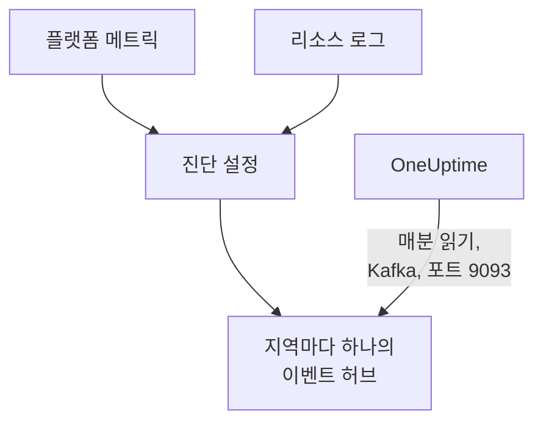

# Azure Monitor 메트릭 및 로그 스트리밍

연결된 Azure 구독은 Azure Monitor 메트릭과 리소스 로그를 OneUptime으로 스트리밍할 수 있습니다. 진단 설정이 이를 구독의 이벤트 허브로 보내고, OneUptime이 이벤트 허브를 매분 읽습니다. 핵심 메트릭은 연결의 다음 읽기를 기다리지 않고 Azure Monitor가 수집한 뒤 몇 분 안에 도착하며, 리소스 로그는 OneUptime 로그로 도착해 각각 해당 리소스 아래에 보관됩니다. Azure Cloud Shell에서 명령 하나로 설정하며, 계속 실행해 둘 것은 없습니다.

:::cards
- [작동 방식](#작동-방식): 진단 설정이 각 지역의 이벤트 허브로 보내고, OneUptime이 이를 읽습니다.
- [스트리밍 설정](#스트리밍-설정): 스트리밍할 대상을 고르고, 읽기를 켜고, 명령 하나를 실행합니다.
- [도착하는 것](#도착하는-것): 메트릭은 측정 대상 리소스에, 로그는 출처 리소스에 도착합니다.
- [명령이 만드는 것](#명령이-만드는-것): 명령이 구독에 만드는 모든 리소스와 권한.
- [스트리밍 중지](#스트리밍-중지): 읽기를 멈춘 다음, 명령이 만든 것을 삭제합니다.
:::

## 작동 방식



- **지역마다 하나의 이벤트 허브.** 진단 설정은 리소스 자체의 지역에 있는 이벤트 허브로만 보냅니다. 그래서 명령은 리소스가 있는 각 지역에 Event Hubs 네임스페이스를 하나의 리소스 그룹 안에 만들고, 각 리소스의 진단 설정을 해당 지역의 이벤트 허브로 향하게 합니다.
- **OneUptime이 읽습니다.** Azure Monitor는 이벤트 허브, 스토리지 계정, Log Analytics 작업 영역으로만 보내고 사용자의 주소로는 보내지 않습니다. OneUptime이 읽는 이벤트 허브라면 사용자 쪽에서 아무것도 실행할 필요가 없습니다. OneUptime은 연결 자체의 앱으로 로그인하며, 이 앱은 해당 이벤트 허브만 읽을 수 있습니다.
- **읽기는 스트리밍된 메트릭을 스트림에 맡깁니다.** 스트림이 한 지역의 리소스 유형 핵심 메트릭을 전달하는 동안 연결의 읽기는 이를 기록하지 않으므로, 데이터 포인트가 두 번 집계되지 않습니다. 읽기는 리소스와 그 상태, 변경 사항을 계속 찾아내며, 이벤트 없이 15분이 지나면 메트릭을 다시 맡습니다.
- **OneUptime이 읽지 못하는 동안에도 잃는 것은 없습니다.** 이벤트는 이벤트 허브가 보관하는 동안 OneUptime이 읽을 때까지 이벤트 허브에서 기다리며, OneUptime은 각 파티션을 어디까지 읽었는지 기억해 멈춘 곳에서 이어서 읽습니다.

## 시작하기 전에

- **연결된 Azure 구독.** 먼저 **클라우드 → 연결**에서 연결하세요. [클라우드 계정 연결](/docs/telemetry/cloud-accounts)을 참고하세요.
- **프로젝트 소유자 또는 관리자.** 이들만 읽기를 켜고 스트리밍을 중지할 수 있습니다.
- **Azure Cloud Shell**. 구독의 **Owner**이거나 **User Access Administrator**이기도 한 **Contributor**로 로그인하세요. 명령은 리소스 그룹과 역할 할당을 만들고 진단 설정을 변경합니다.
- **자체 호스팅 OneUptime이라면 Azure로 나가는 경로.** OneUptime은 각 네임스페이스를 `<namespace>.servicebus.windows.net`의 9093 포트로 읽으며, 네임스페이스는 인터넷에서 오는 연결을 받습니다.

## 스트리밍 설정

:::steps
### 스트리밍 대화 상자 열기

**클라우드 → 연결**로 이동해 Azure 구독의 행에서 **메트릭 및 로그 스트리밍**을 선택합니다.

### 스트리밍할 대상 고르기

**메트릭**은 모든 리소스의 모든 핵심 메트릭을 1분 단위로 스트리밍합니다. OneUptime이 각 리소스를 차트로 보여 주고 판단하는 기준이 되는 메트릭입니다. **메트릭 및 로그**는 각 리소스 자체의 로그(Azure가 그 리소스에 대해 보관하는 모든 범주)를 더하고, **로그**는 리소스 로그만 스트리밍합니다.

### 읽기 켜기

**읽기 켜기**를 선택합니다. OneUptime은 매분 이벤트 허브를 찾고, 명령이 만들 때까지 기다립니다.

### Azure Cloud Shell에서 명령 실행하기

명령을 복사해 Azure Cloud Shell에서 실행하고 끝날 때까지 기다립니다. 이벤트 허브를 만든 각 지역, 그곳으로 보내는 리소스 수, 제외한 리소스와 Azure가 밝힌 이유가 표시됩니다.

### 첫 이벤트 기다리기

대화 상자는 몇 초마다 무엇이 도착했는지 확인합니다. Azure는 명령이 끝난 뒤 몇 분 안에 보내기 시작하며, 그러면 대화 상자에 무엇이 어디에서 왔는지 표시되고 연결의 행에는 **스트리밍 중**이 표시됩니다.
:::

**추가 필드**에 나머지가 있습니다.

| 필드 | 하는 일 |
| --- | --- |
| **구독** | 스트리밍할 구독. 처음에는 연결이 읽는 구독입니다. 첫 번째 구독에 이벤트 허브가 있으며, OneUptime은 그곳에서 읽습니다. 최대 50개 |
| **다른 방법으로 설정** | Terraform이나 포털로 설정할 때 쓰는, 명령이 사용하는 이름 |

첫 번째 구독이 OneUptime이 이벤트 허브를 읽는 구독이 아니면 대화 상자가 알려 줍니다. 명령을 실행하기 전에 **그곳에서 읽기**를 선택하세요.

## 도착하는 것

| 무엇이 | 어디에 도착하는지 |
| --- | --- |
| 핵심 메트릭 | 측정 대상 클라우드 리소스에, 연결의 읽기가 기록하는 것과 같은 시계열로 |
| 리소스 로그 | 로그 탐색기의 연결 텔레메트리 서비스 아래에, 구독, 지역, 범주를 속성으로 |
| OneUptime이 아는 리소스의 로그 | 그 리소스에도. 클라우드에 있는 그 페이지에 **로그** 탭이 생깁니다 |

스트림은 연결이 1분 단위로 읽는 핵심 메트릭을 전달합니다. 스토리지 계정의 사용 용량처럼 더 긴 간격으로 읽는 메트릭은 읽기에 남습니다. 로그는 리소스의 ARM ID로 해당 리소스 아래에 보관되며 `cloud.resource_id`로 전달되고, 범주, 작업, 결과, 속성은 `azure.category`처럼 속성으로 남습니다.

가상 머신, 확장 집합, 디스크, 네트워크 인터페이스, 가상 네트워크, 프라이빗 엔드포인트, NAT 게이트웨이, DNS 영역, App Service 계획은 자체 리소스 로그를 보내지 않으므로, 그 페이지에는 **로그** 탭이 없습니다. 스토리지 계정의 로그는 그 서비스들의 로그이고, 컨테이너 앱의 로그는 그 환경의 로그입니다.

## 명령이 만드는 것

리소스 그룹의 이름은 `oneuptime-stream-` 뒤에 연결 ID의 처음 8자를 붙인 것입니다. OneUptime에 리소스에 대한 접근 권한은 주지 않습니다. 연결의 앱은 이벤트 허브를 읽을 수 있을 뿐입니다.

| 리소스 | 할 수 있는 일 |
| --- | --- |
| 첫 번째 구독의 리소스 그룹 `oneuptime-stream-<suffix>` | 이벤트 허브를 담으며, 연결 ID가 `oneuptime-connection` 태그로 붙습니다 |
| 각 지역의 Event Hubs 네임스페이스 `oneuptime-<suffix>-<region>`, Standard 계층, 처리량 단위 1 | 해당 지역의 진단 설정이 보내는 것을 받습니다 |
| 각 네임스페이스의 이벤트 허브 `oneuptime`, 파티션 2 | OneUptime이 읽을 때까지 이벤트를 보관합니다 |
| 연결의 앱에 부여하는 **Azure Event Hubs Data Receiver** 역할, 리소스 그룹에만 적용 | 앱이 이벤트 허브만 읽을 수 있게 합니다 |
| 각 리소스의 진단 설정 `OneUptime-<suffix>` | 리소스의 메트릭, 로그 또는 둘 다를 해당 지역의 이벤트 허브로 보냅니다 |

Front Door처럼 전역 지역에 있는 리소스는 첫 번째 지역의 이벤트 허브로 보냅니다. Azure가 메트릭만 또는 로그만 보관하는 리소스는 가진 것으로 설정되며, Azure가 허용하는 최대치인 진단 설정 5개를 이미 가진 리소스는 제외됩니다. Azure는 각 네임스페이스의 처리량 단위를 시간 단위로, 진단 설정이 보내는 이벤트와 함께 청구합니다.

## 스트리밍 중지

:::steps
### 읽기 멈추기

**클라우드 → 연결**에서 구독의 행에 있는 **스트리밍 중지**를 선택합니다. OneUptime은 즉시 이벤트 허브 읽기를 멈추고, 연결은 모든 메트릭을 다시 일정에 따라 읽습니다. 이미 읽은 것은 남습니다.

### 명령이 만든 것 삭제하기

이벤트 허브와 진단 설정은 삭제될 때까지 Azure에 남고, Azure는 그에 대한 요금을 청구합니다. 대화 상자에 명령이 표시됩니다. 이 명령은 각 리소스의 진단 설정을 삭제한 다음, 리소스 그룹이 어느 구독에 있든 그 리소스 그룹을 삭제합니다.

```bash
oneuptime_stream_stop() {
  local SUB ID N=0
  for SUB in '11111111-aaaa-4aaa-8aaa-111111111111' '22222222-bbbb-4bbb-8bbb-222222222222'; do
    while IFS= read -r ID; do
      if [ -z "$ID" ]; then continue; fi
      az monitor diagnostic-settings delete --name OneUptime-6f1c3a2e --resource "$ID" --output none 2> /dev/null &
      N=$((N + 1))
      if [ $((N % 4)) -eq 0 ]; then wait; fi
    done < <(az resource list --subscription "$SUB" --query "[].id" --output tsv)
  done
  wait
  for SUB in '11111111-aaaa-4aaa-8aaa-111111111111' '22222222-bbbb-4bbb-8bbb-222222222222'; do
    if [ "$(az group exists --subscription "$SUB" --name oneuptime-stream-6f1c3a2e 2> /dev/null)" = true ]; then
      az group delete --subscription "$SUB" --name oneuptime-stream-6f1c3a2e --yes --no-wait && echo "Deleting oneuptime-stream-6f1c3a2e in $SUB."
    fi
  done
}
oneuptime_stream_stop
```
:::

스트리밍할 대상을 바꾸려면 **메트릭 및 로그 스트리밍**을 다시 열고 스트리밍할 대상을 고른 뒤 새 명령을 실행하세요. 첫 실행이 만든 것을 업데이트하며, 아무것도 두 번 만들지 않습니다.

## 다른 방법으로 설정

Terraform이나 포털로, 명령이 만드는 것을 다음 이름으로 만드세요.

| 설정 | 값 |
| --- | --- |
| 리소스 그룹 | `oneuptime-stream-<suffix>`, OneUptime이 이벤트 허브를 읽는 구독에 |
| Event Hubs 네임스페이스 | `oneuptime-<suffix>-<region>`, 스트리밍할 리소스가 있는 지역마다 하나씩 |
| 이벤트 허브 | `oneuptime`, 각 네임스페이스에 |
| 진단 설정 | 각 리소스의 `OneUptime-<suffix>`, 해당 지역의 이벤트 허브로, 네임스페이스의 `RootManageSharedAccessKey` 규칙 사용 |
| 역할 | 연결의 앱에 부여하는 **Azure Event Hubs Data Receiver**, 리소스 그룹에 적용 |

그런 다음 그 구독을 **구독**의 맨 앞에 두고 읽기를 켜세요.

## 문제 해결

:::details 대화 상자가 계속 첫 이벤트를 기다립니다
명령이 끝났는지, 그리고 한 지역의 이벤트 허브가 준비되었다고 표시했는지 확인하세요. `az eventhubs namespace list --resource-group oneuptime-stream-6f1c3a2e`로 네임스페이스 목록을 볼 수 있습니다. 진단 설정은 Azure Monitor가 가진 것만 보내므로, 아무 일도 하지 않는 리소스는 거의 보내지 않습니다. 새 역할이 적용되기까지 몇 분 걸릴 수 있으며, 그동안 읽기에는 이벤트가 보이지 않습니다.
:::

:::details 연결에 스트림 실패가 표시됩니다
대화 상자와 행의 도구 설명에 이유가 표시됩니다. 앱에 이벤트 허브를 읽을 권한이 없으면 명령을 다시 실행하세요. 앱에 역할을 다시 부여합니다. OneUptime이 이벤트 허브에 접근하지 못했다면, 네임스페이스가 인터넷에서 오는 연결을 받는지, 자체 호스팅 OneUptime이 9093 포트에 접근할 수 있는지 확인하세요.
:::

:::details 명령이 리소스를 제외했습니다
제외한 리소스가 각각 Azure가 밝힌 이유와 함께 표시됩니다. 진단 설정이 없는 유형의 리소스는 아무것도 보내지 않으며, 진단 설정 5개를 이미 가진 리소스는 먼저 그중 하나를 삭제해야 합니다. 그런 다음 명령을 다시 실행하세요.
:::

## 다음 단계

:::cards
- [클라우드 계정 연결](/docs/telemetry/cloud-accounts): 연결이 무엇을 얼마나 자주 읽는지.
- [Google Cloud 로그 스트리밍](/docs/telemetry/cloud-streaming-google-cloud): Google Cloud 프로젝트의 로그를 Pub/Sub로 푸시합니다.
- [CloudWatch 메트릭 및 로그 스트리밍](/docs/telemetry/cloud-streaming): AWS 계정의 것을 Amazon Data Firehose로 전달합니다.
- [로그 탐색기](/docs/telemetry/logs-explorer): 스트림이 전달한 것을 검색하고 필터링합니다.
:::
