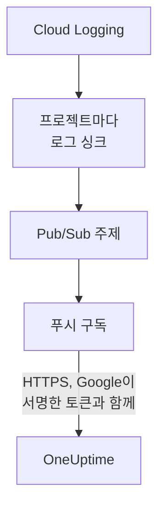

# Google Cloud 로그 스트리밍

연결된 Google Cloud 프로젝트는 로그가 기록되는 즉시 OneUptime으로 스트리밍할 수 있습니다. Cloud Logging이 로그 싱크를 통해 로그를 Pub/Sub 주제로 보내고, 주제의 푸시 구독이 각 항목을 1분 안에 OneUptime으로 전달하며, 각 항목은 OneUptime 로그로 해당 리소스 아래에 보관됩니다. Google Cloud Shell에서 명령 하나로 설정하며, 계속 실행해 둘 것은 없습니다. Cloud Monitoring에는 메트릭을 푸시하는 내보내기가 없으므로, 연결은 계속 일정에 따라 메트릭을 읽습니다.

:::cards
- [작동 방식](#작동-방식): 각 프로젝트의 로그 싱크, 주제, 그리고 그 푸시 구독.
- [스트리밍 설정](#스트리밍-설정): 로그를 고르고, 스트림 키를 만들고, 명령 하나를 실행합니다.
- [도착하는 것](#도착하는-것): 로그는 출처 리소스에 도착합니다.
- [명령이 만드는 것](#명령이-만드는-것): 명령이 프로젝트에 만드는 모든 리소스와 권한.
- [스트리밍 중지](#스트리밍-중지): 키를 끈 다음, 명령이 만든 것을 삭제합니다.
:::

## 작동 방식



- **프로젝트마다 로그 싱크.** 각 프로젝트의 싱크는 필터와 일치하는 항목을 연결 자체의 서비스 계정이 속한 프로젝트의 Pub/Sub 주제 하나로 보냅니다.
- **푸시마다 두 번의 확인.** Pub/Sub는 푸시 전용으로 만든 서비스 계정의 OpenID Connect 토큰에 서명하며, 토큰의 대상(audience)은 연결의 스트림 키입니다. OneUptime은 Google이 그 서비스 계정에 대해 토큰에 서명했고 키가 연결의 키일 때만 푸시를 받습니다. 키는 연결을, 즉 프로젝트를 가리키며, 푸시의 내용이 어디에 기록될지 정하지 않습니다. OneUptime은 키의 SHA-256만 보관합니다.
- **OneUptime이 받지 못하는 동안에도 잃는 것은 없습니다.** Pub/Sub는 거부된 항목을 시도 사이에 10초에서 최대 10분까지 기다리며 다시 보내고, 하루 동안 보관합니다.

## 시작하기 전에

- **연결된 Google Cloud 프로젝트.** 먼저 **클라우드 → 연결**에서 연결하세요. [클라우드 계정 연결](/docs/telemetry/cloud-accounts)을 참고하세요.
- **프로젝트 소유자 또는 관리자.** 이들만 스트림 키를 만들고 스트리밍을 중지할 수 있습니다.
- **Google Cloud Shell**. 프로젝트의 **Owner**이거나, 그 프로젝트들에서 서비스 계정, Pub/Sub 주제, 로그 싱크를 만들 수 있는 사람으로 로그인하세요.
- **자체 호스팅 OneUptime이라면 HTTPS 주소.** Pub/Sub는 Google이 신뢰하는 인증서를 쓰는 `https://` 주소로만 푸시하며, 주소는 Google Cloud에서 접근할 수 있어야 합니다.

## 스트리밍 설정

:::steps
### 스트리밍 대화 상자 열기

**클라우드 → 연결**로 이동해 Google Cloud 프로젝트의 행에서 **로그 스트리밍**을 선택합니다.

### 스트리밍할 로그 고르기

**경고 및 오류**는 심각도가 `WARNING` 이상인 모든 항목을 스트리밍합니다. 모든 요청이 아니라 문제가 생긴 것만입니다. **모든 로그**는 모든 읽기를 기록하고 프로젝트가 기록하는 다른 모든 것을 넘어설 수도 있는 Data Access 감사 로그를 제외하고 모든 항목을 스트리밍합니다. **직접 작성한 필터**는 **필터** 필드에 쓴 Cloud Logging 쿼리와 일치하는 항목을 스트리밍합니다.

### 스트림 키 만들기

**스트림 키 만들기**를 선택합니다. 키는 이번 한 번만 명령 안에 표시됩니다. OneUptime은 그 SHA-256만 보관합니다.

### Google Cloud Shell에서 명령 실행하기

명령을 복사해 Google Cloud Shell에서 실행하고 끝날 때까지 기다립니다. 싱크를 설정한 각 프로젝트가 표시되며, Google이 거부한 첫 단계에서 Google이 밝힌 이유와 함께 멈춥니다.

### 첫 푸시 기다리기

대화 상자는 몇 초마다 무엇이 도착했는지 확인합니다. 프로젝트가 필터와 일치하는 항목을 기록하면 Pub/Sub는 1분 안에 그것을 푸시하며, 그러면 대화 상자에 무엇이 어디에서 왔는지 표시되고 연결의 행에는 **스트리밍 중**이 표시됩니다.
:::

**추가 필드**에 나머지가 있습니다.

| 필드 | 하는 일 |
| --- | --- |
| **프로젝트** | 로그를 스트리밍할 프로젝트. 처음에는 연결이 읽는 프로젝트입니다. 주제는 연결의 서비스 계정이 속한 프로젝트에 만들어집니다. 최대 100개 |
| **다른 방법으로 설정** | Terraform이나 콘솔로 설정할 때 쓰는 푸시 엔드포인트, 푸시 서비스 계정, 키 |

## 도착하는 것

| 무엇이 | 어디에 도착하는지 |
| --- | --- |
| 로그 | 로그 탐색기의 연결 텔레메트리 서비스 아래에, 프로젝트, 지역, 로그 이름을 속성으로 |
| OneUptime이 아는 리소스의 로그 | 그 리소스에도. 클라우드에 있는 그 페이지에 **로그** 탭이 생깁니다 |

각 로그는 항목의 시각을 나노초까지, 심각도, 트레이스와 스팬, HTTP 요청을 OpenTelemetry 시맨틱 규칙의 이름으로 유지합니다. 모니터링 대상 리소스가 VM(`gce_instance`), Cloud Run 서비스(`cloud_run_revision`), Cloud SQL 인스턴스(`cloudsql_database`)처럼 OneUptime이 메트릭을 읽는 종류이면 로그는 그 리소스 아래에 보관되고, 리소스의 ID를 `cloud.resource_id`로 전달합니다. 외부 부하 분산기의 요청 로그는 `http_load_balancer` 아래에 기록되지만, 메트릭이 도착하는 그 URL 맵의 `https_lb_rule` 아래에 보관됩니다.

인스턴스 그룹의 로그는 그 VM들의 로그이므로, 그 페이지에는 **로그** 탭이 없습니다. 다른 종류의 항목도 프로젝트 아래에 그대로 스트리밍됩니다.

## 명령이 만드는 것

만드는 리소스의 이름에는 연결 ID의 처음 8자가 붙습니다. OneUptime에 프로젝트에 대한 접근 권한은 주지 않으며, 항목은 밖으로 나가기만 합니다.

| 리소스 | 할 수 있는 일 |
| --- | --- |
| 연결의 서비스 계정이 속한 프로젝트의 서비스 계정 `oneuptime-push-<suffix>` | 역할이 없습니다. Pub/Sub가 이 계정을 위해 푸시의 토큰에 서명합니다 |
| Pub/Sub 서비스 에이전트에 부여하는 **Service Account OpenID Connect Identity Token Creator** 역할, 그 서비스 계정에만 적용 | Pub/Sub가 그 토큰만 만들 수 있게 합니다 |
| Pub/Sub 주제 `oneuptime-stream-<suffix>` | 싱크가 보내는 항목을 담습니다 |
| 그 푸시 구독 `oneuptime-stream-<suffix>-push` | 각 항목을 60초의 확인 기한으로 OneUptime에 푸시하고, 푸시하지 못한 것은 하루 동안 보관합니다 |
| 각 프로젝트의 로그 싱크 `oneuptime-stream-<suffix>` | 필터와 일치하는 항목을 주제로 보냅니다 |
| 각 싱크의 작성자에게 부여하는 **Pub/Sub Publisher** 역할, 주제에만 적용 | 싱크가 주제에만 게시할 수 있게 합니다 |

명령은 주제의 프로젝트에서 Pub/Sub와 Cloud Logging API가 꺼져 있으면 켭니다. Google은 전달된 로그에 대해 Pub/Sub 요금을 청구하므로, 필요한 로그만 스트리밍하세요.

## 스트리밍 중지

:::steps
### 키 끄기

**클라우드 → 연결**에서 프로젝트의 행에 있는 **스트리밍 중지**를 선택합니다. 연결의 모든 스트림 키가 즉시 작동을 멈추고, OneUptime은 Pub/Sub가 푸시하는 것을 거부합니다. 이미 전달된 것은 남습니다.

### 명령이 만든 것 삭제하기

싱크, 주제, 그 푸시 구독은 삭제될 때까지 Google Cloud에 남고, Pub/Sub는 계속 푸시합니다. 대화 상자에 연결이 읽는 프로젝트에 대한 명령이 표시됩니다.

```bash
for SOURCE in 'acme-prod' 'acme-data'; do
  gcloud logging sinks delete oneuptime-stream-6f1c3a2e --project "$SOURCE" --quiet
done
gcloud pubsub subscriptions delete oneuptime-stream-6f1c3a2e-push --project 'acme-prod' --quiet
gcloud pubsub topics delete oneuptime-stream-6f1c3a2e --project 'acme-prod' --quiet
gcloud iam service-accounts delete 'oneuptime-push-6f1c3a2e@acme-prod.iam.gserviceaccount.com' --project 'acme-prod' --quiet
```
:::

스트리밍할 로그를 바꾸려면 **로그 스트리밍**을 다시 열고 **새 키 만들기**를 선택한 뒤 새 명령을 실행하세요. 대체된 키는 24시간 동안 계속 작동하므로, 구독이 업데이트되는 동안 푸시가 거부되지 않습니다. 대체된 키는 최대 3개까지 동시에 작동합니다.

## 다른 방법으로 설정

Pub/Sub 주제에 다음 값으로 푸시 구독을 추가하고, Pub/Sub 서비스 에이전트가 푸시 서비스 계정의 토큰을 만들 수 있게 하세요.

| 설정 | 값 |
| --- | --- |
| 푸시 엔드포인트 | `https://oneuptime.com/telemetry/gcp-pubsub/v1/logs` |
| 인증 | `oneuptime-push-<suffix>@<project>.iam.gserviceaccount.com`의 OpenID Connect 토큰 |
| 대상(audience) | 스트림 키 |
| 페이로드 | 래핑됨(따로 지정하지 않을 때 Pub/Sub가 보내는 방식) |
| 확인 기한 | 60초 |
| 메시지 보관 기간 | 1일 |

그런 다음 로그 싱크로 각 프로젝트의 로그를 주제로 보내고, 각 싱크의 작성자에게 주제에 대한 **Pub/Sub Publisher**를 부여하세요. 자체 호스팅 OneUptime에서는 `https://oneuptime.com`을 사용 중인 OneUptime의 HTTPS 주소로 바꾸세요.

OneUptime은 Pub/Sub가 기대하는 방식으로 각 푸시에 응답합니다.

| 응답 | 언제 | Pub/Sub의 동작 |
| --- | --- | --- |
| `204` | 항목을 받았거나, 이전에 받았거나, 메시지가 로그 항목이 아님 | 다음으로 넘어감 |
| `400` | OneUptime이 읽을 수 있는 Pub/Sub 푸시가 아님 | 매번 더 오래 기다리며 하루 동안 다시 푸시함 |
| `401` | 토큰이 푸시 서비스 계정에 대해 Google이 서명한 것이 아니거나, 대상이 연결의 키가 아님 | 매번 더 오래 기다리며 하루 동안 다시 푸시함 |
| `402` | 프로젝트에 텔레메트리 요금을 청구할 수 없음 | 매번 더 오래 기다리며 하루 동안 다시 푸시함 |
| `403` | 연결이 꺼져 있거나, 프로젝트가 텔레메트리를 받을 수 없음 | 매번 더 오래 기다리며 하루 동안 다시 푸시함 |
| `413` | 요청이 1MiB를 넘거나, 항목이 512KiB를 넘음 | 매번 더 오래 기다리며 하루 동안 다시 푸시함 |
| `429` | 연결의 구독이 1분에 12,000개가 넘는 항목을 푸시함 | 매번 더 오래 기다리며 하루 동안 다시 푸시함 |
| `503` | OneUptime이 그 순간 토큰을 확인하거나 항목을 대기열에 넣지 못함 | 매번 더 오래 기다리며 하루 동안 다시 푸시함 |

## 문제 해결

:::details 대화 상자가 계속 첫 푸시를 기다립니다
명령이 멈추지 않고 끝났는지, 그리고 프로젝트가 필터와 일치하는 항목을 기록했는지 확인하세요. **경고 및 오류**에서는 조용한 프로젝트가 아무것도 보내지 않습니다. `gcloud pubsub subscriptions describe oneuptime-stream-6f1c3a2e-push --project acme-prod`로 구독의 엔드포인트를 볼 수 있습니다. 자체 호스팅 OneUptime이라면 Google Cloud가 그 주소에 HTTPS로 접근하는지 확인하세요.
:::

:::details 연결에 스트림 거부됨이 표시됩니다
대화 상자와 행의 도구 설명에 이유가 표시됩니다. 키가 잘못되었다면 구독이 더 이상 작동하지 않는 키로 푸시하는 것입니다. 새 키를 만들고 명령을 다시 실행하세요. 푸시 서비스 계정에 대해 서명되지 않은 푸시는 구독이 다른 계정으로 서명하거나 Pub/Sub가 그 계정으로 서명할 수 없다는 뜻입니다. 명령을 다시 실행하세요.
:::

:::details 리소스의 로그가 그 페이지에 표시되지 않습니다
페이지에는 Cloud Logging이 그 리소스의 모니터링 대상 리소스 아래에, 메트릭과 같은 라벨로 보관한 로그가 표시됩니다. 컨테이너의 로그처럼 워크로드가 다른 리소스 아래에 기록하는 로그는 프로젝트 아래에만 스트리밍됩니다.
:::

## 다음 단계

:::cards
- [클라우드 계정 연결](/docs/telemetry/cloud-accounts): 연결이 무엇을 얼마나 자주 읽는지.
- [Azure Monitor 메트릭 및 로그 스트리밍](/docs/telemetry/cloud-streaming-azure): Azure 구독의 것을 이벤트 허브에서 읽습니다.
- [CloudWatch 메트릭 및 로그 스트리밍](/docs/telemetry/cloud-streaming): AWS 계정의 것을 Amazon Data Firehose로 전달합니다.
- [로그 탐색기](/docs/telemetry/logs-explorer): 스트림이 전달한 것을 검색하고 필터링합니다.
:::
