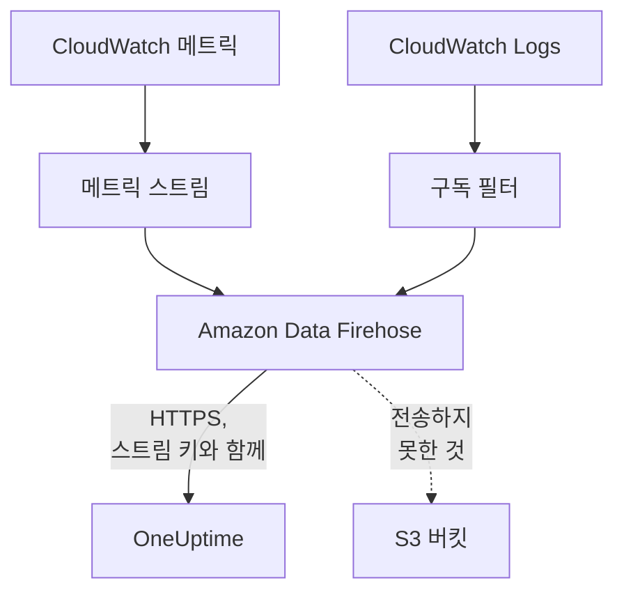

# CloudWatch 메트릭 및 로그 스트리밍

연결된 AWS 계정은 Amazon Data Firehose를 통해 CloudWatch 메트릭과 로그를 OneUptime으로 스트리밍할 수 있습니다. 그러면 메트릭은 연결의 다음 읽기를 기다리지 않고 CloudWatch에 들어온 지 몇 분 만에 도착하고, CloudWatch Logs는 OneUptime 로그로 도착해 각각 해당 리소스 아래에 정리됩니다. AWS CloudShell에서 명령 하나만 실행하면 설정되며, 따로 실행해 둘 것은 없습니다.

:::cards
- [작동 방식](#작동-방식): 각 리전의 메트릭 스트림과 로그 구독을 Firehose가 전송합니다.
- [스트리밍 설정](#스트리밍-설정): 스트리밍할 대상을 고르고, 스트림 키를 만들고, 명령 하나를 실행합니다.
- [도착하는 것](#도착하는-것): 메트릭은 측정하는 리소스에, 로그는 보낸 리소스에 도착합니다.
- [스택이 만드는 것](#스택이-만드는-것): 명령이 계정에 만드는 모든 리소스와 권한입니다.
- [스트리밍 중지](#스트리밍-중지): 키를 끈 다음 스택을 삭제합니다.
:::

## 작동 방식



- **리전마다 스택 하나.** 명령은 스트리밍하는 각 리전에 CloudFormation 스택을 배포합니다. 스택의 메트릭 스트림과 로그 구독 필터가 모든 것을 두 개의 Firehose 스트림에 넘기고, Firehose가 HTTPS로 OneUptime에 전송합니다.
- **스트림 키가 누구의 것인지 알려 줍니다.** Firehose는 전송할 때마다 연결의 스트림 키를 보냅니다. 키는 연결을, 따라서 프로젝트를 가리킵니다. 전송 내용이 저장 위치를 정하는 일은 없습니다. OneUptime은 키의 SHA-256만 보관합니다.
- **읽기는 스트리밍된 메트릭을 스트림에 맡깁니다.** 스트림이 어떤 리전의 네임스페이스를 전송하는 동안에는 연결의 읽기가 그 네임스페이스의 메트릭을 기록하지 않으므로, 데이터 포인트가 두 번 세어지지 않습니다. 읽기는 리소스와 그 상태, 변경 사항을 계속 찾고, 전송 없이 15분이 지나면 네임스페이스를 다시 맡습니다.
- **OneUptime이 받지 못하는 동안에도 잃는 것은 없습니다.** Firehose는 거부된 배치를 최대 한 시간 동안 다시 보내고, 그 뒤에는 스택의 S3 버킷에 30일 동안 보관합니다.

## 시작하기 전에

- **연결된 AWS 계정.** 먼저 **클라우드 → 연결**에서 연결하세요. [클라우드 계정 연결](/docs/telemetry/cloud-accounts)을 참고하세요.
- **프로젝트 소유자 또는 관리자.** 이들만 스트림 키를 만들고 스트리밍을 중지할 수 있습니다.
- **그 계정의 AWS CloudShell**. CloudFormation 스택과 IAM 역할을 만들 수 있는 사용자로 로그인해야 합니다.
- **자체 호스팅 OneUptime이라면 HTTPS 주소.** Firehose는 포트 443의 `https://` 주소로만, AWS가 신뢰하는 인증서로 전송하며, 주소는 AWS에서 접근할 수 있어야 합니다.

## 스트리밍 설정

:::steps
### 스트리밍 대화 상자 열기

**클라우드 → 연결**로 이동한 뒤, AWS 계정의 행에서 **메트릭 및 로그 스트리밍**을 선택합니다.

### 스트리밍할 대상 고르기

**메트릭**은 모든 리소스의 모든 핵심 메트릭을 1분마다 스트리밍합니다. OneUptime이 각 리소스를 차트로 보여 주고 평가하는 기준 메트릭입니다. **메트릭 및 로그**는 CloudWatch Logs를 더하고, **로그**는 CloudWatch Logs만 스트리밍합니다.

로그는 **로그 그룹**을 한 줄에 하나씩, 옆의 **지역**에 있는 이름이나 자체 리전의 ARN으로 입력하거나, **계정의 모든 로그 그룹(새 로그 그룹 포함)** 옵션을 선택합니다. 명령 하나는 이름으로 최대 50개의 로그 그룹을, 최대 10개 리전에서 구독합니다.

### 스트림 키 만들기

**스트림 키 만들기**를 선택합니다. 키는 이번 한 번만 명령 안에 표시되며, OneUptime은 키의 SHA-256만 보관합니다.

### AWS CloudShell에서 명령 실행하기

명령을 복사해 AWS CloudShell에서 실행하고 끝날 때까지 기다립니다. 명령은 템플릿을 `oneuptime-stream.json`에 쓰고, 다시는 표시되지 않는 매개변수로 키를 넘겨 각 리전에 배포합니다.

### 첫 전송 기다리기

대화 상자는 몇 초마다 무엇이 도착했는지 확인합니다. Firehose는 명령이 끝나고 몇 분 안에 전송하며, 그러면 대화 상자가 무엇이 어디에서 왔는지 알려 주고 연결의 행에는 **스트리밍 중**이 표시됩니다.
:::

**추가 필드**에 나머지가 있습니다.

| 필드 | 하는 일 |
| --- | --- |
| **핵심 메트릭만이 아닌 모든 메트릭** | CloudWatch에 있는 계정의 모든 메트릭(사용자 지정 메트릭 포함)을 스트리밍합니다. AWS는 스트림이 보내는 메트릭 업데이트마다 요금을 청구하므로 비용이 몇 배로 늘 수 있습니다 |
| **리전** | 스트리밍할 위치입니다. 처음에는 연결이 리소스를 찾은 리전이 들어 있습니다. 비워 두면 명령이 AWS CloudShell 자체의 리전에서 스트리밍합니다. 최대 30개입니다 |
| **다른 방법으로 설정** | Terraform이나 콘솔로 스트림을 설정할 때 쓰는 메트릭 및 로그 엔드포인트와 키입니다 |

**템플릿 다운로드**는 명령이 배포하는 템플릿을 저장해, 원하는 방식으로 배포할 수 있게 합니다.

## 도착하는 것

| 무엇 | 도착하는 곳 |
| --- | --- |
| 메트릭 | 측정하는 클라우드 리소스에, 연결의 읽기가 붙이는 것과 같은 이름과 속성으로 도착합니다 |
| 로그 | 로그 탐색기에, 연결의 텔레메트리 서비스 아래에서 계정, 리전, 로그 그룹을 속성으로 하여 도착합니다 |
| AWS가 리소스 이름을 붙인 로그 그룹의 로그 | 그 리소스에도 도착합니다. 클라우드의 해당 리소스 페이지에 **로그** 탭이 생깁니다 |

AWS가 리소스 이름을 따서 이름을 붙인 로그 그룹은 그 리소스 아래에 정리됩니다.

| 로그 그룹 | 리소스 유형 |
| --- | --- |
| `/aws/lambda/<function>` | `AWS::Lambda::Function` |
| `/aws/rds/instance/<instance>/<log>` | `AWS::RDS::DBInstance` |
| `/aws/rds/cluster/<cluster>/<log>` | `AWS::RDS::DBCluster` |
| `/aws/docdb/<cluster>/<log>` | `AWS::DocDB::DBCluster` |
| `/aws/neptune/<cluster>/<log>` | `AWS::Neptune::DBCluster` |
| `/aws/redshift/cluster/<cluster>/<log>` | `AWS::Redshift::Cluster` |
| `/aws/OpenSearchService/domains/<domain>/<log>` | `AWS::OpenSearchService::Domain` |
| `/aws/aes/domains/<domain>/<log>` | `AWS::OpenSearchService::Domain` |
| `/aws/apprunner/<service>/<service-id>/<log>` | `AWS::AppRunner::Service` |
| `/aws/elasticbeanstalk/<environment>/<log>` | `AWS::ElasticBeanstalk::Environment` |
| `/aws/ecs/containerinsights/<cluster>/performance` | `AWS::ECS::Cluster` |

각 로그는 리소스의 ID를 `cloud.resource_id`로 지니며, Lambda 함수의 로그는 `faas.name`도 지니므로 Serverless의 함수에도 표시됩니다. 다른 이름의 로그 그룹도 그 계정과 리전 아래에서 그대로 스트리밍됩니다. 로그의 심각도는 Lambda가 쓰는 방식대로 메시지에 적힌 심각도입니다.

## 스택이 만드는 것

스택 이름은 `OneUptimeStream-` 뒤에 연결 ID의 처음 8자를 붙인 것입니다. 스택은 OneUptime에 계정에 대한 어떤 접근 권한도 주지 않습니다. 데이터는 밖으로 나가기만 합니다.

| 리소스 | 할 수 있는 일 |
| --- | --- |
| OpenTelemetry 1.0 형식의 CloudWatch 메트릭 스트림 | 메트릭용 Firehose 스트림에만 레코드를 넣습니다 |
| 로그 구독 필터, 또는 모든 로그 그룹에 대한 계정 전체 구독 정책 하나 | 로그용 Firehose 스트림에만 레코드를 넣습니다 |
| 두 개의 Firehose 스트림, `OneUptime-<suffix>-metrics`와 `OneUptime-<suffix>-logs` | GZIP, 1 MiB 또는 60초 버퍼, 한 시간의 재시도로 OneUptime에 전송하고, 전송하지 못한 것은 버킷에 씁니다 |
| 전송하지 못한 것을 위한 S3 버킷 | 퍼블릭 액세스 차단, 암호화, 30일 뒤 비움, 스택을 삭제해도 남습니다 |
| 로그 그룹 `/aws/kinesisfirehose/OneUptime-<suffix>` | Firehose 자체의 전송 오류를 담으며, 스트리밍되지 않습니다 |
| 세 개의 IAM 역할 | 각각 이 계정의 AWS 서비스 하나만 신뢰하고, 위의 행에 적힌 것만 허용합니다 |

AWS는 메트릭 스트림에 대해서는 보낸 메트릭 업데이트마다, Firehose에 대해서는 전송한 양에 따라 요금을 청구합니다. 필요한 메트릭과 로그 그룹만 스트리밍하세요.

## 스트리밍 중지

:::steps
### 키 끄기

**클라우드 → 연결**의 계정 행에서 **스트리밍 중지**를 선택합니다. 연결의 모든 스트림 키가 즉시 작동을 멈추고, OneUptime은 스트림이 전송하는 것을 거부하며, 연결은 다시 모든 메트릭을 일정에 따라 읽습니다. 스트림이 이미 전송한 것은 남아 있습니다.

### 스택 삭제하기

스택을 삭제할 때까지 스트림은 AWS에 남고 AWS가 요금을 청구합니다. 대화 상자에는 스트림이 전송해 온 리전과 연결이 리소스를 찾은 리전에 대한 명령이 표시됩니다.

```bash
for REGION in us-east-1 eu-west-1; do
  aws cloudformation delete-stack --region "$REGION" --stack-name OneUptimeStream-6f1c3a2e
done
```
:::

스택이 스트리밍하는 내용을 바꾸려면 **메트릭 및 로그 스트리밍**을 다시 열고, **새 키 만들기**를 선택한 뒤 새 명령을 실행합니다. 교체되는 키는 24시간 동안 계속 작동하므로 스택이 업데이트되는 동안 거부되는 전송은 없습니다. 교체된 키는 동시에 최대 3개까지 작동합니다.

## 다른 방법으로 설정

각 Firehose 스트림에 이 값들을 사용한 HTTP 엔드포인트 대상을 지정하고, 메트릭 스트림의 출력 형식을 OpenTelemetry 1.0으로 지정하세요.

| 설정 | 값 |
| --- | --- |
| 메트릭 엔드포인트 | `https://oneuptime.com/telemetry/aws-firehose/v1/metrics` |
| 로그 엔드포인트 | `https://oneuptime.com/telemetry/aws-firehose/v1/logs` |
| 액세스 키 | 스트림 키이며, `X-Amz-Firehose-Access-Key`로 보내집니다 |
| 콘텐츠 인코딩 | `GZIP` |
| 버퍼 | 1 MiB 또는 60초 |
| 재시도 기간 | 3600초이며, 전송하지 못한 것을 위한 S3 버킷을 둡니다 |

자체 호스팅 OneUptime에서는 `https://oneuptime.com`을 사용 중인 OneUptime의 HTTPS 주소로 바꾸세요. 메트릭 엔드포인트는 JSON 형식의 메트릭 스트림도 받습니다.

OneUptime은 Firehose가 기대하는 방식으로 모든 전송에 응답합니다.

| 응답 | 언제 | Firehose의 동작 |
| --- | --- | --- |
| `200` | 전송을 받았거나, 이미 받은 적이 있음 | 다음으로 넘어감 |
| `400` | OneUptime이 읽을 수 있는 Firehose 전송이 아님, 예를 들어 레코드가 10,000개를 넘는 전송 | 최대 한 시간 동안 다시 보냄 |
| `401` | 키가 연결의 키 중 하나가 아님 | 최대 한 시간 동안 다시 보냄 |
| `402` | 프로젝트에 텔레메트리 요금을 청구할 수 없음 | 최대 한 시간 동안 다시 보냄 |
| `403` | 연결이 꺼져 있거나, 프로젝트가 텔레메트리를 받을 수 없음 | 최대 한 시간 동안 다시 보냄 |
| `413` | 요청이 4 MiB보다 크거나, 압축을 풀면 32 MiB를 넘음 | 버킷에 보관함 |
| `429` | 연결의 스트림이 1분 동안 600건이 넘는 전송을 보냄 | 나중에 다시 보냄 |

## 문제 해결

:::details 대화 상자가 첫 전송을 계속 기다립니다
명령이 모든 리전에서 오류 없이 끝났는지 확인하세요. `aws cloudformation describe-stacks --stack-name OneUptimeStream-6f1c3a2e`로 스택의 상태를 볼 수 있습니다. 메트릭 스트림은 CloudWatch에 있는 메트릭만 전송하므로, 리소스가 없는 리전은 아무것도 보내지 않습니다. 자체 호스팅 OneUptime이라면 AWS가 포트 443의 HTTPS로 그 주소에 도달하는지 확인하세요.
:::

:::details 연결에 스트림 거부됨이 표시됩니다
대화 상자와 행의 도구 설명이 이유를 알려 줍니다. 키가 잘못되었다면 스택이 더는 작동하지 않는 키로 실행되고 있는 것입니다. 새 키를 만들고 명령을 다시 실행하세요. Firehose는 보관 중인 것을 계속 보내며, 키가 올바르면 받아들여집니다.
:::

:::details Lambda 함수의 로그가 함수 페이지에 표시되지 않습니다
페이지에는 함수 이름을 딴 로그 그룹 `/aws/lambda/<function>`의 로그가 표시됩니다. 다른 이름의 로그 그룹에 쓰는 함수는 로그를 그 계정과 리전 아래에서만 스트리밍합니다.
:::

## 다음 단계

:::cards
- [클라우드 계정 연결](/docs/telemetry/cloud-accounts): 연결이 읽는 것과 그 빈도.
- [클라우드 리소스(IaaS 및 PaaS)](/docs/telemetry/cloud-resources): OneUptime이 인식하는 모든 리소스 유형.
- [로그 탐색기](/docs/telemetry/logs-explorer): 스트림이 전송한 것을 검색하고 필터링합니다.
:::
