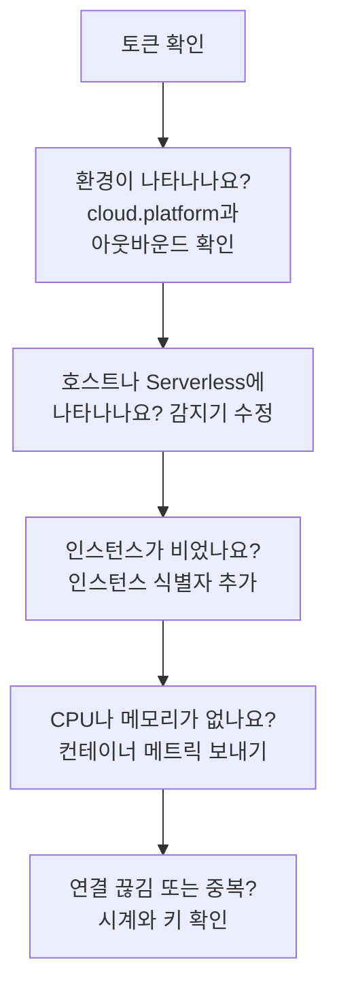

# 클라우드 문제 해결

클라우드 환경이 없거나, 엉뚱한 곳에 기록되거나, 비어 있거나, 중복되는 이유를 찾습니다. 각 섹션은 장애가 일어나는 순서대로 놓여 있고 섹션마다 한 계층씩 원인을 배제하므로, 위에서부터 차례로 확인하세요. 한 플랫폼에만 해당하는 장애는 그 플랫폼 페이지의 끝에 있습니다: [AWS ECS / Fargate](/docs/telemetry/cloud-aws-ecs), [Google Cloud Run](/docs/telemetry/cloud-gcp-cloud-run), [Azure Container Apps](/docs/telemetry/cloud-azure-container-apps), [기타 클라우드 플랫폼](/docs/telemetry/cloud-other-platforms).



## 먼저 토큰 확인하기

가장 간단한 확인이며, 이것이 통과하지 않으면 아래의 어떤 것도 동작하지 않습니다:

```bash
curl -i https://oneuptime.com/otlp/v1/validate \
  -H "x-oneuptime-token: YOUR_TELEMETRY_INGESTION_TOKEN"
```

| 응답 | 의미 |
| ------------------------- | -------------------------------------------------------------------------------------------------------------------------- |
| `200`, `"valid": true` | 토큰이 받아들여졌습니다. `keyType`은 `Server`여야 합니다. `Browser` 키는 Collector나 백엔드 서비스에서 보내면 거부됩니다. |
| `401`, `"valid": false` | 토큰이 없거나, 알 수 없거나, 취소되었거나, 비활성화되었거나, 만료되었으며, 응답의 `message`가 그중 무엇인지 알려 줍니다. **프로젝트 설정 → 텔레메트리 및 APM → 수집 키**에서 새 키를 만들고 다시 배포하세요. |

OneUptime을 자체 호스팅한다면 `https://YOUR-ONEUPTIME-HOST/otlp/v1/validate`를 사용하세요. 가능하면 태스크, 인스턴스, 복제본 안에서 확인을 실행하세요(ECS Exec, `az containerapp exec`). 그래야 노트북만이 아니라 워크로드 자체가 OneUptime에 닿는다는 것을 확인할 수 있습니다.

## 환경이 나타나지 않음

첫 요청을 보내고 1분이 지나도 **클라우드 → All Environments**에 아무것도 없는 경우입니다. 다음 세 가지를 이 순서대로 확인하세요.

**`cloud.platform`이 없거나 관리형 값이 아닙니다.** OneUptime은 리소스가 다음 값 중 하나를 가질 때만 텔레메트리를 클라우드 환경에 기록합니다: `aws_ecs`, `aws_elastic_beanstalk`, `aws_app_runner`, `gcp_cloud_run`, `gcp_app_engine`, `azure_container_apps`, `azure_container_instances`, `azure_app_service`. 흔한 원인은 다음과 같습니다:

- SDK에서 리소스 감지기가 꺼져 있습니다(`OTEL_NODE_RESOURCE_DETECTORS`, `OTEL_EXPERIMENTAL_RESOURCE_DETECTORS`, `-Dotel.resource.providers.<cloud>.enabled=true`).
- Collector의 파이프라인이 `resourcedetection` 프로세서를 건너뜁니다.
- 감지기가 없는 플랫폼에서 `OTEL_RESOURCE_ATTRIBUTES`에 오타가 있습니다.

Node.js와 .NET용 Azure 감지기는 `azure.container_apps`, `azure.app_service`, `azure.functions`로 씁니다. OneUptime은 이를 밑줄 값으로 바꾸므로 문제없이 인식됩니다. 텔레메트리에 무엇이 들어 있는지 보려면 **서비스**에서 서비스를 열고, **트레이스** 탭에서 트레이스 하나를 열어 리소스 속성을 읽으세요. `cloud.platform`이 없다면 그것이 문제의 전부입니다.

**토큰이 잘못되었습니다.** 토큰 확인에서 `401`이 돌아왔습니다. Collector는 이를 `Permanent error: ... 401`로 기록합니다. SDK는 한 번 기록하고 재시도를 멈추는데, 이는 OTLP의 올바른 동작이지만 놓치기 쉽습니다.

**아웃바운드가 막혀 있습니다.** Collector 로그에 `connection refused`, `context deadline exceeded`, `i/o timeout` 또는 DNS 오류가 남습니다:

- **ECS와 Fargate:** 프라이빗 서브넷에는 NAT 게이트웨이나 `assignPublicIp=ENABLED`가 필요하고, 보안 그룹은 TCP 443 아웃바운드를 허용해야 합니다.
- **Cloud Run:** **VPC egress: All traffic**에는 Cloud NAT가 필요합니다.
- **Container Apps:** 방화벽으로 가는 사용자 정의 경로가 OneUptime 호스트를 허용해야 합니다.
- **공통:** 프라이빗 DNS 이름 뒤에 있는 자체 호스팅 OneUptime은 워크로드의 네트워크에서 이름을 확인할 수 있어야 합니다.

## 대신 호스트에 나타남

리소스가 가상 머신의 플랫폼(`aws_ec2`, `gcp_compute_engine`, `azure_vm`)을 가지고 있어 OneUptime이 이를 **호스트**에 기록합니다. 가상 머신이라면 맞지만 관리형 컴퓨팅이라면 틀립니다. 가상 머신의 감지기가 관리형 감지기보다 우선했습니다. Collector에서 `detectors: [ec2, elastic_beanstalk]`로 설정해 `cloud.platform`을 먼저 설정한 감지기가 이겼거나, SDK의 순서가 EC2 감지기를 우선한 경우입니다. `elastic_beanstalk`를 앞에 두거나, `OTEL_RESOURCE_ATTRIBUTES`에서 `cloud.platform`을 직접 설정하고 `env` 감지기만 남기세요.

## 서버리스 함수에만 나타남

리소스에 `faas.name`은 있지만 관리형 `cloud.platform`이 없습니다. Cloud Run과 App Engine은 GCP 감지기가 실행되면 둘 다 설정합니다. `faas.name`을 직접 설정했거나, SDK 감지기가 설정한 리소스 속성을 Collector가 버렸다면 서버리스 쪽 조건만 충족됩니다. 감지기를 켜거나, `cloud.platform=gcp_cloud_run`(또는 `gcp_app_engine`), `cloud.account.id`, `cloud.region`을 직접 설정하세요.

> [!NOTE]
> Cloud Run과 App Engine에서는 서비스가 두 곳 모두에 나타나는 것이 의도된 동작입니다. 환경은 프로젝트와 리전을 묶고, **서버리스 함수**는 개별 서비스를 보여 줍니다.

## 인스턴스가 비어 있음

환경은 있는데 **인스턴스** 탭에 아무것도 없습니다. 텔레메트리에 인스턴스 식별자가 없기 때문입니다. OneUptime은 다음 리소스 속성 중 처음 찾은 것으로 인스턴스 이름을 정합니다:

1. `aws.ecs.task.id`
2. `aws.ecs.task.arn`(태스크 ID로 줄임)
3. `faas.instance`
4. `azure.container_app.instance.id`
5. `service.instance.id`
6. `container.id`
7. `host.id`
8. `host.name`

플랫폼 자체의 식별자가 `service.instance.id`보다 먼저 오므로, SDK가 프로세스마다 만들어 내는 ID(Node.js SDK는 기본적으로 그렇게 합니다) 때문에 태스크가 사이드카의 CPU, 메모리와 갈라지는 일은 없습니다. 플랫폼별로 식별자를 설정하는 주체는 다음과 같습니다:

| 플랫폼 | 식별자를 설정하는 주체 |
| ----------------------------------------- | ------------------------------------------------------------------------------------------------------------------------------------------------ |
| ECS | `ecs` 감지기가 태스크 ARN을 설정합니다 |
| Cloud Run, App Engine | `gcp` 감지기가 `faas.instance`를 설정합니다 |
| Container Apps | Collector의 `azurecontainerapps` 감지기가 복제본 ID를 설정합니다. 또는 `CONTAINER_APP_REPLICA_NAME`에서 `service.instance.id`를 설정하거나 호스트 감지기를 실행합니다 |
| App Runner, Container Instances | 호스트 감지기의 `host.name` |
| App Service, Elastic Beanstalk | 플랫폼의 감지기가 `service.instance.id`를 설정합니다. Beanstalk에서는 `host.id`로 각 인스턴스의 이름이 정해지도록 이를 제거하세요 |

인스턴스는 그 속성을 가진 첫 신호가 오고 1분 안에 나타납니다.

## CPU와 메모리가 비어 있음

인스턴스는 나열되는데 개요의 **CPU**와 **메모리** 타일, 그리고 **인스턴스**의 CPU와 메모리 열이 비어 있습니다. 이 값은 트레이스가 아니라 메트릭에서 나옵니다. 트레이스와 같은 인스턴스 식별자와 `cloud.platform`을 리소스에 가진 `container.cpu.utilization`과 `container.memory.usage`(또는 `container.memory.usage.total`) 데이터 포인트입니다.

- **ECS에서는** 사이드카 Collector의 `awsecscontainermetrics` 수신기가 이를 `ecs.task.cpu.utilized`와 `ecs.task.memory.utilized`로 제공합니다. 이 수신기를 `metrics` 파이프라인에 두고, 같은 파이프라인에 `resourcedetection`도 남겨 두세요. 그렇지 않으면 메트릭이 `cloud.platform` 없이 도착해 다른 곳에 기록됩니다.
- **Cloud Run, Container Apps와 그 밖의 플랫폼에서는** 플랫폼이 컨테이너 사용량을 사이드카에 보여 주지 않습니다. 그 메트릭을 직접 보내지 않으면 타일은 비어 있으니, 대신 요청 타일을 보세요.
- **SDK direct에서는** 컨테이너 메트릭을 보내는 것이 없으므로 타일이 비어 있는 것이 정상입니다.

## 환경이 연결 끊김으로 표시됨

15분 동안 텔레메트리가 오지 않은 환경은 **연결 끊김**으로 표시되고, 다음 스팬, 로그 또는 메트릭이 오면 돌아옵니다. OneUptime 자체가 중단되었거나 밀린 데이터를 따라잡던 시간은 세지 않습니다. 텔레메트리가 흐르는 동안에도 마지막 확인 시각이 최대 5분까지 늦을 수 있어서, 기준을 15분으로 정했습니다.

- **사용량이 많은 환경이 연결 끊김으로 표시됨:** 익스포터가 멈췄습니다. Collector 로그에서 위의 `401`과 아웃바운드 오류를 찾아보세요.
- **밤에 인스턴스를 모두 내리는 스테이징 환경**은 아침의 첫 요청까지 연결 끊김으로 표시되며, 이는 정확한 표시입니다.

인스턴스는 두 가지 시계를 따릅니다:

- **Stale:** **인스턴스** 탭은 지난 15분 동안 보고하지 않은 태스크, 인스턴스, 복제본을 **Stale**로 표시하고, 개요는 나머지만 활성으로 셉니다.
- **삭제:** 정리 작업이 `CLOUD_INSTANCE_STALE_MINUTES`(기본값 15, 최소 10) 동안 보이지 않은 인스턴스 행을 삭제합니다. 이 시간은 환경 자체의 마지막 텔레메트리부터 재므로, Collector가 중단되면 마지막으로 알려진 태스크 목록이 지워지는 대신 시계가 멈춥니다. 서버리스 함수는 `SERVERLESS_INSTANCE_STALE_MINUTES`를 씁니다. 기준을 높이면 행이 더 오래 남지만, **Stale**이 되는 시점은 바뀌지 않습니다.

## 하나여야 할 환경이 두 개임

환경 키는 `cloud.platform|cloud.account.id|cloud.region`이며 한 글자씩 비교됩니다. 어떤 워크로드는 `cloud.account.id`를 설정하고 다른 워크로드는 설정하지 않거나, 하나는 `eastus`, 다른 하나는 `East US`로 쓰거나, 한 Collector만 `ecs` 감지기를 실행하면 `aws_ecs|123456789012|us-east-1`과 `aws_ecs||us-east-1`이 나란히 생깁니다.

각 환경의 **개요**를 여세요. **환경 키**를 보면 어느 부분이 다른지 알 수 있습니다. 값이 빠진 워크로드를 고치세요. 빈 부분이 있는 환경은 더 이상 텔레메트리를 받지 않으므로 보관해도 됩니다.

## 직접 만든 환경이 일치하지 않음

수집 과정은 키만으로 환경을 찾으며, 키는 정확히 `platform|account|region`(예: `aws_ecs|123456789012|us-east-1`)이어야 합니다. 즉 텔레메트리가 가진 것과 같은 플랫폼 값, 계정 ID, 리전이어야 합니다. 생성 양식(**클라우드 → All Environments**의 **클라우드 리소스 만들기**)은 **클라우드 플랫폼**, **클라우드 계정 ID**, **클라우드 리전** 필드로 키를 만드므로, 이 세 값은 텔레메트리와 한 글자씩 일치해야 합니다. 일치하지 않으면 수집 과정이 자신이 계산한 키로 두 번째 환경을 만들고, 직접 만든 환경은 비어 있게 됩니다. 직접 만든 환경을 보관하고 수집 과정이 올바른 환경을 만들게 하거나, 고친 값으로 다시 만드세요.

## 그래도 해결되지 않을 때

도움을 요청하기 전에 다음을 모아 두세요:

- 워크로드에서 나온 실제 스팬이나 로그 레코드 하나의 리소스 속성. Collector의 `debug` 익스포터로 출력하거나, **서비스**에서 서비스의 트레이스를 여세요.
- 워크로드 안에서 실행한 `/otlp/v1/validate` 확인의 응답.
- Collector 로그의 마지막 50줄, 또는 `OTEL_LOG_LEVEL=debug`를 켠 SDK 진단 로그.
- 나타난 각 환경의 **환경 키**.

그런 다음 support@oneuptime.com으로 연락하거나 [GitHub](https://github.com/OneUptime/oneuptime)에 이슈를 여세요.

## 다음 단계

:::cards
- [클라우드 환경](/docs/telemetry/cloud-environments): 환경과 인스턴스를 식별하는 방법.
- [AWS ECS / Fargate](/docs/telemetry/cloud-aws-ecs): 완전한 태스크 정의가 포함된 ECS 설정.
- [OpenTelemetry](/docs/telemetry/open-telemetry): 엔드포인트, 한도, 각 응답의 의미.
:::
