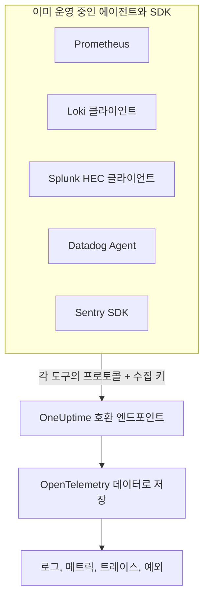

# Prometheus, Loki, Splunk, Datadog & Sentry

Prometheus, Loki 클라이언트, Splunk 포워더, Datadog Agent 또는 Sentry SDK를 이미 운영하고 있나요? 그대로 두세요. OneUptime은 이 도구들이 각각 보내는 것을 그 도구가 이미 쓰는 경로에서 받아 OpenTelemetry 데이터로 저장합니다. OneUptime을 써 보는 데는 URL과 키만 바꾸면 되고 계측을 다시 할 필요가 없으며, 드롭 필터, 스크럽 규칙, 로그 파이프라인, 데이터 보존, 수집 예산도 다른 데이터와 마찬가지로 이 데이터에 적용됩니다.

:::cards
- [Prometheus remote write](#prometheus-remote-write): Prometheus, Grafana Alloy 또는 모든 remote write 발신자의 메트릭.
- [Loki](#loki): Promtail, Grafana Alloy, Fluent Bit 또는 Vector의 로그.
- [Splunk HTTP Event Collector](#splunk-http-event-collector): 모든 HEC 클라이언트의 로그와 메트릭 이벤트.
- [Datadog Agent](#datadog-agent): Datadog Agent의 메트릭과 로그.
- [Sentry SDK](#sentry-sdk): 모든 Sentry SDK의 오류, 트랜잭션, 로그.
:::

## 작동 방식



각 엔드포인트는 해당 도구의 방식대로 응답합니다. Prometheus와 Loki에는 `204`, HEC에는 `{"text": "Success", "code": 0}`, Datadog에는 `202`, Sentry에는 이벤트 ID를 돌려주므로, 도구는 늘 하던 대로 성공과 실패를 보고합니다. 그 뒤 데이터는 OpenTelemetry SDK에서 온 데이터와 똑같이 처리됩니다.

## 시작하기 전에

- **OneUptime 프로젝트**: OneUptime Cloud에서 텔레메트리는 수집된 GB당 과금되며, Free 플랜의 프로젝트는 텔레메트리를 보내기 전에 결제 수단이 있어야 합니다.
- **텔레메트리 수집 키**: **제품 → 프로젝트 설정 → 텔레메트리 및 APM → 수집 키**에서 **서버** 키를 만들고 키의 **시크릿 키**를 복사합니다. 각 도구는 자체 자격 증명을 보내는 자리에 이 키를 담아 보냅니다. 브라우저 앱의 Sentry DSN에는 대신 사이트의 출처를 등록한 **브라우저** 키를 사용합니다.
- **자신의 호스트**: 예시는 `oneuptime.com`을 사용합니다. OneUptime을 자체 호스팅한다면 자신의 호스트를 사용하세요.

> [!TIP]
> 로그, 메트릭, 트레이스, 예외의 설정 가이드 탭에는 이 도구들이 전송 방법 목록에 들어 있으며, 호스트와 고른 키가 이미 채워져 있습니다.

## 엔드포인트

| 도구 | 보낼 곳 | 키를 넣는 곳 |
| --- | --- | --- |
| Prometheus remote write | `https://oneuptime.com/telemetry/prometheus/api/v1/write` | Bearer 토큰, 또는 키를 비밀번호로 쓰는 Basic 인증. |
| Loki | `https://oneuptime.com/telemetry/loki/api/v1/push` | 키를 비밀번호로 쓰는 Basic 인증, 또는 Bearer 토큰. |
| Splunk HTTP Event Collector | `https://oneuptime.com/telemetry/services/collector` | HEC 토큰: `Authorization: Splunk <key>`. |
| Datadog Agent | `https://oneuptime.com/telemetry/datadog` | API 키: `DD-API-KEY`. |
| Sentry SDK | DSN `https://<key>@oneuptime.com/telemetry/sentry/1` | DSN의 공개 키. |

모든 엔드포인트는 `x-oneuptime-token` 헤더로도 키를 받으며, `x-oneuptime-service-name` 헤더는 보내는 모든 데이터가 속할 서비스를 지정합니다. 키는 하이픈 없이 16진수 32자로 쓸 수 있으며, Sentry DSN과 Datadog API 키는 반드시 이렇게 써야 합니다.

## Prometheus remote write

OneUptime을 remote write 대상으로 추가합니다. Prometheus는 지금처럼 계속 스크레이프하면서 모든 샘플의 사본을 보냅니다.

```yaml title="prometheus.yml"
remote_write:
  - url: https://oneuptime.com/telemetry/prometheus/api/v1/write
    authorization:
      credentials: YOUR_TELEMETRY_KEY
```

Grafana Alloy에서는 `prometheus.remote_write` 컴포넌트를 추가하고 스크레이프한 데이터를 그쪽으로 전달합니다.

```text title="config.alloy"
prometheus.remote_write "oneuptime" {
  endpoint {
    url          = "https://oneuptime.com/telemetry/prometheus/api/v1/write"
    bearer_token = "YOUR_TELEMETRY_KEY"
  }
}
```

remote write 1.0과 2.0을 모두 받으며, 모든 발신자가 보내는 대로 snappy로 압축된 형식입니다.

### 시리즈가 변환되는 방식

- **이름과 레이블은 그대로 유지됩니다.** `http_requests_total{job="checkout", code="500"}`은 속성 `job`과 `code`가 있는 메트릭 `http_requests_total`이 되므로, Grafana에서 옮겨 온 쿼리도 이를 찾습니다.
- **job이 서비스가 됩니다.** OpenTelemetry의 Prometheus 매핑 규칙대로 각 `job`은 서비스가 되고, 각 `instance`는 그 서비스 인스턴스가 됩니다.
- **유형이 유지됩니다.** 카운터, 그리고 히스토그램의 버킷과 카운트는 누적 합계가 되므로 rate가 차트에 올바르게 그려집니다. 유형은 발신자가 포함한 메타데이터에서 정해지며, 메타데이터가 없으면 이름이 `_total`로 끝나는 것은 카운터, `le` 레이블이 있는 `_bucket`은 히스토그램 버킷이 됩니다.
- **네이티브 히스토그램**은 지수 히스토그램이 되고, 사용자 지정 버킷이 있는 네이티브 히스토그램은 히스토그램이 됩니다.
- **유지되지 않는 것:** staleness 마커와 그 밖의 NaN 또는 무한대 샘플, 카운터의 `_created` 시리즈, exemplar.

## Loki

OneUptime은 Loki의 push API를 Loki 자체 경로에서 받으며, JSON이나 Promtail과 Grafana Alloy가 보내는 snappy 압축 protobuf 형식을 받습니다. 클라이언트로 추가하세요.

```yaml title="promtail.yaml"
clients:
  - url: https://oneuptime.com/telemetry/loki/api/v1/push
    bearer_token: YOUR_TELEMETRY_KEY
```

Fluent Bit의 `loki` 출력은 호스트와 경로를 따로 받습니다.

```text title="fluent-bit.conf"
[OUTPUT]
    Name         loki
    Match        *
    Host         oneuptime.com
    Port         443
    Tls          On
    Uri          /telemetry/loki/api/v1/push
    Http_User    oneuptime
    Http_Passwd  YOUR_TELEMETRY_KEY
    Labels       job=fluent-bit
```

### 스트림이 변환되는 방식

- **모든 항목이 로그가 되며**, 나노초 단위의 자체 타임스탬프를 갖고 그 줄이 본문이 됩니다.
- **레이블과 구조화 메타데이터는 속성이 되며**, Loki에서의 이름을 그대로 씁니다.
- **서비스**는 Loki가 찾는 방식대로, `service_name`, `service`, `app`, `application`, `name`, `app_kubernetes_io_name`, `container`, `container_name`, `component`, `workload`, `job` 중 스트림에 있는 첫 번째 것에서 정해집니다. `host` 또는 `hostname` 레이블은 호스트를 나타냅니다.
- **레벨**은 `level`, `detected_level` 또는 `severity` 레이블이나 메타데이터에서 정해지고, 없으면 logfmt의 `level=`이나 JSON 줄의 `level` 필드에서 정해집니다.
- **트레이스 컨텍스트:** 구조화 메타데이터의 `trace_id`와 `span_id`가 로그를 해당 트레이스에 연결합니다.

## Splunk HTTP Event Collector

수집 키를 HEC 토큰으로 사용해 OneUptime을 HTTP Event Collector로 쓰세요. Splunk의 Docker 로깅 드라이버는 경로를 스스로 붙이므로 호스트만 지정합니다.

```bash
docker run \
  --log-driver=splunk \
  --log-opt splunk-url=https://oneuptime.com \
  --log-opt splunk-token=YOUR_TELEMETRY_KEY \
  --log-opt splunk-format=json \
  your-image
```

그 밖의 HEC 클라이언트는 `/services/collector/event` 또는 `/services/collector/raw`로 POST합니다. 이벤트 하나를 보내려면 다음과 같이 합니다.

```bash
curl https://oneuptime.com/telemetry/services/collector/event \
  -H "Authorization: Splunk YOUR_TELEMETRY_KEY" \
  -d '{"event": "Payment failed for order 42", "sourcetype": "app", "fields": {"service": "checkout"}}'
```

`{"text": "Success", "code": 0}`과 함께 `200`이 오면 이벤트가 받아들여진 것입니다. 엔드포인트는 HEC 고유의 코드로도 응답합니다. `No data`(5), 유효하지 않은 이벤트의 번호를 함께 알려 주는 `Invalid data format`(6), `Event field is required`(12)입니다. 또한 `GET /services/collector/health`에는 토큰 없이 응답합니다.

### 이벤트가 변환되는 방식

- **로그**가 되며, `time`이 타임스탬프가 됩니다. 문자열 이벤트는 그대로 본문이 되고, 객체 이벤트는 `message`, `msg`, `log`, `line`, `text` 중 하나가 본문이 되며 나머지 필드는 속성이 됩니다.
- **메타데이터는 유지됩니다:** `host`는 호스트가 되고, `source`, `sourcetype`, `index`는 `com.splunk.source`, `com.splunk.sourcetype`, `com.splunk.index`로 보존됩니다. 이벤트에 없는 값은 쿼리 문자열의 `host`, `source`, `sourcetype`, `index`가 채웁니다.
- **필드는 속성이 됩니다.** `service.name` 필드가 서비스를 지정하며, 로그의 `service` 필드도 마찬가지입니다.
- **메트릭 이벤트**(`metric_name`과 `_value`, 또는 `metric_name:<name>` 필드가 있는 `"event": "metric"`)는 로그가 아니라 항상 메트릭으로 저장됩니다.
- **제공하지 않는 것:** 인덱서 승인(indexer acknowledgement). 이를 요청하는 클라이언트는 `ackId`를 받지 못합니다.

## Datadog Agent

수집 키를 API 키로 사용해 Agent의 메트릭과 로그를 OneUptime으로 향하게 하세요.

```yaml title="datadog.yaml"
api_key: YOUR_TELEMETRY_KEY_WITHOUT_HYPHENS
dd_url: https://oneuptime.com/telemetry/datadog
logs_enabled: true
logs_config:
  use_http: true
  logs_dd_url: oneuptime.com:443
apm_config:
  enabled: false
process_config:
  process_collection:
    enabled: false
```

Agent는 `dd_url`에 자체 경로를 붙이고, 로그는 `logs_dd_url`이 지정하는 호스트와 포트의 `/api/v2/logs`로 보냅니다. OneUptime은 `DD-API-KEY` 헤더가 있는 요청에 대해서만 루트에서 이 경로들에 응답합니다. 변경한 뒤 Agent를 다시 시작하세요. OneUptime이 키를 받아들이면 `datadog-agent status`에 API 키가 유효하다고 표시됩니다.

### Agent 데이터가 변환되는 방식

- **메트릭**은 이름이 유지됩니다. 게이지는 게이지로, 카운트는 합계로, rate는 초당 값의 게이지로 바뀝니다.
- **분포**는 개수, 합계, 최솟값, 최댓값을 가진 요약이 됩니다.
- **서비스 체크**는 체크 이름을 딴 메트릭이 되며, 그 값은 체크의 상태입니다. 0은 OK, 1은 경고, 2는 심각, 3은 알 수 없음입니다.
- **로그**는 메시지, 상태, 호스트, 서비스를 유지하고, 나머지 필드는 속성으로 유지합니다.
- **태그는 속성이 되며**, `service`, `env`, `version` 태그가 각각 서비스, 그 환경, 그 버전을 지정합니다.
- **아직 읽지 않는 것:** APM 트레이스, 프로세스, 컨테이너, 네트워크 데이터, 프로파일. 위와 같이 `datadog.yaml`에서 꺼 두세요.

Datadog의 HTTP API 클라이언트(`/api/v2/logs`로 POST하는 로그 라이브러리, 시리즈를 POST하는 스크립트 등)도 `DD-API-KEY` 헤더와 함께 같은 엔드포인트로 보낼 수 있습니다.

## Sentry SDK

Sentry를 설정한 곳에서 DSN을 바꾸세요. 나머지 Sentry 코드는 그대로 둡니다.

```javascript
Sentry.init({
  dsn: "https://YOUR_TELEMETRY_KEY_WITHOUT_HYPHENS@oneuptime.com/telemetry/sentry/1",
  release: "checkout@1.4.2",
  environment: "production",
});
```

```python
sentry_sdk.init(
    dsn="https://YOUR_TELEMETRY_KEY_WITHOUT_HYPHENS@oneuptime.com/telemetry/sentry/1",
    release="checkout@1.4.2",
    environment="production",
)
```

DSN 끝의 `1`은 Sentry SDK가 요구하는 것으로, 읽지는 않습니다. 브라우저 앱의 DSN은 공개되므로, 그곳에는 사이트의 출처를 등록한 **브라우저** 수집 키를 사용하세요.

### 엔벨로프가 변환되는 방식

- **오류**는 스택 트레이스, 원인이 된 예외와 함께 "예외"에 나타나며, 다른 예외와 마찬가지로 묶입니다. 각 오류는 해당 트레이스에서, 활성 상태였던 스팬 아래의 스팬이 됩니다.
- **트랜잭션**과 그 스팬은 "트레이스"에 나타납니다.
- **Sentry 로그**와 `capture_message`로 캡처한 메시지는 "로그"에 나타납니다.
- **서비스**는 `service` 태그이며, 없으면 릴리스 이름의 `@` 앞부분입니다. `checkout@1.4.2`는 `checkout`이 됩니다. 릴리스는 서비스 버전이 되고, 환경은 유지됩니다.
- **유지되지 않는 것:** 세션, 리플레이, 첨부 파일, 프로파일, 체크인. SDK는 이를 계속 보내며, OneUptime은 받아들인 뒤 버립니다.

## 한도와 수집 예산

- **요청 크기**: OneUptime의 인그레스는 `/telemetry` 아래에서 최대 4MB의 요청을 받으며, 각 본문은 압축을 풀었을 때 최대 64MB까지입니다.
- **수집 예산**: Prometheus remote write와 Loki는 본문을 읽기 전에 메트릭 또는 로그 예산과 대조되며, 예산이 소진되면 `403`으로 거부됩니다. HEC 배치, Datadog 페이로드, Sentry 엔벨로프는 여러 신호를 담을 수 있으므로, 각 신호는 저장될 때 자체 예산에 집계되고 그 예산이 소진되면 버려집니다.

## 문제 해결

### 모든 요청이 401로 거부됨

키가 엔드포인트가 찾는 위치에 도착하지 않았거나, 이 프로젝트의 키가 아닙니다. 도구의 자격 증명 설정을 [엔드포인트](#엔드포인트) 표와 대조하고, 키가 꺼져 있거나 만료되지 않았는지 확인하세요.

### Sentry SDK가 DSN이 유효하지 않다고 함

Sentry SDK는 키에 하이픈이 있는 DSN을 거부합니다. 키를 하이픈 없이 16진수 32자로 쓰세요.

### Datadog 메트릭은 들어오지만 로그는 들어오지 않음

`logs_config.use_http`가 `true`인지, `logs_config.logs_dd_url`이 URL이 아니라 호스트와 포트인지 확인하세요. `use_http`가 설정되지 않으면 Agent는 로그를 TCP로 보냅니다.

### Prometheus가 415를 보고함

발신자가 OneUptime이 읽지 않는 remote write 프로토콜을 요청했습니다. remote write 1.0 또는 2.0으로 보내세요.
