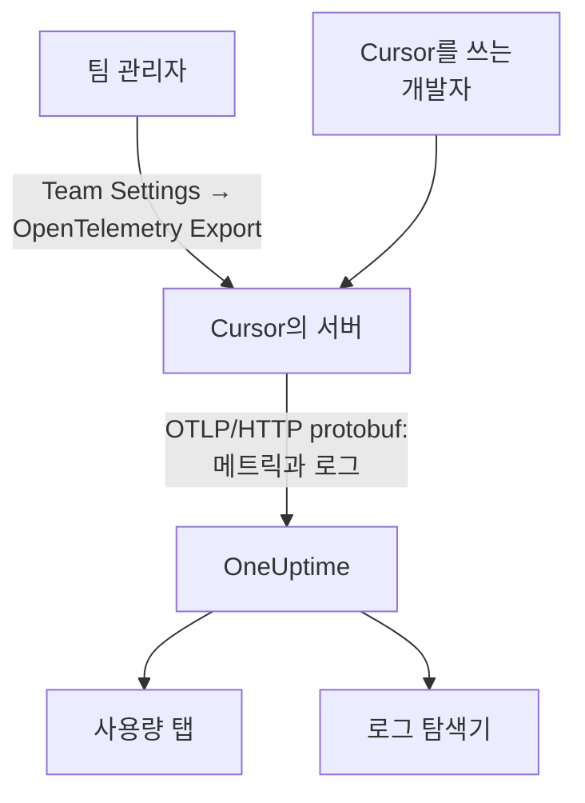

# Cursor

Cursor는 팀의 텔레메트리를 Cursor 자체 서버에서 내보냅니다. 팀 관리자가 Cursor 대시보드에서 OneUptime을 대상으로 한 번 추가하면, 팀 전체의 토큰, 추정 비용, 도구 호출이 들어옵니다. 개발자 머신에 설치하거나 설정할 것은 없습니다.

:::cards
- [설정하기](#설정하기): OneUptime에서 키를, Cursor에서 대상을 만듭니다.
- [얻는 것](#얻는-것과-얻지-못하는-것): 메트릭과 로그. 트레이스는 없습니다.
- [누가 무엇에 썼는지](#직원-귀속): 사람은 Cursor 사용자 ID로 들어옵니다.
- [문제 해결](#문제-해결): 아무것도 도착하지 않을 때 확인할 사항.
:::

## 작동 방식



## 시작하기 전에

- **Cursor의 Enterprise 요금제.** OpenTelemetry Export 화면은 다른 요금제에는 없습니다.
- **Cursor가 인터넷에서 도달할 수 있는 엔드포인트.** 연결하는 쪽은 Cursor이며, 고정된 주소 집합에서 연결합니다. OneUptime Cloud는 추가로 필요한 것이 없습니다. 방화벽 뒤에 있는 직접 호스팅한 OneUptime은 Cursor가 [OpenTelemetry Export](https://cursor.com/docs/enterprise/opentelemetry-export) 페이지에 나열한 송신 주소를 허용해야 합니다.

## 설정하기

:::steps
### 수집 키 만들기

OneUptime에서 **프로젝트 설정 → 텔레메트리 및 APM → 수집 키** 를 열고, **수집 키 생성** 을 클릭한 뒤 키를 복사합니다. OTLP 기본 URL은 `https://oneuptime.com/otlp`이며, OneUptime을 직접 호스팅한다면 `https://YOUR-ONEUPTIME-HOST/otlp`입니다.

### Cursor에서 대상 만들기

Cursor 웹 대시보드에서 팀 관리자로 **Team Settings → OpenTelemetry Export** 를 열고 대상을 만듭니다.

| 필드 | 값 |
| --- | --- |
| Endpoint (base URL) | `https://oneuptime.com/otlp` |
| Header name | `x-oneuptime-token` |
| Header value | `YOUR_INGESTION_TOKEN` |

기본 URL은 `/v1` 없이 입력하세요. Cursor가 `/v1/metrics`와 `/v1/logs`를 직접 덧붙이므로, `https://oneuptime.com/otlp/v1`로 하면 `/otlp/v1/v1/metrics`로 보내져 아무것도 도착하지 않습니다.

### 테스트하고 켜기

**Test connection** 을 클릭해 URL과 헤더를 확인한 다음, **Enable** 을 클릭합니다. 내보내기는 1분 정도 안에 시작되며, 이후 헤더를 바꾸면 30초 정도 뒤에 반영됩니다.

### 데이터가 도착하는지 확인하기

Cursor를 1~2분 사용한 다음 OneUptime에서 **로그** 를 열고 서비스 이름 `cursor`로 필터링합니다. 토큰 수가 있는 `cursor.api.request` 레코드가 보이면 키와 URL이 올바른 것입니다.
:::

Cursor는 HTTP 위의 OTLP를 바이너리 protobuf로만 사용하며(gRPC도 JSON도 없음), OneUptime은 이를 그대로 받습니다. 헤더는 암호화해 저장하고, 대상은 팀마다 하나뿐입니다. OneUptime과 다른 곳에 함께 보내려면 앞에 Collector를 두세요.

## 얻는 것과 얻지 못하는 것

| 신호 | Cursor에서 |
| --- | --- |
| 메트릭: 토큰, 추정 비용, 도구 호출 | 예, 델타로 |
| 로그 이벤트: 요청, 오류, 정정, 스킬, 훅, 플러그인, 클라우드 에이전트 | 예 |
| 프롬프트와 답변 텍스트 | `conversation_content` 패밀리를 켠 경우에만 |
| 트레이스 | 아니요 |
| 대상을 켜기 전의 모든 것 | 아니요 |

따라서 OneUptime에서 Cursor는 `cursor.token.usage`와 `cursor.cost.usage`를 바탕으로 **제품 → AI / LLM** 의 **사용량** 탭에 표시되지만, 트레이스로 만들어지는 **호출** 이나 **대화** 에는 나타나지 않습니다. 요청별 세부 정보는 **로그** 탐색기의 `cursor.api.request` 이벤트입니다.

### 패밀리

각 신호와 각 텔레메트리 패밀리에는 Cursor 설정에 자체 스위치가 있습니다.

| 패밀리 | 포함하는 것 |
| --- | --- |
| `model_usage` | `cursor.token.usage`, `cursor.cost.usage`, 그리고 `cursor.api.request`, `cursor.api.error`, `cursor.api.correction` 이벤트 |
| `tool_calls` | `cursor.tool.calls` |
| `skills_hooks_plugins` | 스킬, 훅, 플러그인 이벤트 |
| `cloud_agents` | `cursor.cloud_agent.*` 이벤트 |
| `grok_bot_agent_actions` | `cursor.grok_bot.*` 이벤트. Action Recording이 필요함 |
| `conversation_content` | 메시지 텍스트와 MCP 도구의 입력 및 출력. 기본적으로 꺼짐 |

`conversation_content`를 제외한 모든 패밀리는 켜진 상태로 시작합니다. Cursor가 나중에 추가하는 패밀리도 `auto_enable_new_families`를 끄지 않는 한 켜진 상태로 시작합니다.

## 메트릭과 이벤트

세 메트릭은 모두 델타 합계입니다.

| 메트릭 | 단위 | 속성 |
| --- | --- | --- |
| `cursor.token.usage` | `{token}` | `cursor.token.type`: `input`, `output`, `cache_read`, `cache_creation`; `cursor.model.name`; `cursor.api.status`: `success`, `errored`, `aborted`; `cursor.api.billable` |
| `cursor.cost.usage` | `USD` | `cursor.model.name` |
| `cursor.tool.calls` | `{call}` | `cursor.tool.kind`: `builtin`, `mcp`; `cursor.tool.name`; `cursor.tool.status`: `success`, `failure`, `aborted`; `cursor.mcp.server.name` |

데이터 포인트에는 대화 ID도 요청 ID도 없으므로, 세션별 비용은 메트릭에 없습니다. `cursor.model.name`은 요청한 모델이며, 라우팅된 선택은 하나로 합쳐집니다. 모델별 분류에는 `Auto`라는 행이 있으며, Cursor가 라우팅한 모델별로 나눌 수 없습니다.

가장 많이 쓰게 될 로그 이벤트는 `cursor.api.request`입니다. 요청마다 하나씩 있으며, 입력, 출력, 캐시 토큰 수, 모델, 청구 여부를 담고 있습니다. `cursor.api.error`는 실패한 요청을 기록하고(오류 메시지는 없음), `cursor.api.correction`은 나중에 도착해 요청이 결국 청구되지 않았음을 알립니다. Cursor의 [와이어 참조 문서](https://cursor.com/docs/enterprise/opentelemetry-export/wire)에 모든 이벤트와 속성이 나와 있습니다.

모든 레코드에는 다음 리소스 속성이 있습니다.

| 속성 | 의미 |
| --- | --- |
| `service.name` | 항상 `cursor`. **로그** 와 **메트릭** 탐색기에서 이것으로 필터링 |
| `cursor.team.id` | 팀. 정수이며 항상 있음 |
| `cursor.user.id` | 사람. 팀 안에서 유효한 정수이며 선택 사항 |
| `cursor.surface` | 활동이 발생한 곳. `desktop`, `cli`, `cloud_agent`, `bugbot` 등 |
| `cursor.entrypoint` | 시작된 방식. `desktop`, `cli`, `web`, `api`, `github_pr` 등 |

## 직원 귀속

**Cursor는 사람을 `cursor.user.id`로 지목합니다. 이는 Cursor만 이름으로 바꿀 수 있는 정수이며, 클라우드 에이전트에서는 자주 빠집니다.** OneUptime은 이를 직원으로, `cursor.team.id`를 팀으로 읽으므로, **사용량** 탭은 설정 없이 사람과 팀의 순위를 매기지만 사람은 정수로 표시됩니다.

- 둘 다 리소스 속성(`resource.cursor.user.id`, `resource.cursor.team.id`)으로 들어오며, OneUptime은 이를 읽습니다.
- Cursor는 `cursor.user.email`도 보낼 수 있지만, OneUptime은 아직 읽지 않으므로 Cursor의 경우 직원 이메일 열은 비어 있습니다.
- `gen_ai.user`, `llm.user`, LiteLLM의 최종 사용자 ID는 직원으로 읽지 않습니다. 이들은 직원이 아니라 고객을 지목합니다. [직원 및 팀 귀속](/docs/telemetry/ai-coding-assistants#직원-및-팀-귀속)을 참조하세요.

### 사용량 탭에서 Cursor가 표시되는 위치

Cursor는 메트릭을 보내고 GenAI 스팬은 보내지 않으며, 메트릭은 스팬을 보충할 뿐입니다. **같은 프로젝트가 비용이 있는 GenAI 스팬을 받으면, Cursor의 지출은 표시되지 않습니다.** Cursor는 전용 프로젝트로 보내세요. [스팬이 먼저, 메트릭은 보충](/docs/telemetry/ai-llm-observability#스팬이-먼저-메트릭은-보충)을 참조하세요.

| 분류 | Cursor의 경우 |
| --- | --- |
| **직원** | 예. `cursor.user.id`별 |
| **팀** | 예. `cursor.team.id`별 |
| **모델** | 예. `cursor.model.name`별 |
| **공급자** | 아니요. Cursor는 어떤 공급자가 호출을 처리했는지 알려 주지 않음 |
| **애플리케이션 / 서비스** | 아니요. Cursor의 메트릭은 어떤 OneUptime 서비스에도 속하지 않음 |

Cursor 행은 비용만 가집니다. `cursor.cost.usage`에는 호출별 세부 정보가 없으므로 호출과 토큰 셀에는 `—`가 표시됩니다. `cursor.token.usage`는 여전히 표 위의 토큰 합계를 채우며(`input`과 `output` 종류만, 캐시 토큰은 제외), `cursor.token.type`별로 대시보드에 차트를 그릴 수 있습니다.

:::details Cursor 사용자 ID를 사람으로 바꾸기
이름과 청구 금액은 Cursor의 Admin API에 있으며, OneUptime은 이를 호출하지 않습니다. 필요하면 직접 호출하세요. Enterprise 전용이며 `https://api.cursor.com`에 있고, 관리자 API 키를 사용자 이름으로, 비밀번호는 비워서 사용합니다.

```bash
curl -u YOUR_API_KEY: https://api.cursor.com/teams/members
```

`GET /teams/members`는 각 구성원의 이메일과 이름을 나열합니다. `POST /teams/filtered-usage-events`는 이벤트별 청구된 사용량을 반환하므로, 지출은 그 `chargedCents`를 합산하세요. 그 `conversationId`는 Cursor 로그 이벤트의 `cursor.conversation.id`와 일치하므로, 양쪽에 모두 있으면 사람과 청구 금액을 이미 보고 있는 세션에 연결할 수 있습니다. Cursor는 정수 `cursor.user.id`와 Admin API의 사용자 ID가 같다고 문서화하지 않았으므로, 이를 근거로 누군가에게 청구하기 전에 자체 팀에서 확인하세요.
:::

## Cursor의 전송 방식

이 규칙들은 차트에 보이는 내용을 바꾸므로, 공백을 보고하기 전에 알아 두세요.

- **메트릭은 최대 한 번 보냅니다.** 실패한 내보내기는 다시 시도하지 않으므로, 실패 뒤의 짧은 공백은 예상된 것입니다. Cursor 메트릭의 공백 때문에 누군가를 호출하지 마세요.
- **로그는 최소 한 번 보내며**, `cursor.event.id`로 중복을 제거하고 약 7일 동안 자동으로 다시 시도합니다.
- **순서는 보장되지 않습니다.** `cursor.api.correction`은 정정하는 요청보다 나중에 도착합니다. 도착 순서가 아니라 레코드의 타임스탬프로 정렬하세요.
- **소급해서 채우지 않습니다.** 대상을 켜기 전의 데이터는 도착하지 않으며, 고장 난 채로 둔 대상은 Cursor가 보내지 못한 것을 잃습니다.
- **대상을 끄거나 삭제하면 전송 중인 데이터가 사라집니다.** 수집 키를 바꾸려면 대상을 삭제하고 다시 만드는 대신, 대상의 헤더를 편집하세요.

## 비용은 청구서가 아니라 추정치입니다

Cursor는 `cursor.cost.usage`를 최선의 추정치라고 설명합니다. 포함된 사용량과 온디맨드로 청구되는 사용량을 구분하지 않으며, 자체 모델 키를 쓰는 경우 공급자의 청구서가 아니라 Cursor의 토큰 요율만 반영하고, 나중에 도착하는 `cursor.api.correction`이 이미 센 사용량을 되돌릴 수 있습니다. 추세로 읽으세요. 청구서와 일치하는 수치가 필요하면 Cursor Admin API의 `chargedCents`를 합산하세요.

## 문제 해결

:::details 아무것도 도착하지 않음
Cursor에서 **Test connection** 을 다시 실행하세요. 기본 URL이 `/v1`로 끝나지 않는지, 헤더 이름이 `x-oneuptime-token`이고 값이 정확히 키인지, `model_usage` 패밀리가 켜져 있는지 확인하세요. 내보내기는 대상을 켠 뒤 약 1분 뒤에 시작됩니다.
:::

:::details 직접 호스팅한 OneUptime에 아무것도 도착하지 않음
Cursor는 자체 서버에서 연결합니다. OTLP 엔드포인트는 공개 DNS 이름으로 인터넷에서 도달할 수 있어야 하며, 방화벽에서 Cursor의 송신 주소를 허용해야 합니다.
:::

:::details 로그는 도착하지만 사용량 탭에 Cursor 지출이 없음
프로젝트가 비용이 있는 GenAI 스팬도 받고 있으므로 Cursor 메트릭을 읽지 않습니다. Cursor는 자체 수집 키가 있는 전용 프로젝트로 보내세요.
:::

:::details 사람이 숫자로 표시됨
그것은 `cursor.user.id`이며, 현재 OneUptime이 Cursor에서 읽는 유일한 사람 ID입니다. Cursor의 Admin API로 이름과 연결하세요.
:::

## 다음 단계

:::cards
- [AI 코딩 어시스턴트](/docs/telemetry/ai-coding-assistants): 모든 코딩 어시스턴트에서 지출이 귀속되는 방식.
- [AI 게이트웨이](/docs/telemetry/ai-gateways): 자체 앱이 하는 모델 호출의 전체 트레이스와 프롬프트.
- [메트릭 모니터](/docs/monitor/metrics-monitor): `cursor.cost.usage`, `cursor.token.usage`, `cursor.tool.calls`에 알림을 설정합니다.
:::
