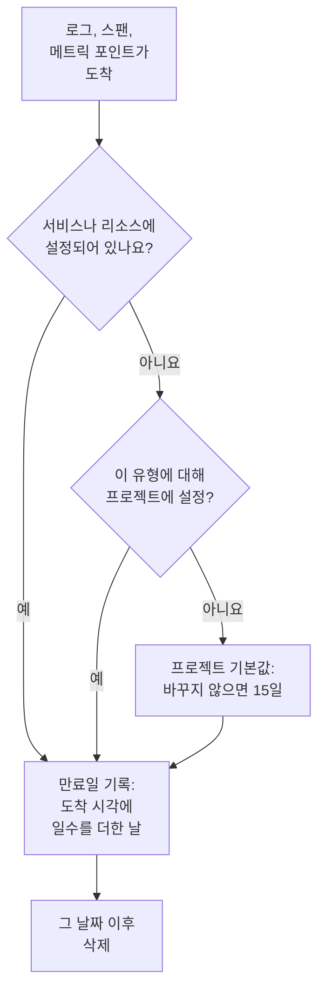

# 데이터 보존

OneUptime은 로그, 트레이스, 메트릭, 프로파일을 정해진 일수 동안 보관한 뒤 삭제합니다. 바꾸지 않으면 15일입니다. 이 페이지에서는 그 일수가 어떻게 정해지는지, 프로젝트 전체에서 바꾸는 방법, 그리고 일부 텔레메트리를 나머지보다 더 길게 또는 짧게 보관하는 방법을 설명합니다.

:::cards
- [텔레메트리 보관 기간](#텔레메트리-보관-기간): OneUptime이 설정을 읽는 순서.
- [프로젝트의 보존 기간 바꾸기](#프로젝트의-보존-기간-바꾸기): 모든 텔레메트리에 적용되는 숫자 하나.
- [일부 텔레메트리를 더 길게 또는 짧게 보관](#일부-텔레메트리를-더-길게-또는-짧게-보관): 유형, 심각도, 상태, 서비스별로.
- [보존 비용](#보존-비용): OneUptime Cloud의 요금, 자체 호스팅의 디스크.
:::

## 텔레메트리 보관 기간

각 로그, 스팬, 메트릭 포인트, 프로파일 샘플은 도착할 때 보존 기간을 받습니다. OneUptime은 며칠 동안 보관할지 계산하고, 만료 날짜를 기록한 뒤, 그 날짜가 지나면 삭제합니다. 가장 구체적인 설정이 우선합니다.

자세히 보면, OneUptime은 다음 순서로 설정을 읽고 처음으로 설정된 것이 결정합니다.

| 순서 | 설정 | 설정하는 곳 |
| --- | --- | --- |
| 1 | 특정 서비스나 리소스의, 로그 심각도나 스팬 상태별 일수 | 해당 **설정** 페이지의 **텔레메트리 유형별 보존** |
| 2 | 특정 서비스나 리소스의, 텔레메트리 유형별 일수 | 같은 카드 |
| 3 | 특정 서비스나 리소스에서 오는 모든 것의 일수 | 같은 페이지의 **텔레메트리 데이터 보존** |
| 4 | 프로젝트의, 로그 심각도나 스팬 상태별 일수 | **데이터 보존**의 **텔레메트리 유형별 보존** |
| 5 | 프로젝트의, 텔레메트리 유형별 일수 | 같은 카드 |
| 6 | 그 밖의 모든 것의 일수 | **데이터 보존**의 **기본 보존(일)** |

- **설정 1~5는 보존 재정의입니다.** 이 설정은 [엔터프라이즈 에디션](/docs/self-hosted/enterprise)과 OneUptime Cloud의 Scale 플랜에 포함됩니다. 재정의가 없으면 모든 레코드는 프로젝트 기본값에 따라 보관됩니다.
- **변경 사항은 새 텔레메트리에 적용됩니다.** 레코드는 기록된 날짜를 그대로 유지합니다. 보존 기간을 줄여도 더 일찍 삭제되지 않고, 늘려도 더 오래 보관되지 않습니다. 새 레코드는 약 5분 안에 변경 사항을 따릅니다.
- **예외는 발견된 곳을 따릅니다.** 예외는 그 예외가 나온 스팬이나 로그와 같은 기간 동안 보관됩니다. Session Replay에는 자체 보존 기간이 있습니다. [자체 보존 기간이 있는 다른 데이터](#자체-보존-기간이-있는-다른-데이터)를 참고하세요.

## 시작하기 전에

- **프로젝트를 바꾸는 역할.** 프로젝트의 보존 기간은 Project Owner 또는 Project Admin이 바꿉니다. 서비스나 리소스의 보존 기간에는 그 밖의 설정을 바꾸는 역할이 필요합니다.
- **재정의에는 엔터프라이즈 에디션이나 Scale 플랜.** 자체 호스팅 설치에는 Enterprise 라이선스가, OneUptime Cloud 프로젝트에는 Scale 플랜 이상이 필요합니다. 프로젝트의 기본 보존 기간은 모든 에디션과 플랜에 있습니다.

## 프로젝트의 보존 기간 바꾸기

:::steps
### 데이터 보존 열기

**프로젝트 설정 → 텔레메트리 및 APM → 데이터 보존**으로 이동합니다. 사이드 메뉴의 **텔레메트리 및 APM**은 처음에 접혀 있으니 클릭해서 엽니다. **텔레메트리 데이터 보존** 카드에 **기본 보존(일)** 값이 표시됩니다.

### 일수 정하기

**Edit Retention Settings** 버튼을 클릭하고, 1 이상의 일수를 입력한 다음, **변경 사항 저장**을 클릭합니다.
:::

새 일수는 그 이후에 도착하고 자체 재정의가 없는 모든 레코드에 적용됩니다.

## 일부 텔레메트리를 더 길게 또는 짧게 보관

재정의를 쓰면 필요한 것은 더 길게, 나머지는 더 짧게 보관할 수 있습니다. 예를 들어 오류 로그는 한 분기, 디버그 로그는 며칠 동안 보관합니다.

### 프로젝트 전체

기본값 아래의 **텔레메트리 유형별 보존** 카드에서 텔레메트리 유형마다 일수를 정합니다. **Edit Overrides** 버튼을 클릭하고, 필요한 필드를 채운 뒤 나머지는 비워 둡니다.

| 유형 | 필드 |
| --- | --- |
| 로그 | **Logs default (days)** 필드와, 로그 심각도마다 하나씩 있는 필드 |
| 트레이스 | **Traces default (days)** 필드와, 스팬 상태(오류, 확인, 설정 안 됨)마다 하나씩 있는 필드 |
| 메트릭 | **Metrics default (days)** |
| 프로파일 | **Profiles default (days)** |

비워 둔 필드는 위 순서의 다음 설정을 따르므로, 자체 일수가 없는 심각도는 로그 기본값에 따라 로그를 보관합니다.

### 특정 서비스나 리소스

서비스나 리소스의 **설정** 페이지를 엽니다. 그 **텔레메트리 데이터 보존** 카드에는 보내는 모든 것에 적용되는 숫자 하나인 **텔레메트리 데이터 보존 기간(일)** 필드가 있고, **텔레메트리 유형별 보존** 카드에는 프로젝트와 같은 필드가 있습니다. 프로젝트 설정을 쓰려면 필드를 비워 둡니다.

서비스, 호스트, Kubernetes 클러스터, Docker 및 Podman 호스트, Docker Swarm, Proxmox, Ceph 클러스터, 스토리지 어레이, vCenter, 데이터베이스, 서버리스 함수, 클라우드 리소스, RUM 애플리케이션, IoT 플릿에 모두 이 카드가 있습니다. 서비스의 **설정** 페이지는 [서비스 카탈로그](/docs/telemetry/services#서비스-변경)를 참고하세요.

### 플랜이나 라이선스에 재정의가 더 이상 포함되지 않을 때

- **자체 호스팅 설치에서는** 라이선스 없이 Enterprise 평가판이나 유예 기간이 끝나면 재정의가 더 이상 적용되지 않습니다. 새 텔레메트리는 프로젝트 기본값에 따라 보관되고, 카드는 읽기 전용이 되며, 설정한 내용은 삭제되지 않습니다. 라이선스를 활성화하면 다시 적용됩니다. [엔터프라이즈 에디션](/docs/self-hosted/enterprise#라이선스가-만료되었거나-없을-때)을 참고하세요.
- **OneUptime Cloud에서는** 평가판 기간에 설정된 채 남은 재정의가 Scale 플랜보다 낮은 플랜에서도 계속 적용됩니다. 해당 페이지에서는 업그레이드 카드 아래에 재정의가 표시되며, 모든 플랜에서 작동하는 **재정의 제거** 버튼이 있습니다. 재정의를 다시 설정하려면 Scale 플랜이 필요합니다.

## 자체 보존 기간이 있는 다른 데이터

| 데이터 | 보관 기간 | 바꾸는 곳 |
| --- | --- | --- |
| Session Replay | 바꾸지 않으면 7일 | RUM 애플리케이션의 리플레이 정책. [애플리케이션 관리](/docs/rum/applications#세션-리플레이-보존)를 참고하세요. |
| 모니터 로그(검사마다 한 행) | 바꾸지 않으면 1일 | 자체 호스팅 설치에서는 Admin Dashboard의 **모니터 로그 보존 기간(일)** 필드 |
| 모니터 메트릭과 SLO가 기록하는 메트릭 | 바꾸지 않으면 30일 | 자체 호스팅 설치에서는 Admin Dashboard의 **모니터 메트릭 보존 기간(일)** 필드 |

## 보존 비용

- **OneUptime Cloud에서는** 텔레메트리가 수집한 GB 단위로 청구되며, GB당 가격에는 15일 보존이 포함됩니다. 보존 기간이 길수록 비례해서 비용이 늘어, 30일은 GB당 15일의 두 배입니다. 보존 기간이 짧을수록 비례해서 비용이 줄지만, 7일 미만의 보존은 7일로 청구됩니다. **프로젝트 설정 → 결제 및 청구서 → 사용 기록**에서 각 서비스가 보낸 양과 보관 기간을 날짜별로 볼 수 있습니다.
- **자체 호스팅에서는** 텔레메트리가 ClickHouse에 저장되며, 보존 기간만큼 디스크 사용량이 늘어납니다. [사이징](/docs/installation/sizing#보존-기간과-스토리지에-미치는-영향)을 참고하세요.

필요 없는 텔레메트리는 저장하지 않으면 비용이 들지 않습니다. [드롭 필터 및 스크럽 규칙](/docs/telemetry/drop-filters-and-scrub-rules)으로 도착하는 즉시 버릴 수 있습니다.

## 문제 해결

:::details 보존 기간을 줄였는데 오래된 데이터가 남아 있습니다
레코드는 도착할 때 기록된 만료 날짜를 그대로 유지합니다. 변경 전에 저장된 레코드는 각자의 날짜에 삭제되며, 새 보존 기간은 새 레코드에만 적용됩니다.
:::

:::details 재정의 카드에 업그레이드 안내가 표시됩니다
보존 재정의에는 자체 호스팅 설치에서는 엔터프라이즈 에디션이, OneUptime Cloud에서는 Scale 플랜이 필요합니다. 그때까지는 모든 것이 프로젝트 기본값에 따라 보관됩니다.
:::

:::details 데이터가 만료되고 하루 뒤에 디스크 공간이 돌아옵니다
만료된 레코드는 만료되는 즉시 검색, 차트, 목록에 더 이상 나타나지 않습니다. 디스크에서는 로그와 메트릭이 그 뒤 첫 자정에 삭제되므로, 공간이 돌아오기까지 최대 하루가 걸립니다.
:::

## 다음 단계

:::cards
- [수집 키](/docs/telemetry/ingestion-keys): 프로젝트로 텔레메트리를 보냅니다.
- [드롭 필터 및 스크럽 규칙](/docs/telemetry/drop-filters-and-scrub-rules): 필요한 텔레메트리만 남깁니다.
- [서비스 카탈로그](/docs/telemetry/services): 서비스 자체의 보존 기간을 정합니다.
- [엔터프라이즈 에디션](/docs/self-hosted/enterprise): 보존 재정의가 포함된 에디션.
:::
