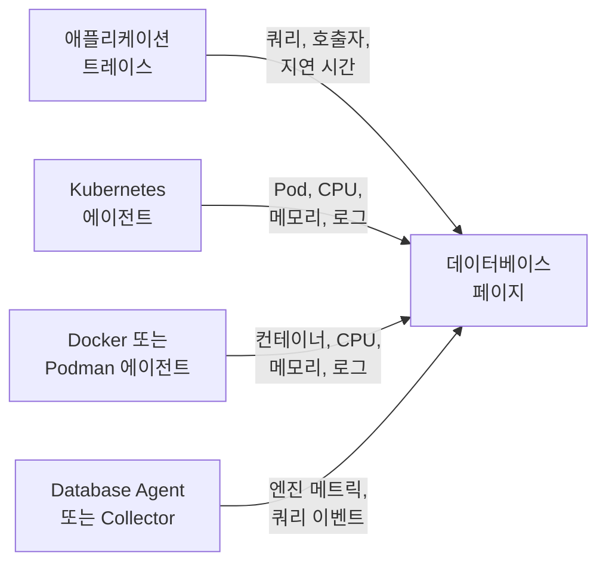

# 데이터베이스

**Databases**는 프로젝트가 실행하거나 통신하는 모든 데이터베이스 서버에 전용 페이지를 제공합니다. 무엇이 얼마나 빠르게 호출하는지, 어디에서 실행되는지, 엔진 자체의 상태 메트릭, 로그와 트레이스, 연결된 인시던트, 알림, 예정된 유지 관리, 그리고 해당 엔진에 권장되는 알림 모니터를 보여 줍니다. 데이터베이스에는 다른 모든 리소스처럼 레이블, 소유자, 레이블 및 소유자 규칙, 데이터베이스별 보존 기간, 보관 기능이 있습니다. **제품 → 리소스 → 데이터베이스**에서 여세요.

:::cards
- [Database Agent](#database-agent): PostgreSQL, MySQL, SQL Server, Oracle, Redis, MongoDB, Elasticsearch, Memcached의 엔진 메트릭.
- [데이터베이스 감지 방식](#데이터베이스-감지-방식): 트레이스, Kubernetes, Docker, Podman, Collector에서 감지합니다.
- [데이터베이스의 알림](#데이터베이스의-알림): 권장 모니터와 직접 만드는 모니터.
- [문제 해결](#문제-해결): 진단 스크립트와 일반적인 문제.
:::

## 작동 방식

대부분의 데이터베이스는 저절로 나타납니다. OneUptime은 각 데이터베이스를 최대 네 가지 소스로 구성하며, 소스마다 추가하는 내용이 다릅니다:

| 소스 | 필요한 것 | 데이터베이스 페이지에 추가하는 내용 |
| --- | --- | --- |
| **애플리케이션 트레이스** | 계측된 애플리케이션(OpenTelemetry) | 애플리케이션의 쿼리: 호출 빈도, 오류, 지연 시간, 호출하는 서비스 |
| **Kubernetes** | [OneUptime Kubernetes 에이전트](/docs/telemetry/kubernetes-agent) | 실행 위치: Pod, CPU와 메모리, Pod의 로그 |
| **Docker / Podman** | [Docker 에이전트](/docs/telemetry/docker-host) 또는 [Podman 에이전트](/docs/telemetry/podman-host) | 실행 위치: 컨테이너, 그 CPU와 메모리, 그 로그 |
| **Database Agent**(OpenTelemetry Collector) | [Database Agent](#database-agent) 또는 직접 운영하는 Collector | **Engine metrics**: 연결, 처리량, 캐시 적중률, 잠금, 복제 지연, 메모리 등 엔진이 제공하는 범위의 메트릭([수집되는 항목](#수집되는-항목) 참조), 그리고 선택 사항인 쿼리 샘플, 상위 쿼리, 엔진의 로그 파일 |



엔진 메트릭은 데이터베이스 자체와 통신하는 Collector(관리형 클라우드 데이터베이스라면 공급자의 모니터링 API와 통신하는 Collector)에서만 옵니다. 트레이스와 컨테이너 인벤토리는 데이터베이스가 존재한다는 사실과 사용 방식을 OneUptime에 알려 주지만, 내부 상태는 알려 주지 않습니다. 각 데이터베이스의 **Engine metrics** 상태가 그 부분이 연결되어 있는지 보여 줍니다.

데이터베이스를 직접 추가할 수도 있습니다. **Databases → 데이터베이스 만들기**에서 엔진, 주소, 포트를 지정하세요. 에이전트가 전혀 필요 없는 프로브 기반 상태 검사는 [데이터베이스 상태 모니터](/docs/monitor/database-health-monitor)를 참조하세요.

## 지원되는 데이터베이스

OneUptime은 아래 엔진을 이름으로 알고 있습니다. 계측이 `db.system.name`(또는 이전의 `db.system`)에 넣는 값을 두 번째 열의 값으로 정규화하고, 엔진 이름을 표시하며, 스팬이나 주소에 포트가 없으면 기본 포트를 적용하고, 컨테이너 이미지와 Helm 차트를 인식하며, 엔진 메트릭을 어디에서 가져오는지 압니다. 목록에 없는 엔진도 데이터베이스를 주소로 식별하는 모든 곳에서 작동합니다. 스팬이 보고하는 원래 이름으로 표시될 뿐이며, 트레이스만으로는 생성되지 않습니다.

**계열**은 포크나 프로토콜 호환 엔진에 접근할 때 거치는 엔진입니다. 클라이언트 라이브러리는 MariaDB와 MySQL, Valkey와 Redis를 구별하지 못하므로 스팬은 `mysql`이나 `redis`라고 보고하고, 컨테이너 이미지, Helm 차트, Database Agent는 포크의 이름을 보고합니다. 둘 다 같은 데이터베이스에 들어가며, 컨테이너 이미지 또는 현재 엔진을 정한 소스 이상으로 강한 소스가 더 구체적인 엔진을 지정하면 데이터베이스는 그 엔진을 표시합니다([데이터베이스에 표시되는 엔진](#데이터베이스에-표시되는-엔진) 참조).

**트레이스에서 생성**은 클라이언트 스팬만으로 해당 엔진의 데이터베이스가 생성되는지를 나타냅니다([애플리케이션 트레이스에서](#애플리케이션-트레이스에서) 참조). 공급자의 공유 API 호스트로 접근하는 관리형 서비스와 애플리케이션 프로세스 안에서 실행되는 엔진은 생성되지 않습니다. **Engine metrics**는 엔진 자체의 상태 메트릭을 어디에서 가져오는지 나타냅니다. Database Agent 구성, 직접 운영하는 Collector에 추가하는 collector-contrib 리시버, 엔진 자체의 Prometheus 엔드포인트(`:port/path`, Collector의 `prometheus` 리시버로 스크레이프), 클라우드 공급자의 모니터링 API, 또는 내장 없음 중 하나입니다. 각 데이터베이스의 **문서** 탭은 이를 해당 데이터베이스용으로 바로 쓸 수 있는 Collector 구성으로 만들어 줍니다.

| 엔진 | `db.system.name` | 기본 포트 | 계열 | 트레이스에서 생성 | Engine metrics |
| --- | --- | --- | --- | --- | --- |
| Actian Ingres | `actian.ingres` | — | — | 예 | 내장 없음 |
| Actian Zen (Pervasive PSQL) | `pervasive` | 1583 | — | 예 | 내장 없음 |
| Aerospike | `aerospike` | 3000 | — | 예 | `aerospike` 리시버 |
| Amazon DocumentDB | `aws.documentdb` | 27017 | MongoDB | 예 | `awsfirehose` 리시버(클라우드 모니터링) |
| Amazon DynamoDB | `aws.dynamodb` | 443 | — | 아니요(클라우드 API) | `awsfirehose` 리시버(클라우드 모니터링) |
| Amazon Neptune | `aws.neptune` | 8182 | — | 예 | `awsfirehose` 리시버(클라우드 모니터링) |
| Amazon Redshift | `aws.redshift` | 5439 | PostgreSQL | 예 | `awsfirehose` 리시버(클라우드 모니터링) |
| Apache Derby | `derby` | 1527 | — | 아니요(인프로세스) | 없음(인프로세스) |
| Apache Doris | `doris` | 9030 | MySQL | 예 | Prometheus, `:8030/metrics` |
| Apache Druid | `druid` | 8888 | — | 예 | 내장 없음 |
| Apache Geode | `geode` | 10334 | — | 예 | 내장 없음 |
| Apache HBase | `hbase` | — | — | 예 | 내장 없음 |
| Apache Hive | `hive` | 10000 | — | 예 | 내장 없음 |
| Apache Ignite | `ignite` | 10800 | — | 예 | 내장 없음 |
| Apache Impala | `impala` | 21050 | — | 예 | 내장 없음 |
| Apache Pinot | `pinot` | 8099 | — | 예 | 내장 없음 |
| Apache Solr | `solr` | 8983 | — | 예 | 내장 없음 |
| ArangoDB | `arangodb` | 8529 | — | 예 | Prometheus, `:8529/_admin/metrics/v2` |
| Azure Cosmos DB | `azure.cosmosdb` | 443 | — | 아니요(클라우드 API) | `azure_monitor` 리시버(클라우드 모니터링) |
| Cassandra | `cassandra` | 9042 | — | 예 | 내장 없음 |
| Chroma | `chroma` | 8000 | — | 예 | 내장 없음 |
| Claris FileMaker | `filemaker` | 2399 | — | 예 | 내장 없음 |
| ClickHouse | `clickhouse` | 9000 | — | 예 | Prometheus, `:9363/metrics` |
| Cloud Bigtable | `gcp.bigtable` | 443 | — | 아니요(클라우드 API) | `googlecloudmonitoring` 리시버(클라우드 모니터링) |
| Cloud Firestore | `gcp.firestore` | 443 | — | 아니요(클라우드 API) | `googlecloudmonitoring` 리시버(클라우드 모니터링) |
| Cloud Spanner | `gcp.spanner` | 443 | — | 아니요(클라우드 API) | `google_cloud_spanner` 리시버 |
| CockroachDB | `cockroachdb` | 26257 | PostgreSQL | 예 | Prometheus, `:8080/_status/vars` |
| Couchbase | `couchbase` | 11210 | — | 예 | Prometheus, `:8091/metrics` |
| CouchDB | `couchdb` | 5984 | — | 예 | `couchdb` 리시버 |
| Databricks | `databricks` | 443 | — | 예 | 내장 없음 |
| Dragonfly | `dragonfly` | 6379 | Redis | 예 | Database Agent(`redis` 리시버) |
| DuckDB | `duckdb` | — | — | 아니요(인프로세스) | 없음(인프로세스) |
| Elasticsearch | `elasticsearch` | 9200 | — | 예 | Database Agent(`elasticsearch` 리시버) |
| etcd | `etcd` | 2379 | — | 예 | Prometheus, `:2379/metrics` |
| FerretDB | `ferretdb` | 27017 | MongoDB | 예 | Prometheus, `:8088/debug/metrics` |
| Firebird | `firebirdsql` | 3050 | — | 예 | 내장 없음 |
| FoundationDB | `foundationdb` | 4500 | — | 예 | 내장 없음 |
| Google BigQuery | `bigquery` | 443 | — | 아니요(클라우드 API) | `googlecloudmonitoring` 리시버(클라우드 모니터링) |
| Greenplum | `greenplum` | 5432 | PostgreSQL | 예 | 내장 없음 |
| H2 | `h2database` | 9092 | — | 아니요(인프로세스) | 없음(인프로세스) |
| Hazelcast | `hazelcast` | 5701 | — | 예 | 내장 없음 |
| HyperSQL | `hsqldb` | 9001 | — | 아니요(인프로세스) | 없음(인프로세스) |
| IBM Db2 | `ibm.db2` | 50000 | — | 예 | 내장 없음 |
| IBM Informix | `ibm.informix` | 9088 | — | 예 | 내장 없음 |
| IBM Netezza | `ibm.netezza` | 5480 | — | 예 | 내장 없음 |
| InfluxDB | `influxdb` | 8086 | — | 예 | Prometheus, `:8086/metrics` |
| InstantDB | `instantdb` | — | — | 아니요(인프로세스) | 없음(인프로세스) |
| InterBase | `interbase` | 3050 | Firebird | 예 | 내장 없음 |
| InterSystems IRIS / Caché | `intersystems.cache` | 1972 | — | 예 | Prometheus, `:52773/api/monitor/metrics` |
| KeyDB | `keydb` | 6379 | Redis | 예 | Database Agent(`redis` 리시버) |
| MariaDB | `mariadb` | 3306 | MySQL | 예 | Database Agent(`mysql` 리시버) |
| Meilisearch | `meilisearch` | 7700 | — | 예 | Prometheus, `:7700/metrics` |
| Memcached | `memcached` | 11211 | — | 예 | Database Agent(`memcached` 리시버) |
| Milvus | `milvus` | 19530 | — | 예 | Prometheus, `:9091/metrics` |
| MongoDB | `mongodb` | 27017 | — | 예 | Database Agent(`mongodb` 리시버) |
| MySQL | `mysql` | 3306 | — | 예 | Database Agent(`mysql` 리시버) |
| Neo4j | `neo4j` | 7687 | — | 예 | Prometheus, `:2004/metrics` |
| OceanBase | `oceanbase` | 2881 | MySQL | 예 | 내장 없음 |
| OpenSearch | `opensearch` | 9200 | Elasticsearch | 예 | Database Agent(`elasticsearch` 리시버) |
| Oracle | `oracle.db` | 1521 | — | 예 | Database Agent(`oracledb` 리시버) |
| Pinecone | `pinecone` | 443 | — | 아니요(클라우드 API) | 내장 없음 |
| PostgreSQL | `postgresql` | 5432 | — | 예 | Database Agent(`postgresql` 리시버) |
| Presto | `presto` | 8080 | — | 예 | 내장 없음 |
| Progress OpenEdge | `progress` | — | — | 예 | 내장 없음 |
| Qdrant | `qdrant` | 6333 | — | 예 | Prometheus, `:6333/metrics` |
| QuestDB | `questdb` | 8812 | PostgreSQL | 예 | Prometheus, `:9003/metrics` |
| RavenDB | `ravendb` | 8080 | — | 예 | 내장 없음 |
| Redis | `redis` | 6379 | — | 예 | Database Agent(`redis` 리시버) |
| Riak KV | `riak` | 8087 | — | 예 | `riak` 리시버 |
| SAP ASE (Sybase) | `sybase` | 5000 | — | 예 | 내장 없음 |
| SAP HANA | `sap.hana` | 30015 | — | 예 | `saphana` 리시버 |
| SAP MaxDB | `sap.maxdb` | 7210 | — | 예 | 내장 없음 |
| ScyllaDB | `scylladb` | 9042 | Cassandra | 예 | Prometheus, `:9180/metrics` |
| SingleStore | `singlestore` | 3306 | MySQL | 예 | Prometheus, `:9104/metrics` |
| Snowflake | `snowflake` | 443 | — | 예 | `snowflake` 리시버 |
| Software AG Adabas | `softwareag.adabas` | — | — | 예 | 내장 없음 |
| SQL Server | `microsoft.sql_server` | 1433 | — | 예 | Database Agent(`sqlserver` 리시버) |
| SQLite | `sqlite` | — | — | 아니요(인프로세스) | 없음(인프로세스) |
| StarRocks | `starrocks` | 9030 | MySQL | 예 | Prometheus, `:8030/metrics` |
| SurrealDB | `surrealdb` | 8000 | — | 예 | 내장 없음 |
| Teradata | `teradata` | 1025 | — | 예 | 내장 없음 |
| TiDB | `tidb` | 4000 | MySQL | 예 | Prometheus, `:10080/metrics` |
| Trino | `trino` | 8080 | — | 예 | Prometheus, `:8080/metrics` |
| Typesense | `typesense` | 8108 | — | 예 | 내장 없음 |
| Valkey | `valkey` | 6379 | Redis | 예 | Database Agent(`redis` 리시버) |
| Vertica | `vertica` | 5433 | — | 예 | 내장 없음 |
| Vitess | `vitess` | 3306 | MySQL | 예 | Prometheus, `:15000/metrics` |
| Weaviate | `weaviate` | 8080 | — | 예 | Prometheus, `:2112/metrics` |
| YugabyteDB | `yugabytedb` | 5433 | PostgreSQL | 예 | Prometheus, `:9000/prometheus-metrics` |

흔히 쓰는 다른 표기도 받아들입니다: `postgres`와 `pg`, `mssql`과 `sqlserver`, `oracle`, `mongo`, `scylla`, `dragonflydb`, `memsql`, 그리고 OpenTelemetry가 사용해 온 모든 이전 `db.system` 값(`db2`, `hanadb`, `cosmosdb`, `dynamodb`, `spanner`, `redshift`, `informix`, `maxdb`, `cache`, `h2`, `firebird`, `edb`, `cloudscape`, …). 어떤 엔진의 프로토콜을 사용하는 관리형 서비스(Amazon RDS와 Aurora, Azure Database, Cloud SQL, AlloyDB, Neon, Supabase, PlanetScale, ElastiCache, Memorystore, MongoDB Atlas)는 그 엔진으로 취급합니다.

## 데이터베이스 감지 방식

각 데이터베이스는 자신을 만든 소스를 기억하며(**Discovered from** 열), **피드**의 첫 항목은 무엇이 그것을 찾았는지 알려 줍니다. Kubernetes 워크로드와 그 클러스터, Docker 또는 Podman 컨테이너(또는 Compose나 Swarm 서비스)와 그 호스트, 애플리케이션이 호출한 엔드포인트, 또는 이를 보고한 Database Agent(버전 포함)나 Collector입니다. 나중에 들어온 소스는 같은 엔드포인트를 설명하는 한 새 데이터베이스를 만들지 않고 같은 데이터베이스에 내용을 더합니다([엔드포인트](#엔드포인트와-단일-소유자-규칙) 참조).

### 애플리케이션 트레이스에서

OneUptime은 10분마다 애플리케이션이 지난 15분 동안 보낸 CLIENT 스팬 중 `db.system.name`(또는 이전의 `db.system`)이 있는 스팬을 요약합니다. 서버는 `server.address`(또는 이전의 `net.peer.name`, 그다음 `network.peer.address` / `net.sock.peer.addr`)에서, 포트는 `server.port`(또는 `net.peer.port`, `network.peer.port`, `net.sock.peer.port`)에서 가져오며, 스팬에 포트가 없으면 엔진의 기본 포트로 간주합니다. 엔진 이름은 정규화되므로([지원되는 데이터베이스](#지원되는-데이터베이스) 참조) `postgres`, `pg`, `postgresql`은 하나의 엔진이고, `mssql`과 `microsoft.sql_server`도 마찬가지입니다. `mariadb`와 `mysql`은 한 계열에 속한 두 엔진입니다.

데이터베이스는 다음 조건이 모두 충족될 때만 트레이스에서 **생성**됩니다. 그 밖의 경우에도 이미 있는 데이터베이스에는 계속 반영되지만, 새로 생성되지는 않습니다:

- 주소가 프로젝트 전체에서 하나의 서버를 가리킵니다. 즉 DNS 이름이어야 하며, IP 리터럴이나 한 머신 또는 한 네트워크 안에서만 확인되는 이름이 아니어야 합니다. 단, 호출자의 Kubernetes 클러스터가 이를 한정하는 경우는 예외입니다([엔드포인트](#엔드포인트와-단일-소유자-규칙) 참조).
- 포트가 서버가 수신 대기하는 포트입니다. 운영 체제는 연결의 클라이언트 쪽에 32768 이상의 포트를 할당합니다(Linux의 기본 임시 포트 범위가 여기서 시작하며, Windows와 macOS는 49152–65535를 사용합니다). 따라서 32768 이상의 포트는 엔진 자체의 기본 포트(IBM Db2의 50000)가 아닌 한 데이터베이스를 만들지 않습니다. Kubernetes 에이전트를 포함한 eBPF 계측은 오래 유지되는 연결에 중간부터 붙어 양쪽 끝을 뒤바꿀 수 있습니다. 그러면 스팬이 클라이언트 자신의 포트를 서버로 보고하므로, 이 규칙이 없다면 연결마다 별도의 데이터베이스가 생깁니다.
- 엔진이 OneUptime이 아는 엔진이며 자체 주소를 가집니다. [지원되는 데이터베이스](#지원되는-데이터베이스)의 **트레이스에서 생성** 열을 참조하세요. 모든 고객이 호스트를 공유하는 클라우드 API(DynamoDB, BigQuery, Spanner, Firestore, Bigtable, Cosmos DB, Pinecone), 애플리케이션 안에서 실행되는 엔진(SQLite, DuckDB, H2, HyperSQL, Derby), OneUptime이 모르는 엔진은 트레이스에서 생성되지 않으니 직접 추가하세요.
- 한 번의 실행이 살펴보는 15분 창 안에서 엔드포인트가 쿼리를 10개 이상 받았습니다. 그래서 일회성 스크립트는 데이터베이스를 만들지 않습니다. 클라이언트 라이브러리의 연결 관리 스팬(node-postgres의 `pg.connect`와 `pg-pool.connect`, `redis-connect`, `connect`, …)은 쿼리가 아니며, 여기에서도 데이터베이스의 **쿼리**에서도 세지 않습니다.
- 프로젝트가 [자동 생성 한도](#자동-생성-한도) 미만입니다.

데이터베이스로 가는 모든 CLIENT 스팬은 수집될 때 엔드포인트로도 태그가 지정됩니다. 따라서 데이터베이스가 엔드포인트를 소유하게 되면 **애플리케이션에서 보낸 쿼리** 섹션과 **트레이스** 탭에 데이터베이스가 생성되기 전의 호출까지 포함해 그 엔드포인트로 가는 모든 호출이 표시됩니다. `server.address`가 있는 `db.client.*` 메트릭(예: `db.client.operation.duration`)도 같은 방식으로 태그가 지정됩니다.

**클러스터와 호스트 목록.** 여러 호스트를 나열한 연결 문자열(`m1:27017,m2:27017,m3:27017`)은 클라이언트가 어떤 순서로 나열하든 하나의 데이터베이스입니다. MongoDB Atlas 멤버(`cluster0-shard-00-01.ab1cd.mongodb.net`)는 클러스터 이름을 딴 하나의 데이터베이스(`cluster0.ab1cd.mongodb.net`)가 되며, 관측된 각 멤버는 그 엔드포인트 중 하나가 됩니다. Cassandra 링, Redis Cluster, Elasticsearch 클러스터의 각 멤버나 ElastiCache 노드를 따로 보고하는 드라이버는 여전히 멤버마다 데이터베이스를 하나씩 만듭니다. 그 호스트 이름에는 어느 클러스터에 속하는지 알려 주는 정보가 없기 때문입니다. 하나를 남기고 나머지를 그 데이터베이스에 [병합](#엔드포인트와-단일-소유자-규칙)하세요.

### Kubernetes에서

OneUptime은 5분마다 연결된 각 Kubernetes 클러스터의 Pod를 살펴보고 데이터베이스 워크로드를 인식합니다:

1. **먼저 오퍼레이터와 차트 레이블**: CloudNativePG, Zalando(Spilo), Crunchy PGO, Bitnami 차트, ECK, Altinity ClickHouse, cass-operator, Percona, Oracle MySQL 오퍼레이터, Vitess 오퍼레이터(`vtgate` Pod가 데이터베이스이며, `vttablet`, `vtctld`, `vtorc`, `vtbackup`은 그 일부일 뿐 멤버가 아닙니다). 하나의 오퍼레이터 클러스터가 하나의 데이터베이스가 됩니다. Vitess 클러스터 자체의 vtgate Service는 이름이 해시되어 있으므로, 애플리케이션이 이를 통해 연결한다면 데이터베이스의 **엔드포인트** 탭에서 추가하세요.
2. **그 밖에는 컨테이너 이미지**로, 정확한 이미지 이름으로 판단합니다. [지원되는 데이터베이스](#지원되는-데이터베이스)에 있는 엔진 중 이미지를 제공하는 엔진의 공식 이미지, Bitnami 이미지(이전된 `bitnamilegacy`와 `bitnamisecure` 저장소 포함), Red Hat / OpenShift 이미지입니다(`postgres`, `bitnami/postgresql`, `rhel9/postgresql-16`, `mysql`, `mariadb`, `mssql/server`, `gvenzl/oracle-free`, `redis`, `valkey/valkey`, `mongo`, `cockroachdb/cockroach`, `pingcap/tidb`, `clickhouse/clickhouse-server`, `qdrant/qdrant`, …). 포크는 그 자체로 인식됩니다. `mariadb` 이미지는 MariaDB이고, `valkey/valkey` 이미지는 Valkey입니다. 익스포터, 오퍼레이터, 관리 UI, 연결 풀러(pgbouncer, pgpool, ProxySQL, HAProxy, Cloud SQL Proxy), 백업 도구는 데이터베이스가 아닙니다. 애플리케이션 컨테이너도 함께 실행하는 Pod도 데이터베이스로 취급하지 않습니다(데이터베이스 사이드카가 있는 앱은 여전히 앱입니다). 다만 데이터베이스 컨테이너가 엔진의 기본 포트를 선언하는 StatefulSet에는 OneUptime이 인식하지 못하는 컨테이너(예: 로그 전송기)가 하나 더 있어도 됩니다.

데이터베이스 이미지라고 해서 Pod가 데이터베이스 서버가 되는 것은 아니지만, 다른 것으로 판단하려면 명확한 근거가 있어야 합니다. 프로그램이 클라이언트나 덤프 도구(`psql`, `redis-cli`, `mongosh`, `pg_dump`, `mysql`), 킵얼라이브(`sleep infinity`, `tail -f /dev/null`), 대화형 셸인 컨테이너(또는 `sh -c` 스크립트가 그런 도구, 셸 내장 명령, `echo`나 `cp` 같은 단순 유틸리티만 실행하는 컨테이너)는 클라이언트나 디버그 실행이지 데이터베이스가 아닙니다. Redis나 Valkey Sentinel(`redis-sentinel`, `redis-server --sentinel`)도 마찬가지입니다. 이는 런처 뒤에 있어도 같습니다. `env`(`NAME=value` 설정 포함), `nohup`, `setsid`, `tini`, `dumb-init`, 이미지의 `docker-entrypoint.sh`는 이들이 시작하는 프로그램까지 따라가서 판단하며, 스크립트 안의 `exec`, `env`, `nohup`도 마찬가지입니다. 따라서 `env PGPASSWORD=… psql`과 `tini -- redis-cli`는 클라이언트 실행이고, `tini -- docker-entrypoint.sh postgres`는 서버이며, 이미지 자체의 서버를 플래그와 함께 시작하는 `docker-entrypoint.sh -c max_connections=200`도 서버입니다. 이어서 다른 무언가를 시작하는 스크립트(`sleep 5 && exec redis-server`, `bash -ecx 'exec cockroach start …'`), 스크립트 파일(`sh /start.sh`), 프로그램 앞에 자체 인수를 받는 래퍼(`gosu postgres …`, `timeout 30 …`), 너무 길어서 읽을 수 없는 스크립트는 서버일 수 있는 것으로 봅니다. 완료된 Pod, 배치 작업, 포트를 선언하지 않은 일회성 `kubectl run` Pod도 데이터베이스가 아닙니다.

데이터베이스는 Pod 중 하나가 약 10분 동안 Ready 상태였을 때 나타납니다(사이드카 때문에만 Pod가 Ready가 되지 못하는 경우에는 대신 준비된 데이터베이스 컨테이너로 판단합니다). 크래시 루프에 빠진 Pod는 재시작할 때마다 새로 Ready가 되므로 데이터베이스가 되지 않으며, CI 작업이나 1분 만에 충돌한 Pod도 마찬가지입니다. 생성된 데이터베이스는 실행할 때마다 갱신됩니다.

Pod는 StatefulSet, Deployment, 오퍼레이터 클러스터별로 묶이므로, 멤버가 세 개인 StatefulSet은 멤버 세 개를 가진 하나의 데이터베이스입니다. 페이지의 **인스턴스**는 데이터베이스 컨테이너가 실행 중인 Pod를 셉니다. `CrashLoopBackOff`나 `ImagePullBackOff`에서 대기 중인 Pod, 종료된 Pod는 Kubernetes가 여전히 Running으로 보고하더라도 세지 않습니다. 0으로 스케일된 워크로드는 0을 표시하며, [자동 보관](#수명-주기-보관-보존)이 정리할 때까지 페이지가 유지됩니다. 반대 방향도 됩니다. 워크로드의 StatefulSet이나 Deployment 페이지와 그 각 Pod의 페이지는 실행 중인 데이터베이스를 **Open database** 링크로 알려 줍니다. 데이터베이스와 이름이 다른 StatefulSet이나 Deployment(`shop-redis`에 대한 Bitnami의 `shop-redis-master`, `cluster1`에 대한 Percona의 `cluster1-pxc`)도 마찬가지입니다. 한편 오퍼레이터가 클러스터의 일부로 레이블을 붙인 풀러나 백업 워크로드에는 그 데이터베이스 클러스터의 일부라고 표시됩니다.

Kubernetes 에이전트는 Service 객체를 보고하지 않으므로, 데이터베이스의 Service 이름은 차트와 오퍼레이터가 따르는 관례에서 나옵니다. 소유한 StatefulSet이나 Deployment의 이름, StatefulSet의 헤드리스 Service(와 그 뒤의 각 멤버, `<pod>.<headless-service>`), 그리고 오퍼레이터의 프록시와 풀러 Service입니다. 구체적으로는 Percona XtraDB Cluster의 HAProxy와 ProxySQL, Percona Server for MySQL의 라우터와 HAProxy, Percona Server for MongoDB의 mongos, Crunchy의 pgBouncer, Zalando와 CloudNativePG의 풀러입니다. 각각은 클러스터로 한정된 엔드포인트(`postgres.prod.svc.cluster.local:5432@my-cluster`)가 되므로, 두 클러스터에 있는 같은 이름은 두 데이터베이스로 유지됩니다. 프로젝트에 클러스터가 정확히 하나인 동안에는 한정되지 않은 `postgres.prod.svc.cluster.local:5432`도 추가되며, 두 번째 클러스터가 나타나고 약 2시간 후에 다시 해제됩니다. 다른 이름의 Service는 데이터베이스의 **엔드포인트** 탭에서 추가하세요.

텔레메트리가 Kubernetes 에이전트를 거치는 애플리케이션은 네임스페이스와 클러스터를 함께 전달하므로, 그 호출은 Pod의 리졸버가 읽는 방식대로 해석됩니다. `postgres`(같은 네임스페이스에서), `postgres.prod`(네임스페이스 `prod`의 Service `postgres`), `postgres.prod.svc`, 전체 이름이 모두 데이터베이스와 매칭되며, 호출자와 같은 네임스페이스에 있는 StatefulSet 멤버 `mongo-0.mongo-headless`도 마찬가지입니다.

OneUptime이 읽는 것은 Pod 메타데이터, 레이블, 이미지, 선언된 포트, 그리고 컨테이너의 명령줄이 무엇을 실행하는지(프로그램 이름, 셸의 플래그, 스크립트가 실행하는 잘 알려진 클라이언트, 킵얼라이브, 셸 명령. 그 밖의 명령은 인식되지 않음으로만 기록됩니다)이며, 환경 변수, 인수 값, 스크립트 본문, 시크릿은 절대 읽지 않습니다.

### Docker와 Podman에서

5분마다 연결된 각 Docker 또는 Podman 호스트의 컨테이너를 같은 방식으로 이미지에 따라 분류한 다음, 이름과 Compose, Swarm, Testcontainers 레이블로 묶고 걸러 냅니다. 실행하는 명령으로는 판단하지 않습니다(아래 참조). 하나의 Compose 서비스(Compose 프로젝트 및 서비스 레이블 기준)나 하나의 Swarm 서비스에 속한 컨테이너는 멤버가 여러 개인 하나의 데이터베이스이며, 그 워크로드는 해당 서비스입니다(`Compose service/<project>-<service>`, `Swarm service/<service>`). 그 밖의 컨테이너는 정확한 이름(`Container/<name>`)으로 각각 별도의 데이터베이스가 되므로 `redis-6379`와 `redis-6380`은 두 개로 유지됩니다. Testcontainers, `docker compose run` 일회성 실행, kubelet이 Docker 노드에서 실행하는 컨테이너(Kubernetes 감지가 Pod로 찾아냅니다), 10분 미만으로 실행된 컨테이너는 데이터베이스가 되지 않습니다. 컨테이너의 나이는 가동 시간이므로, 이미 그만큼 실행된 컨테이너는 에이전트를 설치한 뒤 첫 실행에서 데이터베이스가 됩니다. **인스턴스**는 실행 중인 컨테이너를 세며, 각 컨테이너의 페이지는 해당 데이터베이스로 다시 연결됩니다(**Open database**). 같은 이름으로 두 번 등록된 호스트는 가장 최근에 확인된 등록을 통해 한 번만 읽습니다.

에이전트는 `otel-collector-config.yaml`이 레이블을 복사하게 되면(`container_labels_to_metric_labels`) 각 컨테이너의 메트릭과 함께 그 레이블을 보냅니다. 이전 Docker 또는 Podman 에이전트는 그렇게 하지 않으니 업데이트하세요. 그렇지 않으면 Testcontainers 실행과 일회성 실행을 포함해 모든 컨테이너가 각각 별도의 데이터베이스가 됩니다.

Kubernetes와 달리 컨테이너의 명령줄은 읽지 않습니다(시크릿이 들어 있을 수 있으므로 에이전트가 보내지 않습니다). 따라서 데이터베이스 이미지로 오래 실행되는 클라이언트나 디버그 컨테이너(`sleep infinity`, `psql`이나 `redis-cli` 루프)는 10분 동안 실행되면 데이터베이스가 됩니다. 정리하려면 보관하세요. 사람이 보관한 데이터베이스는 보관된 상태로 유지됩니다. 그대로 두면 컨테이너가 멈추고 7일 후에 [자동으로 보관](#수명-주기-보관-보존)됩니다.

컨테이너 이름은 하나의 Docker 네트워크 안에서만 확인되므로, 이 데이터베이스에는 엔드포인트가 자동으로 **전혀** 붙지 않습니다. 페이지에는 컨테이너 자체의 메트릭과 로그가 표시됩니다. 애플리케이션이 보내는 쿼리를 연결하려면 애플리케이션이 사용하는 주소를 [엔드포인트](#엔드포인트와-단일-소유자-규칙) 탭에서 추가하세요.

엔진 메트릭을 얻으려면 데이터베이스 자체의 **문서** 탭에서 [Database Agent](#database-agent)를 설치하세요. 그 설치 명령과 `.env`에는 `DATABASE_SERVER_ID`가 미리 채워져 있으므로 에이전트의 데이터가 이 데이터베이스에 들어갑니다. 이것 없이 설치한 에이전트는 대신 `DATABASE_SERVER_ADDRESS`로 매칭되는데, 컨테이너 데이터베이스는 그 주소를 소유하지 않습니다. DNS 이름이면 서버가 두 번째 데이터베이스로 등록되고(컨테이너가 있는 페이지와 엔진 메트릭이 있는 페이지가 따로 생깁니다. [한 서버에 데이터베이스 두 개](#한-서버에-데이터베이스-두-개) 참조), 사설 IP나 컨테이너 이름이면 어디에도 연결되지 않습니다.

### Database Agent 또는 직접 운영하는 Collector에서

엔진 메트릭이나 로그가 Collector의 데이터베이스 리시버에서 들어오면, OneUptime은 수집하는 순간 이를 데이터베이스와 매칭합니다. 데이터에 `oneuptime.database.server.id`(에이전트의 `DATABASE_SERVER_ID`)가 있으면 ID로 직접, 그렇지 않으면 데이터가 지정한 엔드포인트(`server.address` / `server.port`)로 매칭합니다:

- ID로 연결된 데이터는 보고하는 주소가 사설 IP, 클러스터 로컬 이름, 다른 데이터베이스가 소유한 주소, 또는 주소 없음 중 무엇이든 해당 데이터베이스에 들어가 그 페이지에만 표시됩니다. 보고된 주소가 프로젝트 전체에서 하나의 서버를 가리키고 아직 어떤 데이터베이스에도 속하지 않았다면 엔드포인트로 데이터베이스에 추가되므로, 그 주소로 가는 애플리케이션 트레이스도 그곳에 들어갑니다.
- 그렇지 않으면 데이터베이스가 이미 소유한 엔드포인트가 데이터를 그 데이터베이스에 연결합니다. 그 데이터베이스를 무엇이 만들었는지는 상관없습니다.
- 그렇지 않으면 데이터베이스가 **생성**됩니다. 단, 프로젝트 전체에서 하나의 서버를 뜻하는 이름(DNS 이름, 공인 IP, 또는 데이터가 Kubernetes 클러스터로 한정한 클러스터 로컬, `.internal`, `.local` 이름. 클러스터는 `k8s.cluster.name`이며 Database Agent는 이를 절대 설정하지 않습니다)에서만, 그리고 스스로 생성될 수 있는 엔진([지원되는 데이터베이스](#지원되는-데이터베이스)의 **트레이스에서 생성** 열. 공유 클라우드 API, 프로세스 내 엔진, 알 수 없는 엔진은 해당하지 않음)에 대해서만 생성됩니다. 사설 IP와 링크 로컬 IP, 단일 레이블 이름(`db`), 한정되지 않은 클러스터 로컬 이름(`postgres.prod.svc.cluster.local`), `.internal`이나 `.local` 이름은 네트워크마다 다른 서버를 뜻할 수 있습니다. Pod IP는 재시작할 때마다 바뀌며, Collector 자체의 네임스페이스로 보완된 단일 레이블 이름은 Service일 수도 있고 Collector 자체의 Pod일 수도 있습니다. 이런 이름을 지정한 데이터는 그 이름을 이미 엔드포인트로 가진 데이터베이스(Service 이름의 경우 Kubernetes에서 감지된 워크로드)에만 들어갑니다. 그 데이터베이스를 직접 만들거나(**Databases → 데이터베이스 만들기**, 같은 주소와 포트) `DATABASE_SERVER_ID`로 에이전트를 연결하세요. Kubernetes 클러스터가 있는 프로젝트에서는 클러스터가 없는 클러스터 로컬 Service 이름이 거부됩니다. 데이터베이스를 `postgres.prod.svc.cluster.local:5432@my-cluster`로 만든 다음, 한정되지 않은 `postgres.prod.svc.cluster.local:5432`(에이전트가 보고하는 이름)를 그 **엔드포인트** 탭에서 추가하세요.
- 서버를 전혀 지정하지 않는 리시버 배치는 무시됩니다([직접 운영하는 OpenTelemetry Collector 사용](#직접-운영하는-opentelemetry-collector-사용) 참조).

Collector가 생성하는 데이터베이스는 다른 모든 감지된 데이터베이스처럼 [자동 생성 한도](#자동-생성-한도)에 포함됩니다. 직접 만들고 `DATABASE_SERVER_ID`로 연결한 데이터베이스는 생성될 필요가 없습니다. [Database Agent](#database-agent)를 참조하세요.

### 데이터베이스에 표시되는 엔진

데이터베이스의 엔진을 두고 소스끼리 의견이 다르면 더 강한 근거가 이깁니다. 사람이 설정한 엔진, 그다음 Collector 또는 Database Agent(엔진이 자기 자신을 보고), 그다음 컨테이너 이미지나 Helm 차트, 그다음 클라이언트 스팬 순입니다. PostgreSQL 드라이버는 CockroachDB와 통신할 때도 `postgresql`이라고 보고합니다. 소스가 데이터베이스를 다른 엔진 계열로 옮기는 것은 그 근거가 현재 엔진을 정한 근거보다 강할 때뿐이며, 사람이 설정한 엔진은 감지로 바뀌지 않습니다. 같은 계열 안에서는 포크를 지정하는 소스가 현재 엔진을 정한 소스 이상으로 강하거나 컨테이너 이미지일 때 포크가 엔진을 더 구체적으로 만듭니다. 스팬이 `redis`, 이미지가 `valkey`라고 하면 데이터베이스는 Valkey로 표시되며, Collector의 `redis` 리시버가 `redis`라고 한 경우에도 마찬가지입니다. 이 리시버는 둘을 구별하지 못하기 때문입니다. 애플리케이션 트레이스만으로는 이미지나 Collector가 정한 엔진을 더 구체적으로 만들지 않습니다. 클라이언트는 자신이 사용하는 프로토콜을 보고하며, MariaDB Connector/J는 MySQL 서버에 대해서도 `mariadb`라고 보고합니다. Collector는 `db.system.name`에 포크를 설정할 때(Database Agent는 `DATABASE_SYSTEM`을 기준으로 설정합니다), 또는 배치의 `db.system.version`이 포크를 가리킬 때 포크를 지정합니다. 후자는 포크 이름이 들어 있는 버전 문자열(`8.0.11-TiDB-v7.5.1`)이거나 포크만 출시한 주 버전입니다. MySQL에는 10.x나 11.x가 없으므로, `mysql`과 `11.4.13`(`mysql` 리시버가 MariaDB 11.4에 대해 보고하는 숫자만 있는 값)의 조합은 MariaDB입니다([직접 운영하는 OpenTelemetry Collector 사용](#직접-운영하는-opentelemetry-collector-사용) 참조). 포크는 그 계열의 엔진을 가리키는 컨테이너 이미지에 의해서만 취소되며, 그것도 포크를 지정한 것이 애플리케이션 트레이스뿐일 때만 그렇습니다. 계열을 지정하는 Collector나 트레이스는 포크를 취소하지 않습니다. 이미지가 같은 계열의 포크로 바뀐 Kubernetes 워크로드(`redis`에서 `valkey`로)는 같은 데이터베이스로 유지됩니다.

### 자동 생성 한도

트레이스, Kubernetes, Docker, Podman, Collector는 프로젝트에 보관되지 않은 활성 감지 데이터베이스가 500개 미만인 동안에만 스스로 데이터베이스를 만듭니다(`DATABASE_SERVER_AUTO_CREATE_BUDGET`, [셀프 호스팅 조정](#셀프-호스팅-조정) 참조). 직접 만든 데이터베이스는 세지 않으며 막히지도 않습니다. 보관된 데이터베이스는 세지 않으므로 [자동 보관](#수명-주기-보관-보존)이 한도를 비워 줍니다. 이미 있는 데이터베이스는 계속 매칭되고 갱신됩니다. 한도에 도달하면 새 엔드포인트에 대한 Collector 데이터는 아무것도 만들지 않고(이미 있는 데이터베이스에만 들어갑니다), OneUptime은 프로젝트마다 최대 10분에 한 번 경고를 로그에 남깁니다.

## Database Agent

OneUptime Database Agent는 **PostgreSQL**, **MySQL / MariaDB**, **SQL Server**, **Oracle**, **Redis / Valkey / KeyDB / Dragonfly**, **MongoDB**, **Elasticsearch / OpenSearch**, **Memcached**용으로 미리 구성된 OpenTelemetry Collector입니다. 구성만으로 이루어져 있습니다. 표준 `otel/opentelemetry-collector-contrib` 컨테이너가 엔진용 Collector 기본 리시버를 실행하고, 그 구성이 모든 배치에 데이터베이스의 ID를 붙여 OTLP로 OneUptime에 보냅니다. 데이터베이스 서버에는 아무것도 설치하지 않습니다. 같은 `docker-compose.yml`은 OneUptime AI를 위해 Collector 옆에서 [데이터베이스 AI 에이전트](#ai-에이전트)도 실행합니다. [지원되는 데이터베이스](#지원되는-데이터베이스)의 다른 엔진은 [직접 운영하는 OpenTelemetry Collector 사용](#직접-운영하는-opentelemetry-collector-사용)을 참조하세요. 각 데이터베이스의 **문서** 탭에 구성이 있습니다.

**에이전트 하나가 데이터베이스 서버 하나를 모니터링합니다.** 에이전트가 보내는 모든 것에 ID가 붙으므로 서버마다 에이전트 하나(설치 디렉터리 하나)를 실행하고, 복제본을 각자의 페이지에서 보고 싶다면 복제본마다 하나씩 실행하세요.

에이전트는 [DatabaseAgent 디렉터리](https://github.com/OneUptime/oneuptime/tree/master/agents/DatabaseAgent)에 있습니다: `docker-compose.yml`, 리시버별 Collector 구성(`configs/postgresql.yaml`, `configs/mysql.yaml`, `configs/sqlserver.yaml`, `configs/oracledb.yaml`, `configs/redis.yaml`, `configs/mongodb.yaml`, `configs/elasticsearch.yaml`, `configs/memcached.yaml`), `install.sh`, `troubleshoot.sh`, systemd 유닛. 포크나 호환 대체 엔진은 해당 계열의 구성을 실행하고 자신의 이름을 보고합니다. `DATABASE_SYSTEM=mariadb`는 `configs/mysql.yaml`을 실행하며, 데이터베이스는 MariaDB로 표시됩니다.

### 시작하기 전에

- Docker Engine 20.10 이상과 Docker Compose v2 플러그인이 있고, 데이터베이스 포트에 접근할 수 있는 머신(또는 Kubernetes 클러스터: [Kubernetes](#kubernetes) 참조).
- 모니터링 사용자를 만들고 아래 통계 권한을 부여할 수 있는 데이터베이스 로그인.
- 수집 키. **프로젝트 설정 → 텔레메트리 및 APM → 수집 키**에서 만들고 값을 복사합니다.

:::steps
### 모니터링 사용자 만들기

에이전트에는 엔진 통계를 읽을 수 있는 전용 로그인을 주세요. 관리자나 애플리케이션의 로그인은 절대 쓰지 마세요. [데이터베이스 상태 모니터](/docs/monitor/database-health-monitor#모니터링-사용자-만들기)용 모니터링 사용자를 이미 만들었다면, 그 PostgreSQL, MySQL, SQL Server 권한으로 에이전트도 충분합니다.

:::tabs
@tab PostgreSQL
```sql
CREATE USER oneuptime_monitor WITH PASSWORD 'a-strong-password';
GRANT pg_monitor TO oneuptime_monitor;
```

`pg_monitor`는 기본 제공 역할(PostgreSQL 10 이상)로, 통계 및 모니터링 뷰에 대한 읽기 권한을 주며 테이블에는 접근 권한을 주지 않습니다. 생략할 수 없습니다. 이 역할이 없으면 `pg_stat_activity`는 실패하지 않고 에이전트 자신의 세션만 반환하므로, 실제로는 가득 찬 서버에서도 연결 수가 `1`로 표시됩니다. 리시버는 데이터베이스별 통계를 읽으려고 모든 데이터베이스에 연결하므로, 사용자에게는 각 데이터베이스에 대한 `CONNECT`도 필요합니다(`PUBLIC`에 기본으로 있습니다). PostgreSQL 리시버는 비밀번호 없이는 시작하지 않습니다.

상위 쿼리(`DATABASE_QUERY_EVENTS=true`)는 `pg_stat_statements`도 읽습니다. `shared_preload_libraries = 'pg_stat_statements'`로 로드하고(재시작 필요) 모니터링하는 모든 데이터베이스에서 생성하세요:

```sql
CREATE EXTENSION IF NOT EXISTS pg_stat_statements;
```

상위 쿼리의 실행 계획에는 쿼리가 다루는 테이블에 대한 `SELECT`가 필요한데, `pg_monitor`는 이를 주지 않습니다. 실행 계획이 필요하면 스키마별로 부여하세요(`GRANT SELECT ON ALL TABLES IN SCHEMA app TO oneuptime_monitor`). 부여하지 않아도 상위 쿼리는 들어오지만 실행 계획이 비어 있으며, Collector는 쿼리마다 `failed to explain`을 로그에 남깁니다. 진단 스크립트는 이를 권한 누락이 아니라 경고로 보고합니다.

`pg_monitor`를 쓸 수 없는 관리형 서비스에서는 `pg_read_all_stats`가 같은 뷰를 다룹니다. 에이전트는 고객 로그인으로 열 수 없는 Amazon RDS, Azure, Cloud SQL, AlloyDB의 내부 데이터베이스를 이미 건너뜁니다.
@tab MySQL / MariaDB
```sql
CREATE USER 'oneuptime_monitor'@'%' IDENTIFIED BY 'a-strong-password';
GRANT PROCESS, REPLICATION CLIENT ON *.* TO 'oneuptime_monitor'@'%';
GRANT SELECT ON performance_schema.* TO 'oneuptime_monitor'@'%';
```

`PROCESS`와 `REPLICATION CLIENT`는 전역 상태 카운터, InnoDB 상태, 복제본 상태를 다룹니다. `performance_schema`(MySQL 5.6부터 기본으로 켜져 있음)는 쿼리 샘플과 상위 쿼리를 위해 읽습니다. MariaDB 10.5.9 이상은 복제본 상태를 별도 권한으로 분리했으므로, 그곳에서는 `GRANT SLAVE MONITOR ON *.* TO 'oneuptime_monitor'@'%';`도 실행하세요. MariaDB 서버에는 `DATABASE_SYSTEM=mariadb`를 설정하세요. 같은 구성으로 모니터링되며 데이터베이스는 MariaDB로 표시됩니다. 이것이 확실한 방법입니다. MariaDB 10 이상에 대해 `mysql`로 설치한 에이전트도 버전 번호(`11.4.13`. MySQL은 10.x나 11.x를 출시한 적이 없습니다)로 MariaDB가 되지만, MariaDB 5.5는 MySQL로 남습니다.
@tab SQL Server
```sql
CREATE LOGIN oneuptime_monitor WITH PASSWORD = 'a-strong-password';
GRANT VIEW SERVER STATE TO oneuptime_monitor;
GRANT VIEW ANY DEFINITION TO oneuptime_monitor;
```

`VIEW SERVER STATE`(SQL Server 2022 이상에서는 `VIEW SERVER PERFORMANCE STATE`로 충분)는 모든 메트릭의 출처인 동적 관리 뷰를 읽으며, 데이터에는 접근 권한을 주지 않습니다. 리시버는 로그인을 따옴표 없이 연결 문자열에 넣으므로, 사용자 이름과 비밀번호에는 세미콜론(`;`)이나 큰따옴표(`"`)가 들어갈 수 없고 공백으로 시작하거나 끝날 수도 없습니다. `install.sh`는 이를 거부합니다. 드라이버가 서버와 직접 암호화를 협상하므로 TLS 변수는 적용되지 않습니다.

명명된 인스턴스(`sql1.corp\INST01`)에는 `DATABASE_ENDPOINT`를 그 인스턴스 자체의 TCP 포트로 지정하세요. 기본 인스턴스의 1433은 절대 쓰지 마세요. 그 포트로는 기본 인스턴스에 연결됩니다. SQL Server 구성 관리자(인스턴스의 TCP/IP 프로토콜, IPAll)에서 확인하거나, 인스턴스에서 `SELECT local_tcp_port FROM sys.dm_exec_connections WHERE session_id = @@SPID;`를 실행하세요. `install.sh`는 `host\instance`를 거부하고 `host:port`를 요구합니다.
@tab Oracle
```sql
-- In the pluggable database the agent connects to, e.g. ALTER SESSION SET CONTAINER = FREEPDB1;
CREATE USER oneuptime_monitor IDENTIFIED BY "a-strong-password";
GRANT CREATE SESSION TO oneuptime_monitor;
GRANT SELECT_CATALOG_ROLE TO oneuptime_monitor;
```

`SELECT_CATALOG_ROLE`은 메트릭, 쿼리 샘플, 상위 쿼리의 출처인 `V$`와 `DBA_` 뷰를 읽으며, 테이블에는 접근 권한을 주지 않습니다. `DATABASE_ORACLE_SERVICE`는 에이전트가 연결할 서비스(`FREEPDB1`, `ORCLPDB1`, …)를 지정합니다.
@tab Redis / Valkey / KeyDB / Dragonfly
```text
ACL SETUSER oneuptime_monitor on >a-strong-password -@all +info +ping
```

리시버는 `INFO`만 실행합니다. 사용자는 `ACL SAVE`(또는 `redis.conf`나 ACL 파일의 `user` 줄)로 영구 저장하세요. `requirepass`로만 보호되는 서버에서는 `DATABASE_USERNAME`을 비워 두고 `DATABASE_PASSWORD`를 설정하세요. 인증이 없는 서버에서는 둘 다 비워 두세요. 그런 서버에는 `DATABASE_SYSTEM`을 `valkey`, `keydb`, `dragonfly` 중 하나로 설정하세요. 리시버는 `INFO`의 `redis_version`에서 버전을 읽는데, Valkey는 이 값을 `7.2.4`(포크해 온 Redis 릴리스)로 고정하고 Dragonfly는 에뮬레이트하는 Redis 버전으로 설정합니다. OneUptime은 이들에 대해서는 이 값을 무시하므로, Valkey나 Dragonfly 데이터베이스는 Kubernetes, Docker, Podman이 실행하는 경우 컨테이너 이미지의 버전을 표시하고, 에이전트만 있는 경우에는 버전을 표시하지 않습니다.
@tab MongoDB
```js
db.getSiblingDB("admin").createUser({
  user: "oneuptime_monitor",
  pwd: "a-strong-password",
  roles: [{ role: "clusterMonitor", db: "admin" }],
});
```

`clusterMonitor`는 모든 메트릭을 다룹니다. 상위 쿼리의 실행 계획에는 모니터링하는 데이터베이스마다 `{ role: "read", db: "<database>" }`도 필요합니다. 없어도 상위 쿼리는 들어오지만 실행 계획이 비어 있습니다. 에이전트는 정확히 한 멤버에만 연결하므로(`direct_connection`) 복제본 세트 멤버마다 에이전트를 하나씩 실행하세요.
@tab Elasticsearch / OpenSearch
```text
POST /_security/role/oneuptime_monitor
{ "cluster": ["monitor"], "indices": [{ "names": ["*"], "privileges": ["monitor"] }] }

POST /_security/user/oneuptime_monitor
{ "password": "a-strong-password", "roles": ["oneuptime_monitor"] }
```

`monitor` 권한은 노드, 클러스터, 인덱스 통계를 읽으며 문서는 읽지 않습니다. 보안 플러그인이 있는 OpenSearch에서는 대신 클러스터 권한 `cluster_monitor`와 `*`에 대한 인덱스 권한 `indices_monitor`를 부여하세요. 보안이 없는 클러스터에서는 `DATABASE_USERNAME`과 `DATABASE_PASSWORD`를 비워 두세요. 에이전트 하나가 엔드포인트 하나, 즉 URL(`http://search.internal:9200`, TLS는 `https://`)을 통해 클러스터 전체를 모니터링합니다. OpenSearch 클러스터에는 `DATABASE_SYSTEM=opensearch`를 설정하세요.
@tab Memcached
Memcached에는 사용자가 없습니다. 리시버는 텍스트 프로토콜로 `stats`를 실행하므로 `DATABASE_USERNAME`과 `DATABASE_PASSWORD`를 비워 두세요. SASL 인증(`-S`)으로 시작한 서버는 이 방법으로 모니터링할 수 없습니다.
:::

### 에이전트 설치 및 시작

:::tabs
@tab install.sh
에이전트를 실행할 머신에서 설치 스크립트를 내려받아 실행하세요:

```bash
curl -sSL https://raw.githubusercontent.com/OneUptime/oneuptime/master/agents/DatabaseAgent/install.sh -o install.sh
bash install.sh
```

스크립트는 OneUptime URL과 수집 키, 엔진, 연결할 엔드포인트, 모니터링 자격 증명(비밀번호는 화면에 표시하지 않고 읽음)을 묻고, [AI 에이전트](#ai-에이전트)가 지원하는 엔진이라면 수정을 적용해도 되는지, 된다면 그 전용 로그인도 묻습니다. `docker-compose.yml`과 해당 `configs/<receiver>.yaml`(`otel-collector-config.yaml`로 저장)을 `/opt/oneuptime-database-agent`에 내려받고, 권한이 `0600`인 `.env` 파일을 쓴 다음 에이전트를 시작합니다. 엔드포인트가 이 머신에서만 의미가 있는 경우(`localhost`, `host.docker.internal`) 애플리케이션이 사용하는 호스트 이름도 묻습니다. 그 이름이 데이터베이스의 ID가 되기 때문입니다. 그 이름이 한 네트워크 안에서만 확인되는 경우(사설 IP나 링크 로컬 IP, 단일 레이블 이름, 클러스터 로컬 이름, `.internal`이나 `.local` 이름) OneUptime에서의 데이터베이스 ID(`DATABASE_SERVER_ID`)를 묻습니다. 그런 이름은 스스로 데이터베이스를 만들지 않기 때문입니다.

모든 질문은 같은 이름의 내보낸 변수로 답할 수 있으며, `INSTALL_DIR`로 디렉터리를 고릅니다. 예를 들어 두 번째 데이터베이스에는 `INSTALL_DIR=/opt/oneuptime-database-agent-orders bash install.sh`를 사용합니다. 스크립트를 다시 실행하면 기존 `.env`의 모든 값을 재사용합니다([업그레이드 및 제거](#업그레이드-및-제거) 참조).

SQL Server의 연결 문자열이 담지 못하는 몇 가지 문자를 제외하면 비밀번호에는 어떤 문자든 쓸 수 있습니다([모니터링 사용자 만들기](#모니터링-사용자-만들기)의 SQL Server 탭 참조). Collector는 읽어 들인 값 안의 `$`를 한 번 더 확장하므로(`$$`는 `$`가 되고 `${NAME}`은 다른 변수가 됨), 스크립트는 Docker Compose용으로 값을 따옴표로 감싸는 것에 더해 `DATABASE_USERNAME`과 `DATABASE_PASSWORD`의 모든 `$`를 두 번 써 넣습니다.
@tab Docker Compose
[DatabaseAgent 디렉터리](https://github.com/OneUptime/oneuptime/tree/master/agents/DatabaseAgent)에서 `docker-compose.yml`과 엔진용 구성을 한 폴더에 내려받고, 구성은 `otel-collector-config.yaml`로 저장하세요:

```bash
curl -fsSL https://raw.githubusercontent.com/OneUptime/oneuptime/master/agents/DatabaseAgent/docker-compose.yml -o docker-compose.yml
curl -fsSL https://raw.githubusercontent.com/OneUptime/oneuptime/master/agents/DatabaseAgent/configs/postgresql.yaml -o otel-collector-config.yaml
```

그 옆에 `.env` 파일을 만드세요(`chmod 600 .env`. 비밀번호가 들어 있습니다):

```bash
# DATABASE_USERNAME and DATABASE_PASSWORD are escaped for the collector: every $ is written as $$.
ONEUPTIME_URL=YOUR_ONEUPTIME_URL
ONEUPTIME_TELEMETRY_INGESTION_KEY=YOUR_TELEMETRY_INGESTION_KEY
DATABASE_SYSTEM=postgresql
DATABASE_ENDPOINT=db.example.com:5432
DATABASE_ENDPOINT_HOST=db.example.com
DATABASE_ENDPOINT_PORT=5432
DATABASE_ORACLE_SERVICE=
DATABASE_SERVER_ADDRESS=db.example.com
DATABASE_SERVER_PORT=5432
DATABASE_USERNAME=oneuptime_monitor
DATABASE_PASSWORD='a-strong-password'
DATABASE_TLS_INSECURE=true
DATABASE_TLS_INSECURE_SKIP_VERIFY=false
DATABASE_COLLECTION_INTERVAL=30s
DATABASE_QUERY_EVENTS=false
DATABASE_SERVER_ID=
```

비밀번호는 작은따옴표로 감싸고, 그 안의 모든 `$`는 `$$`로 쓰세요. 첫 줄에 `install.sh`가 쓰는 `.env`와 같은 말로 그 내용이 적혀 있으며, 이 폴더(`INSTALL_DIR`)에서 다시 실행한 `install.sh`도 같은 방식으로 파일을 읽습니다. 시작하세요:

```bash
docker compose up -d
```
:::

### OneUptime에서 데이터베이스 찾기

첫 수집 후 데이터베이스가 **Databases** 아래에 나타납니다. OneUptime이 같은 주소의 트레이스나 컨테이너에서 이미 감지했다면 그 **Engine metrics** 상태가 연결됨으로 바뀝니다. 사설 IP나 네트워크 안에서만 확인되는 이름(`db.prod.internal`, 클러스터 로컬 이름)이라면 먼저 데이터베이스를 만들거나 `DATABASE_SERVER_ID`를 설정하세요([Database Agent 또는 직접 운영하는 Collector에서](#database-agent-또는-직접-운영하는-collector에서) 참조).
:::

### 환경 변수

| 변수 | 필수 | 설명 |
| --- | --- | --- |
| `ONEUPTIME_URL` | 예 | OneUptime 인스턴스 URL(예: `https://oneuptime.com` 또는 셀프 호스팅 호스트) |
| `ONEUPTIME_TELEMETRY_INGESTION_KEY` | 예 | **프로젝트 설정 → 텔레메트리 및 APM → 수집 키**의 수집 키 |
| `DATABASE_SYSTEM` | 예 | 엔진이며 `db.system.name`으로 붙습니다: `postgresql`, `mysql`, `mariadb`, `redis`, `valkey`, `keydb`, `dragonfly`, `mongodb`, `microsoft.sql_server`, `oracle.db`, `elasticsearch`, `opensearch`, `memcached`. `install.sh`는 흔히 쓰는 표기를 받아들이고 해당 구성을 내려받습니다 |
| `DATABASE_ENDPOINT` | 예 | 에이전트가 연결하는 `host:port`. 에이전트가 데이터베이스 머신에서 실행될 때는 `host.docker.internal:<port>`를 사용하세요(거부되면 [문제 해결](#문제-해결) 참조). Elasticsearch / OpenSearch에서는 URL: `http://host:9200`, TLS는 `https://` |
| `DATABASE_ENDPOINT_HOST` | SQL Server | `DATABASE_ENDPOINT`의 호스트만. SQL Server 리시버는 호스트와 포트를 따로 받습니다. `install.sh`가 씁니다 |
| `DATABASE_ENDPOINT_PORT` | SQL Server | `DATABASE_ENDPOINT`의 포트만. `install.sh`가 씁니다 |
| `DATABASE_ORACLE_SERVICE` | Oracle | 연결할 Oracle 서비스. 예: `FREEPDB1` 또는 `ORCLPDB1` |
| `DATABASE_SERVER_ADDRESS` | 예 | 데이터베이스의 ID이며 `server.address`로 붙습니다. **애플리케이션**이 데이터베이스에 접근할 때 사용하는 호스트 이름입니다. `localhost`는 절대 쓰지 마세요. OneUptime은 한 머신에서만 의미가 있는 주소를 무시합니다. 한 네트워크 안에서만 확인되는 이름(사설 IP, 단일 레이블 이름, 클러스터 로컬 이름, `.internal`이나 `.local` 이름)은 그 이름을 이미 엔드포인트로 가진 데이터베이스에만 들어갑니다. 바꾸지 마세요. 바꾸면 두 번째 데이터베이스가 등록됩니다 |
| `DATABASE_SERVER_PORT` | 예 | 애플리케이션이 사용하는 포트이며 `server.port`로 붙습니다 |
| `DATABASE_USERNAME` | PostgreSQL, MySQL, SQL Server, Oracle | 모니터링 사용자. 인증이 없는 Redis, MongoDB, Elasticsearch 서버에서는 선택 사항이고, Memcached에서는 사용하지 않습니다 |
| `DATABASE_PASSWORD` | PostgreSQL, SQL Server, Oracle | 그 비밀번호. `.env`에서는 작은따옴표로 감싸고 모든 `$`를 `$$`로 씁니다(`install.sh`가 둘 다 해 줍니다) |
| `DATABASE_TLS_INSECURE` | 아니요 | `true`(기본값)는 TLS 없이 연결하고, `false`는 TLS를 켭니다 |
| `DATABASE_TLS_INSECURE_SKIP_VERIFY` | 아니요 | `true`는 Collector 이미지가 신뢰하지 않는 인증서(자체 서명, 사설 CA)를 받아들입니다. 기본값은 `false` |
| `DATABASE_COLLECTION_INTERVAL` | 아니요 | 엔진 통계를 읽는 주기. 기본값은 `30s` |
| `DATABASE_QUERY_EVENTS` | 아니요 | `true`는 쿼리 샘플과 상위 쿼리를 로그로 보냅니다(PostgreSQL, MySQL, MongoDB, SQL Server, Oracle). 쿼리 텍스트가 들어 있습니다. 기본값은 `false` |
| `DATABASE_SERVER_ID` | 아니요 | OneUptime이 이미 표시하는 데이터베이스의 ID(**문서** 탭에 미리 채워져 있음). 그러면 데이터가 그 데이터베이스에 직접 들어가며, 보고하는 주소가 무엇이든(또는 없더라도) 그 페이지에 표시됩니다. Kubernetes와 사설 IP에서는 이 방법을 쓰세요. 수집 키가 속한 프로젝트의 데이터베이스여야 합니다 |

### 수집되는 항목

| 엔진 | 리시버 | 에이전트가 추가로 켜는 항목(업스트림에서는 꺼져 있음) | 쿼리 이벤트 |
| --- | --- | --- | --- |
| PostgreSQL | `postgresql`: `max_connections` 대비 연결, 커밋과 롤백, 블록 읽기, 데이터베이스와 테이블 크기, 행 작업, 복제 바이트 지연, WAL 경과 시간, 체크포인트, vacuum | `postgresql.blks_hit` / `postgresql.blks_read`(캐시 적중률), `postgresql.deadlocks`, `postgresql.temp_files`, `postgresql.tup_*`(행 처리량), `postgresql.database.locks`, `postgresql.wal.delay`(복제 시간 지연) | 쿼리 샘플(`pg_stat_activity`), 상위 쿼리(`pg_stat_statements`) |
| MySQL / MariaDB | `mysql`: 스레드와 연결, 버퍼 풀 사용량과 읽기, 행 잠금과 테이블 잠금, 핸들러, 행 작업(MySQL만), 가동 시간 | `mysql.query.count`, `mysql.query.slow.count`, `mysql.commands`, `mysql.connection.count`, `mysql.connection.errors`, `mysql.max_used_connections`, `mysql.replica.time_behind_source`, `mysql.client.network.io` | 쿼리 샘플, 상위 쿼리(`performance_schema`) |
| SQL Server | `sqlserver`: 사용자 연결, 일괄 처리 요청, 컴파일, 버퍼 캐시 적중률, 페이지 수명, 잠금 대기 | `sqlserver.deadlock.rate`, `sqlserver.processes.blocked`, `sqlserver.memory.grants.pending.count`, `sqlserver.cpu.utilization`, `sqlserver.database.io`, `sqlserver.database.latency`, `sqlserver.availability_group.database_replica.secondary_lag` | 쿼리 샘플, 상위 쿼리(동적 관리 뷰) |
| Oracle | `oracledb`: 세션, 실행, 커밋과 롤백, 구문 분석, 논리 읽기와 물리 읽기, CPU 시간, PGA, 테이블스페이스 크기(플러그형 데이터베이스에 연결하면 프로세스 수도, 세션이나 프로세스 한도도 보고되지 않습니다) | `oracledb.db.time`, `oracledb.tablespace.utilization`, `oracledb.sga.usage`, `oracledb.sga.limit` | 쿼리 샘플, 상위 쿼리(`V$SESSION`, `V$SQL`) |
| Redis / Valkey / KeyDB / Dragonfly | `redis`: 클라이언트, 초당 명령 수, 키스페이스 적중과 미스, 메모리, 축출, 만료, 복제 오프셋, 가동 시간 | `redis.maxmemory`, `redis.role`, `redis.replication.replica_offset`, `redis.cmd.latency` | — |
| MongoDB | `mongodb`: 연결, 작업과 그 시간, 캐시 작업, 메모리, 데이터·스토리지·인덱스 크기, 커서, 세션 | `mongodb.uptime`, `mongodb.operation.latency.time`, `mongodb.page_faults`, `mongodb.lock.deadlock.count`, `mongodb.active.reads`, `mongodb.active.writes` | 쿼리 샘플(`$currentOp`), 상위 쿼리(프로파일러 또는 `getLog`) |
| Elasticsearch / OpenSearch | `elasticsearch`: 클러스터 상태, 샤드와 대기 중인 작업, 노드별 문서, 작업과 그 시간, 스레드 풀, 캐시, 디스크, JVM 힙과 GC, 인덱스별 크기와 작업 | `jvm.memory.heap.utilization`, `elasticsearch.process.cpu.usage`, `elasticsearch.node.operations.current` | — |
| Memcached | `memcached`: 연결, 명령, 적중과 미스, 축출, 항목, 바이트, 네트워크, 스레드, CPU(모두 기본으로 켜져 있음) | — | — |

PostgreSQL 리시버의 `postgresqlreceiver.preciselagmetrics` 기능 게이트는 기본으로 켜져 있으며, 복제 시간 지연을 `postgresql.wal.lag` 대신 `postgresql.wal.delay`로 기록합니다. 이 메트릭은 업스트림에서 꺼져 있으므로 에이전트가 켭니다. 각 구성에는 그 밖의 선택적 메트릭이 주석으로 나열되어 있으며, 어느 것이든 같은 방식으로 켤 수 있습니다. 데이터베이스 개요의 **Engine metrics** 섹션은 이 표의 엔진마다 엄선한 세트를 차트로 보여 줍니다(Elasticsearch / OpenSearch는 클러스터 상태, 노드, 할당되지 않은 샤드, 대기 중인 작업, JVM 힙, 여유 디스크, 검색과 인덱싱. Memcached는 연결, 메모리, 항목, get 적중과 미스, 명령, 축출). **메트릭** 탭에는 모든 것이 있습니다. 그곳에서 개요가 차트로 보여 주는 메트릭은 개요와 같은 값(시리즈를 같은 방식으로 결합하고, 카운터는 초당 비율)을 보여 주며, 방법을 알려 주는 캡션(_total of series_, _per second, all series_)이 붙습니다. 다른 모든 행은 시리즈의 평균을 보여 주며, 속성으로 목록을 필터링하는 동안에는 모든 행이 평균을 보여 줍니다. MariaDB는 `mysql.buffer_pool.limit`을 리시버가 선언하는 바이트가 아니라 버퍼 풀의 페이지 수로 보고하므로, MariaDB 데이터베이스에서는 그 행과 차트를 페이지 단위로 읽어야 합니다. MariaDB에는 `Innodb_rows_*` 상태 카운터가 없으므로 리시버는 MariaDB에 대해 `mysql.row_operations`를 보내지 않으며, MariaDB 개요에는 **Row operations** 차트가 없습니다. 행 읽기와 쓰기는 **Handler operations**에 표시됩니다.

데이터베이스의 **버전**은 리시버가 보고하는 경우 리시버에서 가져옵니다: `db.system.version`(MySQL / MariaDB, MongoDB), `redis.version`(Redis, KeyDB), `oracle.db.version`(Oracle), `elasticsearch.node.version`(Elasticsearch / OpenSearch). PostgreSQL, SQL Server, Memcached 리시버는 보고하지 않으므로, 에이전트만 있으면 이 데이터베이스들은 버전을 표시하지 않습니다. Kubernetes, Docker, Podman에서도 실행되는 데이터베이스는 컨테이너 이미지의 버전을 표시합니다.

쿼리 샘플과 상위 쿼리는 쿼리 텍스트를 메시지로 하여 데이터베이스의 **로그** 탭에 들어옵니다. 리시버는 본문을 비우고 쿼리를 `db.query.text`에 넣어 보냅니다. 구성의 `transform/query_event_body` 프로세서가 이를 본문으로 복사하고 속성은 그대로 두며, 쿼리 텍스트가 없는 이벤트에는 이벤트 이름(`db.server.query_sample`, `db.server.top_query`)을 붙입니다.

모든 배치에는 `db.system.name`(`DATABASE_SYSTEM`에서), `server.address`, `server.port`, `oneuptime.database.agent`, `oneuptime.agent.version`이 붙고, `DATABASE_SERVER_ID`가 설정되어 있으면 `oneuptime.database.server.id`도 붙습니다. 구성은 `service.name`을 삭제하므로 데이터가 유령 서비스를 등록할 수 없고, SQL Server와 Oracle 구성은 리시버의 `host.name`(데이터베이스 머신의 이름)을 끄며, 어떤 구성에도 `resourcedetection` 프로세서가 없으므로 머신이 데이터베이스의 ID를 대신하는 일은 없습니다.

### 선택 사항: 데이터베이스의 로그 파일 보내기

PostgreSQL, MySQL, Redis, MongoDB 구성에는 주석 처리된 `filelog` 리시버가 있습니다. 주석을 풀고 `logs` 파이프라인에 추가한 뒤, `docker-compose.yml`에서 엔진의 로그 디렉터리를 `/var/log/database`에 마운트하세요(예: `- /var/log/postgresql:/var/log/database:ro`). Collector는 root가 아닌 사용자로 실행되므로 그 사용자가 파일을 읽을 수 있어야 합니다. `resource` 프로세서가 같은 ID를 붙이므로 로그 줄은 데이터베이스의 **로그** 탭에 들어갑니다.

### systemd 서비스로 실행하기

```bash
sudo cp /opt/oneuptime-database-agent/systemd/oneuptime-database-agent.service /etc/systemd/system/
sudo systemctl daemon-reload
sudo systemctl enable --now oneuptime-database-agent
```

유닛은 `/opt/oneuptime-database-agent`(설치 스크립트의 기본값)를 가정합니다. 두 번째 데이터베이스에는 새 이름으로 복사하고 `WorkingDirectory`를 바꾸세요.

### 업그레이드 및 제거

`install.sh`를 다시 실행하세요. 기존 `.env`의 모든 값을 재사용하고, `docker-compose.yml`, `otel-collector-config.yaml`, systemd 유닛을 현재 버전으로 바꾸며, 새 구성이 적용되도록 에이전트의 컨테이너를 다시 만듭니다. 편집했던 파일(`network_mode: host`, `filelog` 리시버와 그 마운트, 추가 메트릭)은 새 파일 옆에 `<file>.bak.<timestamp>`로 보존되며, 스크립트가 마지막에 이를 나열하므로 편집 내용을 다시 적용할 수 있습니다. `.env`나 `otel-collector-config.yaml`의 편집은 `docker compose up -d --force-recreate`로 적용하세요. Collector는 시작할 때만 구성을 읽으며, 구성 파일만 바뀐 경우 일반 `docker compose up -d`는 실행 중인 컨테이너를 그대로 둡니다. 스크립트는 설치한 내용을 `.agent-files.sha256`에 기록하므로, 아무도 편집하지 않은 파일은 새 버전이 얼마나 바뀌었든 사본 없이 교체됩니다. 그 기록이 없는 디렉터리(직접 구성한 디렉터리)에서는 편집 내용이 있을 수 있으므로 새 버전과 다른 파일을 모두 보존합니다. 에이전트를 제거하려면 `cd /opt/oneuptime-database-agent && docker compose down`을 실행한 다음 모니터링 사용자(와 만들었다면 AI 에이전트 전용 로그인)를 삭제하세요.

에이전트는 파일에 고정된 Collector 버전을 **Agent version**으로 보고합니다. 그 버전이 이 OneUptime 릴리스가 고정한 버전보다 오래되면 데이터베이스의 **개요**에서 그 옆에 경고 표시가 나타납니다. 선택하면 업그레이드 방법이 표시됩니다. 설치 스크립트, Docker Compose, 또는 Kubernetes의 데이터베이스라면 설정 가이드의 Deployment를 사용합니다.

## AI 에이전트

Database Agent의 `docker-compose.yml`은 **데이터베이스 AI 에이전트**(`oneuptime-database-ai-agent` 서비스, 이미지 `oneuptime/resource-ai-agent:release`)도 실행합니다. OneUptime AI는 이 데이터베이스의 인시던트나 알림을 조사하는 동안 에이전트에 진단(`db sessions --limit 20`, `db long-queries --min-seconds 30`, `db locks`, `db replication`, `db settings work_mem`)을 요청하고, 허용한 경우에만 수정을 적용합니다. 수정은 실행 중인 쿼리 하나를 취소하거나 세션 하나를 종료하는 것입니다. `db`는 SQL이 아닙니다. 각 명령은 고정된 카탈로그의 작업 하나이며, 에이전트가 엔진 자체의 드라이버를 통해 모든 문에 시간 제한이 있는 읽기 전용 세션에서 실행합니다. OneUptime AI는 SQL, Redis 명령, MongoDB 셸 코드를 절대 작성하지 않으며, 쿼리 텍스트는 모든 리터럴이 `?`로 바뀐 상태로 돌아옵니다.

- **AI 조사는 기본적으로 켜져 있습니다.** 에이전트가 연결되면 OneUptime AI가 에이전트로 이 데이터베이스의 인시던트와 알림을 조사하며, 데이터베이스의 **개요**에 에이전트 상태가 표시됩니다. 중지하려면 에이전트가 실행되는 곳에서 `ONEUPTIME_AI_INVESTIGATION=false`를 설정하거나(AI 에이전트 페이지의 **AI가 할 수 있는 작업** 아래 **변경**에서 방법을 볼 수 있습니다) 에이전트를 빼세요.
- PostgreSQL, MySQL(과 MariaDB, Percona Server), Redis(와 Valkey, KeyDB, Dragonfly), MongoDB를 지원합니다. SQL Server, Oracle, Elasticsearch / OpenSearch, Memcached에서는 아무것도 실행하지 않으며, 데이터베이스의 **AI → AI 에이전트** 페이지에 그렇게 표시합니다.
- Collector가 보고하는 데이터베이스(`DATABASE_SERVER_ID`, 또는 `DATABASE_SYSTEM`, `DATABASE_SERVER_ADDRESS`, `DATABASE_SERVER_PORT`)로 등록되며, 같은 `.env`에 있는 Collector의 모니터링 로그인으로 `DATABASE_ENDPOINT`에 연결합니다. **로그인이 넘을 수 없는 한계입니다**: 모니터링 로그인은 읽기 외에는 아무것도 할 수 없습니다.
- `ONEUPTIME_AI_ALLOW_WRITES=true`를 설정하지 않는 한 **읽기 전용**입니다. 수정에는 다른 세션에 신호를 보낼 수 있는 AI 에이전트 전용 로그인(PostgreSQL의 `pg_signal_backend`, MySQL 8의 `CONNECTION_ADMIN` 권한, Redis ACL 사용자의 `+client|kill`, MongoDB의 `killop` 작업)이 필요하며, 이를 같은 `.env`에 `ONEUPTIME_AI_DATABASE_USERNAME` / `ONEUPTIME_AI_DATABASE_PASSWORD`로 설정해 Collector의 로그인은 읽기 전용으로 남겨 둡니다(권한은 에이전트의 README에, 다른 리소스의 권한은 [자격 증명과 최소 권한](/docs/ai/infrastructure-ai-agents#자격-증명과-최소-권한)에 있습니다). 자신의 세션은 절대 종료하지 않습니다. 같은 `.env`의 `ONEUPTIME_AI_FIXES`는 수정이 실행되는 방식을 정합니다. `ask-for-approval`(사람이 하나씩 승인), `automatic`, `bypass-approval` 중 하나이며, AI 에이전트 페이지에 읽기 전용으로 표시됩니다([에이전트가 설정하는 AI가 할 수 있는 작업](/docs/ai/infrastructure-ai-agents#ai가-할-수-있는-일-에이전트가-설정)).
- UID 1000으로 capabilities 없이 실행됩니다. OneUptime AI를 쓰지 않는다면 `oneuptime-database-ai-agent` 서비스를 `docker-compose.yml`에서 삭제하세요.

전용 변수는 같은 `.env`에 있습니다(compose 파일은 이를 AI 에이전트에만 전달합니다. 하나를 바꾼 뒤에는 `docker compose up -d`를 실행하세요):

| 변수 | 기본값 | 설명 |
| --- | --- | --- |
| `ONEUPTIME_AI_INVESTIGATION` | `true` | `false`로 설정하면 OneUptime AI가 조사하는 동안 읽기 전용 진단조차 실행하지 않습니다 |
| `ONEUPTIME_AI_FIXES` | `ONEUPTIME_AI_ALLOW_WRITES=true`이면 `ask-for-approval`, 아니면 `off` | 수정이 실행되는 방식: `off`, `ask-for-approval`, `automatic`, `bypass-approval`. `off` 이외의 모드에는 `ONEUPTIME_AI_ALLOW_WRITES=true`도 필요합니다. 데이터베이스의 AI 에이전트 페이지에 둘 다 읽기 전용으로 표시됩니다 |
| `ONEUPTIME_AI_ALLOW_WRITES` | `false` | `true`이면 수정을 적용할 수 있습니다. 그 밖의 값은 읽기 전용으로 유지합니다 |
| `ONEUPTIME_AI_WRITE_TARGETS` | 모든 세션 | 수정이 건드릴 수 있는 `session:<id>` glob 패턴(쉼표로 구분) |
| `ONEUPTIME_AI_PROTECTED_TARGETS` | — | 수정이 절대 건드리지 않는 `session:<id>` glob 패턴(쉼표로 구분) |
| `ONEUPTIME_AI_DATABASE_USERNAME` | 모니터링 로그인 | AI 에이전트 전용 로그인으로, 이 둘 중 하나라도 설정되면 `DATABASE_USERNAME` / `DATABASE_PASSWORD` 대신 사용됩니다. 그대로 씁니다. Collector의 로그인과 달리 `$`를 두 번 쓰지 않습니다 |
| `ONEUPTIME_AI_DATABASE_PASSWORD` | — | 그 로그인의 비밀번호. 작은따옴표로 감싸세요 |
| `ONEUPTIME_AI_DATABASE_NAME` | `postgres` / `admin` | PostgreSQL: 에이전트가 연결하는 데이터베이스. MongoDB: 로그인의 인증 데이터베이스 |
| `ONEUPTIME_AI_DATABASE_CA_FILE` | — | 컨테이너에 마운트한 PEM CA 번들(`oneuptime-database-ai-agent`의 주석 처리된 `volumes` 참조)로, `DATABASE_TLS_INSECURE=false`일 때 서버 인증서를 이것으로 검증합니다 |
| `ONEUPTIME_AI_AGENT_RESOURCE_NAME` | Collector의 ID | AI 에이전트를 Collector와 다른 데이터베이스로 등록합니다. OneUptime에서의 ID 또는 `<engine>\|<address>:<port>`를 씁니다. 비워 두세요 |
| `LOG_LEVEL` | `info` | AI 에이전트의 로그 수준: `debug`, `info`, `warn`, `error` |

실행할 수 있는 작업, 수정이 작동하는 방식, 문제 해결 방법: [Infrastructure AI Agents](/docs/ai/infrastructure-ai-agents#데이터베이스-서버).

## Kubernetes

OneUptime Kubernetes 에이전트가 있는 클러스터에서 실행되는 데이터베이스는 Pod, 리소스 사용량, 로그와 함께 [자동으로 감지](#kubernetes에서)됩니다. 엔진 메트릭에는 그 옆에 Database Agent가 필요합니다. 데이터베이스의 네임스페이스에서 작은 Deployment로 실행하고, ID로 감지된 데이터베이스에 연결하세요.

감지된 데이터베이스의 앱 내 **문서** 탭은 이 매니페스트를 해당 데이터베이스에 맞게(네임스페이스, 엔진, 주소, ID) 미리 채워서 보여 줍니다. 직접 하려면:

:::steps
### 구성과 시크릿을 네임스페이스에 넣기

엔진용 구성은 ConfigMap에, 시크릿은 Secret에 넣으세요(비밀번호의 모든 `$`는 `$$`로 쓰세요. Collector가 확장합니다):

```bash
curl -fsSL https://raw.githubusercontent.com/OneUptime/oneuptime/master/agents/DatabaseAgent/configs/postgresql.yaml -o config.yaml
kubectl -n prod create configmap oneuptime-database-agent --from-file=config.yaml=config.yaml
kubectl -n prod create secret generic oneuptime-database-agent \
  --from-literal=ONEUPTIME_TELEMETRY_INGESTION_KEY='YOUR_TELEMETRY_INGESTION_KEY' \
  --from-literal=DATABASE_PASSWORD='a-strong-password'
```

### Deployment 적용하기

```yaml
apiVersion: apps/v1
kind: Deployment
metadata:
  name: oneuptime-database-agent
  namespace: prod
spec:
  replicas: 1
  selector:
    matchLabels:
      app.kubernetes.io/name: oneuptime-database-agent
  template:
    metadata:
      labels:
        app.kubernetes.io/name: oneuptime-database-agent
    spec:
      containers:
        - name: otel-collector
          image: otel/opentelemetry-collector-contrib:0.161.0
          env:
            - name: ONEUPTIME_URL
              value: "YOUR_ONEUPTIME_URL"
            - name: ONEUPTIME_TELEMETRY_INGESTION_KEY
              valueFrom:
                secretKeyRef:
                  name: oneuptime-database-agent
                  key: ONEUPTIME_TELEMETRY_INGESTION_KEY
            - name: DATABASE_SYSTEM
              value: "postgresql"
            - name: DATABASE_ENDPOINT
              value: "postgres.prod.svc.cluster.local:5432"
            - name: DATABASE_ENDPOINT_HOST
              value: "postgres.prod.svc.cluster.local"
            - name: DATABASE_ENDPOINT_PORT
              value: "5432"
            - name: DATABASE_ORACLE_SERVICE
              value: ""
            - name: DATABASE_SERVER_ADDRESS
              value: "postgres.prod.svc.cluster.local"
            - name: DATABASE_SERVER_PORT
              value: "5432"
            - name: DATABASE_USERNAME
              value: "oneuptime_monitor"
            - name: DATABASE_PASSWORD
              valueFrom:
                secretKeyRef:
                  name: oneuptime-database-agent
                  key: DATABASE_PASSWORD
            - name: DATABASE_TLS_INSECURE
              value: "true"
            - name: DATABASE_TLS_INSECURE_SKIP_VERIFY
              value: "false"
            - name: DATABASE_COLLECTION_INTERVAL
              value: "30s"
            - name: DATABASE_QUERY_EVENTS
              value: "false"
            - name: DATABASE_SERVER_ID
              value: "YOUR_DATABASE_ID"
          volumeMounts:
            - name: config
              mountPath: /etc/otelcol-contrib
              readOnly: true
          resources:
            requests:
              cpu: 50m
              memory: 64Mi
            limits:
              memory: 320Mi
      volumes:
        - name: config
          configMap:
            name: oneuptime-database-agent
```
:::

두 값이 메트릭을 OneUptime이 이미 감지한 데이터베이스에 연결합니다:

- `DATABASE_SERVER_ID`: 데이터베이스의 **문서** 탭에 있는 ID. 클러스터 로컬 이름은 한 클러스터 안에서만 고유하므로 스스로 데이터베이스를 만들지 않습니다. ID는 데이터를 감지된 데이터베이스에 직접 연결하므로, 프로젝트에 클러스터가 여러 개여도 데이터가 그 데이터베이스의 페이지에 표시됩니다. ID가 없으면 데이터는 한정되지 않은 `<service>.<namespace>.svc.cluster.local:<port>`를 이미 엔드포인트로 가진 데이터베이스에만 들어가며, OneUptime은 프로젝트에 클러스터가 정확히 하나인 동안에만 이를 자동으로 추가합니다.
- `DATABASE_SERVER_ADDRESS`: Service의 전체 이름 `<service>.<namespace>.svc.cluster.local`이며, `DATABASE_ENDPOINT`는 같은 Service를 가리킵니다. 멤버별 메트릭이 필요하면 멤버마다 에이전트를 하나씩 실행하고, 두 값을 모두 그 Pod의 헤드리스 이름(`<pod>.<headless-service>.<namespace>.svc.cluster.local`)으로, `DATABASE_SERVER_ID`는 같은 값으로 설정하세요. 그러면 멤버의 시리즈가 `server.address`로 구분됩니다.

에이전트는 `k8s.cluster.name`을 절대 붙이지 않습니다. OneUptime은 이 속성을 Kubernetes 에이전트 자체의 하트비트로 읽으므로, Database Agent가 붙이면 클러스터가 계속 연결된 것처럼 보이거나 오타 때문에 새 클러스터가 등록됩니다.

Collector 이미지는 기본 명령이 이미 읽는 경로에 ConfigMap을 마운트하므로 `args`가 필요 없습니다. Collector 자체는 데이터베이스로 감지되지 않습니다. Collector는 인프라로 인식됩니다.

## 직접 운영하는 OpenTelemetry Collector 사용

이미 Collector를 운영하고 있다면 에이전트를 실행하는 대신 그중 하나에 리시버를 추가하세요. OneUptime은 collector-contrib의 `postgresql`, `mysql`, `sqlserver`, `oracledb`, `redis`, `mongodb`, `mongodbatlas`, `elasticsearch`, `memcached`, `couchdb`, `riak`, `saphana`, `snowflake`, `aerospike`, `googlecloudspanner` 리시버의 데이터(현재 Collector는 Atlas와 Spanner 리시버를 `mongodb_atlas`와 `google_cloud_spanner`로 구성합니다)와, `db.system.name`(또는 이전의 `db.system`)과 `server.address`를 모두 가진 모든 리소스의 데이터(예: 엔진 자체의 메트릭 엔드포인트를 Prometheus로 스크레이프하고 직접 ID를 붙인 데이터)를 인식합니다. 각 데이터베이스의 **문서** 탭은 해당 엔진의 완전한 Collector 구성(리시버 또는 Prometheus 스크레이프, ID 부여, 익스포터, 파이프라인)을 보여 줍니다. 규칙은 세 가지입니다:

1. **모든 배치는 서버를 지정해야 합니다.** OneUptime은 `server.address` / `server.port`, 그다음 `service.instance.id` 안의 `host:port`, 그다음 `mysql.instance.endpoint`, 그다음 `mongodb_atlas.host.name` / `mongodb_atlas.process.port`, 그다음 `saphana.host`(SAP HANA의 기본 포트 30015 사용)를 읽습니다. 아무것도 식별하지 못하는 값(`unknown`, 컨테이너 ID, Pod 자신의 이름)은 없는 것으로 칩니다. 이 중 아무것도 보고하지 않는 리시버(`resource_attributes.server.address`와 `server.port`를 켜지 않은 Redis, Memcached, Elasticsearch, CouchDB, Snowflake, Riak, Aerospike, Cloud Spanner)는 에이전트 구성처럼 `resource` 프로세서로 `server.address`와 `server.port`를 붙이기 전까지(또는 `oneuptime.database.server.id`를 붙이기 전까지) 무시됩니다. `saphana` 리시버의 배치는 HANA 자체의 호스트 이름으로 연결됩니다. 그 호스트 이름이 단일 레이블 이름이거나(그런 이름은 이미 그 이름을 가진 데이터베이스에만 들어가고 데이터베이스를 만들지 않습니다) 애플리케이션이 사용하는 주소가 아니라면, 그래도 `server.address`와 `server.port`(또는 ID)를 붙이세요. 파이프라인마다 리시버 인스턴스는 하나만 두세요. 그렇지 않으면 ID 부여가 이들을 하나로 합칩니다. 포크를 가리키는 리시버는 그 계열을 보고합니다. 기본 설정에서 `mysql` 리시버는 MariaDB와 TiDB를 `mysql`로, `redis` 리시버는 Valkey를 `redis`로 보고합니다. `mysql` 리시버는 `resource_attributes.db.system.name`을 켜면(기본값은 꺼짐) 직접 MariaDB를 지정해 `mariadb`라고 보고합니다. 서버 자체의 버전 문자열을 담은 `db.system.version`도 MariaDB, TiDB, Vitess, OceanBase를 가리키면 엔진을 더 구체적으로 만듭니다(`8.0.11-TiDB-v7.5.1`은 TiDB입니다). `mysql` 리시버는 그곳에 숫자만 보고합니다(`11.4.13`이며, `11.4.13-MariaDB`가 아닙니다). MySQL은 10.x나 11.x를 출시한 적이 없으므로 이것만으로도 MariaDB 10 이상은 알 수 있지만, MariaDB 5.5나 MySQL과 같은 번호를 쓰는 TiDB, Vitess, OceanBase는 알 수 없습니다. `db.system.name`에 포크 이름을 붙이는 것이 포크를 그 자체로 보는 확실한 방법이며, Database Agent는 `DATABASE_SYSTEM`을 기준으로 그렇게 합니다.
2. **리소스에 `service.name`을 두지 마세요.** `service.name`이 있는 데이터는 먼저 그 서비스로 라우팅됩니다. Prometheus 리시버는 항상 이를 (작업 이름으로) 설정하므로, `resource` 프로세서에서 이것과 스크레이프 대상인 `service.instance.id`를 삭제하세요.
3. **애플리케이션이 사용하는 서버 이름을 지정하세요.** 루프백 엔드포인트(`localhost:5432`)는 어떤 서버도 지정하지 않습니다. OneUptime이 Collector 머신의 `host.name`으로 대체하는 것은 VM이나 베어메탈 호스트에서 직접 실행되는 Collector뿐입니다(`resourcedetection`의 `system` 감지기가 `os.type`을 보고하고, 컨테이너, Pod, 서버리스 작업임을 나타내는 것이 없는 경우). 그 밖의 곳에서는 배치가 무시됩니다. 어느 쪽이든 `server.address`에 애플리케이션이 사용하는 이름을 붙이는 편이 더 확실하며, 그것이 엔진 메트릭과 애플리케이션 트레이스를 연결합니다. 에이전트 구성처럼 데이터베이스 리시버에는 전용 파이프라인을 주세요. 리시버의 데이터는 어느 쪽이든 해당 데이터베이스에 속하지만([메트릭이 호스트에 들어감](#메트릭이-호스트에-들어가거나-새-서비스가-나타남) 참조), 데이터베이스의 ID를 붙이는 `resource` 프로세서는 호스트 메트릭을 포함해 그 파이프라인의 모든 리소스에 ID를 붙입니다.

주소와 관계없이 OneUptime이 이미 표시하는 데이터베이스에 리시버를 연결하려면, 그 데이터베이스의 ID로 `oneuptime.database.server.id`도 붙이세요(ID는 **문서** 탭에 있습니다). Collector가 환경에서 읽는 값은 한 번 더 확장되므로 비밀번호의 모든 `$`는 `$$`로 쓰세요.

리시버의 쿼리 이벤트(`db.server.query_sample`, `db.server.top_query`)를 켠다면 에이전트 구성처럼 쿼리 텍스트를 로그 본문으로 복사하세요. 리시버는 본문을 비워 두므로, 그렇지 않으면 **로그** 탭에 각 이벤트의 메시지가 `{}`로 표시됩니다:

```yaml
processors:
  transform/query_event_body:
    error_mode: ignore
    log_statements:
      - set(log.body, log.attributes["db.query.text"]) where (log.body == nil or log.body == "") and log.attributes["db.query.text"] != nil and log.attributes["db.query.text"] != ""
      - set(log.body, log.event_name) where (log.body == nil or log.body == "") and log.event_name != ""
```

`logs` 파이프라인의 `batch` 앞에 추가하세요.

## 엔드포인트와 단일 소유자 규칙

엔드포인트는 데이터베이스가 응답하는 `host:port`입니다. 데이터베이스의 **엔드포인트** 탭에 기본 엔드포인트(데이터베이스를 만든 출처이며 제거할 수 없음)와 별칭이 나열됩니다. 엔드포인트를 지정하는 모든 것(스팬, `db.client.*` 메트릭, 리시버 배치, 데이터베이스 상태 또는 SQL 쿼리 모니터)은 그 엔드포인트를 소유한 데이터베이스에 귀속되므로, 트레이스, Kubernetes, 엔진 메트릭, 알림을 한 페이지로 묶는 것은 엔드포인트입니다.

- **소유자는 하나.** 엔드포인트는 프로젝트에서 최대 한 데이터베이스에만 속합니다. 다른 데이터베이스가 이미 소유한 별칭을 추가하면 거부되며, 그 데이터베이스를 볼 수 있다면 이름이 표시됩니다.
- **별칭 추가와 제거는 편집입니다.** 그 데이터베이스를 편집할 권한이 필요하며(레이블이나 소유자로 범위가 정해진 편집 권한은 그 범위에 드는 데이터베이스에만 적용됩니다), 기본 엔드포인트는 절대 제거할 수 없습니다. 이렇게 추가하거나 제거한 별칭은 엔드포인트와 변경한 사람과 함께 데이터베이스의 **피드**에 기록됩니다. 감지가 직접 한 엔드포인트 변경은 기록되지 않습니다.
- **한 서버인 두 데이터베이스 병합.** 남기지 않을 데이터베이스의 엔드포인트를 적어 두고 삭제한 뒤, 곧바로 그 엔드포인트를 다른 데이터베이스의 별칭으로 추가하세요. 삭제하면 기본 엔드포인트를 포함해 삭제한 데이터베이스의 모든 엔드포인트가 해제됩니다. 보관은 그렇지 않습니다. 보관된 데이터베이스는 엔드포인트를 유지합니다. 별칭을 추가하고 나면 그 엔드포인트를 지정하는 모든 것이 남긴 데이터베이스에 들어가므로, 삭제한 데이터베이스는 돌아오지 않습니다.
- **정규 형식.** 엔드포인트는 소문자와 포트(지정되지 않으면 엔진의 기본 포트)로 저장되며, IPv6는 대괄호로 감쌉니다. Kubernetes 이름은 `<service>.<namespace>.svc.cluster.local`로 확장되고, 한 네트워크 안에서만 확인되는 이름은 클러스터를 알고 있으면 클러스터가 접미사로 붙습니다(`postgres.prod.svc.cluster.local:5432@my-cluster`). 여러 호스트를 나열한 연결 문자열은 나열 순서와 관계없이 하나의 엔드포인트입니다.
- **SQL Server 명명된 인스턴스.** 한 호스트의 명명된 인스턴스 두 개는 두 데이터베이스입니다. 인스턴스는 지정하고 포트는 지정하지 않는 주소(`sql1.corp\INST01`, 스팬의 `db.mssql.instance_name`, 또는 `instance|database` 형식인 `db.namespace`의 인스턴스 부분)는 포트 없는 엔드포인트 `sql1.corp\inst01`이 됩니다. 알려진 포트는 그것만으로 인스턴스를 식별하므로 `sql1.corp:14330`에는 인스턴스 이름이 필요 없으며, 기본 인스턴스인 `MSSQLSERVER`는 인스턴스로 치지 않습니다. 어떤 애플리케이션은 인스턴스를, 다른 애플리케이션은 포트를 지정한다면 위와 같이 두 데이터베이스를 병합하세요.
- **로컬 전용 이름은 데이터베이스를 식별하지 않습니다.** `localhost`, `127.0.0.1`, `::1`, `host.docker.internal`, `host.containers.internal`, 그 밖의 모든 `*.docker.internal` 이름, 그리고 minikube, k3d, Lima, OrbStack, Rancher Desktop의 `host.<tool>.internal` 이름은 호출자마다 다른 곳을 가리킵니다. 보통 localhost의 Cloud SQL Auth Proxy나 pgbouncer 같은 사이드카 프록시입니다. 이런 이름으로 가는 호출은 어떤 데이터베이스에도 귀속되지 않으며, 별칭으로 추가할 수도 없습니다.
- **한 네트워크 안에서만 확인되는 이름**(`postgres` 같은 단일 레이블 이름, 클러스터 로컬 이름, `.internal`, `.local`, `.home.arpa`, `.localdomain` 이름, `10/8`, `172.16/12`, `192.168/16`, `100.64/10`, `fc00::/7` 같은 사설 IP)은 호출자가 Kubernetes에서 실행될 때 호출자의 클러스터로 한정됩니다. 클러스터가 없으면(VM, 노트북, 서버리스 함수, Database Agent에서의 호출) 스팬과 리시버 데이터에 기록되지만 데이터베이스를 만들지는 않습니다. 정확히 그 엔드포인트를 이미 가진 데이터베이스, 즉 그 주소로 직접 만든 데이터베이스나 이름이 프로젝트에서 정말 고유하기 때문에 별칭으로 추가한 데이터베이스에만 연결됩니다. 링크 로컬 주소(`169.254/16`, `fe80::/10`)는 Pod에서 오더라도 데이터베이스를 만들지 않습니다. 네트워크 링크마다 자체 주소가 있기 때문입니다.
- **Kubernetes에서 오는 호출은 클러스터를 전달합니다.** 텔레메트리가 Kubernetes 에이전트를 거치는 애플리케이션은 네임스페이스와 클러스터를 보고하므로, 그 호출은 Pod의 리졸버가 읽는 방식대로 해석됩니다(`postgres`는 자기 네임스페이스의 Service, `postgres.prod`는 네임스페이스 `prod`의 Service `postgres`). 클러스터 안에서만 확인되는 이름은 클러스터를 붙여 기록됩니다. VM에서 호출한 두 부분짜리 이름은 일반 DNS 이름입니다.
- **클러스터 직접 지정.** 엔드포인트(직접 만드는 데이터베이스의 주소나 그 엔드포인트 탭의 별칭)를 입력할 때 한 클러스터나 네트워크 안에서만 확인되는 이름이라면 `@` 뒤에 클러스터를 쓰세요: `postgres.prod.svc.cluster.local:5432@my-cluster` 또는 `postgres.prod:5432@my-cluster`처럼, Kubernetes 에이전트를 설치할 때 쓴 클러스터 이름을 사용합니다. 그렇지 않으면 그 클러스터에서 오는 호출과 일치하지 않습니다. Kubernetes에서 감지된 데이터베이스에서는 클러스터 없이 입력한 이름에 데이터베이스 자체의 클러스터가 붙습니다. 어디서나 똑같이 확인되는 이름(`db.example.com@prod`)에는 한정자를 붙일 수 없고, 단일 레이블 이름에는 먼저 네임스페이스가 필요하며(`postgres@prod`가 아니라 `postgres.prod@prod`), `user@host`(`admin@10.0.0.5:5432`)는 거부됩니다. 데이터베이스 사용자는 엔드포인트에 들어갈 것이 아닙니다.
- **엔진과 무관합니다.** 엔드포인트에는 엔진 정보가 없으므로 프로토콜 호환 엔진은 하나로 합쳐집니다. 애플리케이션이 PostgreSQL 드라이버로 접근하는 CockroachDB나 YugabyteDB 클러스터, MySQL 드라이버로 접근하는 MariaDB 서버, 클라이언트가 Elasticsearch로 보고하는 OpenSearch 클러스터도 해당 데이터베이스에 들어가며, 데이터베이스는 이미지, 차트, 에이전트가 구체적인 엔진을 지정하는 즉시 그 엔진을 표시합니다.
- **감지된 엔드포인트는 옮겨 갑니다.** **Added by** 열은 엔드포인트를 사람이 추가했는지 감지가 추가했는지 보여 줍니다. 감지는 자신의 엔드포인트를 관리합니다. Kubernetes Service 이름은 워크로드가 그 이름을 더 이상 만들지 않은 지 약 2시간 후에 해제되며(이름이 바뀐 Service, 또는 프로젝트에 두 번째 클러스터가 생긴 뒤의 한정되지 않은 형식), 워크로드가 교체되면(Deployment가 StatefulSet으로 옮겨 가거나 이미지가 다른 엔진으로 인식되는 경우) 이전 워크로드가 한 시간 동안 보이지 않은 시점에 이전 데이터베이스의 엔드포인트가 새 데이터베이스로 옮겨 갑니다. 또한 워크로드가 감지되기 전에 애플리케이션 트레이스가 만든 손대지 않은 중복 데이터베이스, 즉 지난 30일 동안 아무도 이름 변경, 설명 작성, 레이블이나 소유자 지정, 인시던트·알림·예정된 유지 관리 연결, 엔드포인트 추가, 보존 기간 변경, 보관에서 복원을 하지 않은 데이터베이스에서도 옮겨 갑니다. 사람이 추가한 엔드포인트는 옮겨 가거나 해제되지 않습니다. **Last Matched**는 최대 한 시간에 한 번 갱신되며, Kubernetes Service 이름의 경우 워크로드가 마지막으로 그 이름을 만든 시각입니다.

데이터베이스 이름의 기본값은 엔진과 엔드포인트(`PostgreSQL db.example.com:5432`)이며, 컨테이너에서 감지된 데이터베이스라면 엔진과 워크로드입니다. Kubernetes에서는 `<namespace>/<workload>`(`PostgreSQL data/postgres`), Docker나 Podman에서는 컨테이너 이름, Compose 서비스(`<project>-<service>`), 또는 Swarm 서비스입니다. 이름은 자유롭게 바꿀 수 있으며, 이름은 ID가 아닙니다. 이 기본값 덕분에 이름 기반 레이블 및 소유자 규칙을 쉽게 만들 수 있습니다. 이름 패턴 `^PostgreSQL`은 모든 PostgreSQL 데이터베이스와, `^MariaDB`는 모든 MariaDB 데이터베이스와 일치합니다.

## 데이터베이스의 알림

데이터베이스의 **알림** 탭과 **인시던트** 탭은 그 데이터베이스를 지정하는 모니터가 연 항목을 보여 줍니다. 데이터베이스가 진행 중인 예정된 유지 관리 기간에 있는 동안, 그 모니터는 기간 밖의 리소스도 함께 지정하지 않는 한 새 인시던트나 알림을 열지 않습니다. 상태는 계속 갱신되며, 기간 전에 연 항목은 계속 해결됩니다. 데이터베이스는 다른 리소스처럼 인시던트, 알림, 예정된 유지 관리에 직접 연결할 수도 있습니다. 데이터베이스 자체의 **인시던트**, **알림**, **예정된 유지 관리** 탭에서 만들면 데이터베이스가 이미 선택된 상태로 시작합니다.

### 권장 모니터

데이터베이스의 **권장 사항** 탭은 해당 엔진용 기성 메트릭 모니터(한도에 가까운 연결, 복제 지연, 메모리와 캐시 압박, 차단된 세션, 가득 찬 테이블스페이스, 클러스터 상태, 재시작, 그리고 엔진 메트릭이 더 이상 들어오지 않을 때 발생하는 **Engine Metrics Stopped** 검사)를 다음 엔진에 대해 제안합니다: PostgreSQL, MySQL, MariaDB, SQL Server, Oracle, Redis, Valkey, KeyDB, Dragonfly, Memcached, MongoDB, CouchDB, Elasticsearch, OpenSearch. 이 모니터는 엔진의 Collector 리시버가 보고하는 메트릭을 읽으므로, 그 메트릭 중 하나가 지난 30일 동안 데이터베이스의 `oneuptime.database.server.id`가 붙은 채로 들어온 뒤에 제안됩니다(로그, 다른 리시버(예: MongoDB Atlas 클러스터의 `mongodbatlas` 리시버), 익스포터는 해당하지 않으며, 그 전까지 탭은 비어 있는 이유를 알려 줍니다). 모든 모니터는 데이터베이스의 `oneuptime.database.server.id`로 필터링합니다. 탭 옆의 배지는 아직 만들지 않은 모니터의 수를 셉니다.

리시버의 문서는 보고할 수 있는 항목을 나열할 뿐, 모든 환경에서 실제로 들어오는 항목을 나열하지는 않습니다. 그래서 SQL Server와 Oracle 모니터는 Database Agent 자체 구성에서 들어오는 것이 확인된 메트릭만 읽습니다. 이 때문에 SQL Server에는 트랜잭션 로그나 잠금 대기 시간 모니터가 없고(이를 보고하는 것은 Windows 성능 카운터뿐이며, 에이전트는 직접 연결합니다), Oracle에는 세션이나 프로세스 한도 모니터가 없습니다(플러그형 데이터베이스에 연결하면 이를 보고하지 않습니다).

### 직접 만드는 모니터

직접 만드는 모니터는 데이터베이스를 지정할 때 그 알림과 인시던트를 데이터베이스에 연결합니다:

- **ID로.** 엔진 메트릭에 대한 **메트릭** 모니터나, 쿼리 이벤트와 로그 파일에 대한 **로그** 모니터로서 `oneuptime.database.server.id`(데이터베이스의 **문서** 탭에 있는 ID)로 필터링하는 모니터입니다. 모니터 하나로 여러 데이터베이스를 지켜보려면 대신 쿼리를 `oneuptime.database.server.id`로 그룹화하세요. 그러면 각 시리즈가 자기 데이터베이스에 연결되고, 그 데이터베이스의 예정된 유지 관리에 의해서만 억제됩니다.
- **엔드포인트로.** **Database Health**와 **SQL Query** 모니터는 연결하는 호스트와 포트를 엔드포인트에 포함한 데이터베이스에 연결됩니다(SQL Server 명명된 인스턴스 `host\instance`의 경우 호스트와 인스턴스. 드라이버는 명명된 인스턴스의 포트를 무시하고 SQL Browser에 인스턴스 자체의 포트를 묻습니다). `server.address`로 필터링하는 메트릭 모니터와 **트레이스** 모니터도 마찬가지이며, `server.port`를 함께 쓰거나, 없으면 `db.system.name` 필터나 리시버 메트릭(`postgresql.backends`)이 가리키는 엔진의 기본 포트를 사용합니다. `orders-db.example.com`으로 가는 실패한 호출에 대한 트레이스 모니터는 그 데이터베이스의 모니터입니다. 주소는 스팬의 주소와 같은 방식으로 해석되므로, 클러스터 로컬 이름 옆에 `k8s.namespace.name`이나 `k8s.cluster.name` 필터가 있으면 이름이 보완되고 한정됩니다. 프로브에는 클러스터가 없으므로, 한 클러스터 안에서만 확인되는 이름과는 데이터베이스가 그 이름을 한정되지 않은 형태로도 가지고 있는 동안(Kubernetes 클러스터가 하나인 프로젝트)에만 일치합니다.

가장 빠른 방법은 차트에서 바로 만드는 것입니다. 데이터베이스의 **메트릭** 탭에서 연 차트에는 **모니터 생성**이 있으며, 이를 누르면 그 메트릭에 대한 새 메트릭 모니터가 (차트의 집계, 속성 필터, 시간 범위와 함께) 열립니다. 이 모니터는 데이터베이스의 `oneuptime.database.server.id`로 필터링되어 있으므로 처음부터 데이터베이스에 속합니다. 차트가 시리즈를 합산하는 엄선된 게이지(데이터베이스별 연결, 복제본 세트 멤버마다 에이전트 하나)는 시리즈마다 알림을 보내는 모니터가 되며(모니터는 시리즈를 더할 수 없습니다), 차트가 시리즈의 최댓값이나 최솟값을 보여 주는 게이지는 Max나 Min으로 읽습니다. 버튼 아래의 줄이 이를 알려 줍니다. 누적 카운터(차트는 그 비율을 보여 주지만 모니터에는 비율이 없습니다)와 데이터베이스의 ID가 없는 메트릭(데이터베이스를 호출하는 애플리케이션의 `db.client.*` 메트릭, 또는 데이터베이스가 실행되는 Pod와 컨테이너의 CPU와 메모리)에서는 버튼이 비활성화되며 그 이유를 알려 줍니다. 그런 모니터는 메트릭 탐색기에서 만드세요.

`server.address`로 그룹화하면 아무것도 연결되지 않습니다. `oneuptime.database.server.id`로 그룹화하세요. 차트는 `oneuptime.database.server.id`로 필터링될 때 데이터베이스의 인시던트와 알림을 겹쳐 보여 주며, `oneuptime.database.server.name`으로 필터링될 때는 그렇지 않습니다. 후자는 데이터에서 만든 표시 이름이며 데이터베이스 자체의 이름이 아닙니다.

### 무엇에 알림을 걸까

임계값이 있는 게이지(한도 대비 연결, 메모리, 복제 지연, 캐시 적중률, 차단된 세션) 또는 같은 스크레이프에서 얻은 두 게이지의 비율입니다. 누적 카운터(느린 쿼리, 교착 상태, 거부된 연결, 축출)는 증가하기만 하고 모니터에는 비율 함수가 없으므로, 원시 값에 대한 임계값은 한 번 발생한 뒤 해제되지 않습니다. 그래도 **메트릭** 탭은 이를 비율로 차트에 보여 줍니다. 이런 카운터에 알림을 걸려면 Collector에서 `cumulativetodelta` 프로세서로 델타로 바꾸세요. 그러면 각 포인트가 이전 포인트 이후의 증가량이 되고, 모니터 창 전체의 합계(Sum)에 임계값을 적용할 수 있습니다. 에이전트의 `otel-collector-config.yaml`에서 프로세서를 추가하고 `metrics` 파이프라인의 `batch` 앞에 넣으세요:

```yaml
processors:
  cumulativetodelta/alerting:
    include:
      metrics:
        - postgresql.deadlocks
        - postgresql.rollbacks
      match_type: strict

service:
  pipelines:
    metrics:
      processors: [memory_limiter, resource, transform/optional_identity, cumulativetodelta/alerting, batch]
```

알림을 거는 카운터만 나열하세요. 그 뒤로는 데이터베이스의 차트가 그 메트릭을 간격별 값으로 보여 줍니다. 업그레이드는 구성을 교체하고 편집한 사본을 그 옆에 남기므로([업그레이드 및 제거](#업그레이드-및-제거) 참조), 업그레이드한 뒤 편집 내용을 다시 적용하세요.

SQL Server의 `sqlserver.*.rate` 메트릭(일괄 처리 요청, 컴파일, 잠금 대기, 교착 상태)은 사실상 카운터입니다. 에이전트의 직접 연결에서는 초당 비율이 아니라 서버 시작 이후의 카운터 합계를 담고 있으며(비율을 보고하는 것은 Windows 성능 카운터뿐입니다), 리시버가 게이지로 보고하므로 `cumulativetodelta`는 이를 건드리지 않습니다. 대신 SQL Server의 특정 시점 값에 알림을 거세요. 차단된 세션, 대기 중인 메모리 부여, 페이지 수명, 버퍼 캐시 적중률입니다.

에이전트 없이 데이터베이스를 검사하는 프로브는 [데이터베이스 상태 모니터](/docs/monitor/database-health-monitor)를 참조하세요.

## 수명 주기, 보관, 보존

- **마지막 확인**은 모든 소스가 갱신하며, 데이터베이스 헤더의 배지가 이를 읽습니다. 어떤 소스가 지난 30분 안에 데이터베이스를 확인했다면 _최근 확인됨_ 상태, 그 후에는 _최근 확인되지 않음_ 상태, 어떤 소스도 확인하기 전에는 _확인된 적 없음_ 상태로 표시됩니다. 이는 엔진 메트릭에 대해서는 아무것도 알려 주지 않으며, 엔진 메트릭에는 별도의 상태가 있습니다.
- **Engine metrics**는 Collector 데이터가 계속 들어오는 동안 _연결됨_ 상태, 보고하던 Collector가 15분 동안 멈추면 _연결 끊김_ 상태, Database Agent나 Collector가 한 번도 보고한 적이 없으면 _연결 안 됨_ 상태로 표시됩니다. 15분은 최솟값입니다. OneUptime은 데이터가 흐르는 동안 Collector의 하트비트를 약 5분마다만 기록하므로, 마지막으로 기록된 하트비트부터 세어 7분을 더 기다리고 5분마다 확인합니다. 멈춘 Collector는 마지막 데이터 포인트로부터 15분에서 약 27분 사이에 _연결 끊김_ 상태가 됩니다. 목록의 **Engine metrics** 필터에서 세 가지 모두를 고를 수 있습니다.
- **정리하려면 보관하세요.** 감지된 데이터베이스를 삭제해도 소스가 다시 확인할 때까지만 사라집니다. 다음 스팬이나 Pod가 그것을 새 데이터베이스로 되살립니다. 완전히 정리하려면 **보관**하세요. 보관된 데이터베이스는 엔드포인트를 유지하므로, 그 엔드포인트와 일치하는 모든 것이 새 데이터베이스를 만드는 대신 보관된 데이터베이스에 계속 연결됩니다.
- **클라이언트 포트에 대해 생성된 데이터베이스.** 애플리케이션 트레이스가 32768 이상의 포트(엔진의 기본 포트 제외)에 대해 만든 데이터베이스는, 아무도 손대지 않았고 이름 변경, 설명 작성, 보관, 복원도 하지 않았다면 보관되지 않고 삭제됩니다. 감지는 더 이상 이런 데이터베이스를 만들지 않으며([연결마다 데이터베이스 하나](#연결마다-데이터베이스-하나-각각-다른-높은-포트) 참조), 삭제된 데이터베이스는 돌아오지 않습니다.
- **자동 보관.** 어떤 소스도 7일 동안 확인하지 않은 감지된 데이터베이스는 누군가 손대지 않았다면 자동으로 보관됩니다. 손댄 것으로 보는 항목은 사람이 추가한 레이블이나 소유자, 인시던트, 알림, 예정된 유지 관리, 사람이 추가한 엔드포인트, 보존 기간 설정입니다. 레이블 또는 소유자 규칙이나 `oneuptime.label.*` 속성이 스스로 붙인 레이블과 소유자는 사람이 데이터베이스에서 저장하기 전까지 치지 않습니다(그렇지 않으면 포괄 규칙 때문에 모든 데이터베이스가 영원히 남습니다). Kubernetes 클러스터나 Docker 또는 Podman 호스트 자체가 조용해진 경우, 그 데이터베이스는 조용한 동안 보관되지 않습니다. 데이터베이스는 클러스터나 호스트보다 훨씬 전에 보이지 않게 되었을 때만 확인되지 않은 것으로 칩니다.
- **복원.** 자동으로 보관된 데이터베이스는 소스가 다시 확인하는 즉시 자동으로 복원됩니다. 단, Kubernetes, Docker, Podman 워크로드의 데이터베이스는 예외로, 그 워크로드나 Collector만 되살릴 수 있습니다. 여전히 그 Service를 지정하는 애플리케이션 트레이스는 데이터베이스를 복원하지도, 확인한 것으로 치지도 않습니다(**마지막 확인**이 움직이지 않습니다). 직접 만든 데이터베이스와 사람이 보관한 데이터베이스는 감지에 의해 보관되거나 복원되지 않습니다. 사람이 복원한 데이터베이스는 아무것도 확인하지 않더라도 30일 동안(보관 기간이 더 길면 그 기간 동안) 복원된 상태로 유지되며, 다음에 확인된 시점부터 다시 7일 규칙이 적용됩니다.
- **보존.** 데이터베이스의 **설정** 탭에 있는 보존 기간 설정은 Collector나 에이전트가 데이터베이스 자체에서 수집한 텔레메트리(엔진 메트릭, 쿼리 이벤트, 로그 파일. 호스트나 Kubernetes 메트릭과 Collector를 공유하는 데이터베이스 리시버의 데이터 포함)에 적용됩니다. 설정이 없으면 프로젝트의 기본값이 적용됩니다. 애플리케이션 트레이스는 보낸 서비스의 보존 기간을 따르고, 컨테이너 로그와 메트릭은 해당 클러스터나 호스트의 보존 기간을 따릅니다.

## 셀프 호스팅 조정

셀프 호스팅 설치에서는 OneUptime 앱의 다음 환경 변수로 감지를 조정할 수 있습니다:

| 변수 | 기본값 | 제어하는 항목 |
| --- | --- | --- |
| `DATABASE_SERVER_MIN_CALLS` | `10` | 10분마다 실행되는 각 작업이 살펴보는 15분 창 안에서 트레이스가 엔드포인트의 데이터베이스를 만들기 전에 필요한 쿼리 수(`pg.connect` 같은 연결 스팬은 세지 않음) |
| `DATABASE_SERVER_AUTO_CREATE_BUDGET` | `500` | 트레이스, Kubernetes, Docker, Podman, Collector가 새 데이터베이스 만들기를 멈추기 전까지 프로젝트가 가질 수 있는 보관되지 않은 활성 감지 데이터베이스 수. 예외는 직접 만든 데이터베이스뿐이며, `0`은 자동 생성을 끕니다 |
| `DATABASE_SERVER_AUTO_ARCHIVE_DAYS` | `7` | 손대지 않은 감지된 데이터베이스가 확인되지 않은 채 보관되기까지의 일수(최소 1) |
| `DATABASE_SERVER_COLLECTOR_STALE_MINUTES` | `15` | Collector가 조용해진 뒤 Engine metrics가 연결 끊김으로 표시되기까지의 분(최소 10). 마지막 데이터 이후 최소 이 시간이 지나야 하며, 최대 약 12분이 더 걸립니다([수명 주기](#수명-주기-보관-보존) 참조) |

## 문제 해결

### 먼저 진단 스크립트를 실행하세요

```bash
curl -sSL https://raw.githubusercontent.com/OneUptime/oneuptime/master/agents/DatabaseAgent/troubleshoot.sh -o troubleshoot.sh
bash troubleshoot.sh    # add -d <dir> if you installed outside /opt/oneuptime-database-agent
```

진단 스크립트는 컨테이너, `.env`의 ID, 에이전트 자체 네트워크에서 데이터베이스로의 TCP 연결 가능 여부, Collector 로그의 로그인·권한·TLS 오류(그곳에서 찾은 그 밖의 리시버 오류도 알려 줍니다), 수집 키를 검사합니다. 키 검사는 중요합니다. OneUptime의 OTLP 엔드포인트는 잘못된 키를 `401`(비활성화된 키나 브라우저 키는 `422`)로 거부하며, Collector는 전달하지 못한 모든 배치를 버리고 배치마다 `Exporting failed` 줄을 하나씩 로그에 남기는데, 이는 리시버의 출력 사이에서 놓치기 쉽습니다. 스크립트는 `GET <url>/otlp/v1/validate`를 호출하며, 이는 `200`이나 `401`로 바로 응답합니다. 검사는 버전이 고정된 curl 이미지에서 실행하며, 키는 명령줄이 아니라 stdin으로 전달합니다.

### 에이전트는 실행되지만 데이터베이스가 나타나지 않음

- `DATABASE_SERVER_ADDRESS`가 `localhost`, `127.0.0.1`, `host.docker.internal`입니다. 로컬 전용 주소는 무시됩니다. 애플리케이션이 사용하는 이름을 쓰세요.
- 사설 IP, 단일 레이블 이름, 클러스터 로컬 이름(`*.svc.cluster.local`)입니다. 이런 이름은 스스로 데이터베이스를 만들지 않습니다. 그 주소와 포트로 데이터베이스를 직접 만들거나 `DATABASE_SERVER_ID`를 설정하세요. Kubernetes 클러스터가 있는 프로젝트에서는 클러스터 로컬 Service 이름을 클러스터와 함께(`postgres.prod.svc.cluster.local:5432@my-cluster`) 만들고(그곳에서는 한정되지 않은 이름이 거부됩니다), 그런 다음 에이전트가 보고하는 한정되지 않은 이름을 데이터베이스의 **엔드포인트** 탭에서 추가하세요.
- `DATABASE_SERVER_ID`가 수집 키가 속한 프로젝트의 데이터베이스 ID가 아닙니다.
- 수집 키가 잘못되었습니다. 진단 스크립트를 실행하세요.
- 직접 운영하는 Collector가 `server.address` 없이 리시버 배치를 보냅니다. **서버를 지정하지 않는 리시버 배치는 무시됩니다.** `resource_attributes.server.address` / `server.port`를 켜거나(Redis) `resource` 프로세서로 둘 다 붙이세요(Memcached, Elasticsearch, CouchDB, Snowflake, Riak, Aerospike, Cloud Spanner). 직접 붙이는 리소스에는 `server.address` 옆에 `db.system.name`(또는 이전의 `db.system`)이 있어야 합니다.
- 직접 운영하는 Collector의 배치가 단일 레이블 이름(예: SAP HANA 자체의 호스트 이름)으로만 서버를 지정하며, 그런 이름은 데이터베이스를 만들지 않습니다. 애플리케이션이 사용하는 이름으로 `server.address` / `server.port`를 붙이거나 `oneuptime.database.server.id`를 붙이세요.

### Collector가 데이터베이스에 연결할 수 없음

에이전트의 컨테이너 안에서 `localhost`는 컨테이너 자신입니다. `host.docker.internal:<port>`를 사용하고(compose 파일은 Linux에서도 이를 머신에 연결합니다) 데이터베이스가 Docker 브리지 주소에서도 수신 대기하게 하거나, `docker-compose.yml`에서 `network_mode: host`의 주석을 풀고 `localhost:<port>`를 사용하세요. 원격 서버라면 DNS, 방화벽, 서버 자체의 허용 목록(`pg_hba.conf`, `bind-address`, `bind`, `net.bindIp`)을 확인하세요.

### Collector 로그의 로그인, 권한, TLS 오류

- `password authentication failed`, `Access denied for user`, `Login failed for user`, `ORA-01017`, `WRONGPASS`, `Authentication failed`: 자격 증명을 확인하세요. Collector는 그 안의 `$`를 한 번 더 확장하므로 `.env`나 Kubernetes Secret에서는 모든 `$`를 `$$`로 써야 합니다(`install.sh`가 그렇게 합니다). `#`, 공백, 따옴표가 들어 있는 비밀번호는 `.env`에서 따옴표로 감싸세요. SQL Server에서 `;`나 `"`가 들어 있거나 앞뒤에 공백이 있는 로그인은 항상 실패합니다. 연결 문자열이 이를 담을 수 없기 때문입니다([모니터링 사용자 만들기](#모니터링-사용자-만들기)의 SQL Server 탭 참조).
- 연결 수가 항상 `1`, `permission denied`, `Access denied; you need … privilege(s)`(MySQL / MariaDB 오류 1227: `PROCESS`, 또는 MariaDB 10.5.9 이상에서는 `SLAVE MONITOR`), `NOPERM`, `not authorized`, `VIEW SERVER STATE`, `ORA-00942`: 모니터링 사용자에게 권한이 없습니다. [모니터링 사용자 만들기](#모니터링-사용자-만들기)를 참조하세요.
- `ORA-12514` 또는 `ORA-12505`: Oracle 리스너는 응답하지만(그래서 연결 검사는 통과합니다) `DATABASE_ORACLE_SERVICE`가 지정한 서비스를 알지 못합니다. 데이터베이스 호스트에서 `lsnrctl services`를 실행하면 리스너가 아는 서비스가 나열됩니다.
- `ORA-28000` 또는 `ORA-28001`: Oracle 모니터링 사용자가 잠겼거나 비밀번호가 만료되었습니다.
- PostgreSQL 상위 쿼리의 `failed to explain`은 권한 누락이 아닙니다. 실행 계획에는 테이블에 대한 `SELECT`가 필요한데, `pg_monitor`는 의도적으로 이를 주지 않습니다. 메트릭과 상위 쿼리에는 영향이 없으며, 실행 계획만 비어 있습니다.
- `SSL is not enabled on the server`: `DATABASE_TLS_INSECURE=true`를 설정하세요. TLS가 필요한 서버에서는 `DATABASE_TLS_INSECURE=false`를 설정하고, 이미지가 신뢰하지 않는 인증서라면 `DATABASE_TLS_INSECURE_SKIP_VERIFY=true`도 설정하세요. Elasticsearch / OpenSearch에서는 `DATABASE_ENDPOINT`의 `http://` 또는 `https://`가 이를 결정합니다.
- `pg_stat_statements` 오류: 확장을 만들거나 `DATABASE_QUERY_EVENTS=false`를 설정하세요.
- 그 밖의 리시버 오류는 진단 스크립트가 가장 자주 나온 오류를 데이터베이스 드라이버의 표현 그대로(비밀번호는 가린 채) 출력합니다.

### 메트릭이 호스트에 들어가거나 새 서비스가 나타남

OneUptime은 배치가 데이터베이스의 서버를 지정하거나 그 `oneuptime.database.server.id`를 가진 경우에만 배치를 데이터베이스에 귀속합니다. 그렇지 않은 배치는 다른 속성에 따라 귀속됩니다. `resourcedetection`이 `host.name`을 추가했다면 Collector의 호스트에, `service.name`이 있다면 서비스에 귀속되며, 후자는 데이터베이스의 ID보다도 우선합니다. `server.address` / `server.port`를 붙이고([직접 운영하는 OpenTelemetry Collector 사용](#직접-운영하는-opentelemetry-collector-사용) 참조) `resource` 프로세서에서 `service.name`을 삭제하세요.

데이터베이스 리시버의 데이터는 그 리시버가 호스트나 Kubernetes 메트릭과 Collector(및 파이프라인)를 공유하더라도 데이터베이스에 속합니다. 각 리시버는 자체 리소스를 내보내므로, 호스트 메트릭이나 Kubernetes 에이전트 파이프라인에 추가한 PostgreSQL 리시버는 호스트나 클러스터가 아니라 해당 데이터베이스에 귀속되며, 인벤토리 호스트를 등록하지도 하트비트로 호스트를 살려 두지도 않습니다. 호스트로 남는 것은 그 자체로도 `system.*`나 `process.*` 메트릭을 가진 단일 리소스뿐입니다. 데이터베이스가 존재하기 전에 이런 방식으로 설정된 Collector는 이제 그 데이터를 데이터베이스(주소가 허용하면 자동으로 생성됨)로 보냅니다. 따라서:

- 데이터베이스의 보존 기간이 적용되며(데이터베이스의 **설정** 탭에서 설정하세요), 설정하기 전까지는 호스트나 클러스터가 아니라 프로젝트의 기본값이 적용됩니다.
- 그 행에는 `oneuptime.host.id`가 아니라 `oneuptime.database.server.id`가 붙습니다. 그런 메트릭을 `oneuptime.host.id`로 그룹화하던 모니터나 대시보드는 대신 `oneuptime.database.server.id`로 필터링하거나 그룹화해야 합니다.

### 한 서버에 데이터베이스 두 개

소스가 서버를 서로 다르게 불렀습니다. 한 곳에서는 IP, 다른 곳에서는 DNS 이름이거나, DNS 이름 두 개이거나, 한 곳에서는 인스턴스로, 다른 곳에서는 포트로 지정한 SQL Server 인스턴스이거나, 드라이버가 따로 보고한 클러스터 멤버(Cassandra, Redis Cluster, Elasticsearch, ElastiCache)입니다. 남기지 않을 데이터베이스를 삭제하고 그 엔드포인트를 다른 데이터베이스의 별칭으로 추가하세요([엔드포인트](#엔드포인트와-단일-소유자-규칙) 참조). `DATABASE_SERVER_ID`로 에이전트를 데이터베이스에 지정하면 엔진 메트릭에서는 이 문제를 피할 수 있습니다. 특히 Docker나 Podman 컨테이너에서 감지된 데이터베이스에는 에이전트 주소와 일치할 엔드포인트가 없으므로 더욱 그렇습니다. 그 데이터베이스의 **문서** 탭에서 에이전트를 설치하세요. 그곳에는 ID가 미리 채워져 있습니다.

### 연결마다 데이터베이스 하나, 각각 다른 높은 포트

호스트는 같고 포트가 32768 이상으로 서로 다른 데이터베이스 여러 개(예: `Redis my-worker.default.svc.cluster.local:46600`, `…:46482`, `…:60538`)가 모두 **애플리케이션 트레이스**로 발견되었다면 데이터베이스가 아닙니다. 각 연결의 클라이언트 쪽 끝입니다. 연결에 중간부터 붙은 eBPF 계측이 두 끝을 뒤바꿨기 때문에, 각 스팬이 호출하는 워크로드와 그 임시 포트를 서버로 지정했습니다. 감지는 더 이상 이런 포트에 대해 데이터베이스를 만들지 않습니다([애플리케이션 트레이스에서](#애플리케이션-트레이스에서) 참조). 이전에 만들어진 데이터베이스는 5분 안에 삭제됩니다. 단, 누군가 그중 하나의 이름 변경, 설명 작성, 레이블이나 소유자 지정, 보관, 복원을 했거나, 인시던트·알림·예정된 유지 관리에 연결했거나, 엔드포인트를 추가했거나, 보존 기간을 바꾼 경우는 제외입니다. 그런 데이터베이스는 직접 삭제하세요.

### 애플리케이션이 사용하는 데이터베이스가 생성되지 않음

아마 [생성 정책](#애플리케이션-트레이스에서)에 해당하지 않았을 것입니다. IP 주소, 로컬 전용 이름이나 단일 레이블 이름, Kubernetes 밖에서 호출한 한 네트워크 안에서만 확인되는 이름(`.internal`이나 `.local` 이름, 클러스터 로컬 이름), 엔진의 기본 포트가 아닌 32768 이상의 포트(예: 무작위로 게시된 Docker 포트), 지난 15분 동안 10개 미만의 쿼리(`pg.connect`와 `pg-pool.connect` 같은 연결 스팬은 세지 않음), 트레이스에서 생성되지 않는 엔진(공유 클라우드 API, 프로세스 내 엔진, OneUptime이 모르는 엔진), 또는 프로젝트의 [자동 생성 한도](#자동-생성-한도)입니다. 애플리케이션이 사용하는 주소로 직접 만드세요. 그 **애플리케이션에서 보낸 쿼리** 섹션은 이미 저장된 스팬으로 채워집니다.

### Kubernetes 데이터베이스가 감지되지 않음

클러스터가 연결되어 있어야 하며(Kubernetes 에이전트 실행 중), 데이터베이스의 Pod 중 하나가 약 10분 동안 Ready 상태여야 합니다. `CrashLoopBackOff`의 Pod는 재시작할 때마다 새로 Ready가 됩니다. 애플리케이션 컨테이너도 실행하는 Pod, 데이터베이스 이미지의 클라이언트나 디버그 실행(직접, `sh -c`를 통해, 또는 `env`, `nohup`, `tini`, `dumb-init`, `docker-entrypoint.sh` 뒤에서), 포트를 선언하지 않은 `kubectl run` Pod, OneUptime이 인식하지 못하는 이미지, 연결 풀러는 데이터베이스가 아닙니다. 직접 만들고 그 Service 이름을 클러스터를 붙인 엔드포인트(`postgres.prod.svc.cluster.local:5432@my-cluster`)로 추가하세요. 그러면 클러스터 안의 애플리케이션에서 오는 호출이 일치합니다.

### 애플리케이션에서 보낸 쿼리 섹션이 비어 있음

스팬에 `db.system.name` / `db.system`이나 `server.address`가 없거나, 데이터베이스의 엔드포인트가 아닌 주소를 사용합니다. **엔드포인트** 탭과 **트레이스** 탐색기에 있는 스팬의 `server.address`를 비교하고, 없는 별칭을 추가하세요.

### Engine metrics가 연결 끊김 또는 연결 안 됨으로 표시됨

_연결 안 됨_: 이 데이터베이스에 대해 Database Agent나 Collector가 한 번도 보고한 적이 없습니다. **문서** 탭에서 에이전트를 설치하세요. _연결 끊김_: 보고하던 에이전트나 Collector가 15분 이상 아무것도 보내지 않았습니다([수명 주기](#수명-주기-보관-보존) 참조). 그것이 실행되는 곳에서 [진단 스크립트](#먼저-진단-스크립트를-실행하세요)를 실행하세요. 권장 모니터는 엔진 리시버 자체의 메트릭이 들어온 뒤 **권장 사항** 탭에 나타납니다.

### 모니터의 알림이 데이터베이스에 표시되지 않음

모니터가 데이터베이스를 지정하지 않습니다. 메트릭 또는 로그 모니터를 `oneuptime.database.server.id`로 필터링하거나 그룹화하고, 데이터베이스 상태, SQL 쿼리, 메트릭, 트레이스 모니터가 지정하는 호스트와 포트가 **엔드포인트** 탭에 나열된 그대로 데이터베이스의 엔드포인트 중 하나인지 확인하세요([직접 만드는 모니터](#직접-만드는-모니터) 참조).

## 다음 단계

:::cards
- [메트릭 모니터](/docs/monitor/metrics-monitor): 데이터베이스의 `oneuptime.database.server.id`로 필터링해 그 엔진 메트릭에 알림을 겁니다.
- [데이터베이스 상태 모니터](/docs/monitor/database-health-monitor): 에이전트 없이 프로브에서 PostgreSQL, MySQL, SQL Server를 검사합니다.
- [OpenTelemetry](/docs/telemetry/open-telemetry): 애플리케이션을 계측해 데이터베이스 호출이 **애플리케이션에서 보낸 쿼리**를 채우게 하세요.
- [Infrastructure AI Agents](/docs/ai/infrastructure-ai-agents): 데이터베이스 AI 에이전트가 실행할 수 있는 작업과 수정이 작동하는 방식.
:::
