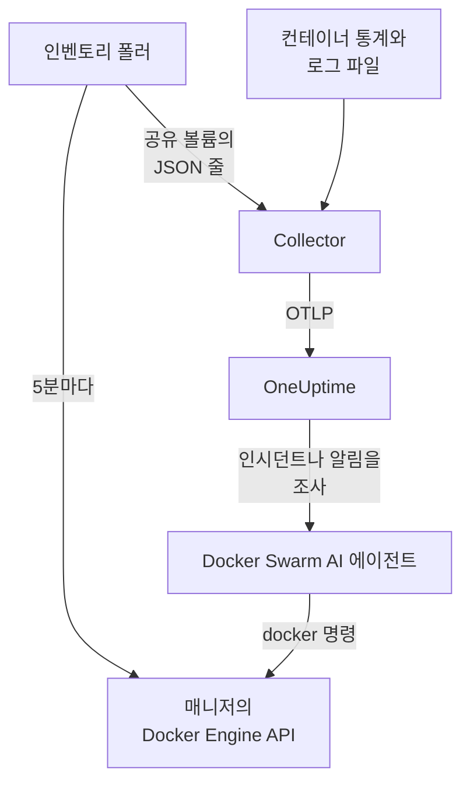

# Docker Swarm 에이전트

OneUptime Docker Swarm 에이전트는 Docker Swarm 클러스터의 노드, 서비스, 태스크, 스택, 오버레이 네트워크, 시크릿, 컨피그, 볼륨과 각 컨테이너의 메트릭 및 로그를 모니터링합니다. Swarm 매니저 노드에서 Docker Compose로 실행하면 클러스터가 이 모든 것과 함께 OneUptime에 나타납니다. 들어오는 데이터에 대해서는 [Docker Swarm 모니터](/docs/monitor/docker-swarm-monitor)가 알림을 보냅니다.

:::cards
- [에이전트 설치](#에이전트-설치): 매니저 노드에서 설치 스크립트나 Docker Compose를 사용합니다.
- [에이전트가 수집하는 항목](#에이전트가-수집하는-것): 인벤토리, 클러스터 집계, 컨테이너 메트릭과 로그.
- [AI 에이전트](#ai-에이전트): OneUptime AI가 조사하는 동안 Swarm을 읽게 합니다.
- [문제 해결](#문제-해결): 진단 스크립트와 일반적인 문제.
:::

## 작동 방식

에이전트는 컨테이너 세 개이며, 모두 하나의 `docker-compose.yml`에 정의되어 있습니다:

1. **Collector**: OpenTelemetry Collector로, 각 컨테이너의 메트릭을 위해 `docker_stats`를 읽고, 컨테이너의 로그 파일을 따라가며, 인벤토리 스냅샷 파일도 따라갑니다. 모든 것에 클러스터 이름(`docker.swarm.cluster.name`)을 붙여 OTLP로 OneUptime에 보냅니다.
2. **인벤토리 폴러**: `curl`과 `jq`로 된 작은 사이드카로, 5분마다 Swarm 매니저의 API(`/nodes`, `/services`, `/tasks`, `/networks`, `/secrets`, `/configs`, `/volumes`)를 순회하고 서비스 레이블 `com.docker.stack.namespace`에서 스택을 알아냅니다. 객체마다 JSON 한 줄을 쓰고, Collector가 이를 전달합니다.
3. **AI 에이전트**: `oneuptime-docker-swarm-ai-agent`로, OneUptime AI가 이 클러스터의 인시던트나 알림을 조사하는 동안 요청하는 `docker` 명령을 실행합니다. 수정을 허용하지 않는 한 읽기 전용입니다([AI 에이전트](#ai-에이전트) 참고).



클러스터는 첫 데이터와 함께, 구성한 클러스터 이름으로 스스로 등록됩니다.

## 시작하기 전에

- 에이전트를 실행할 Swarm **매니저** 노드. 인벤토리 폴러와 AI 에이전트는 매니저만 응답하는 API 엔드포인트를 호출합니다.
- Docker Compose v2 플러그인이 있는 Docker Engine 20.10 이상.
- 수집 키. **프로젝트 설정 → 텔레메트리 및 APM → 수집 키**에서 만들고 값을 복사합니다.
- 노드에서 OneUptime URL로 나가는 HTTPS.

### 에이전트를 실행할 위치

매니저 노드에서 실행하세요. Collector는 자신이 실행되는 노드의 컨테이너를 보고하므로, 모든 노드의 컨테이너 메트릭을 얻으려면 모든 노드에서 Collector를 실행하되 모두 같은 `DOCKER_SWARM_CLUSTER_NAME`을 쓰세요. 인벤토리 폴러와 AI 에이전트는 매니저 하나에서만 실행하면 됩니다. `install.sh`는 매니저가 아닌 노드에서는 AI 에이전트를 빼고, 이전에 그곳에 설치한 것은 제거합니다. 그래도 워커에서 시작된 AI 에이전트는 클러스터에 등록되지 않습니다. 노드가 매니저가 될 때까지 기다리므로 매니저의 AI 에이전트를 밀어낼 수 없습니다. Compose 대신 Swarm 스택으로 에이전트를 배포하나요? 제약 조건 `node.role == manager`로 인벤토리 폴러와 AI 에이전트를 매니저에 두세요.

## 에이전트 설치

:::steps
### 에이전트 설치 및 시작

:::tabs
@tab install.sh
설치 스크립트를 내려받아 매니저 노드에서 실행하세요:

```bash
curl -sSL https://raw.githubusercontent.com/OneUptime/oneuptime/master/agents/DockerSwarmAgent/install.sh -o install.sh
sh install.sh
```

스크립트는 OneUptime URL, 수집 키, 클러스터 이름을 묻습니다. `/opt/oneuptime-docker-swarm-agent`에 설치하고, 소유자만 읽을 수 있는 `.env` 파일을 쓰고, 컨테이너 세 개를 모두 시작합니다. AI 에이전트를 빼려면 `--no-ai-agent`를 추가하세요.
@tab Docker Compose
[DockerSwarmAgent 디렉터리](https://github.com/OneUptime/oneuptime/tree/master/agents/DockerSwarmAgent)에서 `docker-compose.yml`, `otel-collector-config.yaml`, `inventory-snapshot.sh`를 매니저 노드의 새 폴더로 내려받으세요:

```bash
curl -fsSL https://raw.githubusercontent.com/OneUptime/oneuptime/master/agents/DockerSwarmAgent/docker-compose.yml -o docker-compose.yml
curl -fsSL https://raw.githubusercontent.com/OneUptime/oneuptime/master/agents/DockerSwarmAgent/otel-collector-config.yaml -o otel-collector-config.yaml
curl -fsSL https://raw.githubusercontent.com/OneUptime/oneuptime/master/agents/DockerSwarmAgent/inventory-snapshot.sh -o inventory-snapshot.sh
chmod +x inventory-snapshot.sh
```

그 옆에 `.env` 파일을 만드세요. 수집 키가 들어 있으므로 `chmod 600 .env`로 비공개로 유지하세요:

```bash title=".env"
ONEUPTIME_URL=https://oneuptime.com
ONEUPTIME_SERVICE_TOKEN=your-telemetry-ingestion-key
DOCKER_SWARM_CLUSTER_NAME=my-swarm
```

에이전트를 시작하세요:

```bash
docker compose up -d
```
:::

### 에이전트가 실행 중인지 확인

```bash
docker compose ps
docker compose logs --tail 50 oneuptime-docker-swarm-agent oneuptime-docker-swarm-inventory
```

`docker compose ps`에는 컨테이너 세 개가 표시됩니다. Collector(`oneuptime-docker-swarm-agent`), 인벤토리 폴러(`oneuptime-docker-swarm-inventory`), AI 에이전트(`oneuptime-docker-swarm-ai-agent`)입니다.

### OneUptime에서 클러스터 찾기

**제품 → 인프라 → Docker Swarm → 모든 클러스터**를 여세요. 몇 분 안에 클러스터가 나타나고, 첫 인벤토리 스냅샷 이후 5분 안에 **노드**, **서비스**, **작업**, **Stacks**, **네트워크**, **시크릿**, **Configs**, **볼륨** 페이지가 채워집니다.
:::

## 환경 변수

설치 스크립트는 처음 세 개를 `/opt/oneuptime-docker-swarm-agent/.env`에 씁니다. Docker Compose 설치는 `docker-compose.yml` 옆의 `.env`에서 읽습니다. 거기서 어느 것이든 추가하거나 바꾼 다음, 그 폴더에서 `docker compose up -d`를 실행하세요.

| 변수 | 필수 | 설명 |
| --- | --- | --- |
| `ONEUPTIME_URL` | 예 | OneUptime URL(예: `https://oneuptime.com` 또는 자체 호스팅 인스턴스). 인스턴스가 HTTP 전용이면 `http://`와 해당 포트를 사용하세요. |
| `ONEUPTIME_SERVICE_TOKEN` | 예 | **프로젝트 설정 → 텔레메트리 및 APM → 수집 키**의 수집 키. |
| `DOCKER_SWARM_CLUSTER_NAME` | 예 | OneUptime에서의 클러스터 이름이자 모든 노드의 데이터를 묶는 키로, 모든 것에 `docker.swarm.cluster.name` 리소스 속성으로 붙습니다. 바꾸지 마세요. 나중에 바꾸면 별도의 클러스터가 등록됩니다. 기본값은 `docker-swarm`입니다. |
| `DOCKER_INVENTORY_INTERVAL_SECONDS` | 아니요 | 인벤토리 폴러가 스냅샷을 찍는 간격(초). 기본값은 `300`입니다. |
| `DOCKER_API_VERSION` | 아니요 | Collector와 인벤토리 폴러가 사용하는 Docker Engine API 버전. 기본값은 `1.44`이며, 비워 두면 데몬과 협상합니다([문제 해결](#문제-해결) 참고). AI 에이전트는 지정하지 않는 한 협상합니다. |

AI 에이전트 자체의 설정은 [AI 에이전트](#ai-에이전트)에 있습니다.

## 에이전트가 수집하는 것

| 신호 | 소스 | 표시되는 곳 |
| --- | --- | --- |
| 노드, 서비스, 태스크, 스택, 네트워크, 시크릿, 컨피그, 볼륨 | 인벤토리 폴러, Swarm 매니저의 API에서 | 클러스터의 목록과 세부 정보 페이지 |
| 클러스터 집계(준비된 노드, 실행 중인 태스크, 서비스, 스택 등) | 같은 스냅샷 | 개요의 카드와 사이드 메뉴의 배지 |
| 컨테이너 CPU, 메모리, 프로세스 수, 가동 시간 | `docker_stats` 리시버 | **메트릭** 페이지 |
| 컨테이너 stdout 및 stderr 로그 | `filelog` 리시버 | **로그** 페이지 |

### Docker 에이전트와의 차이

[Docker 에이전트](/docs/telemetry/docker-host)는 호스트 하나를 모델링하며 `host.name`과 `container.runtime=docker`를 붙입니다. Docker Swarm 에이전트는 의도적으로 `docker.swarm.cluster.name`만 붙입니다. 그러면 OneUptime은 각 노드를 별도의 호스트로 등록하는 대신 데이터를 Swarm 클러스터 아래에 정리합니다.

## 프로젝트 레이블로 클러스터에 태그 붙이기

`oneuptime.label.`로 시작하는 리소스 속성은 클러스터의 프로젝트 레이블이 됩니다. `oneuptime.label.<dimension>=<value>`는 레이블 `<dimension>:<value>`입니다. `otel-collector-config.yaml`의 `resource` 프로세서에 `docker.swarm.cluster.name`과 나란히 속성을 추가하세요:

```yaml
processors:
  resource:
    attributes:
      # ...existing attributes...
      - key: oneuptime.label.team
        value: platform
        action: upsert
      - key: oneuptime.label.env
        value: production
        action: upsert
```

Collector는 시작할 때만 구성을 읽습니다. `docker compose restart oneuptime-docker-swarm-agent`를 실행하세요. 그러면 클러스터에 `team:platform`과 `env:production` 레이블이 표시됩니다. 레이블은 대소문자를 구분하지 않고 비교되므로 기존 `Production` 레이블은 중복되지 않고 재사용되며, 에이전트는 누군가 OneUptime에서 추가한 레이블을 절대 제거하지 않습니다.

## systemd 서비스로 실행

노드와 함께 에이전트를 시작하고 실패하면 다시 시작하려면 systemd 유닛을 설치하세요. 설치 스크립트가 에이전트를 두는 `/opt/oneuptime-docker-swarm-agent`에 에이전트가 있다고 가정합니다:

```bash
sudo curl -fsSL https://raw.githubusercontent.com/OneUptime/oneuptime/master/agents/DockerSwarmAgent/systemd/oneuptime-docker-swarm-agent.service -o /etc/systemd/system/oneuptime-docker-swarm-agent.service
sudo systemctl daemon-reload
sudo systemctl enable --now oneuptime-docker-swarm-agent
```

## 에이전트 업그레이드

에이전트는 실행 중인 Collector 버전을 보고합니다. 그 버전이 이 OneUptime 릴리스가 고정한 버전보다 오래되었으면, 클러스터의 **개요** 페이지에서 에이전트 버전 옆에 경고 표시가 나타납니다. 이를 선택하면 다음 명령을 볼 수 있습니다.

매니저 노드에서 설치 스크립트를 다시 실행하고, 같은 URL, 키, 클러스터 이름으로 질문에 답하세요. 최신 파일을 내려받고, 이미지를 가져오고, 에이전트를 다시 시작합니다:

```bash
curl -sSL https://raw.githubusercontent.com/OneUptime/oneuptime/master/agents/DockerSwarmAgent/install.sh -o install.sh
sh install.sh
```

스크립트는 답변을 바탕으로 `.env`를 다시 씁니다. 유지되는 것은 AI 에이전트의 대상 목록과 AI가 할 수 있는 작업(`ONEUPTIME_AI_INVESTIGATION`, `ONEUPTIME_AI_FIXES`)뿐입니다. `DOCKER_API_VERSION`처럼 직접 설정한 변수는 다시 추가하세요. AI 수정을 켰나요? 계속 켜 두려면 `ONEUPTIME_AI_ALLOW_WRITES=true sh install.sh`로 실행하세요. AI 에이전트를 뺐나요? `--no-ai-agent`를 다시 전달하세요.

Docker Compose를 사용한다면 에이전트의 폴더에서 세 파일을 다시 내려받고(`docker-compose.yml`에 가한 변경이 있으면 다시 적용), 이미지를 가져와 다시 시작하세요:

```bash
docker compose pull
docker compose up -d
```

Collector 버전은 파일에 고정되어 있으므로, 가져오기만으로는 에이전트가 새 버전이 되지 않습니다.

## 에이전트 제거

```bash
cd /opt/oneuptime-docker-swarm-agent
docker compose down
```

## AI 에이전트

Swarm의 `docker-compose.yml`(과 `install.sh`)은 **Docker Swarm AI 에이전트**도 실행합니다. 세 번째 컨테이너인 `oneuptime-docker-swarm-ai-agent`(이미지 `oneuptime/resource-ai-agent:release`)로, OneUptime AI가 이 클러스터의 인시던트나 알림을 조사하는 동안 요청하는 읽기 전용 `docker` 명령(`docker node ls`, `docker service ps web --no-trunc`, `docker service logs --tail 200 web`)을 실행하고, 허용한 경우에만 이름을 지정한 서비스의 롤링 재시작 같은 수정을 적용합니다. Collector와 같은 `ONEUPTIME_URL`, `ONEUPTIME_SERVICE_TOKEN`, `DOCKER_SWARM_CLUSTER_NAME`을 읽으므로 바로 이 클러스터를 담당하며, OneUptime에서 클러스터의 **AI → AI 에이전트** 페이지에 표시됩니다.

- **AI 조사는 기본적으로 켜져 있습니다.** 에이전트가 연결되면 OneUptime AI가 에이전트로 이 클러스터의 인시던트와 알림을 조사하며, 클러스터의 **개요**에 에이전트 상태가 표시됩니다. 중지하려면 에이전트가 실행되는 곳에서 `ONEUPTIME_AI_INVESTIGATION=false`를 설정하거나(AI 에이전트 페이지의 **AI가 할 수 있는 작업** 아래 **변경**에서 방법을 볼 수 있습니다) 에이전트를 빼세요.
- 인벤토리 폴러처럼 **매니저 노드에서 실행해야 합니다**. 노드, 서비스, 태스크 명령은 매니저에서만 쓸 수 있기 때문입니다. 워커에서는 아무것도 실행하지 않으며, 노드가 매니저가 될 때까지 클러스터에 등록되지 않습니다(이유는 `/status`에 표시됩니다). 클러스터마다 하나를 실행하세요.
- `.env`에 `ONEUPTIME_AI_ALLOW_WRITES=true`를 설정하고 `docker compose up -d`를 실행하지 않는 한(또는 그 변수와 함께 `install.sh`를 실행하지 않는 한) **읽기 전용**입니다. 설치 프로그램은 환경에서 `ONEUPTIME_AI_ALLOW_WRITES`, `ONEUPTIME_AI_INVESTIGATION`, `ONEUPTIME_AI_FIXES`, `ONEUPTIME_AI_WRITE_TARGETS`, `ONEUPTIME_AI_PROTECTED_TARGETS`를 `.env`에 쓰며, 다시 실행할 때는 그 변수를 (비어 있더라도) 전달하지 않는 한 마지막 네 개에 대해 `.env`에 이미 있는 값을 유지합니다. `ONEUPTIME_AI_WRITE_TARGETS`(서비스 및 노드 이름 글로브, 예: `web_*,api_*`)는 수정이 건드릴 수 있는 범위를 제한합니다. 같은 `.env`의 `ONEUPTIME_AI_FIXES`는 수정이 실행되는 방식을 정합니다. `ask-for-approval`(사람이 하나씩 승인), `automatic`, `bypass-approval` 중 하나이며, AI 에이전트 페이지에 읽기 전용으로 표시됩니다([에이전트가 설정하는 AI가 할 수 있는 작업](/docs/ai/infrastructure-ai-agents#what-ai-may-do-set-by-the-agent)). 노드 드레인은 모드와 관계없이 항상 사람의 승인이 필요합니다.
- Docker 소켓을 마운트한 채 root로 실행됩니다. 소켓의 소유자가 root이기 때문입니다. 그리고 매니저에서는 소켓을 쓸 수 있는 사람이 `:ro` 여부와 관계없이 Swarm 전체를 제어합니다. 한계를 정하는 것은 에이전트의 명령 정책입니다. 서비스나 스택을 만들거나 제거하지 않고, 시크릿이나 컨피그를 건드리지 않으며, 자기 자신, Collector, 인벤토리 폴러, `ONEUPTIME_AI_PROTECTED_TARGETS`(서비스 및 노드 이름 글로브)에 있는 어떤 것도 절대 바꾸지 않습니다.
- `install.sh --no-ai-agent`로 빼거나, `docker-compose.yml`에서 `oneuptime-docker-swarm-ai-agent` 서비스를 삭제하세요.

실행할 수 있는 명령, 수정이 동작하는 방식, 문제 해결 방법: [Infrastructure AI Agents](/docs/ai/infrastructure-ai-agents#docker-swarm-clusters).

## 문제 해결

:::details 먼저 진단 스크립트 실행
에이전트에는 전체 체인을 확인하는 스크립트 [`troubleshoot.sh`](https://github.com/OneUptime/oneuptime/blob/master/agents/DockerSwarmAgent/troubleshoot.sh)가 함께 제공됩니다. 컨테이너, 인벤토리 폴러가 매니저에 있는지(`docker node ls`), 스냅샷 파일, 모든 것에 붙은 클러스터 이름, 토큰 형식, Collector 자체 메트릭, 그리고 OneUptime이 수집 키를 받아들이는지를 확인합니다. 마지막 확인이 가장 중요합니다. OneUptime은 잘못된 키를 `401`로 거부하며(비활성화된 키나 브라우저 키는 `422`), Collector는 이를 배치마다 `Exporting failed` 한 줄로 기록할 뿐이어서 놓치기 쉽습니다. 스크립트는 `GET <url>/otlp/v1/validate`를 요청해 `200`(유효) 또는 `401`(무효)을 직접 받습니다. 매니저 노드에서 실행하세요:

```bash
curl -sSL https://raw.githubusercontent.com/OneUptime/oneuptime/master/agents/DockerSwarmAgent/troubleshoot.sh -o troubleshoot.sh
bash troubleshoot.sh    # add -d <dir> if you installed outside /opt/oneuptime-docker-swarm-agent
```
:::

:::details 클러스터가 나타나지 않음
먼저 진단 스크립트를 실행하세요. 그 밖에는 Collector의 로그(`docker compose logs oneuptime-docker-swarm-agent`)를 읽고, `.env`의 `ONEUPTIME_SERVICE_TOKEN`과 `ONEUPTIME_URL`이 올바른지, 노드가 OneUptime URL에 연결되는지 확인하세요.
:::

:::details 인벤토리가 나타나지 않음
인벤토리 폴러가 매니저에서 실행되는지 확인하세요. 그곳에서 `docker node ls`가 성공해야 합니다. 그런 다음 로그에서 `failed to emit ...` 줄을 찾으세요: `docker compose logs oneuptime-docker-swarm-inventory`.
:::

:::details 클러스터가 연결 끊김으로 바뀜
OneUptime이 15분 동안 클러스터에서 아무것도 받지 못하면 클러스터는 연결 끊김 상태가 됩니다. OneUptime은 5분마다 확인하며, OneUptime 자체가 데이터를 받지 못한 시간은 계산하지 않습니다. Collector 컨테이너가 계속 실행 중인지 확인하세요. `docker compose ps`에 표시됩니다.
:::

:::details Collector가 "client version is too new"로 종료됨
Collector의 로그에 다음이 표시됩니다:

```text
Error: cannot start pipelines: failed to start "docker_stats" receiver:
Error response from daemon: client version 1.44 is too new.
Maximum supported API version is 1.41
```

데몬의 가장 높은 API 버전이 기본값 `1.44`보다 낮아서(Docker Engine 20.10은 `1.41`까지), `docker_stats` 리시버가 시작되지 못하고 컨테이너가 계속 재시작됩니다. 데몬의 가장 높은 버전을 확인하세요:

```bash
docker version --format '{{ .Server.APIVersion }}'
```

`.env`에서 `DOCKER_API_VERSION`을 그 값으로 설정하고, 에이전트가 실행되는 모든 노드에서 `docker compose up -d`를 실행하세요. 새 데몬도 이전 API 버전을 계속 지원하므로, Docker를 업그레이드한 뒤에도 이 설정은 계속 동작합니다. 또는 `DOCKER_API_VERSION=`(빈 값)으로 설정하면 Collector가 버전을 고정하지 않고 데몬과 협상합니다.
:::

:::details 클러스터가 잘못된 이름으로 나타남
클러스터 이름은 `DOCKER_SWARM_CLUSTER_NAME`에서 옵니다. `.env`에서 바꾸고 `docker compose up -d`를 실행하세요. 새 이름은 기존 클러스터의 이름을 바꾸는 대신 새 클러스터를 등록합니다.
:::

## 다음 단계

:::cards
- [Docker Swarm 모니터](/docs/monitor/docker-swarm-monitor): 노드, 서비스, 태스크, 컨테이너에 대해 알림을 보냅니다.
- [Infrastructure AI Agents](/docs/ai/infrastructure-ai-agents): Docker Swarm AI 에이전트가 실행할 수 있는 명령과 수정이 동작하는 방식.
- [Docker 에이전트](/docs/telemetry/docker-host): 대신 Docker 호스트 하나를 모니터링합니다.
:::
