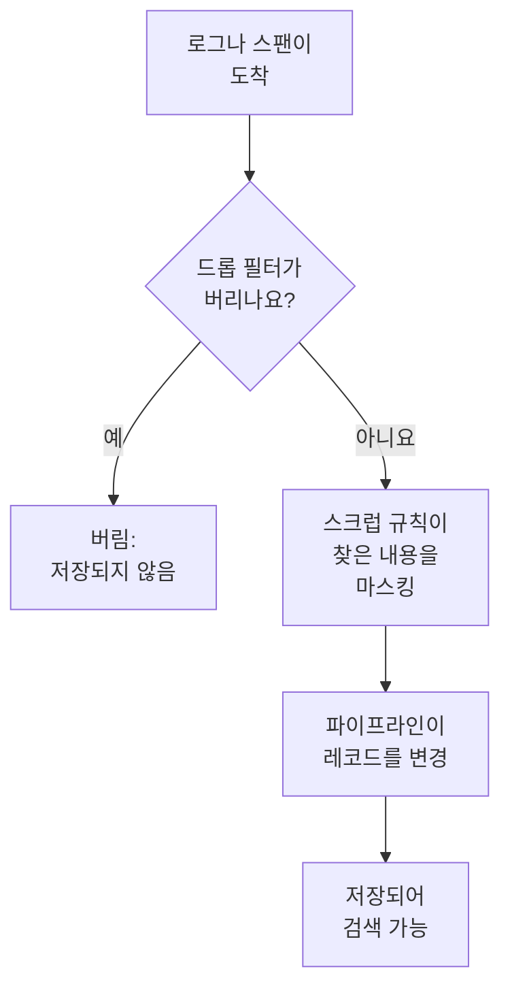

# 드롭 필터 및 스크럽 규칙

드롭 필터와 스크럽 규칙은 로그와 스팬이 도착하는 즉시, 무엇이든 저장되기 전에 작동합니다. 드롭 필터는 전혀 필요 없는 레코드를 버리거나, 그중 일부 샘플만 남깁니다. 스크럽 규칙은 이메일 주소, 카드 번호, 비밀번호 같은 개인 데이터와 시크릿을 가려서 저장소에 닿지 않게 합니다.

:::cards
- [실행되는 위치](#실행되는-위치): 파이프라인보다 먼저, 저장보다 먼저.
- [레코드 버리기 또는 샘플링](#레코드-버리기-또는-샘플링): 레코드를 골라 버리거나 일부만 남깁니다.
- [민감한 데이터 스크럽](#민감한-데이터-스크럽): 패턴이 찾은 것을 가리거나, 마스킹하거나, 해시합니다.
- [필터가 버린 것 확인](#필터가-버린-것-확인): 필터마다 표시되는 개수.
:::

## 실행되는 위치

로그용은 **로그 → 설정**에, 스팬용은 **트레이스 → 설정**에 있습니다. 레코드가 도착하면 OneUptime은 다음 순서로 실행합니다.



- **새 레코드에만 작동합니다.** 만들거나 바꾼 규칙은 약 1분 뒤에 도착하는 레코드부터 적용됩니다. 이미 저장된 레코드는 바뀌지 않습니다.
- **버린 레코드는 사라집니다.** 어떤 검색, 차트, 모니터, 기록 규칙도 그 레코드를 보지 못하며, 그 레코드로 예외가 만들어지지도 않습니다. OneUptime Cloud에서는 요금도 청구되지 않습니다.
- **각 목록은 순서대로 실행됩니다.** 순서를 바꾸려면 목록의 행을 끌어 옮깁니다. 활성화된 필터와 규칙만 실행됩니다.

로그 드롭 필터와 스크럽 규칙은 OpenTelemetry, Syslog, Fluent Bit, Fluentd에서 온 로그에 똑같이 적용됩니다. 그다음 단계는 [로그 파이프라인](/docs/telemetry/log-pipelines)에서 설명합니다.

## 시작하기 전에

- **들어오는 로그나 스팬.** [OpenTelemetry](/docs/telemetry/open-telemetry)를 참고하세요.
- **텔레메트리 설정을 바꾸는 역할.** Project Owner 또는 Project Admin, 아니면 바꾸려는 대상에 대한 권한(예: Create Log Drop Filter 또는 Create Trace Scrub Rule)이 있는 사용자 지정 역할입니다. Telemetry 역할은 필터와 규칙을 볼 수 있지만 바꿀 수는 없습니다.

## 레코드 버리기 또는 샘플링

:::steps
### 드롭 필터 열기

**로그 → 설정 → 드롭 필터**로 이동합니다. 스팬은 **트레이스 → 설정 → 드롭 필터**로 이동합니다.

### 레코드 고르기

**로그 드롭 필터 만들기**를 클릭합니다. 스팬은 **트레이스 드롭 필터 만들기**를 클릭합니다. **일치** 단계에서 필터에 **이름**을 붙이고 **필터 쿼리**를 만듭니다. 조건마다 필드, 연산자, 값을 정하고, **모든 조건**과 **하나 이상의 조건** 중 어느 쪽이 일치해야 하는지 고릅니다. **다음**을 클릭합니다.

### 작업 고르기

**작업** 단계에서 일치하는 레코드를 모두 버리려면 **삭제**를 그대로 두고, 아니면 **샘플**을 골라 남길 **샘플 비율**을 1에서 99 사이로 입력합니다. 그런 다음 필터를 만듭니다.
:::

필터는 1분 안에 레코드를 버리기 시작합니다. 아직 아무것도 버리지 않고 저장만 하려면, 만들기 전에 **고급** 아래의 **활성화됨**을 끕니다.

> [!WARNING]
> 버린 레코드는 되살릴 수 없습니다. 필터의 쿼리는 좁게 유지하고, 만든 뒤에는 **Dropped** 개수를 지켜보세요.

필터는 다음 필드와, **Custom Attribute...** 항목으로 지정한 모든 속성을 검사할 수 있습니다.

| 레코드 | 필드 |
| --- | --- |
| 로그 | **심각도**, **로그 본문**, **서비스 ID** |
| 스팬 | **스팬 이름**, **스팬 종류**, **상태**, **상태 메시지**, **서비스 ID**, **예외 있음**, **루트 스팬 여부** |

| 연산자 | 일치하는 것 |
| --- | --- |
| **같음** | 대소문자까지 정확히 같은 값. `Debug`는 일치하지만 `DEBUG`는 일치하지 않습니다. |
| **같지 않음** | 정확히 같은 값을 제외한 모든 것. |
| **포함** | 대소문자와 관계없이 필드 안 어디에든 있는 값. 값 안의 `%`는 와일드카드입니다. |
| **다음 중 하나** | 쉼표로 구분한 정확한 값 목록 중 하나. |

**Preview query** 항목은 조건으로 만들어지는 쿼리를 보여 줍니다. 다음 쿼리는 헬스 체크의 디버그 줄을 버립니다.

```text
severityText = 'Debug' AND body LIKE 'healthcheck'
```

샘플링은 레코드마다 따로 결정됩니다. **샘플 비율**이 10이면 일치하는 레코드 열 개 중 약 하나가 남습니다. 필터는 목록 순서대로 실행되며, 레코드를 처음 버리는 필터가 결정합니다. 샘플로 남은 레코드는 다음 필터로 넘어갑니다.

## 민감한 데이터 스크럽

:::steps
### 스크럽 규칙 열기

**로그 → 설정 → 스크럽 규칙**으로 이동합니다. 스팬은 **트레이스 → 설정 → 스크럽 규칙**으로 이동합니다.

### 찾을 대상 고르기

**로그 스크럽 규칙 만들기**를 클릭합니다. 스팬은 **트레이스 스크럽 규칙 만들기**를 클릭합니다. 그런 다음 **패턴 유형**을 고릅니다. 직접 이름을 입력하기 전까지 규칙에는 **이메일 주소 스크럽**처럼 패턴에 맞춘 이름이 붙습니다. **사용자 지정 정규식**의 경우 **사용자 지정 정규식 패턴**도 입력합니다.

### 스크럽 방법 고르기

**고급** 아래에서 **스크럽 작업**과 **정리할 필드**를 고르거나 그대로 둡니다. 새 규칙은 레코드의 어디에 있든 일치하는 부분을 `[REDACTED]`로 바꿉니다. 그런 다음 규칙을 만듭니다.
:::

| 패턴 유형 | 찾는 것 |
| --- | --- |
| **이메일 주소** | `jane@example.com` 같은 이메일 주소 |
| **신용 카드 번호** | `4111 1111 1111 1111`처럼 네 자리씩 묶은 열여섯 자리 숫자 |
| **SSN (사회 보장 번호)** | `123-45-6789` 같은 미국 사회 보장 번호 |
| **전화번호** | `555-123-4567` 같은 북미 전화번호 |
| **IP 주소** | `192.168.1.1` 같은 IPv4 주소 |
| **Sensitive Attribute Keys** | `password`, `token`, `api_key`, `authorization`, `cookie`처럼 키가 비밀스러워 보이는 속성의 값 전체 |
| **사용자 지정 정규식** | 슬래시나 플래그 없이 쓴 직접 만든 정규식으로, 대소문자를 구분해 비교합니다 |

| 스크럽 작업 | 일치한 부분이 바뀌는 모습 |
| --- | --- |
| **삭제 처리** | `[REDACTED]`, 기본값 |
| **마스크** | 대부분 가립니다. 이메일 주소는 첫 글자와 도메인의 끝을, 카드 번호, 전화번호, 사회 보장 번호는 마지막 네 자리를, 사용자 지정 일치나 시크릿 값은 첫 글자와 마지막 글자를 남깁니다. IP 주소는 모두 가립니다. |
| **해시** | 값의 짧은 해시입니다. 같은 값이면 항상 같으므로 반복 횟수를 계속 셀 수 있습니다 |

예를 들어 **이메일 주소** 규칙은 다음 로그 본문을

```text
Payment failed for jane@example.com
```

**스크럽 작업**에 따라 다음 중 하나로 저장합니다.

```text
Redact: Payment failed for [REDACTED]
Mask:   Payment failed for j***@***.com
Hash:   Payment failed for [HASHED:8c87b489]
```

**정리할 필드** 값은 로그 규칙에서 **본문만** 또는 **속성만**을 고르지 않으면 **둘 다 (본문 및 속성)** 값이고, 스팬 규칙에서 **스팬 이름만**, **속성만**, **이벤트 속성만** 중 하나를 고르지 않으면 **전체 (이름, 속성 및 이벤트)** 값입니다. **Sensitive Attribute Keys** 규칙은 속성의 키를 읽으므로 항상 속성 값을 스크럽합니다.

- **예외는 스크럽된 레코드에서 만들어집니다.** 로그에서 찾은 예외는 스크럽 뒤에 만들어지고, 스팬 이벤트를 스크럽하는 규칙은 그 이벤트에 기록된 예외도 스크럽합니다.
- **Session Replay도 스크럽됩니다.** 로그 스크럽 규칙은 브라우저에서 레코더가 하는 마스킹에 더해 Session Replay 녹화에도 실행됩니다.
- **규칙은 목록 순서대로 실행됩니다.** 각 규칙은 앞선 규칙들이 남긴 내용을 봅니다.
- **사용자 지정 패턴에 걸리는 시간은 레코드 길이에 비례합니다.** 어떻게 쓰든 전방 탐색과 후방 탐색을 포함해 JavaScript 구문과 결과를 그대로 유지합니다. `\1` 같은 역참조는 그렇게 실행할 수 없으므로, 역참조가 있는 규칙은 저장할 때 거부되며, 너무 커서 실행할 수 없는 패턴도 마찬가지입니다. 모든 일치를 찾으려고 긴 값을 계속 다시 읽어야 한다면, 규칙은 값 전체를 스크럽합니다. 프로젝트의 드롭 필터, 스크럽 규칙, 파이프라인도 보내는 배치마다 배치 크기에 비례하는 작업 할당량을 함께 씁니다. 패턴에 그보다 많은 작업이 필요하면 사용자 지정 스크럽 규칙은 값 전체를 스크럽하고, 답할 수 없는 필터는 그 레코드에 적용되지 않습니다.

## 필터가 버린 것 확인

**드롭 필터** 목록에는 필터마다 **Dropped** 개수와 마지막으로 버린 시각인 **Last Dropped** 값이 표시됩니다. **Nothing dropped yet** 문구는 한 번도 일치한 적이 없다는 뜻입니다. 필터 자체의 페이지에는 같은 내용이 **활동** 아래에 표시되며, 버린 뒤 1분 안에 갱신됩니다. **필터 조건** 카드에는 필터가 고르는 대상이 표시되고, 거기서 조건을 바꿀 수 있습니다.

## 문제 해결

:::details 드롭 필터가 아무것도 버리지 않습니다
**같음**, **같지 않음**, **다음 중 하나**는 대소문자까지 포함해 정확한 텍스트를 비교합니다. 심각도는 `INFO`나 `WARN`이 아니라 `Information`과 `Warning`입니다. 필터가 활성화되어 있는지 확인하고, 바꾼 뒤에는 1분 기다리세요.
:::

:::details 기다리던 로그가 보이지 않습니다
각 드롭 필터의 **Dropped** 개수와 **Last Dropped** 시각을 확인하세요. 의심되는 필터의 **활성화됨**을 끄면 다음 로그부터 다시 들어옵니다.
:::

:::details 사용자 지정 스크럽 규칙에 '아무것도 스크럽하지 않음'이 표시됩니다
패턴이 비어 있거나, 유효한 정규식이 아니거나, `\1` 같은 역참조가 있는 것처럼 실행할 수 없어서 아무것도 스크럽하지 않습니다. 규칙을 편집해 적어도 한 글자와 일치하는 패턴을 지정하세요.
:::

:::details 오래된 레코드에 새 규칙이 스크럽하는 데이터가 아직 보입니다
스크럽 규칙은 레코드가 도착할 때 작동합니다. 규칙보다 먼저 저장된 레코드는 보존 기간이 끝날 때까지 원래 내용을 유지합니다. [데이터 보존](/docs/telemetry/data-retention)을 참고하세요.
:::

## 다음 단계

:::cards
- [로그 파이프라인](/docs/telemetry/log-pipelines): 남긴 로그를 파싱하고 보강합니다.
- [로그 탐색기](/docs/telemetry/logs-explorer): 저장된 것을 검색합니다.
- [트레이스 탐색기](/docs/telemetry/traces-explorer): 남긴 스팬을 따라갑니다.
- [데이터 보존](/docs/telemetry/data-retention): 얼마나 오래 보관할지 정합니다.
:::
