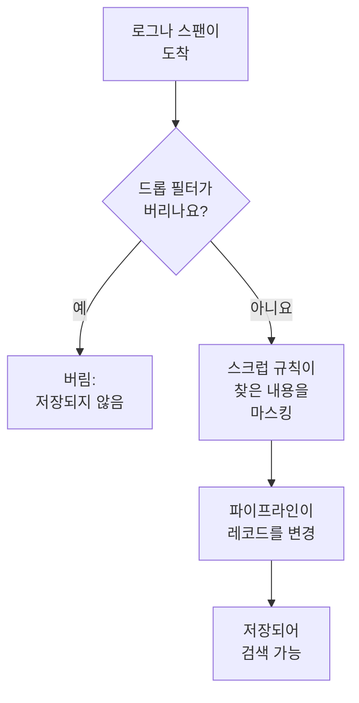

# 드롭 필터 및 스크럽 규칙

드롭 필터와 스크럽 규칙은 로그와 스팬이 도착하는 즉시, 무엇이든 저장되기 전에 작동합니다. 드롭 필터는 전혀 필요 없는 레코드를 버리거나, 그중 일부 샘플만 남깁니다. 스크럽 규칙은 이메일 주소, 카드 번호, 비밀번호 같은 개인 데이터와 시크릿을 가려서 저장소에 닿지 않게 합니다.

:::cards
- [실행되는 위치](#실행되는-위치): 파이프라인보다 먼저, 저장보다 먼저.
- [레코드 버리기 또는 샘플링](#레코드-버리기-또는-샘플링): 레코드를 골라 버리거나 일부만 남깁니다.
- [필터가 가져갈 것](#필터가-가져갈-것): 저장하기 전에, 레코드를 읽는 것을 확인합니다.
- [민감한 데이터 스크럽](#민감한-데이터-스크럽): 패턴이 찾은 것을 가리거나, 마스킹하거나, 해시합니다.
- [필터가 버린 것 확인](#필터가-버린-것-확인): 필터마다 표시되는 개수.
:::

## 실행되는 위치

로그용은 **로그 → 설정**에, 스팬용은 **트레이스 → 설정**에 있습니다. 레코드가 도착하면 OneUptime은 다음 순서로 실행합니다.



- **새 레코드에만 작동합니다.** 만들거나 바꾼 규칙은 약 1분 뒤에 도착하는 레코드부터 적용됩니다. 이미 저장된 레코드는 바뀌지 않습니다.
- **버린 레코드는 사라집니다.** 어떤 검색, 차트, 모니터, 기록 규칙도 그 레코드를 보지 못하며, 그 레코드로 예외가 만들어지지도 않습니다. OneUptime Cloud에서는 요금도 청구되지 않습니다.
- **각 목록은 순서대로 실행됩니다.** 순서를 바꾸려면 목록의 행을 끌어 옮깁니다. 활성화된 필터와 규칙만 실행됩니다.

로그 드롭 필터와 스크럽 규칙은 OpenTelemetry, Syslog, Fluent Bit, Fluentd에서 온 로그에 똑같이 적용됩니다. 그다음 단계는 [로그 파이프라인](/docs/telemetry/log-pipelines)에서 설명합니다.

## 시작하기 전에

- **들어오는 로그나 스팬.** [OpenTelemetry](/docs/telemetry/open-telemetry)를 참고하세요.
- **텔레메트리 설정을 바꾸는 역할.** 프로젝트 소유자 또는 프로젝트 관리자, 아니면 바꾸려는 대상에 대한 권한(예: Create Log Drop Filter 또는 Create Trace Scrub Rule)이 있는 사용자 지정 역할입니다. Telemetry 역할은 필터와 규칙을 볼 수 있지만 바꿀 수는 없습니다.

## 레코드 버리기 또는 샘플링

:::steps
### 드롭 필터 열기

**로그 → 설정 → 드롭 필터**로 이동합니다. 스팬은 **트레이스 → 설정 → 드롭 필터**로 이동합니다.

### 레코드 고르기

**로그 드롭 필터 만들기**를 클릭합니다. 스팬은 **트레이스 드롭 필터 만들기**를 클릭합니다. **일치** 단계에서 필터에 **이름**을 붙이고 **필터 쿼리**를 만듭니다. 조건마다 필드, 연산자, 값을 정하고, **모든 조건**과 **하나 이상의 조건** 중 어느 쪽이 일치해야 하는지 고릅니다. **다음**을 클릭합니다.

### 작업 고르기

**작업** 단계에서 일치하는 레코드를 모두 버리려면 **삭제**를 그대로 두고, 아니면 **샘플**을 골라 남길 **샘플 비율**을 1에서 99 사이로 입력합니다. 그런 다음 필터를 만듭니다.
:::

필터는 1분 안에 레코드를 버리기 시작합니다. 아직 아무것도 버리지 않고 저장만 하려면, 만들기 전에 **고급** 아래의 **활성화됨**을 끕니다.

> [!WARNING]
> 버린 레코드는 되살릴 수 없습니다. 필터의 쿼리는 좁게 유지하고, 만든 뒤에는 **삭제됨** 개수를 지켜보세요.

필터는 다음 필드와, **Custom Attribute...** 항목으로 지정한 모든 속성을 검사할 수 있습니다.

| 레코드 | 필드 |
| --- | --- |
| 로그 | **심각도**, **로그 본문**, **서비스 ID** |
| 스팬 | **스팬 이름**, **스팬 종류**, **상태**, **상태 메시지**, **서비스 ID**, **예외 있음**, **루트 스팬 여부** |

| 연산자 | 일치하는 것 |
| --- | --- |
| **같음** | 대소문자까지 정확히 같은 값. `Debug`는 일치하지만 `DEBUG`는 일치하지 않습니다. |
| **같지 않음** | 정확히 같은 값을 제외한 모든 것. |
| **포함** | 대소문자와 관계없이 필드 안 어디에든 있는 값. 값 안의 `%`는 와일드카드입니다. |
| **다음 중 하나** | 쉼표로 구분한 정확한 값 목록 중 하나. |

**Preview query** 항목은 조건으로 만들어지는 쿼리를 보여 줍니다. 다음 쿼리는 상태 확인의 디버그 줄을 버립니다.

```text
severityText = 'Debug' AND body LIKE 'healthcheck'
```

샘플링은 레코드마다 따로 결정됩니다. **샘플 비율**이 10이면 일치하는 레코드 열 개 중 약 하나가 남습니다. 필터는 목록 순서대로 실행되며, 레코드를 처음 버리는 필터가 결정합니다. 샘플로 남은 레코드는 다음 필터로 넘어갑니다.

## 필터가 가져갈 것

버린 레코드는 그것을 읽는 모든 것에서 사라집니다. 그래서 드롭 필터를 작성하는 동안 입력을 멈추고 잠시 지나면, 양식이 필터가 가져갈 것을 알려 줍니다. **일치** 단계에서는 **필터 쿼리** 아래에, **작업** 단계에서는 작업 아래에 표시됩니다. 한 줄은 가장 중요한 영향을 알려 주고, 나머지는 **세부 정보 보기**에서 볼 수 있습니다.

- **얼마나 일치하는지.** 지난 하루 동안 저장된 레코드 중 몇 개가 일치하는지, 즉 필터가 저장소와 청구서에서 빼 줄 양입니다. 개수는 스크럽 규칙과 파이프라인이 바꾼 뒤 저장된 내용을 기준으로 세며, 레코드를 읽을 수 있는 서비스만 대상으로 합니다. 10초보다 오래 걸리는 집계는 중단되며, 양식에 그렇게 표시됩니다.
- **보안 이벤트가 잃게 될 것.** [보안 이벤트](/docs/telemetry/security-events)가 **내 로그**로 로그를 읽거나 스팬을 읽는 경우, 양식은 일치한 레코드 중 보안 이벤트가 읽은 개수를 알려 줍니다. 보안 이벤트가 이벤트로 바꾸는 로그인, 공격, 방화벽 기록입니다. **샘플** 필터는 개수에 따라 발동하는 규칙도 알려 주고, 필터가 그 비율만 남기면 그 규칙이 어떻게 되는지도 알려 줍니다. 10%에서는 5분 동안 로그인 실패 10번에 발동하는 규칙에 약 100번이 필요하므로, 훨씬 드물게 발동하거나 전혀 발동하지 않습니다.
- **같은 레코드를 읽는 다른 것.** 쿼리가 필터가 가져갈 레코드를 포함할 수 있는 모니터, SLO, 위젯이 있는 대시보드, 기록 규칙, 저장된 보기입니다. 쿼리가 같은 종류의 레코드를 필터가 가져갈 수 있는 서비스에서 읽고, 정확한 값으로 고정한 조건 중 어느 것도 필터를 배제하지 않으면 그 레코드를 읽는 것으로 봅니다. **디버그** 로그 필터는 오류 모니터를 건드리지 않고, 한 서비스의 필터는 다른 서비스의 SLO를 건드리지 않습니다. 로그 본문 검색처럼 양식이 배제할 수 없는 것은 읽는 것으로 셉니다. 각각은 링크이며, 열 수 없는 것은 개수만 세고 이름은 밝히지 않습니다.

필터가 가져갈 것을 무언가가 읽고 있으면, 필터를 만들거나, 켜거나, 켜져 있는 필터의 쿼리나 작업을 바꿀 때 확인을 요청합니다. 그래도 필터를 저장할 수 있습니다. 확인은 알고서 결정하도록 하기 위한 것입니다. 아무것도 읽지 않는 필터는 확인 없이 저장됩니다.

API에서는 아무것도 묻지 않습니다. 스크립트나 Terraform에는 답할 사람이 없기 때문입니다. API로 만들거나 바꾼 필터는 저장되며, 다른 것이 읽는 것을 가져갈 때는 응답에 그 내용을 개수로 알려 주는 `X-OneUptime-Write-Warning` 헤더가 붙고, Terraform 프로바이더는 이를 경고로 보여 줍니다. 먼저 확인하려면 필터의 `filterQuery`, `action`, `samplePercentage`를 `POST /api/telemetry/logs/drop-filter-impact`로, 스팬은 `/api/telemetry/traces/drop-filter-impact`로 보내세요. 양식이 보여 주는 모든 것을 응답으로 돌려줍니다.

OneUptime이 프로젝트에 추가하는 OpenStack 필터는 OneUptime이 만든 그대로인 동안 보안 이벤트가 읽는 모든 줄을 남깁니다. 하나를 바꾸면 직접 만든 필터처럼 일치하는 것을 버립니다.

## 민감한 데이터 스크럽

:::steps
### 스크럽 규칙 열기

**로그 → 설정 → 스크럽 규칙**으로 이동합니다. 스팬은 **트레이스 → 설정 → 스크럽 규칙**으로 이동합니다.

### 찾을 대상 고르기

**로그 스크럽 규칙 만들기**를 클릭합니다. 스팬은 **트레이스 스크럽 규칙 만들기**를 클릭합니다. 그런 다음 **패턴 유형**을 고릅니다. 직접 이름을 입력하기 전까지 규칙에는 **이메일 주소 스크럽**처럼 패턴에 맞춘 이름이 붙습니다. **사용자 지정 정규식**의 경우 **사용자 지정 정규식 패턴**도 입력합니다. **지정한 속성**의 경우 **숨길 속성**을 한 줄에 하나씩 입력합니다.

### 스크럽 방법 고르기

**추가 필드** 아래에서 **스크럽 작업**과 **정리할 필드**를 고르거나 그대로 둡니다. 새 규칙은 레코드의 어디에 있든 일치하는 부분을 `[REDACTED]`로 바꿉니다. 그런 다음 규칙을 만듭니다.
:::

| 패턴 유형 | 찾는 것 |
| --- | --- |
| **이메일 주소** | `jane@example.com` 같은 이메일 주소이며, `张伟@example.com` 같은 다른 문자 체계의 주소, 퍼센트 인코딩된 URL 안의 주소, `ｊａｎｅ＠ｅｘａｍｐｌｅ．ｃｏｍ` 같은 전각으로 입력한 주소도 포함합니다 |
| **신용 카드 번호** | `4111 1111 1111 1111`이나 American Express 번호 같은 카드 번호이며, `４１１１ １１１１ １１１１ １１１１` 같은 다른 문자 체계의 숫자로 쓴 번호, `４１１１－１１１１－１１１１－１１１１` 같은 전부 전각으로 입력한 번호, `4111–1111–1111–1111` 같은 묶음 사이에 다른 대시가 있는 번호, 묶음 사이에 퍼센트 인코딩된 공백이나 더하기 기호가 있는 URL 안의 번호, 네 자리씩 묶은 임의의 열여섯 자리 숫자도 포함합니다 |
| **SSN (사회 보장 번호)** | `123-45-6789` 같은 미국 사회 보장 번호이며, 점, 공백, 다른 대시로 구분한 번호, URL 안의 번호, `１２３-４５-６７８９` 같은 다른 문자 체계의 숫자로 쓴 번호, 전부 전각으로 입력한 번호, 그 번호를 가리키는 단어 옆에 있거나 `customer.ssn` 같은 그 번호를 가리키는 키 아래에 홀로 있는 아홉 자리 연속 숫자도 포함합니다 |
| **전화번호** | `555-123-4567`이나 `+44 20 7946 0958` 같은 전화번호이며, 사람들이 쓰는 묶음 그대로의 국제 번호와 다른 대시로 구분한 번호, 퍼센트 인코딩된 URL 안의 번호(폼이 쓰는 방식 포함), 다른 문자 체계의 숫자로 쓴 번호, `＋８１ ３－１２３４－５６７８` 같은 전부 전각으로 입력한 번호, 그 번호를 가리키는 단어 옆에 있거나 `user.phone` 같은 그 번호를 가리키는 키 아래에 홀로 있는 국내 번호도 포함합니다. 소수, 시간대 오프셋, 버전은 포함하지 않습니다 |
| **IP 주소** | `203.0.113.7`, `2001:db8::1`, `2001::1` 같은 공용 IPv4 및 IPv6 주소이며, 키의 콜론 바로 뒤에 있는 주소와 퍼센트 인코딩된 URL 안의 주소도 포함하고, 사설, 루프백, 링크 로컬 주소는 제외됩니다 |
| **민감한 속성 키** | `password`, `token`, `api_key`, `authorization`, `cookie`처럼 키가 비밀스러워 보이는 속성의 값 전체 |
| **지정한 속성** | 지정한 속성의 값 전체로, 무엇이 들어 있든 숨깁니다. 예를 들어 `customer_name` 아래의 사람 이름입니다. 키는 그 아래에 중첩된 속성도 지정합니다: `user`는 `user.email`을 숨깁니다 |
| **사용자 지정 정규식** | 슬래시나 플래그 없이 쓴 직접 만든 정규식으로, 대소문자를 구분해 비교하며, 퍼센트 인코딩된 URL 안(폼이 쓰는 방식 포함)과 다른 문자 체계의 숫자로 쓴 값, 글자까지 전부 전각으로 입력한 값에서도 비교합니다 |

| 스크럽 작업 | 일치한 부분이 바뀌는 모습 |
| --- | --- |
| **삭제 처리** | `[REDACTED]`, 기본값 |
| **마스크** | 대부분 가립니다. 이메일 주소는 첫 글자와 도메인의 끝을, 카드 번호, 전화번호, 사회 보장 번호는 마지막 네 자리를, 사용자 지정 일치나 시크릿 값은 첫 글자와 마지막 글자를 남깁니다. IP 주소는 모두 가립니다. |
| **해시** | 프로젝트에만 있는 토큰입니다. 같은 값이면 항상 같으므로 반복 횟수를 계속 셀 수 있지만, 누구도 원래 값을 알아낼 수 없습니다 |

예를 들어 **이메일 주소** 규칙은 다음 로그 본문을

```text
Payment failed for jane@example.com
```

**스크럽 작업**에 따라 다음 중 하나로 저장합니다.

```text
Redact: Payment failed for [REDACTED]
Mask:   Payment failed for j***@***.com
Hash:   Payment failed for [HASHED:5e29db14e508e09a]
```

**정리할 필드** 값은 로그 규칙에서 **본문만** 또는 **속성만**을 고르지 않으면 **둘 다 (본문 및 속성)** 값이고, 스팬 규칙에서 **스팬 이름만**, **속성만**, **이벤트 속성만** 중 하나를 고르지 않으면 **전체 (이름, 속성 및 이벤트)** 값입니다. 스팬 링크의 속성은 스팬 자체의 속성과 함께 스크럽되며, **전체 (이름, 속성 및 이벤트)** 값은 스팬의 상태 메시지와 이벤트 이름도 스크럽합니다. **민감한 속성 키** 규칙은 키를 읽으므로 항상 그 아래의 값을 스크럽합니다. 속성과 로그의 JSON 본문이 그 대상입니다.

- **규칙은 한 서비스용으로 만들 수 있습니다.** **추가 필드** 에서 **하나의 서비스에만** 에 서비스를 고르면 규칙은 그 서비스의 레코드를 스크럽하고, 다른 서비스의 레코드는 그대로 둡니다. 비워 두면 모든 서비스의 레코드를 스크럽합니다. 목록의 **범위** 열에 어느 쪽인지 표시됩니다.
- **규칙은 읽는 속성을 지정할 수 있습니다.** **지정한 속성** 규칙은 지정한 속성을 숨깁니다. **민감한 속성 키** 를 제외한 다른 모든 패턴은 **추가 필드** 의 **이 속성에서만** 에 한 줄에 하나씩 적은 속성만 읽고, 비어 있으면 모든 속성을 읽습니다. 로그 본문, 또는 스팬의 이름과 상태 메시지는 계속 **정리할 필드** 에 따라 읽습니다. 데이터 보안이 발견 사항에 대해 만드는 규칙은 데이터가 발견된 속성만 읽으며, 그 양식에 그 속성이 표시되므로 `db.password_old` 같은 다른 속성을 추가하거나 비울 수 있습니다. 목록은 규칙의 **패턴 유형** 아래에 그 속성을 표시합니다. 규칙이 통째로 숨기는 속성이거나, 패턴이 읽는 유일한 속성입니다.
- **목록은 각 규칙이 바꾼 것을 알려 줍니다.** **변경된 값**은 각 규칙이 최근 7일 동안 숨긴 값을 세고, **서비스별**은 그 값이 어떤 서비스와 버전에서 왔는지 보여 줍니다. 규칙이 숨기는 것을 더 이상 보내지 않는 버전은 아무것도 바꾸지 않으므로, 코드에서 고친 유출이 여기에 드러납니다.
- **데이터 보안이 검증한 규칙은 그렇게 표시됩니다.** 발견 사항에 대해 만든 규칙은 저장되기 전에 데이터가 발견된 레코드에서 실행되었으며, 검증된 그 규칙으로 남아 있는 동안 **검증됨**이 표시됩니다([텔레메트리의 민감한 데이터](/docs/data-security/telemetry#발견된-레코드에서-검증) 참고). 찾는 대상, 읽는 속성, 정리 방식, 정리하는 위치, 서비스 중 하나라도 바꾸면 **검증됨**이 사라집니다. 같은 속성을 다른 순서나 다른 대소문자로 쓰면 그대로 남습니다.
- **양식은 규칙이 다른 것에 무엇을 바꿀지 알려 줍니다.** 규칙을 만들기 전과 규칙을 켤 때, OneUptime은 규칙이 숨길 값을 읽는 모니터, 대시보드, 저장된 보기, 기록 규칙, SLO를 각각 링크로 나열하고, [보안 이벤트](/docs/telemetry/security-events) 가 잃게 될 것도 알려 줍니다. 숨겨진 값으로 필터링하는 모니터는 더 이상 그 값과 일치하지 않습니다. 규칙은 어느 경우든 저장됩니다.
- **IP 주소 규칙은 개인 데이터인 주소를 숨깁니다.** 공용 IPv4 및 IPv6 주소이며, 어떻게 쓰였든 숨깁니다. `2001:db8::1`처럼 줄여 쓴 주소, `::` 양쪽에 그룹을 하나씩만 남긴 `2001::1` 같은 주소, `[2001:db8::1]:443`처럼 대괄호와 포트가 있는 주소(대괄호와 포트는 남깁니다), `2001:db8::2%eth0`처럼 영역이 있는 주소(영역은 남깁니다), 그리고 `::ffff:203.0.113.7`처럼 IPv6로 쓴 IPv4 주소는 통째로 숨깁니다. logfmt나 syslog의 로그 줄이 쓰듯 키의 콜론 바로 뒤에 있는 주소(`peer ip:2001:db8::1`, `remote:2001:db8::1` 등)는 주소만 숨기고, 키의 글자는 모두 남깁니다. `::` 양쪽에 그룹이 하나씩인 주소는 공용 주소처럼 첫 그룹이 2 또는 3으로 시작하는 16진수 네 자리일 때 주소로 보므로, `10::30` 이나 `ab::cd` 같은 텍스트는 남깁니다. URL 안에서 퍼센트 인코딩된 주소(`2001%3Adb8%3A%3A1` 을 담은 `/geo?ip=2001%3Adb8%3A%3A1` 등)는 디코딩해서 읽고, 이스케이프까지 포함해 쓰인 그대로 숨기며, URL의 나머지는 남깁니다. `10.0.0.12`, `127.0.0.1`, `fe80::1` 같은 사설, 루프백, 링크 로컬 주소와, 요청 URL에 있는 클라우드 메타데이터 주소 `169.254.169.254`는 남깁니다. [보안 이벤트](/docs/telemetry/security-events)가 여기서 서버 측 요청 위조를 찾기 때문입니다. 내부 주소도 숨기려면 이를 위한 **사용자 지정 정규식** 규칙을 추가하세요. 예를 들어 모든 IPv4 주소에는 `\b(?:\d{1,3}\.){3}\d{1,3}\b`를 씁니다. 규칙이 해시하지 않는 한, 보안 이벤트는 규칙이 스크럽하는 로그나 트레이스에서 찾은 공격에 대해 주소를 밝히지 않습니다([정리 규칙에 의해 숨겨짐](/docs/telemetry/security-events#정리-규칙에-의해-숨겨짐) 참고).
- **이메일 주소 규칙은 데이터 보안이 이메일 주소로 보는 것을 숨깁니다.** 자체 패턴이 찾는 것에 더해, `张伟@example.com`, `josé@example.com`, `user@例え.jp`처럼 어떤 문자 체계로 쓴 주소든 숨기고, URL 안에서 퍼센트 인코딩된 주소(`jane%40example.com` 을 담은 `/signup?email=jane%40example.com` 등)도, 글자의 UTF-8 바이트까지 인코딩된 주소(`jos%C3%A9%40example.com` 등)도 디코딩해서 읽고 쓰인 그대로 숨기며, URL의 나머지는 남깁니다. 전각 모드의 입력기가 입력하듯 전각으로 입력한 주소(`ｊａｎｅ＠ｅｘａｍｐｌｅ．ｃｏｍ` 등)나 `＠`만 전각인 주소도 숨깁니다. **마스크** 는 이런 주소를 디코딩하고 ASCII로 읽으므로, 다른 이메일 주소처럼 첫 글자와 도메인의 끝을 남깁니다.
- **신용 카드 번호 규칙은 데이터 보안이 카드 번호로 보는 것을 숨깁니다.** 네 자리씩 묶은 임의의 열여섯 자리 숫자에 더해, 데이터 보안이 찾는 모든 카드를 숨깁니다. 네 자리, 여섯 자리, 다섯 자리로 묶은 American Express 번호와 다른 문자 체계의 숫자로 쓴 카드가 그 예입니다. 일본어 텍스트가 카드를 쓸 때의 전각 숫자(`４１１１ １１１１ １１１１ １１１１` 등), 아랍-인도 숫자와 페르시아 숫자, 그 밖의 문자 체계의 숫자, 두 문자 체계로 입력한 카드도 숨깁니다. URL 안에서 묶음 사이를 퍼센트 인코딩된 공백이나 폼이 공백 대신 쓰는 더하기 기호로 구분한 카드도 숨기며, `4111%201111%201111%201111`이나 `4111+1111+1111+1111`(`/pay?card=4111+1111+1111+1111` 안) 같은 카드가 그 예입니다. URL의 나머지 부분은 그대로 남습니다. 묶음 사이를 전각 하이픈이나 전각 공백으로 구분해 전부 전각으로 입력한 카드(`４１１１－１１１１－１１１１－１１１１` 등)도 숨깁니다. 묶음 사이를 다른 대시로 구분한 카드도 숨기며, 이 대시는 두 숫자 사이에서 하이픈으로 읽습니다. 일본어 텍스트가 하이픈 대신 입력하는 장음 부호 `ー`, 조판용 하이픈, 피겨 대시, 엔 대시, 빼기 기호가 그것이며, `4111–1111–1111–1111` 같은 카드가 그 예입니다. **마스크** 는 마지막 네 자리를 ASCII 숫자로 남깁니다.
- **전화번호 또는 SSN 규칙은 데이터 보안이 그 번호로 보는 것을 숨깁니다.** 자체 패턴이 찾는 것에 더해, **전화번호** 규칙은 데이터 보안이 찾는 모든 전화번호를, **SSN (사회 보장 번호)** 규칙은 모든 미국 사회 보장 번호를 숨기며, 일본어나 중국어 텍스트가 번호를 쓰듯 더하기 기호, 하이픈, 괄호, 마침표, 전각 공백까지 전부 전각으로 입력한 번호(`＋８１ ３－１２３４－５６７８`이나 `５３６－２２－８７３１` 등)도 숨깁니다. 두 규칙은 또한 데이터 보안이 그 번호를 가리키는 단어가 옆에 있을 때만 그 번호로 보는 번호도 숨깁니다. tel, phone, mobile, fax 같은 단어가 바로 앞이나 뒤에 있는 9자리에서 12자리까지의 국내 전화번호(`tel 02012345678` 등)와, SSN이나 social security number 같은 단어 가까이에 있는 아홉 자리 연속 숫자(`SSN 536221234` 등)가 그것입니다. 그 단어는 데이터 보안이 찾는 범위만큼 번호 가까이에 있어야 합니다. `order 02012345678`과 `ref 536221234`는 남습니다. 속성의 키는 그 이름이 번호를 가리킬 때 그 단어가 되며, 이는 데이터 보안이 필드 이름을 읽는 방식과 같습니다. `user.phone` 아래에 홀로 있는 국내 번호와 `customer.ssn` 아래의 아홉 자리 숫자는 텍스트로 보내든 숫자로 보내든 숨기고, 그런 키 아래에서 값 전체가 전화번호 형태인 경우(`020 1234 5678` 등)도 숨깁니다. 목록이나 맵은 저장된 JSON 텍스트로 읽으므로, 그 안에서 키나 단어 옆에 있는 번호도 숨깁니다(`[{"system": "phone", "value": "02012345678"}]` 등). `order.id`처럼 아무것도 가리키지 않는 키 아래의 번호는 남습니다. 다만 규칙 자체의 패턴이 찾는 경우는 숨기며, 이 패턴은 임의의 열 자리 숫자를 찾습니다. 두 규칙은 또한 묶음 사이를 다른 대시로 구분한 번호도 숨기며, 이 대시는 두 숫자 사이에 있을 때만 하이픈으로 읽습니다. 일본어 텍스트가 하이픈 대신 입력하는 장음 부호(`＋８１ ３ー１２３４ー５６７８` 등)나 조판용 하이픈, 엔 대시, 빼기 기호(`536–22–8731` 등)가 그것입니다. 번호를 가리키는 단어는 전각으로 입력해도 인정됩니다(`ＴＥＬ` 등). **마스크** 는 마지막 네 자리를 ASCII 숫자로 남깁니다.
- **사용자 지정 정규식 규칙은 데이터 보안이 읽는 방식대로 값을 읽습니다.** 텍스트를 먼저 쓰인 그대로 읽고, 다음으로 문자의 UTF-8 바이트까지 포함해 퍼센트 이스케이프를 읽은 형태로, 그다음 폼이 공백마다 더하기 기호를 넣어 쓰는 URL 쿼리 문자열로 읽은 형태로, 그다음 모든 문자 체계의 숫자를 ASCII 숫자로 읽은 형태로, 그다음 번호의 전각 더하기 기호, 하이픈, 괄호, 마침표, 슬래시와 전각 공백, 두 숫자 사이의 다른 대시를 ASCII 문자로 읽은 형태로, 그다음 모든 전각 영문자, 숫자, 기호를 해당하는 ASCII 문자로 읽은 형태로 읽으며, 그중 어디에서 찾은 것이든 이스케이프까지 포함해 쓰인 그대로 숨깁니다. 예를 들어 `\+44 \d{2} \d{4} \d{4}`는 URL 안의 `%2B44%2020%207946%200958`과 `%2B44+20+7946+0958`, 아랍-인도 숫자로 쓴 `+٤٤ ٢٠ ٧٩٤٦ ٠٩٥٨`, 전부 전각으로 입력한 `＋４４ ２０ ７９４６ ０９５８`을 숨깁니다. **사용자 지정 정규식** 규칙 가운데 **정리**가 GitHub 토큰이나 IBAN 같은 다른 데이터 유형을 위해 만드는 규칙도 같은 방식으로 값을 읽으므로, 폼에 입력한 IBAN(`DE44+5001+0517+5407+3249+31` 등)이나 전각 영문자로 입력한 IBAN(`ＤＥ４４　５００１　０５１７　５４０７　３２４９　３１` 등)도 통째로 숨깁니다. **마스크** 는 규칙이 읽은 대로 일치한 부분의 첫 글자와 마지막 글자를 남깁니다.
- **해시 토큰은 프로젝트 고유의 것입니다.** 설치의 `ENCRYPTION_SECRET`에서 파생된 프로젝트 고유의 키로 만들어지므로, 같은 값도 다른 프로젝트에서는 다른 토큰이 되고, 토큰을 읽는 누구도 원래 값을 알아내거나 추측한 값을 해시해 비교할 수 없습니다. IP 주소는 어떻게 쓰였든 토큰이 하나입니다. `::ffff:203.0.113.7`과 `203.0.113.7`은 같은 토큰을 쓰고, `2001%3Adb8%3A%3A1`과 `2001:db8::1`도 마찬가지입니다. 퍼센트 인코딩된 이메일 주소와 쓰인 그대로의 이메일 주소(`jane%40example.com`과 `jane@example.com`, `jos%C3%A9%40example.com`과 `josé@example.com` 등), 다른 문자 체계의 숫자로 쓴 카드와 ASCII 숫자로 쓴 카드, URL 안에 쓴 카드와 그냥 쓴 카드(`4111+1111+1111+1111`과 `4111 1111 1111 1111` 등), 전부 전각으로 입력한 번호와 ASCII로 입력한 번호(`＋８１ ３－１２３４－５６７８`과 `+81 3-1234-5678` 등), 다른 대시로 구분한 번호와 하이픈으로 구분한 번호(`536–22–8731`과 `536-22-8731` 등), 전각으로 입력한 이메일 주소와 ASCII로 입력한 이메일 주소(`ｊａｎｅ＠ｅｘａｍｐｌｅ．ｃｏｍ`과 `jane@example.com` 등)도 마찬가지이고, **사용자 지정 정규식** 규칙이 찾은 것도 규칙이 읽은 값에 따라 마찬가지입니다. 토큰에 키가 없던 때 저장된 레코드에는 `[HASHED:8c87b489]` 같은 8자 토큰이 있으며, 지금의 16자 토큰과 다릅니다. 그 레코드가 보존 기간의 끝에 이를 때까지는 둘 다 검색하세요. `ENCRYPTION_SECRET`을 바꾸면 모든 토큰이 바뀌며, 자체 호스팅 설치에서는 토큰이 그 값만큼만 비밀입니다.
- **완전히 가리거나 마스킹하는 IP 주소 규칙은 보안 이벤트가 잃는 것을 알려 줍니다.** [보안 이벤트](/docs/telemetry/security-events)가 로그나 트레이스를 읽는 곳에서는, 그런 규칙의 행에 보안 이벤트에서도 주소를 숨기므로 어떤 주소를 차단해야 할지 알려 줄 수 없다고 표시되며, 규칙을 **해시**로 바꾸는 **대신 해시**가 함께 있습니다. 사람에게는 주소 대신 토큰이 보이고, 보안 이벤트는 여전히 주소를 봅니다. 규칙 양식도 규칙의 작업 아래에 같은 내용을 표시하며, **정리**는 그곳에서 처음부터 IP 주소를 해시합니다.
- **보안 이벤트는 해시된 IP 주소도 여전히 밝힐 수 있습니다.** [보안 이벤트](/docs/telemetry/security-events)가 로그나 트레이스를 읽는 경우, 해시하는 IP 주소 규칙은 숨긴 각 주소를 그 토큰 옆에 함께, 보안 이벤트의 스캔만 읽는 저장소에 보관합니다. 어떤 페이지, 검색, 내보내기, API, AI 도구도 이를 읽을 수 없습니다. 그래서 로그에 토큰으로만 보이는 주소에서 온 공격도 그 주소를 밝히고, 해당 케이스는 어떤 주소를 차단해야 하는지 알려 줍니다. 각 주소는 마지막으로 확인된 뒤 30일이 지날 때까지 보관됩니다. 주소를 지우거나 마스킹하는 규칙은 아무것도 보관하지 않으므로, 보안 이벤트는 스크럽 규칙이 주소를 숨겼다고 알려 줍니다. 30일보다 오래된 토큰이나 토큰에 키가 없던 때 만든 토큰도 마찬가지입니다.
- **보안 이벤트는 해시된 사용자도 여전히 밝힐 수 있습니다.** [보안 이벤트](/docs/telemetry/security-events)가 로그나 트레이스에서 사용자를 읽는 곳(예: 요청의 `enduser.id` , AI 호출의 사용자, 클라우드 감사 로그의 주체)에서는, 그 사용자를 해시하는 규칙이 사용자를 그 토큰 옆에 함께, 보안 이벤트의 스캔만 읽는 저장소에 보관합니다. 어떤 페이지, 검색, 내보내기, API, AI 도구도 이를 읽을 수 없습니다. 그래서 로그에 토큰으로만 보이는 계정에 관한 케이스도 그 계정을 밝히고, 플레이북이 그 계정에 대응할 수 있습니다. 각 사용자는 마지막으로 확인된 뒤 30일이 지날 때까지 보관됩니다. 보안 이벤트가 사용자를 읽지 않는 곳에서 해시된 값(예: 오류 메시지 속 이메일 주소)은 보관되지 않으며, 지우거나 마스킹하는 규칙은 아무것도 보관하지 않습니다. 한 사람을 그곳에서 영구히 제거하려면 삭제 요청을 제출하세요. [개인 삭제](/docs/telemetry/security-events#개인-삭제)를 참조하세요.
- **목록과 중첩된 값도 읽습니다.** 규칙은 HTTP 헤더의 값처럼 목록, 목록의 목록, 키-값 목록 안에 있는 모든 텍스트를 읽고 값의 형태를 유지합니다. 숫자와 참/거짓 값은 그대로 남습니다. **민감한 속성 키** 규칙은 값 안의 키도 읽으므로, 키-값 목록 안의 `password`도 숨겨집니다. 맵이나 목록으로 보낸 로그 본문은 JSON 텍스트로 저장되고, **민감한 속성 키** 규칙은 JSON으로 작성된 본문에서처럼 그 안의 키를 읽습니다. 패턴 규칙은 그런 본문을 JSON으로 유지하며, AI 호출의 메시지처럼 JSON으로 작성된 속성도 마찬가지입니다. 애플리케이션이 쓴 그대로 텍스트를 읽고, `\n` 같은 이스케이프는 그것이 나타내는 줄바꿈으로 읽으며, 찾은 것은 텍스트와 숫자 안에서만 바꿉니다.
- **문자열 안의 JSON도 읽습니다.** `{"password":"hunter2"}`를 담은 `http.request.body` 속성이나, 로그 본문 안에 있는 Fluentd 레코드의 `log` 줄처럼 그 자체가 JSON인 텍스트는 JSON이 서로 중첩된 4단계까지 JSON으로 읽고, 그보다 깊으면 텍스트로 읽습니다. **민감한 속성 키** 규칙은 그 안에서 비밀처럼 보이는 키 아래의 값을 숨기고 그 밖의 것은 바꾸지 않습니다. 숫자, 공백, 다른 텍스트는 애플리케이션이 쓴 그대로 남습니다. `{token}`처럼 JSON처럼 보이기만 하는 텍스트는 그대로 둡니다.
- **항목별로 읽기에 너무 큰 값은 텍스트로 읽습니다.** 32단계보다 깊이 중첩된 값이나, 레코드의 목록과 맵 안의 값을 10,000개 넘게 만드는 값은 JSON 텍스트로 읽고 저장합니다. 패턴 규칙은 그 텍스트에서 찾은 것을 스크럽하고, **민감한 속성 키** 규칙은 `password`나 `token` 같은 단어가 들어 있으면 값 전체를 숨깁니다. 로그 본문과 문자열 안의 JSON에서는 이 한도를 넘는 부분만 텍스트로 읽고, 나머지는 계속 키별로 읽습니다.
- **예외는 스크럽된 레코드에서 만들어집니다.** 로그에서 찾은 예외는 스크럽 뒤에 만들어지고, 스팬 이벤트를 스크럽하는 규칙은 그 이벤트에 기록된 예외도 스크럽합니다. 각 예외는 여전히 스크럽 전의 내용으로 묶이므로, 규칙을 추가해도 이미 있는 예외가 새 예외가 되거나 그 예외에 대해 **새 예외**가 다시 발생하지 않습니다. 새 예외를 묶는 기준이 되는 내용의 일부를 규칙이 숨기면, 그 지문은 해시 토큰처럼 프로젝트 고유의 키로 만들어지므로 누구도 숨겨진 내용을 알아낼 수 없습니다. 규칙보다 먼저 만들어진 예외는 규칙이 바꾸는 다음 발생 때 이런 지문으로 옮겨지며, 이전에 기록된 발생은 보존 기간이 끝날 때까지 이전 지문을 유지합니다.
- **syslog 줄의 원본 사본은 규칙이 그 부분에서 숨긴 것을 숨깁니다.** syslog는 RFC 5424 줄의 구조화 데이터를 도착한 그대로 `syslog.structured.raw`에 보관하고, HTTP로 보낸 syslog는 줄 전체를 `syslog.raw`에 보관합니다. 각 사본은 규칙이 헤더의 필드, 구조화 데이터의 각 매개변수, 메시지에서 남긴 것으로 다시 조립되고, 그다음 규칙은 다른 속성을 읽듯이 그것을 읽습니다. 그래서 **민감한 속성 키** 규칙이 `syslog.structured.auth_1.password`에서 숨기는 비밀번호나 **본문만** 규칙이 메시지에서 숨기는 주소는 사본에서도 숨겨지며, RFC 5424가 값을 쓰는 방식대로 `password="[REDACTED\]"`처럼 쓰입니다. 규칙이 아무것도 바꾸지 않는 줄은 도착한 그대로의 사본을 유지합니다.
- **레코드의 세션 ID는 유지됩니다.** **민감한 속성 키** 규칙은 `session_id`, `sessionid` 또는 쿠키 같은 로그인 세션을 숨기지만, `session.id`가 로그나 스팬이 속한 세션을 담고 있으면 유지합니다. [Session Replay](/docs/telemetry/session-replay)가 레코드를 녹화에 연결하는 무작위 ID이며, 레코드는 어차피 이를 자신의 세션으로 유지합니다. AI 호출의 대화 ID도 같은 방식으로 유지됩니다. 로그인 세션의 비밀을 `session.id`로 보내지 마세요.
- **Session Replay도 스크럽됩니다.** 모든 서비스용 로그 스크럽 규칙은 브라우저에서 레코더가 하는 마스킹에 더해 Session Replay 녹화에도 실행됩니다.
- **규칙은 목록 순서대로 실행됩니다.** 각 규칙은 앞선 규칙들이 남긴 내용을 봅니다.
- **사용자 지정 패턴에 걸리는 시간은 레코드 길이에 비례합니다.** 어떻게 쓰든 전방 탐색과 후방 탐색을 포함해 JavaScript 구문과 결과를 그대로 유지합니다. `\1` 같은 역참조는 그렇게 실행할 수 없으므로, 역참조가 있는 규칙은 저장할 때 거부되며, 너무 커서 실행할 수 없는 패턴도 마찬가지입니다. 모든 일치를 찾으려고 긴 값을 계속 다시 읽어야 한다면, 규칙은 값 전체를 스크럽합니다. 프로젝트의 드롭 필터, 스크럽 규칙, 파이프라인도 보내는 배치마다 배치 크기에 비례하는 작업 할당량을 함께 씁니다. 이 할당량은 사용자 지정 패턴 수십 개가 모든 값을 읽기에 충분합니다. 패턴에 그보다 많은 작업이 필요하면 사용자 지정 스크럽 규칙은 값 전체를 스크럽하고, 답할 수 없는 필터는 그 레코드에 적용되지 않습니다.

## 필터가 버린 것 확인

**드롭 필터** 목록에는 필터마다 **삭제됨** 개수와 마지막으로 버린 시각인 **Last Dropped** 값이 표시됩니다. **Nothing dropped yet** 문구는 한 번도 일치한 적이 없다는 뜻입니다. 필터 자체의 페이지에는 같은 내용이 **활동** 아래에 표시되며, 버린 뒤 1분 안에 갱신됩니다. **필터 조건** 카드에는 필터가 고르는 대상이 표시되고, 거기서 조건을 바꿀 수 있습니다.

## 문제 해결

:::details 드롭 필터가 아무것도 버리지 않습니다
**같음**, **같지 않음**, **다음 중 하나**는 대소문자까지 포함해 정확한 텍스트를 비교합니다. 심각도는 `INFO`나 `WARN`이 아니라 `Information`과 `Warning`입니다. 필터가 활성화되어 있는지 확인하고, 바꾼 뒤에는 1분 기다리세요.
:::

:::details 기다리던 로그가 보이지 않습니다
각 드롭 필터의 **삭제됨** 개수와 **Last Dropped** 시각을 확인하세요. 의심되는 필터의 **활성화됨**을 끄면 다음 로그부터 다시 들어옵니다.
:::

:::details 사용자 지정 스크럽 규칙에 '아무것도 스크럽하지 않음'이 표시됩니다
패턴이 비어 있거나, 유효한 정규식이 아니거나, `\1` 같은 역참조가 있는 것처럼 실행할 수 없어서 아무것도 스크럽하지 않습니다. 규칙을 편집해 적어도 한 글자와 일치하는 패턴을 지정하세요.
:::

:::details 오래된 레코드에 새 규칙이 스크럽하는 데이터가 아직 보입니다
스크럽 규칙은 레코드가 도착할 때 작동합니다. 규칙보다 먼저 저장된 레코드는 보존 기간이 끝날 때까지 원래 내용을 유지합니다. [데이터 보존](/docs/telemetry/data-retention)을 참고하세요.
:::

## 다음 단계

:::cards
- [로그 파이프라인](/docs/telemetry/log-pipelines): 남긴 로그를 파싱하고 보강합니다.
- [로그 탐색기](/docs/telemetry/logs-explorer): 저장된 것을 검색합니다.
- [트레이스 탐색기](/docs/telemetry/traces-explorer): 남긴 스팬을 따라갑니다.
- [데이터 보존](/docs/telemetry/data-retention): 얼마나 오래 보관할지 정합니다.
:::
