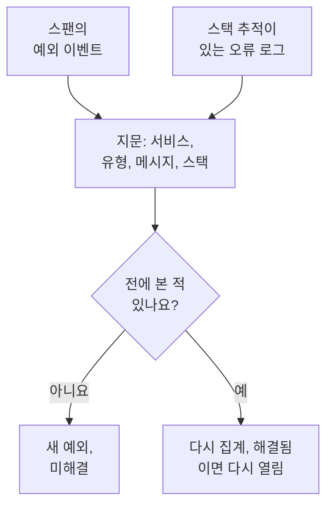

# 예외 추적

예외 추적은 코드가 던지는 오류를 모으고, 같은 오류의 모든 발생을 하나의 예외로 묶습니다. 예외에는 스택 추적, 추세, 오류가 일어난 요청이 함께 붙습니다. 할 일 목록처럼 분류하세요. 고치고, 해결 처리하고, 잡음은 보관하고, AI가 고칠 수 있는 것은 AI가 pull request를 열게 하세요.

:::cards
- [예외가 오는 곳](#예외가-오는-곳): 서비스가 이미 보내는 스팬과 로그.
- [목록 분류하기](#목록-분류하기): 미해결이 먼저, 잡음은 숨김.
- [예외 페이지](#예외-페이지): 스택 추적, 발생, 컨텍스트.
- [AI로 고치기](#ai로-고치기): 수정이나 회귀 테스트가 담긴 pull request.
- [AI로 새로 생기거나 늘어나는 예외 찾아 수정하기](#ai로-새로-생기거나-늘어나는-예외-찾아-수정하기): OneUptime이 찾은 예외를 위한 pull request.
:::

## 예외가 오는 곳

예외를 따로 보낼 필요는 없습니다. OneUptime은 서비스가 이미 보내는 텔레메트리에서 예외를 찾습니다.

- 스팬의 예외 이벤트. OpenTelemetry의 `recordException()`이 쓰는 것입니다.
- `exception.type`, `exception.message`, `exception.stacktrace` 속성이 있는 로그.
- 메시지에 스택 추적이 담긴 Error 또는 Fatal 심각도의 로그. 단, 스팬 안에서 기록된 로그는 제외합니다(스팬이 이미 보고하므로).

각 발생은 같은 오류의 이전 발생과 함께 하나의 예외로 묶입니다.

- **서비스와 오류마다 하나의 예외.** 지문은 서비스, 예외 유형, 메시지, 스택 추적으로 만듭니다. 호출마다 바뀌는 값은 먼저 제거됩니다. UUID와 그 밖의 ID, 타임스탬프, IP 주소와 이메일 주소, 일곱 자리 이상의 숫자입니다. 그래서 `Order id=1042 not found`와 `Order id=2077 not found`는 하나의 예외입니다.
- **새 발생은 해결된 예외를 다시 엽니다.** 해결한 뒤에 다시 일어났다면 수정이 효과가 없었던 것입니다.
- **보관된 예외는 보관된 상태로 남습니다.** 새 발생은 계속 집계되지만 더 이상 알림을 보내지 않습니다.

> [!TIP]
> 서비스가 거부한 잘못된 입력처럼 예상된 오류를 예외 추적에서 빼려면, 스팬의 예외 이벤트에 `error.class` 속성을 `user-error` 또는 `expected-denial`로 설정하세요. 그러면 OneUptime은 그 오류에 대해 예외를 기록하지 않습니다.

## 시작하기 전에

- **도착하는 스팬이나 로그.** [OpenTelemetry](/docs/telemetry/open-telemetry)로 서비스를 계측합니다. **설정 가이드** 탭에 사용하는 언어에 맞는 코드가 표시됩니다.
- **텔레메트리를 읽을 수 있는 역할.** Project Owner, Project Admin, Project Member, Viewer, Telemetry Admin, Telemetry Member, Telemetry Viewer 중 하나이거나 Read Telemetry Service Exception 권한이 있는 사용자 지정 역할입니다. 해결하고 보관하려면 Project Owner나 Project Admin, 또는 Edit Telemetry Service Exception 권한이 필요합니다.

## 목록 분류하기

:::steps
### 예외 목록 열기

**제품 → 관측 가능성 → 예외**로 이동합니다. **예외** 탭의 배지는 미해결 이슈의 수를 세고, 목록은 **미해결** 예외로 열립니다.

### 상태 고르기

**미해결**, **해결됨**, **보관됨**, **전체** 사이를 오갑니다. 목록 위의 차트는 시간에 따라 발생 중 몇 개가 **처리되지 않음**이었고 몇 개가 **처리됨**이었는지 보여 줍니다.

### 무엇을 이슈로 볼지 고르기

기본값인 **이슈**는 사용자 오류와 예상된 거부를 숨겨, 고쳐야 할 것만 목록에 보여 줍니다. **User errors**는 그것들만 보여 주고, **전체**는 모든 예외를 보여 줍니다.

### 검색과 필터링

`type:TypeError env:production` 같은 쿼리를 입력하거나([검색 구문](/docs/telemetry/search-syntax#예외) 참고), **필터** 사이드바에서 값을 클릭합니다. 서비스, 호스트 같은 리소스, **예외 유형**, **환경**, **Error Class**입니다.

### 예외 열기

행을 클릭하면 예외 페이지가 열립니다.
:::

## 예외 페이지

페이지의 사이드 메뉴는 예외로 할 수 있는 일을 묶어 둡니다.

| 페이지 | 보여 주는 것 |
| --- | --- |
| **개요** | 메시지, 서비스, 얼마나 자주 일어났는지와 처음과 마지막으로 본 때, 시간에 따른 추세, 그리고 최신 발생의 릴리스, 환경, 스팬, 트레이스, 사용자 세션. |
| **스택 추적** | 스택의 프레임. 브라우저 코드라면 릴리스의 [소스 맵](/docs/telemetry/source-maps)을 올린 뒤 원래 파일과 줄을 보여 줍니다. |
| **Occurrences** | 모든 발생과 그 시각, 메시지, 발생한 트레이스. |
| **Context** | 최신 발생의 속성, 녹화되었다면 그 세션 리플레이, 발생에 이르기까지의 단계. |
| **로그** | 최신 발생 전후에 기록된 로그. |
| **AI Assistance** | 예외를 고치거나 테스트하는 AI 작업. |
| **설정** | 예외를 해결하거나 보관합니다. 처음에 접혀 있는 **Manage** 아래에 있습니다. |

## 해결, 다시 열기, 보관

예외 페이지 맨 위의 버튼과 그 **설정** 페이지에서 예외의 상태를 바꿉니다.

| 작업 | 쓰는 때 | 그다음 일어나는 일 |
| --- | --- | --- |
| **해결** | 수정을 배포했습니다. | **미해결** 목록에서 빠집니다. 새 발생이 있으면 다시 열립니다. |
| **Reopen** | 수정이 효과가 없었습니다. | 다시 미해결이 됩니다. |
| **보관** | 고칠 생각이 없는 잡음입니다. | 목록에서 빠집니다. 새 발생은 집계되지만 더 이상 알림을 보내지 않습니다. |
| **보관 취소** | 다시 소식을 듣고 싶습니다. | 원래 속한 목록으로 돌아갑니다. |

**설정**에는 누가 마지막으로 예외를 해결하거나 보관했는지와 그 시각이 표시됩니다. 그 버튼은 **해결됨으로 표시** 또는 **미해결로 표시**, 그리고 **보관** 또는 **보관 취소**입니다.

## 오류 클래스

모든 예외에는 누구의 문제인지 알려 주는 오류 클래스가 있습니다. OneUptime AI는 새 예외나 급증한 예외 같은, 예외에 관한 인사이트를 분류할 때 오류 클래스를 정합니다. [AI SRE](/docs/ai/ai-sre#인사이트-선제적-감지)를 참고하세요. 아직 분류하지 않은 예외는 `unknown`으로 남습니다.

| 클래스 | 의미 | **이슈**에 포함 |
| --- | --- | --- |
| `code-fault` | 코드의 결함. AI가 스스로 고치는 유일한 클래스입니다. | 예 |
| `infrastructure` | 시간 초과, 끊어진 연결, 바닥난 리소스. | 예 |
| `unknown` | 아직 분류되지 않았습니다. | 예 |
| `user-error` | 사용자의 잘못된 입력으로 생긴 결과. | 아니요 |
| `expected-denial` | 거부된 로그인처럼, 검사가 제 할 일을 한 결과. | 아니요 |

AI 인사이트 설정에서 **예상된 예외 보관**을 켜 두면, 분류 결과 예상된 거부로 판단된 예외를 자동으로 보관합니다.

## AI로 고치기

**AI Assistance** 페이지는 세 가지 작업을 제공합니다. 각 작업은 코드 저장소에 pull request를 여는 AI 작업으로 실행됩니다.

| 작업 | pull request가 하는 일 |
| --- | --- |
| **Fix this exception with AI** | 근본 원인을 고칩니다. **AI로 수정** 버튼으로 시작합니다. |
| **Generate Regression Test** | 버그가 고쳐질 때까지 실패하는 테스트를 추가합니다. |
| **오류 처리 개선** | 예상된 오류용: 입력을 더 일찍 검증하고, 사용자 데이터를 메시지에서 빼고, 오류를 처리됨으로 표시합니다. |

AI에는 먼저 세 가지가 필요합니다. LLM 공급자, 연결한 저장소(GitHub, GitLab, Forgejo 또는 Gitea, 모든 Git 서버), 작업을 실행할 온라인 상태의 AI 에이전트입니다. 페이지는 각각을 확인하고 빠진 것으로 가는 링크를 보여 줍니다. 예외가 해결되었거나 보관된 동안에는 작업이 일시 중지됩니다. [코드](/docs/ai/ai-agent)를 참고하세요.

## AI로 새로 생기거나 늘어나는 예외 찾아 수정하기

OneUptime은 15분마다 예외를 살펴 새 예외, 갑자기 훨씬 자주 일어나는 예외, 그리고 예외에 스택 추적이 없는 서비스를 찾아, 발견한 내용을 근거와 함께 AI 인사이트로 기록합니다. 그런 다음 OneUptime AI가 각각을 살펴보고 그것을 위한 pull request를 엽니다. 병합은 절대 하지 않으며, 팀이 모든 pull request를 검토합니다.

| 발견 사항 | OneUptime이 기록하는 경우 | pull request |
| --- | --- | --- |
| **New Exception** | 지난 24시간 안에 처음 보였고 이미 3번 이상 일어난 예외. | 예외를 고치거나 더 잘 처리합니다. |
| **Exception Spike** | 지난 한 시간에 10번 이상 일어났고, 그 전 24시간의 시간당 발생률의 5배 이상인 예외. | 예외를 고치거나 더 잘 처리합니다. |
| **스택 추적 없음** | 한 서비스가 지난 하루 동안 기록한 예외에 스택 추적이 없고, 합쳐서 20번 이상 일어났습니다. | 서비스가 예외마다 스택 추적을 기록하게 합니다. |

새로 생기거나 늘어나는 예외의 pull request는 그 예외 자신의 AI 작업, 즉 예외의 **AI Assistance** 페이지가 시작하는 작업이며, OneUptime AI가 발견 사항을 살펴볼 때까지 기다립니다. 원인 코드를 찾으면 (`code-fault`) pull request는 **Fix this exception with AI**처럼 그것을 고칩니다. 예상된 오류를 찾으면 (`user-error` 또는 `expected-denial`) pull request는 **오류 처리 개선**처럼 그 오류를 더 잘 처리합니다. 그 밖의 판정으로는 pull request가 스스로 열리지 않습니다.

OneUptime AI는 사용자 자신의 코드에서 발생한 예외에 대해서만 스스로 pull request를 엽니다. 즉 라이브러리나 런타임의 프레임만이 아니라 사용자 코드의 프레임이 스택 추적에 있는 예외입니다. 누군가 병합하지 않고 닫은 pull request가 있으면 그 예외의 자동 pull request는 일시 중지됩니다. 그래도 누구나 발견 사항의 **AI로 수정**으로 어떤 것이든 요청할 수 있습니다.

### 켜기

**예외 → AI → 설정**에 **새로 생기거나 늘어나는 예외 찾아 수정** 스위치가 있으며, 새 프로젝트에서는 켜져 있습니다. 꺼져 있는 동안 새로 생기거나 늘어나는 예외는 예전처럼 AI 인사이트가 맡습니다. [AI SRE](/docs/ai/ai-sre#인사이트-선제적-감지)를 참고하세요. **AI 활성화**가 꺼져 있으면 예외는 계속 발견되지만 OneUptime AI는 아무것도 하지 않습니다. pull request를 열려면 OneUptime AI에 [코드](/docs/ai/ai-agent)에서 연결한 저장소가 필요합니다. 부족한 것은 페이지가 먼저 알려 줍니다. 각 저장소의 코드는 그 저장소가 코드에서 선택한 Runner에서 변경됩니다.

OneUptime AI는 하루(UTC)에 스스로 최대 5개의 pull request를 발견 사항마다 하나씩 열며, 저장소의 열린 AI pull request 한도를 넘지 않습니다.

### AI 규칙

규칙이 없으면 OneUptime AI는 발견한 모든 예외를 즉시 살펴보고 고칠 수 있는 예외마다 pull request를 엽니다. **추가 설정**의 **AI 규칙**은 이를 세 단계로 좁힙니다.

| 단계 | 결정하는 것 |
| --- | --- |
| **일치** | 대상 서비스: 선택한 서비스, 특정 레이블이 있는 서비스 또는 이름이 패턴과 일치하는 서비스. |
| **조사** | **즉시** 또는 **대기 후에도 발견되는 경우에만**: 대기 중에 사라진 예외는 살펴보지 않습니다. |
| **수정** | **수정하지 않음**, **수정 전에 승인 요청** 또는 **승인 없이 수정**. 먼저 승인을 요청하면 pull request는 사람에게 맡겨지며, 발견 사항에 **AI로 수정**이 표시됩니다. |

**추가 필드**에서 규칙마다 OneUptime AI가 사용할 수 있는 코드 저장소, MCP 서버, LLM 공급자를 고릅니다. 아무것도 고르지 않으면 모두 사용할 수 있으며 프로젝트의 기본 LLM 공급자를 사용합니다.

### 한 일 확인하기

- **예외 → AI → 인사이트**에는 OneUptime이 찾은 것이 표시되며, 각 발견 사항에 스택 추적 속 사용자 코드의 프레임을 포함한 근거가 있습니다. **View Exception Group**은 예외를 열고, 서비스의 스택 추적 없음 발견 사항에서는 **예외에서 열기**가 그 서비스의 지난 하루 동안 해결되지 않은 예외를 엽니다.
- **예외 → AI → 로그**에는 모든 조사와 pull request가 최신순으로 각각의 상태와 함께 표시됩니다.
- pull request에는 연 이유가 발견 사항 링크와 함께 적힙니다. 새로 생기거나 늘어나는 예외의 pull request는 예외에도 링크하며, 그 예외의 **AI Assistance** 페이지에 표시됩니다. 코드에서는 작업에 고치는 예외나 출처가 된 발견 사항이 표시됩니다.

## 예외 인사이트

**인사이트** 탭은 **미해결**, **해결됨**, **보관됨** 예외의 수와 해결률을 세고, 가장 잦은 예외, 그 예외가 영향을 주는 서비스, 가장 최근에 본 예외를 나열합니다.

## 문제 해결

:::details 방금 던진 예외가 목록에 없습니다
먼저 보기 기준을 확인하세요. **이슈**는 사용자 오류와 예상된 거부를 숨기므로 **전체**를 고르세요. 그다음 시간 범위를 넓히고, 예외가 스팬에 기록되었는지 또는 스택 추적이 있는 로그에 기록되었는지 확인하세요.
:::

:::details 오류 하나가 여러 예외로 보입니다
지문에는 메시지와 스택 추적이 들어갑니다. 이 둘이 다르면, 예를 들어 메시지에 호출마다 바뀌는 짧은 숫자나 이름이 들어 있으면, 변형마다 별도의 예외가 됩니다.
:::

:::details 해결된 예외가 계속 돌아옵니다
새 발생이 해결된 예외를 다시 여는 것은 의도된 동작입니다. 오류가 아직 일어나고 있기 때문입니다. 수정이 그 오류를 보고하는 릴리스에 들어갔는지 확인하거나, 더 이상 소식을 듣고 싶지 않다면 예외를 보관하세요.
:::

## 다음 단계

:::cards
- [예외 모니터](/docs/monitor/exceptions-monitor): 예외가 급증하면 알림을 받습니다.
- [소스 맵](/docs/telemetry/source-maps): 브라우저 코드의 읽기 쉬운 스택 추적.
- [코드](/docs/ai/ai-agent): AI가 코드를 고치고 pull request를 여는 방식.
- [트레이스 탐색기](/docs/telemetry/traces-explorer): 예외가 일어난 요청을 봅니다.
:::
