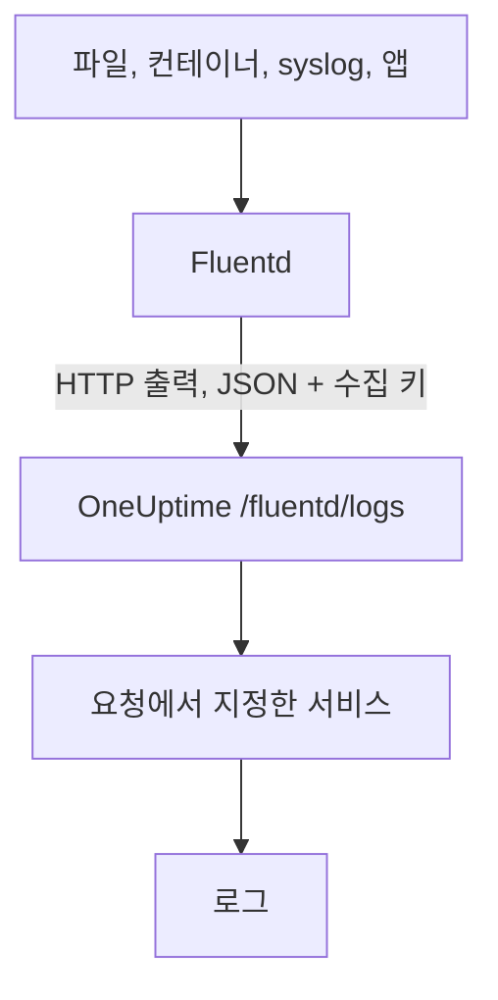

# Fluentd

[Fluentd](https://www.fluentd.org/)는 파일, 컨테이너, syslog, 애플리케이션 등 [많은 소스](https://www.fluentd.org/datasources)에서 로그를 모읍니다. 기본 제공 [HTTP 출력](https://docs.fluentd.org/output/http)이 로그를 OneUptime의 Fluentd 엔드포인트로 보내면, **제품 → 로그**에서 검색할 수 있습니다.

:::cards
- [Fluentd 구성](#fluentd-구성): OneUptime을 가리키는 HTTP 출력을 추가합니다.
- [레코드를 읽는 방식](#레코드를-읽는-방식): 어떤 필드가 메시지, 심각도, 속성이 되는지.
- [자체 호스팅 OneUptime](#자체-호스팅-oneuptime): Fluentd가 직접 운영하는 인스턴스로 보내게 합니다.
:::

## 작동 방식



Fluentd는 레코드를 JSON으로 묶어 보내며, 수집 키는 `x-oneuptime-token` 헤더에, 서비스 이름은 `x-oneuptime-service-name`에 넣습니다. OneUptime은 각 레코드를 그 서비스의 로그로 만들고, 처음 보낼 때 서비스를 만듭니다.

## 시작하기 전에

- **Fluentd 설치**: [설치 가이드](https://docs.fluentd.org/installation)를 참고하세요.
- **OneUptime 프로젝트.** OneUptime Cloud에서 텔레메트리는 수집된 GB당 과금되며([요금](https://oneuptime.com/pricing) 참고), Free 플랜의 프로젝트는 텔레메트리를 보내기 전에 결제 수단이 있어야 합니다.
- **텔레메트리 수집 키.** 아직 없다면 다음과 같이 만듭니다.

:::steps
### 수집 키 열기

**제품 → 프로젝트 설정**으로 이동해 사이드 메뉴에서 **텔레메트리 및 APM**을 열고 **수집 키**를 선택합니다.


### 키 만들기

**수집 키 생성**을 클릭합니다. 대화 상자에는 키 이름이 이미 채워져 있고 **서버**(애플리케이션이나 Collector가 데이터를 보낼 때 쓰는 키 유형)가 선택되어 있으므로, **수집 키 생성**을 클릭해 만들거나 먼저 이름을 바꿉니다.

### 시크릿 복사

새 키는 자체 페이지에서 열립니다. 키의 **시크릿 키**를 복사하세요. 이것이 아래 구성의 `YOUR_SERVICE_TOKEN`입니다.


:::

## Fluentd 구성

Fluentd의 구성 파일은 보통 `/etc/fluent/fluentd.conf`이고, 예전 td-agent 패키지라면 `/etc/td-agent/td-agent.conf`입니다.

:::steps
### HTTP 출력 추가

레코드를 OneUptime으로 보내는 `<match>` 섹션을 추가합니다. `YOUR_SERVICE_TOKEN`은 수집 키로, `YOUR_SERVICE_NAME`은 로그가 표시될 이름(원하는 아무 이름)으로 바꿉니다.

```text title="fluentd.conf"
# Send the time Fluentd gave each event: the HTTP output sends only the record
<filter **>
  @type record_transformer
  enable_ruby true
  <record>
    fluentd_time ${time.utc.strftime("%Y-%m-%dT%H:%M:%S.%NZ")}
  </record>
</filter>

# Match all patterns
<match **>
  @type http

  endpoint https://oneuptime.com/fluentd/logs
  open_timeout 2

  headers {"x-oneuptime-token":"YOUR_SERVICE_TOKEN", "x-oneuptime-service-name":"YOUR_SERVICE_NAME"}

  content_type application/json
  json_array true

  # Send a batch again when OneUptime is busy (429) or restarting (502, 503, 504)
  retryable_response_codes 429,502,503,504

  <format>
    @type json
  </format>
  <buffer>
    # Keep the batches on disk until OneUptime takes them: a restart of Fluentd loses none
    @type file
    path /var/log/fluent/buffer/oneuptime
    total_limit_size 512m
    flush_interval 10s
    chunk_limit_size 900k
    # Try again at least every 30 seconds, for up to 72 hours
    retry_max_interval 30s
    retry_timeout 72h
  </buffer>
</match>

# Keep Fluentd's own logs out of OneUptime
<label @FLUENT_LOG>
  <match **>
    @type null
  </match>
</label>
```

`json_array true`는 버퍼의 청크마다 하나의 JSON 배열로 보내고, `flush_interval 10s`는 10초마다 버퍼를 보냅니다. `chunk_limit_size 900k`는 각 요청을 이 엔드포인트에서 OneUptime이 받는 최대 크기인 1MB 미만으로 유지합니다.

Fluentd의 기본 설정도 동작합니다. `content_type`과 `json_array true`가 없으면 Fluentd는 줄바꿈으로 구분된 JSON을 한 줄에 레코드 하나씩 보내고, OneUptime은 각 줄을 그 레코드로 읽습니다. `compress gzip`을 쓰든 쓰지 않든 같습니다.

`@type file`은 아직 보내지 않은 배치를 `path`가 가리키는 폴더에 보관하므로, Fluentd를 다시 시작해도 하나도 잃지 않습니다. Fluentd의 기본값인 메모리 버퍼는 보관하던 것을 잃습니다. Fluentd의 사용자가 그 폴더에 쓸 수 있어야 합니다. `/var/log/fluent`는 fluent-package의 폴더이고, `/var/log/td-agent`는 td-agent의, `/fluentd/log`는 `fluent/fluentd` 이미지의 폴더입니다. `total_limit_size 512m`은 그곳에 최대 512MB까지 보관하며, 가득 차면 배치가 전송될 때까지 Fluentd는 더 이상 레코드를 받지 않습니다.

`retryable_response_codes 429,502,503,504`는 OneUptime이 바쁘거나(`429`) 다시 시작하는 중일 때(`502`, `503`, `504`) 배치를 다시 보냅니다. 이 설정이 없으면 Fluentd는 `503`이 아닌 모든 응답에서 배치를 버립니다. `retry_max_interval 30s`는 재시도 사이에 최대 30초를 기다리고, `retry_timeout 72h`는 72시간이 지나도 보내지 못한 배치를 버립니다. `record_transformer` 필터는 Fluentd가 각 레코드에 준 시간을 `fluentd_time`으로 추가합니다. HTTP 출력은 레코드만 보내고, OneUptime은 로그의 시간을 레코드에서 읽기 때문입니다.

### Fluentd 다시 시작

새 출력을 불러오도록 Fluentd 서비스를 다시 시작합니다.

### 로그가 들어오는지 확인

다음 플러시 후 몇 초 안에 로그가 **제품 → 로그**에 나타납니다. 서비스는 **제품 → 서비스**에 표시되며, 아직 없었다면 OneUptime이 만듭니다.
:::

## 전체 예시

이 구성은 포트 `24224`에서 Fluentd의 forward 프로토콜로 이 호스트에서만 레코드를 받아 모두 OneUptime으로 보냅니다.

```text title="fluentd.conf"
####
## Source descriptions:
##

## built-in TCP input
## @see https://docs.fluentd.org/input/forward
<source>
  @type forward
  port 24224
  # This host alone: see "Take records from other hosts" to open it
  bind 127.0.0.1
</source>

# Send the time Fluentd gave each event: the HTTP output sends only the record
<filter **>
  @type record_transformer
  enable_ruby true
  <record>
    fluentd_time ${time.utc.strftime("%Y-%m-%dT%H:%M:%S.%NZ")}
  </record>
</filter>

<match **>
  @type http

  endpoint https://oneuptime.com/fluentd/logs
  open_timeout 2

  headers {"x-oneuptime-token":"YOUR_SERVICE_TOKEN", "x-oneuptime-service-name":"YOUR_SERVICE_NAME"}

  content_type application/json
  json_array true

  # Send a batch again when OneUptime is busy (429) or restarting (502, 503, 504)
  retryable_response_codes 429,502,503,504

  <format>
    @type json
  </format>
  <buffer>
    # Keep the batches on disk until OneUptime takes them: a restart of Fluentd loses none
    @type file
    path /var/log/fluent/buffer/oneuptime
    total_limit_size 512m
    flush_interval 10s
    chunk_limit_size 900k
    # Try again at least every 30 seconds, for up to 72 hours
    retry_max_interval 30s
    retry_timeout 72h
  </buffer>
</match>

# Keep Fluentd's own logs out of OneUptime
<label @FLUENT_LOG>
  <match **>
    @type null
  </match>
</label>
```

`bind 127.0.0.1`은 이 호스트에서만 레코드를 받습니다. 예를 들어 `localhost:24224`로 보내는 Docker의 `fluentd` 로그 드라이버의 레코드입니다. 서로 다른 소스를 서로 다른 서비스로 보내려면 태그마다 `<match>` 섹션을 하나씩 두고, 각각에 자체 `x-oneuptime-service-name`과 자체 버퍼 `path`를 지정하세요. 한 경로에 버퍼가 두 개 있으면 Fluentd가 시작되지 않습니다.

## 다른 호스트에서 레코드 받기

`bind 0.0.0.0`이고 `<security>` 섹션이 없으면, 포트 `24224`에 닿을 수 있는 누구나 여러분의 수집 키로 OneUptime에 로그를 보낼 수 있습니다. 다른 호스트의 Fluentd나 Fluent Bit에서 레코드를 받으려면 모든 주소에서 수신하고, 보내는 쪽마다 공유 키를 요구하고, TLS를 사용하세요. 전체 예시의 `<source>` 섹션을 다음으로 바꾸세요.

```text title="fluentd.conf on this host"
<source>
  @type forward
  port 24224
  bind 0.0.0.0
  <transport tls>
    cert_path /etc/fluent/certs/fluentd.crt
    private_key_path /etc/fluent/certs/fluentd.key
  </transport>
  <security>
    self_hostname fluentd.example.com
    shared_key YOUR_SHARED_KEY
  </security>
</source>
```

`cert_path`와 `private_key_path`는 이 호스트 이름(여기서는 `fluentd.example.com`)의 인증서와 그 키이며, Fluentd의 사용자가 읽을 수 있어야 합니다. 키에 암호 문구가 없으면 Fluentd가 경고하며, `private_key_passphrase`로 설정할 수 있습니다. `YOUR_SHARED_KEY`를 `openssl rand -base64 32`로 만든 것 같은 길고 무작위한 비밀로 바꾸고, 보내는 쪽마다 같은 값을 주세요.

```text title="fluentd.conf on each sender"
<match **>
  @type forward
  transport tls
  # The certificate of the authority that signed this host's; not needed for a public one
  tls_cert_path /etc/fluent/certs/ca.crt
  <security>
    self_hostname app-1.example.com
    shared_key YOUR_SHARED_KEY
  </security>
  <server>
    host fluentd.example.com
    port 24224
  </server>
  <buffer>
    @type file
    path /var/log/fluent/buffer/forward
  </buffer>
</match>

# Keep Fluentd's own logs out of OneUptime
<label @FLUENT_LOG>
  <match **>
    @type null
  </match>
</label>
```

Fluent Bit의 `forward` 출력도 같은 설정 `Shared_Key`, `Self_Hostname`, `tls On`, `tls.ca_file`을 받습니다.

키나 TLS 없이 보내는 쪽은 거부됩니다. 키 자체는 네트워크를 지나가지 않으며, 양쪽이 키를 가지고 있음을 서로 증명합니다. TLS가 없으면 호스트 사이 네트워크에 있는 누구나 레코드를 읽을 수 있습니다. 호스트 방화벽에서는 포트 `24224`를 보내는 호스트에만 여세요. 로그 가이드의 Docker Compose 파일로 Fluentd를 실행한다면, 거기서도 포트를 모든 주소에 게시하고(`"24224:24224"`), 인증서 폴더를 컨테이너에 마운트하세요.

## 레코드를 읽는 방식

OneUptime은 각 레코드에서 다음 필드를 읽습니다.

| 로그 필드 | 레코드에서 처음 나오는 다음 필드에서 읽음 | 참고 |
| --- | --- | --- |
| 본문 | `message`, `log`, `msg`, `body`, `text` | 로그 줄. 이 중 아무것도 없는 레코드는 전체가 JSON으로 저장됩니다. |
| 심각도 | `level`, `severity`, `loglevel`, `log_level`, `priority`, `severityText`, `severity_text` | `trace`, `debug`, `info`, `notice`, `warn`, `error`, `critical`, `fatal` 같은 이름(대소문자 무관). 그 밖의 값은 `Unspecified`로 저장됩니다. |
| 트레이스 ID | `trace_id`, `traceId`, `traceid` | 로그를 해당 트레이스에 연결합니다. |
| 스팬 ID | `span_id`, `spanId`, `spanid` | 로그를 해당 스팬에 연결합니다. |
| 서비스 | `x-oneuptime-service-name` 헤더 | 헤더가 없으면 `Fluentd`. |
| 시간 | `time`, `timestamp`, `@timestamp`, `ts`, `fluentd_time` | `2026-11-14T08:00:00.123Z` 같은 ISO 8601 시간, 또는 에포크 이후의 초, 밀리초, 마이크로초, 나노초. 시간대가 없는 시간은 UTC로 봅니다. 2000년 이전이거나 하루 넘게 앞선 시간은 읽지 않습니다. 시간을 읽은 필드는 속성으로 저장하지 않습니다. 시간이 없는 레코드는 OneUptime이 레코드를 받은 시간으로 저장됩니다. |

그 밖의 필드는 모두 `fluentd.` 뒤에 필드 이름을 붙인 속성이 되어 검색하고 필터링할 수 있습니다. 예를 들어 `container_name` 필드는 로그 탐색기에서 `@fluentd.container_name`입니다. 중첩된 객체는 `fluentd.kubernetes.pod_name`처럼 점으로 펼쳐지고, 목록은 JSON으로 저장됩니다.

Fluentd 로그도 다른 로그처럼 [로그 파이프라인](/docs/telemetry/log-pipelines), 드롭 필터, 스크럽 규칙을 거칩니다.

## 자체 호스팅 OneUptime

`endpoint`의 `https://oneuptime.com`을 OneUptime 인스턴스의 URL로 바꿉니다: `http(s)://YOUR_ONEUPTIME_HOST/fluentd/logs`.

## 문제 해결

:::details Fluentd가 HTTP 출력에서 `401`을 기록함
수집 키가 없거나, 알 수 없거나, 만료되었습니다. `headers`에 있는 `x-oneuptime-token` 값을 확인하세요.
:::

:::details Fluentd가 `402` 또는 `422`를 기록함
`402`: OneUptime Cloud에서 프로젝트가 Free 플랜이고 결제 수단이 없습니다. **프로젝트 설정 → 결제 및 청구서 → 결제**에서 추가하세요. `422`: 키가 비활성화되었거나 브라우저 키입니다. 키 설정에서 **활성화됨**을 다시 켜거나 **서버** 키를 만드세요.
:::

:::details Fluentd가 `413`을 기록함
요청이 이 엔드포인트에서 OneUptime이 받는 최대 크기인 1MB를 넘습니다. 위 구성처럼 `<buffer>` 섹션에 `chunk_limit_size 900k`를 설정하세요.
:::

:::details Fluentd가 `429`, `502`, `503` 또는 `504`를 기록함
OneUptime이 바쁘거나 다시 시작하는 중입니다. 위 구성처럼 `<match>` 섹션에 `retryable_response_codes 429,502,503,504`가 있으면 Fluentd는 배치를 보관했다가 다시 보냅니다. 없으면 Fluentd는 배치를 버립니다. `<buffer>` 섹션에 `@type file`이 있으면 Fluentd는 다시 시작할 때도 배치를 보관합니다.
:::

:::details 로그에 자체 시간이 아니라 OneUptime이 받은 시간이 표시됨
OneUptime은 로그의 시간을 레코드에서 읽고, Fluentd의 HTTP 출력은 레코드만 보냅니다. `<parse>` 섹션은 레코드에서 `time` 필드를 이벤트 시간으로 빼내므로, 여기에 `time_key fluentd_time`을 추가해 어떤 레코드의 시간도 읽지 않고 `time`을 그대로 두게 하세요. 위 구성의 `record_transformer` 필터도 추가하세요. Fluentd가 각 레코드에 준 시간을 `fluentd_time`으로 추가합니다.
:::

:::details `time`이 `null`, `true`, 목록 또는 객체인 JSON 줄이 도착하지 않음
Fluentd의 `json` 파서는 줄의 `time` 필드를 이벤트 시간으로 읽고, `time`이 텍스트도 숫자도 아닌 줄을 경고 없이 버립니다. 위와 같이 그 `<parse>` 섹션에 `time_key fluentd_time`을 추가하세요. 그러면 Fluentd는 `time`을 레코드에 그대로 둡니다. 위의 `record_transformer` 필터가 있으면 OneUptime은 Fluentd가 읽은 시간 `fluentd_time`에 로그를 저장하고, 없으면 OneUptime이 받은 시간에 저장합니다.
:::

:::details 로그가 `Fluentd` 서비스로 들어옴
`x-oneuptime-service-name` 헤더가 없습니다. 각 `<match>` 섹션의 `headers`에 추가하세요.
:::

:::details 로그 본문에 레코드 전체가 JSON으로 표시됨
OneUptime은 레코드에 처음 나오는 `message`, `log`, `msg`, `body`, `text` 필드에서 본문을 가져오고, 이 중 아무것도 없으면 레코드 전체를 저장합니다. 로그 줄이 담긴 필드의 이름을 이 중 하나로 바꾸세요. 예를 들어 Fluentd의 `record_transformer` 필터를 쓸 수 있습니다.
:::

구성에 대해 질문이 있거나 도움이 필요하면 support@oneuptime.com으로 문의하세요.

## 다음 단계

:::cards
- [로그 파이프라인](/docs/telemetry/log-pipelines): Fluentd가 보내는 로그를 파싱하고 보강합니다.
- [검색 구문](/docs/telemetry/search-syntax): 로그 탐색기에서 로그를 찾습니다.
- [Fluent Bit](/docs/telemetry/fluentbit): OpenTelemetry로 보내는 더 가벼운 에이전트.
- [로그 모니터](/docs/monitor/logs-monitor): 일치하는 로그가 나타나면 알립니다.
:::
