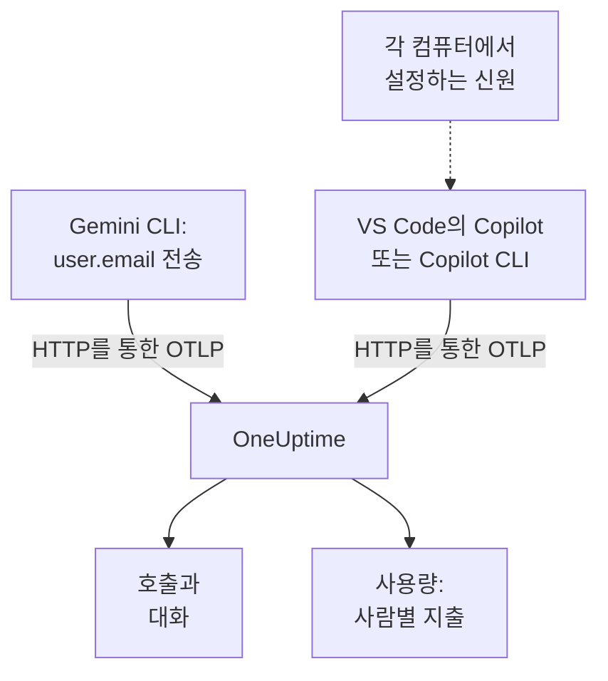

# Gemini CLI 및 GitHub Copilot

Gemini CLI와 GitHub Copilot은 둘 다 직접 OpenTelemetry를 내보냅니다. OneUptime으로 향하게 하면 모델 호출, 토큰, 비용, 도구 호출이 여러분 앱의 AI 호출과 나란히 [AI / LLM](/docs/telemetry/ai-llm-observability) 에 도착합니다. 두 도구는 비용 배분에서 가장 중요한 점이 다릅니다. Gemini CLI는 모든 레코드에서 사람을 식별하지만 Copilot은 아무도 식별하지 않으므로, 개발자 한 명 한 명을 직접 지정해야 합니다.

:::cards
- [Gemini CLI](#gemini-cli-설정하기): 트레이스와 함께 텔레메트리를 켜고 OneUptime으로 바로 보냅니다.
- [GitHub Copilot](#github-copilot-설정하기): VS Code 또는 Copilot CLI에서 내보냅니다.
- [개발자마다 이름 붙이기](#개발자마다-이름-붙이기): Copilot이 빠뜨리는 신원.
- [문제 해결](#문제-해결): 아무것도 도착하지 않을 때 확인할 것.
:::

## 작동 방식



| | Gemini CLI | GitHub Copilot |
| --- | --- | --- |
| 보내는 것 | 트레이스, 메트릭, 로그 | 트레이스, 메트릭, 이벤트(에이전트 기능에서만) |
| 사람 식별 | 로그인한 경우 `user.email` | 없음: `enduser.id` 와 `user.email` 을 직접 설정 |
| 프롬프트 텍스트 | `logPrompts` 를 끄지 않는 한 전송 | `captureContent` 를 켜지 않는 한 전송하지 않음 |
| 기본 전송 대상 | `http://localhost:4317`, gRPC | `http://localhost:4318`, HTTP |

## 시작하기 전에

- 수집 키: **프로젝트 설정 → 텔레메트리 및 APM → 수집 키** 를 열고 **수집 키 생성** 을 클릭합니다.
- OTLP 기본 URL: `https://oneuptime.com/otlp`, OneUptime을 직접 호스팅한다면 `https://YOUR-ONEUPTIME-HOST/otlp`.
- 키는 모든 내보내기 요청의 `x-oneuptime-token` 헤더에 담겨 전달됩니다.

## Gemini CLI 설정하기

Gemini CLI는 트레이스, 메트릭, 로그 이벤트를 보내며, 누군가 로그인해 있으면 모든 레코드에 `user.email` 을 붙입니다. OneUptime은 `user.email` 을 직원으로 읽으므로, 매핑 표도 컴퓨터별 설정도 없이 각 사람의 지출이 표시됩니다.

:::steps
### 텔레메트리 켜기

각 컴퓨터의 사용자 설정 파일이나 저장소의 `.gemini/settings.json` 에 `telemetry` 블록을 추가합니다.

```json title="~/.gemini/settings.json"
{
  "telemetry": {
    "enabled": true,
    "target": "local",
    "otlpEndpoint": "https://oneuptime.com/otlp",
    "otlpProtocol": "http",
    "otlpHeaders": {
      "x-oneuptime-token": "YOUR_INGESTION_TOKEN"
    },
    "traces": true,
    "logPrompts": false
  }
}
```

### 새 세션 시작하기

Gemini CLI는 시작할 때 설정을 읽으므로, 다시 시작하고 프롬프트를 실행합니다.

### 데이터가 도착하는지 확인하기

**제품 → AI / LLM → 호출** 을 엽니다. 호출이 서비스 `gemini-cli` 아래에 모델, 토큰과 함께 표시됩니다.
:::

이 블록의 설정 중 다음 세 가지가 특히 중요합니다.

- `otlpProtocol: "http"`. Gemini CLI는 따로 지정하지 않으면 gRPC를 사용합니다. HTTP에서는 기본 URL에 `/v1/traces`, `/v1/metrics`, `/v1/logs` 를 직접 붙입니다. OneUptime은 포트 443에서 gRPC도 받지만([gRPC를 통한 OTLP](/docs/telemetry/open-telemetry#grpc를-통한-otlp) 참고), HTTP가 더 간단합니다.
- `traces: true`. 기본적으로 꺼져 있으며, 이것이 없으면 Gemini CLI의 스팬에 모델도 토큰 수도 담기지 않아 가격을 매길 수 없습니다. Gemini CLI는 비용 메트릭도 보내지 않습니다. 호출 비용을 보려면 트레이스를 켜세요.
- `logPrompts: false`. 아래 경고를 읽어 보세요.

> [!WARNING]
> `logPrompts` 는 기본값이 `true` 이므로, 텔레메트리를 켜면 엔지니어가 입력하는 텍스트가 전송됩니다. 소스 코드, 고객 데이터, 붙여 넣은 자격 증명이 포함되는 경우가 많습니다. 텔레메트리를 켜는 바로 그 변경에서 이 값을 `false` 로 설정하세요. 디버깅을 위해 프롬프트가 필요하다면 의도적으로 결정하고, 필요한 부분은 **트레이스 → 설정** 의 스크럽 규칙으로 가리세요.

### 여러 컴퓨터에 배포하는 설정

모든 설정에는 환경 변수가 있고, 환경 변수는 저장소의 `.gemini/settings.json` 보다 우선합니다. 그래서 MDM으로 배포하는 정책은 환경 변수로 설정하는 것이 알맞습니다.

```bash
export GEMINI_TELEMETRY_ENABLED=true
export GEMINI_TELEMETRY_TARGET=local
export GEMINI_TELEMETRY_OTLP_ENDPOINT="https://oneuptime.com/otlp"
export GEMINI_TELEMETRY_OTLP_PROTOCOL=http
export GEMINI_TELEMETRY_OTLP_HEADERS="x-oneuptime-token=YOUR_INGESTION_TOKEN"
export GEMINI_TELEMETRY_TRACES_ENABLED=true
export GEMINI_TELEMETRY_LOG_PROMPTS=false
```

| 설정 | 변수 | 기본값 | 하는 일 |
| --- | --- | --- | --- |
| `enabled` | `GEMINI_TELEMETRY_ENABLED` | `false` | 텔레메트리를 켬 |
| `target` | `GEMINI_TELEMETRY_TARGET` | `local` | `local` 은 설정한 엔드포인트로, `gcp` 는 Google Cloud로 보냄 |
| `otlpEndpoint` | `GEMINI_TELEMETRY_OTLP_ENDPOINT` | `http://localhost:4317` | 텔레메트리를 보낼 곳 |
| `otlpProtocol` | `GEMINI_TELEMETRY_OTLP_PROTOCOL` | `grpc` | `grpc` 또는 `http` |
| `otlpHeaders` | `GEMINI_TELEMETRY_OTLP_HEADERS` | 없음 | 내보낼 때마다 붙는 헤더. 파일에서는 객체, 변수에서는 `key=value` 쌍이나 JSON |
| `traces` | `GEMINI_TELEMETRY_TRACES_ENABLED` | `false` | 모델, 토큰, 페이로드를 스팬에 담음 |
| `logPrompts` | `GEMINI_TELEMETRY_LOG_PROMPTS` | `true` | 프롬프트 텍스트를 로그 이벤트에 담음 |
| `outfile` | `GEMINI_TELEMETRY_OUTFILE` | 없음 | 대신 텔레메트리를 파일에 써서 무엇이 전송될지 확인 |

명령줄 플래그는 `GEMINI_TELEMETRY_*` 변수보다 우선하고, 이 변수는 표준 `OTEL_EXPORTER_OTLP_*` 변수보다, 표준 변수는 `settings.json` 보다 우선합니다. Gemini CLI는 `OTEL_EXPORTER_OTLP_HEADERS` 도 읽으므로, 다른 도구를 위해 이미 설정한 헤더도 그대로 전달됩니다.

:::details 대신 OpenTelemetry Collector를 거쳐 보내기
컴퓨터마다 또는 팀마다 하나씩 둔 컬렉터는 텔레메트리가 OneUptime에 도달하기 전에 일괄 처리, 재시도, 라우팅을 할 수 있습니다. Gemini CLI는 `http://localhost:4317` 로 gRPC를 보내는 기본값 그대로 두고, 키는 컬렉터가 추가하게 하세요.

```yaml title="otel-collector-config.yaml"
receivers:
  otlp:
    protocols:
      grpc:
        endpoint: 0.0.0.0:4317
      http:
        endpoint: 0.0.0.0:4318

exporters:
  otlphttp:
    endpoint: "https://oneuptime.com/otlp"
    headers:
      "x-oneuptime-token": "YOUR_INGESTION_TOKEN"

service:
  pipelines:
    traces:
      receivers: [otlp]
      exporters: [otlphttp]
    metrics:
      receivers: [otlp]
      exporters: [otlphttp]
    logs:
      receivers: [otlp]
      exporters: [otlphttp]
```

컬렉터 실행 방법은 [OpenTelemetry](/docs/telemetry/open-telemetry) 를 참고하세요.
:::

### Gemini CLI가 보내는 것

| 메트릭 | 담긴 내용 |
| --- | --- |
| `gen_ai.client.token.usage` | 입력 및 출력 토큰. OneUptime이 세는 계열 |
| `gemini_cli.token.usage` | Gemini CLI 고유 이름으로 된 같은 토큰과 `thought`, `cache`, `tool` 토큰. 토큰을 두 번 세지 않도록 집계하지 않음 |
| `gen_ai.client.operation.duration` | 각 모델 호출에 걸린 시간 |
| `gemini_cli.api.request.count` | 모델 호출 |
| `gemini_cli.tool.call.count` | 도구 호출 |
| `gemini_cli.session.count` | 시작된 세션 |
| `gemini_cli.lines.changed` | 에이전트가 변경한 줄 |

로그 이벤트에는 `gemini_cli.user_prompt`, `gemini_cli.api_request`, `gemini_cli.api_response`, `gemini_cli.api_error`, `gemini_cli.tool_call`, `gemini_cli.file_operation` 이 있습니다. 모든 레코드에는 `session.id`, `installation.id`, `active_approval_mode`, 그리고 로그인한 경우 `user.email` 이 담깁니다. OneUptime은 `session.id` 를 대화 ID로 읽으므로, Gemini CLI 세션 전체가 트레이스가 몇 개이든 **대화** 아래에 하나의 대화로 표시됩니다.

이 메트릭들은 일반적인 OpenTelemetry 메트릭입니다. 어느 것이든 대시보드의 차트로 만들거나 [메트릭 모니터](/docs/monitor/metrics-monitor) 로 알림을 받을 수 있습니다.

## GitHub Copilot 설정하기

GitHub는 Copilot의 에이전트 기능에 대해서만 OpenTelemetry를 문서화합니다.

| 기능 | OpenTelemetry 전송 |
| --- | --- |
| VS Code의 Copilot Chat과 에이전트 모드 | 예 |
| Copilot CLI | 예 |
| Copilot SDK | 예 |
| JetBrains IDE의 에이전트 워크플로 | 예, Copilot 플러그인 설정에서 지정 |
| 인라인 자동 완성, github.com의 Copilot, Copilot 코드 리뷰 | 문서화되지 않음 |

그래서 주로 인라인 자동 완성을 쓰는 팀은 내보내기를 어떻게 설정하든 OneUptime에서 활동이 없는 것처럼 보입니다.

:::tabs
@tab VS Code
```json title="settings.json"
{
  "github.copilot.chat.otel.enabled": true,
  "github.copilot.chat.otel.exporterType": "otlp-http",
  "github.copilot.chat.otel.otlpEndpoint": "https://oneuptime.com/otlp",
  "github.copilot.chat.otel.captureContent": false
}
```
@tab Copilot CLI
```bash
export COPILOT_OTEL_ENABLED=true
export OTEL_EXPORTER_OTLP_ENDPOINT="https://oneuptime.com/otlp"
export OTEL_EXPORTER_OTLP_HEADERS="x-oneuptime-token=YOUR_INGESTION_TOKEN"
```
@tab 관리형 설정
```json
{
  "telemetry": {
    "enabled": true,
    "endpoint": "https://oneuptime.com/otlp",
    "protocol": "http/protobuf",
    "serviceName": "github-copilot",
    "captureContent": false,
    "lockCaptureContent": true,
    "headers": {
      "x-oneuptime-token": "YOUR_INGESTION_TOKEN"
    }
  }
}
```
:::

- VS Code 설정에는 헤더용 키가 없습니다. Copilot CLI와 마찬가지로 VS Code가 시작되는 환경에서 `OTEL_EXPORTER_OTLP_HEADERS` 를 설정하세요. 환경 변수는 VS Code 설정보다 우선합니다.
- 기업이 VS Code와 Copilot CLI에 배포하는 관리형 설정은 키를 `headers` 에 담으며, 각 개발자가 설정한 것보다 우선합니다. `lockCaptureContent` 는 모든 사람의 프롬프트 수집을 꺼진 상태로 고정합니다. 여기서 `protocol` 은 전송 형식으로, `http/protobuf` 또는 `http/json` 입니다.
- `captureContent` 는 기본적으로 꺼져 있으므로, 켜지 않는 한 프롬프트와 답변은 전송되지 않습니다.

## 개발자마다 이름 붙이기

Copilot은 OneUptime이 쓸 수 있는 신원을 보내지 않습니다. `captureIdentity` 설정은 `user.name` 을 추가하고 Copilot CLI는 `enduser.pseudo.id` 를 추가할 수 있지만, OneUptime은 둘 다 직원으로 읽지 않습니다. 신원이 없으면 Copilot의 모든 지출이 **사용량** 탭의 **미지정** 행 하나에 모입니다.

각 컴퓨터에서, VS Code와 Copilot CLI가 시작되는 환경에 신원을 설정하세요. 셸 프로필이나 MDM이 실행하는 스크립트가 그 자리입니다.

```bash
export OTEL_RESOURCE_ATTRIBUTES="enduser.id=alice@example.com,user.email=alice@example.com,team.id=platform,cost_center=eng-tools"
```

| 속성 | OneUptime이 읽는 의미 |
| --- | --- |
| `enduser.id` | 직원의 ID |
| `user.email` | 직원의 이메일. **사용량** 탭에 표시되는 이름 |
| `team.id`, `team`, `cost_center`, `department` | 팀 또는 비용 센터 |

이것들은 리소스 속성이므로 `resource.enduser.id`, `resource.user.email` 등으로 도착합니다. OneUptime은 신원과 팀의 모든 키를 `resource.` 접두사가 있든 없든 읽습니다. Gemini CLI는 이미 `user.email` 을 보내므로, `OTEL_RESOURCE_ATTRIBUTES` 는 팀을 위해서만 설정하세요.

- 첫 호출 전에 신원을 설정하세요. 신원 없이 도착한 호출은 나중에 귀속시킬 수 없습니다.
- Copilot의 관리형 설정에는 `resourceAttributes` 를 넣지 마세요. 이 값은 `OTEL_RESOURCE_ATTRIBUTES` 보다 우선해서, 각 컴퓨터에서 설정한 신원을 대체해 버립니다.
- `gen_ai.user` 나 `llm.user` 는 쓰지 마세요. 고객에게 서비스하는 앱에서는 이 값들이 고객을 가리키므로, OneUptime은 절대 직원으로 읽지 않습니다.

## Copilot 데이터의 모습

Copilot은 OpenTelemetry GenAI 규칙을 따르므로, 그 호출은 여러분 앱의 호출과 똑같이 **호출**, **대화**, **사용량** 에 표시됩니다.

| 스팬 | 단위 |
| --- | --- |
| `invoke_agent` | 에이전트 턴 |
| `chat` | 모델 호출 |
| `execute_tool` | 도구 호출 |
| `execute_hook` | 훅 실행 |

스팬에는 모델, `gen_ai.usage.input_tokens`, `gen_ai.usage.output_tokens`, `gen_ai.conversation.id` 가 담기므로 에이전트 턴 전체가 하나의 대화로 표시됩니다. 두 기능 모두 `gen_ai.client.token.usage` 와 `gen_ai.client.operation.duration` 메트릭, 그리고 OTLP 로그 신호로 이벤트도 보냅니다. 중간에 두는 컬렉터에는 `logs` 파이프라인을 남겨 두세요.

OneUptime은 각 호출의 가격을 모델과 토큰으로 **가격** 의 요율에 따라 매깁니다. 이는 토큰을 정가로 썼을 때의 비용이지, GitHub가 청구하는 금액이 아닙니다. Copilot은 시트와 프리미엄 요청 단위로 비용을 냅니다.

시트, 시트 활동, 프리미엄 요청 청구는 OpenTelemetry에 전혀 없습니다. 이 정보는 GitHub의 REST API에 있으며 OneUptime은 이를 읽지 않습니다. 시트와 청구 수치는 GitHub에서 확인하세요.

## 문제 해결

:::details Gemini CLI에서 아무것도 도착하지 않음
흔한 원인은 엔드포인트가 HTTP URL인데 `otlpProtocol` 이 기본값 `grpc` 로 남아 있는 것입니다. `otlpProtocol` 을 `http` 로 설정하고, `otlpEndpoint` 가 `/otlp` 로 끝나는 기본 URL인지, `x-oneuptime-token` 헤더가 설정되어 있는지 확인하세요. 잠시 `outfile` 을 설정하면 Gemini CLI가 무엇을 보낼지 볼 수 있습니다.
:::

:::details Gemini CLI의 호출에 모델, 토큰, 비용이 없음
`traces` 가 꺼져 있습니다. 켜세요. 이것이 없으면 Gemini CLI의 스팬에 모델도 토큰 수도 담기지 않고, 비용 메트릭도 전송되지 않습니다.
:::

:::details Copilot의 지출이 미지정으로 표시됨
신원이 익스포터에 전달되지 않았습니다. VS Code나 Copilot CLI가 시작된 환경에 `OTEL_RESOURCE_ATTRIBUTES` 가 설정되어 있는지, 그리고 Copilot의 관리형 설정이 그것을 대체하는 `resourceAttributes` 를 설정하지 않았는지 확인하세요.
:::

:::details Copilot이 아무것도 보내지 않음
대상 사용자가 인라인 자동 완성이 아니라 에이전트 기능을 쓰고 있는지, 그리고 `OTEL_EXPORTER_OTLP_HEADERS` 에 키가 담겨 있는지 확인하세요. VS Code 자체 설정으로는 키를 전달할 수 없습니다.
:::

:::details 키가 거부됨
OneUptime은 키가 없거나, 알 수 없거나, 만료된 경우 `401` 을, 비활성화된 키나 브라우저 키에는 `422` 를 반환합니다. `x-oneuptime-token` 으로 보내는 서버 키를 사용하세요.
:::

## 다음 단계

:::cards
- [AI 코딩 어시스턴트](/docs/telemetry/ai-coding-assistants): 누가 어떤 도구를 쓰고, 각 사람과 팀이 얼마를 쓰는지.
- [AI / LLM 옵저버빌리티](/docs/telemetry/ai-llm-observability): OneUptime이 읽는 속성, 비용 계산 방식, 일일 예산.
- [AI 게이트웨이](/docs/telemetry/ai-gateways): 자체 내보내기가 없는 도구를 게이트웨이를 통해.
:::
