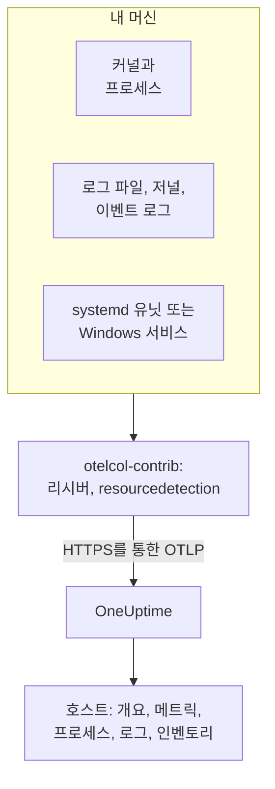

# 호스트 OpenTelemetry 수집기

OpenTelemetry Collector를 Linux, macOS, Windows 머신에서 실행해 머신의 메트릭, 프로세스, 로그, 서비스 상태를 OneUptime으로 보냅니다. 머신은 **제품 → 인프라 → 호스트** 아래에 자체 페이지와 함께 나타나며, 설치할 OneUptime 에이전트는 없습니다. Collector는 업스트림 `otelcol-contrib` 릴리스입니다. [호스트 모니터](/docs/monitor/host-monitor)는 Collector가 보낸 데이터를 기준으로 알림을 보냅니다.

:::cards
- [Collector 설치](#collector-설치): Linux, macOS, Windows에서 세 단계.
- [수집할 항목 선택](#수집할-항목-선택): 메트릭, 파일 로그, 저널, 이벤트 로그, 서비스 상태.
- [인벤토리 속성](#인벤토리-속성-ip-mac-일련번호-제조사-모델-펌웨어): CMDB를 위한 IP, MAC, 일련번호, 제조사, 모델, 펌웨어.
- [전송량 줄이기](#수집하는-데이터양-줄이기): 더 적은 로그 줄, 더 긴 간격, 더 적은 시계열.
:::

## 작동 방식

Collector는 리시버를 통해 머신을 읽고, 모든 레코드에 머신의 ID를 붙인 다음, 수집 키를 사용해 OTLP로 OneUptime에 보냅니다. OneUptime은 첫 메트릭으로 호스트를 등록하고, 데이터가 도착하는 대로 호스트의 페이지를 채웁니다.



| 호스트에서 보이는 것 | 출처 |
| --- | --- |
| **개요** 및 **메트릭** | `hostmetrics` 리시버: CPU, 메모리, 디스크, 파일 시스템, 네트워크, 부하, 페이징. |
| **프로세스** | `hostmetrics`의 `process` 스크레이퍼: 프로세스별 시계열 세트. |
| **로그** | `filelog`, `journald`, `windowseventlog` 리시버. |
| **Systemd Units** (Linux) | `systemd` 리시버. |
| **서비스** (Windows) | `windows_service` 리시버. |
| 인벤토리 항목 | `resourcedetection` 프로세서와 [직접 붙이는 속성](#인벤토리-속성-ip-mac-일련번호-제조사-모델-펌웨어). |
| **에이전트 버전** | `resource` 프로세서의 `oneuptime.agent.version`. |

`host.name`을 포함한 배치에 `hostmetrics` 또는 `process` 메트릭이나 `os.type` 속성도 함께 있으면 호스트가 등록됩니다. `resourcedetection` 프로세서가 이 모두를 설정하므로 모든 구성에서 이 프로세서를 맨 앞에 둡니다. `host.id`나 `host.arch`만으로는 호스트가 등록되지 않으며, Kubernetes ID(`k8s.cluster.name`, `k8s.node.name`, `k8s.pod.name`)를 포함한 텔레메트리는 대신 해당 클러스터 아래에 기록됩니다. Kubernetes 노드는 [Kubernetes 에이전트](/docs/telemetry/kubernetes-agent)로 모니터링하세요.

## 시작하기 전에

- 수집 키. **프로젝트 설정 → 텔레메트리 및 APM → 수집 키**에서 만들고 값을 복사합니다. Collector는 이 값을 `x-oneuptime-token` 헤더로 보냅니다.
- 머신의 관리자 권한: Linux와 macOS에서는 `sudo`, Windows에서는 관리자 권한 PowerShell 프롬프트.
- 머신에서 OneUptime URL로 나가는 HTTPS.
- Collector의 contrib 배포판인 `otelcol-contrib`. 핵심 `otelcol` 빌드에는 이 구성들이 사용하는 리시버와 프로세서가 없습니다. `systemd` 리시버(Linux)는 v0.143.0부터, `windows_service` 리시버(Windows)는 v0.155.0부터 작동하며, 아래 명령은 OneUptime이 고정한 릴리스인 v0.161.0을 설치합니다.

## Collector 설치

:::steps
### 구성 저장

설치 명령을 실행할 폴더에 이 내용을 `config.yaml`로 저장하고 `YOUR_TELEMETRY_INGESTION_TOKEN`을 수집 키로 바꾸세요(자체 호스팅하는 경우 엔드포인트도 자신의 URL로 바꾸세요).

:::tabs
@tab Linux
```yaml title="config.yaml"
receivers:
  hostmetrics:
    collection_interval: 30s
    scrapers:
      cpu:
        metrics:
          system.cpu.utilization:
            enabled: true
          system.cpu.logical.count:
            enabled: true
      memory:
        metrics:
          system.memory.utilization:
            enabled: true
      disk:
      filesystem:
        metrics:
          system.filesystem.utilization:
            enabled: true
      load:
      network:
      paging:
      processes:
      process:
        mute_process_name_error: true
        mute_process_exe_error: true
        mute_process_io_error: true
        metrics:
          process.cpu.utilization:
            enabled: true
          process.memory.utilization:
            enabled: true

  # The systemd journal: every unit's logs, info and above.
  journald:
    directory: /var/log/journal
    priority: info

  # Powers the Systemd Units tab (otelcol-contrib v0.143.0+).
  systemd:
    collection_interval: 30s
    units: ["*.service"]
    metrics:
      systemd.service.cpu.time:
        enabled: false

processors:
  # Stamps host.name, host.id and os.type: this is how OneUptime attaches
  # telemetry to the host. Without it the host's pages stay empty.
  resourcedetection:
    detectors: [system, env]
    system:
      hostname_sources: [os]
      resource_attributes:
        host.name:
          enabled: true
        host.id:
          enabled: true
        host.arch:
          enabled: true
        host.ip:
          enabled: true
        host.mac:
          enabled: true
        os.type:
          enabled: true
        os.description:
          enabled: true
        os.version:
          enabled: true
  # The collector release this config is for: the host's Agent Version.
  resource:
    attributes:
      - key: oneuptime.agent.version
        value: "0.161.0"
        action: upsert
  batch:

exporters:
  otlphttp/oneuptime:
    endpoint: https://oneuptime.com/otlp
    headers:
      x-oneuptime-token: YOUR_TELEMETRY_INGESTION_TOKEN

service:
  pipelines:
    metrics:
      receivers: [hostmetrics, systemd]
      processors: [resourcedetection, resource, batch]
      exporters: [otlphttp/oneuptime]
    logs:
      receivers: [journald]
      processors: [resourcedetection, resource, batch]
      exporters: [otlphttp/oneuptime]
```
@tab macOS
```yaml title="config.yaml"
receivers:
  hostmetrics:
    collection_interval: 30s
    scrapers:
      cpu:
        metrics:
          system.cpu.utilization:
            enabled: true
          system.cpu.logical.count:
            enabled: true
      memory:
        metrics:
          system.memory.utilization:
            enabled: true
      disk:
      filesystem:
        metrics:
          system.filesystem.utilization:
            enabled: true
      load:
      network:
      paging:
      processes:
      process:
        mute_process_name_error: true
        mute_process_exe_error: true
        mute_process_io_error: true
        metrics:
          process.cpu.utilization:
            enabled: true
          process.memory.utilization:
            enabled: true

  filelog/system:
    include:
      - /var/log/install.log
      - /var/log/wifi.log
    start_at: end

processors:
  # Stamps host.name, host.id and os.type: this is how OneUptime attaches
  # telemetry to the host. Without it the host's pages stay empty.
  resourcedetection:
    detectors: [system, env]
    system:
      hostname_sources: [os]
      resource_attributes:
        host.name:
          enabled: true
        host.id:
          enabled: true
        host.arch:
          enabled: true
        host.ip:
          enabled: true
        host.mac:
          enabled: true
        os.type:
          enabled: true
        os.description:
          enabled: true
        os.version:
          enabled: true
  # The collector release this config is for: the host's Agent Version.
  resource:
    attributes:
      - key: oneuptime.agent.version
        value: "0.161.0"
        action: upsert
  batch:

exporters:
  otlphttp/oneuptime:
    endpoint: https://oneuptime.com/otlp
    headers:
      x-oneuptime-token: YOUR_TELEMETRY_INGESTION_TOKEN

service:
  pipelines:
    metrics:
      receivers: [hostmetrics]
      processors: [resourcedetection, resource, batch]
      exporters: [otlphttp/oneuptime]
    logs:
      receivers: [filelog/system]
      processors: [resourcedetection, resource, batch]
      exporters: [otlphttp/oneuptime]
```
@tab Windows
```yaml title="config.yaml"
receivers:
  hostmetrics:
    collection_interval: 30s
    scrapers:
      cpu:
        metrics:
          system.cpu.utilization:
            enabled: true
          system.cpu.logical.count:
            enabled: true
      memory:
        metrics:
          system.memory.utilization:
            enabled: true
      disk:
      filesystem:
        metrics:
          system.filesystem.utilization:
            enabled: true
      load:
      network:
      paging:
      processes:
      process:
        mute_process_name_error: true
        mute_process_exe_error: true
        mute_process_io_error: true
        metrics:
          process.cpu.utilization:
            enabled: true
          process.memory.utilization:
            enabled: true

  windowseventlog/system:
    channel: System
    start_at: end

  windowseventlog/application:
    channel: Application
    start_at: end

  windowseventlog/security:
    channel: Security
    start_at: end

  # Powers the Services tab (otelcol-contrib v0.155.0+).
  windows_service:
    collection_interval: 30s

processors:
  # Stamps host.name, host.id and os.type: this is how OneUptime attaches
  # telemetry to the host. Without it the host's pages stay empty.
  resourcedetection:
    detectors: [system, env]
    system:
      hostname_sources: [os]
      resource_attributes:
        host.name:
          enabled: true
        host.id:
          enabled: true
        host.arch:
          enabled: true
        host.ip:
          enabled: true
        host.mac:
          enabled: true
        os.type:
          enabled: true
        os.description:
          enabled: true
        os.version:
          enabled: true
  # The collector release this config is for: the host's Agent Version.
  resource:
    attributes:
      - key: oneuptime.agent.version
        value: "0.161.0"
        action: upsert
  batch:

exporters:
  otlphttp/oneuptime:
    endpoint: https://oneuptime.com/otlp
    headers:
      x-oneuptime-token: YOUR_TELEMETRY_INGESTION_TOKEN

service:
  pipelines:
    metrics:
      receivers: [hostmetrics, windows_service]
      processors: [resourcedetection, resource, batch]
      exporters: [otlphttp/oneuptime]
    logs:
      receivers:
        - windowseventlog/system
        - windowseventlog/application
        - windowseventlog/security
      processors: [resourcedetection, resource, batch]
      exporters: [otlphttp/oneuptime]
```
:::

각 구성은 대시보드가 **제품 → 인프라 → 호스트 → 문서**에 작성하는 구성에 로그 파이프라인을 추가한 것입니다. 프로세서는 `resourcedetection`, `resource`, `batch`이고 익스포터는 `otlphttp/oneuptime`입니다. `service.name`을 설정하지 않으므로 호스트의 텔레메트리는 호스트 자체에 속하며 `host/<hostname>`으로 기록됩니다. 대신 그 이름의 텔레메트리 서비스 아래에 기록하려는 경우에만 `resource` 프로세서에 `service.name`을 추가하세요.

### Collector 설치 및 시작

:::tabs
@tab Linux
Debian 또는 Ubuntu:

```bash
VERSION=0.161.0                      # the release OneUptime pins
ARCH=$(dpkg --print-architecture)   # amd64 or arm64

curl -fL -o /tmp/otelcol-contrib.deb \
  "https://github.com/open-telemetry/opentelemetry-collector-releases/releases/download/v${VERSION}/otelcol-contrib_${VERSION}_linux_${ARCH}.deb"
sudo dpkg -i /tmp/otelcol-contrib.deb
```

RHEL, CentOS, Fedora 또는 Amazon Linux:

```bash
VERSION=0.161.0
ARCH=$(uname -m | sed 's/x86_64/amd64/;s/aarch64/arm64/')

curl -fL -o /tmp/otelcol-contrib.rpm \
  "https://github.com/open-telemetry/opentelemetry-collector-releases/releases/download/v${VERSION}/otelcol-contrib_${VERSION}_linux_${ARCH}.rpm"
sudo rpm -Uvh /tmp/otelcol-contrib.rpm
```

패키지는 `/usr/bin/otelcol-contrib`와 systemd 유닛을 설치하고 기본 구성으로 시작합니다. 자신의 구성을 넣고, Collector 사용자가 저널을 읽을 수 있게 한 다음 다시 시작하세요:

```bash
sudo install -m 0644 config.yaml /etc/otelcol-contrib/config.yaml
sudo usermod -aG systemd-journal otelcol-contrib
sudo systemctl enable otelcol-contrib
sudo systemctl restart otelcol-contrib
sudo systemctl status otelcol-contrib
```

패키지된 유닛은 권한 없는 `otelcol-contrib` 사용자로 Collector를 실행합니다. `systemd-journal` 그룹은 저널을 읽을 수 있게 해 주며, `/var/log`의 파일(Debian과 Ubuntu에서는 `adm` 그룹이 읽을 수 있음)을 추적하려면 그 그룹도 추가하세요. `process` 스크레이퍼가 다른 사용자의 프로세스를 보려면 `CAP_SYS_PTRACE` 기능을 부여하세요.
@tab macOS
```bash
VERSION=0.161.0
ARCH=$(uname -m | sed 's/x86_64/amd64/')   # arm64 on Apple silicon, amd64 on Intel

curl -fL -o /tmp/otelcol-contrib.tar.gz \
  "https://github.com/open-telemetry/opentelemetry-collector-releases/releases/download/v${VERSION}/otelcol-contrib_${VERSION}_darwin_${ARCH}.tar.gz"

sudo mkdir -p /usr/local/otelcol-contrib /usr/local/bin /etc/otelcol-contrib
sudo tar -xzf /tmp/otelcol-contrib.tar.gz -C /usr/local/otelcol-contrib
sudo ln -sf /usr/local/otelcol-contrib/otelcol-contrib /usr/local/bin/otelcol-contrib
sudo install -m 0644 config.yaml /etc/otelcol-contrib/config.yaml
```

`/Library/LaunchDaemons/com.oneuptime.otelcol-contrib.plist`를 만들어 launchd가 Mac과 함께 Collector를 시작하고 멈추면 다시 시작하도록 합니다:

```xml title="/Library/LaunchDaemons/com.oneuptime.otelcol-contrib.plist"
<?xml version="1.0" encoding="UTF-8"?>
<!DOCTYPE plist PUBLIC "-//Apple//DTD PLIST 1.0//EN" "http://www.apple.com/DTDs/PropertyList-1.0.dtd">
<plist version="1.0">
<dict>
  <key>Label</key><string>com.oneuptime.otelcol-contrib</string>
  <key>ProgramArguments</key>
  <array>
    <string>/usr/local/bin/otelcol-contrib</string>
    <string>--config=/etc/otelcol-contrib/config.yaml</string>
  </array>
  <key>RunAtLoad</key><true/>
  <key>KeepAlive</key><true/>
  <key>StandardOutPath</key><string>/var/log/otelcol-contrib.out.log</string>
  <key>StandardErrorPath</key><string>/var/log/otelcol-contrib.err.log</string>
</dict>
</plist>
```

로드합니다:

```bash
sudo launchctl load -w /Library/LaunchDaemons/com.oneuptime.otelcol-contrib.plist
sudo launchctl list | grep otelcol-contrib
```

Homebrew가 아니라 이 tarball을 사용하세요. Homebrew 포뮬러는 핵심 빌드여서 이 구성으로는 시작을 거부합니다.
@tab Windows
관리자 권한 PowerShell 프롬프트에서 `config.yaml`이 있는 폴더로 이동해 이 블록 전체를 한 번에 실행하세요. 각 줄은 위의 변수에 의존합니다.

```powershell
$VERSION = "0.161.0"                          # the release OneUptime pins; v0.155.0+ has the Services tab
$ARCH    = "amd64"                            # use "arm64" on ARM hosts
$dest    = "C:\Program Files\otelcol-contrib"
$tar     = "$env:TEMP\otelcol-contrib.tar.gz"

# Note the "-contrib" in the asset name; otelcol_... is the wrong archive.
$url = "https://github.com/open-telemetry/opentelemetry-collector-releases/releases/download/v$VERSION/otelcol-contrib_${VERSION}_windows_${ARCH}.tar.gz"

New-Item -ItemType Directory -Force -Path $dest | Out-Null
Invoke-WebRequest -Uri $url -OutFile $tar
tar -xf $tar -C $dest                          # tar.exe ships with Windows 10 1803+ / Server 2019+
Get-ChildItem $dest                            # expect otelcol-contrib.exe, not otelcol.exe
Copy-Item config.yaml "$dest\config.yaml" -Force

# --% hands the rest of the line to sc.exe unchanged, so its quoting
# survives PowerShell — keep the command on one line.
sc.exe --% create "otelcol-contrib" binPath= "\"C:\Program Files\otelcol-contrib\otelcol-contrib.exe\" --config=\"C:\Program Files\otelcol-contrib\config.yaml\"" start= auto DisplayName= "OpenTelemetry Collector (OneUptime)"
sc.exe description "otelcol-contrib" "Collects host telemetry and forwards it to OneUptime over OTLP."
sc.exe start "otelcol-contrib"
sc.exe query "otelcol-contrib"
```

서비스는 `LocalSystem`으로 실행되며, `Security` 이벤트 로그와 모든 Windows 서비스를 읽을 수 있습니다. Windows에서 `load` 스크레이퍼는 *Processor Queue Length* 카운터로 부하 평균을 흉내 낼 뿐이며 0부터 시작합니다.

자산 이름은 `otelcol-contrib_`로 시작해야 합니다. 핵심 `otelcol_<version>_windows_amd64.tar.gz` 아카이브는 `otelcol.exe`를 풀어 놓는데, 여기에는 `windowseventlog`나 `windows_service` 리시버가 없으며 `otelcol-contrib.exe`로 이름을 바꿔도 추가되지 않습니다. 설치 프로그램이 더 편하신가요? 같은 [릴리스 페이지](https://github.com/open-telemetry/opentelemetry-collector-releases/releases)에 서명된 `otelcol-contrib_<version>_windows_x64.msi`가 있으며 서비스를 대신 등록해 줍니다. 이 `config.yaml`을 지정하고 서비스는 `LocalSystem`으로 유지하세요.
:::

### 호스트가 나타나는지 확인

**제품 → 인프라 → 호스트 → 모든 호스트**를 엽니다. 첫 메트릭이 도착하면, 보통 30초 안에 호스트가 호스트 이름으로 나타나고 **개요**, **메트릭**, **프로세스**, **로그** 페이지가 채워집니다. 나타나지 않으면 Collector 자체의 로그를 확인하세요:

:::tabs
@tab Linux
```bash
sudo journalctl -u otelcol-contrib -f
```
@tab macOS
```bash
tail -f /var/log/otelcol-contrib.err.log
```
@tab Windows
```powershell
Get-WinEvent -LogName Application -MaxEvents 20 | Where-Object ProviderName -eq "otelcol-contrib"
```
:::
:::

테스트 로그 줄을 만들려면 `logger "hello from oneuptime"`(Linux, macOS) 또는 `eventcreate /T INFORMATION /ID 999 /L APPLICATION /SO OneUptimeTest /D "hello from oneuptime"`(Windows, 관리자 권한)을 실행한 다음 호스트의 **로그** 페이지를 확인하세요.

## 수집할 항목 선택

모든 구성은 같은 형태입니다. 무엇을 읽을지 정하는 리시버, `resourcedetection`, `resource`, `batch` 프로세서, 그리고 `otlphttp/oneuptime` 익스포터입니다. 아래 리시버를 `receivers:`와 해당 파이프라인에 추가한 다음 Collector를 다시 시작하세요(`sudo systemctl restart otelcol-contrib`, Mac에서는 `launchctl unload` 후 `load`, Windows에서는 `Restart-Service otelcol-contrib`). 각 스니펫은 구성에 있는 섹션에 병합하세요. 두 번째 `processors:` 또는 `service:` 키는 첫 번째 키를 대체합니다.

### 호스트 메트릭

`hostmetrics`는 모든 OS에서 작동합니다. `collection_interval`마다 커널에서 CPU, 메모리, 디스크, 파일 시스템, 네트워크, 부하, 페이징, 프로세스를 읽습니다. `*.utilization` 메트릭과 `system.cpu.logical.count`는 리시버에서 기본적으로 꺼져 있지만 호스트의 차트와 Host 알림 템플릿이 이를 읽으므로, 위 구성처럼 켜 두세요. `process` 스크레이퍼는 **프로세스** 페이지를 채우며, 가장 큰 시계열 발생원이기도 합니다([전송량 줄이기](#수집하는-데이터양-줄이기) 참조).

Linux에서 Collector는 `/proc`와 `/sys`를 읽습니다. 컨테이너 안의 Collector는 호스트의 것을 마운트하고 `HOST_PROC`와 `HOST_SYS`를 설정해야 하며([Docker 컨테이너에서](#docker-컨테이너에서) 참조), 네이티브 설치에는 아무것도 필요하지 않습니다.

### 파일 로그

`filelog` 리시버로 디스크의 어떤 로그 파일이든 추적하고 `logs` 파이프라인에 추가하세요:

```yaml
receivers:
  filelog/app:
    include:
      - /var/log/myapp/*.log
    start_at: end
    multiline:
      # A new entry starts with a timestamp; continuation lines (the
      # "at ...", "File ...", "Caused by: ..." frames) are folded into it.
      line_start_pattern: '^\d{4}-\d{2}-\d{2}[ T]\d{2}:\d{2}:\d{2}'
```

`start_at: end`는 새 줄만 읽습니다. 첫 실행 때 파일을 처음부터 읽으려면 `beginning`을 사용하세요. Collector는 각 파일에서 읽은 위치를 기억하므로 다시 시작한 뒤에도 올바르게 이어서 읽습니다.

OneUptime은 error와 fatal 로그 줄에서 스택 트레이스를 찾아 호스트 아래의 **예외**로 그룹화합니다. 이를 위해 여러 줄 스택 트레이스(Java, Python, .NET, Ruby)는 하나의 레코드로 도착해야 하며, `multiline`이 바로 그 일을 합니다. 이것이 없으면 각 프레임이 별도의 로그가 됩니다. 애플리케이션이 OpenTelemetry `exception.type`, `exception.message`, `exception.stacktrace` 속성을 직접 기록할 수 있다면 그 편이 더 확실합니다.

systemd 호스트에서는 `/var/log/syslog`와 `/var/log/messages`가 저널에 이미 있는 내용을 반복하므로 둘 중 하나만 읽으세요.

### systemd 저널

systemd 호스트에서 `journald` 리시버는 모든 유닛의 로그를 구조화된 필드와 함께 한곳에서 읽습니다. 위의 Linux 구성은 `info` 이상을 모두 읽습니다. 일부 유닛으로 좁히려면:

```yaml
receivers:
  journald:
    directory: /var/log/journal
    units:
      # Drop this list to ingest everything; restrict it to limit volume.
      - ssh.service
      - cron.service
      - nginx.service
    priority: info
```

리시버는 모든 systemd 호스트에 있는 `journalctl`을 실행하며, Collector 사용자는 `systemd-journal` 그룹에 속해야 합니다.

### Linux 서비스 (systemd 유닛, 메트릭)

호스트의 **Systemd Units** 페이지는 [`systemdreceiver`](https://github.com/open-telemetry/opentelemetry-collector-contrib/tree/main/receiver/systemdreceiver)(구성 유형 `systemd`)에서 가져온 모든 유닛과 그 상태를 나열합니다. Windows의 **서비스** 페이지에 해당하는 Linux 페이지입니다. 위의 Linux 구성이 이를 켭니다:

```yaml
receivers:
  systemd:
    collection_interval: 30s
    # The service manager to read: "system" (default) or "user".
    scope: system
    # Which units to scrape, as systemctl unit patterns. The default is
    # every service; widen it to include timers, sockets or mounts, or
    # narrow it to cut volume on hosts with hundreds of units:
    units: ["*.service"]
    # units: [nginx.service, postgresql.service, "*.timer"]
    metrics:
      # Per-service CPU time is on by default and doubles this receiver's
      # datapoint count. The Systemd Units tab does not use it, so turn it
      # off unless you chart it. On v0.142.0 the key is
      # systemd.unit.cpu.time — naming a metric the running build does not
      # have stops the collector at startup.
      systemd.service.cpu.time:
        enabled: false

service:
  pipelines:
    metrics:
      receivers: [hostmetrics, systemd]
      processors: [resourcedetection, resource, batch]
```

이 리시버는 `otelcol-contrib` v0.142.0에 처음 포함되었고, 실행할 만한 첫 릴리스는 v0.143.0입니다. 그보다 오래된 버전에서는 `systemd`를 추가하면 시작 시 `'receivers' unknown type: "systemd"`로 실패합니다. v0.142.0만은 CPU 메트릭 이름이 `systemd.unit.cpu.time`이고 모든 유닛에서 cgroup 통계를 찾기 때문에, `.service`가 아닌 유닛마다 스크레이프 오류를 기록합니다.

이 리시버는 `systemd.unit.state`를 상태 집합으로 내보냅니다. 스크레이프할 때마다 각 유닛은 가능한 상태(`active`, `reloading`, `inactive`, `failed`, `activating`, `deactivating`, `maintenance`, `refreshing`)마다 데이터 포인트를 하나씩 받으며, 현재 상태는 `1`, 나머지는 `0`입니다. 유닛 이름은 리소스 속성 `systemd.unit.name`이고 상태는 데이터 포인트 속성 `systemd.unit.active_state`입니다. 유닛 이름이 리소스 속성이므로 `resourcedetection`은 메트릭 파이프라인에 남아 있어야 합니다. 이 프로세서가 각 유닛의 리소스에 `host.name`을 붙이며, 이것이 없으면 샘플이 호스트에 연결되지 않습니다.

이 리시버는 systemd가 권한 없이 허용하는, `systemctl list-units`가 하는 것과 같은 읽기 전용 호출로 시스템 D-Bus를 통해 유닛 상태를 읽습니다. 따라서 root가 아닌 `otelcol-contrib` 사용자로 실행되는 패키지 서비스에는 추가 권한이 필요하지 않습니다. 다만 버스는 필요합니다. 컨테이너 안의 Collector에는 호스트의 것을 마운트하지 않는 한 `/run/dbus/system_bus_socket`이 없으므로 네이티브 설치를 사용하세요. 이 리시버는 알파 단계이며 Linux 전용입니다.

> [!WARNING]
> 상태 집합은 스크레이프마다 유닛당 데이터 포인트 8개가 들고, 기본으로 켜져 있는 `systemd.service.cpu.time`이 두 개(`user`와 `system`)를 더합니다. 스크레이프마다 유닛당 데이터 포인트 10개입니다. 300개 유닛을 30초마다 추적하는 호스트는 이 리시버만으로 분당 약 6,000개의 데이터 포인트를 보내며, CPU 메트릭을 끄면 약 4,800개입니다. 플릿 전체에서 켜기 전에 `units:`를 알림을 보내는 서비스로 좁히거나 `collection_interval`을 늘리세요.

### Apple Unified Log

macOS는 시스템 로그를 `/var/log/system.log`가 아니라 `log show`와 `log stream`으로 읽는 Apple Unified Log에 기록합니다. 이를 수집하려면 작은 스크립트 `/usr/local/otelcol-contrib/log-stream.sh`로 파일에 스트리밍하세요:

```bash title="/usr/local/otelcol-contrib/log-stream.sh"
#!/bin/bash
exec /usr/bin/log stream --style ndjson --level info \
  --predicate 'subsystem != "com.apple.cfnetwork"' \
  >> /var/log/apple-unified.log
```

실행 권한을 주고 launchd에서 실행한 다음(빠른 테스트는 `nohup`), `filelog` 리시버가 그 파일을 가리키게 하세요:

```yaml
receivers:
  filelog/apple-unified:
    include:
      - /var/log/apple-unified.log
    start_at: end
    operators:
      - type: json_parser
        timestamp:
          parse_from: attributes.timestamp
          layout: "%Y-%m-%d %H:%M:%S.%f%j"
```

많은 Mac 플릿은 통합 로그 없이 호스트 메트릭과 몇 개의 파일 로그만으로도 충분합니다.

### Windows 이벤트 로그

위의 Windows 구성은 `System`, `Application`, `Security` 채널을 구독합니다. 양이 많은 `Security` 채널을 일부 이벤트 ID로 좁히려면:

```yaml
windowseventlog/security:
  channel: Security
  start_at: end
  query: "*[System[(EventID=4625 or EventID=4740)]]"
```

다른 채널(*Event Viewer → Applications and Services Logs* 아래의 모든 채널)을 읽으려면 정확한 이름을 사용하세요:

```yaml
windowseventlog/iis:
  channel: Microsoft-IIS-Logging/Logs
  start_at: end
```

### Windows 서비스 (메트릭)

호스트의 **서비스** 페이지는 [`windowsservicereceiver`](https://github.com/open-telemetry/opentelemetry-collector-contrib/tree/main/receiver/windowsservicereceiver)(구성 유형 `windows_service`)에서 가져온 모든 Windows 서비스를 상태 및 시작 유형과 함께 나열합니다. 이 리시버는 v0.155.0부터 `otelcol-contrib`에 포함되며, 이전 릴리스에서는 `windows_service`를 추가하면 시작 시 `'receivers' unknown type: "windows_service"`로 실패합니다. 위의 Windows 구성이 이를 켭니다:

```yaml
receivers:
  windows_service:
    collection_interval: 30s
    # Collect every service by default. To cut volume — and avoid the
    # "access denied" noise from services the collector can't open —
    # list just the ones you care about:
    # include_services: [Spooler, W3SVC, MSSQLSERVER]
    # Or collect everything except a few:
    # exclude_services: [TrustedInstaller]

service:
  pipelines:
    metrics:
      receivers: [hostmetrics, windows_service]
```

서비스마다 Win32 서비스 상태(`4`는 실행 중, `1`은 중지됨)인 `windows.service.status` 게이지를 하나씩 `name` 및 `startup_mode` 속성과 함께 내보냅니다. Collector는 `LocalSystem`으로 모든 서비스를 읽고 열 수 없는 서비스는 건너뜁니다. 이 리시버는 알파 단계이며 Windows 전용입니다. 한 서비스의 스크레이프 오류나 `access denied`가 다른 서비스에 영향을 주면 `include_services`로 제한하세요.

`include_services`는 집합을 좁힐 수만 있습니다. 서비스를 나열했는데도 모든 서비스가 보인다면 편집한 구성이 실행 중인 Collector에 반영되지 않은 것입니다. 서비스를 다시 시작하고, `include_services`가 `collection_interval`과 같은 들여쓰기의 채워진 목록인지 확인한 다음, 변경 전에 보고된 서비스가 롤링 기간에서 빠질 때까지 **서비스** 페이지에 몇 분을 주세요. 이름은 대소문자를 구분하는 정확한 서비스 키 이름(`Spooler`, `W3SVC`)이며, `Get-Service | Select-Object Name`으로 나열할 수 있습니다.

### 레이블

`oneuptime.label.`로 시작하는 리소스 속성은 모두 호스트의 프로젝트 레이블이 됩니다. `oneuptime.label.<dimension>=<value>`는 레이블 `<dimension>:<value>`입니다. 이를 위한 프로세서를 추가하고 파이프라인에서 지정하세요:

```yaml
processors:
  resource/oneuptime-labels:
    attributes:
      - key: oneuptime.label.team
        value: payments
        action: upsert
      - key: oneuptime.label.env
        value: production
        action: upsert

service:
  pipelines:
    metrics:
      processors: [resourcedetection, resource, resource/oneuptime-labels, batch]
```

레이블은 대소문자를 구분하지 않고 일치시키므로 기존 `Production` 레이블은 중복되지 않고 재사용되며, OneUptime에서 추가한 레이블은 Collector가 절대 제거하지 않습니다.

### 인벤토리 속성 (IP, MAC, 일련번호, 제조사, 모델, 펌웨어)

모든 호스트에는 인벤토리 항목도 생깁니다. CMDB 내보내기가 읽는 레코드입니다. 세부 정보는 보내는 텔레메트리의 리소스 속성에서 바로 채워지므로, 도착한 것이 곧 CMDB 동기화가 가져갈 수 있는 것입니다.

| 원하는 정보 | 속성 | 출처 |
| --- | --- | --- |
| IP 주소 | `host.ip` | `resourcedetection`, 머신에 여러 개가 있으면 쉼표로 연결 |
| MAC 주소 | `host.mac` | `resourcedetection`, 활성 인터페이스별 값을 쉼표로 연결 |
| 아키텍처 | `host.arch` | `resourcedetection` |
| 머신 ID | `host.id` | `resourcedetection`: Windows에서는 머신 GUID, Linux에서는 `/etc/machine-id` |
| OS | `os.type`, `os.description`, `os.version` | `resourcedetection` |
| 일련번호 | `host.serial_number` | WMI 또는 DMI에서 읽어 직접 붙임 |
| 제조사 | `device.manufacturer` | WMI 또는 DMI에서 읽어 직접 붙임 |
| 모델 | `device.model.name` | WMI 또는 DMI에서 읽어 직접 붙임 |
| 펌웨어(BIOS 또는 UEFI) 버전 | `device.firmware.version` | WMI 또는 DMI에서 읽어 직접 붙임 |

위의 구성은 감지되는 모든 속성을 켭니다. system 감지기에서는 `host.name`과 `os.type`만 기본으로 켜져 있기 때문에 나머지를 `resource_attributes` 아래에 나열합니다. 자체 구성을 만든다면 그 `resourcedetection` 블록을 유지하세요. 이것이 없으면 `host.name`이 없으므로 호스트도 인벤토리 항목도 전혀 생기지 않습니다.

#### 일련번호, 제조사, 모델, 펌웨어 버전에는 감지기가 없음

이 값들은 머신의 펌웨어에 있으며, Collector는 펌웨어를 읽지 않습니다. Linux에서는 바꿀 수 있는 설정도 아닙니다. 패키지된 Collector는 권한 없는 `otelcol-contrib` 사용자로 실행되고, `/sys/class/dmi/id/product_serial`은 root만 읽을 수 있습니다. 따라서 머신을 프로비저닝할 때 한 번 읽어서 전용 프로세서로 리소스에 붙이세요:

```yaml
processors:
  resource/oneuptime-hardware:
    attributes:
      - key: host.serial_number
        value: "7XYZ123"
        action: upsert
      - key: device.manufacturer
        value: "Dell Inc."
        action: upsert
      - key: device.model.name
        value: "OptiPlex 7090"
        action: upsert
      - key: device.firmware.version
        value: "1.21.0"
        action: upsert

service:
  pipelines:
    metrics:
      processors: [resourcedetection, resource, resource/oneuptime-hardware, batch]
```

이 줄을 기존 줄 위에 붙여 넣지 말고, 이미 있는 프로세서 목록에 `resource/oneuptime-hardware`를 추가하세요. `resource`를 빼면 호스트의 **에이전트 버전**이 사라집니다. 어느 쪽이든 `resourcedetection`은 맨 앞에 두세요. 이 프로세서가 배치를 호스트에 연결합니다.

`host.manufacturer`, `host.model.name`, `host.firmware.version`, `host.bios.version`도 다른 표기로 받아들여 위의 `device.*` 키 아래에 저장하므로, 어느 쪽으로 작성한 구성이든 한곳에 모입니다. 둘 다 있으면 `device.*` 값이 우선합니다. 일련번호는 반대 방향입니다. `device.serial_number`를 받아들여 `host.serial_number`로 저장합니다.

> [!NOTE]
> 호스트 ID가 없는 리소스에서 `device.manufacturer`는 "모바일 앱"을 뜻합니다. 배치를 모바일 Real User Monitoring으로 표시하는 속성 중 하나입니다. 호스트의 리소스에는 항상 `host.name`이나 `host.id`가 있으므로 위와 같은 Collector 구성이 휴대폰으로 오인되는 일은 없지만, 같은 블록을 모바일 앱의 SDK 구성에 재사용하지는 마세요.

#### 값 읽기

Windows에서는 관리자 권한 PowerShell 프롬프트에서 실행합니다. 실행한 머신에 대한 YAML 블록을 출력합니다:

```powershell
$bios = Get-CimInstance -ClassName Win32_BIOS
$cs   = Get-CimInstance -ClassName Win32_ComputerSystem

# Quote for YAML: trim, escape any embedded quote, wrap in single quotes.
# The cast to string first is what keeps this working on machines whose
# firmware leaves a field empty — .Trim() on $null throws.
function Format-YamlValue($value) {
  "'" + ("$value".Trim() -replace "'", "''") + "'"
}

@"
  resource/oneuptime-hardware:
    attributes:
      - key: host.serial_number
        value: $(Format-YamlValue $bios.SerialNumber)
        action: upsert
      - key: device.manufacturer
        value: $(Format-YamlValue $cs.Manufacturer)
        action: upsert
      - key: device.model.name
        value: $(Format-YamlValue $cs.Model)
        action: upsert
      - key: device.firmware.version
        value: $(Format-YamlValue $bios.SMBIOSBIOSVersion)
        action: upsert
"@
```

이미 들여쓰기된 프로세서 항목 하나를 출력합니다. 두 번째 `processors:` 키가 아니라 기존 `processors:` 블록 안에 추가하세요. `Get-CimInstance`를 사용하세요. 더 이상 사용되지 않는 `Get-WmiObject`는 PowerShell 7 이상에 없습니다. 펌웨어가 비워 둔 필드는 `''`로 출력됩니다. 빈 값을 보내지 말고 그 속성을 빼세요. 가상 머신에는 일련번호가 아예 없는 경우가 많습니다.

Linux에서는 root로:

```bash
cat /sys/class/dmi/id/product_serial   # host.serial_number
cat /sys/class/dmi/id/sys_vendor       # device.manufacturer
cat /sys/class/dmi/id/product_name     # device.model.name
cat /sys/class/dmi/id/bios_version     # device.firmware.version
```

네 가지 중 아무 사용자나 읽을 수 있는 것은 `bios_version`뿐입니다. `/sys/class/dmi`가 없는 머신에서는 `dmidecode -s system-serial-number`, `-s system-manufacturer`, `-s system-product-name`, `-s bios-version`이 같은 값을 반환합니다. 가상 머신은 여기에 하이퍼바이저(`QEMU`, `VMware, Inc.`, `Amazon EC2`)를 보고하며, 보통 CMDB에서 원하는 값이 바로 이것입니다.

Mac에서는:

```bash
ioreg -l | awk -F'"' '/IOPlatformSerialNumber/{print $4}'   # host.serial_number
sysctl -n hw.model                                          # device.model.name
system_profiler SPHardwareDataType | awk -F': ' '/System Firmware Version/{print $2}'   # device.firmware.version
```

제조사는 `Apple Inc.`입니다. `hw.model`은 마케팅 이름이 아니라 `Mac14,7`이나 `MacBookPro18,3` 같은 모델 식별자를 반환하며, Mac은 마케팅 이름을 보고하지 않습니다. 필요하면 CMDB에서 식별자를 매핑하세요. 그래도 값은 `device.model.name`에 넣으세요. `device.model.identifier`는 다른 무엇이 있든 배치를 모바일 앱으로 표시하므로, 이것이 붙은 Mac은 휴대폰으로 기록되고 호스트에서 분리됩니다.

#### 대신 환경 변수 사용

`env` 감지기가 켜져 있으므로 프로세서 대신 `OTEL_RESOURCE_ATTRIBUTES`를 사용할 수 있습니다:

```text
OTEL_RESOURCE_ATTRIBUTES=host.serial_number=7XYZ123,device.manufacturer=Dell%20Inc.,device.model.name=OptiPlex%207090
```

모든 값을 퍼센트 인코딩하세요. 이 변수는 W3C Baggage `key=value` 목록으로 읽히며, `,`와 `=`가 항목을 구분하고 공백은 Collector 버전 간에 이식성이 없습니다. 따옴표는 도움이 되지 않으며 `device.manufacturer="Dell Inc."`는 값에 따옴표가 포함된 채로 도착할 수 있습니다. Windows에서는 `[System.Uri]::EscapeDataString($value)`로 값을 인코딩합니다.

머신 전체가 아니라 Collector 자체의 서비스에 설정하세요:

- **Linux:** `sudo systemctl edit otelcol-contrib`를 실행한 다음 `Environment="OTEL_RESOURCE_ATTRIBUTES=…"`가 있는 `[Service]` 섹션을 추가합니다.
- **Windows:** `HKLM\SYSTEM\CurrentControlSet\Services\otelcol-contrib` 아래의 `Environment` 값(유형 `REG_MULTI_SZ`). `sc.exe create`는 서비스 환경 변수를 설정할 수 없으며, `setx`는 실행 중인 서비스가 다시는 읽지 않는 변수를 설정합니다.

> [!WARNING]
> 머신 전체에 설정하지 마세요(`setx /M`, `/etc/environment`). 머신의 모든 OpenTelemetry SDK 프로세스가 `OTEL_RESOURCE_ATTRIBUTES`를 상속하므로 애플리케이션이 머신의 `device.manufacturer`를 자기 것으로 보고하게 되고, `device.manufacturer`는 있지만 `host.name`이나 `host.id`가 없는 애플리케이션 리소스는 모바일 앱으로 읽혀 서비스에서 분리됩니다.

프로세서가 올바르게 설정하기 더 쉽습니다. 구조상 Collector로 범위가 한정되고, 머신의 값은 절대 바뀌지 않습니다. 이미 환경 파일을 템플릿으로 관리하는 경우가 아니라면 프로세서를 사용하세요.

#### MAC 주소는 직접 붙이는 값이 아님

`host.mac`은 `host.ip`처럼 `system` 감지기에서 옵니다. 루프백을 제외한 활성 네트워크 인터페이스마다 주소 하나씩, OpenTelemetry가 지정하는 IEEE 형식(`AC-DE-48-23-45-67`)입니다. Docker나 Hyper-V를 실행하는 머신은 가상 스위치도 보고하므로 값이 목록입니다. 모두 0인 자리 표시자(`00-00-00-00-00-00`)를 보고하는 인터페이스는 제외됩니다.

머신의 어떤 것도 업그레이드로 제공되는 펌웨어 버전을 보고하지 않으므로, OneUptime은 설치된 버전을 기록합니다.

#### 작동 확인

**제품 → 인벤토리**에서 호스트의 항목을 열고 **자산 세부 정보** 카드를 확인하세요. 값은 다음 배치 후 몇 분 안에 나타납니다. Collector가 보고하지 않은 세부 정보는 알 수 없음으로 표시되며 이 섹션으로 돌아오는 링크가 있습니다. 감지가 아니라 직접 붙인 값이므로 스스로 업데이트되지 않습니다. 메인보드 교체, 펌웨어 업데이트, 재이미징 후에는 다시 붙이세요.

## Collector를 실행하는 다른 방법

### Docker 컨테이너에서

`config.yaml`이 있는 폴더에서, 호스트의 프로세스와 파일 시스템을 볼 수 있는 컨테이너로 Collector를 실행합니다:

```bash
docker run -d \
  --name otel-collector \
  --restart unless-stopped \
  --network host \
  --pid host \
  -v $(pwd)/config.yaml:/etc/otelcol-contrib/config.yaml:ro \
  --volume /:/hostfs:ro,rslave \
  -e HOST_PROC=/hostfs/proc \
  -e HOST_SYS=/hostfs/sys \
  -e HOST_ETC=/hostfs/etc \
  -e HOST_VAR=/hostfs/var \
  -e HOST_RUN=/hostfs/run \
  -e HOST_DEV=/hostfs/dev \
  otel/opentelemetry-collector-contrib:0.161.0 \
  --config /etc/otelcol-contrib/config.yaml
```

`--network host`, `--pid host`, `/hostfs` 마운트, `HOST_*` 변수는 `hostmetrics`와 `process`가 컨테이너가 아닌 호스트의 커널을 읽게 합니다. 구성의 메트릭 파이프라인만 사용하세요. 이미지에는 `journalctl`이 없고, `systemd` 리시버에는 호스트의 D-Bus가 필요합니다.

### 릴리스 tarball에서

패키지를 쓸 수 없는 경우 정적 바이너리를 풀고 전용 systemd 유닛을 만드세요:

```bash
VERSION=0.161.0
ARCH=$(uname -m | sed 's/x86_64/amd64/;s/aarch64/arm64/')

curl -fL -o /tmp/otelcol.tar.gz \
  "https://github.com/open-telemetry/opentelemetry-collector-releases/releases/download/v${VERSION}/otelcol-contrib_${VERSION}_linux_${ARCH}.tar.gz"
sudo mkdir -p /opt/otelcol-contrib
sudo tar -xzf /tmp/otelcol.tar.gz -C /opt/otelcol-contrib
sudo install -m 0644 config.yaml /opt/otelcol-contrib/config.yaml
```

```ini title="/etc/systemd/system/otelcol-contrib.service"
[Unit]
Description=OpenTelemetry Collector
After=network.target

[Service]
ExecStart=/opt/otelcol-contrib/otelcol-contrib --config /opt/otelcol-contrib/config.yaml
Restart=on-failure
RestartSec=5s
User=root

[Install]
WantedBy=multi-user.target
```

```bash
sudo systemctl daemon-reload
sudo systemctl enable --now otelcol-contrib
```

`User=root`는 이 유닛이 모든 로그 파일과 모든 프로세스를 읽게 합니다. 위의 패키지 설치가 권한 없는 대안입니다.

### Kubernetes 노드에서

Kubernetes 노드는 OneUptime에서 호스트가 아닙니다. 텔레메트리에 Kubernetes ID가 있어 클러스터 아래에 기록됩니다. [Kubernetes 에이전트](/docs/telemetry/kubernetes-agent)를 설치하세요. 각 노드는 클러스터의 **노드** 페이지에 Pod와 함께 나타납니다.

## Collector 업그레이드

이 페이지의 모든 구성은 대상 Collector 릴리스를 `resource` 프로세서에 `oneuptime.agent.version`으로 붙입니다. OneUptime은 이를 호스트의 **개요**에 **에이전트 버전**으로 표시하며, OneUptime이 더 새로운 릴리스를 고정하면 옆에 경고 표시가 나타납니다. 표시를 선택하면 설치한 방식대로 업그레이드하는 방법이 보입니다.

수동으로 업그레이드하려면 이번 릴리스를 설치한 방식대로 새 `VERSION`으로 새 릴리스를 설치하고(Debian과 Ubuntu에서는 `sudo dpkg -i --force-confold`가 묻지 않고 구성을 유지합니다), `config.yaml`의 `oneuptime.agent.version`을 같은 버전으로 설정한 다음 Collector를 다시 시작하세요. 구성에 버전을 붙이지 않는 Collector는 버전이 표시되지 않으며 경고 표시도 없습니다.

## 수집하는 데이터양 줄이기

구성은 직접 관리하므로, 추가한 리시버가 읽지 않는 한 아무것도 머신을 떠나지 않습니다. 호스트가 원하는 것보다 많이 보낸다면(수집량 증가로, OneUptime Cloud에서는 비용 증가로 나타남) 여기서 줄이세요. 가장 큰 두 가지 수단은 어떤 로그를 읽는지와 메트릭을 얼마나 자주 스크레이프하는지이며, 나머지는 `filter` 프로세서가 처리합니다. 한 번에 하나의 수단만 바꾸고, 편집할 때마다 Collector를 다시 시작하세요.

### 데이터양이 생기는 곳

| 신호 | 가장 큰 요인 | 줄이는 방법 |
| --- | --- | --- |
| 로그 | 모든 파일, 저널 유닛, 이벤트 채널의 모든 줄 | 리시버 줄이기, 더 좁은 `units:` 또는 `query:`, 심각도 기준 `filter` |
| 호스트 메트릭 | 스크레이프 빈도 × 시계열 수 | 더 긴 `collection_interval`, 스크레이퍼 줄이기 |
| 메트릭 카디널리티 | 프로세스별 메트릭: 프로세스마다 시계열 세트 | `process` 스크레이퍼 빼기 또는 좁히기 |
| systemd 유닛 | 스크레이프마다 유닛당 데이터 포인트 10개(상태 집합과 CPU) | 더 좁은 `units:`, CPU 메트릭 끄기, 더 긴 `collection_interval` |

### 필요한 로그만 읽기

로그는 거의 항상 가장 큰 비중을 차지하며, Collector는 나열한 것만 읽으므로 적게 나열하세요:

- `filelog`가 넓은 glob이 아닌 특정 파일을 가리키게 하세요. `/var/log/**`가 아니라 `/var/log/myapp/error.log`처럼 지정합니다.
- `journald`를 관심 있는 유닛으로 좁히고, `priority`를 높여 `info`와 `debug`가 머신을 떠나기 전에 버리세요:

```yaml
receivers:
  journald:
    directory: /var/log/journal
    units:
      - ssh.service
      - nginx.service
    priority: warning # info and debug are dropped before export
```

- 양이 많은 `Security` 이벤트 채널을 `query:`로 감사하는 이벤트 ID로 좁히거나([Windows 이벤트 로그](#windows-이벤트-로그)처럼), 채널을 빼세요.

### 메트릭 스크레이프 빈도 낮추기

`hostmetrics` 양은 `collection_interval`에 비례합니다. 30초 해상도가 필요 이상이라면 60초로 하면 데이터 포인트가 절반이 됩니다.

```yaml
receivers:
  hostmetrics:
    collection_interval: 60s
```

### 프로세스별 스크레이퍼 좁히기

`process` 스크레이퍼는 실행 중인 모든 프로세스에 대해 시계열 세트를 내보내므로, 바쁜 머신에서는 가장 큰 시계열 발생원입니다. **프로세스** 페이지가 필요 없으면 빼거나, 중요한 프로세스로만 좁히세요(어느 경우든 몇 가지 프로세스 수인 `processes`는 유지하세요):

```yaml
receivers:
  hostmetrics:
    collection_interval: 60s
    scrapers:
      cpu:
      memory:
      disk:
      filesystem:
      network:
      load:
      paging:
      processes: # aggregate counts only — cheap
      process:
        mute_process_name_error: true
        mute_process_exe_error: true
        mute_process_io_error: true
        include:
          names: [nginx, postgres, node]
          match_type: strict
```

이렇게 하면 리시버가 기본 메트릭으로 줄어듭니다. 호스트의 차트와 Host 알림 템플릿을 사용한다면 위 구성의 `metrics:` 블록을 `cpu`, `memory`, `filesystem`, `process` 아래에 다시 넣으세요.

### systemd 유닛 좁히기

`systemd` 리시버는 스크레이프마다 유닛별·상태별로 데이터 포인트를 하나씩, 즉 유닛당 8개를 보내고, 기본으로 켜져 있는 `systemd.service.cpu.time`에 대해 2개를 더 보내므로, 양은 `units:`와 일치하는 유닛 수로 정해집니다. 기본값 `["*.service"]`에는 상태가 절대 바뀌지 않는 수십 개의 일회성 유닛이 포함됩니다. 알림을 보내는 유닛을 나열하고, 차트로 보지 않는다면 CPU 메트릭을 끄세요:

```yaml
receivers:
  systemd:
    collection_interval: 60s
    units: [nginx.service, postgresql.service, ssh.service]
    metrics:
      # On otelcol-contrib v0.142.0 this key is systemd.unit.cpu.time.
      systemd.service.cpu.time:
        enabled: false
```

이렇게 하면 300개 유닛 호스트의 데이터 포인트가 분당 약 6,000개에서 100개 훨씬 아래로 줄어듭니다. 목록에서 빠진 유닛은 마지막 샘플이 롤링 기간에서 빠지는 몇 분 뒤에 **Systemd Units** 페이지에서 사라집니다.

### filter 프로세서로 레코드 버리기

리시버는 필요하지만 그 출력 전부는 필요하지 않다면 [`filter`](https://github.com/open-telemetry/opentelemetry-collector-contrib/tree/main/processor/filterprocessor) 프로세서를 추가하세요. 이 프로세서는 [OTTL](https://github.com/open-telemetry/opentelemetry-collector-contrib/blob/main/pkg/ottl/README.md) 조건을 평가하고, 일치하는 모든 레코드를 전송 전에 버립니다.

특정 심각도 미만의 로그 버리기:

```yaml
processors:
  filter/drop-low-severity:
    error_mode: ignore
    logs:
      log_record:
        # Drop anything less severe than WARN (info, debug, trace).
        # The UNSPECIFIED guard is required — see the warning below.
        - "severity_number != SEVERITY_NUMBER_UNSPECIFIED and severity_number < SEVERITY_NUMBER_WARN"
```

> [!WARNING]
> `UNSPECIFIED` 가드를 유지하세요. `SEVERITY_NUMBER_UNSPECIFIED`는 `0`이고 `SEVERITY_NUMBER_WARN`은 `13`이므로, 가드 없는 `severity_number < SEVERITY_NUMBER_WARN`은 심각도가 파싱되지 않은 모든 레코드에서 참입니다. 일반 `filelog` 리시버는 줄에서 심각도를 파싱하지 않으므로, 가드가 없으면 이 조건은 읽은 모든 줄을 아무 오류 없이 조용히 삭제합니다. 가드가 있으면 파싱되지 않은 레코드는 유지되어 심각도 `Unspecified`로 도착하며, 이는 심각도 파서가 필요하다는 신호입니다.

파일 로그를 심각도로 제대로 필터링하려면 먼저 리시버에서 [`severity_parser`](https://github.com/open-telemetry/opentelemetry-collector-contrib/blob/main/pkg/stanza/docs/operators/severity_parser.md) 연산자로 심각도를 파싱하세요:

```yaml
receivers:
  filelog/app:
    include:
      - /var/log/myapp/*.log
    start_at: end
    operators:
      # Pull a level out of lines like "2026-01-01 ERROR something broke".
      - type: regex_parser
        regex: '(?i)(?P<level>TRACE|DEBUG|INFO|WARN(?:ING)?|ERROR|FATAL)'
        parse_from: body
        # Lines with no recognisable level fall through unparsed rather
        # than being discarded, and are then kept by the guard above.
        on_error: send
      - type: severity_parser
        parse_from: attributes.level
        preset: default
        mapping:
          warn: warning
          error: err
          fatal: panic
```

systemd 호스트에서는 저널에 이런 작업이 필요 없습니다. `journald`의 `priority:`가 `journalctl` 자체에서 레벨로 필터링합니다.

차트로 보지 않는 메트릭을 정확한 이름이나 패턴으로 버리기:

```yaml
processors:
  filter/drop-metrics:
    error_mode: ignore
    metrics:
      metric:
        # Exact metric name.
        - 'name == "system.paging.faults"'
        # Or a whole family. IsMatch is RE2 and UNANCHORED, so anchor it
        # yourself with ^ when you mean "starts with".
        - 'IsMatch(name, "^system\\.paging\\.")'
```

고정된 메트릭 집합만 보내려면 조건을 뒤집으세요. `filter`는 일치하는 것을 버리므로 `not (...)`은 지정하지 않은 모든 것을 버립니다. 조건은 한 줄로 유지하세요:

```yaml
processors:
  filter/allowlist:
    error_mode: ignore
    metrics:
      metric:
        - 'not (name == "system.cpu.utilization" or name == "system.memory.utilization" or name == "system.filesystem.utilization")'
```

허용 목록은 큰 망치입니다. 지정하는 것을 잊은 것은 그것을 기반으로 한 모니터와 함께 사라집니다. 원하지 않는 몇몇 메트릭을 버리거나, 그 메트릭을 만드는 스크레이퍼를 빼는 편이 낫습니다. 수집하지 않은 메트릭은 필터링 비용이 들지 않습니다.

그런 다음 프로세서를 해당 파이프라인의 `batch` 앞에 추가하세요:

```yaml
service:
  pipelines:
    metrics:
      receivers: [hostmetrics]
      processors: [filter/drop-metrics, resourcedetection, resource, batch]
      exporters: [otlphttp/oneuptime]
    logs:
      receivers: [journald]
      processors: [filter/drop-low-severity, resourcedetection, resource, batch]
      exporters: [otlphttp/oneuptime]
```

구성에 정의되지 않은 프로세서나 익스포터를 지정한 파이프라인은 시작 시 Collector를 멈춥니다. 텔레메트리를 호스트에 연결하는 `resourcedetection`과 Collector 버전을 보고하는 `resource`는 유지하세요. `filter`는 contrib 프로세서이므로 핵심 빌드는 이 구성을 거부합니다.

### 가벼운 출발점

간격이 길고 프로세스별 시계열이 없는 메트릭 전용 호스트가 가장 작은 유용한 구성입니다:

```yaml title="config.yaml"
receivers:
  hostmetrics:
    collection_interval: 60s
    scrapers:
      cpu:
        metrics:
          system.cpu.utilization:
            enabled: true
          system.cpu.logical.count:
            enabled: true
      memory:
        metrics:
          system.memory.utilization:
            enabled: true
      disk:
      filesystem:
        metrics:
          system.filesystem.utilization:
            enabled: true
      load:
      network:
      paging:
      processes:

processors:
  # Stamps host.name, host.id and os.type: this is how OneUptime attaches
  # telemetry to the host. Without it the host's pages stay empty.
  resourcedetection:
    detectors: [system, env]
    system:
      hostname_sources: [os]
      resource_attributes:
        host.name:
          enabled: true
        host.id:
          enabled: true
        host.arch:
          enabled: true
        host.ip:
          enabled: true
        host.mac:
          enabled: true
        os.type:
          enabled: true
        os.description:
          enabled: true
        os.version:
          enabled: true
  # The collector release this config is for: the host's Agent Version.
  resource:
    attributes:
      - key: oneuptime.agent.version
        value: "0.161.0"
        action: upsert
  batch:

exporters:
  otlphttp/oneuptime:
    endpoint: https://oneuptime.com/otlp
    headers:
      x-oneuptime-token: YOUR_TELEMETRY_INGESTION_TOKEN

service:
  pipelines:
    metrics:
      receivers: [hostmetrics]
      processors: [resourcedetection, resource, batch]
      exporters: [otlphttp/oneuptime]
```

필요할 때 좁은 `filelog` 또는 `journald` 리시버와 함께 `logs` 파이프라인을 다시 추가하세요.

> [!CAUTION]
> 무엇을 줄이는지 주의하세요. 로그 모니터는 로그가 도착해야 하므로, 심각도나 채널을 걸러 내면 그것을 감시하는 모니터가 조용해지고, Host 알림 템플릿에는 `*.utilization` 메트릭이 필요합니다. 대응에 쓰지 않는 데이터를 줄이고 모니터가 감시하는 데이터는 줄이지 말며, 다음 수단을 쓰기 전에 하루나 이틀 뒤 **프로젝트 설정 → 사용 기록**에서 감소를 확인하세요(사용량은 하루 단위로 집계됩니다).

## 자체 호스팅 OneUptime과 프록시

자체 호스팅 OneUptime에서는 익스포터가 자신의 인스턴스를 가리키게 하세요. HTTP 전용이면 `http://`와 해당 포트를 사용하세요:

```yaml
exporters:
  otlphttp/oneuptime:
    endpoint: https://your-oneuptime-host.example.com/otlp
    headers:
      x-oneuptime-token: YOUR_TELEMETRY_INGESTION_TOKEN
```

프록시 뒤에서는 Collector가 표준 `HTTPS_PROXY`, `HTTP_PROXY`, `NO_PROXY` 변수를 사용합니다. Collector의 서비스에 설정하세요:

- **Linux:** `[Service]` 섹션과 `Environment="HTTPS_PROXY=http://proxy.example.com:3128"`이 있는 드롭인 `/etc/systemd/system/otelcol-contrib.service.d/proxy.conf`를 만든 다음, `sudo systemctl daemon-reload`를 실행하고 Collector를 다시 시작합니다.
- **macOS:** plist의 `EnvironmentVariables` 딕셔너리.
- **Windows:** `HKLM\SYSTEM\CurrentControlSet\Services\otelcol-contrib` 아래의 `Environment` 값.

## AI 에이전트

Collector는 호스트가 보고하는 것을 보내고, **호스트 AI 에이전트**는 OneUptime AI가 그 호스트의 인시던트나 알림을 조사하는 동안 호스트 자체에 물어볼 수 있게 합니다. 읽기 전용 명령(`systemctl status nginx --no-pager -n 50`, `journalctl -u nginx -n 200 --no-pager`, `df -h`, `free -m`, `ps aux --sort=-%cpu`, `ss -tulpn`)을 실행하고, 허용한 경우에만 지정한 systemd 유닛 재시작 같은 수정을 적용합니다. 자체 설치 프로그램이 있는 Linux 컨테이너(이미지 `oneuptime/resource-ai-agent:release`)이며, Docker(rootless Docker가 아닌 시스템 엔진)와 Docker Compose 플러그인이 필요합니다:

```bash
curl -fsSL https://raw.githubusercontent.com/OneUptime/oneuptime/master/agents/HostAIAgent/install.sh -o install.sh
sudo bash install.sh
```

- **AI 조사는 기본적으로 켜져 있습니다.** 에이전트가 연결되면 OneUptime AI가 에이전트로 이 호스트의 인시던트와 알림을 조사하며, 호스트의 **개요**에 에이전트 상태가 표시됩니다. 중지하려면 에이전트가 실행되는 곳에서 `ONEUPTIME_AI_INVESTIGATION=false`를 설정하거나(AI 에이전트 페이지의 **AI가 할 수 있는 작업** 아래 **변경**에서 방법을 볼 수 있습니다) 에이전트를 제거하세요.
- `HOST_NAME`으로 등록됩니다. 비워 두면 호스트 자체의 호스트 이름을 사용하며, 다른 이름을 설정하지 않는 한 이 Collector가 `host.name`으로 보고하는 것도 그 이름입니다. 두 값이 일치해야 에이전트가 이 Collector가 만든 호스트를 담당합니다. OneUptime에서 호스트의 **AI 에이전트** 페이지에 나타납니다.
- `nsenter`로 호스트의 네임스페이스에 들어가 호스트 자체의 프로그램을 실행하므로, `pid: host`와 함께 root 권한의 privileged 모드로 실행됩니다. 즉 호스트의 root입니다. 한계는 에이전트의 명령 정책입니다. `ONEUPTIME_AI_ALLOW_WRITES=true`를 설정하지 않는 한 읽기 전용 명령만 실행하며, 셸, `sudo`, 목록에 없는 프로그램은 절대 실행하지 않고, 자기 자신, 이 Collector의 유닛, `ONEUPTIME_AI_PROTECTED_TARGETS`에 있는 것은 절대 건드리지 않습니다.
- `ONEUPTIME_AI_ALLOW_WRITES=true`일 때 `ONEUPTIME_AI_WRITE_TARGETS`(`nginx.service,app-*` 같은 전체 유닛 이름)가 수정이 건드릴 수 있는 유닛을 제한합니다. `ONEUPTIME_AI_FIXES`는 수정 실행 방식, 즉 `ask-for-approval`(사람이 하나씩 승인), `automatic`, `bypass-approval` 중 하나를 정하며, AI 에이전트 페이지에는 읽기 전용으로 표시됩니다. 설치 프로그램은 두 값을 환경에서 에이전트의 `.env`에 기록합니다([에이전트가 설정하는 AI가 할 수 있는 작업](/docs/ai/infrastructure-ai-agents#what-ai-may-do-set-by-the-agent)).

실행할 수 있는 명령, 수정 방식, 문제 해결 방법은 [Infrastructure AI Agents](/docs/ai/infrastructure-ai-agents#hosts)를 참조하세요.

## 문제 해결

:::details OneUptime에 호스트가 나타나지 않음
1. Collector의 로그에서 내보내기 오류를 확인하세요([호스트가 나타나는지 확인](#호스트가-나타나는지-확인) 참조). 자세한 내용을 보려면 구성에 `service.telemetry.logs.level: debug`를 추가하세요.
2. HTTP `401`은 수집 키가 없거나 잘못되었거나 만료되었다는 뜻이고, `422`는 키가 비활성화되었거나 호스트 텔레메트리를 보낼 수 없는 브라우저 키라는 뜻입니다. **프로젝트 설정 → 텔레메트리 및 APM → 수집 키**에서 키를 만들고 `x-oneuptime-token`을 업데이트하세요.
3. 머신이 OneUptime에 도달할 수 있는지 확인하세요. 같은 머신에서 `curl -v https://oneuptime.com/otlp`(또는 자체 호스팅 URL)를 실행합니다.
4. `resourcedetection`을 메트릭 파이프라인에 유지하세요. 이 프로세서가 `host.name`을 설정하며, OneUptime은 이것으로 호스트를 인식합니다.
:::

:::details Collector가 저널이나 로그 파일을 읽을 수 없음
패키지된 Collector는 권한 없는 `otelcol-contrib` 사용자로 실행됩니다. 로그를 읽을 수 있는 그룹에 이 사용자를 추가한 다음 다시 시작하세요. 저널에는 `sudo usermod -aG systemd-journal otelcol-contrib`, Debian과 Ubuntu에서 `/var/log` 대부분에는 `adm` 그룹입니다. `journald`의 경우 `journalctl`이 Collector의 `PATH`에 있어야 하고 `/var/log/journal`이 존재해야 합니다(`sudo systemd-tmpfiles --create --prefix /var/log/journal`로 만들 수 있습니다).
:::

:::details Windows 서비스가 Error 2: The system cannot find the file specified로 실패함
서비스 제어 관리자가 서비스에 등록된 프로그램을 찾을 수 없습니다. `sc.exe qc "otelcol-contrib"`를 실행하고 `BINARY_PATH_NAME`을 `C:\Program Files\otelcol-contrib`에 있는 것과 비교하세요. 거의 항상 핵심 `otelcol_<version>_windows_amd64.tar.gz` 아카이브를 내려받은 경우입니다. 이 아카이브는 `otelcol.exe`를 풀어 놓지만 서비스는 `otelcol-contrib.exe`를 지정하며, 이 파일은 `otelcol-contrib_<version>_...` 아카이브에만 있습니다. contrib 자산을 다시 내려받으세요. `otelcol.exe`의 이름을 바꾸지 마세요. 그러면 대신 아래의 `1064`가 발생합니다. 다른 원인은 따옴표 없는 `binPath=`입니다. `C:\Program Files`를 지나는 경로는 설치 단계에서 보여 준 그대로 따옴표로 묶지 않으면 공백에서 나뉩니다.
:::

:::details Windows 서비스가 Error 1064로 실패함
서비스 관리자는 프로그램을 시작했지만 Collector가 시작 중에 종료되었습니다. 이름을 바꾼 `otelcol.exe`가 이렇게 됩니다. 핵심 빌드에는 `windowseventlog`나 `windows_service` 리시버가 없어 구성을 거부합니다. 따옴표 없는 `--config` 경로도 `Program Files`의 공백에서 나뉘어 같은 결과가 됩니다. 무엇이 있는지 확인하세요:

- `otelcol-contrib.exe --version`은 `otelcol-contrib version ...`을 출력해야 합니다. `otelcol version ...`은 이름을 바꾼 핵심 빌드입니다.
- `otelcol-contrib.exe components`의 리시버 목록에 `windowseventlog`와 `windows_service`가 있어야 합니다(`hostmetrics`는 핵심 빌드에도 있으므로 확인 대상이 아닙니다).
- 실제 오류를 보려면 포그라운드에서 실행하세요: `& "C:\Program Files\otelcol-contrib\otelcol-contrib.exe" --config="C:\Program Files\otelcol-contrib\config.yaml"`.
- *Event Viewer → Windows Logs → Application*의 원본 `otelcol-contrib`에 서비스 관리자가 삼킨 시작 오류가 기록됩니다.
:::

:::details Security 이벤트 로그가 access denied를 반환함
서비스에 권한이 없습니다. `LocalSystem`(`sc.exe create` 기본값)으로 실행하거나 서비스 계정에 *Manage auditing and security log* 사용자 권한을 부여하세요.
:::

:::details systemd 리시버가 D-Bus 오류를 보고하거나 Systemd Units 페이지가 비어 있음
- Collector가 시스템 버스에 연결할 수 없습니다. `/run/dbus/system_bus_socket`이 있는지, Collector 사용자가 이를 열 수 있는지 확인하세요. 가장 빠른 확인은 그 사용자로 `systemctl list-units`를 실행하는 것입니다. root는 필요하지 않습니다. 컨테이너 안의 Collector는 호스트의 소켓을 마운트하지 않으면 버스를 볼 수 없습니다.
- 리시버가 실행 중인데 페이지가 비어 있다면 `resourcedetection`을 같은 메트릭 파이프라인에 유지하세요. 리시버는 각 유닛의 리소스에 `systemd.unit.name`만 붙이므로, `resourcedetection`이 없으면 `host.name`이 없고 샘플이 호스트에 연결되지 않습니다.
- 유닛마다 스크레이프 오류가 나거나 알 수 없는 메트릭 때문에 Collector가 시작을 거부하면 버전 차이입니다. v0.142.0은 모든 유닛에서 cgroup 통계를 읽고 CPU 메트릭을 `systemd.unit.cpu.time`이라고 부르며, v0.143.0 이상은 서비스만 읽고 `systemd.service.cpu.time`이라고 부릅니다. v0.143.0 이상을 실행하고, `metrics:` 재정의에서는 사용 중인 빌드의 키 이름을 사용하세요.
:::

:::details CPU 및 메모리 차트나 Host 알림 템플릿에 데이터가 없음
이 차트와 템플릿은 `system.cpu.utilization`, `system.memory.utilization`, `system.filesystem.utilization`을 읽는데, `hostmetrics`는 켜지 않으면 이들을 꺼 둡니다. 위 구성의 `cpu`, `memory`, `filesystem` 아래 `metrics:` 블록을 자신의 구성에 복사하고 Collector를 다시 시작하세요.
:::

:::details 데이터가 너무 많거나 요금이 높음
[수집하는 데이터양 줄이기](#수집하는-데이터양-줄이기)를 참조하세요. 리시버를 좁히거나(Windows 채널, systemd 유닛, 로그 파일), 스크레이프 빈도를 낮추거나, 프로세스별 스크레이퍼를 좁히거나, 전송 전에 `filter` 프로세서로 레코드를 버리세요.
:::

## 다음 단계

:::cards
- [호스트 모니터](/docs/monitor/host-monitor): CPU, 메모리, 디스크, 프로세스에 대해 알림을 보냅니다.
- [로그 모니터](/docs/monitor/logs-monitor): 5분 기간 안의 로그온 실패 같은 로그 패턴에 대해 알림을 보냅니다.
- [CMDB로 내보내기](/docs/inventory/cmdb-sync): 인벤토리 속성을 CMDB로 보냅니다.
- [서버 / VM 모니터](/docs/monitor/server-monitor): 서버의 도달 가능성을 외부에서도 확인합니다.
:::
