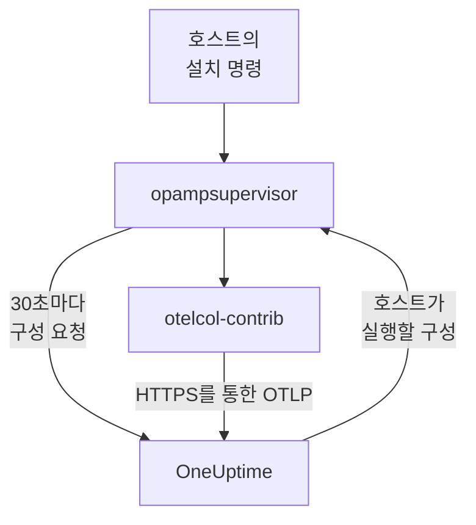

# 호스트

명령 하나로 Linux, Windows, macOS 머신을 OneUptime에 추가합니다. 명령이 호스트에 OpenTelemetry Collector를 설치하고, OneUptime이 컬렉터에 구성을 보내 최신 상태로 유지합니다. `config.yaml`을 작성하거나 각 호스트에 복사하거나 맞춰 둘 필요가 없습니다. 호스트가 수집하는 항목을 바꾸려면 컬렉터 구성을 한 번만 편집하면 되고, 그 구성이 적용되는 모든 호스트가 1분 안에 변경 사항을 받습니다.

:::cards
- [호스트 추가](#호스트-추가): Linux, Windows, macOS에서 명령 하나.
- [호스트가 수집하는 항목 변경](#호스트가-수집하는-항목-변경): 시스템과 레이블별 컬렉터 구성, 모든 버전 보관.
- [호스트의 컬렉터 확인](#호스트의-컬렉터-확인): 실행 중인 구성, 그 버전, 구성이 시작되지 않은 이유.
- [구성으로 할 수 있는 일](#구성으로-할-수-있는-일): 호스트를 읽고 이 OneUptime으로만 보냅니다.
:::

## 작동 방식

명령은 OpenTelemetry Collector 릴리스에서 두 프로그램을 설치하고, 각각 릴리스가 게시한 SHA-256으로 검증합니다. 호스트를 읽는 컬렉터인 `otelcol-contrib`과, 컬렉터를 실행하고 OneUptime이 OpAMP(OpenTelemetry Agent Management Protocol)로 보내는 구성에 컬렉터를 유지하는 `opampsupervisor`입니다. 둘 다 `oneuptime-collector` 서비스로 실행됩니다.



슈퍼바이저는 약 30초마다 수집 키로 OneUptime에 호스트의 구성을 요청하고, 호스트가 실행 중인 구성과 그 구성이 시작되었는지를 보고합니다. 호스트는 슈퍼바이저가 처음 연결할 때 머신 이름으로 **호스트**에 등록되며, 메트릭과 로그가 도착하는 대로 페이지가 채워집니다.

각 호스트는 다음 순서로 선택되는 구성 하나를 실행합니다.

| 호스트가 실행하는 구성 | 조건 |
| --- | --- |
| 호스트의 **컬렉터** 페이지에서 이 호스트용으로 선택한 구성 | 누군가 구성을 선택한 경우. |
| **컬렉터 구성 목록** 중 이 호스트에 적용되는 첫 번째 구성 | 구성이 호스트의 시스템용이고, 레이블을 지정한 경우 호스트에 그중 하나가 있으면 적용됩니다. |
| 해당 시스템용 OneUptime 기본값 | 적용되는 구성이 없는 경우. |

OneUptime 기본값은 모든 시스템에서 CPU, 메모리, 디스크, 파일 시스템, 네트워크, 프로세스를 읽습니다. Linux에서는 호스트에 있으면 저널과 systemd 유닛을, Windows에서는 System, Application, Security 이벤트 로그와 Windows 서비스를, macOS에서는 `/var/log`의 설치 로그와 Wi-Fi 로그를 읽습니다. snap 패키지나 macOS의 `/dev`처럼 설계상 가득 찬 파일 시스템은 제외하므로, 이것들 때문에 High Filesystem Usage 템플릿이 계속 작동하는 일은 없습니다. 기본값은 OneUptime 릴리스를 따르므로, 기본값을 쓰는 호스트는 OneUptime이 기본값에 적용한 개선 사항을 받습니다.

## 시작하기 전에

- 수집 키. **호스트 추가**에서 만들어 주거나, **프로젝트 설정 → 텔레메트리 및 APM → 수집 키**에서 만든 키를 선택하세요.
- 호스트의 관리자 권한. Linux와 macOS에서는 `sudo`, Windows에서는 관리자 권한으로 실행한 PowerShell입니다.
- systemd를 사용하는 Linux, Windows 10 또는 Windows Server 2019 이상, Apple 실리콘이나 Intel의 macOS.
- 호스트에서 OneUptime URL로 나가는 HTTPS(직접 또는 프록시 경유).

## 호스트 추가

:::steps
### 호스트 추가 열기

**제품 → 인프라 → 호스트**를 열고 **호스트 추가**를 선택합니다. 호스트에서 실행 중인 시스템으로 Linux, Windows, macOS 중 하나를 고릅니다. Kubernetes 클러스터의 노드는 대신 [Kubernetes Agent](/docs/telemetry/kubernetes-agent)로 모니터링합니다.

### 수집 키 선택

키를 선택하거나 대화 상자에서 새로 만듭니다. 아래 명령에 그 키가 채워집니다.

### 호스트에서 명령 실행

대화 상자에서 명령을 복사해 호스트에서 실행합니다. 약 1분이 걸립니다. 다음은 같은 명령으로, 예시 대신 OneUptime URL과 키가 들어갑니다.

:::tabs
@tab Linux
```bash
curl -fsSL https://oneuptime.com/docs/static/scripts/host-collector/install.sh | sudo sh -s -- --url https://oneuptime.com --key YOUR_INGESTION_KEY
```
@tab macOS
```bash
curl -fsSL https://oneuptime.com/docs/static/scripts/host-collector/install.sh | sudo sh -s -- --url https://oneuptime.com --key YOUR_INGESTION_KEY
```
@tab Windows
```powershell
[Net.ServicePointManager]::SecurityProtocol = [Net.ServicePointManager]::SecurityProtocol -bor [Net.SecurityProtocolType]::Tls12; & ([scriptblock]::Create((Invoke-RestMethod -Uri 'https://oneuptime.com/docs/static/scripts/host-collector/install.ps1'))) -Url 'https://oneuptime.com' -Key 'YOUR_INGESTION_KEY'
```
:::

각 OneUptime은 자체 설치 프로그램을 제공하므로, 자체 호스팅 OneUptime은 자기 릴리스의 설치 프로그램을 내려줍니다. 두 곳의 `https://oneuptime.com`을 사용자의 URL로 바꾸세요.

### 호스트 대기

대화 상자의 마지막 단계에서 호스트가 연결되면 호스트 링크와 함께 알려 줍니다. 목록에는 첫 메트릭이 도착할 때까지(보통 1분 이내) **시작 중**으로 표시되고, 그 뒤에는 연결됨으로 표시되며 컬렉터는 **실행 중**이 됩니다. 호스트의 **토폴로지** 페이지는 호스트에서 실행되는 것, 호스트를 호출하는 것, 호스트가 호출하는 것을 하나의 지도로 그립니다. [토폴로지](/docs/telemetry/topology#리소스별-지도-열기)를 참고하세요.
:::

## 호스트에 레이블 지정

명령에 레이블을 추가하면 호스트가 연결되는 순간부터 그 레이블을 갖습니다.

:::tabs
@tab Linux
```bash
curl -fsSL https://oneuptime.com/docs/static/scripts/host-collector/install.sh | sudo sh -s -- --url https://oneuptime.com --key YOUR_INGESTION_KEY --label env=production --label team=payments
```
@tab macOS
```bash
curl -fsSL https://oneuptime.com/docs/static/scripts/host-collector/install.sh | sudo sh -s -- --url https://oneuptime.com --key YOUR_INGESTION_KEY --label env=production --label team=payments
```
@tab Windows
```powershell
[Net.ServicePointManager]::SecurityProtocol = [Net.ServicePointManager]::SecurityProtocol -bor [Net.SecurityProtocolType]::Tls12; & ([scriptblock]::Create((Invoke-RestMethod -Uri 'https://oneuptime.com/docs/static/scripts/host-collector/install.ps1'))) -Url 'https://oneuptime.com' -Key 'YOUR_INGESTION_KEY' -Label 'env=production','team=payments'
```
:::

`env=production`은 레이블 `env:production`이 됩니다. 레이블은 추가될 뿐 제거되지 않습니다. 다른 레이블로 명령을 다시 실행하면 호스트는 두 레이블을 모두 갖습니다. **호스트** 목록이나 **레이블 규칙**으로도 호스트에 레이블을 지정할 수 있습니다. 레이블을 지정한 컬렉터 구성은 그중 하나가 있는 호스트에만 적용되므로, 같은 명령이라도 레이블을 달리하면 호스트 그룹마다 고유한 구성을 줄 수 있습니다.

## 호스트가 수집하는 항목 변경

:::steps
### 컬렉터 구성 만들기

**제품 → 인프라 → 호스트 → 컬렉터 구성 목록**을 열고 **컬렉터 구성 만들기**를 선택합니다. 이름, 대상 호스트의 시스템, 그리고 일부 호스트에만 적용하려면 그 호스트의 레이블을 지정합니다. 구성은 해당 시스템의 OneUptime 기본값에서 시작합니다.

### config.yaml 편집

구성 페이지에서 **구성 편집**을 선택하고 YAML을 바꾼 뒤 저장합니다. OneUptime은 먼저 내용을 확인하고, 보낼 수 없는 구성은 이유와 함께 거부합니다. [구성으로 할 수 있는 일](#구성으로-할-수-있는-일)을 참조하세요.

### 호스트에 도달하는지 확인

저장된 각 변경 사항은 새 버전이 되며, 적용 대상 호스트는 1분 안에 받습니다. 구성의 **호스트** 목록에는 각 호스트, 그 컬렉터의 상태, 실행 중인 버전이 표시됩니다.
:::

호스트는 목록에서 적용되는 첫 번째 구성을 실행합니다. **컬렉터 구성 목록**의 행을 끌어 순서를 바꾸세요. `env:production` 웹 서버용처럼 범위가 좁은 구성을 먼저, 모든 Linux 호스트용처럼 범위가 넓은 구성을 그 뒤에 둡니다. 목록 아래의 **OneUptime 기본값 목록** 카드에는 적용되는 구성이 없을 때 호스트가 실행하는 구성이 표시됩니다.

### 버전과 되돌리기

구성의 **버전 목록**에는 저장된 모든 변경 사항이 최신순으로, 저장한 사람과 시각과 함께 남습니다. **보기**로 버전을 읽고, **되돌리기**로 호스트에 다시 보냅니다. 되돌린 버전은 어느 버전을 되돌렸는지 적힌 새 버전으로 저장되므로, 목록에서 각 호스트가 무엇을 받았는지 항상 알 수 있습니다.

### 호스트 한 대용 구성 선택

호스트의 **컬렉터** 페이지에서 **구성 변경**을 선택하고 이 호스트만을 위한 구성을 고릅니다. 호스트의 시스템용 구성과 모든 시스템용 구성이 표시됩니다. 자동을 고르면 호스트가 다시 목록 순서를 따릅니다. 선택한 구성이 삭제된 호스트는 자동으로 목록 순서로 돌아갑니다.

### 구성이 시작되지 않을 때

슈퍼바이저는 새 구성으로 전환하기 전에 컬렉터로 구성을 확인하고, 시작되지 않으면 마지막으로 작동한 구성으로 돌아갑니다. 그동안 호스트는 계속 데이터를 보냅니다. 호스트의 **컬렉터** 페이지에는 **구성 실패**와 함께 컬렉터가 읽을 수 없는 로그 파일 같은 컬렉터의 이유가 표시되며, OneUptime은 구성이 바뀔 때까지 그 구성을 호스트에 다시 보내지 않습니다. 호스트에서 원인을 해결했다면 **다시 시도**를 선택해 한 번 더 보냅니다.

## 구성으로 할 수 있는 일

OneUptime이 보내는 구성은 적용 대상인 모든 호스트에서 실행되므로, OneUptime은 저장할 때마다 구성을 확인하고 규칙을 어긴 구성을 거부합니다.

| 규칙 | 이유 |
| --- | --- |
| OneUptime 목록에 있는 receivers, processors, exporters, extensions, connectors만 사용 | 호스트와 호스트의 서비스를 읽기 위한 것입니다. 프로그램을 실행하거나 클라우드나 클러스터 자격 증명을 읽는 구성 요소는 목록에 없습니다. |
| 데이터는 exporter `otlp_http`를 통해서만 호스트를 떠나며, 대상은 `${env:ONEUPTIME_URL}/otlp`, 헤더는 `x-oneuptime-token: ${env:ONEUPTIME_INGESTION_KEY}` | 각 호스트는 설치할 때 쓴 키로 이 OneUptime에 보냅니다. 키를 담은 구성은 없습니다. |
| 사용할 수 있는 `${...}`는 `${env:NAME}`뿐 | `${file:...}`나 `${https:...}`는 모든 호스트에서 읽혀 다른 곳으로 전달될 수 있습니다. |
| journald의 `journalctl_path`처럼 프로그램을 실행하거나 읽은 파일을 보내는 설정은 불가 | 구성은 호스트를 읽는 것 이상을 할 수 없습니다. |

그래도 다른 시스템용 receiver나 그 호스트에 없는 로그 파일처럼, 호스트가 실행할 수 없는 구성이 될 수는 있습니다. 각 호스트의 컬렉터는 전환하기 전에 이를 확인하며, 자세한 내용은 [구성이 시작되지 않을 때](#구성이-시작되지-않을-때)에 설명되어 있습니다.

## 호스트의 컬렉터 확인

호스트를 열고 **컬렉터** 페이지로 이동합니다. 컬렉터의 상태, 실행 중인 구성과 **이 구성인 이유**, 실행 중인 버전, **마지막 보고**, **컬렉터 릴리스**가 표시됩니다. **호스트에서**에는 호스트의 셸에서 확인하는 명령(서비스 실행 여부, 로그, 다시 시작)이 있습니다.

:::tabs
@tab Linux
```bash
sudo systemctl status oneuptime-collector
sudo journalctl -u oneuptime-collector -n 50
sudo systemctl restart oneuptime-collector
```
@tab macOS
```bash
sudo launchctl print system/com.oneuptime.collector
sudo tail -n 50 /usr/local/oneuptime-collector/log/collector.log
sudo launchctl kickstart -k system/com.oneuptime.collector
```
@tab Windows
```powershell
Get-Service oneuptime-collector
Get-WinEvent -FilterHashtable @{ LogName = 'Application'; ProviderName = 'oneuptime-collector' } -MaxEvents 50 | Format-List TimeCreated, Message
Restart-Service oneuptime-collector
```
:::

Linux에서 컬렉터는 권한 없는 사용자 `oneuptime-collector`로 실행되며, 저널과 `/var/log`의 로그를 읽을 수 있도록 `systemd-journal` 및 `adm` 그룹에 속합니다. macOS에서는 launchd 데몬처럼 root로, Windows에서는 모든 이벤트 로그와 Windows 서비스를 읽을 수 있도록 LocalSystem으로 실행됩니다.

## 수동으로 설정한 호스트

[호스트 OpenTelemetry Collector](/docs/telemetry/host-otel-collector) 가이드로 직접 컬렉터를 설치한 호스트는 이전처럼 계속 보고하며, OneUptime은 구성을 보내지 않습니다. OneUptime에 넘기려면 호스트의 **컬렉터** 페이지를 엽니다. 그곳의 명령에는 `--replace-existing`이 붙어 있어 수동으로 설치한 컬렉터(`otelcol-contrib` 서비스)를 중지하고 비활성화하므로 호스트가 두 번 보고하지 않습니다. 호스트의 이름, 기록, 레이블은 그대로 유지됩니다.

## 설치 옵션

이 중 하나를 바꾸거나 새 릴리스로 옮기려면 명령을 다시 실행하세요. 설치한 것을 교체하고 OneUptime의 호스트는 그대로 유지합니다.

| Linux 및 macOS | Windows | 기능 |
| --- | --- | --- |
| `--url URL` | `-Url URL` | OneUptime의 위치. |
| `--key KEY` | `-Key KEY` | 프로젝트의 텔레메트리 수집 키. |
| `--label KEY=VALUE` | `-Label KEY=VALUE` | 호스트에 레이블을 지정합니다. 레이블이 더 있으면 반복하고, Windows에서는 쉼표로 나열합니다. |
| `--env NAME=VALUE` | `-EnvVar NAME=VALUE` | `${env:NAME}`을 읽는 구성을 위해 컬렉터에 환경 변수를 줍니다. |
| `--version VERSION` | `-Version VERSION` | 설치할 컬렉터 릴리스이며, 기본값은 0.161.0입니다. |
| `--download-url URL` | `-DownloadUrl URL` | GitHub와 같은 폴더 구조를 가진 미러에서 릴리스를 내려받습니다. |
| `--proxy URL` | `-Proxy URL` | 다운로드와 컬렉터의 모든 트래픽을 HTTP 프록시로 보냅니다. |
| `--replace-existing` | `-ReplaceExisting` | 수동으로 설치한 컬렉터를 중지하고 비활성화합니다. |
| `--uninstall` | `-Uninstall` | 컬렉터와 명령이 설치한 모든 항목을 제거합니다. |

## 제거

:::tabs
@tab Linux
```bash
curl -fsSL https://oneuptime.com/docs/static/scripts/host-collector/install.sh | sudo sh -s -- --uninstall
```
@tab macOS
```bash
curl -fsSL https://oneuptime.com/docs/static/scripts/host-collector/install.sh | sudo sh -s -- --uninstall
```
@tab Windows
```powershell
& ([scriptblock]::Create((Invoke-RestMethod -Uri 'https://oneuptime.com/docs/static/scripts/host-collector/install.ps1'))) -Uninstall
```
:::

호스트는 기록과 함께 OneUptime에 남습니다. **호스트** 목록에서 보관하거나 삭제하세요.

## 문제 해결

:::details 명령에서 OneUptime이 키를 거부했다고 표시됨
HTTP `401`: 키가 틀렸거나 만료되었거나 삭제되었습니다. HTTP `422`: 키가 비활성화되었거나, 브라우저 키이거나, 서비스 하나에 고정되어 있습니다. **호스트 추가**에서 활성화된 서버 키를 선택하고 명령을 다시 실행하세요. 호스트의 키가 교체됩니다.
:::

:::details 호스트가 표시되지 않음
호스트가 HTTPS로 OneUptime URL에 연결할 수 있는지 확인한 뒤, [호스트의 컬렉터 확인](#호스트의-컬렉터-확인)에 있는 해당 시스템용 명령으로 컬렉터 로그를 읽으세요.
:::

:::details 호스트가 구성 실패를 보고함
호스트의 **컬렉터** 페이지에 구성이 시작되지 않은 이유가 표시됩니다. 호스트는 마지막으로 작동한 구성을 계속 실행하며, 구성이 바뀌거나 **다시 시도**를 선택하면 실패한 구성을 다시 받습니다.
:::

:::details 호스트에 '보고 없음'이 표시됨
OneUptime이 15분 넘게 호스트의 슈퍼바이저로부터 소식을 받지 못했습니다. `oneuptime-collector` 서비스가 실행 중인지, 호스트가 여전히 OneUptime에 연결할 수 있는지 확인하세요.
:::

## 다음 단계

:::cards
- [호스트 OpenTelemetry Collector](/docs/telemetry/host-otel-collector): 대신 컬렉터를 직접 설치하고 구성을 작성합니다.
- [호스트 모니터](/docs/monitor/host-monitor): 호스트가 보고하는 내용으로 알림을 받습니다.
- [수집 키](/docs/telemetry/ingestion-keys): 호스트가 보낼 때 쓰는 키를 만들고, 범위를 정하고, 교체합니다.
- [Kubernetes Agent](/docs/telemetry/kubernetes-agent): 클러스터의 노드와 워크로드를 모니터링합니다.
:::
