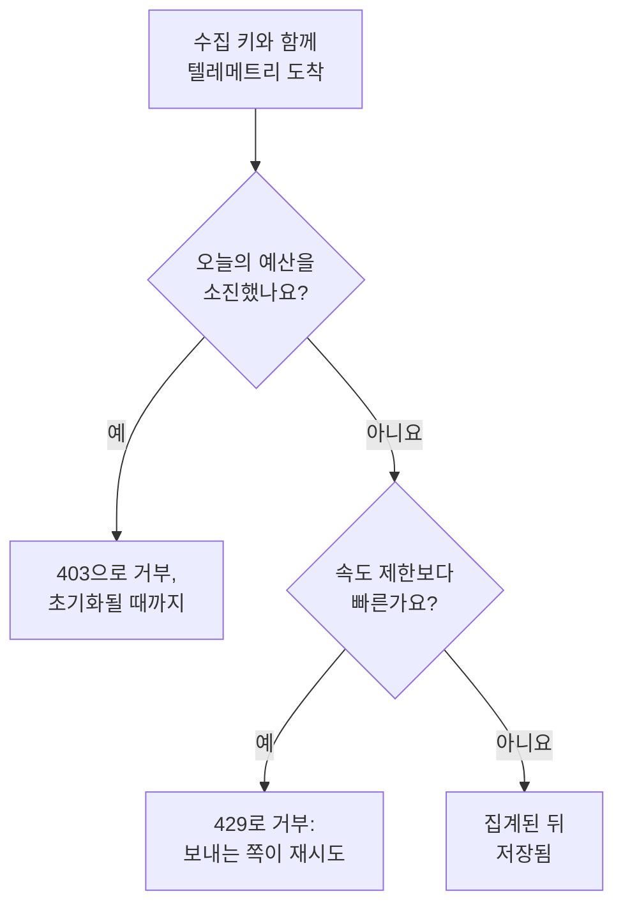

# 수집 예산

수집 예산은 프로젝트가 하루에 보내는 텔레메트리 양에 상한을 두어, 시끄러운 서비스 하나나 폭주하는 로그 루프 하나가 스토리지를 가득 채우지 못하게 합니다. 인스턴스 관리자는 모든 프로젝트 또는 한 프로젝트에 대해 신호마다 일일 예산을 설정하며, 수집 키를 편집할 수 있는 사람은 누구나 그 키에 더 작은 자체 예산을 줄 수 있습니다. 각 예산에는 초당 속도 제한도 둘 수 있습니다.

:::cards
- [예산의 작동 방식](#예산의-작동-방식): 세 가지 수준이며, 텔레메트리가 도착할 때 집계됩니다.
- [모든 프로젝트의 기본 예산 설정](#모든-프로젝트의-기본-예산-설정): Admin Dashboard의 설정에서.
- [수집 키에 자체 예산 주기](#수집-키에-자체-예산-주기): 프로젝트 예산의 일부.
- [예산 알림 받기](#예산-알림-받기): 소진되기 전과 소진되었을 때.
:::

## 예산의 작동 방식

텔레메트리는 도착할 때 집계됩니다. 해당 신호에 대한 프로젝트의 예산에 집계되고, 수집 키에 예산이 있으면 그 키의 예산에도 집계됩니다. 일일 예산이 소진되면 예산이 초기화될 때까지 그 신호는 거부됩니다.



- **세 가지 수준.** 인스턴스 기본값은 모든 프로젝트에 적용됩니다. 인스턴스 관리자는 대신 한 프로젝트에 자체 예산을 주거나 아예 제한을 두지 않을 수 있습니다. 키의 예산은 그 프로젝트의 예산을 나눌 뿐이어서, 더 작을 수는 있어도 더 클 수는 없습니다.
- **다섯 가지 신호.** 로그, 트레이스, 메트릭, 프로파일, 보안 이벤트에는 각각 자체 예산이 있습니다. 세션 리플레이에는 자체 한도가 있습니다. [세션 리플레이](/docs/telemetry/session-replay)를 참고하세요.
- **바이트는 압축 해제 후 크기로 집계됩니다.** 요청은 본문의 압축을 푼 크기로 집계되므로, 압축해도 집계되는 양은 바뀌지 않습니다. 1 GB는 1024³바이트이고, 1 MB는 1024²바이트입니다.
- **저장된 것이 아니라 도착한 것이 집계됩니다.** 나중에 [드롭 필터](/docs/telemetry/drop-filters-and-scrub-rules)가 제거하는 텔레메트리도 집계되므로, 예산은 저장된 것을 집계하는 [텔레메트리 사용량](/docs/telemetry/usage) 페이지보다 크게 나올 수 있습니다.
- **마지막 요청은 통째로 저장됩니다.** 예산에 아직 여유가 있을 때 도착한 요청은 전부 저장되므로, 소진된 예산은 100%를 조금 넘을 수 있습니다.
- **예산을 설정하기 전에는 아무것도 제한되지 않습니다.** 모든 설치는 예산 없이 시작하며, 예산이 없는 프로젝트는 전혀 집계되지 않습니다.
- **변경 사항은 1분 안에 모든 서버에 반영됩니다.**
- **집계할 수 없을 때도 텔레메트리는 수락됩니다.** 예산은 Valkey에서 집계됩니다. Valkey에 연결할 수 없는 동안 OneUptime은 텔레메트리를 거부하지 않고 집계 없이 저장하며, 예산 페이지에 그 사실이 표시됩니다.

## 시작하기 전에

- **인스턴스와 프로젝트의 예산에는 Admin Dashboard.** 자체 호스팅 설치에서는 인스턴스 관리자만 이 예산을 설정합니다. 프로젝트의 소유자와 관리자는 예산을 볼 수 있지만 바꿀 수는 없습니다.
- **키의 자체 예산에는 수집 키를 편집하는 역할.** Project Owner 또는 Project Admin, 아니면 Edit Ingestion Key 권한이 있는 사용자 지정 역할입니다.
- **예산을 보려면 프로젝트의 사용량을 보는 역할.** [텔레메트리 사용량](/docs/telemetry/usage) 페이지를 보는 역할은 그 페이지에서 예산도 봅니다.

## 모든 프로젝트의 기본 예산 설정

:::steps
### 수집 예산 열기

Admin Dashboard에서 **설정 → 텔레메트리 → 수집 예산**으로 이동합니다. 사이드 메뉴의 **텔레메트리**는 처음에 접혀 있으니 클릭해서 엽니다.

### 일일 예산 설정

**기본 일일 예산** 카드에서 **기본 일일 예산 편집**을 클릭하고, **로그(GB/일)** 등 제한할 각 신호에 GB 수를 입력한 다음, **변경 사항 저장**을 클릭합니다. 제한하지 않을 신호는 비워 둡니다.

### 필요하면 속도 제한 설정

**기본 속도 제한** 카드에서 **기본 속도 제한 편집**을 클릭하고, **로그(MB/초)** 등 신호에 초당 MB 수를 입력합니다. 속도 제한이 있으면 한 번의 버스트가 몇 분 만에 하루 예산을 소진할 수 없습니다.
:::

**경고 및 초기화** 카드에는 경고 임계값과 예산일이 초기화되는 시간이 있습니다. [경고와 초기화](#경고와-초기화)를 참고하세요.

## 한 프로젝트의 예산 설정

:::steps
### 프로젝트 열기

Admin Dashboard에서 **프로젝트**로 이동해 프로젝트를 클릭하고, 그 사이드 메뉴에서 **수집 예산**을 클릭합니다. 페이지 맨 위에 그 프로젝트가 오늘 사용한 예산이 표시됩니다.

### 프로젝트의 일일 예산 설정

**이 프로젝트의 일일 예산** 카드에서 **일일 예산 편집**을 클릭합니다. 신호마다 인스턴스 기본값 대신 GB 수를 입력하거나, 아예 제한하지 않으려면 0을 입력합니다. 인스턴스 기본값을 유지하려면 신호를 비워 둡니다.

### 프로젝트의 속도 제한 설정

**이 프로젝트의 속도 제한** 카드에서 **속도 제한 편집**을 클릭하고 같은 방식으로 설정합니다. 초당 MB 수를 입력하거나, 제한하지 않으려면 0을 입력하고, 인스턴스 기본값을 쓰려면 비워 둡니다.
:::

프로젝트의 구성원은 이 예산을 자신의 [텔레메트리 사용량](/docs/telemetry/usage) 페이지에서 읽기 전용으로 봅니다.

## 수집 키에 자체 예산 주기

키의 예산은 그 프로젝트 예산의 일부입니다. 자기 키로 데이터를 쏟아 내는 보내는 쪽은 키의 예산에서 멈추고, 프로젝트의 다른 키는 계속 보낼 수 있습니다.

:::steps
### 키 열기

**프로젝트 설정 → 텔레메트리 및 APM → 수집 키**로 이동해 키를 클릭합니다. 사이드 메뉴의 **텔레메트리 및 APM**은 처음에 접혀 있으니 클릭해서 엽니다.

### 키의 예산 설정

**수집 예산** 카드에서 **수집 예산 편집**을 클릭합니다. **일일 예산** 단계에서 제한할 각 신호에 하루 GB 수를, **속도 제한** 단계에서 초당 MB 수를 입력합니다. 키의 자체 예산을 두지 않을 신호는 비워 둡니다.

### 예산 저장

**변경 사항 저장**을 클릭합니다. 키의 예산은 프로젝트의 예산보다 클 수 없습니다. 더 크면 OneUptime이 거부하고 설정할 수 있는 최댓값을 알려 줍니다.
:::

- **두 예산이 모두 집계됩니다.** 키로 보낸 텔레메트리는 키의 예산과 프로젝트의 예산 모두에 집계되며, 먼저 소진되는 쪽에서 거부됩니다.
- **낮아진 프로젝트 예산은 키에도 적용됩니다.** 프로젝트의 예산이 키의 예산보다 낮아지면 키는 프로젝트의 예산으로 제한됩니다.

## 보내는 쪽에 보이는 것

| 상황 | HTTP에서 | OTLP/gRPC에서 | 보내는 쪽의 동작 |
| --- | --- | --- | --- |
| 일일 예산 소진 | `403` | `RESOURCE_EXHAUSTED` | 배치를 버립니다. 초기화 전에는 다시 시도해도 소용없습니다 |
| 속도 제한 초과 | `Retry-After`가 있는 `429` | 재시도 지연이 있는 `RESOURCE_EXHAUSTED` | 지연 후 배치를 다시 시도합니다 |

모든 거부에는 이유가 담깁니다. OTLP/HTTP에서는 본문이 `google.rpc.Status`이며 요청을 보낸 방식에 따라 protobuf 또는 JSON으로 오므로, 보내는 쪽의 로그에 다음과 같은 이유가 표시됩니다.

```text
This project's daily logs ingestion budget of 10 GB is used up, so OneUptime is not storing logs from this project until the budget resets at 2026-11-10 00:00 UTC.
```

- **다른 HTTP 보내는 쪽은 JSON을 받습니다.** Fluent Bit, Fluentd, syslog 및 기타 HTTP 엔드포인트로 보내는 쪽은 `error`, `message`, `resetsAt`을 받고, 속도 제한일 때는 `retryAfterSeconds`도 받습니다.
- **MQTT와 클라우드 스트림에는 알릴 수 없습니다.** MQTT나 클라우드 공급자의 스트림으로 도착하는 텔레메트리는 예산이 소진되면 버려집니다. 다시 보낼 수 없으므로 속도 제한은 적용되지 않습니다.
- **거부도 집계됩니다.** 소진된 예산이 거부하거나 버린 것은 삭제됨으로, 속도 제한이 거부한 각 요청은 스로틀링됨으로 집계됩니다. [오늘의 사용량과 삭제된 데이터 보기](#오늘의-사용량과-삭제된-데이터-보기)를 참고하세요.

## 경고와 초기화

- **경고.** 일일 예산이 경고 임계값(인스턴스 관리자가 바꾸지 않으면 80%)을 넘으면 프로젝트 소유자에게 이메일이 가고, 탐색기에는 그 신호의 데이터 위에 배너가 표시됩니다. 예산이 소진되면 이메일이 한 번 더 갑니다. 각 예산은 각 이메일을 하루에 한 번까지만 보냅니다.
- **초기화.** 각 예산일은 인스턴스 관리자가 바꾸지 않으면 00:00 UTC에 다시 시작됩니다. **경고 및 초기화** 카드에서는 **경고 임계값(%)**(1에서 99까지), **초기화 시간**(HH:MM 형식), **초기화 시간대**를 설정합니다. **경고 및 초기화 편집**을 클릭하세요.
- **일광 절약 시간.** 초기화는 시간대의 시계를 따르므로, 시계가 바뀌는 날의 예산일은 한 시간 짧거나 깁니다. 시계가 건너뛰는 초기화 시간은 시계가 넘어간 시점에서 그만큼 지난 뒤에 적용됩니다.
- **초기화를 바꾸면 새 날이 시작됩니다.** 초기화 시간이나 시간대를 바꾸면 아직 아무것도 집계되지 않은 새 예산일이 즉시 시작됩니다.

## 오늘의 사용량과 삭제된 데이터 보기

**프로젝트 설정 → 텔레메트리 및 APM → 사용량**으로 이동합니다. 프로젝트에 예산이나 속도 제한이 설정되어 있는 동안에는 페이지 맨 위에 **수집 예산** 카드가 표시되고, 자체 예산이 있는 키는 **수집 키 예산** 카드에 표시됩니다.

| 열 | 표시 내용 |
| --- | --- |
| **신호** | 그 행의 신호. |
| **오늘 사용량** | 예산일이 시작된 뒤 집계된 양과 예산 대비 비율. |
| **일일 예산** | 적용 중인 예산과 설정된 위치: **인스턴스 기본값**, **이 프로젝트에 설정됨** 또는 **이 키의 자체 예산**. |
| **속도 제한** | 적용 중인 속도 제한. |
| **삭제됨** | 예산이 소진되어 거부되거나 버려진 것. |
| **스로틀링됨** | 속도 제한이 거부한 요청 수. |
| **상태** | **예산 이내**, **경고 임계값 초과** 또는 **소진됨**, 속도 제한만 있는 신호의 **일일 예산 없음**, 집계를 읽을 수 없는 동안의 **알 수 없음**. |

- **키의 페이지**에서는 **오늘의 예산 사용량** 카드에 키가 자체 예산을 얼마나 사용했는지 표시됩니다.
- **탐색기**에서는 로그, 트레이스, 메트릭, 프로파일, 보안 이벤트 데이터 위의 배너가 그 신호의 예산이 경고 임계값을 넘었거나 소진되었을 때 알려 주며, **예산 보기**를 눌러 사용량 페이지를 열 수 있습니다.
- **Admin Dashboard**에서는 프로젝트의 **수집 예산** 페이지에 같은 수치가 표시됩니다.

## 예산 알림 받기

OneUptime은 5분마다 각 예산의 그날 수치를 프로젝트의 메트릭으로 기록하며, [메트릭 모니터](/docs/monitor/metrics-monitor)로 다른 메트릭과 똑같이 이 수치에 대한 알림을 받을 수 있습니다.

| 메트릭 | 단위 | 담긴 값 |
| --- | --- | --- |
| `oneuptime.telemetry.budget.used.bytes` | `By` | 예산일이 시작된 뒤 일일 예산에 집계된 바이트 수. |
| `oneuptime.telemetry.budget.used.percent` | `%` | 같은 값을 일일 예산 대비 백분율로 나타낸 것. 100 이상이면 초기화될 때까지 신호가 거부됩니다. |
| `oneuptime.telemetry.budget.dropped.bytes` | `By` | 예산이 소진되어 예산일이 시작된 뒤 거부되거나 버려진 바이트 수. |
| `oneuptime.telemetry.budget.throttled.requests` | `{request}` | 예산일이 시작된 뒤 속도 제한이 거부한 요청 수. |

각 포인트에는 다음 속성이 붙습니다.

| 속성 | 값 |
| --- | --- |
| `projectId` | 프로젝트의 ID. |
| `signal` | `logs`, `traces`, `metrics`, `profiles` 또는 `security-events`. |
| `scope` | `project`, 또는 키의 자체 예산이면 `ingestion-key`. |
| `ingestionKeyId` | 키의 ID(키의 자체 예산인 경우). |
| `ingestionKeyName` | 포인트를 기록할 때의 키 이름(키의 자체 예산인 경우). |

프로젝트의 로그 예산이 90%에 이를 때 알림을 받으려면, `oneuptime.telemetry.budget.used.percent`에 대해 `signal` `logs`와 `scope` `project`로 필터링하고 최댓값이 90을 넘으면 알림을 보내는 메트릭 모니터를 만듭니다.

- **최댓값으로 집계하세요.** 각 수치는 예산일 동안 늘어나기만 합니다.
- **15분 이상의 기간을 사용하세요.** 포인트는 5분마다 기록되며, 포인트가 하나도 없는 기간이 되면 알림이 해결됩니다.
- **0이 아니라 빈 구간을 예상하세요.** 값이 0인 수치나, 집계를 읽을 수 없는 동안에는 아무것도 기록되지 않습니다.
- **비용이 들지 않습니다.** 이 메트릭은 어떤 예산에도, 텔레메트리 사용량에도 집계되지 않으며, 모니터 메트릭과 같은 기간 동안 보관됩니다. 인스턴스 관리자가 바꾸지 않으면 30일입니다. `oneuptime.telemetry.budget.`로 시작하는 메트릭 이름은 이 메트릭용으로 예약되어 있어, 애플리케이션이 그런 이름으로 보내는 메트릭은 버려집니다.

## 문제 해결

:::details collector가 내보내기에서 403을 로그에 기록함
그 신호에 대한 프로젝트나 키의 일일 예산이 소진되어, collector가 보내지 못한 것을 예산이 초기화될 때까지 버립니다. 사용량 페이지에서 **오늘 사용량**을 확인하세요. 인스턴스 관리자에게 프로젝트의 예산을 올려 달라고 하거나, 덜 보내세요. 드롭 필터는 집계된 뒤에 텔레메트리를 제거하므로 여기서는 도움이 되지 않습니다.
:::

:::details collector가 429를 로그에 기록하고 다시 시도함
속도 제한이 허용하는 것보다 빠르게 보내고 있습니다. `Retry-After` 지연 후에 다시 시도하므로, 큐가 가득 차지 않는 한 잃는 것은 없습니다. 속도 제한을 올리거나, 보내는 양을 더 고르게 분산하세요.
:::

:::details 오늘 사용량이 텔레메트리 사용량 페이지보다 큼
예산은 텔레메트리를 도착할 때 압축 해제된 크기로 집계하며, 나중에 드롭 필터가 제거하는 것도 포함합니다. 사용량 페이지는 저장된 것을 다음 날 집계합니다.
:::

:::details 예산에 오늘의 집계를 읽을 수 없다고 표시됨
OneUptime이 예산을 집계하는 Valkey에 연결할 수 없습니다. 연결될 때까지 텔레메트리는 집계 없이 저장되며, 어떤 예산도 적용되지 않습니다.
:::

## 다음 단계

:::cards
- [텔레메트리 사용량](/docs/telemetry/usage): 각 프로젝트와 서비스가 보내는 양을 확인합니다.
- [드롭 필터 및 스크럽 규칙](/docs/telemetry/drop-filters-and-scrub-rules): 필요 없는 텔레메트리를 저장하지 않습니다.
- [수집 키](/docs/telemetry/ingestion-keys): 보내는 쪽마다 키를 두어 각각 예산을 가질 수 있게 합니다.
- [메트릭 모니터](/docs/monitor/metrics-monitor): 예산 메트릭에 대한 알림을 받습니다.
:::
