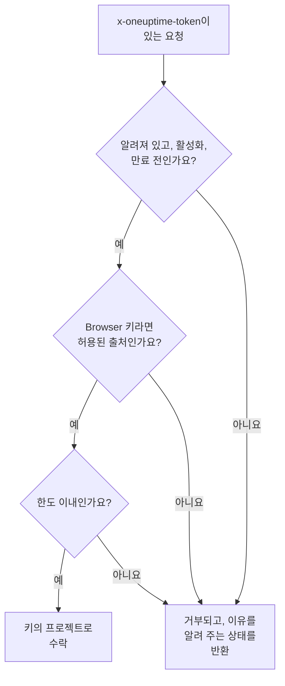

# 수집 키

수집 키는 텔레메트리를 프로젝트에 연결합니다. 애플리케이션, OpenTelemetry Collector, 에이전트는 요청마다 이 키를 보내고, OneUptime은 그 로그, 트레이스, 메트릭을 키가 속한 프로젝트에 기록합니다. 이 페이지에서는 키를 만드는 방법, 어떤 유형을 고를지, 키를 안전하게 지키는 방법을 설명합니다.

:::cards
- [수집 키 만들기](#수집-키-만들기): 이름, 유형, 복사할 시크릿.
- [서버 또는 브라우저](#서버-또는-브라우저): 보내는 쪽에 필요한 키의 종류.
- [브라우저 키 잠그기](#브라우저-키-잠그기): 출처, 서비스 이름 하나, 한도.
- [키 교체, 끄기, 삭제](#키-교체-끄기-삭제): 키가 유출되었을 때 할 일.
:::

## 키를 확인하는 방식

모든 요청은 키의 시크릿을, 보통 `x-oneuptime-token` 헤더에 담아 보냅니다. OneUptime은 키를 찾아 아직 보낼 수 있는지 확인한 뒤에야 데이터를 키의 프로젝트로 받아들입니다.



- **키가 프로젝트를 정합니다.** 프로젝트 ID를 보낼 일은 없습니다. 키로 보낸 데이터는 그 키가 속한 프로젝트에 들어갑니다.
- **변경 사항은 1분 안에 모든 서버에 반영됩니다.** 키를 끄거나, 시크릿을 재설정하거나, 출처, 만료, 한도를 바꾸면 약 1분 안에 적용됩니다.
- **서버 키는 비밀번호입니다.** 키를 가진 사람은 누구나 프로젝트로 텔레메트리를 보낼 수 있습니다. 서버의 시크릿 저장소에 보관하고, 소스 제어나 웹 페이지에는 절대 두지 마세요.

## 서버 또는 브라우저

키가 놓일 위치에 따라 유형을 고릅니다. 키를 만든 뒤에는 유형을 바꿀 수 없습니다.

| | **서버** | **브라우저** |
| --- | --- | --- |
| 용도 | 직접 운영하는 머신의 애플리케이션, collector, 에이전트 | 웹 페이지, 그리고 React Native Session Replay |
| 보내는 것 | 모든 종류의 텔레메트리를 모든 엔드포인트로 | 트레이스, 로그, 메트릭, Session Replay |
| 시크릿 여부 | 예. 서버에 보관합니다 | 아니요. 페이지를 보는 누구나 읽을 수 있습니다 |
| 출처 | 확인하지 않음 | 목록에 있는 출처만 수락 |
| 분당 요청 수 | 직접 설정하지 않으면 제한 없음 | 다른 한도를 설정하지 않으면 6,000 |

그 밖의 모든 곳에서 OneUptime은 브라우저 키를 거부합니다. 예를 들어 gRPC와 MQTT, 프로파일, Syslog, Fluent Bit와 Fluentd, 소스 맵 업로드입니다. 보내는 쪽을 다른 유형으로 옮기려면 그 유형의 키를 만들고, 보내는 쪽을 새 키로 전환한 다음, 이전 키를 삭제합니다.

## 시작하기 전에

- **수집 키를 관리하는 역할.** Project Owner 또는 Project Admin, 아니면 Create Telemetry Ingestion Key 권한이 있는 사용자 지정 역할입니다. Telemetry 역할에는 수집 키가 포함되지 않습니다.
- **OneUptime Cloud에서는 결제 수단.** 텔레메트리는 사용한 만큼 청구되므로, Free 플랜의 프로젝트는 키를 만들기 전에 결제 수단이 필요합니다. 이 경우 생성 대화 상자는 가격을 보여 주는 **결제** 단계로 끝납니다.

## 수집 키 만들기

:::steps
### 수집 키 열기

**프로젝트 설정 → 텔레메트리 및 APM → 수집 키**로 이동합니다. 사이드 메뉴의 **텔레메트리 및 APM**은 처음에 접혀 있으니 클릭해서 엽니다. 목록에는 키마다 **이름**, **유형**, **Last Used**, **설명** 열이 표시됩니다.

### 키 이름을 정하고 유형 고르기

**수집 키 생성**을 클릭합니다. 대화 상자는 이름 **서버 키**와 유형 **서버**로 시작합니다. **키 유형**을 고르고, `checkout-collector`처럼 키를 사용할 대상에 맞게 이름을 바꿉니다. **설명**은 **고급** 아래에 있습니다.

### 브라우저 키의 출처 추가하기

**브라우저** 키는 다음 단계인 **브라우저 설정**에서 **허용된 출처** 목록을 묻고, **고급** 아래에서 **고정된 서비스 이름** 값을 묻습니다. [브라우저 키 잠그기](#브라우저-키-잠그기)를 참고하세요.

### 키를 만들고 시크릿 복사하기

**수집 키 생성**을 클릭합니다. 키의 페이지가 열리면 **시크릿 키**를 복사해 보내는 쪽에 전달합니다.
:::

각 제품의 **설정 가이드**는 **수집 키 선택** 단계로 시작합니다. 이 단계는 그 가이드가 쓸 수 있는 키를 나열하고, 그 자리에서 키를 만들어 줍니다. 그다음부터 가이드의 코드 조각에는 그 키가 들어갑니다.

## 키로 텔레메트리 보내기

보내는 쪽은 시크릿을 `x-oneuptime-token` 헤더에 넣습니다.

```text
x-oneuptime-token: YOUR_ONEUPTIME_INGESTION_KEY
```

- OpenTelemetry SDK는 `OTEL_EXPORTER_OTLP_HEADERS`에서 이 값을 읽습니다. [OpenTelemetry 빠른 시작](/docs/telemetry/open-telemetry#빠른-시작)을 참고하세요.
- OTLP/gRPC에서는 `x-oneuptime-token` 메타데이터에 넣습니다.
- MQTT 기기는 이 값을 비밀번호로 보냅니다. [IoT 기기](/docs/telemetry/iot-devices)를 참고하세요.
- OneUptime은 일부 오래된 구성이 보내는 `x-oneuptime-ingestion-key` 또는 `x-oneuptime-service-token` 헤더에서도 키를 읽습니다.

## 브라우저 키 잠그기

브라우저 키는 페이지 안에 있어서 누구나 복사할 수 있습니다. 다음 설정은 복사본이 할 수 있는 일을 제한합니다. 키의 페이지에서 **텔레메트리 수집 Key 편집**으로 바꿉니다.

| 설정 | 하는 일 |
| --- | --- |
| **허용된 출처** | 키를 수락하는 유일한 출처입니다. 다른 출처에서 온 요청이나 `Origin` 헤더가 아예 없는 요청은 거부됩니다. 브라우저 키에는 출처가 적어도 하나 있어야 합니다. |
| **고정된 서비스 이름** | 보내는 쪽이 어떤 `service.name`을 설정했든, 키가 OTLP/HTTP로 보내는 모든 것을 이 서비스 하나 아래에 기록합니다. 그러면 키의 복사본은 그 서비스에만 쓸 수 있습니다. |
| **Requests Per Minute Limit** | 키가 매분 수락되는 최대 요청 수이며, 모든 방문자가 함께 씁니다. 비워 두면 브라우저 키에는 6,000이 적용됩니다. |
| **만료 시각** | 이 날짜 이후에는 키가 거부되므로, 공개된 복사본이 더 이상 작동하지 않습니다. |

출처는 스킴, 호스트, 그리고 선택 사항인 포트로 이루어집니다. `https://app.example.com`은 `https://app.example.com:8443`을 포함하지 않습니다. 맨 앞의 `*.` 하나는 모든 하위 도메인을 포함하지만, 도메인 자체는 포함하지 않습니다. React Native Session Replay는 정확한 `app://` 식별자를 보내며, 여기에는 와일드카드를 쓸 수 없습니다.

```json
[
  "https://app.example.com",
  "https://*.example.com",
  "app://com.example.mobile"
]
```

[서비스 카탈로그](/docs/telemetry/services#서비스가-카탈로그에-들어오는-방식)에서 고정된 이름이 서비스를 정하는 방식을 볼 수 있습니다. Kubernetes 에이전트의 Runner와 AI 에이전트, 그리고 인프라 AI 에이전트는 고정된 키로 등록되지 않습니다. 이름이 고정되지 않은 서버 키를 주세요.

## 키 교체, 끄기, 삭제

키의 페이지에는 **상태**, **Click to reveal** 뒤에 가려진 **시크릿 키**, 그리고 **Last Used At** 값이 표시됩니다. 이 값은 OneUptime이 그 키로 보낸 데이터를 마지막으로 수락한 시각입니다.

| 목적 | 할 일 | 보내는 쪽에 보이는 것 |
| --- | --- | --- |
| 키를 즉시 멈추고, 나중에 되돌릴 수 있게 하기 | **텔레메트리 수집 Key 편집**을 클릭하고, **액세스 및 제한**을 열어 **활성화됨**을 끕니다. 상태에 **Disabled — telemetry refused** 문구가 표시됩니다. | 다시 켤 때까지 `422` |
| 유출된 시크릿 바꾸기 | **비밀 키 재설정**을 클릭하고 확인합니다. 키는 설정을 유지한 채 새 시크릿을 받습니다. | 새 시크릿을 보낼 때까지 `401` |
| 키를 영구히 멈추기 | 페이지 맨 아래의 **텔레메트리 수집 Key 삭제**를 클릭합니다. | `401` |

데이터를 잃지 않고 시크릿을 바꾸려면 두 번째 키를 만들고, 보내는 쪽을 그 키로 옮긴 다음, 이전 키의 **Last Used At** 값이 더 이상 바뀌지 않을 때 삭제합니다. **Last Used At** 값은 요청마다가 아니라 몇 분마다 갱신됩니다.

## 문제 해결

거부된 요청에는 상태와 그 이유를 설명하는 문장이 돌아옵니다.

| 응답 | 의미 |
| --- | --- |
| `401`과 `Missing ingestion token` | 요청에 키가 없습니다. `x-oneuptime-token`에 담아 보내세요. |
| `401`과 `Invalid ingestion token` | 이 시크릿을 가진 키가 없습니다. 잘못 입력했거나, 재설정했거나, 삭제했습니다. |
| `401`과 `This telemetry ingestion key expired.` | **만료 시각**이 지났습니다. 더 나중 날짜를 설정하거나 다른 키를 쓰세요. |
| `402`와 `Add a payment method` | OneUptime Cloud에서 프로젝트가 Free 플랜이고 아직 결제 수단이 없습니다. |
| `422`와 `This telemetry ingestion key has been disabled.` | 누군가 **활성화됨**을 껐습니다. |
| `422`와 `A browser ingestion key cannot be used for` | 브라우저 키가 서버 키만 받는 엔드포인트에 도달했습니다. |
| `422`와 `did not send an Origin header` | 브라우저 키가 브라우저 밖에서 전송되었습니다. 그곳에서는 서버 키를 쓰세요. |
| `422`와 `is not allowed for this browser ingestion key` | 페이지의 출처가 **허용된 출처** 목록에 없습니다. |
| `422`와 `is pinned to a single service` | **고정된 서비스 이름** 값이 있는 키로 에이전트를 등록하려 했습니다. 이름이 고정되지 않은 서버 키를 쓰세요. |
| `429`와 `Too many telemetry requests for this ingestion key` | 키가 **Requests Per Minute Limit** 값에 도달했습니다. 익스포터는 `Retry-After` 시간이 지난 뒤 다시 시도합니다. |

OTLP 익스포터가 받을 수 있는 다른 응답은 [응답](/docs/telemetry/open-telemetry#응답)을 참고하세요.

:::details 키를 끈 지 1분이 지나도 데이터가 들어옵니다
각 OneUptime 서버는 키에 대해 아는 내용을 최대 1분 동안 유지하므로, 변경 사항이 모든 서버에 반영되기까지 약 1분이 걸립니다. 그 이후의 요청은 거부됩니다.
:::

:::details 브라우저 키가 노트북에서는 되지만 프로덕션에서는 안 됩니다
출처에는 스킴과 포트가 포함됩니다. `http://localhost:3000`과 `https://app.example.com`은 서로 다른 출처입니다. 페이지를 제공하는 출처를 하나하나 목록에 넣으세요.
:::

:::details Last Used At 값이 계속 없음으로 표시됩니다
OneUptime이 이 키의 사용을 기록하기 시작한 뒤로 이 키로 데이터를 보낸 곳이 없습니다. 보내는 쪽이 이 키의 시크릿을 갖고 있는지, 그 요청이 OneUptime에 도달하는지 확인하세요.
:::

## 다음 단계

:::cards
- [OpenTelemetry](/docs/telemetry/open-telemetry): 키로 트레이스, 메트릭, 로그를 보냅니다.
- [서비스 카탈로그](/docs/telemetry/services): 텔레메트리가 기록되는 서비스를 확인합니다.
- [데이터 보존](/docs/telemetry/data-retention): 데이터를 얼마나 오래 보관할지 정합니다.
- [드롭 필터 및 스크럽 규칙](/docs/telemetry/drop-filters-and-scrub-rules): 저장되기 전에 데이터를 버리거나 가립니다.
:::
