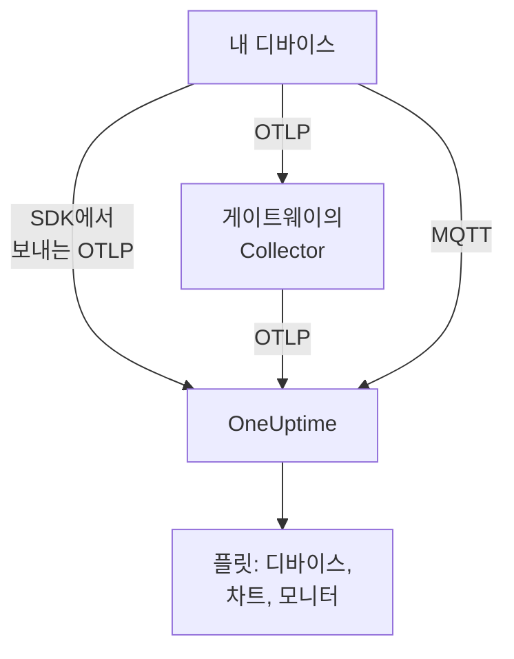

# IoT 기기

OneUptime은 IoT 디바이스(센서, 게이트웨이, 컨트롤러, 엣지 박스)의 플릿을 디바이스가 보내는 소수의 `iot_*` 메트릭으로 모니터링합니다. 디바이스를 플릿으로 묶고, 각 플릿의 디바이스 인벤토리를 유지하며, 배터리, 신호, 온도, CPU, 메모리, 가용성을 차트로 보여 줍니다. 디바이스에 설치할 OneUptime 에이전트는 없습니다. 디바이스는 표준 OpenTelemetry를 보내거나 OneUptime의 MQTT 엔드포인트에 게시합니다. [IoT 기기 모니터](/docs/monitor/iot-device-monitor)는 디바이스가 보낸 데이터를 기준으로 알림을 보냅니다.

:::cards
- [전송 방법 선택](#전송-방법-선택): OpenTelemetry SDK, 게이트웨이 Collector, 또는 MQTT.
- [MQTT를 통한 메트릭 전송](#mqtt를-통한-메트릭-전송): 토픽, 디바이스별 자격 증명, Last Will.
- [메트릭 규칙](#메트릭-규칙): OneUptime이 차트와 알림에 사용하는 `iot_*` 이름.
- [문제 해결](#문제-해결): 누락된 플릿, 누락된 디바이스, 오프라인 전환.
:::

## 작동 방식

모든 측정값은 하나의 플릿과 하나의 디바이스에 속합니다. OneUptime은 첫 측정값으로 플릿을 만들고, 새 디바이스를 플릿의 인벤토리에 추가하며, 그 후에는 측정값마다 디바이스의 최신 값을 업데이트합니다. OpenTelemetry로 보낸 측정값과 MQTT로 보낸 측정값은 같은 플릿, 인벤토리, 차트, 모니터에 반영됩니다.



## OneUptime의 IoT 모델

- **플릿**: `building-a-sensors`나 `field-gateways` 같은 디바이스 그룹입니다. `iot.fleet.name` 리소스 속성에서 정해지며, OneUptime에서는 텔레메트리 서비스 `iot/<fleet>`로 나타납니다. 로그와 메트릭이 같은 서비스 아래에 정렬되도록 `service.name=iot/<fleet>`도 설정하세요.
- **디바이스**: 플릿 안의 디바이스 하나로, 각 데이터 포인트의 `device.id` 속성으로 이름이 정해집니다. 플릿의 인벤토리는 `device.id`를 키로 합니다.

| 속성 | 설정 위치 | 필수 | 설명 |
| --- | --- | --- | --- |
| `iot.fleet.name` | 리소스 | 예 | 디바이스가 속한 플릿. OneUptime 서비스 `iot/<fleet>`가 됩니다. |
| `device.id` | 각 데이터 포인트 | 예 | 플릿 안에서 고유한, 바뀌지 않는 디바이스 ID. |
| `iot.device.kind` | 각 데이터 포인트 | 아니요 | `Device`, `Sensor`, `Gateway` 같은 디바이스 분류. 기본값은 `Device`입니다. |
| `iot.device.type` | 각 데이터 포인트 | 아니요 | 모니터 필터링을 위한 더 세부적인 유형이나 모델(예: `temp-sensor`). |
| `iot.device.firmware` | 각 데이터 포인트 | 아니요 | 디바이스가 보고하는 펌웨어 버전. |

MQTT에서는 토픽이 플릿과 디바이스를 정합니다.

## 전송 방법 선택

| 방법 | 사용하는 경우 | 필요한 것 |
| --- | --- | --- |
| [OpenTelemetry SDK](#opentelemetry-sdk를-통한-메트릭-전송) | 디바이스가 OpenTelemetry SDK를 실행하고 직접 OneUptime에 도달하는 경우. | 디바이스의 수집 키. |
| [OpenTelemetry Collector](#opentelemetry-collector를-통한-메트릭-전송) | 많은 디바이스가 게이트웨이를 통해 보고하는 경우. | Collector를 실행하는 게이트웨이. |
| [MQTT](#mqtt를-통한-메트릭-전송) | 디바이스가 이미 MQTT를 사용하거나, 연결이 끊기는 순간 오프라인을 보고해야 하는 경우. | WebSocket으로 연결하는 MQTT 클라이언트. |

## 시작하기 전에

- 수집 키. **프로젝트 설정 → 텔레메트리 및 APM → 수집 키**에서 만들고 값을 복사합니다. 디바이스는 이를 `x-oneuptime-token` 헤더나 MQTT 비밀번호로 보냅니다.
- 디바이스나 게이트웨이에서 OneUptime URL로의 네트워크 접근.
- 디바이스 그룹마다 플릿 이름, 디바이스마다 바뀌지 않는 ID.

## OpenTelemetry SDK를 통한 메트릭 전송

:::steps
### SDK가 OneUptime을 가리키게 하기

디바이스에서 표준 OpenTelemetry 환경 변수를 설정하세요. 키, 플릿 이름, 디바이스 ID를 자신의 값으로 바꾸세요:

```bash
export OTEL_EXPORTER_OTLP_ENDPOINT=https://oneuptime.com/otlp
export OTEL_EXPORTER_OTLP_PROTOCOL=http/protobuf
export OTEL_EXPORTER_OTLP_HEADERS=x-oneuptime-token=YOUR_TELEMETRY_INGESTION_TOKEN
export OTEL_RESOURCE_ATTRIBUTES=iot.fleet.name=building-a-sensors,device.id=sensor-001,service.name=iot/building-a-sensors
```

`iot.fleet.name`은 바꾸지 마세요. 바꾸면 새 플릿이 등록됩니다.

### 측정값을 IoT 메트릭으로 기록

각 측정값을 [규칙에 따른 이름](#메트릭-규칙) 중 하나로 된 메트릭으로 내보내고, 모든 데이터 포인트에 `device.id` 속성을 주세요:

| 메트릭 | 값 | 데이터 포인트 속성 |
| --- | --- | --- |
| `iot_device_up` | `1` | `device.id=sensor-001` |
| `iot_battery_percent` | `87` | `device.id=sensor-001` |
| `iot_temperature_celsius` | `21.5` | `device.id=sensor-001` |

인벤토리는 리소스가 아니라 데이터 포인트의 `device.id`를 키로 하므로, `OTEL_RESOURCE_ATTRIBUTES`뿐 아니라 각 측정값에도 설정하세요.
:::

그런 다음 [플릿이 나타나는지 확인](#플릿이-나타나는지-확인)하세요.

## OpenTelemetry Collector를 통한 메트릭 전송

많은 디바이스가 게이트웨이를 통해 보고할 때는 게이트웨이에서 OpenTelemetry Collector를 실행하세요. Collector는 디바이스에서 OTLP를 받아 모든 측정값에 플릿을 붙이고 OneUptime으로 전달합니다.

:::steps
### 게이트웨이 구성 저장

이 내용을 게이트웨이에 `config.yaml`로 저장하세요:

```yaml title="config.yaml"
receivers:
  otlp:
    protocols:
      grpc:
        endpoint: 0.0.0.0:4317
      http:
        endpoint: 0.0.0.0:4318

processors:
  batch:
    send_batch_size: 512
    timeout: 5s
  resource:
    attributes:
      - key: iot.fleet.name
        value: field-gateways
        action: upsert
      - key: service.name
        value: iot/field-gateways
        action: upsert

exporters:
  otlphttp:
    endpoint: "https://oneuptime.com/otlp"
    headers:
      "x-oneuptime-token": "YOUR_TELEMETRY_INGESTION_TOKEN"

service:
  pipelines:
    metrics:
      receivers: [otlp]
      processors: [resource, batch]
      exporters: [otlphttp]
```

- `otlp`는 gRPC(`4317`)와 HTTP(`4318`)로 디바이스에서 받습니다. Collector가 지원하는 다른 방법(MQTT 브리지, 파일 로그)으로 측정값을 받아 같은 파이프라인으로 보낼 수도 있습니다.
- `resource`는 모든 측정값에 플릿을 붙입니다. 각 게이트웨이의 디바이스가 해당 플릿에 들어가도록 게이트웨이마다 `iot.fleet.name`과 그에 맞는 `service.name=iot/<fleet>`를 설정하세요.
- OneUptime이 플릿 안의 디바이스를 구분할 수 있도록 각 데이터 포인트에 `device.id`와, 있다면 `iot.device.kind`, `iot.device.type`, `iot.device.firmware`를 유지하세요.
- `otlphttp`는 수집 키로 HTTPS를 통해 OneUptime에 보냅니다. 기본 protobuf 인코딩과 `encoding: json` 모두 받아들여집니다.

### 게이트웨이에서 Collector 실행

:::tabs
@tab Docker
`config.yaml`이 있는 폴더에서 실행하세요:

```bash
docker run -d \
  --name otel-collector \
  --restart unless-stopped \
  -p 4317:4317 \
  -p 4318:4318 \
  -v $(pwd)/config.yaml:/etc/otelcol-contrib/config.yaml:ro \
  otel/opentelemetry-collector-contrib:0.161.0 \
  --config /etc/otelcol-contrib/config.yaml
```
@tab otelcol-contrib
게이트웨이에 이미 `otelcol-contrib`가 있다면 이 파일을 지정하세요:

```bash
otelcol-contrib --config config.yaml
```
:::

그러면 디바이스가 게이트웨이로 OTLP를 보냅니다. 예를 들어 각 디바이스의 SDK에서 `OTEL_EXPORTER_OTLP_ENDPOINT=http://<gateway-host>:4318`을 설정합니다.
:::

그런 다음 [플릿이 나타나는지 확인](#플릿이-나타나는지-확인)하세요.

## MQTT를 통한 메트릭 전송

OneUptime에는 자체 MQTT 엔드포인트가 있으므로, MQTT를 사용하는 디바이스는 SDK, Collector, 브리지 없이 직접 측정값을 게시합니다. MQTT로 도착한 것은 OTLP와 같은 파이프라인을 거칩니다. 플릿이 만들어지고, 인벤토리가 업데이트되며, 모든 IoT 모니터와 알림 템플릿이 똑같이 작동합니다.

### 엔드포인트

| 전송 방식 | 주소 | 참고 |
| --- | --- | --- |
| WebSocket을 통한 MQTT | `wss://<your-host>/mqtt` | 일반 HTTPS 포트를 통해 모든 배포에서 작동합니다. |
| TCP를 통한 MQTT | `<app-host>:1883` | 자체 호스팅 전용이며, 노출하기 전까지는 클러스터나 Compose 네트워크 내부에서만 쓸 수 있습니다. 포트는 `MQTT_INGEST_PORT`입니다. |

### 인증

- **수집 키 사용**: MQTT 비밀번호로 보냅니다. 사용자 이름은 무시됩니다. 클라이언트에 사용자 이름 필드만 있다면 거기에 키를 넣으세요. 많은 디바이스를 대신해 게시하는 게이트웨이에 적합합니다.
- **디바이스별 자격 증명 사용**: 직접 연결하는 디바이스에 권장합니다. 플릿의 **Device Registry** 페이지를 열고 `device.id`로 사용하는 **Device ID**로 디바이스를 등록하세요. 디바이스의 **MQTT Username**이 사용자 이름이고 **MQTT Password (Secret)** 값이 비밀번호입니다.

디바이스 자격 증명은 자체 `oneuptime/<fleet>/<device>/` 토픽 아래에만 게시할 수 있습니다. 플릿의 나머지에 영향을 주지 않고 디바이스 하나를 취소할 수 있습니다. **활성화됨** 스위치를 끄거나 삭제하면, 연결된 디바이스는 1분 정도 안에 끊깁니다. 등록된 디바이스가 조용해지면 인벤토리에 오프라인으로 남고, Last Will 없이 꺼졌더라도 Device Offline 알림 템플릿이 발생합니다.

OneUptime은 잘못된 자격 증명을 CONNECT 단계에서 반환 코드 4(bad username or password)로 거부하므로, 잘못 구성된 디바이스는 분명하게 실패합니다. 브라우저 키는 MQTT에서 거부됩니다.

### 토픽과 페이로드

고정 접두사 `oneuptime/` 아래에 게시하세요. 플릿과 디바이스 세그먼트에는 `/`, `+`, `#`를 포함할 수 없고, `$`로 시작할 수 없으며, 최대 100자입니다.

| 토픽 | 페이로드 |
| --- | --- |
| `oneuptime/<fleet>/<device>/telemetry` | 측정값의 JSON 객체: `{"metrics":{"iot_temperature_celsius":21.5}}`, 또는 숫자 필드가 메트릭인 평평한 객체. |
| `oneuptime/<fleet>/<device>/metrics/<metricName>` | 단일 값: 숫자 그대로(`23.4`) 또는 `{"value":23.4}`. |
| `oneuptime/<fleet>/<device>/status` | `online` 또는 `offline`(`1` 또는 `0`, `true` 또는 `false`, `up` 또는 `down`도 가능). `iot_device_up`을 설정합니다. |

telemetry 페이로드에는 모든 데이터 포인트에 붙는 문자열 맵인 `"attributes"`(`iot.device.kind`, `iot.device.type`, `iot.device.firmware` 또는 자체 레이블에 사용)와, ISO 8601 또는 Unix 초나 밀리초로 된 `"timestamp"`도 넣을 수 있습니다. 둘 다 선택 사항입니다. `timestamp`가 없으면 OneUptime이 측정값을 받은 시간이 사용됩니다.

### Last Will을 이용한 오프라인 감지

`oneuptime/<fleet>/<device>/status`에 페이로드 `offline`으로 MQTT Last Will을 등록하세요. 디바이스가 꺼지거나 네트워크에서 끊기면, OneUptime은 세션이 끝나는 순간 그 디바이스의 `iot_device_up = 0`을 게시하며, 이는 폴링 없이 기본 Device Offline 알림 템플릿을 발생시키고 인벤토리에서 디바이스를 다운으로 표시합니다. 연결 후 같은 토픽에 `online`을 게시하면 디바이스가 다시 업으로 표시됩니다.

### 예시

:::tabs
@tab mosquitto_pub
자체 호스팅 인스턴스에서 원시 TCP로:

```bash
mosquitto_pub -h YOUR-ONEUPTIME-APP-HOST -p 1883 \
  -u oneuptime -P "YOUR_TELEMETRY_INGESTION_TOKEN" \
  -t "oneuptime/building-a-sensors/sensor-001/telemetry" \
  -m '{"metrics":{"iot_device_up":1,"iot_battery_percent":87,"iot_temperature_celsius":21.5},"attributes":{"iot.device.type":"temp-sensor","iot.device.firmware":"1.4.2"}}'
```
@tab Node.js
`mqtt` 패키지로, WebSocket을 통해 oneuptime.com이나 자체 호스팅 인스턴스에:

```javascript
const mqtt = require("mqtt");

const client = mqtt.connect("wss://oneuptime.com/mqtt", {
  username: "oneuptime", // ignored — the token below is what authenticates
  password: "YOUR_TELEMETRY_INGESTION_TOKEN",
  will: {
    topic: "oneuptime/building-a-sensors/sensor-001/status",
    payload: "offline",
  },
});

client.on("connect", () => {
  client.publish("oneuptime/building-a-sensors/sensor-001/status", "online");
  setInterval(() => {
    client.publish(
      "oneuptime/building-a-sensors/sensor-001/telemetry",
      JSON.stringify({
        metrics: {
          iot_device_up: 1,
          iot_battery_percent: readBattery(),
          iot_temperature_celsius: readTemperature(),
        },
      }),
    );
  }, 60 * 1000);
});
```
@tab Python
`paho-mqtt`로, WebSocket을 통해:

```python
import json
import paho.mqtt.client as mqtt

client = mqtt.Client(transport="websockets")
client.username_pw_set("oneuptime", "YOUR_TELEMETRY_INGESTION_TOKEN")
client.tls_set()
client.will_set("oneuptime/building-a-sensors/sensor-001/status", "offline")
client.ws_set_options(path="/mqtt")
client.connect("oneuptime.com", 443)

client.publish("oneuptime/building-a-sensors/sensor-001/status", "online")
client.publish(
    "oneuptime/building-a-sensors/sensor-001/telemetry",
    json.dumps({"metrics": {"iot_device_up": 1, "iot_temperature_celsius": 21.5}}),
)
```
:::

### 한도와 전달

- 엔드포인트는 측정값만 받습니다. 구독은 거부되고(SUBACK 실패), retained 메시지는 보관되지 않습니다.
- 수집은 최소 한 번(at least once)입니다. OneUptime이 각 게시를 확인하게 하려면 QoS 1을 사용하세요. 확인이 유실된 뒤의 QoS 1 또는 2 재전송은 중복 데이터 포인트를 만들 수 있습니다.
- 128 KB를 넘는 게시나 100개가 넘는 메트릭이 있는 게시는 버려지며, 그보다 큰 크기를 선언하는 패킷은 연결을 닫습니다.
- 이 토픽 밖의 게시나 형식이 잘못된 페이로드는 받아들인 뒤 버려집니다. MQTT 3.1.1에는 메시지별 오류가 없기 때문입니다. OneUptime은 이유와 함께 경고를 기록합니다(`MQTT: dropped publish to …`).
- WebSocket 엔드포인트에서는 MQTT keepalive를 5분 미만으로 유지하세요. 인그레스는 300초 동안 유휴 상태인 WebSocket을 닫으며, 이는 Last Will과 잘못된 Device Offline 알림을 발생시킵니다. 클라이언트 라이브러리 기본값(`mqtt`와 `paho-mqtt`에서 60초)이면 괜찮으며, TCP 엔드포인트에는 이런 제한이 없습니다.

## 메트릭 규칙

OneUptime은 다음 `iot_*` 메트릭 이름을 인식합니다. 디바이스에 의미 있는 것만 보내세요. 보내지 않은 것은 차트에 표시되지 않습니다. 각 데이터 포인트에는 디바이스의 `device.id`가 있습니다(MQTT에서는 토픽이 디바이스를 지정합니다).

| 메트릭 이름 | 의미 |
| --- | --- |
| `iot_device_up` | 가용성: `1`은 업이고 도달 가능, `0`은 다운. IoT Device 모니터가 이를 읽습니다. |
| `iot_device_info` | 식별 정보만. `device.id`, 분류, 유형, 펌웨어를 담으므로 디바이스가 측정값을 보고하기 전에도 인벤토리에 나타납니다. |
| `iot_battery_percent` | 배터리 충전량, `0`~`100`(%). |
| `iot_signal_strength_dbm` | dBm 단위 무선 신호 강도(Wi-Fi, LoRa, 셀룰러 RSSI 등). |
| `iot_temperature_celsius` | °C 단위 디바이스 또는 센서 온도. |
| `iot_cpu_usage_ratio` | `0`에서 `1`까지의 비율로 나타낸 CPU 사용량. OneUptime은 이를 백분율로 저장하고 표시합니다. |
| `iot_memory_usage_bytes` | 사용 중인 메모리(바이트). |
| `iot_memory_size_bytes` | 디바이스의 전체 메모리(바이트). |
| `iot_uptime_seconds` | 디바이스가 마지막으로 부팅된 후의 초. |

## 플릿이 나타나는지 확인

1. 디바이스, 게이트웨이 Collector, 또는 MQTT 클라이언트가 오류 없이 보내는지 확인하세요. 로그에서 내보내기 실패와 HTTP `401` 또는 `422` 응답, 또는 반환 코드 4로 거부된 연결을 찾으세요.
2. **제품 → 인프라 → IoT → All Fleets**를 엽니다. 첫 측정값 후 1분 정도 안에 플릿이 `iot/<fleet>`로 나타납니다.
3. 플릿의 **Devices** 페이지를 엽니다. 보낸 각 디바이스가 최신 배터리, 신호, 온도, CPU, 메모리, 업 또는 다운 상태와 함께 나열되어야 합니다.
4. 플릿의 **메트릭** 페이지를 열어 `iot_*` 시계열을 차트로 보세요.

## 자체 호스팅 OneUptime

엔드포인트가 자신의 인스턴스를 가리키게 하세요:

```bash
export OTEL_EXPORTER_OTLP_ENDPOINT=https://your-oneuptime-host.example.com/otlp
```

또는 Collector에서:

```yaml
exporters:
  otlphttp:
    endpoint: https://your-oneuptime-host.example.com/otlp
    headers:
      "x-oneuptime-token": "YOUR_TELEMETRY_INGESTION_TOKEN"
```

MQTT의 경우 `wss://your-oneuptime-host.example.com/mqtt`에 연결하거나, WebSocket을 사용할 수 없는 디바이스를 위해 앱 서비스의 원시 MQTT TCP 포트(`MQTT_INGEST_PORT`, 기본값 `1883`)를 노출하세요. 두 MQTT 리스너를 모두 끄려면 앱 서비스에서 `MQTT_INGEST_ENABLED=false`를 설정하세요. 인스턴스가 HTTP 전용이면 `http://`(MQTT는 `ws://`)와 해당 포트를 사용하세요.

## 문제 해결

:::details 플릿이 나타나지 않음
1. `iot.fleet.name`이 (데이터 포인트 레이블이 아니라) 리소스 속성이고 `service.name`이 `iot/<fleet>`인지 확인하세요.
2. 엔드포인트가 `https://oneuptime.com/otlp`(또는 자체 호스팅 `…/otlp`)이고 `x-oneuptime-token` 헤더에 유효한 수집 키가 있는지 확인하세요.
3. MQTT에서는 토픽이 `oneuptime/<fleet>/<device>/…`를 정확히 따르는지 확인하세요. 플릿을 만드는 것은 토픽의 플릿 세그먼트입니다.
:::

:::details 인벤토리에 디바이스가 없음
1. 모든 데이터 포인트에 `device.id` 레이블을 주세요. 디바이스는 이를 키로 합니다. MQTT에서는 토픽의 디바이스 세그먼트입니다.
2. 아직 측정값을 보고하지 않은 디바이스는 인벤토리에 나타나도록 `iot_device_info`(MQTT에서는 `status` 메시지)를 보내세요.
3. `device.id` 값을 바꾸지 마세요. ID가 바뀌면 디바이스가 중복 생성됩니다.
:::

:::details 익스포터에서 HTTP 401 또는 422가 반환됨
`401`은 수집 키가 없거나 잘못되었거나 만료되었다는 뜻이고, `422`는 키가 비활성화되었거나 디바이스 텔레메트리를 보낼 수 없는 브라우저 키라는 뜻입니다. **프로젝트 설정 → 텔레메트리 및 APM → 수집 키**에서 새 키를 만들고 `x-oneuptime-token` 헤더를 업데이트하세요.
:::

:::details MQTT 연결이 "bad username or password"로 거부됨
OneUptime은 잘못된 자격 증명을 CONNECT 단계에서 반환 코드 4로 거부합니다. 비밀번호가 비활성화되거나 만료되지 않은 유효한 수집 키인지, 또는 등록된 디바이스라면 **MQTT Username**을 사용자 이름으로 한 자격 증명의 시크릿인지 확인하세요. 브라우저 키는 MQTT에서 거부됩니다.
:::

:::details 실행 중인 디바이스가 오프라인으로 바뀜
WebSocket 엔드포인트에서는 인그레스가 300초 동안 유휴 상태인 연결을 닫으며, 이는 Last Will과 잘못된 Device Offline 알림을 발생시킵니다. MQTT keepalive를 5분 미만으로 유지하세요. 클라이언트 라이브러리 기본값인 60초면 괜찮습니다.
:::

:::details 측정값이 플릿 차트에 표시되지 않음
1. [메트릭 규칙](#메트릭-규칙)의 정확한 `iot_*` 이름을 사용하세요. 다른 이름은 일반 메트릭으로 저장되며 IoT 차트를 채우지 않습니다.
2. `iot_cpu_usage_ratio`는 `0`에서 `1`까지의 비율로 보내세요. OneUptime이 백분율로 표시합니다.
3. 디바이스가 보고를 시작한 뒤 첫 데이터 포인트가 나타나기까지 최대 1분 정도 기다리세요.
:::

## 다음 단계

:::cards
- [IoT 기기 모니터](/docs/monitor/iot-device-monitor): 디바이스가 오프라인이 되거나, 배터리가 부족하거나, 과열되면 알림을 보냅니다.
- [OpenTelemetry](/docs/telemetry/open-telemetry): OneUptime이 SDK나 Collector에서 OTLP를 받는 방법.
- [호스트 OpenTelemetry 수집기](/docs/telemetry/host-otel-collector): Linux, macOS, Windows 게이트웨이 자체를 모니터링합니다.
:::
