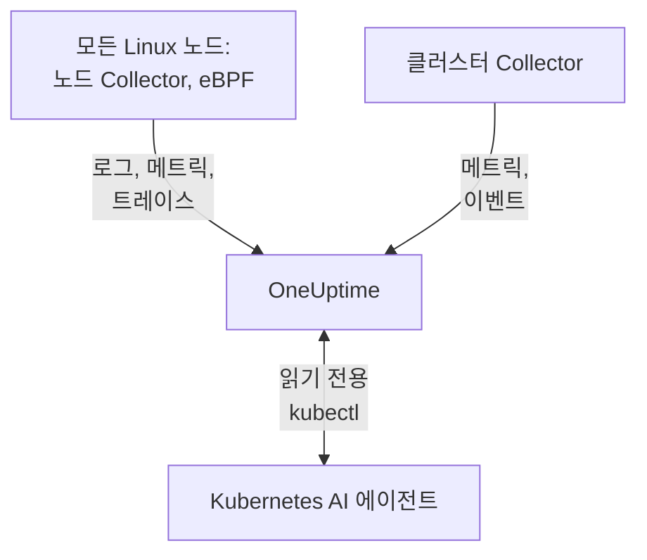

# Kubernetes 에이전트

OneUptime Kubernetes 에이전트는 Helm 차트로, 클러스터의 메트릭, 이벤트, Pod 로그를 수집하고, eBPF로 모든 Pod의 트레이스, 요청 메트릭, 서비스 그래프, 네트워크 흐름을 코드 변경이나 SDK 없이 수집합니다. 또한 [Kubernetes AI 에이전트](#kubernetes-ai-에이전트)를 실행해 OneUptime AI가 인시던트나 알림을 조사하는 동안 읽기 전용 `kubectl`을 실행할 수 있게 합니다. `helm install` 한 번으로 설치되며, [Kubernetes 모니터](/docs/monitor/kubernetes-monitor)가 에이전트가 보낸 데이터를 기준으로 알림을 보냅니다.

:::cards
- [에이전트 설치](#에이전트-설치): Helm으로 네 단계.
- [구성 옵션](#구성-옵션): 필터, 샘플링, 컨트롤 플레인, 서비스 메시, 비용, 레이블.
- [Kubernetes AI 에이전트](#kubernetes-ai-에이전트): OneUptime AI를 위한 읽기 전용 `kubectl`과, 허용할 때의 수정.
- [전송량 줄이기](#수집하는-데이터양-줄이기): 효과가 큰 순서로 정리한 조정 수단.
:::

## 작동 방식

차트는 자체 네임스페이스에서 몇 가지 워크로드를 실행합니다. 각 워크로드는 수집한 데이터를 제공한 수집 키로 OTLP를 통해 OneUptime URL에 보내며, 클러스터는 `clusterName`에 지정한 이름으로 스스로 등록됩니다.



| 워크로드 | 종류 | 하는 일 | 실행 조건 |
| --- | --- | --- | --- |
| 클러스터 Collector | Deployment | Kubernetes API에서 가져온 클러스터 메트릭, Kubernetes 이벤트, Pod·노드·워크로드의 사양. | 항상 |
| 노드 Collector | DaemonSet | `/var/log/pods`의 Pod 로그, kubelet 및 cAdvisor 메트릭, 노드의 OS 메트릭. | EKS Fargate를 제외한 모든 곳 |
| eBPF 계측 (OBI) | DaemonSet | 모든 Pod의 HTTP, gRPC, SQL, Redis 트레이스와 요청 메트릭, 그리고 서비스 맵. | 기본값 (GKE Autopilot과 EKS Fargate 제외) |
| Kubernetes AI 에이전트 | Deployment | OneUptime AI가 인시던트나 알림을 조사하는 동안 사용하는 읽기 전용 `kubectl`. | 기본값 |
| 로그 테일러 | Deployment | 노드 Collector가 읽을 수 없는 경우 Kubernetes API를 통한 Pod 로그. | `gke-autopilot` 및 `eks-fargate` 프리셋 |
| 비용 엔진과 폴러 | Deployments | 네임스페이스, 워크로드, Pod별 지출. | `cost.enabled=true`일 때 |

모든 에이전트 이미지는 Linux 전용이므로 모든 워크로드는 Linux 노드에 고정됩니다.

## 시작하기 전에

- v1.23 이상을 실행하는 Kubernetes 클러스터와, 이 클러스터에 연결하도록 구성된 `kubectl`.
- Helm 3. 업그레이드에는 `--reset-then-reuse-values`를 사용하며, 이를 위해 Helm 3.14 이상이 필요합니다.
- 수집 키. **프로젝트 설정 → 텔레메트리 및 APM → 수집 키**에서 만듭니다. 에이전트는 이 키를 `x-oneuptime-token` 헤더로 보내므로 프로젝트 API 키는 여기서 작동하지 않습니다.
- 프로젝트 안에서 고유하고 바뀌지 않는 클러스터 이름(예: `prod-us-east-1`). 클러스터는 OneUptime에 이 이름으로 나타납니다.
- 클러스터에서 OneUptime URL로 나가는 HTTPS.

## 에이전트 설치

:::steps
### Helm 리포지토리 추가

```bash
helm repo add oneuptime https://helm-chart.oneuptime.com
helm repo update
```

### 차트 설치

`YOUR_ONEUPTIME_URL`, `YOUR_ONEUPTIME_API_KEY`(수집 키), 클러스터 이름을 자신의 값으로 바꾸고, 플랫폼에 맞는 탭을 고르세요([프리셋 선택](#프리셋-선택) 참조).

:::tabs
@tab Standard
자체 관리형 클러스터, EKS on EC2, GKE Standard, AKS, minikube, kind, k3s:

```bash
helm install kubernetes-agent oneuptime/kubernetes-agent \
  --namespace oneuptime-agent \
  --create-namespace \
  --set oneuptime.url="YOUR_ONEUPTIME_URL" \
  --set oneuptime.apiKey="YOUR_ONEUPTIME_API_KEY" \
  --set clusterName="my-cluster" \
  --set aiAgent.enabled=true
```
@tab GKE Autopilot
```bash
helm install kubernetes-agent oneuptime/kubernetes-agent \
  --namespace oneuptime-agent \
  --create-namespace \
  --set oneuptime.url="YOUR_ONEUPTIME_URL" \
  --set oneuptime.apiKey="YOUR_ONEUPTIME_API_KEY" \
  --set clusterName="my-cluster" \
  --set aiAgent.enabled=true \
  --set preset=gke-autopilot
```
@tab EKS Fargate
```bash
helm install kubernetes-agent oneuptime/kubernetes-agent \
  --namespace oneuptime-agent \
  --create-namespace \
  --set oneuptime.url="YOUR_ONEUPTIME_URL" \
  --set oneuptime.apiKey="YOUR_ONEUPTIME_API_KEY" \
  --set clusterName="my-cluster" \
  --set aiAgent.enabled=true \
  --set preset=eks-fargate
```
:::

**AI 조사는 기본적으로 켜져 있습니다.** `aiAgent.enabled=true`는 Collector 옆에서 [Kubernetes AI 에이전트](#kubernetes-ai-에이전트)를 실행합니다. 이 클러스터에서 인시던트나 알림이 발생하면 OneUptime AI가 읽기 전용 `kubectl`(`get`, `describe`, `logs`, `events`, `top`)로 조사하며 아무것도 변경하지 않습니다. 수정은 허용할 때까지 꺼져 있습니다. AI 없이 설치하려면 대신 `--set aiAgent.enabled=false`를 사용하세요.

### Pod가 실행 중인지 확인

```bash
kubectl get pods -n oneuptime-agent
```

모든 Pod가 1~2분 안에 `Running`이 되어야 합니다:

:::tabs
@tab Standard
클러스터 Collector, AI 에이전트, 그리고 모든 노드의 노드 Collector와 eBPF Pod:

```text
NAME                                          READY   STATUS    RESTARTS   AGE
kubernetes-agent-xxxxxxxxxx-xxxxx             1/1     Running   0          1m
kubernetes-agent-ai-agent-xxxxxxxxxx-xxxxx    1/1     Running   0          1m
kubernetes-agent-ebpf-xxxxx                   1/1     Running   0          1m
kubernetes-agent-logs-xxxxx                   1/1     Running   0          1m
```
@tab GKE Autopilot
노드 Collector는 계속 실행되어 `hostPath` 없이 kubelet과 cAdvisor 메트릭을 읽고, 로그 테일러 Deployment가 Kubernetes API를 통해 Pod 로그를 읽습니다:

```text
NAME                                          READY   STATUS    RESTARTS   AGE
kubernetes-agent-xxxxxxxxxx-xxxxx             1/1     Running   0          1m
kubernetes-agent-ai-agent-xxxxxxxxxx-xxxxx    1/1     Running   0          1m
kubernetes-agent-logs-yyyyyyyyyy-yyyyy        1/1     Running   0          1m
kubernetes-agent-logs-xxxxx                   1/1     Running   0          1m
```
@tab EKS Fargate
Deployment 세 개, DaemonSet은 없음: Fargate는 각 Pod에 전용 마이크로 VM을 할당하고 DaemonSet을 예약하지 않으므로 노드 메트릭을 사용할 수 없습니다:

```text
NAME                                          READY   STATUS    RESTARTS   AGE
kubernetes-agent-xxxxxxxxxx-xxxxx             1/1     Running   0          1m
kubernetes-agent-ai-agent-xxxxxxxxxx-xxxxx    1/1     Running   0          1m
kubernetes-agent-logs-yyyyyyyyyy-yyyyy        1/1     Running   0          1m
```
:::

### OneUptime에서 클러스터 찾기

**제품 → 인프라 → Kubernetes → 모든 클러스터**를 엽니다. 몇 분 안에 클러스터가 `clusterName`으로 나타나고 노드, Pod, 워크로드가 채워집니다. Kubernetes AI 에이전트는 클러스터의 **AI** 아래 **에이전트** 페이지에 연결됨으로 표시됩니다.
:::

## 프리셋 선택

`preset`은 플랫폼에서 작동하는 기본값을 고릅니다. Pod 로그를 `hostPath`를 통해 노드에서 읽을지 Kubernetes API를 통해 읽을지, 그리고 어떤 워크로드가 privileged로 실행될 수 있는지입니다.

| `preset` | 용도 | Pod 로그 | 노드 메트릭 |
| --- | --- | --- | --- |
| `standard` (기본값) | 자체 관리형 클러스터, **EKS on EC2**, **GKE Standard**, **AKS**, minikube, kind, k3s | 노드 Collector가 `hostPath`를 통해 `/var/log/pods`를 읽음 (오버헤드가 가장 적음) | Kubelet, cAdvisor, 노드의 OS 메트릭 |
| `gke-autopilot` | **GKE Autopilot** | 로그 테일러가 Kubernetes API를 통해 읽음 (`hostPath` 없음, 호스트 접근 없음) | `hostPath` 없이 Kubelet과 cAdvisor |
| `eks-fargate` | **EKS Fargate** | 로그 테일러가 Kubernetes API를 통해 읽음 (`hostPath` 없음, 호스트 접근 없음) | 없음: Fargate는 DaemonSet을 실행하지 않음 |

확실하지 않다면 `standard`로 시작하세요. `hostPath`를 언급하는 Pod Security 오류로 설치가 실패하면 `preset=gke-autopilot`(Fargate에서는 `eks-fargate`)으로 다시 설치하세요. GKE Autopilot과 EKS Fargate는 eBPF와 프로파일러에 필요한 privileged Pod도 거부하므로, 이 두 프리셋에서는 둘 다 제외됩니다.

## 수집되는 항목

| 범주 | 데이터 |
| --- | --- |
| 노드 메트릭 | CPU, 메모리, 파일 시스템, 네트워크 사용량 |
| Pod 메트릭 | CPU, 메모리, 네트워크, 재시작 |
| 컨테이너 메트릭 | 컨테이너별 CPU와 메모리 |
| 클러스터 메트릭 | 노드 상태, 할당 가능한 리소스, Pod 수 |
| Kubernetes 이벤트 | 경고, 오류, 스케줄링 이벤트 |
| Pod 로그 | 모든 컨테이너의 stdout과 stderr (표준 클러스터에서는 `hostPath`를 통해, Autopilot과 Fargate에서는 Kubernetes API를 통해) |
| 애플리케이션 트레이스 (eBPF, 기본적으로 켜짐) | 모든 Pod의 HTTP, gRPC, SQL, Redis 스팬 (SDK나 코드 변경 불필요) |
| HTTP RED 메트릭 (eBPF) | 서비스별 `http.server.request.duration`, 그리고 요청 및 응답 본문 크기 |
| 서비스 그래프 (eBPF) | 호출자에서 피호출자로의 요청 속도, 지연 시간, 오류 엣지. 서비스 맵을 그립니다 |
| 네트워크 흐름 메트릭 (eBPF) | Kubernetes 메타데이터가 붙은 Pod 간 TCP 및 UDP 바이트·패킷 카운터 |
| TCP 통계 (eBPF) | 노드 수준의 왕복 시간, 연결 실패, 재전송 카운터 |
| 워크로드 비용 (옵트인, `cost.enabled=true`) | 유휴 및 효율을 포함한 네임스페이스, 워크로드, Pod별 지출, 그리고 노드와 볼륨의 시간당 비용: [Kubernetes 비용 옵저버빌리티](/docs/telemetry/kubernetes-cost) 참조 |

## 구성 옵션

아래 옵션은 모두 Helm 값입니다. 설치할 때 설정하거나, 설치된 에이전트에서는 `helm upgrade ... --reset-then-reuse-values --set <value>`로 설정하세요.

### 네임스페이스 필터링

`namespaceFilters.rules`는 네임스페이스 패턴을 네 가지 범위에 각각 따로 적용합니다:

| 범위 | 필터링 위치 | 영향을 받는 대상 |
| --- | --- | --- |
| `podLogs` | hostPath filelog 리시버 또는 API 로그 테일러 | Pod의 stdout과 stderr만. Kubernetes 이벤트와 감사 로그는 영향을 받지 않음 |
| `ebpfDiscovery` | OBI의 프로세스 검색 | 일치하는 워크로드의 eBPF 트레이스와 eBPF 메트릭 모두 |
| `metrics` | Collector에서 Kubernetes 메타데이터가 추가된 뒤 | 네임스페이스가 있는 메트릭 시계열. 네임스페이스가 없는 노드 및 클러스터 시계열은 유지됨 |
| `traces` | Collector에서 Kubernetes 메타데이터가 추가된 뒤 | eBPF 스팬과 애플리케이션이 OTLP로 보내는 스팬 모두 |

패턴은 네임스페이스 이름 전체와 일치해야 하며 `*`(`team-*`)를 사용할 수 있습니다. 어떤 범위에 `include` 규칙이 하나라도 있으면 그 범위에서는 일치하는 네임스페이스만 유지되며, `exclude` 규칙이 항상 우선합니다. 기본 규칙은 `podLogs`와 `ebpfDiscovery`에서만 `kube-system`을 제외합니다.

Pod 로그와 eBPF 검색을 일부 네임스페이스로 한정하려면:

```bash
helm install kubernetes-agent oneuptime/kubernetes-agent \
  --namespace oneuptime-agent \
  --create-namespace \
  --set oneuptime.url="YOUR_ONEUPTIME_URL" \
  --set oneuptime.apiKey="YOUR_ONEUPTIME_API_KEY" \
  --set clusterName="my-cluster" \
  --set-json 'namespaceFilters.rules=[{"action":"include","namespaces":["default","production","staging"],"scopes":["podLogs","ebpfDiscovery"]}]'
```

시끄러운 네임스페이스의 eBPF 트레이스, 서비스 맵, 메트릭은 유지하면서 로그만 멈추려면 제외 범위를 `podLogs`로 한정하세요:

```bash
  --set-json 'namespaceFilters.rules=[{"action":"exclude","namespaces":["kube-system"],"scopes":["podLogs","ebpfDiscovery"]},{"action":"exclude","namespaces":["noisy-*"],"scopes":["podLogs"]}]'
```

`podLogs`와 `ebpfDiscovery` 규칙은 발생원에서 필터링합니다. 제외된 로그 파일은 열리지 않고, 제외된 워크로드는 계측되지 않습니다. `metrics`와 `traces` 규칙은 나중에, 데이터에 네임스페이스가 붙은 뒤 Collector에서 적용됩니다.

#### 네임스페이스별 메트릭 및 트레이스 필터링

네임스페이스가 있는 메트릭이나 스팬도 필터링하려면 규칙에 이 범위를 추가하세요:

```bash
  --set-json 'namespaceFilters.rules=[{"action":"exclude","namespaces":["kube-system","noisy-*"],"scopes":["podLogs","ebpfDiscovery","metrics","traces"]}]'
```

> [!NOTE]
> 노드 및 클러스터 수준 메트릭은 항상 유지됩니다. 네임스페이스는 노드가 아니라 Pod에 속하므로 노드 CPU, 노드 메모리, 파일 시스템 사용량 같은 시계열에는 일치시킬 대상이 없어 절대 버려지지 않습니다. `metrics` 범위 규칙은 문제가 생긴 노드를 숨기지 않고 Pod별 시계열을 줄입니다.

Kubernetes 이벤트는 에이전트에서 네임스페이스로 필터링할 수 없습니다. 이벤트는 `k8sobjects` 리시버에서 `k8s.namespace.name` 속성 없이 도착하므로(네임스페이스는 이벤트 본문 안에 있음) 필터가 일치시킬 대상이 없습니다. 대신 OneUptime의 **로그 → 설정 → 드롭 필터**에서 버리세요.

### 로그 심각도로 필터링

`filters.logs.minSeverity`는 특정 심각도 미만의 Pod 로그 레코드를 전송 전에 에이전트에서 버립니다:

```bash
  --set filters.logs.minSeverity=WARN
```

`TRACE`, `DEBUG`, `INFO`, `WARN`, `ERROR`, `FATAL`을 받습니다. `WARN`은 WARN, ERROR, FATAL을 유지하고 INFO, DEBUG, TRACE를 버립니다. 기본값(`""`)은 모두 유지합니다. 두 로그 모드 모두에 적용되므로(`daemonset` 모드에서는 Collector를 통해, `api` 모드에서는 로그 테일러 안에서), 프리셋이 몰래 이를 끄는 일은 없습니다.

컨테이너 런타임은 심각도를 기록하지 않으므로 에이전트는 로그 텍스트 자체에서 심각도를 읽습니다(`[ERROR]`, `WARN:`, `"level":"info"`, …). 인식할 수 있는 레벨이 없는 줄이 어떻게 처리되는지는 로그 모드에 따라 다릅니다. 두 모드가 아는 정보가 다르기 때문입니다:

| 모드 | 레벨이 없는 줄 | 이유 |
| --- | --- | --- |
| `daemonset` | `stderr`는 ERROR로 간주(유지), `stdout`은 INFO로 간주(WARN 임계값에서 버려짐) | 컨테이너 런타임이 각 줄이 어느 스트림에서 왔는지 기록합니다. |
| `api` | 항상 유지 | Kubernetes `pods/log` API는 줄별 표시 없이 stdout과 stderr를 하나의 스트림으로 합치므로, 에이전트는 추측하는 대신 줄을 유지합니다. |

그래서 `api` 모드는 의도적으로 `daemonset` 모드보다 적게 버립니다. Python 트레이스백이나 `npm ERR!`에는 심각도 키워드가 없으며, 이를 조용히 삭제하는 것이야말로 임계값이 막아야 할 실패입니다. 하이브리드 모드(`logs.windowsPods.enabled`)에서는 노드 OS에 따라 두 행이 모두 적용됩니다. Linux Pod는 `daemonset`, Windows Pod는 `api`를 따릅니다.

두 모드 모두 여러 줄 이벤트는 필터링 전에 다시 합쳐지므로, Java 스택 트레이스는 첫 줄로 판단되어 통째로 유지되거나 버려집니다.

> [!IMPORTANT]
> Kubernetes 이벤트와 리소스 사양은 이것으로 필터링되지 않습니다. 이들은 자체 심각도 없이 Kubernetes API에서 도착하므로, 임계값을 적용하면 가장 원하는 `FailedScheduling`, `BackOff`, `OOMKilling` 경고를 포함한 피드 전체가 삭제됩니다. 양이 적고 가치가 높으므로 에이전트는 항상 이들을 보냅니다. 줄이려면 OneUptime에서 **로그 → 설정 → 드롭 필터**를 사용하세요.

### 이름으로 메트릭 포함 또는 제외

`filters.metrics`는 모든 리시버에 걸쳐 어떤 메트릭이 클러스터를 떠날지 결정합니다.

시끄러운 메트릭 몇 개 버리기(거부 목록, 보통 이쪽을 원합니다):

```bash
  --set-json 'filters.metrics.exclude=["k8s.volume.available","k8s.volume.capacity"]'
```

고정된 집합만 보내기(허용 목록: 나머지는 모두 버려집니다):

```bash
  --set-json 'filters.metrics.include=["k8s.pod.cpu.utilization","k8s.pod.memory.usage"]'
```

정확한 이름 대신 패턴으로 일치시키기:

```bash
  --set filters.metrics.matchType=regexp \
  --set-json 'filters.metrics.exclude=["^container_network_"]'
```

| 키 | 의미 |
| --- | --- |
| `filters.metrics.exclude` | 버릴 메트릭 이름. `include` 다음에 적용되므로 제외가 항상 우선합니다. |
| `filters.metrics.include` | 비어 있지 않으면 이 메트릭만 전송됩니다. |
| `filters.metrics.matchType` | `strict`(정확한 이름, 기본값) 또는 `regexp`(RE2, 앵커 없음). |

- `regexp`에는 앵커가 없습니다. `system.cpu`는 `system.cpu.time`과도 일치합니다. 정확히 메트릭 하나를 뜻한다면 앵커를 붙이세요(`^system\.cpu$`).
- RE2에는 전방 탐색이 없으므로 `^(?!container_)`는 컴파일되지 않습니다. "이것 외 모두"는 부정 패턴이 아니라 `include`로 표현하세요.
- `include`는 모든 리시버에 한꺼번에 적용됩니다. 메트릭을 빠뜨린 허용 목록은 그 메트릭을 기반으로 한 모니터를 조용히 없애므로, 닫힌 집합이 필요한 경우가 아니면 `exclude`를 선호하세요.
- 목록에는 `--set-json`(또는 values 파일)을 사용하세요. 일반 `--set`은 목록에 추가하지 않고 목록을 대체합니다.

> [!WARNING]
> 배포하기 전에 패턴을 테스트하세요. Collector는 시작할 때 패턴을 컴파일하므로 잘못된 패턴이 조용히 오작동하지 않습니다. Collector가 시작을 거부하고 크래시 루프에 빠지며, 그 Collector의 메트릭과 함께 로그도 중단됩니다. Helm은 RE2를 컴파일할 수 없으므로 `helm upgrade`는 잘못된 패턴을 아무 불평 없이 받아들입니다.

### 트레이스 샘플링

위의 필터는 텔레메트리의 한 범주(네임스페이스, 심각도, 메트릭 이름)를 제거합니다. 샘플링은 모든 범주를 유지하고 대신 모집단을 줄입니다. 유지할 트레이스 비율을 `sampling.traces.percentage`로 설정하세요:

```bash
helm upgrade kubernetes-agent oneuptime/kubernetes-agent \
  --namespace oneuptime-agent --reset-then-reuse-values \
  --set sampling.traces.percentage=10
```

이렇게 하면 트레이스 10개 중 1개를 유지하고 나머지 9개는 클러스터를 떠나기 전에 에이전트에서 버립니다.

- **조각이 아니라 트레이스 전체를 얻습니다.** 결정은 스팬마다 동전을 던지는 것이 아니라 트레이스 ID의 해시이므로, 트레이스의 모든 스팬이 함께 유지되거나 버려지고, 남은 트레이스는 처음부터 끝까지 읽을 수 있습니다.
- **메트릭 기반 모니터는 영향을 받지 않습니다.** OBI는 eBPF RED 메트릭(요청 속도, 오류율, 소요 시간)을 모든 요청에서 계산하며, 이 메트릭은 샘플러가 없는 메트릭 파이프라인을 거칩니다. 10%로 설정하면 트레이스는 10분의 1이 되지만 속도, 오류, 지연 시간은 정확합니다.
- **스팬 기반 모니터는 영향을 받습니다.** OneUptime이 스팬 자체에서 세는 것은 모두 비율에 따라 줄어듭니다. 아래 경고를 참조하세요.

| 키 | 의미 |
| --- | --- |
| `sampling.traces.percentage` | 유지할 트레이스의 백분율, 0~100. 기본값 `100`(모두 유지). |
| `sampling.traces.hashSeed` | 트레이스 ID 해시의 시드. 기본값 `22`. |

- `0`은 트레이스를 하나도 유지하지 않습니다. 끄는 스위치가 아니라 비율입니다. eBPF DaemonSet이 계속 실행되며 비용이 드는 동안 모든 트레이스를 삭제합니다. 트레이스가 필요 없다면 `ebpf.enabled=false`를 사용하고, 트레이스는 필요 없지만 RED 메트릭과 서비스 맵은 필요하다면 eBPF를 켠 채 의도적으로 `0`을 설정하세요.
- `ebpf.enabled`가 켜져 있을 때만 적용됩니다. 그렇지 않으면 트레이스 파이프라인이 없어 값이 아무 효과도 없습니다.
- 트레이스만 샘플링합니다. `sampling.logs`나 `sampling.metrics`는 의도적으로 없습니다. 아래 참고를 확인하세요.
- 소수에는 `--set-json`이 필요하며 하한이 있습니다. Helm이 `0.5`를 문자열로 읽기 때문에 `--set sampling.traces.percentage=0.5`는 실패합니다. `--set-json 'sampling.traces.percentage=0.5'` 또는 values 파일을 사용하세요. 약 `0.0061` 미만에서는 비율이 0으로 내림되어 오류 없이 `0`과 똑같이 동작합니다. `0.01`(1만분의 1)이 적힌 대로 동작하는 가장 작은 값입니다.
- 여러 클러스터에서도 기본값으로 작동합니다. 두 에이전트는 `hashSeed`와 `percentage`가 모두 같을 때만 같은 트레이스를 유지하며, 둘 다 어디서나 기본값이 같으므로 두 클러스터를 가로지르는 트레이스는 통째로 남습니다. `hashSeed`는 두 샘플링 계층을 독립적으로 만들 때만 바꾸세요. 같은 시드에서는 낮은 비율이 높은 비율의 트레이스 중 일부를 유지합니다.
- Pod 로그는 샘플링되지 않으므로, `ebpf.logToTraceCorrelation: true`이면 트레이스 중 유지된 일부만 존재하는데도 모든 로그 레코드에 트레이스 ID가 붙습니다. 그러면 로그 레코드의 약 (100 − `percentage`)%가 존재하지 않는 트레이스를 가리킵니다. 트레이스에서 로그로 이동하는 것은 영향을 받지 않습니다.

> [!WARNING]
> 이것을 설정할 때 스팬 기반 모니터를 다시 조정하세요. 샘플링은 OneUptime에 도달하는 스팬을 줄이므로, 스팬을 세는 것은 모두 더 적게 셉니다. `Span Count`에 대한 **트레이스** 모니터와 `Exception Count`에 대한 **예외** 모니터는 어제 양의 약 `percentage`%를 보게 됩니다. 샘플링하지 않은 트래픽으로 맞춘 임계값은 조용히 넘지 않게 됩니다. 모니터는 오류를 내지 않고 그냥 조용해집니다. 그 임계값을 같은 비율로 나누세요. 비율은 클러스터 전체에 적용되므로 제외할 수 있는 서비스는 없습니다. 오류 그룹화는 선형보다 더 나빠집니다. 흔한 예외는 여전히 보이지만, 드문 일회성 예외는 10분의 1 빈도로 나타나기보다 사라질 가능성이 더 큽니다.

> [!NOTE]
> 로그나 메트릭 샘플링이 없는 이유: Collector의 샘플러는 메트릭을 전혀 샘플링할 수 없습니다. 로그는 샘플링할 수 있지만 무작위성을 트레이스 ID에서 얻는데, Pod 로그에는 트레이스 ID가 없으므로 모든 로그 레코드가 같은 방식으로 해시되어, 로그 비율은 시드에 따라 모두 유지하거나 모두 삭제하게 됩니다. 로그를 조용히 삭제하는 설정을 제공하느니 차트는 아무것도 제공하지 않습니다. 로그를 줄이려면 무엇을 제거하는지 정확한 [로그 심각도로 필터링](#로그-심각도로-필터링)과 [네임스페이스 필터링](#네임스페이스-필터링)을 사용하세요.

### 로그 수집 비활성화

Pod 로그가 필요 없다면:

```bash
helm install kubernetes-agent oneuptime/kubernetes-agent \
  --namespace oneuptime-agent \
  --create-namespace \
  --set oneuptime.url="YOUR_ONEUPTIME_URL" \
  --set oneuptime.apiKey="YOUR_ONEUPTIME_API_KEY" \
  --set clusterName="my-cluster" \
  --set logs.enabled=false
```

메트릭에는 영향이 없습니다. 노드 Collector는 kubelet, cAdvisor, 호스트 메트릭을 위해 계속 실행되며 Pod 로그 읽기만 멈춥니다. 로그 기반 알림만 멈추고 다른 것은 그대로입니다.

### 특정 로그 수집 모드 강제

`logs.mode`는 프리셋의 선택을 재정의하며 항상 프리셋보다 우선합니다:

- `logs.mode=daemonset`: hostPath DaemonSet(오버헤드가 가장 적음, `hostPath` 필요).
- `logs.mode=api`: Kubernetes API 로그 테일러 Deployment(모든 클러스터에서 작동).
- `logs.mode=disabled`: Pod 로그 없음.

모드는 Pod 로그를 어디서 가져올지만 결정합니다. 노드 메트릭은 어느 쪽이든 수집되므로 `api`와 `disabled`에서도 kubelet, cAdvisor, 호스트 메트릭은 유지됩니다. 예외는 플랫폼입니다. EKS Fargate는 DaemonSet을 전혀 예약할 수 없으므로 노드 Collector가 없고 노드, Pod, 컨테이너 메트릭도 없습니다. GKE Autopilot은 노드 Collector를 실행하지만 `hostPath`를 차단하므로, kubelet과 cAdvisor 메트릭은 수집하되 호스트의 `/proc`와 `/sys`를 읽는 `hostmetrics` 메트릭(디스크 I/O, inode, NIC 오류)은 수집하지 않습니다.

Windows 노드 풀이 있는 클러스터에서는 모든 에이전트 이미지가 Linux 전용이므로 `daemonset` 모드는 Linux 노드만 다룹니다. Windows 노드의 Pod만을 위해 API 로그 테일러를 함께 실행하려면 `--set logs.windowsPods.enabled=true`를 추가하세요. Linux Pod는 노드 로컬 파일 추적을 유지하며, 둘이 같은 줄을 두 번 보내는 일은 없습니다. 이를 위해서는 차트만큼 새로운 `kubernetes-log-tailer` 이미지가 필요합니다. 오래된 이미지는 이 제한을 무시하고 Linux 로그를 두 번 보냅니다.

### 컨트롤 플레인 모니터링 활성화

클러스터의 **컨트롤 플레인** 페이지는 etcd, API 서버, 스케줄러, 컨트롤러 매니저를 차트로 보여 줍니다. `controlPlane.enabled`가 `true`이면 에이전트가 네 가지를 모두 스크레이프합니다:

```bash
helm upgrade kubernetes-agent oneuptime/kubernetes-agent \
  --namespace oneuptime-agent \
  --reset-then-reuse-values \
  --set controlPlane.enabled=true
```

각 구성 요소는 자체 목록에 있는 주소에서 스크레이프됩니다: `controlPlane.etcd.endpoints`, `controlPlane.apiServer.endpoints`, `controlPlane.scheduler.endpoints`, `controlPlane.controllerManager.endpoints`. 스크레이프는 호스트 네트워크가 없는 에이전트의 Pod에서 실행되므로 기본값(`https://localhost:<port>/metrics`)은 그 Pod 자체를 가리킵니다. 각 목록에 Pod가 도달할 수 있는 주소를 설정하세요. 어떤 클러스터에서든 API 서버는 클러스터 안에서 `https://kubernetes.default.svc:443/metrics`로 응답합니다:

```bash
helm upgrade kubernetes-agent oneuptime/kubernetes-agent \
  --namespace oneuptime-agent \
  --reset-then-reuse-values \
  --set controlPlane.enabled=true \
  --set "controlPlane.apiServer.endpoints={https://kubernetes.default.svc:443/metrics}"
```

`controlPlane.enabled`는 네 가지 스크레이프를 한꺼번에 켭니다. 구성 요소에 엔드포인트로 도달할 수 없으면(관리형 클러스터의 etcd, 스케줄러, 컨트롤러 매니저, 또는 `localhost` 기본값 그대로인 경우) 그 스크레이프는 매 간격마다 실패합니다. Collector는 스크레이프 오류를 기록하고 대상을 다운으로 보고하며, 그 밖에는 아무것도 바뀌지 않습니다.

에이전트는 HTTPS로만, 서비스 계정 토큰을 사용하고 클라이언트 인증서 없이 스크레이프합니다. 따라서:

- **etcd**에는 클라이언트 인증서를 요구하지 않는 HTTPS 메트릭 주소가 필요합니다. etcd의 일반적인 메트릭 포트에는 도달할 수 없습니다. `2381`의 일반 HTTP(kubeadm의 `--listen-metrics-urls`)는 HTTPS로 스크레이프되어 실패하고, `2379`는 클라이언트 인증서가 필요합니다.
- **스케줄러**(`10259`)와 **컨트롤러 매니저**(`10257`)는 HTTPS를 제공하고 토큰을 받지만, kubeadm은 컨트롤 플레인 노드에서 이들을 `127.0.0.1`에 바인딩합니다. 에이전트의 Pod가 도달할 수 있는 `--bind-address`가 필요합니다.

관리형 Kubernetes 서비스(EKS, GKE, AKS)는 etcd, 스케줄러, 컨트롤러 매니저를 노출하지 않으므로 그 탭은 비어 있습니다. 탭의 메트릭이 도착할 때까지 **컨트롤 플레인** 페이지는 차트 대신 설정할 내용을 복사할 명령과 함께 보여 줍니다.

### CoreDNS 메트릭 활성화

**컨트롤 플레인** 페이지의 **CoreDNS** 탭은 DNS 쿼리, 지연 시간, 캐시, 포워딩을 차트로 보여 줍니다. 이 수집은 기본적으로 꺼져 있습니다:

```bash
helm upgrade kubernetes-agent oneuptime/kubernetes-agent \
  --namespace oneuptime-agent \
  --reset-then-reuse-values \
  --set coreDns.enabled=true
```

에이전트는 `kube-system`에서 `k8s-app=kube-dns` 레이블이 붙은 Pod의 포트 `9153`을 스크레이프합니다. kubeadm 클러스터, EKS, AKS에서 CoreDNS가 실행되는 방식입니다. 다른 곳에서 실행한다면 `coreDns.namespace`, `coreDns.service`(`k8s-app` 레이블), `coreDns.port`도 설정하세요. GKE는 CoreDNS 대신 kube-dns(dnsmasq)나 Cloud DNS를 실행하므로 그곳에서는 탭이 비어 있습니다.

### 서비스 메시 메트릭 활성화

클러스터의 **서비스 메시** 페이지는 Istio와 Linkerd를 차트로 보여 줍니다. 에이전트는 `serviceMesh.provider`가 지정하는 메시 하나(`istio` 또는 `linkerd`)를 스크레이프합니다:

```bash
helm upgrade kubernetes-agent oneuptime/kubernetes-agent \
  --namespace oneuptime-agent \
  --reset-then-reuse-values \
  --set serviceMesh.enabled=true \
  --set serviceMesh.provider=istio
```

Istio의 경우 모든 `istio-proxy` 사이드카의 Envoy 통계(포트 `15090`)를, Linkerd의 경우 모든 `linkerd-proxy`의 관리 포트를 읽습니다. 어느 메시의 컨트롤 플레인도 스크레이프되지 않습니다. istiod(**Pilot** 카드)와 Linkerd의 identity, destination, proxy-injector 구성 요소(**컨트롤 플레인** 카드)는 자체 관리 포트에서 메트릭을 제공하므로, 해당 카드는 차트 대신 그 사실을 알려 줍니다.

### 에이전트가 수집하지 않는 메트릭

일부 차트는 에이전트가 스크레이프하지 않는 메트릭을 보여 줍니다. **컨트롤 플레인** 페이지의 **kube-proxy**, **서비스 메시** 페이지의 **Cilium**(Hubble 사용), 그리고 Istio와 Linkerd 탭에 있는 메시 자체의 컨트롤 플레인(**istiod**와 Linkerd의 identity, destination, proxy-injector 구성 요소)입니다. 이 차트들은 리소스 속성 `k8s.cluster.name`을 클러스터 이름(에이전트의 `clusterName`)으로 설정한 채 다른 경로로 메트릭이 OneUptime에 도달하면 채워집니다. 예를 들어 자체 [OpenTelemetry Collector](/docs/telemetry/open-telemetry)로 스크레이프하는 경우입니다. kube-proxy 없이 실행되는 클러스터에는 kube-proxy 메트릭이 아예 없습니다.

### 비용 옵저버빌리티 활성화

클러스터의 **Costs** 페이지에서 모든 네임스페이스, 워크로드, Pod의 비용을 유휴 용량 및 각 request의 사용 비율과 함께 확인하세요:

```bash
helm upgrade kubernetes-agent oneuptime/kubernetes-agent \
  --namespace oneuptime-agent \
  --reset-then-reuse-values \
  --set cost.enabled=true
```

이것만으로 완전한 설치입니다. 차트는 오픈 소스 [OpenCost](https://opencost.io) 엔진(필요한 작은 Prometheus 포함)을 번들로 제공하며, 자격 증명 없이 클라우드 제공업체의 공개 정가로 노드와 볼륨의 가격을 매깁니다. 작은 Pod 두 개가 추가되며, 첫 비용은 첫 1시간이 마감된 뒤에 나타납니다. 이미 Kubecost나 OpenCost를 실행하고 있다면 대신 `--set cost.engine.url=<its service URL>`을 추가하세요. 그러면 아무것도 번들되지 않습니다. 온프레미스 클러스터는 `cost.opencost.customPricing`으로 요금표를 설정할 수 있습니다. 온프레미스 가격 책정과 문제 해결을 포함한 전체 가이드는 [Kubernetes 비용 옵저버빌리티](/docs/telemetry/kubernetes-cost)입니다.

### 프로젝트 레이블로 자동 태그 지정

`oneuptime.label.`로 시작하는 리소스 속성은 모두 프로젝트 레이블이 되어 클러스터와 이 에이전트가 보고하는 서비스 및 호스트에 붙습니다. `oneuptime.label.<dimension>=<value>`는 레이블 `<dimension>:<value>`입니다. 설치할 때 `--set oneuptime.labels.<key>=<value>`로 레이블을 전달하세요:

```bash
helm install kubernetes-agent oneuptime/kubernetes-agent \
  --namespace oneuptime-agent \
  --create-namespace \
  --set oneuptime.url="YOUR_ONEUPTIME_URL" \
  --set oneuptime.apiKey="YOUR_ONEUPTIME_API_KEY" \
  --set clusterName="prod" \
  --set oneuptime.labels.team=payments \
  --set oneuptime.labels.env=production \
  --set oneuptime.labels.region=us-east-1
```

또는 values 파일에 보관하세요:

```yaml title="values.yaml"
oneuptime:
  url: YOUR_ONEUPTIME_URL
  apiKey: YOUR_ONEUPTIME_API_KEY
  labels:
    team: payments
    env: production
    region: us-east-1
clusterName: prod
```

레이블은 대소문자를 구분하지 않고 일치시키므로 직접 만든 기존 `Production` 레이블은 중복되지 않고 재사용되며, OneUptime에서 추가한 레이블은 에이전트가 절대 제거하지 않습니다.

## eBPF를 통한 애플리케이션 트레이스와 HTTP 메트릭 (기본적으로 켜짐)

차트는 모든 노드에서 [OpenTelemetry eBPF Instrumentation (OBI)](https://opentelemetry.io/docs/zero-code/obi/) DaemonSet을 실행합니다. 이것은 커널에 eBPF 프로그램을 로드하고, 지원되는 모든 런타임(Go, .NET, Java, Node.js, Python, Ruby, Rust)의 HTTP 및 HTTPS, gRPC, SQL, Redis 트래픽을 SDK나 사이드카 없이 캡처합니다. 트레이스와 요청 메트릭은 클러스터 내 Collector를 거쳐 OneUptime으로 전달됩니다.

BTF가 있는 Linux 커널 5.8 이상이 필요하며(Debian 11+, Ubuntu 20.10+, Fedora 34+, RHEL 및 Stream 9+의 기본값), eBPF 프로그램을 로드하려면 필요하기 때문에 이 DaemonSet은 privileged로 실행됩니다.

### eBPF 트레이스의 모습

eBPF는 코드가 아니라 네트워크 호출을 보므로, 트레이스는 서비스가 처리하는 요청과 그 처리 중에 하는 호출로 만들어집니다:

- **요청과 그 호출이 하나의 트레이스가 됩니다.** 서비스로 들어오는 요청이 `<METHOD> <route>`라는 이름의 루트 스팬이 되고, 서비스가 그 요청을 처리하는 동안 하는 HTTP, gRPC, SQL, Redis 호출이 자식 스팬이 됩니다. (Node.js에서는 차트가 `ebpf.nodejs.enabled`로 켜는 OBI의 Node.js 에이전트에 의존합니다.) Redis 클라이언트에서 흔하듯 동시 요청이 하나의 공유 연결로 보내는 호출은 항상 구분할 수 있는 것은 아니므로, 그중 일부는 해당 요청의 트레이스에 들어가지 않습니다.
- **다른 노드의 서비스에 대한 호출은 새 트레이스를 시작합니다.** 단, OpenTelemetry SDK나 아래에서 설명하는 옵트인 컨텍스트 전파처럼 트레이스 컨텍스트를 전달하는 것이 있으면 예외입니다. 양쪽 끝이 같은 노드에서 실행되면 OBI가 둘 다 보고 직접 연결합니다.
- **어떤 요청에서도 시작되지 않은 작업은 단독입니다.** Redis를 폴링하는 큐 워커나 cron 작업에는 그 호출이 속할 요청이 없습니다.
- **데이터베이스 서버는 보통 단독입니다.** 데이터베이스 와이어 프로토콜은 트레이스 컨텍스트를 전달하지 않으므로, 호출자가 같은 노드에서 실행되지 않는 한 OBI가 데이터베이스 서버 안에서 명령마다 기록하는 스팬은 스팬 하나짜리 트레이스가 됩니다.

이런 단독 데이터베이스 호출은 명령 이름만 붙은(`set`, `evalsha`, `SELECT`) 스팬 하나짜리 트레이스로 도착하며, 바쁜 클러스터에서는 OBI가 캡처하는 것의 대부분을 차지할 수 있습니다. 에이전트는 기본적으로 이를 클러스터를 떠나기 전에 버립니다. 항상 호출자의 스팬과 중복되는 데이터베이스 서버 자체의 스팬(`ebpf.dropDatabaseServerSpans=true`)과, 어떤 트레이스에도 속하지 않는 애플리케이션의 호출(`ebpf.dropUnlinkedDatabaseCalls=true`)입니다. 요청의 트레이스 안에 있는 애플리케이션의 데이터베이스 호출은 유지되고, 애플리케이션이 자체 SDK로 보내는 스팬은 절대 건드리지 않으며, 데이터베이스 메트릭은 여전히 모든 명령을 셉니다.

한 가지 트레이드오프가 있습니다. OneUptime은 데이터베이스 클라이언트 스팬으로 데이터베이스를 발견하고 서비스 맵에 그립니다. 백그라운드 작업만 통신하는 데이터베이스(워커의 큐, cron 작업의 웨어하우스)는 그러면 더 이상 트레이스에서 발견되지 않고, 서비스 맵에 원격 엔드포인트로 나타납니다. 메트릭은 영향을 받지 않습니다. 이 스팬을 유지하려면 `ebpf.dropUnlinkedDatabaseCalls=false`를 설정하세요.

백그라운드 작업의 HTTP 및 gRPC 호출(HTTP로 ClickHouse에 쿼리하는 워커, Kubernetes 리스를 갱신하는 컨트롤러)도 스팬 하나짜리 트레이스(`POST /`, `PUT /apis/*/...`)로 도착합니다. `ebpf.dropUnlinkedClientCalls=true`를 설정하면 이들과 함께, OBI가 해당 요청의 트레이스에 넣지 못해 똑같아 보이는 호출도 버립니다. 데이터베이스, 메시징, GenAI(MCP 포함) 호출은 이 설정으로 버려지지 않습니다. 데이터 손실이 있으므로 기본적으로 꺼져 있습니다. 호출된 서비스가 같은 노드에서 실행되면 OBI는 그 서비스가 처리한 요청을 호출 아래에 연결하므로 호출이 그 트레이스의 루트가 되며, 이를 버리면 트레이스에 루트가 없어집니다. `ebpf.contextPropagation`이 켜져 있으면 어느 노드에서든, 그리고 자체 OpenTelemetry SDK가 있는 서비스에서도 이런 일이 생깁니다. 서비스 맵도 이 호출을 읽습니다. 백그라운드 작업만 호출하는 의존성은 그러면 OBI의 서비스 그래프 메트릭만으로 그려지고, 요청 안에서도 보이는 엣지는 그 호출만 셉니다. 서비스 개요는 스팬을 세므로, 스팬 대부분이 이런 호출인 워커나 프로브는 훨씬 적은 요청 수를 보여 주며 오류율과 p95 지연 시간도 남은 스팬을 기준으로 합니다. OBI의 클라이언트 요청 메트릭은 여전히 모든 호출을 셉니다.

자체 호스팅 OneUptime에서는 에이전트보다 서버를 먼저 업그레이드하세요. 이 차트가 실행하는 eBPF 트레이서(OBI v0.14)는 이전 OneUptime 서버가 읽지 못하는 방식으로 호출된 서비스의 이름을 붙이고 메시지 브로커 자체의 스팬을 보고합니다.

이름은 트래픽에서 정해집니다. HTTP 스팬은 OBI가 읽을 수 있으면 앱의 경로 템플릿을, 그렇지 않으면 ID 같은 세그먼트를 `*`로 바꾼 URL 패턴을 사용합니다. 직접 이름을 붙이려면 `ebpf.routes.patterns`를 설정하세요. OBI는 Go(net/http, Gorilla mux, Gin), Java(Spring, JAX-RS), Node.js(Express, Fastify, Koa, NestJS, Next.js), Python(Django, FastAPI, Flask), Ruby(Rails), .NET(ASP.NET Core 속성 라우트), PHP(Symfony, Laravel, Slim) 앱의 경로 템플릿을 읽습니다. `OrderService.charge` 같은 애플리케이션 수준 이름은 코드 안에만 있으며 OpenTelemetry SDK가 필요합니다.

앱이 이미 OpenTelemetry SDK로 트레이스를 내보내고 있으면 OBI가 이를 알아채고 그 앱의 eBPF 트레이스 전송을 멈추므로 두 번 추적되지 않습니다(`ebpf.excludeOtelInstrumentedServices=true`, OBI의 기본값). 그 SDK가 다른 프로젝트로 보고하고 이 프로젝트에서도 앱의 eBPF 트레이스를 원한다면 `false`로 설정하세요.

### eBPF 자동 계측 비활성화

다음 경우에는 eBPF를 끄세요:

- **GKE Autopilot** 또는 **EKS Fargate**에 설치하는 경우: 이 플랫폼은 privileged Pod를 거부하므로 `preset=gke-autopilot`과 `preset=eks-fargate`는 이미 eBPF를, 그리고 프로파일러도 함께 제외합니다.
- 노드가 BTF 백포트 없이 5.8보다 오래된 커널을 실행하는 경우.
- 이미 모든 앱에서 OpenTelemetry SDK로 트레이스를 보내고 eBPF 메트릭도 원하지 않는 경우. (트레이스만이라면 끌 필요가 없습니다. 위에서처럼 OBI는 자체적으로 트레이스를 내보내는 앱에 대해서는 eBPF 트레이스 전송을 멈춥니다.)

```bash
helm install kubernetes-agent oneuptime/kubernetes-agent \
  --namespace oneuptime-agent \
  --create-namespace \
  --set oneuptime.url="YOUR_ONEUPTIME_URL" \
  --set oneuptime.apiKey="YOUR_ONEUPTIME_API_KEY" \
  --set clusterName="my-cluster" \
  --set ebpf.enabled=false
```

### 개별 신호 패밀리 켜고 끄기

하나를 제외하고 모두 기본적으로 켜져 있습니다. `--set ebpf.features.<name>=false`로 원하는 것을 끄세요:

| `ebpf.features.*` | 기본값 | 추가되는 것 |
| --- | --- | --- |
| `httpMetrics` | 켜짐 | 서비스별 HTTP 및 gRPC RED 메트릭(요청 속도, 지연 시간, 오류) |
| `spanMetrics` | 켜짐 | 스팬 호출 수와 소요 시간(`traces.span.metrics.*`) |
| `serviceGraph` | 켜짐 | 호출자에서 피호출자로의 엣지 메트릭. 서비스 맵을 그립니다 |
| `networkMetrics` | 켜짐 | Pod 간 TCP 및 UDP 흐름 카운터 |
| `networkInterZoneMetrics` | 꺼짐 | 네트워크 메트릭의 영역 간 변형(카디널리티가 두 배가 됨) |
| `tcpStats` | 켜짐 | 노드 수준 TCP 왕복 시간, 연결 실패, 재전송 카운터 |

서비스 간 트레이스 컨텍스트 전파는 기본적으로 꺼져 있습니다. OBI가 W3C `traceparent`를 삽입해, Pod A에서 Pod B로 넘어가는 요청을 어디에도 SDK 없이 하나의 트레이스로 보여 주는 기능입니다. `--set ebpf.contextPropagation=true`로 옵트인하세요. 에이전트의 나머지 부분에 필요한 것 이상의 커널은 필요 없으며, 이 기능을 무력화하는 커널 버전도 없습니다.

이 기능이 꺼져 있는 이유는 헤더를 삽입하려면 이미 전송 중인 트래픽을 다시 써야 하기 때문입니다. 일반 텍스트 HTTP 요청은 커널 안에서 그 자리에서 늘어나고, TLS와 원시 TCP에는 Traffic Control 훅에서 TCP 옵션이 덧붙습니다. 연결의 바이트 계산이 정확히 보정되지 않으면 스트림이 어긋나며, 보고된 증상은 nginx 같은 L7 프록시를 거치는 전송이 응답이 약 64KB를 넘는 시점에 본문 중간에서 멈추고 작은 요청은 계속 작동하는 것입니다. 커널이 오래되었다는 이유로 이 가능성을 배제하지 마세요. 커널 5.17 미만에서 OBI는 범위가 제한된 스캔 프로그램으로 전환해 똑같이 트래픽을 다시 씁니다. 트레이스, RED 메트릭, 서비스 맵은 이 기능에 의존하지 않습니다. 서비스 간 연결에는 커널에서 다시 쓰지 않고 사용자 공간에서 `traceparent`를 전파하는 OpenTelemetry SDK가 더 안전한 선택입니다.

## Kubernetes AI 에이전트

이 클러스터에서 인시던트나 알림이 발생하면 OneUptime AI가 조사합니다. 차트의 **Kubernetes AI 에이전트**는 AI에게 터미널을 줍니다. 온콜 엔지니어처럼 읽기 전용 `kubectl`을 실행하고(실패하는 Pod를 describe하고, 이벤트를 읽고, 크래시하는 컨테이너의 로그를 tail하고, 노드 용량을 확인), 실행한 모든 명령을 인시던트 페이지에 인용합니다.

에이전트는 **기본적으로 켜져** 있고 **읽기 전용**입니다. 작은 Deployment 하나(`kubernetes-agent-ai-agent`, Pod 레이블 `component=ai-agent`, 이미지 `oneuptime/kubernetes-ai-agent`)이며, 그 ServiceAccount는 읽기만 할 수 있습니다. Collector와 같은 `oneuptime.apiKey`와 `clusterName`으로 스스로 등록하므로 대시보드에서 설정할 것이 없습니다. 클러스터의 **AI 에이전트** 페이지(Kubernetes → 클러스터 → AI → 에이전트)에 1분 안에 연결됨으로 표시되며, 그 상태 옆 **⋯** 메뉴의 **연결 테스트**는 에이전트를 통해 `kubectl version`과 `kubectl auth can-i --list`를 실행합니다. AI가 에이전트로 한 모든 작업은 클러스터의 **AI 로그** 페이지(AI → 로그)에 있고, 클러스터에 대해 알아 둘 만한 것(계속 반복되는 문제와 그 이유, 그 대부분의 원인인 노드나 워크로드, AI가 고친 것)은 **AI Insights** 페이지(AI → Insights)에 있습니다. 에이전트에는 고정된 kubectl(v1.36.4)이 포함되어 있습니다. Runner가 아니며 Runbooks → Runners 아래에 나타나지 않습니다. OneUptime은 에이전트에 자격 증명을 넘기지 않고, 런북을 실행하지 않으며, 자동 수정 규칙의 명령 Runner로도 받아들이지 않습니다.

AI 에이전트가 생기기 전에 설치한 에이전트에서는 먼저 차트 인덱스를 새로 고친 다음 업그레이드하세요(자체 호스팅 OneUptime에서는 OneUptime을 먼저 업그레이드하세요. [에이전트 업그레이드](#에이전트-업그레이드) 참조):

```bash
helm repo update
helm upgrade kubernetes-agent oneuptime/kubernetes-agent \
  --namespace oneuptime-agent --reset-then-reuse-values \
  --set aiAgent.enabled=true
```

에이전트를 설치한 릴리스 이름과 네임스페이스가 다르면 그것을 사용하세요(`helm list -A | grep kubernetes-agent`로 확인할 수 있습니다). `helm repo update`를 실행하지 않으면 Helm이 설치할 때 쓴 차트를 찾을 수 있는데, 그 차트는 `aiAgent`를 모르므로 `Additional property aiAgent is not allowed`로 실패합니다. 게시된 차트 버전은 OneUptime 버전을 따르므로, `helm show values oneuptime/kubernetes-agent | grep aiAgent`가 아무것도 출력하지 않으면 인덱스가 아직 오래된 것입니다. AI 에이전트 없이 차트를 실행하려면 `--set aiAgent.enabled=false`를 전달하세요.

### AI가 할 수 있는 작업

OneUptime AI가 클러스터에서 할 수 있는 작업은 차트에서 두 값으로 설정되며, 클러스터의 AI 에이전트 페이지는 이를 **AI가 할 수 있는 작업** 아래에 보여 주지만 그곳에서 바꿀 수는 없습니다:

- `aiAgent.investigation` — `true`: AI가 클러스터의 인시던트나 알림을 조사하는 동안 읽기 전용 `kubectl`을 실행합니다. `false`: OneUptime이 이미 가진 데이터로 여전히 조사합니다.
- `aiAgent.fixes` — `off`, `ask-for-approval`, `automatic`, `bypass-approval`(아래 참조). `off`를 제외한 모든 수준은 AI 에이전트에 쓰기 권한을 부여합니다. `off`는 아무 권한도 부여하지 않으며, 그러면 에이전트가 모든 쓰기를 스스로 거부합니다.

AI 에이전트는 두 값을 OneUptime에 보고하고, OneUptime은 이를 클러스터에 적용하며 다른 곳(AI 에이전트 페이지, API, Terraform)에서 한 변경은 거부합니다. 그 페이지의 **변경**은 선택한 옵션에 맞는 명령을 보여 줍니다. 둘 다 `values.yaml`에서는 설정되어 있지 않습니다. 둘 다 설정하지 않은 릴리스에서는 에이전트가 자체 기본값(조사 켜짐, 수정 꺼짐)을 사용하며, OneUptime은 아무도 AI 에이전트 페이지에서 설정을 고르지 않은 클러스터에만 이를 적용합니다. 누군가 그곳에서 고른 설정은 그대로 유지되며, 페이지는 그 설정을 차트로 옮기는 방법을 보여 줍니다.

### 찾은 문제를 AI가 고치게 하기

수정은 `aiAgent.fixes`로 켤 때까지 꺼져 있습니다. AI 에이전트에 쓰기 권한도 부여하는 별도의 선택 단계입니다. 권장 형태는 AI가 고칠 수 있는 네임스페이스에만 권한을 부여하고 노드 작업은 끄는 것입니다:

```bash
helm repo update
helm upgrade kubernetes-agent oneuptime/kubernetes-agent \
  --namespace oneuptime-agent --reset-then-reuse-values \
  --set aiAgent.enabled=true \
  --set aiAgent.investigation=true \
  --set aiAgent.fixes=ask-for-approval \
  --set "aiAgent.remediation.namespaces={web,api}" \
  --set aiAgent.remediation.nodeOperations=false
```

또는 클러스터 전체에:

```bash
helm repo update
helm upgrade kubernetes-agent oneuptime/kubernetes-agent \
  --namespace oneuptime-agent --reset-then-reuse-values \
  --set aiAgent.enabled=true \
  --set aiAgent.investigation=true \
  --set aiAgent.fixes=ask-for-approval \
  --set-json 'aiAgent.remediation.namespaces=[]'
```

나열하는 모든 네임스페이스는 이미 존재해야 합니다. 차트는 각 네임스페이스에 RoleBinding을 하나씩 만들지만 네임스페이스 자체는 만들지 않으므로, 없는 네임스페이스가 하나라도 있으면 업그레이드 전체(Collector의 업그레이드 포함)가 `namespaces "api" not found`로 실패합니다. 먼저 만들거나 목록에서 빼고, 네임스페이스를 삭제하기 전에도 목록에서 빼세요. 업그레이드에서 플래그를 생략하면 저장된 목록이 유지됩니다. `--set-json 'aiAgent.remediation.namespaces=[]'`(Helm 3.10+)는 클러스터 전체로 되돌립니다. `={}`는 Helm이 빈 이름 하나로 읽으므로 사용하지 마세요. `--reuse-values`에서는 `--set aiAgent.remediation.namespaces=null`로 저장된 목록이 재설정되지 않으며, Helm은 저장된 목록을 유지합니다. `aiAgent.remediation.nodeOperations=false`는 수정이 노드에 미치지 않게 합니다. AI가 노드를 cordon, uncordon, drain, taint할 수 있게 하려면 `true`로 설정하세요.

`aiAgent.fixes`는 수정 실행 방식을 고릅니다. 다시 끄려면 `--set aiAgent.fixes=off`로 업그레이드하세요. 그러면 쓰기 권한도 제거됩니다:

- **ask-for-approval** — OneUptime AI가 정확한 `kubectl` 계획을 작성하고, 사람이 인시던트에서 한 번의 클릭으로 승인합니다.
- **automatic** — 안전한 변경은 자동으로 실행되고, 더 위험한 변경은 절대 자동으로 실행되지 않습니다. 라운드에서 더 위험한 수정만 찾은 경우 바로 그 수정을 원클릭 승인용으로 제안하며 끝납니다. 안전한 수정도 실행한 경우에는 검증 결과 안전한 수정으로 신호가 회복되지 않았을 때만 더 위험한 수정이 제안됩니다(승인을 요청하는 후속 라운드).
- **bypass-approval** — AI가 묻지 않습니다. 정책이 허용하는 모든 변경이 후속 라운드를 포함해 자동으로 실행됩니다. 단, 시간당 회로 차단기가 작동했을 때, 다른 무인 OneUptime AI 라운드가 아직 같은 클러스터를 변경하거나 검증하고 있을 때, 또는 롤백이 완료되지 않은 수정 뒤에 이어질 때는 라운드가 승인을 요청합니다.

모드와 관계없이 kube-system, kube-public, kube-node-lease에 대한 쓰기에는 항상 사람이 필요하며, 노드에 대한 `drain`, `taint`, `patch`도 마찬가지입니다(drain은 에이전트 자체를 포함한 모든 네임스페이스의 Pod를 축출하고, `NoExecute` taint도 `kubectl taint`로 설정하든 노드 `patch`로 설정하든 같은 일을 합니다). 커스텀 리소스는 기본 제공 종류와 같은 이름이더라도 네임스페이스로 판단됩니다. 또한 AI 에이전트는 자체 네임스페이스, `aiAgent.remediation.namespaces` 범위 밖, 또는 `aiAgent.remediation.nodeOperations=false`인 노드에서는 아무것도 변경하지 않습니다. OneUptime은 AI 에이전트가 보고하는 내용에서 이 범위를 읽고, 에이전트에서만이 아니라 제안되거나 승인될 때에도 그런 수정을 거부합니다. 두 무인 모드 모두에서 시간당 회로 차단기가 작동하거나 다른 무인 라운드가 이미 클러스터를 잡고 있으면 라운드는 계획을 실행하는 대신 승인용으로 제안합니다. 각 모드가 실행할 수 있는 것과 명령 정책이 무조건 거부하는 것은 [AI SRE — 클러스터 접근](/docs/ai/ai-sre)을 참조하세요.

**쓰기 권한이 의미하는 것.** 네임스페이스에서 워크로드, Pod, CronJob에 대한 patch/update와 Job에 대한 create는 그 네임스페이스에서 임의의 이미지를 임의의 ServiceAccount로 실행하고 그 Secret을 읽는 것과 같습니다. Pod 템플릿은 어떤 이미지, ServiceAccount, Secret 볼륨이든 지정할 수 있기 때문입니다. 따라서 차트의 RBAC는 AI 에이전트가 *어디에* 쓸 수 있는지를 제한할 뿐, 쓰기로 무엇을 할 수 있는지는 제한하지 않습니다. 명령 정책은 Pod 템플릿 보안 패치, Pod 사양이나 `containers` 목록 전체를 바꾸는 패치, `set serviceaccount`, `create … --image`, `expose --overrides`(Service 대신 Job이나 다른 종류의 객체를 만들 수 있음), JSON이 아닌 패치 본문을 거부합니다. `set image`나 이미지 필드 패치는 거부하지 않습니다. 이는 더 위험한 변경이며(새 이미지는 워크로드 자체의 ServiceAccount로, 그 Secret과 함께 실행됨), 클러스터가 승인을 건너뛰거나 허용 목록에 그 명령이 있지 않은 한 사람이 승인합니다. `aiAgent.remediation.namespaces`가 비어 있으면 쓰기 역할이 클러스터 전체에 바인딩되며, RBAC로는 kube-system, kube-public, kube-node-lease, 에이전트 자체 네임스페이스를 막을 수 없습니다. 그곳에서는 정책과 AI 에이전트가 선을 지킵니다. 네임스페이스를 나열하면 차트는 그 네임스페이스에만 바인딩하며, 다른 곳에 대한 쓰기는 제안되거나 승인될 때 거부되고 AI 에이전트에서도 다시 거부됩니다.

### AI 에이전트 값

`aiAgent.remediation.*`와 `aiAgent.extraEnv`는 `values.yaml`에 설정되어 있지 않으므로, 이전 `aiAccess` 키 아래에 저장된 값은 이들을 설정할 때까지 계속 적용됩니다([에이전트 업그레이드](#에이전트-업그레이드) 참조). 표에 나온 이들의 기본값은 `aiAgent` 키도 `aiAccess` 키도 설정되지 않았을 때만 적용됩니다. `aiAgent.investigation`과 `aiAgent.fixes`도 설정되어 있지 않으므로, 클러스터의 AI 에이전트 페이지에서 고른 AI 설정은 둘 중 하나를 설정할 때까지 유지됩니다.

| 값 | 기본값 | 하는 일 |
| --- | --- | --- |
| `aiAgent.enabled` | `true` | 읽기 전용 RBAC(클러스터 전체)로 Kubernetes AI 에이전트를 실행합니다. `false`는 에이전트를 제거합니다. |
| `aiAgent.investigation` | 설정 안 됨 (`true`) | OneUptime AI가 조사하는 동안 읽기 전용 `kubectl`을 실행할지 여부. 클러스터의 AI 에이전트 페이지에 읽기 전용으로 표시됩니다. |
| `aiAgent.fixes` | 설정 안 됨 (`off`) | `off`, `ask-for-approval`, `automatic`, `bypass-approval`. `off`를 제외한 모든 수준이 아래의 쓰기 동사를 부여합니다. 클러스터의 AI 에이전트 페이지에 읽기 전용으로 표시됩니다. |
| `aiAgent.remediation.enabled` | `false` | `aiAgent.fixes`로 대체되어 더 이상 사용되지 않으며, 그 값이 설정되지 않은 동안에만 읽힙니다. OneUptime AI의 수정이 사용하는 쓰기 동사도 부여합니다. Deployments, StatefulSets, DaemonSets, ReplicaSets(및 해당 scale 하위 리소스), Jobs, CronJobs, Pods, HPA에 대한 patch/update, Jobs와 HPA에 대한 create, Pods와 Jobs에만 한정된 delete입니다. Secrets, `exec`, `attach`, `port-forward`, CRD, RBAC 쓰기는 절대 부여하지 않으므로, 다른 종류에 대한 변경(Deployment 삭제, Service나 ConfigMap에 레이블 지정)은 승인되더라도 `Forbidden`으로 실패합니다. |
| `aiAgent.remediation.namespaces` | `[]` | 쓰기 역할을 이 네임스페이스에만, 각각 RoleBinding 하나씩으로 바인딩합니다. 다른 곳에 대한 쓰기는 제안되거나 승인될 때, 그리고 AI 에이전트에서 거부됩니다. 각 네임스페이스는 이미 존재해야 하며, 그렇지 않으면 업그레이드가 실패합니다. 비어 있으면 클러스터 전체에 바인딩합니다. `--set-json 'aiAgent.remediation.namespaces=[]'`는 저장된 목록을 재설정합니다(`--reuse-values`에서는 `--set aiAgent.remediation.namespaces=null`로 저장된 목록이 재설정되지 않음). 에이전트 자체 네임스페이스는 나열할 수 없습니다. |
| `aiAgent.remediation.nodeOperations` | `true` | `remediation.enabled`와 함께, cordon/uncordon/taint(노드에 대한 patch)와 drain(Pod 축출)도 클러스터 전체에 부여합니다. 수정이 노드에 미치지 않게 하려면 `false`로 설정하세요. 노드 RBAC가 없고, 노드 작업은 제안되거나 승인될 때 거부되며, AI 에이전트도 이를 거부합니다(`ONEUPTIME_KUBECTL_ALLOW_NODE_OPERATIONS=false`). |
| `aiAgent.image.repository` | `oneuptime/kubernetes-ai-agent` | 에이전트 이미지. 노드가 Docker Hub에서 가져올 수 없으면 미러를 가리키게 하세요. |
| `aiAgent.image.tag` | `release` | `release`는 OneUptime 릴리스마다 바뀝니다. 고정하려면 버전을 지정하세요. |
| `aiAgent.image.pullPolicy` | `release`에는 `Always`, 고정된 태그에는 `IfNotPresent` | 이 기본값을 쓰려면 비워 두세요. 그러면 노드에 캐시된 에이전트가 업그레이드 뒤에 남지 않습니다. |
| `aiAgent.imagePullSecrets` | `[]` | 프라이빗 레지스트리나 미러용 풀 시크릿(`[{name: <secret>}]` 형식). |
| `aiAgent.resources` | requests `50m` / `64Mi`, limits `500m` / `256Mi` | 에이전트는 명령 사이에 유휴 상태입니다. |
| `aiAgent.extraEnv` | `[]` | 에이전트 컨테이너에 추가할 `EnvVar` 객체 — 예를 들어 이그레스 프록시 뒤에서의 `HTTPS_PROXY` / `NO_PROXY`이며, 에이전트는 이를 따릅니다. 차트가 직접 설정하는 이름(`ONEUPTIME_KUBECTL_ALLOW_WRITES`, `ONEUPTIME_KUBECTL_WRITE_NAMESPACES`, `ONEUPTIME_KUBECTL_ALLOW_NODE_OPERATIONS`, `ONEUPTIME_KUBERNETES_CLUSTER_NAME` 등)은 차트의 값을 조용히 바꾸는 대신 렌더링을 실패시킵니다. |

### AI 에이전트가 연결되지 않는 경우

몇 분이 지나도 AI 에이전트 페이지에 에이전트가 연결되지 않았다고 표시되면 에이전트의 로그를 확인하세요:

```bash
kubectl logs -n oneuptime-agent -l component=ai-agent --tail=100
```

- **"This OneUptime server does not have the Kubernetes AI agent API"** — 차트가 OneUptime 서버보다 새 버전입니다. OneUptime을 업그레이드하거나, 서버와 맞는 차트 버전(`--version <your OneUptime version>`)을 설치하세요. 에이전트는 5분마다 다시 시도합니다.
- **저절로 해소되는 거부** — 이전 에이전트 Pod가 아직 보고하고 있거나(정상 종료 없이 교체된 Pod), 업그레이드 중에 이전 클러스터 내 Runner가 아직 종료되고 있는 경우입니다. 에이전트는 서버가 알려 주는 대기 시간 뒤에 다시 시도합니다.
- **조치가 필요한 거부** — `clusterName`이 비어 있거나 너무 긴 경우, 또는 프로젝트가 AI 에이전트 한도에 도달한 경우입니다. 로그에 바꿀 내용이 나옵니다. 에이전트가 전혀 연결되지 않고 로그에 `Another Kubernetes AI agent for cluster "<name>" is online`이 나오면 두 설치가 하나의 `clusterName`을 공유하는 것입니다(AI 에이전트 페이지에서도 경고합니다). 이미 연결된 쪽이 실행되는 동안 계속 유지하므로, 클러스터마다 고유한 `clusterName`을 주거나 여분의 릴리스를 제거하세요. **Pinned Service Name**이 있는 수집 키로는 에이전트를 등록할 수 없습니다. 차트에는 그것이 없는 키를 주세요.

AI 에이전트 페이지에서 에이전트 상태 옆 **⋯** 메뉴의 **에이전트 재설정**은 확인 후 서버가 에이전트의 키를 잊게 합니다(Project Owner, Project Admin, 또는 **Edit Auto Remediation Rule** 권한이 있으면 할 수 있습니다). Pod는 몇 분 안에 스스로 다시 연결합니다. 에이전트의 준비 상태는 OneUptime에 의존하지 않으므로, 잘못 구성된 AI 에이전트가 `helm upgrade --wait`를 실패시키는 일은 없습니다. 실패시키는 것은 이미지를 가져올 수 없는 Pod뿐입니다.

## 에이전트 업그레이드

에이전트가 OneUptime보다 오래되었으면 클러스터의 **클러스터 세부 정보**에 있는 **에이전트 버전** 옆에 경고 표시가 나타납니다. 표시를 선택하면 이 명령이 보입니다.

```bash
helm repo update
helm upgrade kubernetes-agent oneuptime/kubernetes-agent \
  --namespace oneuptime-agent \
  --reset-then-reuse-values
```

`--reset-then-reuse-values`(Helm 3.14+)는 설정한 값(프리셋, 클러스터 이름, 필터)을 유지하고 나머지 값은 모두 새 차트에서 가져옵니다. 새로운 `--set` 재정의는 그 위에 전달하세요. Helm 3.13 이하에서는 대신 설정한 값을 지정해 업그레이드하세요:

```bash
helm repo update
helm get values kubernetes-agent --namespace oneuptime-agent -o yaml > values.yaml && \
  helm upgrade kubernetes-agent oneuptime/kubernetes-agent \
  --namespace oneuptime-agent -f values.yaml
```

`--reuse-values`는 사용하지 마세요. 업그레이드하기 전 차트의 기본값까지 유지하므로 새 차트의 기본값(eBPF 이미지 포함)이 적용되지 않습니다. 릴리스가 이전 차트의 기본값으로 실행되고 있으면, 설치나 업그레이드 후 Helm이 출력하는 노트 끝에 경고와 이를 고치는 명령이 표시됩니다.

업그레이드가 `namespaces "<name>" not found`로 실패하면 `aiAgent.remediation.namespaces`(또는 이전 `aiAccess.remediation.namespaces`)에 존재하지 않는(또는 더 이상 존재하지 않는) 네임스페이스가 있는 것입니다. 차트는 나열된 각 네임스페이스에 RoleBinding을 두지만 네임스페이스는 만들지 않습니다. 네임스페이스를 만들거나, 그 네임스페이스를 뺀 목록으로 업그레이드하거나(`--set "aiAgent.remediation.namespaces={web}"`), `--set-json 'aiAgent.remediation.namespaces=[]'`로 클러스터 전체 바인딩으로 되돌리세요. `--reuse-values`에서는 `--set aiAgent.remediation.namespaces=null`로 저장된 목록이 재설정되지 않으므로 같은 오류로 실패합니다.

> **eBPF 스팬 메트릭의 이름이 바뀌었습니다.** `ebpf.features.spanMetrics`는 이제 `traces_spanmetrics_calls_total`과 `traces_spanmetrics_latency` 대신 `traces.span.metrics.calls`와 `traces.span.metrics.duration`(초)을 보냅니다. 같은 시계열이며, OBI가 유지하는 이름입니다(이전 이름은 OBI에서 더 이상 사용되지 않음). 이전 이름을 사용하는 대시보드, 차트, 메트릭 모니터는 업그레이드 후 오류 없이 새 데이터를 받지 못합니다. 새 이름으로 옮기고, 이전 이름을 지정한 `filters.metrics` 항목도 업데이트하세요.

### Kubernetes AI 에이전트로 업그레이드

이제 차트는 기본적으로 [Kubernetes AI 에이전트](#kubernetes-ai-에이전트)를 실행합니다. 이전 버전에서 `aiAccess.enabled=true`가 설치하던 클러스터 내 Runner(`component=ai-runner`)를 대체합니다. 업그레이드하기 전에:

- **자체 호스팅 OneUptime: OneUptime 서버를 먼저 업그레이드하세요.** AI 에이전트에는 이전 서버에 없는 API가 필요합니다. 이전 서버에 대해서는 "This OneUptime server does not have the Kubernetes AI agent API"를 기록하고 5분마다 다시 시도하는데, 업그레이드가 이미 이전 클러스터 내 Runner를 제거했으므로 서버를 업그레이드할 때까지 OneUptime AI는 kubectl에 접근할 수 없습니다. 아직 서버를 업그레이드할 수 없다면 서버와 맞는 차트 버전(`--version <your OneUptime version>`)을 설치하세요.
- **업그레이드는 `docker.io/oneuptime/kubernetes-ai-agent`를 가져오는 Pod를 추가합니다.** 노드가 미러나 이미지 허용 목록을 통해 이미지를 가져오고, `--wait`나 `--atomic`, Terraform, Flux(둘 다 기본적으로 대기)로 업그레이드한다면, 먼저 이미지를 미러링하고 `aiAgent.image.repository`(프라이빗 레지스트리에는 `aiAgent.imagePullSecrets`도)를 설정하거나 `--set aiAgent.enabled=false`를 전달하세요. 그렇지 않으면 Pod가 준비되지 않아 업그레이드가 시간 초과되고, `--atomic`이 Collector를 포함한 릴리스 전체를 롤백합니다.

`aiAccess` 설정은 이어집니다:

- 쓰기 권한(`aiAccess.enabled`와 `aiAccess.remediation.enabled`), `aiAccess.remediation.namespaces`, `aiAccess.remediation.nodeOperations`, `aiAccess.extraEnv`는 해당하는 `aiAgent.*` 값을 설정할 때까지 계속 적용되며, 그 값이 항상 우선합니다. 쓰기 권한은 `--set aiAgent.fixes=off`로 취소하고, `--set-json 'aiAgent.remediation.namespaces=[]'`로 클러스터 전체로 되돌리며, 저장된 프록시 설정은 `--set-json 'aiAgent.extraEnv=[]'`로 지우세요.
- `aiAccess.enabled=false`는 AI 에이전트를 끄지 않습니다. 끄는 것은 `--set aiAgent.enabled=false`입니다.
- `aiAccess.image`와 `aiAccess.resources`는 이어지지 않습니다. AI 에이전트는 다른 이미지이며 자체 `aiAgent.image`와 `aiAgent.resources`가 있습니다.
- OneUptime에서는 각 클러스터가 AI 설정을 유지하지만, 서버를 업그레이드할 때 두 가지가 바뀝니다. 누군가 Runner(클러스터 내 Runner든 다른 Runner든)의 바인딩을 해제하거나 삭제한 클러스터는 **kubectl로 조사**와 수정이 꺼진 상태로 시작합니다(AI 에이전트 페이지에서 다시 켜세요). 그리고 프로젝트에서 **Enable AI Command Execution**을 한 번도 켜지 않은 클러스터의 **자동** 또는 **승인 건너뛰기**는 **승인 요청**이 됩니다. 이 스위치는 예전에 그런 수정을 막고 있었지만, AI 에이전트를 통한 수정에는 더 이상 필요하지 않습니다.

되돌리려면 `helm upgrade --version <older version>`이 아니라 `helm rollback kubernetes-agent <revision> --namespace oneuptime-agent`를 사용하세요(`helm history`로 리비전을 나열할 수 있습니다). 이전 차트의 스키마는 릴리스에 저장된 `aiAgent` 값을 거부하기 때문입니다. 업그레이드 후 일주일 안이면 롤백으로 클러스터 내 Runner가 돌아오며, AI 에이전트가 멈추면 스스로 다시 연결됩니다. 그 이후에는 OneUptime이 이전 Runner를 제거했을 수 있습니다(클러스터의 **Feed**에 언제인지 나옵니다). 그러면 롤백된 Runner는 연결되지만, API나 Terraform으로 클러스터에 다시 바인딩하거나(클러스터의 **AI Access Runner**. Project Owner, Project Admin, 또는 **Edit Auto Remediation Rule** 권한이 있으면 할 수 있습니다) 차트를 다시 업그레이드할 때까지 사용되지 않습니다.

Kubernetes AI 에이전트는 OneUptime 12에서 폐지된 AI Agent와 관련이 없습니다.

## 에이전트 제거

```bash
helm uninstall kubernetes-agent --namespace oneuptime-agent
kubectl delete namespace oneuptime-agent
```

클러스터는 보낸 데이터와 함께 연결 끊김 상태로 OneUptime에 남습니다. 더 이상 필요 없다면 메뉴의 **클러스터 삭제**로 삭제하세요.

## 수집하는 데이터양 줄이기

기본 상태의 에이전트는 커버리지에 맞춰져 있습니다. 클러스터 전체에서 메트릭, Pod 로그, eBPF 트레이스를 보내므로 모든 대시보드와 모니터가 첫날부터 작동합니다. 크거나 바쁜 클러스터에서는 필요 이상일 수 있으며, 이는 수집량 증가(OneUptime Cloud에서는 비용 증가)로 나타납니다. 여기 있는 것은 필수가 아니지만, 클러스터가 원하는 것보다 많이 보낸다면 바꿀 설정은 이것이며 대략 효과가 큰 순서입니다. 각각 Helm 값입니다. `helm upgrade --reset-then-reuse-values`에서 `--set`으로 적용하고, 같은 방법으로 되돌리세요.

### 데이터양이 생기는 곳

| 신호 | 가장 큰 요인 | 줄이는 방법 |
| --- | --- | --- |
| Pod 로그 | 클러스터 전체 모든 컨테이너의 모든 줄 | `namespaceFilters`, `filters.logs.minSeverity`, `logs.enabled`, `logs.mode` |
| eBPF 트레이스와 스팬 메트릭 | 계측된 모든 프로세스의 요청마다 트레이스 하나 | `sampling.traces.percentage`, `ebpf.enabled`, `ebpf.features.*`, `ebpf.autoTargetExe`, `ebpf.excludeExePaths` |
| 메트릭 데이터 포인트 | 에이전트의 스크레이프 빈도 × Pod와 컨테이너 수 | `collectionInterval`, `hostMetrics.collectionInterval`, `cadvisor.scrapeInterval` |
| 메트릭 카디널리티 | 고유 시계열 수(컨테이너별, PVC별, …) | `filters.metrics.exclude`, `metrics` 범위의 `namespaceFilters.rules`, `cadvisor.metricsAllowlist`, `kubeletstats.volumeMetrics` |
| 옵트인 추가 기능 | 프로파일링, 감사 로그, 컨트롤 플레인, 영역 간 메트릭 | 기본값처럼 꺼 두기 |

데이터양을 줄이는 방법은 세 가지이며, 어느 것을 쓰고 있는지 알아 둘 가치가 있습니다:

- **리시버에서**: 데이터가 아예 수집되지 않습니다. Pod 로그에 대한 `namespaceFilters`, `cadvisor.metricsAllowlist`, 더 긴 `collectionInterval`입니다. 실행 비용이 없고 CPU, 이그레스, 수집량을 함께 절약하므로, 요구 사항을 충족한다면 이것을 우선하세요.
- **필터 프로세서에서**: 데이터가 수집된 뒤 전송 전에 버려집니다. `filters.logs.minSeverity`, `filters.metrics.*`, `metrics` 또는 `traces` 범위의 `namespaceFilters.rules`입니다. Collector CPU가 조금 더 들지만 리시버 전반에 걸쳐 작동하며 리시버로는 표현할 수 없는 조건도 쓸 수 있습니다.
- **샘플러에서**: 데이터가 수집된 뒤 대표적인 일부가 유지됩니다. `sampling.traces.percentage`입니다. 다른 두 방법은 텔레메트리의 한 범주를 통째로 제거하지만, 샘플링은 모든 범주를 유지하면서 줄이므로 남은 것은 여전히 완전하고 대표적입니다.

세 가지 모두 되돌릴 수 없습니다. 버린 것은 OneUptime에 도달하지 않으며, 세 가지 모두 모니터를 조용하게 만들 수 있습니다. 앞의 두 방법은 모니터가 감시하는 대상을 제거해 모니터를 조용하게 만듭니다. 샘플링은 영향이 더 좁습니다. eBPF RED 메트릭은 샘플러 전에 계산되므로 메트릭 모니터는 정확하지만, 스팬을 세는 모니터(`Span Count`에 대한 **트레이스**, `Exception Count`에 대한 **예외**)는 비례해서 적게 보므로 임계값을 다시 조정해야 합니다. 나중에 결정하고 싶다면 OneUptime에서 데이터를 버리세요(**로그 → 설정 → 드롭 필터**, **메트릭 → 설정 → 파이프라인 규칙**). 이그레스 비용은 여전히 들지만 재배포 없이 바꿀 수 있습니다.

### 먼저 Pod 로그 줄이기

컨테이너 로그는 거의 항상 수집량의 가장 큰 비중을 차지합니다. 클러스터의 모든 컨테이너에서 줄마다 레코드가 하나씩 생깁니다.

- 일부 네임스페이스의 로그만 필요한가요? `podLogs` include 규칙을 사용하세요. 일치는 발생원에서 이루어지므로 필터링된 네임스페이스는 읽히지 않으며, eBPF 텔레메트리는 영향을 받지 않습니다:

```bash
helm upgrade kubernetes-agent oneuptime/kubernetes-agent \
  --namespace oneuptime-agent --reset-then-reuse-values \
  --set-json 'namespaceFilters.rules=[{"action":"include","namespaces":["default","production"],"scopes":["podLogs"]}]'
```

- 시끄러운 네임스페이스 계열을 제외한 모든 네임스페이스를 유지하려면 `"namespaces":["noisy-*"]`와 `"scopes":["podLogs"]`가 있는 exclude 규칙을 사용하세요.
- 경고와 오류만 중요한가요? `filters.logs.minSeverity`가 나머지를 에이전트에서 버립니다. 로그가 많은 클러스터에서는 애플리케이션이 쓰는 대부분이 INFO와 DEBUG이므로, 이것이 단일 조치로는 가장 큰 감소가 되는 경우가 많습니다(심각도를 읽는 방식은 [로그 심각도로 필터링](#로그-심각도로-필터링) 참조):

```bash
helm upgrade kubernetes-agent oneuptime/kubernetes-agent \
  --namespace oneuptime-agent --reset-then-reuse-values \
  --set filters.logs.minSeverity=WARN
```

- OneUptime에서 Pod 로그가 전혀 필요 없나요? 끄세요:

```bash
helm upgrade kubernetes-agent oneuptime/kubernetes-agent \
  --namespace oneuptime-agent --reset-then-reuse-values \
  --set logs.enabled=false
```

이렇게 하면 Pod 로그만 멈춥니다. 노드, Pod, 컨테이너 메트릭은 계속 흐르고, 이를 기반으로 한 모니터(OOM kill, CPU 스로틀링, PVC 디스크 부족)도 계속 작동합니다. 노드 Collector는 남아 있으며 `/var/log/pods` 읽기만 멈춥니다. `logs.mode: api`와 `logs.mode: disabled`도 마찬가지입니다.

### eBPF 자동 계측 줄이기

eBPF는 코드 변경 없이 트레이스, RED 메트릭, 서비스 맵, 네트워크 흐름 메트릭을 제공하지만, 두 번째로 큰 데이터 발생원이기도 합니다. 요청마다 스팬 하나, 서비스마다 여러 메트릭 패밀리가 생깁니다.

- 이미 OpenTelemetry SDK로 트레이스를 보내고 있거나 자동 트레이스가 필요 없나요? eBPF를 끄세요:

```bash
helm upgrade kubernetes-agent oneuptime/kubernetes-agent \
  --namespace oneuptime-agent --reset-then-reuse-values \
  --set ebpf.enabled=false
```

- 트레이스는 유지하고 무거운 메트릭 패밀리를 버리세요. [신호 패밀리 표](#개별-신호-패밀리-켜고-끄기)에 각 `ebpf.features.*` 플래그가 나와 있습니다. 네트워크 메트릭과 스팬 메트릭이 가장 크며, 이를 꺼도 트레이스, HTTP RED 메트릭, 서비스 맵은 유지됩니다:

```bash
helm upgrade kubernetes-agent oneuptime/kubernetes-agent \
  --namespace oneuptime-agent --reset-then-reuse-values \
  --set ebpf.features.networkMetrics=false \
  --set ebpf.features.tcpStats=false \
  --set ebpf.features.spanMetrics=false
```

- `ebpf.features.networkInterZoneMetrics`는 기본값대로 꺼 두세요. 네트워크 흐름 시계열이 두 배가 됩니다.
- 관심 있는 런타임만 계측하세요. 기본적으로 OBI는 인식하는 모든 프로세스에 연결됩니다(`ebpf.autoTargetExe: "*"`). 이를 좁히거나 바이너리를 건너뛰기 목록(차트 값의 `ebpf.excludeExePaths`)에 추가해 에이전트가 만드는 서비스와 트레이스를 줄이세요. `--set`은 쉼표로 분할하므로 두 패턴 사이의 쉼표는 이스케이프하세요:

```bash
helm upgrade kubernetes-agent oneuptime/kubernetes-agent \
  --namespace oneuptime-agent --reset-then-reuse-values \
  --set 'ebpf.autoTargetExe=*/python\,*/java'
```

### 스크레이프 빈도 낮추기

메트릭 양은 에이전트의 스크레이프 빈도에 비례합니다. 간격을 두 배로 늘리면 그 메트릭의 데이터 포인트가 대략 절반이 되며, 커버리지는 같고 해상도만 거칠어집니다. 30초 해상도가 필요 이상이라면 60초나 120초가 크고 안전한 감소입니다:

```bash
helm upgrade kubernetes-agent oneuptime/kubernetes-agent \
  --namespace oneuptime-agent --reset-then-reuse-values \
  --set collectionInterval=60s \
  --set hostMetrics.collectionInterval=60s \
  --set cadvisor.scrapeInterval=60s
```

- `collectionInterval`(기본값 `30s`)은 노드, Pod, 컨테이너 메트릭(`kubeletstats`)과 클러스터 상태 메트릭(`k8s_cluster`)을 결정하며, 메트릭 양의 대부분을 차지합니다.
- `hostMetrics.collectionInterval`과 `cadvisor.scrapeInterval`은 노드의 OS 메트릭과 스로틀링 및 OOM 카운터를 다룹니다.
- `resourceSpecs.interval`(기본값 `300s`)은 전체 리소스 사양(레이블, 어노테이션, 상태)을 읽는 빈도를 정합니다. 사양 변경이 빨리 보일 필요가 없다면 늘리세요.
- 선택적 스크레이퍼에는 자체 간격이 있습니다: `kubeStateMetrics.scrapeInterval`, `serviceMesh.*.scrapeInterval`, `coreDns.scrapeInterval`, `csi.scrapeInterval`.

### 메트릭 카디널리티 제한

고유 시계열 수인 카디널리티는 빈도만큼 중요합니다. 각 시계열이 따로 저장되고 과금되기 때문입니다.

- cAdvisor는 의도적으로 허용 목록 방식입니다. cAdvisor 리시버(기본적으로 켜짐)는 수백 개의 메트릭을 내보낼 수 있지만, 차트는 모니터가 사용하는 몇 개(`cadvisor.metricsAllowlist`)만 전달합니다. 목록을 짧게 유지하세요. 각 항목은 컨테이너별로 유지되므로 메트릭 하나를 더하면 클러스터의 컨테이너 수만큼 곱해집니다. kube-state-metrics는 기본적으로 꺼져 있으며, 켜면(`kubeStateMetrics.enabled=true`) 그 `kubeStateMetrics.metricsAllowlist`도 같은 방식으로 작동합니다.
- PVC별 볼륨 메트릭(`kubeletstats.volumeMetrics.enabled`, 기본적으로 켜짐)은 Pod별·PVC별로 시계열 하나를 내보냅니다. 대부분의 클러스터에는 괜찮지만, PVC가 수천 개인 상태 저장 워크로드(Kafka, 데이터베이스)에서는 많아집니다. PVC 디스크 공간을 감시하지 않는다면 그곳에서 `--set kubeletstats.volumeMetrics.enabled=false`로 끄세요.
- 포화도 메트릭(`kubeletstats.utilizationMetrics.enabled`, 기본적으로 켜짐)은 "request 또는 limit 대비 %"의 파생 패밀리 8개를 추가합니다. 추가 스크레이프는 들지 않지만, limit 대비 CPU 및 메모리 모니터를 사용하지 않는다면 `--set kubeletstats.utilizationMetrics.enabled=false`로 버리세요.
- 리시버 허용 목록으로 표현할 수 없는 것은 모든 리시버에 적용되는 `filters.metrics.exclude`로 이름을 지정해 메트릭을 버리세요([이름으로 메트릭 포함 또는 제외](#이름으로-메트릭-포함-또는-제외) 참조):

```bash
helm upgrade kubernetes-agent oneuptime/kubernetes-agent \
  --namespace oneuptime-agent --reset-then-reuse-values \
  --set filters.metrics.matchType=regexp \
  --set-json 'filters.metrics.exclude=["^container_network_"]'
```

- `metrics` 범위의 exclude 규칙으로 네임스페이스 전체의 메트릭을 버리세요. Pod별·컨테이너별 시계열이 필터링되며, 네임스페이스가 없는 노드 및 클러스터 시계열은 항상 유지됩니다:

```bash
helm upgrade kubernetes-agent oneuptime/kubernetes-agent \
  --namespace oneuptime-agent --reset-then-reuse-values \
  --set-json 'namespaceFilters.rules=[{"action":"exclude","namespaces":["noisy-*"],"scopes":["metrics"]}]'
```

### 무거운 옵트인 기능은 꺼 두기

이 기능들은 부하를 늘리므로 기본적으로 꺼져 있습니다. 제공하는 기능을 사용할 때만 켜고, 시험해 본 것이라면 다시 끄세요:

| 값 | 추가되는 것 |
| --- | --- |
| `profiling.enabled` | eBPF 트레이스보다 무거운 지속적 CPU 프로파일링 DaemonSet |
| `auditLogs.enabled` | 모든 Kubernetes API 요청을 로그 레코드로 기록(양이 많음) |
| `controlPlane.enabled` | etcd, API 서버, 스케줄러, 컨트롤러 매니저 메트릭 |
| `kubeStateMetrics.enabled` | CrashLoop, ImagePull, 스케줄링 사유 메트릭(kube-state-metrics Deployment와 스크레이프 추가) |
| `ebpf.features.networkInterZoneMetrics` | 네트워크 흐름 시계열이 두 배가 됨 |
| `serviceMesh.enabled` / `csi.enabled` / `coreDns.enabled` | 더 많은 Prometheus 스크레이프 작업 |
| `cost.enabled` | 워크로드 비용(OpenCost와 작은 Prometheus를 번들로 제공. 시간당 비용 행과 엄격하게 허용 목록으로 제한한 메트릭 스크레이프. 적당한 수집량, Pod 두 개 추가) |

### 트레이스를 버리는 대신 샘플링

위의 모든 설정은 무언가를 포기하고 데이터양을 줄입니다. 감시를 멈추는 네임스페이스, 유지를 멈추는 심각도, 수집을 멈추는 메트릭 패밀리입니다. 샘플링은 예외이며, 바쁜 클러스터에서는 가장 작은 손실로 가장 크게 줄이는 경우가 많습니다:

```bash
helm upgrade kubernetes-agent oneuptime/kubernetes-agent \
  --namespace oneuptime-agent --reset-then-reuse-values \
  --set sampling.traces.percentage=10
```

이렇게 하면 트레이스 양이 90% 줄고, 유지하는 트레이스는 완전하며, RED 메트릭은 정확하게 유지됩니다. 포기하는 것은 주로 예시 트레이스입니다. 모니터가 발생했을 때 열어 볼 수 있는 트레이스가 10분의 1이 됩니다. 초당 수천 개의 같은 요청을 처리하는 클러스터에서는 보통 좋은 거래이지만, 조용한 클러스터에서는 그렇지 않습니다. 고장 난 드문 요청의 예시가 하나도 없을 수 있기 때문입니다. 먼저 스팬을 세는 모니터를 확인하고([트레이스 샘플링](#트레이스-샘플링) 참조), 무언가의 계측을 완전히 멈추고 싶다면 eBPF 기능을 끄는 쪽을 선택하세요.

### 가벼운 출발점

모든 모니터가 계속 작동하면서 더 적게 보내기 위해, 이 프로필은 메트릭 커버리지를 완전히 유지하고 데이터양을 늘리는 두 가지, 즉 로그 줄과 eBPF 스팬을 줄입니다:

```yaml title="lean-values.yaml"
# lean-values.yaml
oneuptime:
  url: YOUR_ONEUPTIME_URL
  apiKey: YOUR_ONEUPTIME_API_KEY
clusterName: my-cluster

# Halve the metric data points. Coarser resolution, same coverage.
collectionInterval: 60s
hostMetrics:
  collectionInterval: 60s
cadvisor:
  scrapeInterval: 60s

# Keep pod logs, but only ship the ones worth alerting on. (Metrics do
# not depend on this — the node collector runs either way.)
logs:
  enabled: true
  mode: daemonset

filters:
  logs:
    minSeverity: WARN # drop INFO / DEBUG / TRACE at the agent

namespaceFilters:
  rules:
    - action: exclude
      namespaces: [kube-system]
      scopes: [podLogs, ebpfDiscovery]
    - action: exclude
      namespaces: [noisy-*]
      scopes: [podLogs]

ebpf:
  enabled: true
  features:
    networkMetrics: false # the heaviest eBPF families
    tcpStats: false
    spanMetrics: false
```

```bash
helm upgrade --install kubernetes-agent oneuptime/kubernetes-agent \
  --namespace oneuptime-agent --create-namespace \
  -f lean-values.yaml
```

필요에 따라 더 조이세요. `minSeverity`를 `ERROR`로 올리거나, 네임스페이스 규칙의 범위에 `metrics`를 추가하거나, 이미 OpenTelemetry SDK로 트레이스를 보내고 있다면 `ebpf.enabled=false`를 설정하세요.

> [!CAUTION]
> 무엇을 줄이는지 주의하세요. 일부 모니터는 특정 신호에 의존합니다. `cadvisor`를 끄면 OOM kill 및 CPU 스로틀링 모니터가 없어지고, `kubeletstats.volumeMetrics`를 끄면 PVC 디스크 부족 모니터가 없어지며, 로그를 끄면 로그 기반 알림이 없어집니다. `sampling.traces.percentage`는 모니터를 없애지 않지만 스팬 기반 모니터(`Span Count`에 대한 **트레이스**, `Exception Count`에 대한 **예외**)의 값을 줄이므로 임계값을 다시 조정하세요. 대응에 쓰지 않는 신호를 줄이고, 모니터가 감시하는 신호는 줄이지 마세요.

### 효과 측정

텔레메트리 사용량은 하루 단위로 집계되므로 하루나 이틀에 걸쳐 **프로젝트 설정 → 사용 기록**에서 추세를 확인하세요. 변경을 적용하는 순간 바로 바뀌지 않습니다. 각 설정이 무엇을 했는지 알 수 있도록 한 번에 하나씩 바꾸세요(로그 끄기, 다음에 간격 늘리기, 다음에 eBPF 줄이기). 모든 것을 한꺼번에 줄이면 의지하던 모니터를 잃을 수 있습니다.

## 문제 해결

진단 스크립트부터 실행하세요. Pod 상태를 확인하고, 수집 키를 디코딩해 검증하고, 클러스터가 OneUptime에 도달할 수 있는지 확인하고, OneUptime이 키를 받아들이는지 물은 다음, 가장 가능성 높은 원인을 알려 주는 판정 하나를 출력합니다:

```bash
curl -fsSL https://raw.githubusercontent.com/OneUptime/oneuptime/master/HelmChart/Public/kubernetes-agent/troubleshoot.sh \
  | bash -s -- -n oneuptime-agent
```

클러스터 상태를 읽고 몇 가지 프로브를 실행할 뿐 아무것도 변경하지 않습니다. 가장 정확한 이그레스 테스트를 하려면 먼저 `--set debug.enabled=true`로 설치하세요. 에이전트의 Pod에 작은 네트워크 도구 사이드카가 추가되어 스크립트가 Collector 자체의 외부 경로를 테스트합니다.

:::details 설치가 "hostPath volumes are not allowed" 또는 Pod Security 오류로 실패함
GKE Autopilot과 EKS Fargate처럼 클러스터가 `hostPath`를 거부합니다. API 모드 프리셋으로 전환하세요. 이 프리셋은 해당 플랫폼이 거부하는 privileged Pod가 필요한 eBPF와 프로파일러도 제외합니다:

```bash
helm repo update
helm upgrade kubernetes-agent oneuptime/kubernetes-agent \
  --namespace oneuptime-agent \
  --reset-then-reuse-values \
  --set preset=gke-autopilot   # or eks-fargate
```
:::

:::details 클러스터가 연결 끊김으로 표시됨
클러스터의 연결 상태는 도착하는 텔레메트리를 따릅니다. 약 15분 동안 데이터가 도착하지 않으면 클러스터가 연결 끊김으로 표시됩니다. 따라서 "연결 끊김"과 "메트릭 없음"은 거의 항상 원인이 같습니다. OneUptime이 에이전트의 텔레메트리를 받아들이지 않는 것입니다.

가장 흔한 원인은, 특히 재설치 후에는, 잘못되었거나 취소된 수집 키입니다. OneUptime은 그런 키를 거부합니다. OTLP 엔드포인트는 키가 없거나 알 수 없거나 만료되었으면 HTTP `401`을, 비활성화된 키나 브라우저 키에는 `422`를 반환합니다. 둘 다 재시도되지 않으므로 Collector는 배치마다 이를 버리고 배치당 `Exporting failed. Dropping data.` 오류를 하나씩 기록하지만, Pod는 Running이고 Ready인 상태로 남아 이 줄을 놓치기 쉽습니다.

1. 에이전트의 Pod가 실행 중인지 확인하세요: `kubectl get pods -n oneuptime-agent`
2. 메트릭 Collector의 로그를 확인하세요: `kubectl logs -n oneuptime-agent -l component=metrics-collector -c otel-collector` (`HTTP Status Code 401` 또는 `422`를 보고하는 `Exporting failed` 줄은 키가 거부되었다는 뜻입니다)
3. OneUptime에 키가 받아들여지는지 물어보세요(`200`은 유효, `401`은 알 수 없거나 취소됨):

```bash
curl -i -H "x-oneuptime-token: <YOUR_API_KEY>" https://oneuptime.com/otlp/v1/validate
```

4. `401`이 반환되면 릴리스의 키가 잘못되었거나 취소된 것입니다. **프로젝트 설정 → 텔레메트리 및 APM → 수집 키**에서 유효한 키를 복사해 배포하세요:

```bash
helm upgrade kubernetes-agent oneuptime/kubernetes-agent \
  --namespace oneuptime-agent --reset-then-reuse-values \
  --set oneuptime.apiKey=<LIVE_KEY>
```

5. `oneuptime.url`이 올바르고 클러스터가 네트워크를 통해 도달할 수 있는지 확인하세요.
6. 재설치할 때 `clusterName`을 바꿨다면 에이전트는 새 클러스터로 표시되고 이전 클러스터는 연결 끊김으로 남습니다. 예상된 동작이며, 이전 클러스터는 더 이상 쓰이지 않는 것입니다.
:::

:::details 메트릭이 나타나지 않음
1. 먼저 거부된 수집 키가 아닌지 확인하세요. 가장 흔한 원인이며 에이전트 쪽에서는 보기 어렵습니다. 위의 *클러스터가 연결 끊김으로 표시됨*을 참조하거나 진단 스크립트를 실행하세요.
2. 클러스터의 **클러스터 이름 (clusterName)** 값이 전달한 `clusterName`과 일치하는지 확인하세요. 클러스터의 **설정** 페이지의 **클러스터 세부 정보**에 있습니다. 고치려면 **세부 정보 편집**을 선택하고 **추가 필드**를 여세요.
3. RBAC 권한을 확인하세요: `kubectl get clusterrolebinding | grep kubernetes-agent`
4. Collector의 로그에서 내보내기 오류를 찾으세요.
:::

:::details Pod 로그가 나타나지 않음 (API 모드)
1. 로그 테일러 Pod가 Ready인지 확인하세요: `kubectl get pods -n oneuptime-agent -l component=log-collector`
2. `/healthz`를 확인하세요. 로그 테일러는 포트 `13133`에서 활성 스트림 수와 마지막 내보내기 오류로 응답합니다.
3. 로그를 확인하세요: `kubectl logs -n oneuptime-agent deployment/kubernetes-agent-logs`
4. 매우 큰 클러스터에서는 레플리카 하나가 병목이 될 수 있습니다. `namespaceFilters.rules`에서 `podLogs` 범위의 include 규칙으로 네임스페이스를 여러 릴리스에 나누세요.
:::

:::details eBPF Pod가 크래시 루프에 빠지거나 시작되지 않음
로그를 확인하세요:

```bash
kubectl logs -n oneuptime-agent -l component=ebpf-instrument --tail=200
```

- **커널이 너무 오래되었거나 BTF가 없습니다.** OBI에는 BTF가 있는 Linux 5.8 이상이 필요합니다. 노드에서 `uname -r`을 실행하세요. 업그레이드할 수 없다면 `--set ebpf.enabled=false`로 eBPF를 끄세요.
- **Privileged Pod가 거부됩니다.** GKE Autopilot과 EKS Fargate에서는 각 프리셋이 이미 eBPF를 제외합니다. 그 밖의 잠긴 클러스터에서는 eBPF를 끄세요.
- **호스트에 `debugfs` 또는 `tracefs`가 마운트되어 있지 않습니다.** `tcpStats` 패밀리는 이것이 필요한 커널 트레이스포인트에 연결됩니다. 차트는 `hostPath`로 둘 다 마운트하지만, 호스트에 없다면 `--set ebpf.features.tcpStats=false`로 그 패밀리만 끄세요.
:::

:::details 애플리케이션 트레이스가 나타나지 않음
1. eBPF DaemonSet이 정상인지 확인하세요: `kubectl get pods -n oneuptime-agent -l component=ebpf-instrument`
2. OBI의 트레이스 출력을 켜서 트래픽을 캡처하는지 확인하세요: `--set ebpf.printTraces=true --set ebpf.logLevel=debug`를 설정한 다음 `kubectl logs -n oneuptime-agent -l component=ebpf-instrument --tail=200`을 확인합니다.
3. OBI가 스팬을 출력하는데 대시보드에 보이지 않는다면 Collector에서 OneUptime으로의 내보내기가 문제입니다. 메트릭 Collector의 로그를 확인하세요.
:::

## 다음 단계

:::cards
- [Kubernetes 모니터](/docs/monitor/kubernetes-monitor): 크래시 루프, OOM kill, CPU 스로틀링, 가득 찬 디스크에 대해 알림을 보냅니다.
- [Kubernetes 비용 옵저버빌리티](/docs/telemetry/kubernetes-cost): 각 워크로드의 비용과 줄일 request를 확인합니다.
- [데이터베이스](/docs/telemetry/databases): 클러스터의 데이터베이스 워크로드가 발견되어 전용 페이지가 생깁니다.
- [호스트 OpenTelemetry 수집기](/docs/telemetry/host-otel-collector): Kubernetes 밖의 Linux, macOS, Windows 머신을 모니터링합니다.
:::
