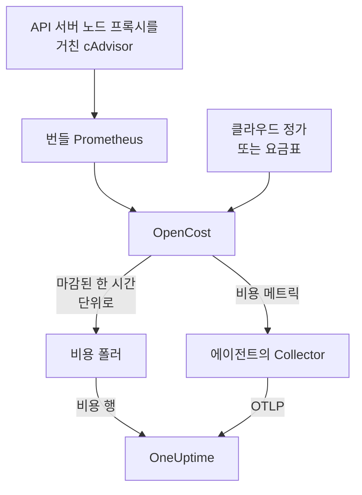

# Kubernetes 비용 옵저버빌리티

모든 Kubernetes 워크로드의 비용(네임스페이스, 워크로드, Pod별 지출, 유휴 용량, 각 request 중 실제로 사용되는 양)을 [Kubernetes 에이전트](/docs/telemetry/kubernetes-agent)가 이미 수집하는 메트릭, 로그, 트레이스 옆에서 확인하세요. Helm 값 하나로 켜지며 클라우드 자격 증명이 필요 없고, 켜면 클러스터의 **Costs** 페이지가 줄여야 할 request를 알려 줍니다.

:::cards
- [켜기](#비용-옵저버빌리티-켜기): `helm upgrade` 한 번.
- [자체 엔진 사용](#이미-kubecost나-opencost를-실행하고-있나요): 에이전트가 Kubecost나 OpenCost를 가리키게 합니다.
- [적정 크기 조정](#적정-크기-조정): request 권장값과 그 산출 방식.
- [문제 해결](#문제-해결): 빈 페이지, 권장값 누락.
:::

## 작동 방식

`cost.enabled=true`이면 차트는 에이전트 옆에서 네 가지를 실행합니다:



1. **OpenCost**: 오픈 소스 비용 엔진입니다(Apache-2.0, CNCF. Kubecost의 기반이기도 한 [cost-model](https://github.com/kubecost/cost-model)). 클러스터를 감시하고, 노드, 볼륨, 로드 밸런서의 가격을 매기며, 각 워크로드의 비용을 계산합니다.
2. **작은 Prometheus**: OpenCost가 사용량과 가격 기록에 필요로 하는 것입니다. 레플리카 하나로 실행되고, 7일간의 기록을 보관하며, 정확히 두 대상만 스크레이프합니다. API 서버의 노드 프록시를 통한 cAdvisor와 OpenCost 자체입니다(OpenCost가 자체 리소스 request 메트릭을 내보내므로 kube-state-metrics는 관여하지 않습니다). 클러스터 밖으로 노출되지 않으며 데이터도 클러스터를 떠나지 않습니다.
3. **비용 폴러**(`cost.agent`). 1시간이 마감될 때마다 OpenCost의 Allocation API를 읽고 워크로드마다 비용 행 하나를 OneUptime에 보냅니다. CPU, 메모리, GPU, 볼륨, 네트워크, 로드 밸런서, 유휴, 그리고 효율입니다. 각 시간은 한 번만 전송되며, 서버는 이미 가진 시간을 건너뛰므로 재시작으로 지출이 두 번 집계되지 않습니다.
4. **비용 메트릭 스크레이프**(`cost.metrics`). 에이전트의 Collector가 OpenCost의 비용 메트릭을 스크레이프해 클러스터의 나머지 메트릭과 함께 보냅니다.

OpenCost는 자격 증명 없이 클라우드 제공업체의 공개 정가(AWS, Google Cloud, Azure)로 노드의 가격을 매깁니다. 클라우드 정가가 없는 클러스터는 대신 [요금표](#온프레미스-및-베어메탈-가격-책정)를 설정합니다.

## 비용 옵저버빌리티 켜기

:::steps
### cost.enabled로 에이전트 업그레이드

```bash
helm upgrade kubernetes-agent oneuptime/kubernetes-agent \
  --namespace oneuptime-agent \
  --reset-then-reuse-values \
  --set cost.enabled=true
```

이것으로 완전한 설치입니다. 작은 Pod 두 개, 즉 OpenCost와 그 Prometheus가 추가됩니다. 에이전트를 다른 릴리스 이름이나 네임스페이스로 설치했다면 그것을 사용하세요(`helm list -A | grep kubernetes-agent`로 확인할 수 있습니다).

### 첫 1시간이 마감되기를 기다리기

첫 비용은 첫 1시간이 완전히 마감된 뒤에 나타나며, OpenCost는 시작 후 첫 1시간의 가격을 매기는 데 몇 분이 걸립니다.

### Costs 페이지 열기

- **제품 → 인프라 → Kubernetes → Costs**는 프로젝트의 모든 클러스터의 지출을 보여 줍니다.
- 클러스터에서 **Costs**는 지출 추세, CPU·메모리·스토리지로 나눈 **Spend by Namespace**, **Spend by Workload**, 유휴 지출, 효율, **Right-Sizing** 카드를 보여 줍니다.
:::

비용 메트릭(`node_total_hourly_cost`, `pv_hourly_cost` 등)은 일반 메트릭이므로 메트릭 탐색기, 사용자 지정 대시보드, 메트릭 모니터에서 사용할 수 있습니다. 미리 만들어진 대시보드를 원하면 **제품 → 대시보드**로 이동해 **대시보드 만들기**를 선택하고 **Kubernetes Cost Dashboard**를 고르세요. 노드 시간당 비용 추세, CPU 및 메모리 단가, 볼륨과 로드 밸런서 지출을 보여 줍니다.

## 이미 Kubecost나 OpenCost를 실행하고 있나요?

대신 에이전트가 사용 중인 엔진을 가리키게 하면 아무것도 번들되지 않습니다:

```bash
helm upgrade kubernetes-agent oneuptime/kubernetes-agent \
  --namespace oneuptime-agent \
  --reset-then-reuse-values \
  --set cost.enabled=true \
  --set cost.engine.url=http://kubecost-cost-analyzer.kubecost.svc.cluster.local:9090
```

| 엔진 | 일반적인 서비스 URL |
| --- | --- |
| OpenCost | `http://opencost.opencost.svc.cluster.local:9003` |
| Kubecost | `http://kubecost-cost-analyzer.kubecost.svc.cluster.local:9090` |

Allocation API 경로는 자동으로 찾습니다(Kubecost는 `/model/allocation`, OpenCost는 `/allocation/compute` 또는 `/allocation`). `cost.engine.allocationPath`는 특이한 설치에서만 설정하세요. 메모리 권장값을 위해서는 `cost.engine.prometheusUrl`도 설정하세요([권장값의 바탕이 되는 데이터](#권장값의-바탕이-되는-데이터) 참조).

## 온프레미스 및 베어메탈 가격 책정

노드에 퍼블릭 클라우드 정가가 없는 클러스터는 요금표를 설정할 수 있습니다. 그러면 OpenCost는 이 수치로 모든 리소스의 가격을 매기며, 단위는 모두 리소스-시간당 USD입니다:

```yaml title="values.yaml"
cost:
  enabled: true
  opencost:
    customPricing:
      enabled: true
      cpuPerCoreHour: "0.031611"       # ~$23 per core-month
      ramPerGiBHour: "0.004237"        # ~$3 per GiB-month
      storagePerGBHour: "0.00005479452" # ~$0.04 per GB-month
      gpuPerHour: "0.95"
```

## 알아 둘 만한 설정

모두 선택 사항이며, 전체 목록은 차트의 `values.yaml`에 있습니다:

```yaml title="values.yaml"
cost:
  agent:
    windowSeconds: 3600   # allocation window length (hourly = native)
    includeIdle: true     # ship the engine's __idle__ allocation
    currency: USD         # currency code shown in the UI (informational)
  prometheus:
    retention: 7d         # bundled TSDB history; right-sizing reads peaks back over days
    persistence:
      enabled: false      # set true for a small PVC; emptyDir otherwise
  metrics:
    enabled: true         # cost metrics for dashboards / Metric Explorer
    scrapeInterval: 60s
```

## 적정 크기 조정

클러스터 **Costs** 페이지의 **Right-Sizing** 카드는 충분한 기록이 있는 모든 컨테이너에 대해 CPU와 메모리 request를 권장하며, 각 변경으로 매월 절약되는 금액 순으로 정렬합니다.

권장값은 관찰된 수요에 25% 여유를 더하고, 매니페스트에 붙여 넣을 수 있는 값(CPU는 10m, 메모리는 16Mi 단위)으로 반올림한 것입니다:

- CPU는 시간별 평균 사용량의 95번째 백분위수로 크기를 정합니다. 실제 부하를 감당할 만큼 높고, 스파이크 한 번으로 한 달 동안 request가 부풀지 않을 만큼 낮습니다.
- 메모리는 평균이 아니라 워킹 세트의 최대치로 크기를 정합니다([권장값의 바탕이 되는 데이터](#권장값의-바탕이-되는-데이터) 참조).

request는 권장하지만 limit은 권장하지 않습니다. request는 스케줄러가 예약하는 양이자 청구액을 계산하는 기준이므로 비용을 움직이는 숫자입니다. limit은 오작동하는 컨테이너를 스로틀링할지 종료할지에 대한 결정이며, 사용량 데이터가 대신 내려 줄 수 없습니다.

각 컨테이너는 현재 request와 비교됩니다:

| 판정 | 의미 |
| --- | --- |
| 과다 프로비저닝(Over-provisioned) | 사용하는 것보다 확실히 많이 예약합니다. 절약은 여기서 나옵니다. |
| 과소 프로비저닝(Under-provisioned) | 사용하는 것보다 적게 예약하므로 스로틀링되거나 OOM kill 위험이 있습니다. 고치려면 비용이 들며, 카드는 이를 증가로 표시합니다. |
| request 미설정 | 줄일 것은 없지만 스케줄러가 컨테이너를 안전하게 배치할 수 없고, 리소스가 부족할 때 가장 먼저 축출됩니다. |

권장값과의 차이가 15% 이내인 컨테이너는 적정 크기로 간주되어 제외됩니다. request에서 3%를 줄이려고 매니페스트를 편집할 필요는 없습니다.

두 가지 안전장치가 권장을 정직하게 유지합니다. 워크로드는 최소 24시간의 비용 기간이 쌓여야 크기가 정해집니다. 4시간 기간은 야간 배치 작업이 쉬고 있는 때를 포착해 0까지 줄이라고 권할 수 있기 때문입니다. 또한 절약액은 행 수가 아니라 보고 있는 기간의 길이로 추정되므로, Deployment의 절약액이 레플리카 수만큼 곱해지지 않습니다. 이 추정은 지출이 엔진이 할당한 양, 즉 `max(request, usage)`에 비례한다고 가정합니다. 과다 프로비저닝된 컨테이너에서는 그 값이 request이므로 절약액은 정확합니다.

### 권장값의 바탕이 되는 데이터

폴러는 지출 외에도 권장에 필요한 것, 즉 각 컨테이너의 CPU 및 메모리 request, limit, 사용량을 수집합니다.

메모리에는 데이터 소스가 하나 더 필요합니다. Allocation API는 각 기간의 평균만 보고하며, 시간별 평균은 컨테이너를 OOM kill하는 급증을 숨기므로 이것으로 메모리 크기를 정하는 것은 위험합니다. 그래서 폴러는 대신 Prometheus에서 각 컨테이너의 메모리 최대치를 읽어 `(namespace, pod, container)`로 결합합니다:

- 번들 엔진(기본값)에서는 차트 자체의 Prometheus를 사용합니다. 설정할 것이 없습니다.
- 자체 엔진(`cost.engine.url`)에서는 `cost.engine.prometheusUrl`이 cAdvisor를 스크레이프하는 Prometheus를 가리키게 하고, 그 스크레이프 작업 이름이 `kubernetes-nodes-cadvisor`가 아니면 `cost.engine.prometheusCadvisorJob`을 설정하세요.
- Prometheus가 없으면 CPU 권장은 저장된 시간별 평균으로 여전히 작동하고, 메모리 권장은 추측하지 않고 생략됩니다.

Prometheus가 중단되어도 지출 수집은 멈추지 않습니다. 최대치는 부가 정보이며, 그 시간은 최대치 없이 전송됩니다. CPU는 의도적으로 Prometheus를 사용하지 않습니다. CPU request가 너무 크면 스로틀링될 뿐이지만 메모리 request가 너무 작으면 컨테이너가 종료되므로 CPU에는 시간별 평균으로 충분히 안전하며, 클러스터 전체에서 모든 컨테이너의 CPU 비율을 쿼리하는 것은 작은 Prometheus를 쓰러뜨릴 만큼 무겁습니다.

## 비용에 대한 알림

비용 메트릭은 일반 메트릭이므로 [메트릭 모니터](/docs/monitor/metrics-monitor)가 다른 것과 마찬가지로 이에 대해 알림을 보낼 수 있습니다. 예를 들어 평균 `node_total_hourly_cost`가 예산을 넘을 때, 또는 클러스터에 있어서는 안 되는 볼륨 클래스의 `pv_hourly_cost`가 나타날 때입니다.

## 데이터 모델과 보존

비용 행은 ClickHouse에 클러스터, 기간, 네임스페이스, 컨트롤러, Pod, 컨테이너마다 하나씩 저장됩니다. 클러스터의 텔레메트리 보존 기간을 따릅니다. 클러스터의 `retainTelemetryDataForDays`, 또는 그것이 설정되지 않았으면 프로젝트의 데이터 보존 기간입니다. 유휴 용량과 할당되지 않은 용량은 `__idle__`와 `__unallocated__` 네임스페이스 아래에 일반 행으로 저장되므로 워크로드 지출처럼 그룹화하고 필터링할 수 있습니다.

## 문제 해결

:::details Costs 페이지가 비어 있음
비용 폴러의 로그를 확인하세요: `kubectl logs -n oneuptime-agent deploy/kubernetes-agent-cost`. (릴리스 이름에 `kubernetes-agent`가 없으면 Deployment 이름은 `<release>-kubernetes-agent-cost`입니다. `kubectl get deploy -n oneuptime-agent`로 나열할 수 있습니다.) `HTTP 401`은 OneUptime이 수집 키를 거부했다는 뜻입니다. `did not answer any known allocation path`는 엔진이 아직 준비되지 않았거나(번들 OpenCost는 첫 몇 시간의 가격을 매기는 데 몇 분이 걸립니다) `cost.engine.url`이 잘못되었다는 뜻입니다.
:::

:::details 번들 OpenCost가 준비되지 않음
로그를 확인하세요: `kubectl logs -n oneuptime-agent deploy/kubernetes-agent-opencost`. 감지한 클라우드 제공업체와 가격 데이터가 로드되었는지 알려 줍니다.
:::

:::details OpenCost 로그에 mkdir /var/configs: permission denied가 표시됨
이전 차트는 쓰기 가능한 구성 디렉터리 없이 OpenCost를 실행했기 때문에 `Error downloading default pricing data`로 Allocation API가 응답하지 못하고 폴러가 멈췄지만, Pod는 `Running`이고 `/healthz`는 정상이며 노드 비용 메트릭은 계속 게시되었습니다. 현재 차트에서는 고쳐졌습니다. `helm repo update`를 실행한 다음 `--reset-then-reuse-values`로 업그레이드하세요. 다음 폴링에서 비용 행이 나타납니다.
:::

:::details Kubernetes Cost Dashboard에 데이터가 없음
이 템플릿은 스크레이프된 비용 메트릭을 읽습니다. `cost.metrics.enabled`가 `true`인지 확인하세요.
:::

:::details Right-Sizing 카드가 비어 있음
시간 범위가 권장에 필요한 24시간보다 짧거나(범위를 넓히세요), 모든 컨테이너가 이미 권장 request의 15% 이내에 있는 경우입니다. 후자라면 카드에 그렇게 표시됩니다.
:::

:::details 메모리 권장값은 -로 표시되지만 CPU 권장값은 작동함
메모리 최대치가 OneUptime에 도달하지 않았으므로, 평균으로 추측하지 않고 메모리 크기를 정하지 않았습니다. 자체 엔진을 쓴다면 `cost.engine.prometheusUrl`을 설정하세요. 영향을 받는 컨테이너 수는 카드에 표시됩니다.
:::

:::details 수치가 엔진 자체 UI와 다름
OneUptime은 엔진의 조정(reconciliation) 금액을 각 비용 구성 요소에 포함하고, 마감된 시간을 통째로 보냅니다. 현재 시간의 지출은 그 시간이 마감된 뒤에 나타납니다.
:::

:::details 번들 Prometheus가 다시 시작됨
기본 `emptyDir` 스토리지에서는 재시작 시 몇 시간 분의 사용량 기록이 사라지므로 그 시간의 비용이 더 작게 나올 수 있습니다. 중요하다면 `cost.prometheus.persistence.enabled=true`를 설정하세요.
:::

## 다음 단계

:::cards
- [Kubernetes 에이전트](/docs/telemetry/kubernetes-agent): 에이전트 설치와 에이전트가 수집하는 그 밖의 모든 것.
- [메트릭 모니터](/docs/monitor/metrics-monitor): 지출이 예산을 넘으면 알림을 보냅니다.
- [Kubernetes 모니터](/docs/monitor/kubernetes-monitor): 클러스터 상태에 대해서도 알림을 보냅니다.
:::
