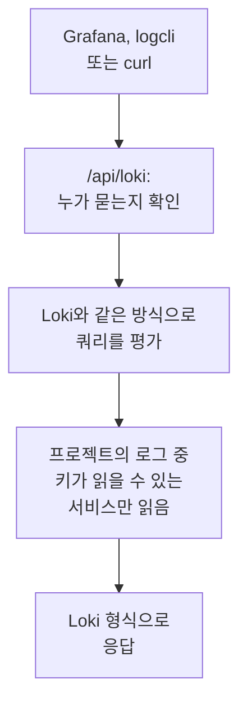

# LogQL로 로그 조회하기

LogQL은 Grafana Loki의 쿼리 언어입니다. OneUptime은 프로젝트의 로그에 대해 Loki의 쿼리 API에 응답하므로, Grafana의 Loki 데이터 소스, logcli 또는 모든 Loki 클라이언트가 로그를 읽을 수 있고, Loki용으로 만든 대시보드와 저장된 쿼리도 그대로 작동합니다.

:::cards
- [Grafana 연결](#grafana-연결): OneUptime을 Loki 데이터 소스로 추가합니다.
- [로그의 레이블](#로그의-레이블): 스트림 선택기가 무엇과 일치하는지.
- [지원하는 LogQL 기능](#지원하는-logql-기능): 로그 쿼리, 파서, 메트릭 쿼리.
- [제한](#제한): 쿼리가 읽을 수 있는 양과 빈도.
:::

## 작동 방식

Grafana는 Loki에 묻는 것과 같은 방식으로 OneUptime에 묻습니다. OneUptime은 API 키가 프로젝트의 로그를 읽을 수 있는지 확인하고, 읽을 수 있는 서비스만 읽으며, Loki와 같은 방식으로 쿼리를 평가합니다.



## 시작하기 전에

- **로그가 들어오고 있어야 합니다.** [OpenTelemetry](/docs/telemetry/open-telemetry)로 보내거나, Promtail, Grafana Alloy, Fluent Bit, Vector에서 [Loki 푸시 API](/docs/telemetry/compatible-endpoints)로 보냅니다.
- **로그를 읽을 수 있는 프로젝트 API 키.** 프로젝트 소유자, 프로젝트 관리자, 프로젝트 구성원, 뷰어, 텔레메트리 관리자, 텔레메트리 구성원, 텔레메트리 뷰어 중 하나의 역할이나 Read Logs 권한이 있어야 합니다. 일부 서비스로 제한된 키는 그 서비스의 로그만 읽습니다. [API 키 만들기](/docs/api-reference/api-reference#api-키-만들기)를 참조하세요. OneUptime Cloud에서 API 키를 쓰려면 **Growth** 요금제가 필요합니다.
- **수집 키는 쓸 수 없습니다.** 수집 키는 텔레메트리를 보내기만 하고 아무것도 읽지 않으므로, Grafana는 수집 키로 로그인할 수 없습니다.

## Grafana 연결

:::steps
### API 키 만들기

OneUptime에서 **프로젝트 설정 → 고급 → API 키**를 열고 **API 키 만들기**를 클릭합니다. 키에 텔레메트리를 읽을 수 있는 역할이나 Read Logs 권한을 주세요.

### Loki 데이터 소스 추가하기

Grafana에서 **Connections → Data sources → Add data source**를 열고 **Loki**를 고릅니다.

### URL 입력하기

**URL**을 OneUptime 주소 뒤에 `/api/loki`를 붙인 값으로 설정합니다. OneUptime Cloud에서는 `https://oneuptime.com/api/loki`입니다.

### API 키 보내기

**HTTP headers**에서 `Authorization` 헤더를 추가하고, 값으로 `Bearer`와 공백 하나, API 키를 차례로 넣습니다. 기본 인증도 쓸 수 있습니다. 사용자 이름은 아무것이나 쓰고 비밀번호로 API 키를 넣으면 됩니다.

### 저장하고 테스트하기

**Save & test**를 클릭합니다. Grafana가 쿼리를 실행하고 데이터 소스가 작동한다고 알려 줍니다.
:::

이제 Explore, 줄 위에 표시되는 로그 양, 레이블 브라우저, 대시보드가 Loki를 읽듯이 OneUptime을 읽습니다. logcli와 다른 Loki 클라이언트도 같은 방식으로 작동합니다. curl로는 다음과 같습니다.

```bash title="Query OneUptime's Loki API"
curl -G -H "Authorization: Bearer $ONEUPTIME_API_KEY" \
  "https://oneuptime.com/api/loki/loki/api/v1/query_range" \
  --data-urlencode 'query={service_name="checkout"} |= "error"'
```

## 로그의 레이블

스트림 선택기는 로그의 속성과 일치하며, 이름은 Loki 3가 OpenTelemetry 로그에 붙이는 이름과 같습니다.

| OneUptime에서 | LogQL에서 |
| --- | --- |
| 리소스 속성 `service.name` | 레이블 `service_name` |
| 리소스 속성 `k8s.pod.name` | 레이블 `k8s_pod_name` |
| 속성 `http.method` | 레이블 `http_method` |
| Loki 클라이언트가 보낸 레이블(예: `job`) | 레이블 `job` |
| 로그의 심각도 | 레이블 `detected_level`: `trace`, `debug`, `info`, `warn`, `error`, `fatal`, `unknown` 중 하나 |

- **모든 속성이 레이블입니다.** 로그 쿼리는 레이블 조합마다 스트림 하나로 응답하므로, 속성이 다른 로그는 서로 다른 스트림이 됩니다. 구조화된 메타데이터가 있는 로그에 Loki 3가 응답하는 방식과 같습니다.
- **로그 자체의 속성이 먼저입니다.** 리소스에 같은 이름의 속성이 있을 때 그렇습니다.
- **선택기는 값을 지정합니다.** Loki처럼, 그 레이블이 없는 로그가 만족하지 않는 매처가 하나 이상 있어야 합니다. 예를 들어 `{service_name="checkout"}`이나 `{service_name=~"check.+"}`입니다.

먼저 다음 쿼리로 시작해 보세요.

```text title="LogQL"
# The checkout service's lines that say error
{service_name="checkout"} |= "error"

# Requests slower than 250ms, read from JSON lines
{service_name="checkout"} | json | duration > 250ms

# Error logs per second, by service
sum by (service_name) (rate({detected_level="error"} [5m]))
```

## 지원하는 LogQL 기능

- **로그 쿼리**: `=`, `!=`, `=~`, `!~`를 쓰는 스트림 선택기, `or`를 쓸 수 있는 줄 필터 `|=`, `!=`, `|~`, `!~`, 파서 `json`과 `logfmt`, 텍스트, 숫자, 기간, 크기에 대한 레이블 필터(`and`, `or`, `__error__` 포함), `{{.label}}`을 쓰는 `line_format`, `drop`, `keep`, `decolorize`.
- **메트릭 쿼리**: `count_over_time`, `rate`, `bytes_over_time`, `bytes_rate`, `absent_over_time`, `unwrap`(`duration()` 또는 `bytes()` 포함)으로 꺼낸 레이블에 대한 `rate`, `sum_over_time`, `avg_over_time`, `min_over_time`, `max_over_time`, `first_over_time`, `last_over_time`, `stddev_over_time`, `stdvar_over_time`, `quantile_over_time`, 그리고 `offset`.
- **그 주변**: `by` 또는 `without`을 붙인 `sum`, `avg`, `min`, `max`, `count`, `stddev`, `stdvar`, `topk`, `bottomk`, 산술 연산, 비교(`bool` 포함), `and`, `or`, `unless`와 `on`, `ignoring`, `group_left`, `group_right`, `sort`, `sort_desc`, `label_replace`, `vector()`.

파서 `pattern`, `regexp`, `unpack`, `label_format`, 이름 있는 필드를 쓰는 `json`, `ip()` 필터, `{{.label}}`을 넘어서는 `line_format` 템플릿은 아직 지원하지 않습니다. 이를 쓰는 쿼리는 그 이름을 알려 주는 메시지와 함께 거부됩니다.

## API

API는 `/api/loki` 아래에서 Loki HTTP API의 경로에 `GET` 또는 `POST`로 응답합니다.

| 경로 | 응답하는 내용 |
| --- | --- |
| `/loki/api/v1/query_range` | `start`부터 `end`까지의 로그 쿼리 줄, 또는 각 `step`의 메트릭 쿼리. |
| `/loki/api/v1/query` | 한 시점(`time`, 기본값은 지금)의 메트릭 쿼리. |
| `/loki/api/v1/labels` | `query`가 고르는 로그 또는 모든 로그의 레이블 이름. |
| `/loki/api/v1/label/<name>/values` | 레이블 하나의 값. |
| `/loki/api/v1/series` | `match[]`가 고르는 로그의 레이블 조합. |

시각은 1970년부터의 나노초, Unix 초 또는 RFC 3339이며, 범위는 따로 지정하지 않으면 `end` 전의 1시간입니다. 로그 쿼리는 `limit`개의 줄(기본값 100)로 응답하며, `direction=forward`가 아니면 최신 줄부터 반환합니다. 응답은 Loki 형식이고, 오류는 Loki처럼 일반 텍스트입니다. `/loki/api/v1/status/buildinfo`는 Loki 3 서버로 응답합니다.

## 제한

모든 쿼리에는 한도가 있어서, 패널이 많은 대시보드도 OneUptime에 과부하를 주지 못합니다.

| 제한 | 값 |
| --- | --- |
| 로그 쿼리가 응답하는 줄 | 5,000 |
| 파서 뒤의 필터가 일부를 버릴 때 로그 쿼리가 읽는 로그 | 20,000 |
| ClickHouse가 셀 수 없을 때 메트릭 쿼리가 직접 읽는 로그 | 100,000 |
| 메트릭 쿼리가 응답하는 시리즈 | 500 |
| 범위 쿼리의 시리즈 하나에 담기는 점 | 11,000 |
| 읽기 한 번이 돌려주는 로그 | 64MB |
| 읽기 한 번에 걸릴 수 있는 시간 | 30초 |
| 프로젝트 하나가 1분에 보낼 수 있는 쿼리 | 1,200 |

`sum(count_over_time({service_name="checkout"} |= "error" [5m]))`처럼 파이프라인이 줄 필터뿐인 메트릭 쿼리는 로그가 있는 곳에서 세어지므로, 줄을 전혀 읽지 않습니다.

## 문제 해결

:::details Grafana에서 데이터 소스가 작동하지 않는다고 나올 때
URL이 `/api/loki`로 끝나는지, `Authorization` 헤더에 `Bearer`, 공백, API 키가 들어 있는지 확인하세요. 수집 키나 로그를 읽을 수 있는 역할이 없는 API 키는 거부됩니다. **프로젝트 설정 → 고급 → API 키**에서 키에 그런 역할을 주세요.
:::

:::details "queries require at least one regexp or equality matcher that does not have an empty-compatible value"
선택기가 값을 지정하지 않고 로그와 일치합니다(예: `{service_name=~".*"}`). `{service_name="checkout"}`처럼 값을 지정하는 매처를 추가하세요.
:::

:::details "This project sent more queries this minute than OneUptime answers."
프로젝트의 대시보드와 클라이언트가 이번 1분 동안 1,200개가 넘는 쿼리를 API에 보냈습니다. 패널은 다음 1분에 다시 불러옵니다. 한도를 넘지 않도록 대시보드를 덜 자주 새로 고치세요.
:::

## 다음 단계

:::cards
- [로그 탐색기](/docs/telemetry/logs-explorer): 쿼리를 쓰지 않고 로그를 검색하고 필터링합니다.
- [PromQL](/docs/telemetry/promql): PromQL로 메트릭을 조회합니다. Grafana의 Prometheus 데이터 소스에서도 쓸 수 있습니다.
- [로그 모니터](/docs/monitor/logs-monitor): 로그의 양과 내용으로 경고합니다.
:::
