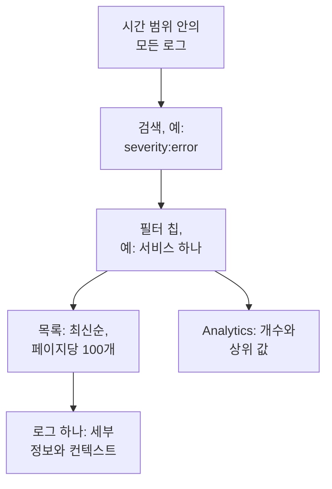

# 로그 탐색기

로그 탐색기에서는 서비스, 호스트, 에이전트가 OneUptime에 보내는 로그를 검색하고 읽습니다. 수백만 줄을 중요한 몇 줄로 좁히고, 새 로그가 도착하는 대로 따라가고, 차트로 그리고, 팀이 자주 찾는 보기를 저장하세요.

:::cards
- [로그 줄 찾기](#로그-줄-찾기): 시간 범위, 검색, 몇 가지 필터.
- [로그 읽기](#로그-읽기): 속성, 트레이스, 주변의 줄.
- [로그를 실시간으로 따라가기](#로그를-실시간으로-따라가기): 10초마다 새 줄.
- [보기 저장](#보기-저장): 검색, 필터, 열을 모두를 위해 남깁니다.
- [로그 인사이트](#로그-인사이트): 주요 오류, 심각도, 누가 무엇을 로깅하는지.
- [AI로 오류 로그, 누락된 로그, 노이즈가 많은 로그 찾아 수정하기](#ai로-오류-로그-누락된-로그-노이즈가-많은-로그-찾아-수정하기): 오류를 수정하고, 기록되지 않는 것을 로그로 남기고, 노이즈가 많은 줄을 줄이는 풀 리퀘스트.
:::

## 탐색기가 로그를 좁히는 방식

**뷰어** 탭의 모든 것은 하나의 로그 집합을 다룹니다. 시간 범위 안에 있으면서 검색과 모든 필터 칩에 맞는 로그입니다. 이 중 하나를 바꾸면 목록, 볼륨 차트, 사이드바의 개수가 함께 바뀝니다.

탐색기에는 다섯 개의 탭이 있습니다.

| 탭 | 용도 |
| --- | --- |
| **뷰어** | 로그를 검색하고, 필터링하고, 읽습니다. 지난 한 시간의 로그를 최신순으로, 페이지당 100개씩 보여 주며 열립니다. |
| **인사이트** | 어떤 시간 범위에 서비스가 무엇을 로깅했고 무엇이 잘못되었는지. |
| **AI** | OneUptime이 로그에서 찾은 오류 로그, 부족한 로깅, 노이즈가 많은 로그, 그리고 OneUptime AI가 그에 대해 한 일. [AI로 오류 로그, 누락된 로그, 노이즈가 많은 로그 찾아 수정하기](#ai로-오류-로그-누락된-로그-노이즈가-많은-로그-찾아-수정하기)를 참조하세요. |
| **설정 가이드** | [수집 키](/docs/telemetry/ingestion-keys) 중 하나로 OpenTelemetry, Fluent Bit, Fluentd를 사용해 로그를 보내는 방법. |
| **설정** | 도착한 로그에 일어나는 일: **파이프라인**, **드롭 필터**, **스크럽 규칙**, **기록 규칙**. |

## 시작하기 전에

- **도착하는 로그.** [OpenTelemetry](/docs/telemetry/open-telemetry), [Fluent Bit](/docs/telemetry/fluentbit), [Fluentd](/docs/telemetry/fluentd), [Syslog](/docs/telemetry/syslog) 중 하나로 보냅니다. **설정 가이드** 탭에 사용하는 언어나 수집기에 맞는 구성이 표시됩니다.
- **텔레메트리를 읽을 수 있는 역할.** Project Owner, Project Admin, Project Member, Viewer, Telemetry Admin, Telemetry Member, Telemetry Viewer 중 하나이거나 Read Telemetry Service Log 권한이 있는 사용자 지정 역할입니다. 역할의 범위에 따라 누구의 로그를 볼 수 있는지가 정해집니다. [텔레메트리](/docs/permissions/index#텔레메트리)를 참고하세요.

## 로그 줄 찾기

:::steps
### 뷰어 열기

**제품 → 관측 가능성 → 로그**로 이동합니다. **뷰어**에 지난 1시간의 로그가 최신순으로 **시간**, **서비스**, **심각도**, **메시지**와 함께 나열됩니다.

### 시간 범위 고르기

시간 선택기에서 범위를 고르거나, 목록 위의 볼륨 차트를 드래그해 급증한 구간을 확대합니다. 차트를 두 번 클릭하면 다시 축소됩니다. [시간 범위 확대](/docs/telemetry/charts-and-time-ranges)를 참고하세요.

### 검색

검색 상자에 쿼리를 입력하고 Enter를 누릅니다. 예를 들면 `severity:error service:checkout timeout`입니다. 단어만 쓰면 메시지를 검색하고, `@key:value`는 속성을 검색합니다. [검색 구문](/docs/telemetry/search-syntax#로그)을 참고하세요.

### 필터로 좁히기

**필터** 사이드바에서 값을 클릭하면 칩으로 추가됩니다. 심각도, 서비스, 또는 로그를 보낸 호스트, 클러스터 같은 리소스입니다. 각 값에는 그 값을 가진 로그의 개수가 표시됩니다. 휴대폰에서는 **필터**를 탭해 사이드바를 엽니다.

### 로그 열기

행을 클릭합니다. 목록 옆에 세부 정보가 열립니다.
:::

검색, 칩, 시간 범위는 페이지 주소에 저장되므로 새로 고침, 북마크, 공유한 링크로 같은 로그를 열 수 있습니다.

## 로그 읽기

세부 정보 패널에는 두 개의 탭이 있습니다.

| 탭 | 보여 주는 것 |
| --- | --- |
| **세부 정보** | **로그 본문**, 있으면 **트레이스 ID**, **스팬 ID**, **세션**, 그리고 목록이나 JSON으로 보는 **속성**. |
| **Context** | 이웃한 로그 사이의 이 로그. **Nearby (service + time)** 보기는 같은 서비스에서 이 로그 앞뒤의 다섯 줄씩을 보여 주고, **This trace** 보기는 그 트레이스의 로그를 최대 100개까지 보여 줍니다. |

- 트레이스 ID를 클릭하면 [트레이스 탐색기](/docs/telemetry/traces-explorer)에서 요청 전체가 열립니다.
- 속성에 포인터를 올리고 필터 아이콘을 클릭하면 그 값으로 검색하거나, 값을 복사할 수 있습니다. 모든 속성을 한 번에 JSON으로 복사할 수도 있습니다.
- **This trace**는 트레이스 안에서 기록된 로그에만 나타납니다.

## 로그를 실시간으로 따라가기

목록 위의 **실시간**을 클릭합니다. 탐색기는 최신순으로 정렬된 첫 페이지로 이동하고 10초마다 새 로그를 확인하므로, 서비스가 쓰는 대로 줄이 나타납니다.

검색, 필터, 시간 범위를 바꾸거나 결과의 다른 페이지로 이동하면 실시간 모드는 저절로 꺼집니다. 실시간 모드는 최신 로그만 보여 주기 때문입니다. 다시 시작하려면 **실시간**을 한 번 더 클릭합니다.

## 열 고르기와 내보내기

- **열**은 목록에 보일 내용을 고릅니다. **시간**, **서비스**, **심각도**, **메시지**가 맨 앞에 옵니다. **트레이스 ID**, **스팬 ID** 또는 아무 속성이나 추가하고, 열을 위아래로 옮기거나 **재설정**으로 기본값으로 되돌릴 수 있습니다.
- **내보내기**는 보고 있는 페이지의 로그를 다운로드합니다. **CSV로 내보내기**는 표시한 열을 쓰고, **JSON으로 내보내기**는 각 로그의 모든 필드를 모든 속성과 함께 씁니다.
- 머리글 행을 가리키고 열 이름 끝의 선을 끌면 열을 넓히거나 좁힐 수 있으며, 선을 두 번 클릭하면 열을 내용에 맞춥니다. 목록은 이 브라우저에 열 너비를 기억합니다. 머리글 행 끝의 **열 너비 재설정**은 모든 열을 원래 너비로 되돌립니다.

## 보기 저장

저장된 보기는 검색, 필터 칩, 시간 범위, 열, 정렬, 페이지 크기를 이름 아래에 남깁니다.

:::steps
### 보기 준비하기

검색하고, 필터링하고, 남길 열을 고릅니다.

### 저장하기

**저장된 보기**를 열고 **+ 현재 보기 저장**을 클릭합니다. **이름**을 입력하고, 누군가 로그를 열 때마다 이 보기가 열려야 하면 **기본값으로 설정**을 선택한 다음 **보기 저장**을 클릭합니다.

### 사용하기

**저장된 보기**에서 보기를 고르면 적용되고, **보기 지우기**를 고르면 필터 없는 지난 1시간으로 돌아갑니다. 목록의 보기에 포인터를 올려 **편집**하거나 **삭제**하고, 적용 중일 때는 변경 사항으로 **업데이트**할 수 있습니다.
:::

저장된 보기는 프로젝트에 속하므로 프로젝트의 모든 사람이 같은 목록을 봅니다. 지난 1시간 같은 상대적 범위는 계속 상대적입니다. 보기는 저장한 시점의 한 시간이 아니라 여는 시점 직전의 한 시간을 보여 줍니다. 프로젝트에 기본 보기가 없는 동안에는 다음에 저장한 보기가 기본이 되고, 프로젝트의 기본 보기는 한 번에 하나뿐입니다.

## 로그 차트 그리기

로그를 읽는 대신 세려면 목록을 **Analytics**로 바꿉니다. 시계열, 상위 목록, 표 중 하나를 고르고, 모든 로그를 세거나 한 필드의 고유한 값을 세고, 심각도, 서비스, 트레이스, 스팬 또는 아무 속성으로 그룹화한 다음 두 번째 필드로 다시 그룹화합니다. 상위 목록이나 표는 상위 5, 10, 25, 50개 그룹을 보여 줍니다.

줄 자체로 돌아가려면 **목록**를 클릭합니다.

## 관련 트레이스와 메트릭 열기

**저장된 보기** 옆의 **트레이스**와 **메트릭** 버튼은 같은 시간 창으로 [트레이스 탐색기](/docs/telemetry/traces-explorer)나 [메트릭 탐색기](/docs/telemetry/metrics-explorer)를 열고, 그 탐색기가 쓸 수 있는 만큼 필터를 가져갑니다. 버튼에 포인터를 올리면 가져갈 수 없는 것이 표시됩니다.

## 로그 인사이트

**인사이트** 탭은 어떤 시간 범위에 서비스가 무엇을 로깅했고 무엇이 잘못되었는지 보여 줍니다. 시간 선택기 옆의 드롭다운으로 일부 서비스, 호스트, 클러스터로 범위를 좁힐 수 있습니다.

| 패널 | 보여 주는 것 |
| --- | --- |
| 요약 카드 | **전체 로그**, **오류**, **Distinct errors**, **Reporting sources**. |
| **Severity distribution** | 로그가 심각도별로 어떻게 나뉘는지. |
| **Top errors** | Error 또는 Fatal 심각도로 기록된 서로 다른 메시지를 많은 순서대로. |
| **Sources reporting logs** | 서비스, 호스트, 기타 소스마다의 볼륨과 오류 신호. |

주요 오류 하나를 선택하면 그 주변에서 무슨 일이 있었는지 볼 수 있습니다. 언제 일어났는지, 발생들이 공통으로 가진 것, 어디에서 일어나는지, 그 오류를 담은 트레이스, 최근 줄입니다. **Open matching logs**는 그 로그를 **뷰어**에서 열고, **AI로 설명**는 오류와 그 근거를 편집 가능한 프롬프트로 담아 [AI에게 질문](/docs/ai/ask-ai)을 엽니다.

## AI로 오류 로그, 누락된 로그, 노이즈가 많은 로그 찾아 수정하기

OneUptime은 매시간 각 서비스의 지난 한 시간 로그에서 반복해서 기록되는 오류, 로그에 남지 않는 실패, 로그를 뒤덮는 줄을 찾아, 발견한 내용을 근거와 함께 AI 인사이트로 기록합니다. 그런 다음 OneUptime AI가 각각을 살펴보고 이를 수정하는 풀 리퀘스트를 엽니다. 병합은 절대 하지 않으며, 팀이 모든 풀 리퀘스트를 검토합니다.

OneUptime은 세 가지 발견 사항을 기록합니다.

| 발견 사항 | OneUptime이 기록하는 경우 | 풀 리퀘스트 |
| --- | --- | --- |
| **오류 로그** | 서비스가 같은 메시지를 그 한 시간 동안 Error 또는 Fatal로 20번 이상 기록했고, 그 메시지에 고유한 단어가 있으며 예외가 없는 경우. 예외와 함께 또는 스택 트레이스를 담아 기록된 메시지는 대신 [예외 추적](/docs/telemetry/exceptions)에서 추적됩니다. | 오류가 기록되는 원인을 수정하거나, 알맞은 수준으로 기록합니다. |
| **부족한 로깅** | 한 작업의 스팬이 그 한 시간 동안 20개 이상 실패했고 그 비율이 5% 이상이며, 서비스 로그 중 100개 이상이 트레이스 ID를 가지고 있는데도, 그 작업의 가장 최근 실패한 요청 20개 중 어느 것도 로그 줄을 쓰지 않은 경우. 또는 서비스가 그 한 시간 동안 500개 이상의 로그와 100개 이상의 스팬을 보냈고, 트레이스 ID를 가진 로그가 1% 미만인 경우. | 실패가 일어나는 곳에서 이를 로그로 기록하거나, 서비스의 로그가 트레이스 ID를 갖도록 합니다. |
| **노이즈가 많은 로그** | Error보다 낮은 수준으로 기록되는 어떤 메시지가 그 한 시간 동안 서비스 줄의 25% 이상, 약 10,000줄 이상을 차지하는 경우. | 그 줄을 덜 기록합니다. Debug로 기록하거나, 배치마다 한 번만 기록하거나, 아예 기록하지 않습니다. |

발견 사항은 메시지를 패턴으로 보관합니다. 숫자나 ID처럼 줄마다 바뀌는 부분은 가려집니다. 풀 리퀘스트는 이 패턴으로 요청되며, 기록된 그대로의 줄은 쓰이지 않습니다. 또한 OneUptime AI에게는 비밀이나 개인 데이터를 절대 로그에 기록하지 말고, 로그 줄을 풀 리퀘스트에 복사하지 말라고 지시합니다.

OneUptime AI는 오류 로그의 풀 리퀘스트를 원인 코드를 찾은 경우에만 스스로 엽니다. 다운된 의존성처럼 다른 곳에서 오는 오류는 누군가 **AI로 수정**으로 요청하지 않는 한 풀 리퀘스트를 받지 않습니다.

### 켜기

**로그 → AI → 설정**에 **오류 로그, 누락된 로그, 노이즈가 많은 로그 찾아 수정** 스위치가 있으며, 새 프로젝트에서는 켜져 있습니다. **AI 활성화**가 꺼져 있으면 오류 로그, 누락된 로그, 노이즈가 많은 로그는 계속 발견되지만 OneUptime AI는 아무것도 하지 않습니다. 풀 리퀘스트를 열려면 OneUptime AI에 [코드](/docs/ai/ai-agent)에서 연결한 저장소가 필요합니다. 부족한 것은 페이지가 먼저 알려 줍니다. 각 저장소의 코드는 그 저장소가 코드에서 선택한 Runner에서 변경됩니다.

OneUptime AI는 수정하는 모든 텔레메트리를 합쳐 하루(UTC)에 스스로 최대 5개의 풀 리퀘스트를 발견 사항마다 하나씩 열며, 저장소의 열린 AI 풀 리퀘스트 한도를 넘지 않습니다.

### AI 규칙

규칙이 없으면 OneUptime AI는 로그에서 발견한 모든 문제를 즉시 살펴보고 수정할 수 있는 문제마다 풀 리퀘스트를 엽니다. **추가 설정**의 **AI 규칙**은 이를 세 단계로 좁힙니다.

| 단계 | 결정하는 것 |
| --- | --- |
| **일치** | 대상 서비스: 선택한 서비스, 특정 레이블이 있는 서비스 또는 이름이 패턴과 일치하는 서비스. |
| **조사** | **즉시** 또는 **대기 후에도 발견되는 경우에만**: 대기 중에 사라진 문제는 살펴보지 않습니다. |
| **수정** | **수정하지 않음**, **수정 전에 승인 요청** 또는 **승인 없이 수정**. 먼저 승인을 요청하면 풀 리퀘스트는 사람에게 맡겨지며, 발견 사항에 **AI로 수정**이 표시됩니다. |

**추가 필드**에서 규칙마다 OneUptime AI가 사용할 수 있는 코드 저장소, MCP 서버, LLM 공급자를 고릅니다. 아무것도 고르지 않으면 모두 사용할 수 있으며 프로젝트의 기본 LLM 공급자를 사용합니다.

### 한 일 확인하기

- **로그 → AI → 인사이트**에는 OneUptime이 찾은 것이 표시되며, 각 발견 사항에 근거와 **로그에서 열기**가 있습니다. 이 버튼은 발견된 시간대의 해당 줄을 **뷰어**에서 엽니다. 로그 줄을 쓰지 않는 실패에는 열 줄이 없으므로, 대신 **트레이스에서 열기**가 그 실패한 스팬을 엽니다. 오류 로그에서는 **모니터 생성**으로 메시지의 줄을 세는 로그 모니터를 만들 수 있습니다.
- **로그 → AI → 활동**에는 모든 조사와 풀 리퀘스트가 최신순으로 각각의 상태와 함께 표시됩니다. 완료된 조사에는 OneUptime AI가 찾은 내용도 표시됩니다. 예를 들어 오류의 원인이 코드 밖에 있다는 것으로, 그 오류 로그에 풀 리퀘스트가 저절로 열리지 않은 이유가 바로 그것입니다.
- 코드에서는 작업에 OneUptime이 시작했다는 내용이 발견 사항 링크와 함께 표시되고, 풀 리퀘스트에는 그것을 연 이유가 적힙니다.

## 도착한 로그에 일어나는 일

**설정** 탭에는 OneUptime이 모든 로그를 저장하기 전에 적용하는 규칙이 있습니다. 규칙은 이후에 도착하는 로그에 작용하며, 이미 저장된 로그에는 작용하지 않습니다. 각 로그를 얼마나 보관할지도 도착할 때 정해집니다. [데이터 보존](/docs/telemetry/data-retention)을 참고하세요.

| 규칙 | 하는 일 |
| --- | --- |
| **드롭 필터** | 보관하고 싶지 않은 로그를 버리거나, 그 일부 샘플만 남깁니다. [레코드 버리기 또는 샘플링](/docs/telemetry/drop-filters-and-scrub-rules#레코드-버리기-또는-샘플링)을 참고하세요. |
| **스크럽 규칙** | 이메일 주소와 카드 번호 같은 민감한 데이터를 가립니다. [민감한 데이터 스크럽](/docs/telemetry/drop-filters-and-scrub-rules#민감한-데이터-스크럽)을 참고하세요. |
| **파이프라인** | 메시지에서 필드를 뽑아내고, 심각도를 고치고, 속성 이름을 바꿉니다. [로그 파이프라인](/docs/telemetry/log-pipelines)을 참고하세요. |
| **기록 규칙** | 맞는 로그를 메트릭으로 바꿉니다. [로그 기록 규칙](/docs/telemetry/log-recording-rules)을 참고하세요. |

## 키보드 단축키

뷰어에서 `?`를 누르면 볼 수 있습니다.

| 키 | 하는 일 |
| --- | --- |
| `j` / `k` | 다음 또는 이전 로그로 이동합니다. |
| Enter | 선택한 로그를 열거나 닫습니다. |
| Esc | 세부 정보 패널을 닫습니다. |
| `/` | 검색 상자로 이동합니다. |
| ⌘ + Enter 또는 Ctrl + Enter | 검색을 적용합니다. |
| `?` | 단축키를 표시하거나 숨깁니다. |

## 문제 해결

:::details 로그가 나타나지 않습니다
먼저 시간 범위를 넓히세요. 뷰어는 지난 1시간으로 열립니다. 그래도 목록이 비어 있으면 설정을 **설정 가이드**와 비교하고, 역할의 범위에 로그를 보내는 서비스가 포함되는지 확인하세요.
:::

:::details 검색 시간이 초과되었다고 합니다
45초보다 오래 실행되는 검색은 중지됩니다. 더 짧은 시간 범위를 고르거나, 서비스 같은 정확한 값을 추가해 OneUptime이 인덱스를 쓸 수 있게 하세요. [검색 구문](/docs/telemetry/search-syntax#알아-두면-좋은-점)을 참고하세요.
:::

:::details Live가 자꾸 꺼집니다
실시간 모드는 최신 로그만 따라가므로 검색, 필터, 시간 범위, 페이지를 바꾸면 꺼집니다. 필터를 정한 다음 **실시간**을 다시 클릭하세요.
:::

## 다음 단계

:::cards
- [검색 구문](/docs/telemetry/search-syntax): 검색 상자가 이해하는 모든 필터.
- [로그 모니터](/docs/monitor/logs-monitor): 찾는 로그가 나타나면 알림을 받습니다.
- [로그 파이프라인](/docs/telemetry/log-pipelines): 로그 줄의 일부를 필터링할 수 있는 속성으로 바꿉니다.
- [트레이스 탐색기](/docs/telemetry/traces-explorer): 로그의 요청을 서비스 전체에 걸쳐 따라갑니다.
:::
