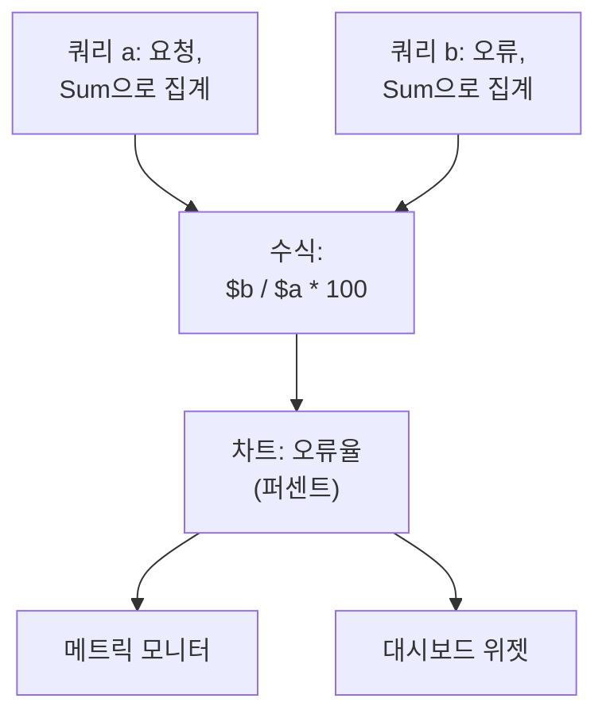

# 메트릭 탐색기

메트릭은 서비스와 인프라가 시간에 따라 보고하는 숫자입니다. 요청 수, 지연 시간, CPU, 큐 깊이 같은 것입니다. 메트릭 탐색기는 프로젝트가 받는 모든 메트릭을 나열하고, 어느 것이든 차트로 그리고, 수식으로 결합하고, 차트를 모니터나 대시보드 위젯으로 바꿉니다.

:::cards
- [메트릭 찾기](#메트릭-찾기): 메트릭 이름 목록을 검색합니다.
- [메트릭 차트 그리기](#메트릭-차트-그리기): 쿼리를 집계하고, 필터링하고, 그룹화합니다.
- [수식으로 쿼리 결합](#수식으로-쿼리-결합): 오류율과 그 밖의 비율.
- [그린 차트 활용](#그린-차트-활용): 모니터, 대시보드 위젯, 링크.
:::

## 탐색기의 작동 방식

탐색기에는 두 단계가 있습니다. **뷰어** 탭은 프로젝트가 받는 메트릭을 나열합니다. 하나를 클릭하면 그 메트릭에 대한 쿼리로 메트릭 탐색기가 열립니다. 쿼리는 메트릭과 그 집계 방법, 필터링과 그룹화 방법으로 이루어집니다. 각 쿼리는 `a`, `b` 같은 변수이며, 수식에서 쓸 수 있습니다.

탐색기에는 네 개의 탭이 있습니다.

| 탭 | 용도 |
| --- | --- |
| **뷰어** | 메트릭 목록. 각 메트릭에 작은 차트와 최신 값이 붙습니다. 지난 한 시간으로 열립니다. |
| **인사이트** | 어떤 서비스가 메트릭을 보고하는지, 그리고 몇 개인지. |
| **설정 가이드** | 수집 키 중 하나로 OpenTelemetry를 사용해 메트릭을 보내는 방법. |
| **설정** | **파이프라인 규칙**과 **기록 규칙**: 도착한 메트릭에 일어나는 일. |

## 시작하기 전에

- **도착하는 메트릭.** [OpenTelemetry](/docs/telemetry/open-telemetry)로 보내거나, [호스트용 OpenTelemetry Collector](/docs/telemetry/host-otel-collector)나 [Kubernetes 에이전트](/docs/telemetry/kubernetes-agent) 같은 에이전트에서 보냅니다.
- **텔레메트리를 읽을 수 있는 역할.** Project Owner, Project Admin, Project Member, Viewer, Telemetry Admin, Telemetry Member, Telemetry Viewer 중 하나이거나 Read Telemetry Service Metrics 권한이 있는 사용자 지정 역할입니다. 역할이 어떤 메트릭을 읽는지는 [텔레메트리](/docs/permissions/index#텔레메트리)를 참고하세요.

## 메트릭 찾기

**제품 → 관측 가능성 → 메트릭**으로 이동합니다. **뷰어**는 프로젝트가 받은 모든 메트릭을 이름으로 나열하며, 각 메트릭에 시간 범위의 작은 차트와 최신 값이 붙습니다.

- 단어만 쓰거나 `name:`으로 이름을 검색합니다. 예를 들어 `name:http.server`는 `http.server.request.duration`을 찾습니다. [검색 구문](/docs/telemetry/search-syntax#메트릭)을 참고하세요.
- 사이드바의 **서비스**로 필터링하면 한 서비스가 보고하는 메트릭만 보입니다.
- 메트릭을 클릭하면 메트릭 탐색기에서 차트로 그려집니다.

## 메트릭 차트 그리기

:::steps
### 메트릭 열기

**뷰어**에서 메트릭을 클릭합니다. 목록의 시간 범위와 필터를 이어받은 쿼리 하나, `a`로 탐색기가 열립니다.

### 집계 방법 고르기

**Aggregate by**에서 차트의 각 지점에 있는 값을 어떻게 합칠지 고릅니다. 기본값인 Avg, Sum, Min, Max, Count, 또는 백분위수 P50, P75, P90, P95, P99입니다. 요청 소요 시간 같은 히스토그램 메트릭의 백분위수는 버킷에서 계산합니다.

### 필터링과 그룹화

**Filters & grouping**을 엽니다. **Filter by attributes**는 특정 `http.route`처럼 속성이 맞는 데이터 포인트만 남기고, **Group by**는 고른 속성의 값마다 선을 하나씩 그립니다. 예를 들어 호스트마다 선 하나입니다.

### 차트 조정

**Display Settings**를 열어 **Chart type**(선, 영역, 막대)을 고르거나, 차트에 그릴 **Warning Threshold**와 **Critical Threshold**를 정하거나, **Convert to per-second rate**를 켭니다.
:::

> [!TIP]
> `system.disk.io`처럼 계속 올라가기만 하는 카운터는 비율로 볼 때 가장 읽기 쉽습니다. **Convert to per-second rate**를 켜면 누적 합계 대신 얼마나 빨리 변하는지를 그립니다. 탐색기는 그런 카운터를 알아보면 이 설정을 제안합니다.

각 쿼리는 자신의 차트를 그립니다. 쿼리를 바로 앞 쿼리와 같은 차트에 그리려면 그 쿼리의 **Display Settings**에서 **Overlay with previous query**를 켭니다.

## 수식으로 쿼리 결합

:::steps
### 쿼리 추가

필요한 메트릭마다 **메트릭 추가**를 클릭합니다. 새 쿼리는 `b`, `c` 등이 됩니다.

### 수식 추가

**수식 추가**를 클릭하고 쿼리의 변수, 연산자 `+`, `-`, `*`, `/`, `%`, `^`, 괄호로 **수식**을 씁니다. 퍼센트로 나타낸 오류율이라면 `$b / $a * 100`이라고 씁니다.
:::

변수는 `$`를 붙이든 붙이지 않든, 대소문자와 상관없이 쓸 수 있습니다. 정의하지 않은 쿼리를 가리키는 수식은 차트를 그리는 대신 그 사실을 알려 줍니다.

## 차트 주변 살펴보기

차트 위의 버튼은 보고 있는 시간 범위에 대해 동작합니다.

| 버튼 | 하는 일 |
| --- | --- |
| **로그** | 이 시간 범위와 필터로 [로그 탐색기](/docs/telemetry/logs-explorer)를 엽니다. |
| **트레이스** | 이 시간 범위와 필터로 [트레이스 탐색기](/docs/telemetry/traces-explorer)를 엽니다. |
| **Investigate** | 이 시간 범위의 로그, 트레이스, 예외를 보여 주는 사이드 패널을 엽니다. |
| **이벤트** | 이 시간 범위의 인시던트와 알림을 차트에 표시합니다. |
| **Compare** | 각 차트에 이전 기간을 점선으로 그려, 무엇이 바뀌었는지 볼 수 있게 합니다. |

차트를 드래그하면 그 순간을 확대하고, 두 번 클릭하면 다시 축소합니다. [시간 범위 확대](/docs/telemetry/charts-and-time-ranges)를 참고하세요.

## 그린 차트 활용

- **작업 → 이 보기에서 모니터 만들기**는 이 쿼리와 수식이 채워진 새 메트릭 모니터를 엽니다. [메트릭 모니터](/docs/monitor/metrics-monitor)를 참고하세요.
- **작업 → Add to dashboard**는 고른 대시보드에 차트를 추가합니다. 그 대시보드를 편집할 권한이 있어야 합니다.
- **링크 복사**는 쿼리, 수식, 시간 범위까지 정확히 이 보기로 가는 링크를 복사합니다.
- **Saved Views**는 보기를 이름 아래에 프로젝트의 모든 사람을 위해 남깁니다. **뷰어**에는 검색과 필터를 위한 자체 저장된 보기가 있습니다. 저장된 보기는 [로그 탐색기](/docs/telemetry/logs-explorer#보기-저장)에서와 똑같이 동작합니다.

## 메트릭 인사이트

**인사이트** 탭은 어떤 시간 범위의 메트릭을 셉니다. **활성 메트릭**, **보고 서비스**, 서비스당 평균입니다. 메트릭을 범주로 묶고, 메트릭을 보고하는 서비스를 나열합니다.

## 도착한 메트릭에 일어나는 일

**메트릭 → 설정 → 파이프라인 규칙**은 도착한 메트릭을 저장하기 전에 바꿉니다. 규칙은 목록 순서대로 실행되며, 순서는 드래그해서 바꿉니다. 서비스 하나를 위한 규칙은 모든 서비스를 위한 규칙보다 먼저 실행됩니다.

| 규칙 유형 | 하는 일 |
| --- | --- |
| 필터(허용 목록) | 맞는 데이터 포인트만 남기고 나머지는 버립니다. |
| 삭제 | 맞는 데이터 포인트를 버립니다. |
| 메트릭 이름 바꾸기 | 메트릭의 이름을 바꿉니다. |
| 속성 이름 바꾸기 | 맞는 데이터 포인트에서 속성 키의 이름을 바꿉니다. |
| 속성 추가 | 맞는 데이터 포인트에 속성을 추가합니다. |
| 속성 제거 | 값이 너무 많아 쓸모없는 속성 같은 것을 제거합니다. |
| 속성 삭제 | 속성의 값을 자리 표시자로 바꿉니다. |
| 샘플 | 맞는 데이터 포인트 중 일정 비율을 남깁니다. |

**메트릭 → 설정 → 기록 규칙**은 다른 메트릭에서 새 메트릭을 매분 계산합니다. 기록 규칙의 작동 방식은 [로그 기록 규칙](/docs/telemetry/log-recording-rules)을 참고하세요.

## 문제 해결

:::details 카운터의 차트가 계속 올라가기만 합니다
누적 카운터입니다. 쿼리의 **Display Settings**에서 **Convert to per-second rate**를 켜세요.
:::

:::details 목록에 메트릭이 없다고 합니다
먼저 검색과 필터 칩을 지우세요. 그래도 목록이 비어 있으면 아직 OneUptime에 도착한 메트릭이 없는 것입니다. 설정을 **설정 가이드**와 비교하세요.
:::

:::details 어떤 서비스의 메트릭이 없습니다
**뷰어**를 그 **서비스**로 필터링하고 시간 범위를 넓히세요. 그래도 없으면 역할의 범위에서 그 서비스가 빠져 있을 수 있습니다. [텔레메트리](/docs/permissions/index#텔레메트리)를 참고하세요.
:::

## 다음 단계

:::cards
- [메트릭 모니터](/docs/monitor/metrics-monitor): 메트릭이 임곗값을 넘으면 알림을 받습니다.
- [대시보드 작성](/docs/dashboards/authoring): 차트를 나란히 놓습니다.
- [검색 구문](/docs/telemetry/search-syntax): 검색 상자가 이해하는 모든 필터.
:::
