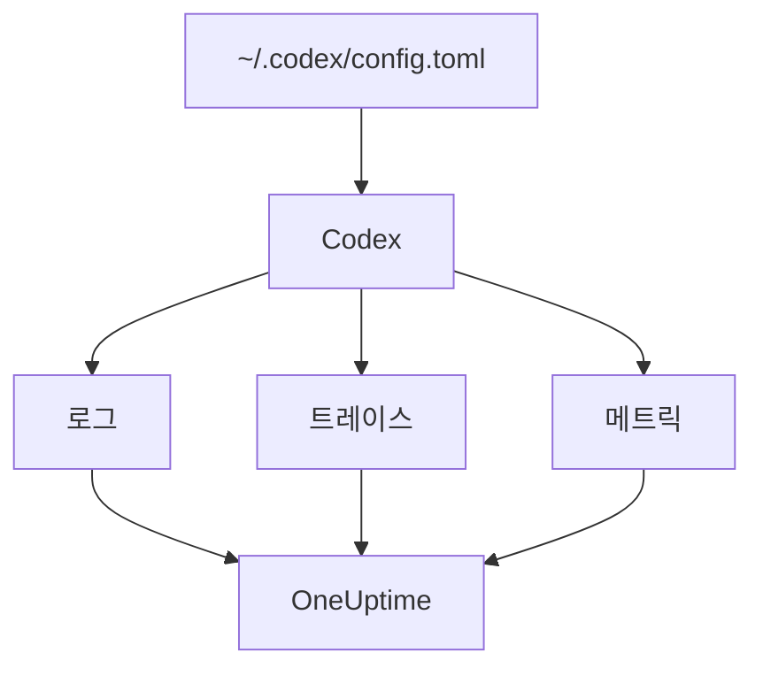

# OpenAI Codex

Codex CLI에는 로그, 트레이스, 메트릭별로 하나씩 세 개의 OpenTelemetry 익스포터가 내장되어 있습니다. `~/.codex/config.toml`에서 이를 OneUptime으로 향하게 하면, Codex의 각 턴이 토큰과 비용과 함께 들어옵니다. 중간에 래퍼나 프록시가 필요 없습니다.

:::cards
- [Codex 구성하기](#codex-구성하기): `[otel]` 블록 하나와 신호마다 전체 URL.
- [사용량을 사람에게 귀속하기](#codex-사용량을-사람에게-귀속하기): Codex는 스팬과 메트릭에서 아무도 지목하지 않으므로 직접 지정합니다.
- [토큰과 비용](#토큰과-비용): OneUptime이 어떤 신호를 읽고, 그것이 무엇을 보여 주는지.
- [문제 해결](#문제-해결): 아무것도 도착하지 않을 때 확인할 사항.
:::

## 작동 방식

각 익스포터는 하나의 신호를 자체 URL로 보냅니다. 트레이스와 로그는 구성하기 전까지 꺼져 있지만, 메트릭은 그렇지 않습니다.



> [!WARNING]
> 이 설정을 바꾸지 않으면 Codex는 메트릭을 OpenAI로 보냅니다. 릴리스 빌드에서 `metrics_exporter`의 기본값은 `statsig`이며, 메트릭을 `https://ab.chatgpt.com/otlp/v1/metrics`로 보냅니다. 아래처럼 `metrics_exporter`를 OTLP 익스포터로 설정하거나 `none`으로 설정하면 멈춥니다. `[analytics]`에서 `enabled = false`로 설정해도 Statsig 기본값은 멈추지만, 직접 설정한 OTLP 메트릭 익스포터는 계속 작동합니다.

## 시작하기 전에

1. **프로젝트 설정 → 텔레메트리 및 APM → 수집 키** 에서 텔레메트리 수집 키를 만듭니다.
2. OTLP 엔드포인트는 `https://oneuptime.com/otlp`이며, OneUptime을 직접 호스팅한다면 `https://YOUR-ONEUPTIME-HOST/otlp`입니다.
3. 모든 내보내기는 `x-oneuptime-token` 헤더로 키를 보냅니다.

## Codex 구성하기

:::steps
### otel 블록 추가하기

다음을 `~/.codex/config.toml`에 넣습니다. 세 신호가 모두 켜지고, 그와 함께 Statsig 기본값도 대체됩니다.

```toml title="~/.codex/config.toml"
[otel]
environment = "prod"
log_user_prompt = false

[otel.exporter.otlp-http]
endpoint = "https://oneuptime.com/otlp/v1/logs"
protocol = "binary"
headers = { "x-oneuptime-token" = "YOUR_INGESTION_TOKEN" }

[otel.trace_exporter.otlp-http]
endpoint = "https://oneuptime.com/otlp/v1/traces"
protocol = "binary"
headers = { "x-oneuptime-token" = "YOUR_INGESTION_TOKEN" }

[otel.metrics_exporter.otlp-http]
endpoint = "https://oneuptime.com/otlp/v1/metrics"
protocol = "binary"
headers = { "x-oneuptime-token" = "YOUR_INGESTION_TOKEN" }

[otel.span_attributes]
"user.id" = "dev@example.com"
"user.email" = "dev@example.com"
"team" = "platform"
```

### 각 익스포터에 전체 URL 지정하기

Codex는 각 `endpoint`를 적힌 그대로 사용합니다. 대부분의 SDK와 달리 `/v1/logs`, `/v1/traces`, `/v1/metrics`를 덧붙이지 않습니다. 세 익스포터를 모두 `https://oneuptime.com/otlp`만으로 설정하면 오류 없이 아무 데도 보내지 않습니다.

### 턴 실행하기

대화형 `codex` 세션을 시작하고, 간단한 질문을 하고, 턴이 끝나게 둡니다. 그런 다음 OneUptime에서 **로그** 를 열면 `codex.conversation_starts`, `codex.api_request`, `codex.turn_cost` 같은 Codex 이벤트가 나타납니다.
:::

> [!IMPORTANT]
> Codex는 `[otel]` 아래의 모르는 키를 경고 없이 무시합니다. 키는 스네이크 표기법(`trace_exporter`, `metrics_exporter`, `span_attributes`)이지만, 익스포터 이름과 TLS 필드는 케밥 표기법(`otlp-http`, `ca-certificate`)입니다. `trace-exporter`라고 쓰면 아무 오류 없이 트레이스가 꺼집니다.

## 구성 키

| 키 | 기본값 | 역할 |
| --- | --- | --- |
| `environment` | `"dev"` | 리소스 속성 `env`를 설정 |
| `log_user_prompt` | `false` | `codex.user_prompt`에 프롬프트 텍스트를 보냄. 아니면 `[REDACTED]`로 표시 |
| `log_agent_responses` | `false` | 에이전트의 최종 답변을 로그 익스포터로 보냄 |
| `exporter` | `none` | 로그 익스포터 |
| `trace_exporter` | `none` | 트레이스 익스포터 |
| `metrics_exporter` | `statsig` | 메트릭 익스포터. 반드시 설정할 것 |
| `span_attributes` | — | 내보내는 모든 스팬에 추가하는 속성 |
| `tracestate` | — | W3C `tracestate` 멤버 |
| `tool_result` | `{ max_bytes = 2048 }` | 로그 레코드가 도구 결과를 얼마나 보관하는지(UTF-8 바이트) |

익스포터는 `none`, `statsig`, `otlp-http`, `otlp-grpc` 중 하나입니다. `otlp-http`는 `endpoint`, `headers`, `protocol`(`"binary"` 또는 `"json"`, OneUptime은 둘 다 받음), `tls`(`ca-certificate`, `client-certificate`, `client-private-key`)를 받고, `otlp-grpc`는 `protocol`을 뺀 같은 것을 받습니다.

## Codex 사용량을 사람에게 귀속하기

Codex는 한 곳에서만 개발자를 지목합니다.

- **로그 레코드** 는 `user.account_id`와 `user.email`을 가집니다.
- **스팬** 은 가지지 않습니다. Codex는 의도적으로 둘 다 트레이스에서 뺍니다.
- **메트릭** 도 가지지 않습니다. `auth_mode`, `session_source`, `originator`, `service_name`, `model`, `app.version`을 가지지만 사람은 없습니다.

OneUptime은 스팬과 메트릭 데이터 포인트에서 사람을 읽으며, 로그 레코드에서는 읽지 않습니다. 따라서 `[otel.span_attributes]`에서 모든 스팬에 신원을 직접 붙이세요.

```toml title="~/.codex/config.toml"
[otel.span_attributes]
"user.id" = "dev@example.com"
"user.email" = "dev@example.com"
"team" = "platform"
"cost_center" = "eng-123"
```

`user.id`는 OneUptime이 우선하는 키이며, `user.email`은 이메일 열을 채웁니다. Codex에는 리소스 속성이 없으므로 팀 키(`team.id`, `team`, `cost_center`, `department`)도 여기에서 설정하세요. 이 블록은 각 개발자의 구성 파일에 있으므로, dotfiles나 MDM 프로필로 개발자마다 배포하세요. 하나의 신원을 가진 공유 파일 하나를 쓰면 모두의 지출이 한 사람에게 청구됩니다.

## 토큰과 비용

| 신호 | Codex가 보내는 것 | OneUptime의 처리 |
| --- | --- | --- |
| 트레이스 | `gen_ai.usage.input_tokens`, `gen_ai.usage.output_tokens`, 캐시 토큰. 모델은 없음 | 사람별로 토큰을 셈. 가격은 매길 수 없음 |
| 메트릭 | `token_type`별 `codex.turn.token_usage`와, USD의 백만분의 일 단위인 `codex.turn.cost_microusd` | 비용을 USD로 환산. 스팬이 아무것도 보고하지 않는 곳에서만 메트릭을 읽음 |
| 로그 | `usage.estimated_usd`와 사람이 담긴 `codex.turn_cost` | **로그** 탐색기에 저장. 지출에는 연결하지 않음 |

위 구성에서는 **사용량** 탭이 다음과 같이 됩니다.

- 토큰은 스팬에서 사람별로 가져오며, `codex.turn.token_usage`는 그 위에 더하지 않습니다. 둘은 합산되지 않습니다([이유](/docs/telemetry/ai-llm-observability#스팬이-먼저-메트릭은-보충)).
- Codex의 스팬은 모델을 지목하지 않으므로 OneUptime이 가격을 매길 수 없고, 비용은 0입니다. 그래서 비용 합계는 Codex의 비용을 `codex.turn.cost_microusd`에서 가져와 USD로 환산해 씁니다.
- **직원** , **팀** , **모델** 표는 스팬의 행을 보여 줍니다. 사람별 토큰은 있지만 사람별 비용은 없습니다.
- 트레이스가 없으면 메트릭이 대신 이 표를 채우는데, 비용만 있고, Codex의 메트릭은 아무도 지목하지 않으므로 모두 **미지정** 아래에 들어갑니다.

사람 정보가 담긴 가장 정확한 턴별 비용은 로그 레코드 `codex.turn_cost`입니다. OneUptime은 아직 로그 레코드를 지출에 연결하지 않지만, 로그 익스포터는 켜 두세요. 연결이 지원될 때 기록이 남아 있습니다.

## CI와 MCP 서버로서의 Codex

`codex`, `codex exec`, `codex mcp-server`는 모두 같은 `[otel]` 블록에서 세 익스포터로 텔레메트리를 만듭니다. `codex exec` 실행은 `originator`로 `codex_exec`을 가지고, `codex mcp-server`는 `codex_mcp_server`로 내보내므로, 이 값으로 CI와 MCP 실행을 대화형 세션과 구분할 수 있습니다.

## 개인정보 보호

`log_user_prompt`와 `log_agent_responses`의 기본값은 `false`입니다. 꺼 두세요. `codex.user_prompt` 이벤트는 프롬프트가 `[REDACTED]`로 바뀐 채로 계속 들어오므로, 프롬프트 텍스트 없이 턴, 토큰, 비용을 유지할 수 있습니다. 사람(`user.email`, `user.account_id`)은 이 스위치와 관계없이 로그 레코드에 있습니다.

조사를 위해 내용을 켠다면, **트레이스 → 설정** 에 있는 트레이스의 **스크럽 규칙** 과 **드롭 필터** 로 저장 전에 마스킹하거나 버릴 수 있습니다.

## Codex 대신 OpenAI API 사용하기

OpenAI의 플랫폼 API는 자체적으로 OpenTelemetry를 보내지 않습니다. 모든 스팬은 자체 클라이언트를 계측해서 나옵니다. OneUptime과 함께 쓸 수 있는 계측은 세 가지입니다.

- **OpenTelemetry**: Python용 `opentelemetry-instrumentation-genai-openai`로, `opentelemetry-instrumentation-openai-v2`를 대체합니다. 메시지를 기록할지는 `OTEL_INSTRUMENTATION_GENAI_CAPTURE_MESSAGE_CONTENT`가 정합니다.
- **OpenLLMetry** (Traceloop): `opentelemetry-instrumentation-openai`.
- **OpenInference** (Arize): `openinference-instrumentation-openai`.

어느 것이든 [AI / LLM 옵저버빌리티](/docs/telemetry/ai-llm-observability)에 나온 대로 OneUptime을 향하게 하세요. 어느 것도 직원이 누구인지 모르므로 `user.id`는 직접 설정하세요.

**OpenAI Agents SDK** 는 OTLP가 아니라 OpenAI 자체 엔드포인트로 트레이스를 보냅니다. SDK의 스팬을 OTLP 익스포터로 넘겨주는 `opentelemetry-instrumentation-openai-agents-v2` 또는 `openinference-instrumentation-openai-agents`로 연결하세요.

## 문제 해결

:::details 아무것도 도착하지 않음
먼저 세 `endpoint` 값을 확인하세요. 각각 `/v1/logs`, `/v1/traces`, `/v1/metrics`로 끝나야 합니다. 그런 다음 `x-oneuptime-token` 헤더를 확인하세요. OneUptime은 잘못된 키를 거부합니다.
:::

:::details 로그는 오지만 트레이스는 오지 않음
`[otel]` 아래에서 철자가 틀린 키를 찾아보세요. Codex는 조용히 무시합니다. 흔한 경우는 `trace_exporter` 대신 `trace-exporter`라고 쓴 것입니다.
:::

:::details Codex 비용은 합계에 나오지만 모든 사람이 $0으로 표시됨
예상된 동작입니다. Codex의 스팬은 토큰은 있지만 모델이 없어서 가격을 매길 수 없고, 비용 메트릭은 아무도 지목하지 않습니다. [토큰과 비용](#토큰과-비용)을 참조하세요.
:::

:::details 모든 사람의 지출이 한 사람 아래에 표시됨
모든 머신에 `[otel.span_attributes]`의 같은 신원이 있습니다. 개발자마다 자기 신원을 주세요.
:::

## 다음 단계

:::cards
- [AI 코딩 어시스턴트](/docs/telemetry/ai-coding-assistants): 모든 코딩 어시스턴트에서 지출이 귀속되는 방식.
- [AI / LLM 옵저버빌리티](/docs/telemetry/ai-llm-observability): 자체 AI 호출의 대화, 알림, 비용, 예산.
- [AI 게이트웨이](/docs/telemetry/ai-gateways): 모든 모델 호출을 트레이스하고 가격을 매기는 게이트웨이 하나.
:::
