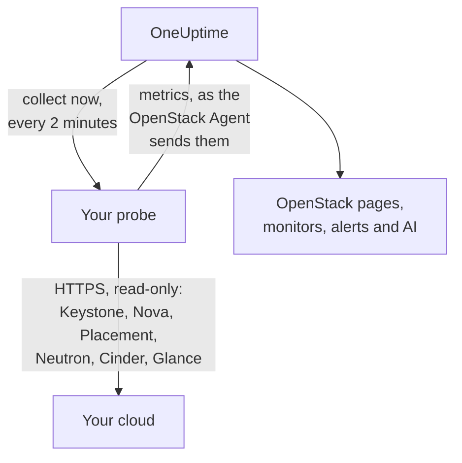

# 에이전트 없는 OpenStack

아무것도 설치하지 않고 OpenStack 클라우드를 모니터링합니다. OneUptime에 Keystone 주소와 애플리케이션 자격 증명을 입력하고 클라우드에 접근할 수 있는 프로브를 선택하면, 프로브가 [OpenStack 에이전트](/docs/telemetry/openstack)와 같은 데이터를 수집합니다. 설치하거나 업그레이드하거나 계속 실행해 둘 에이전트가 없고, 별도로 준비할 전용 머신도 없습니다.

> [!IMPORTANT]
> 프로브는 클라우드와 HTTPS로만 통신합니다. 자격 증명이나 토큰은 평문 HTTP로 절대 전송되지 않으며, DevStack과 Kolla-Ansible은 기본적으로 API를 평문 HTTP로 제공합니다. 이런 클라우드에서는 API에 TLS를 켜거나, 클라우드 옆에서 실행되는 [OpenStack 에이전트](/docs/telemetry/openstack)를 사용하세요. 연결 테스트는 평문 HTTP 주소를 발견하면 이를 알려 줍니다.

:::cards
- [시작하기 전에](#시작하기-전에): API에 접근할 수 있는 프로브와 자격 증명.
- [클라우드 연결](#클라우드-연결): 주소, 자격 증명, 테스트, 이름.
- [문제 해결](#문제-해결): 각 메시지의 의미와 해결 방법.
:::

## 작동 방식



프로브는 2분마다 선택한 각 리전의 각 서비스를 읽고, 찾은 내용을 OneUptime으로 보냅니다. 데이터는 OpenStack 에이전트가 보내는 것과 똑같은 형태로 도착하므로, 모든 OpenStack 페이지, [OpenStack 모니터](/docs/monitor/openstack-monitor), 알림 템플릿이 같은 방식으로 읽습니다.

각 서비스는 다른 서비스와 동시에, 독립적으로 읽습니다. Neutron이 실패하거나 멈추면 Neutron의 시계열만 잃고 Nova의 데이터는 평소처럼 도착합니다. 다만 Nova는 예외가 하나 있습니다. 나열하는 모든 인스턴스에 대해 Neutron에 묻기 때문입니다. 그래서 Neutron이 내려가 있는 동안 프로브는 마지막으로 읽은 인스턴스를 유지하고 변경된 것만 묻습니다. 인스턴스가 변경되었거나 프로브가 막 시작된 경우에는 Nova도 그 목록에 답할 수 없습니다. 그러면 Nova는 실패로 표시되고, 다른 시계열은 계속 도착하며, 각 인스턴스는 Neutron이 복구될 때까지 페이지에 마지막 상태 그대로 남습니다.

Heat, Magnum, Manila, Trove, Gnocchi, Designate, Swift, Barbican은 Keystone의 카탈로그에 이름이 있는 곳에서 읽습니다. 이 중 어느 것도 실행하지 않는 클라우드는 비용이 전혀 들지 않고, 연결 테스트에서도 언급되지 않으며, [흔적도 나타나지 않습니다](/docs/telemetry/openstack#heat와-magnum).

카탈로그에 Octavia가 있는 클라우드에서는 프로브가 로드 밸런서, 풀, 리스너, 암포라를 각각 목록 요청 한 번씩으로 읽고, 이어서 모든 풀의 멤버와 `ACTIVE` 상태인 모든 로드 밸런서와 리스너의 트래픽 카운터를 요청 한 번씩으로 읽습니다. 로드 밸런서 3개, 풀 1개, 리스너 1개가 있는 클라우드는 수집 한 번에 요청 9개가 듭니다. 기록한 실제 DevStack도 정확히 그만큼 들었습니다. 한 번의 수집에서 읽는 풀 멤버는 최대 25개 풀, 카운터는 최대 50개이며, 가장 오래 읽지 않은 것부터 읽고 나머지는 마지막으로 읽었을 때의 값을 그대로 보고합니다. Octavia의 카운터는 누적값이므로 프로브는 각 카운터의 마지막 값을 보관해 두 값의 초당 차이를 차트로 그립니다. 따라서 차트는 두 번째 수집부터 시작되며, 카운터가 줄어든 경우(리스너를 다시 만든 경우) 그 구간은 그리지 않습니다. OVN 프로바이더는 모든 카운터를 0으로 보고하는데, 이는 평평한 선일 뿐 장애가 아닙니다.

암포라는 모든 읽기에 Octavia의 admin 규칙이 필요합니다. admin 미만의 자격 증명은 자기 프로젝트의 로드 밸런서, 풀, 리스너, 멤버와 자신의 카운터는 볼 수 있지만 암포라는 볼 수 없습니다. 로드 밸런서 페이지에 이 사실이 표시되며 경고는 나타나지 않습니다. 로드 밸런서가 없는 프로젝트의 모니터링 역할은 아무것도 볼 수 없습니다. `load-balancer_global_observer`는 이 내용을 기록한 릴리스인 `stable/2026.1`에서 모든 요청이 거부되었습니다.

중지된 Octavia API는 프로브에게 `up 0`으로 보이며, 에이전트의 익스포터는 이를 알려 줄 수 없습니다.

## 프로브와 에이전트 중 무엇을 쓸까요?

| | 프로브(이 페이지) | OpenStack 에이전트 |
|---|---|---|
| 실행하는 것 | 이미 실행 중인 프로브 또는 새 프로브 | 전용 머신의 에이전트 |
| 자격 증명 보관 위치 | OneUptime에 암호화되어 저장되며 프로브에만 전송됨 | 에이전트의 `clouds.yaml` 파일 |
| 접근해야 하는 대상 | Keystone과 각 서비스의 API(HTTPS) | Keystone과 각 서비스의 API |
| 평문 HTTP API | 수집 안 됨: 토큰은 암호화 없이 전송되지 않음 | 수집됨 |
| 최대 클라우드 규모 | 실제 클라우드가 아닌 시뮬레이션 클라우드에서 [인스턴스 200,000개](/docs/telemetry/openstack-very-large-clouds)까지 테스트했으며, 48 MiB 업로드 최대 열 번으로 전송 | 대규모 테스트 안 함: [스크레이프가 그 전에 시간 초과됨](/docs/telemetry/openstack-very-large-clouds#에이전트를-통한-경우) |
| 서비스 로그와 AI 에이전트 | 포함 안 됨 | 포함됨 |
| 클라우드의 기반 요소: RabbitMQ, MariaDB, Memcached, HAProxy, OVN, libvirt | 포함 안 됨: 프로브는 클라우드의 API를 읽음 | 대상 이름과 함께 포함됨 |
| libvirt 또는 Ceilometer에서 가져온 각 인스턴스의 실제 CPU, 메모리, 디스크 | 포함 안 됨 | 익스포터 이름과 함께 포함됨 |
| Keystone 로그인 | 토큰 수명(보통 한 시간) 동안 한 번 | 스크레이프마다 한 번 |
| 한 프로젝트의 일반 `reader` | 해당 프로젝트의 인스턴스, 볼륨, 네트워크 | 해당 프로젝트의 볼륨과 네트워크(인스턴스는 제외) |

두 방식은 같은 시계열을 보내므로 페이지와 모니터는 어느 쪽과도 작동합니다. 프로브는 네이티브 클라이언트만 읽을 수 있는 정보도 함께 보냅니다. 인스턴스의 주소, 작업 상태, 오류 메시지, 부팅에 사용한 이미지, 운영자가 Nova 서비스를 강제로 내렸는지 여부, DHCP 에이전트가 담당하는 네트워크, 볼륨이 위치한 풀, 인스턴스·볼륨·이미지가 마지막으로 변경된 시점, 각 볼륨 스냅샷과 백업의 상태가 여기에 해당합니다. Cinder는 admin으로 취급하는 자격 증명에게만 볼륨이 위치한 풀을 알려 줍니다. [Heat 또는 Magnum](/docs/telemetry/openstack#heat와-magnum)을 실행하는 클라우드에서는 스택이나 클러스터가 실패한 이유, 스택이 소유한 인스턴스와 볼륨, 각 클러스터의 프로젝트·템플릿·Kubernetes 버전, Heat 엔진과 Magnum 컨덕터 각각의 가동 여부도 보냅니다.

서비스 로그, AI 에이전트, 클라우드의 기반 요소와 각 인스턴스의 실제 사용량이 필요하거나, DevStack과 Kolla-Ansible처럼 기본적으로 API가 평문 HTTP만 지원하는 클라우드이거나, [데이터베이스에서 직접 읽어야](/docs/telemetry/openstack-very-large-clouds#데이터베이스-경로) 할 만큼 큰 클라우드라면 에이전트를 선택하세요. 그 외에는 프로브를 선택하세요. 설치할 것이 없고 Nova와 Cinder가 알려 주는 정보를 더 많이 읽습니다. [초대형 OpenStack 클라우드](/docs/telemetry/openstack-very-large-clouds)에서 어느 쪽이든 규모별로 어떤 비용이 드는지 설명합니다.

클라우드의 **설정** 페이지에서 언제든지 한 방식에서 다른 방식으로 전환할 수 있습니다.

## 시작하기 전에

- **HTTPS로 Keystone과 모든 서비스의 API에 접근할 수 있는 프로브.** 보통 클라우드 네트워크 안의 [커스텀 프로브](/docs/probe/custom-probe)입니다. Keystone의 카탈로그가 각 서비스가 응답하는 위치를 알려 주고 프로브는 그 주소로 연결하므로, 각 주소는 프로브에서 접근할 수 있어야 하고 모두 HTTPS여야 합니다. OneUptime Cloud의 공유 프로브는 OpenStack 자격 증명을 절대 받지 않으므로 직접 프로브를 추가하세요. 셀프 호스팅 인스턴스에서는 인스턴스 자체의 프로브도 수집할 수 있습니다.
- **자격 증명.** 읽기 전용으로 제한할 수 있고 만료시킬 수 있으므로 애플리케이션 자격 증명이 가장 좋습니다. 사용자 이름과 비밀번호도 사용할 수 있지만 해당 계정이 할 수 있는 모든 일을 할 수 있습니다.

OpenStack에는 전역 읽기 전용 역할이 없으므로 프로브가 볼 수 있는 범위는 자격 증명에 달려 있습니다.

| 수준 | 필요한 것 | 프로브가 읽는 것 |
|---|---|---|
| 전체 보기 | 전용 프로젝트에서 `admin` 권한을 가진 계정의 애플리케이션 자격 증명이며, 액세스 규칙으로 읽기만 하도록 제한 | Keystone의 사용자와 그룹(규칙이 의도적으로 제외함)을 뺀 모든 것 |
| 인프라만 | 아무것도 담지 않고 할당량이 없는 전용 프로젝트의 `oneuptime_monitoring` 및 `reader` 역할, 그리고 OpenStack 에이전트가 제공하는 정책 파일 | 하이퍼바이저, Nova의 서비스, Neutron의 에이전트, 주소 풀, Placement, 프로젝트 목록, 모든 프로젝트의 인스턴스. 볼륨, 네트워크, 라우터는 역할이 할당된 곳에서만. `cinder-volume` 및 `cinder-scheduler` 상태와 스토리지 풀은 제외: Cinder 자체 코드가 admin을 요구함 |
| 프로젝트 보기 | 한 프로젝트의 일반 `reader` | 해당 프로젝트의 인스턴스, 볼륨, 네트워크(인프라는 제외) |

연결 테스트는 자격 증명이 위 수준 중 어디에 해당하는지 알려 주며, 자격 증명의 프로젝트에 리소스가 있으면 경고합니다. Cinder의 `enforce_new_defaults`가 꺼져 있는 경우(Cinder의 기본값입니다) 프로젝트의 모든 역할이 해당 프로젝트의 볼륨을 만들 수 있으며 `reader`도 예외가 아닙니다.

> [!IMPORTANT]
> 액세스 규칙으로 제한된 애플리케이션 자격 증명은 `keystonemiddleware`에 `service_type`이 설정되지 않은 서비스에서 `401`로 거부됩니다. 연결 테스트가 읽기마다 이를 알려 줍니다. 각 서비스의 설정에 지정한 뒤 재시작하세요. [자격 증명 만들기](/docs/telemetry/openstack#자격-증명-만들기)에 규칙, 정책 파일, 서비스별 설정이 있고, [각 수준이 읽는 것](/docs/telemetry/openstack#각-단계가-읽는-항목)은 실제 클라우드가 응답한 내용입니다.

## 클라우드 연결

:::steps
### 클라우드 목록 열기
OneUptime에서 **OpenStack → 모든 클라우드**를 열고 **클라우드 연결**을 클릭합니다.

### 주소와 자격 증명 입력
`clouds.yaml` 또는 `openrc` 파일의 `auth_url`(예: `https://keystone.example.com:5000/v3`)과 애플리케이션 자격 증명의 ID 및 시크릿을 입력합니다. 클라우드에 접근할 수 있는 프로브를 선택합니다.

### 연결 테스트
**연결 테스트**를 클릭합니다. 프로브가 로그인하고, 각 리전에서 수집이 수행하는 읽기를 하나씩 시도한 뒤 로그아웃합니다. 카탈로그에 있는 리전, 자격 증명이 읽을 수 있는 것, 거부되는 것, 그 때문에 비어 있게 될 페이지, 그리고 이를 열어 주는 설정 줄을 알려 줍니다. 읽기 하나가 실패해도 테스트는 중단되지 않습니다.

### 클라우드 인증서 신뢰
자체 인증 기관을 사용하는 클라우드는 프로브가 신뢰하지 않는 인증서를 제시합니다. 이 경우 테스트에 인증서와 이를 제시한 호스트가 표시됩니다. 지문을 API 자체의 지문과 비교해 확인한 뒤 **이 인증서 신뢰**를 클릭합니다. 서비스마다 호스트가 따로 있는 클라우드는 서비스마다 인증서가 있을 수 있으며, 최대 32개까지 신뢰할 수 있습니다.

### 리전을 선택하고 연결
읽을 리전을 선택하고 클라우드 이름을 정한 뒤 **클라우드 연결**을 클릭합니다. 클라우드 페이지가 열립니다.
:::

클라우드의 **개요**에는 **데이터 수집** 카드가 표시됩니다. 첫 수집이 시작될 때까지(1분 안에 시작됩니다) **확인 중**으로 표시되다가 **수집 중**으로 바뀌고 페이지가 채워집니다. 일부 서비스는 읽었지만 다른 서비스는 읽지 못한 경우에는 어느 서비스인지 알려 줍니다. 프로브가 오프라인이거나 버전이 너무 오래되어 15분 동안 이 클라우드를 수집하러 오지 않으면, 마지막 수집 결과와 관계없이 **수집 안 됨**으로 표시되고 그 사실을 알려 줍니다.

클라우드의 **설정** 페이지에 있는 **데이터 수집** 카드에는 연결할 때 사용한 정보가 있습니다.


## API 또는 Terraform으로 클라우드 연결

클라우드의 연결 설정은 API의 [OpenStack Cloud 리소스](/reference/open-stack-cloud)(`/api/openstack-cloud`)의 일반 필드이므로, 대시보드 없이도 클라우드를 연결할 수 있습니다. Terraform에서는 `oneuptime_openstack_cloud`를 사용합니다.

```hcl
resource "oneuptime_openstack_cloud" "prod_eu" {
  name                      = "prod-eu"
  collection_method         = "Probe"
  auth_url                  = "https://keystone.example.com:5000/v3"
  credential_kind           = "applicationCredential"
  application_credential_id = var.openstack_application_credential_id
  credential_secret         = var.openstack_application_credential_secret
  collection_probe_id       = oneuptime_probe.eu_west.id
  collection_regions        = jsonencode(["RegionOne"])

  # A cloud with its own certificate authority: the fingerprints it presents.
  trusted_certificate_fingerprints = jsonencode(["AB:CD:EF:..."])
}
```

사용자 이름과 비밀번호를 쓰려면 `credential_kind`를 `password`로 설정하고 `keystone_username`, `project_name`을 지정하며, 기본값이 `Default`가 아니라면 `user_domain_name`과 `project_domain_name`도 지정합니다. `endpoint_interface`, `collection_interval_in_minutes`, `collection_options`는 양식에서 **추가 필드** 아래에 접혀 있는 항목입니다. 에이전트가 보내는 클라우드에는 이런 값이 없으므로 `name`만 필수입니다.

`credential_secret`은 쓰기 전용이어서 어떤 읽기도 이를 반환하지 않으며, Terraform도 plan과 출력에서 제외합니다. [저장된 자격 증명 규칙](#저장된-자격-증명)도 여기에 동일하게 적용됩니다. 주소, 프로브, 신뢰하는 인증서를 변경하려면 같은 요청에 시크릿이 있어야 합니다. `collection_status`, `collection_error`, `presented_certificate`처럼 프로브가 보고하는 값은 읽을 수만 있고 설정할 수 없습니다.

## 클라우드에 드는 비용

모니터링이 클라우드를 중단시키는 원인이 되어서는 안 되므로, 수집은 구조적으로 부담이 적게 설계되어 있습니다.

- **로그인은 한 번, 유지.** 토큰은 만료 5분 전까지 사용합니다. 로그인은 문제가 생긴 Keystone이 가장 감당하기 어려운 요청입니다.
- **페이지 단위 목록.** 모든 목록은 `limit`과 `marker`로 1,000행씩 읽습니다.
- **변경된 인스턴스 위주.** 30분마다 하는 전체 읽기 사이에는 `changes-since`로 지난 읽기 이후 바뀐 것만 Nova에 묻습니다.
- **하이퍼바이저 인벤토리는 한 번만.** Placement는 인벤토리가 바뀔 때마다 프로바이더의 세대 값을 올리며 목록 호출 한 번으로 전체를 알 수 있으므로, 그때만 다시 읽습니다.
- **정해진 부하.** 항목마다 호출 하나가 드는 작업은 수집당 2,000개를 넘으면, 한도 조회는 프로젝트가 250개를 넘으면 여러 번에 나눠 처리합니다. 이번에 읽지 않은 것은 마지막으로 읽은 값으로 보내므로 시계열에 공백이 생기지 않고, 클라우드가 커져도 부하가 계속 늘지 않습니다.
- **필요한 필드만.** Neutron 목록은 필드를 명시하며, 보안 그룹은 ID만 요청합니다.
- **겹치지 않게.** 수집 주기보다 오래 걸리는 수집은 다음 수집과 나란히 실행하지 않고 건너뜁니다.
- **시간 예산.** 수집은 주기의 10분의 9, 최대 10분을 사용합니다. 그때까지 읽은 것을 보내며, 시간이 부족했던 서비스는 그렇다고 알립니다.
- **대기 시간 증가.** `429` 또는 `Retry-After`로 기다리라는 응답을 받으면 프로브는 기다립니다. `429`, `503` 또는 아예 무응답인 서비스는 1분, 2분, 4분으로 늘려 최대 30분까지 건드리지 않으며, 그동안 해당 시계열은 계속 내려가 있다고 보고합니다.
- **속도 줄이기.** 그 서비스의 평소 응답보다 3배 느리면서 1초 이상인 응답, 또는 평소와 상관없이 5초 이상인 응답은 그만큼의 시간 동안 그 서비스의 다음 요청을 늦춥니다. **데이터 수집** 카드에 그랬던 시점이 표시됩니다.
- **거부된 자격 증명은 가장 오래 기다림.** 같은 시도를 반복하면 계정이 잠기므로 5분, 10분으로 늘려 최대 1시간까지 기다립니다. 자격 증명을 고치면 즉시 다시 시도합니다.

- **큰 클라우드는 덜 읽음.** 인스턴스가 5,000개를 넘으면 클라우드는 개수와 구성 요소만 유지하고, 인스턴스별·볼륨별 시계열은 보관하지 않습니다. 단, 클라우드의 **설정** 페이지에서 **인스턴스별 실제 사용량** 아래에 다르게 선택한 경우는 예외입니다. 변경된 것, 보관하도록 선택한 것, 알림이 감시하는 것은 매 수집마다 계속 전송됩니다. 나머지는 여러 번에 나눠 보내며, **데이터 수집** 카드에 한 바퀴가 걸리는 시간이 표시됩니다.

기본값으로 수집할 때마다 리전 하나는 Nova에 7번, Neutron에 7번, Cinder에 5번, Placement에 1번을 호출하고 하이퍼바이저당 2번을 더 호출하며, Placement에 [각 플레이버가 몇 개 들어가는지](/docs/telemetry/openstack#용량) 묻는 데 최대 4번이 더 들고, 약 5분마다 Keystone에 5번과 Glance에 1번을 호출합니다. 하이퍼바이저의 인벤토리는 한 번 읽고, Placement가 바뀌었다고 알릴 때만 다시 읽습니다. 1,000행보다 긴 목록은 1,000행마다 호출이 한 번씩 듭니다. 변경된 인스턴스마다 Nova에 한 번 더 호출해 그 인스턴스가 겪은 일을 읽으며, 한 번의 수집에서 최대 25개까지만 읽습니다. 조용한 클라우드는 이 호출이 전혀 없습니다. ML2/OVS에서는 Neutron에 라우터마다 호출이 한 번 더 들어 어떤 L3 에이전트가 해당 라우터를 담당하는지 묻고, 10분마다 DHCP 에이전트당(최대 20개) 호출이 한 번 들어 어떤 네트워크를 담당하는지 묻습니다. DHCP 에이전트가 더 많은 클라우드는 여러 번에 나눠 돌고, 요약 크기를 넘은 클라우드는 이를 생략하며, 느린 Neutron에는 아예 묻지 않습니다. OVN 기반 클라우드에는 물어볼 대상이 없습니다. [초대형 OpenStack 클라우드](/docs/telemetry/openstack-very-large-clouds#컨트롤-플레인에-가는-부하)에 규모별로 이것이 분당 요청 수로 얼마나 되는지 나와 있습니다.

Manila를 실행하는 클라우드는 약 5분마다 Manila에 2번, Trove는 1번, Gnocchi는 1번, Barbican은 3번 호출합니다. Designate는 2번에 더해 `ACTIVE`가 아닌 영역마다 1번씩(수집당 최대 50번) 호출합니다. Swift는 자격 증명 자체의 프로젝트에 1번 호출하고, `ResellerAdmin`이 있으면 다른 프로젝트마다 1번씩(수집당 최대 200번) 더 호출합니다. Heat나 Magnum을 실행하는 클라우드는 약 5분마다 Heat에 2번, Magnum에 3번 호출합니다. 두 목록 모두 모든 정보를 담고 있지 않습니다. Magnum의 목록은 클러스터의 소유자나 실패 이유를 알려 주지 않고, Heat의 목록은 스택이 무엇을 소유하는지 알려 주지 않습니다. 그래서 프로브는 상태가 바뀐 클러스터나 스택을 따로 읽으며, 수집당 각각 최대 25개까지 읽습니다. 더 많은 클라우드는 이후 수집에서 계속 채워 가고, 변하지 않는 것은 두 번 읽지 않습니다.

다음 세 가지는 클라우드에 더 많은 비용이 들기 때문에 기본적으로 꺼져 있습니다. 클라우드의 **설정** 페이지에 있는 **데이터 수집** 카드의 **기본값 외에 읽는 항목** 아래에서, 또는 연결할 때 **추가 필드** 아래에서 켤 수 있습니다.

| 옵션 | 얻는 것 | 드는 비용 |
|---|---|---|
| 포트 | 포트별 시계열, 그리고 주소가 없는 포트와 내려간 로드 밸런서의 수 | 지정한 네트워크 또는 프로젝트마다 페이지 단위 목록 한 번, 지정하지 않으면 모든 포트의 목록. 범위를 지정하지 않은 포트 목록은 큰 클라우드에서 Neutron을 포화시킬 수 있음 |
| 프로젝트 한도 | 프로젝트별 할당량과 한도 | 프로젝트당 호출 네 번, 수집당 최대 프로젝트 250개 |
| Swift의 스토리지 서버 | 각 서버의 응답 여부, 복제 상태, 모든 서버의 링이 같은지 여부. 각 서버의 `/recon` 포트를 `host:port`로 지정해야 함. Swift를 실행하는 클라우드만 이 기능을 제공하며, 첫 수집이 Swift를 읽은 뒤 **설정** 페이지에 표시됨 | 수집마다 서버당 호출 5번. 서버에는 자격 증명이 전송되지 않음 |

## 인증서

프로브는 인증서 검증을 절대 건너뛰지 않습니다. 모든 연결에서 전체 TLS 핸드셰이크를 완료하며, 이후에는 다음과 같이 처리합니다.

- 신뢰하는 인증서가 없으면, API의 인증서는 프로브 머신이 신뢰하는 인증 기관에서 발급되어야 하고 응답하는 주소에 대한 것이어야 합니다.
- 신뢰하는 인증서가 있으면, API는 SHA-256 지문으로 식별되는 바로 그 인증서 중 하나를 제시해야 합니다. 공개적으로 신뢰되는 인증서라 해도 그 외에는 허용되지 않습니다.

지문을 확인하려면 프로브 머신에서 다음을 실행합니다.

```bash
openssl s_client -connect keystone.example.com:5000 </dev/null | openssl x509 -noout -fingerprint -sha256
```

인증서가 갱신되면 수집이 **API의 인증서가 변경됨**과 함께 중단되고 새 인증서가 표시됩니다. 클라우드의 **개요** 또는 **설정** 페이지에서 새 인증서를 신뢰하기 전까지는 아무것도 전송되지 않습니다.

## 저장된 자격 증명

시크릿은 암호화되어 쓰기 전용으로 저장됩니다. 누구도 다시 읽을 수 없고 API도 이를 반환하지 않습니다. 시크릿은 클라우드를 수집하는 프로브에만 전송되며, 프로브는 이를 메모리에만 보관합니다.

저장된 자격 증명은 입력할 때 지정한 주소로, 그 프로브를 거쳐, 그 인증서에만 전송됩니다. 주소, 프로브, 신뢰하는 인증서를 변경하면 시크릿을 다시 요구하므로, 클라우드를 편집할 수 있는 사람이라도 시크릿을 다른 곳으로 보낼 수 없습니다. 프로브가 저장된 주소에서 발견한 인증서를 신뢰하는 경우나 신뢰하는 인증서를 줄이는 경우에는 시크릿이 유지됩니다.

토큰은 카탈로그가 알려 주는 곳 어디로든 가기 때문에, 카탈로그에도 직접 입력한 주소와 같은 규칙이 적용됩니다. 프로브는 카탈로그가 지정했든 호스트 이름이 해석된 결과든 루프백, 링크 로컬, 클라우드 메타데이터 주소에는 연결하지 않으며, 잠시 뒤 DNS가 알려 주는 주소가 아니라 이미 확인한 주소로 연결합니다. 리디렉션은 따라가지 않습니다.

## 에이전트와 프로브 간 전환

클라우드의 **설정** 페이지를 엽니다. **데이터 수집** 카드는 에이전트가 데이터를 보내는 클라우드에는 **프로브로 수집**을, 프로브가 수집하는 클라우드에는 **OpenStack 에이전트 사용**을 제공합니다. 에이전트로 전환하면 저장된 자격 증명이 삭제됩니다.

> [!WARNING]
> 프로브의 첫 수집이 성공하면 OpenStack 에이전트를 중지하세요. 둘이 동시에 실행되는 동안에는 모든 메트릭이 두 번씩 도착합니다.

[인스턴스 5,000개](/docs/telemetry/openstack-very-large-clouds#요약-모드)를 넘는 클라우드에서는 프로브의 첫 수집이 클라우드 전체를 파악하고 그중 일부만 보내므로, 새 클라우드의 목록은 첫 순환 동안 채워지며 **데이터 수집** 카드가 모두 채워지는 시점을 알려 줍니다.

## 베어메탈

카탈로그에 Ironic이 있는 클라우드에서는 프로브가 노드를 읽고 필드를 이름으로 하나씩 요청하므로, 노드의 `driver_info`는 수집에서 절대 읽지 않습니다. 에이전트의 익스포터에는 없는 정보인 노드의 드라이버, 컨덕터, 장애와 실패 이유를 추가로 가져옵니다. Ironic은 약 1분 안에 `last_error`를 비울 수 있으므로, 페이지는 수집이 본 마지막 값을 유지하고 그 시점을 표시합니다.

프로브는 카탈로그를 먼저 읽기 때문에 Ironic API가 내려갔다는 것을 알릴 수 있으며, 에이전트의 익스포터는 이를 알릴 수 없습니다. Ironic이 없는 클라우드에는 이에 대해 아무것도 묻지 않습니다.

Ironic은 프로젝트에 해당 프로젝트가 소유한 노드만 보여 주고 컨덕터 목록은 거부합니다. Ironic의 기본 정책에서는 시스템 범위 자격 증명만 이를 읽을 수 있는데, 프로브의 자격 증명은 같은 자격 증명으로 Nova의 목록도 읽기 때문에 시스템 범위가 될 수 없습니다. 따라서 클라우드의 정책이 해당 역할에 `baremetal:node:list_all`과 `baremetal:conductor:get`을 부여하지 않으면, 프로브는 프로젝트가 소유한 노드만 보고 컨덕터는 보지 못하며 페이지에도 그렇게 표시됩니다. 나머지는 [베어메탈](/docs/telemetry/openstack#베어메탈)에 있습니다.

## 참조

| 설정 | 기본값 | 참고 |
|---|---|---|
| 수집 주기 | 2분 | 1분에서 60분까지. 큰 클라우드는 부담을 줄이도록 수집 주기를 늘리세요. Keystone과 Glance는 나머지가 얼마나 자주 수집되든 약 오 분마다 읽습니다. |
| 엔드포인트 인터페이스 | public | 카탈로그의 URL 중 사용할 것: public, internal, admin. |
| 동시 수집 | 프로브당 4개 | 주기보다 느린 수집은 건너뛰며, 겹쳐 실행하지 않습니다. |
| 최대 업로드 | 48 MiB | 수집 한 번이 필요한 만큼 나눠 전송하며 최대 열 번입니다. [인스턴스 5,000개](/docs/telemetry/openstack-very-large-clouds#요약-모드)를 넘으면 변경되지 않은 것은 여러 번에 나눠 전송합니다. |
| 서비스별 요청 | 한 번에 하나 | Placement의 프로바이더별 호출은 한 번에 네 개씩 처리합니다. |
| 응답 대기 시간 | 60초 | `429`나 서버 오류이면 총 세 번 시도합니다. |
| 연결 테스트 | 시작까지 90초 | 제때 어느 프로브도 가져가지 않았거나 3분을 넘게 실행되는 테스트는 실패로 응답합니다. 프로젝트당 다섯 개까지 동시에 대기하거나 실행할 수 있습니다. |

## 문제 해결

:::details API의 인증서를 신뢰할 수 없음
클라우드가 자체 인증 기관의 인증서를 제시했습니다. 표시된 지문을 API의 인증서와 비교해 확인한 뒤 **이 인증서 신뢰**를 클릭하세요.
:::

:::details API의 인증서가 변경됨
인증서가 갱신되었거나, 중간에서 누군가 가로채고 있습니다. 새 인증서를 신뢰하기 전까지는 아무것도 전송되지 않습니다. 지문을 확인한 뒤 신뢰하세요.
:::

:::details 인증 URL이 올바르지 않음
Keystone의 주소를 HTTPS로 입력하세요. 예: `https://keystone.example.com:5000/v3`. 평문 HTTP 주소는 아무것도 전송되기 전에 거부됩니다. API가 평문 HTTP만 지원하는 클라우드라면 TLS를 켜거나 [OpenStack 에이전트](/docs/telemetry/openstack)를 사용하세요.
:::

:::details 카탈로그에 평문 HTTP 엔드포인트가 있음
자격 증명의 토큰은 암호화 없이 전송되지 않습니다. 해당 API에 TLS를 켜거나, 다른 엔드포인트 인터페이스를 선택하거나, 이 클라우드에 [OpenStack 에이전트](/docs/telemetry/openstack)를 사용하세요. 읽는 모든 API가 HTTPS가 될 때까지 연결 테스트는 실패합니다. 실제 수집에서는 해당 엔드포인트를 가진 서비스만 수집되지 않고, 나머지는 평소처럼 읽습니다.
:::

:::details Keystone이 자격 증명을 거부함
ID, 시크릿 또는 비밀번호가 틀렸거나, 만료되었거나 삭제되었거나, 계정이 프로젝트에서 역할을 잃었습니다. 새로 만들어 클라우드의 **설정** 페이지에서 **연결 편집**으로 입력하세요.
:::

:::details 계정에 해당 프로젝트의 역할이 없음
사용자 이름과 비밀번호로 로그인은 되었지만 해당 프로젝트에는 로그인되지 않았습니다. 프로젝트 이름과 두 도메인을 확인하세요. 애플리케이션 자격 증명은 만들 때 범위가 정해지므로 이 문제가 생기지 않습니다.
:::

:::details 자격 증명이 모니터링에 필요한 것을 읽을 수 없음
테스트가 거부된 읽기, 그 때문에 비어 있게 될 항목, 이를 열어 주는 설정 줄을 각각 나열합니다. 액세스 규칙이 있는 자격 증명에서 `401`이 나오면, 규칙에 해당 경로가 없거나 해당 서비스의 `keystonemiddleware`에 `service_type`이 설정되지 않았거나 재시작되지 않은 것입니다.
:::

:::details 프로브가 클라우드로부터 응답을 받지 못함
프로브의 네트워크가 해당 API에 접근할 수 없습니다. 방화벽에서 허용하거나, 클라우드 네트워크 안의 프로브를 선택하세요. 각 서비스의 주소는 서로 다르며, 메시지에 응답하지 않은 서비스가 표시됩니다.
:::

:::details 해당 포트에서 응답이 없음
주소와 포트를 확인하세요. Keystone은 보통 5000번 포트에서, 또는 `/identity` 같은 경로 뒤의 443번 포트에서 서비스합니다.
:::

:::details 보안 연결 실패
주소가 HTTPS를 지원하지 않는 포트를 가리키고 있을 가능성이 큽니다. 확인하세요. 클라우드의 API가 평문 HTTP만 지원한다면 TLS를 켜거나 OpenStack 에이전트를 사용하세요.
:::

:::details OneUptime이 이 주소에 연결하지 않음
주소 또는 카탈로그가 지정한 주소가 루프백, 링크 로컬 또는 클라우드 메타데이터 주소이거나 그런 주소로 해석됩니다. 네트워크에서 API가 응답하는 주소를 사용하세요.
:::

:::details 이 주소는 Keystone이 아님
`clouds.yaml` 또는 `openrc` 파일의 Identity 엔드포인트인 `auth_url`을 입력하세요.
:::

:::details 리전이 카탈로그에 없음
카탈로그에 있는 리전에서 선택하세요. 연결 테스트가 목록을 보여 줍니다.
:::

:::details Keystone이 실패하고 있음
Keystone이 서버 오류로 응답했습니다. 프로브는 복구될 때까지 로그인 사이의 대기 시간을 늘리며, 로그인 없이는 다른 어떤 것도 읽을 수 없습니다. Keystone 서비스와 그 뒤의 데이터베이스를 확인하세요.
:::

:::details 서비스가 중지되었거나 너무 바빠서 응답하지 못함
서비스가 계속 `429`나 서버 오류로 응답했으므로, 프로브는 복구될 때까지 수집 사이의 대기 시간을 늘립니다. 실행 중인지 확인한 다음 부하를 확인하세요. 바쁜 서비스에는 수집 주기를 늘리면 도움이 됩니다.
:::

:::details 수집 시간이 너무 오래 걸렸습니다
클라우드가 이 수집 주기에 비해 너무 느리게 응답했습니다. 수집 주기를 늘리거나 클라우드의 부하를 확인하세요.
:::

:::details 프로브가 이 작업을 가져가지 않음
프로브가 오프라인이거나 OpenStack 수집을 지원하기 이전 버전의 OneUptime을 실행하고 있습니다. **프로브** 페이지에서 연결되어 있는지 확인하고 업데이트하세요. 수집이 15분 늦어지면 마지막 수집 결과와 관계없이 클라우드 카드에도 이 내용이 표시되며, 프로브가 돌아오면 저절로 사라집니다.
:::

:::details 이 클라우드는 프로브로 수집하기에 너무 큼
메트릭이 수집 한 번에 보낼 수 있는 양을 넘으며, 이 클라우드는 모든 인스턴스의 시계열을 유지하도록 설정되어 있습니다. 클라우드의 **설정** 페이지에서 **인스턴스별 실제 사용량** 아래에 개수만 유지하도록 바꾸거나 [OpenStack 에이전트](/docs/telemetry/openstack)를 사용하세요. 그렇게 하면 무엇을 포기하게 되는지는 [요약 모드](/docs/telemetry/openstack-very-large-clouds#요약-모드)에 있습니다.
:::

## 다음 단계

:::cards
- [OpenStack 모니터](/docs/monitor/openstack-monitor): 서비스, 하이퍼바이저, 인스턴스, 네트워크, 볼륨에 대해 알림을 설정합니다.
- [커스텀 프로브](/docs/probe/custom-probe): 클라우드 네트워크 안에서 프로브를 실행합니다.
- [OpenStack 에이전트](/docs/telemetry/openstack): 대신 에이전트로 클라우드를 수집합니다.
:::
