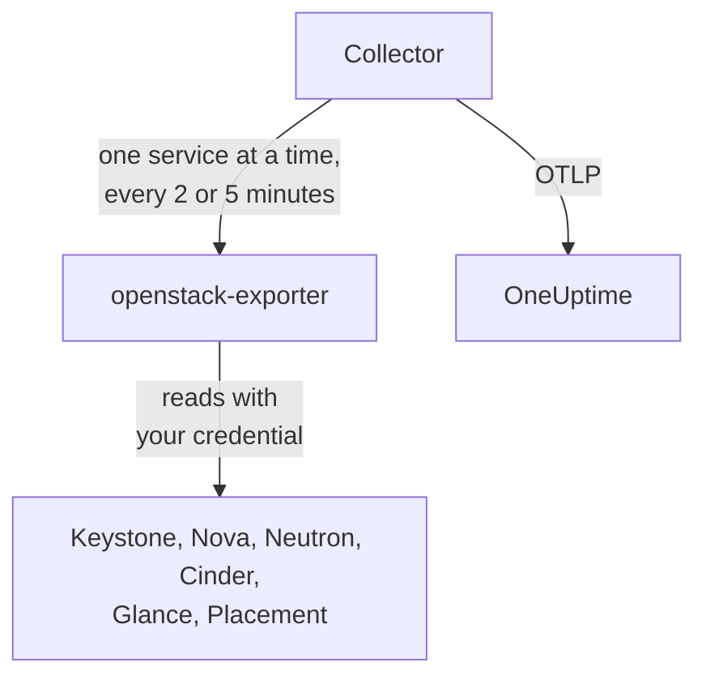

# OpenStack 에이전트

OneUptime OpenStack 에이전트는 OpenStack 클라우드를 모니터링합니다. 모든 리전의 서비스와 에이전트, 하이퍼바이저, 인스턴스, 네트워크, 라우터, 볼륨, 스토리지 풀, 이미지, 프로젝트가 대상입니다. 사용자가 선택한 자격 증명으로 클라우드의 API를 읽고, 찾아낸 내용을 OneUptime으로 보냅니다. 그러면 OneUptime에 해당 클라우드가 리전, 하이퍼바이저, 프로젝트와 함께 표시됩니다. [OpenStack 모니터](/docs/monitor/openstack-monitor)는 들어오는 데이터를 기준으로 알림을 보내며, [프로브](/docs/telemetry/openstack-agentless)를 사용하면 아무것도 설치하지 않고 클라우드를 수집할 수 있습니다.

:::cards
- [프로브와 에이전트 중 무엇을 쓸까요?](/docs/telemetry/openstack-agentless#프로브와-에이전트-중-무엇을-쓸까요): 둘 중 어느 쪽이든 쓸 수 있는 클라우드에서 어느 것을 고를지 안내합니다.
- [에이전트가 볼 범위 선택](#에이전트가-볼-범위-선택): OpenStack에는 전역 읽기 전용 역할이 없어서 세 단계가 있습니다.
- [에이전트 설치](#에이전트-설치): 자격 증명을 만든 뒤 설치 스크립트, Docker Compose, 또는 Docker 없이 설치합니다.
- [클라우드에 드는 부하](#클라우드에-드는-부하): 각 설정이 읽는 항목과 변경 방법입니다.
- [용량](#용량): 각 플레이버를 몇 개 더 만들 수 있는지, 각 항목이 가득 차기까지 며칠 남았는지 보여 줍니다.
- [지출](#지출): 누가 무엇을 쓰는지, 설정한 가격 또는 CloudKitty 등급 기준으로 얼마인지, 무엇을 회수할 수 있는지 보여 줍니다.
- [상태 페이지와 프로젝트별 알림](#상태-페이지와-프로젝트별-알림): 한 번에 리전별 페이지를 만들고, 장애가 영향을 주는 프로젝트에만 알립니다.
- [서비스 로그](#서비스-로그): 파싱된 로그와 서비스 간 요청 추적입니다.
- [라이프사이클 이벤트](#라이프사이클-이벤트): 알림 또는 프로브에서 가져온 인스턴스 작업을 피드와 차트에 표시합니다.
- [누가 무엇을 했는가](#누가-무엇을-했는가): 감사 기록을 보안 이벤트로 가져옵니다.
- [요청 추적](#컨트롤-플레인-요청-추적): 서명된 요청 하나를 컨트롤 플레인 전체에서 추적합니다.
- [외부에서 점검](#외부에서-클라우드-점검): 클라우드 외부의 프로브로, 실제로 인스턴스를 부팅할 수 있는지 확인합니다.
- [인터넷 없이 사용](#인터넷-없이-사용): 에이전트의 이미지 네 개와, 이를 자체 레지스트리로 복사하는 방법입니다.
- [배포 도구별 안내](/docs/telemetry/openstack-deployment-tools): Kolla-Ansible, OpenStack-Ansible, OpenStack-Helm, Atmosphere, Sunbeam, Red Hat, Mirantis.
- [문제 해결](#문제-해결): 진단 스크립트와 자주 겪는 문제입니다.
:::

## 작동 방식

에이전트는 고정된 버전의 업스트림 프로그램 두 개와 그 설정으로 이루어지며, 한 대의 머신에서 실행됩니다. [openstack-exporter](https://github.com/openstack-exporter/openstack-exporter)가 클라우드의 API를 읽어 `openstack_*` 시리즈로 변환하고, OpenTelemetry Collector가 OpenStack 서비스를 하나씩 요청해 각 시리즈에 출처 클라우드와 리전을 표시한 뒤 OneUptime으로 보냅니다. 컨트롤러나 컴퓨트 노드에서는 아무것도 실행되지 않습니다. 단, 해당 노드의 로그를 읽는 선택 사항인 [logs 프로필](#서비스-로그)을 추가한 경우는 예외입니다.



클라우드는 첫 데이터가 도착하면 스스로 등록되며, 이름은 에이전트가 모든 메트릭에 `openstack.cloud.name`으로 붙이는 값입니다. 에이전트 하나는 클라우드 하나, 즉 리전이 하나이든 여러 개이든 Keystone 하나를 감시합니다.

## 시작하기 전에

- Docker Compose v2 플러그인이 있는 Docker Engine 20.10 이상. Docker 없이 실행하려면 systemd 235 이상, glibc 2.34 이상(RHEL 9, Ubuntu 22.04, Debian 12)을 갖춘 Linux 머신(x86_64 또는 arm64)과 root 권한이 필요합니다.
- 해당 머신에서 Keystone과 각 서비스의 공개 엔드포인트로 가는 경로.
- 아래 자격 증명을 만들 수 있는 사용자 권한의 `openstack` 명령줄 도구.
- 수집 키. **프로젝트 설정 → 텔레메트리 및 APM → 수집 키** 에서 만들고 값을 복사하세요.
- 해당 머신에서 OneUptime URL로 나가는 HTTPS 연결.

### 에이전트를 실행할 위치

에이전트는 감시 대상 클라우드 밖에서 실행하세요. 별도 하드웨어의 소형 VM, 관리 호스트, 다른 클라우드 등이 적합합니다. 장애가 난 클라우드 안에 있는 에이전트는 클라우드와 함께 조용해지고, 그 침묵은 보고를 멈춘 정상 클라우드처럼 보입니다.

## 에이전트가 볼 범위 선택

OpenStack에는 전역 읽기 전용 역할이 없으며, 이것이 OpenStack 모니터링에서 가장 어려운 점입니다.

- `reader`는 Keystone과 Ironic을 제외한 모든 곳에서 프로젝트 범위로 제한됩니다.
- 하이퍼바이저, 서비스, 에이전트, 풀, Placement는 기본적으로 admin 전용입니다.
- 정책 재정의로는 Neutron이나 Cinder의 전체 프로젝트 목록을 열 수 없습니다. 두 서비스가 자체 코드에서 admin 컨텍스트로 범위를 제한하기 때문입니다.
- Cinder의 서비스와 스토리지 풀은 admin이 아니면 정책을 통과한 뒤에도 Cinder 자체 코드에서 `403`으로 응답합니다. 어떤 재정의로도 이를 열 수 없습니다.
- Neutron과 Cinder는 일반 reader에게 `200`을 반환하면서 그 reader 자신의 프로젝트만 보여 줍니다. 성공한 것처럼 보이지만 그렇지 않습니다.
- Cinder의 `enforce_new_defaults`가 꺼져 있는 경우(Cinder의 기본값) 프로젝트의 어떤 역할이든 그 프로젝트의 볼륨을 만들 수 있으며, `reader`와 `oneuptime_monitoring`도 포함됩니다. Epoxy, Flamingo, Gazpacho에서는 일반 reader와 실제 프로젝트의 역할 모두 볼륨을 만들었습니다(`202`). Hibiscus에서는 둘 다 거부되었는데(`403`), DevStack이 그 릴리스에서만 `enforce_new_defaults`를 켜기 때문입니다. 실제 프로젝트의 읽기 전용 역할은 읽기 전용이 아닙니다.

따라서 세 단계가 있고, 각 단계에는 대가가 따릅니다. 가능하면 첫 번째 단계부터 시작하세요.

| 단계 | 필요한 것 | 볼 수 있는 것 | 볼 수 없는 것 |
| --- | --- | --- | --- |
| **1. 전체 보기** | 자체 프로젝트에서 `admin` 권한을 가진 계정의 애플리케이션 자격 증명. 액세스 규칙으로 읽기만 하도록 제한하고, 각 서비스에 `service_type`을 설정 | 에이전트가 수행하는 모든 읽기, 그리고 이 단계에서만 보이는 `cinder-volume`과 `cinder-scheduler` 상태 및 스토리지 풀 | Keystone의 사용자와 그룹(의도적으로 제외). 쓰기는 불가: 모든 쓰기가 `401`로 응답 |
| **2. 인프라만** | 아무것도 없고 할당량이 없는 자체 프로젝트의 `oneuptime_monitoring` 및 `reader` 역할, 그리고 에이전트가 제공하는 정책 재정의 | Keystone의 모든 프로젝트, 도메인, 서비스, 엔드포인트, 모든 프로젝트의 서버를 포함한 Nova 전체, Placement 전체, Neutron의 에이전트와 IP 가용성 | Neutron의 네트워크, 서브넷, 라우터, 유동 IP, 포트와 Cinder의 볼륨 및 스냅샷은 자기 프로젝트 것만 보이므로, 빈 프로젝트에서는 공유 및 외부 항목만 보입니다. `cinder-volume`, `cinder-scheduler` 상태와 스토리지 풀은 볼 수 없습니다. 쓰기는 불가: 모든 쓰기가 `403`으로 응답하거나 할당량 때문에 `409`와 `413`으로 응답 |
| **3. 프로젝트 보기** | 다른 사람이 운영하는 클라우드에서 자기 팀 영역만 감시하는 경우, 실제 프로젝트의 일반 `reader` | Cinder와 Neutron에서 가져온 해당 프로젝트의 볼륨, 네트워크, 라우터 | 모든 인프라: 하이퍼바이저, 서비스, 에이전트, 풀, 용량이 없습니다. 에이전트를 통해서는 인스턴스도 볼 수 없는데, exporter의 전체 프로젝트 읽기가 거부되기 때문입니다. 그리고 많은 클라우드에서 `reader`가 그곳에 쓸 수 있습니다 |

**Block Storage Service Down**, **Storage Pool Warning**, **Storage Pool Critical** 템플릿은 1단계가 필요합니다. **Compute Service Down**, **Network Agent Down**, 그리고 Placement 및 하이퍼바이저 템플릿은 1단계 또는 2단계가 필요하며, 3단계에서는 인스턴스를 전혀 읽지 못합니다.

### 각 단계가 읽는 항목

실제 클라우드 다섯 곳(Epoxy, Flamingo, Gazpacho(OVN 및 OVS), Hibiscus)이 응답한 내용입니다. 각 셀은 그 기록을 바탕으로 작성했습니다.

| 읽기 | 1단계: 전체 보기 | 2단계: 인프라만 | 3단계: 프로젝트 보기 |
| --- | --- | --- | --- |
| Keystone: 프로젝트 | 전부 | 전부 | 거부됨 |
| Keystone: 도메인 | 전부 | 전부 | 거부됨 |
| Keystone: 리전 | 전부 | 누구나 보는 범위 | 누구나 보는 범위 |
| Keystone: 서비스 | 전부 | 전부 | 거부됨 |
| Keystone: 엔드포인트 | 전부 | 전부 | 거부됨 |
| Nova: 서버, 모든 프로젝트 | 전부 | 전부 | 거부됨 |
| Nova: 서비스 | 전부 | 전부 | 거부됨 |
| Nova: 하이퍼바이저 | 전부 | 전부 | 거부됨 |
| Nova: 집합체 | 전부 | 전부 | 거부됨 |
| Nova: 가용 영역, 상세 | 전부 | 전부 | 거부됨 |
| Nova: 플레이버 | 전부 | 누구나 보는 범위 | 누구나 보는 범위 |
| Nova: 프로젝트별 사용량 | 전부 | 전부 | 거부됨 |
| Placement: 리소스 공급자 | 전부 | 전부 | 거부됨 |
| Neutron: 에이전트 | 전부 | 전부 | 없음 |
| Neutron: 네트워크 | 전부 | 자기 프로젝트만 | 자기 프로젝트만 |
| Neutron: 서브넷 | 전부 | 자기 프로젝트만 | 자기 프로젝트만 |
| Neutron: 라우터 | 전부 | 자기 프로젝트만 | 자기 프로젝트만 |
| Neutron: 유동 IP | 전부 | 자기 프로젝트만 | 자기 프로젝트만 |
| Neutron: IP 가용성 | 전부 | 전부 | 없음 |
| Neutron: 보안 그룹 | 전부 | 409, 예상된 결과 | 자기 프로젝트만 |
| Neutron: 포트 | 전부 | 자기 프로젝트만 | 자기 프로젝트만 |
| Neutron: 할당량 | 전부 | 거부됨 | 거부됨 |
| Cinder: 볼륨, 모든 프로젝트 | 전부 | 자기 프로젝트만 | 자기 프로젝트만 |
| Cinder: 서비스 | 전부 | 거부됨 | 거부됨 |
| Cinder: 풀 | 전부 | 거부됨 | 거부됨 |
| Cinder: 스냅샷, 모든 프로젝트 | 전부 | 자기 프로젝트만 | 자기 프로젝트만 |
| Cinder: 백업, 모든 프로젝트 | 전부 | 기록된 항목 없음 | 기록된 항목 없음 |
| Cinder: 볼륨 유형 | 전부 | 누구나 보는 범위 | 누구나 보는 범위 |
| Glance: 이미지 | 전부 | 누구나 보는 범위 | 누구나 보는 범위 |

- **모든**: admin이 본 것과 같은 행입니다.
- **자기 프로젝트만**: 해당 프로젝트의 행과, 공유되었거나 외부인 항목입니다. 아무것도 없는 프로젝트에서는 공유 및 외부 항목만 보입니다.
- **거부됨**: `401` 또는 `403`.
- **누구나 보는 범위**: 공개 플레이버, 볼륨 유형, 이미지만 있는 클라우드에서 모든 자격 증명이 모든 행을 보았습니다. 다른 프로젝트의 비공개 항목은 1단계가 필요합니다.
- **없음**: 네트워크가 있는 프로젝트에서도 행 없이 `200`이 반환되었습니다. 성공한 것처럼 보이지만 그렇지 않습니다.
- **기록된 항목 없음**: admin도 행을 보지 못한 상태에서 행 없이 `200`이 반환되어, 구별할 근거가 없었습니다.
- **409, 예상된 결과**: Neutron은 보안 그룹을 나열할 때 프로젝트의 기본 보안 그룹을 만들려고 하는데, 할당량이 0이라 만들 수 없으므로 `409 Quota exceeded`로 응답합니다. 무해하며 고칠 필요가 없습니다.

Octavia, Ironic, Heat, Magnum, Manila, Designate, Barbican, Swift, Trove, Gnocchi는 해당 클라우드가 실행하지 않아 여기에 없습니다. [진단 스크립트](#문제-해결)는 클라우드가 실행하는 경우 이들에도 질의하며, 실제 자격 증명으로 모든 경로를 읽고 그 자격 증명이 볼 수 있는 범위를 알려 줍니다.

각 단계에서 에이전트의 exporter가 서비스별로 받은 시리즈 수입니다. 개수는 질의 시점에 클라우드가 보유한 항목에 따라 달라지므로, 서로 비교하되 사용자의 클라우드와 비교하지는 마세요.

| Exporter 서비스 | Admin | 1단계: 전체 보기 | 2단계: 인프라만 | 3단계: 프로젝트 보기 |
| --- | --- | --- | --- | --- |
| identity | 14 | 13 | 13 | 4 |
| compute | 33 | 33 | 33 | 15 |
| placement | 25 | 25 | 25 | 1 |
| network | 36~40 | 36~40 | 24~26 | 14 |
| volume | 33 | 33~41 | 23 | 29~37 |
| image | 4 | 4 | 4 | 4 |

## 에이전트 설치

모든 OneUptime은 자기 릴리스에 맞는 에이전트 설치 스크립트와 파일을 제공합니다. 아래 명령은 `https://oneuptime.com`에서 내려받으므로, 셀프 호스팅 OneUptime에서는 이를 사용자의 URL로 바꾸세요. 설치 스크립트는 먼저 `install.sh`로 저장하므로, 실행하기 전에 내용을 읽어 볼 수 있습니다.

:::steps
### 자격 증명 만들기

선택한 단계에 맞게 진행하세요. 각 단계는 애플리케이션 자격 증명을 만들고, `id`와 `secret`이 출력됩니다. secret은 한 번만 표시됩니다. 만료 시점을 지정하고, 자격 증명을 추가로 만들 수 있게 되는 `--unrestricted`는 절대 사용하지 마세요.

:::tabs
@tab Level 1: Full view
admin 권한으로 에이전트용 프로젝트와 계정을 만듭니다.

```bash
openstack project create --domain default oneuptime-monitoring
openstack user create --domain default --password-prompt oneuptime-monitoring
openstack role add --project oneuptime-monitoring --user oneuptime-monitoring admin
```

그런 다음 그 계정으로 그 프로젝트에 로그인한 상태에서 자격 증명을 만듭니다. 규칙은 에이전트가 사용하는 정확한 `GET` 경로이며, 사용자의 클라우드에 맞게 조정됩니다.

```bash
curl -fsSLO https://oneuptime.com/install/openstack-agent/access/application-credential-access-rules.json
curl -fsSLO https://oneuptime.com/install/openstack-agent/access/access-rules-for-cloud.py
openstack catalog list -f json | python3 access-rules-for-cloud.py \
  application-credential-access-rules.json > access-rules-for-this-cloud.json
openstack application credential create oneuptime-agent \
  --role admin \
  --access-rules "$(cat access-rules-for-this-cloud.json)" \
  --expiration 2027-11-01T00:00:00
```

액세스 규칙은 서비스가 보는 경로와 대조됩니다. `https://cloud.example/compute/v2.1`처럼 경로 접두사 뒤에 있는 서비스는 `/compute/v2.1/servers`를 보게 되므로, 기본 제공되는 `/v2.1/servers` 규칙을 `401`로 거부합니다. `access-rules-for-cloud.py`는 카탈로그에서 읽은 서비스 접두사 아래에 각 규칙을 한 번 더 추가합니다.

exporter의 읽기 중 두 가지는 직접 작성하면 놓치기 쉬운 규칙이 필요합니다. 첫째, Octavia의 루트를 가장 먼저 읽는데, Apache 뒤에서는 서비스가 이를 슬래시 두 개가 있는 `/load-balancer//`로 인식합니다. 거부되면 exporter는 빈 `200`을 반환하므로 클라우드가 Octavia를 실행하지 않는 것처럼 보입니다. 둘째, Swift의 계정을 끝에 슬래시를 붙여 나열하는데 `/v1/*`는 이와 일치하지 않습니다. 거부되면 `openstack_object_store_up`이 `0`으로 읽힙니다. 조정된 규칙에는 둘 다 들어 있습니다. 자격 증명의 규칙은 바꿀 수 없으므로, 이전 사본으로 만들었다면 새로 만드세요.

또한 액세스 규칙을 쓰려면 각 서비스에서 keystonemiddleware용 `service_type`을 설정하고 해당 서비스를 재시작해야 합니다. 설정하지 않으면 서비스가 자격 증명을 `401`로 거부합니다.

```ini title="nova.conf"
[keystone_authtoken]
service_type = compute
```

| 설정 파일 | `service_type` |
| --- | --- |
| `nova.conf` | `compute` |
| `neutron.conf` | `network` |
| `cinder.conf` | `block-storage`. 규칙에는 그렇게 설정된 Cinder를 위해 `volume`과 `volumev3`도 들어 있습니다 |
| `glance-api.conf` | `image` |
| `placement.conf` | `placement` |
| `octavia.conf` | `load-balancer` |
| `ironic.conf` | `baremetal` |
| `heat.conf` | `orchestration` |
| `magnum.conf` | `container-infra` |
| `manila.conf` | `sharev2`. 규칙에는 그렇게 설정된 Manila를 위해 `shared-file-system`도 들어 있습니다 |
| `designate.conf` | `dns` |
| `barbican.conf` | `key-manager` |
| `trove.conf` | `database` |
| `gnocchi.conf` | `metric` |
| `cloudkitty.conf` | `rating` |
| `proxy-server.conf`, `[filter:authtoken]` 아래 | `object-store`, 그리고 그 옆에 `include_service_catalog = True`. keystonemiddleware는 규칙을 토큰의 카탈로그와 대조하므로, DevStack이 설정하는 `False`에서는 Swift가 자격 증명에 `500`으로 응답합니다 |

클라우드가 실행하는 서비스에만 한 줄이 필요합니다.

클라우드가 실행하지 않을 수도 있는 서비스에서는, 실제 클라우드에서 각 단계가 얻은 결과가 위의 표와 네 가지 점에서 다릅니다.

- **Ironic**은 프로젝트의 자격 증명(admin 것도 마찬가지)에 그 프로젝트가 소유한 노드만 응답하고 conductor는 거부합니다. 모든 노드와 conductor를 읽는 것은 시스템 범위뿐인데, 에이전트의 자격 증명은 프로젝트에 속합니다. 이 자격 증명으로 노드를 읽으려면 해당 프로젝트를 소유자로 지정하세요: `openstack baremetal node set --owner`.
- **Swift**는 자격 증명 자신의 프로젝트 컨테이너만 나열하고 다른 프로젝트의 것은 나열하지 않습니다. 자격 증명에 `ResellerAdmin`이 없으면 다른 프로젝트의 계정은 `403`으로 응답합니다.
- **Barbican**은 자격 증명에 대해 자기 프로젝트 정보만 응답하며 일반 reader는 거부합니다. OneUptime은 어떤 시크릿도 읽지 않습니다.
- **Gnocchi**는 프로젝트의 어떤 역할이든 메트릭을 만들 수 있게 하므로, Gnocchi를 실행하는 클라우드에서는 2단계와 3단계에서 쓰기가 가능합니다.

Keystone은 아무것도 필요하지 않습니다. 규칙을 조정하고, `service_type`을 설정하고, API를 재시작하면 기록된 모든 릴리스에서 모든 읽기는 `200`, 모든 쓰기는 `401`로 응답했습니다. exporter는 Keystone의 사용자와 그룹(의도적으로 제외)을 빼면 admin이 얻는 것과 같은 결과를 얻습니다. 클라우드가 실행하지 않을 수도 있는 서비스도 마찬가지입니다. DevStack에서 기록한 바로는, 1단계는 exporter가 읽는 각 서비스에서 admin 자격 증명과 같은 시리즈를 얻었고 모든 쓰기는 `401`로 응답했습니다.

이 변경을 하지 않으려면 `--access-rules` 없이 같은 자격 증명, 즉 일반 admin 애플리케이션 자격 증명을 만드세요. 작동하지만 쓰기도 가능하므로, 진단 스크립트가 그렇게 표시합니다.
@tab Level 2: Infrastructure only
admin 권한으로 역할, 아무것도 없고 할당량이 0인 프로젝트, 계정을 만듭니다.

```bash
openstack role create oneuptime_monitoring
openstack project create --domain default --description "OneUptime monitoring: holds nothing" oneuptime-monitoring
openstack quota set --instances 0 --cores 0 --ram 0 --key-pairs 0 oneuptime-monitoring
openstack quota set --volumes 0 --gigabytes 0 --snapshots 0 --backups 0 --backup-gigabytes 0 oneuptime-monitoring
openstack quota set --networks 0 --subnets 0 --ports 0 --routers 0 --floating-ips 0 --secgroups 0 --secgroup-rules 0 oneuptime-monitoring
openstack user create --domain default --password-prompt oneuptime-monitoring
openstack role add --project oneuptime-monitoring --user oneuptime-monitoring oneuptime_monitoring
openstack role add --project oneuptime-monitoring --user oneuptime-monitoring reader
```

프로젝트에 아무것도 없고 할당량이 0인 것은 의도적입니다. Cinder의 `enforce_new_defaults`가 꺼져 있으면 프로젝트의 어떤 역할이든 그 프로젝트의 볼륨을 만들 수 있습니다. 건드릴 것도 없고 무언가를 만들 할당량도 없으면 쓸 수 있는 것이 없습니다. 기록된 모든 릴리스에서 모든 쓰기는 `403`으로 응답하거나 할당량 때문에 `409`와 `413`으로 응답했습니다.

정책 재정의를 내려받아, 모든 컨트롤러에서 각 파일을 해당 서비스 설정의 `[oslo_policy] policy_file`이 가리키는 파일에 병합하세요(`nova.conf`, `neutron.conf` 등). 배포 환경에서 달리 지정하지 않는 한 `/etc/nova/policy.yaml` 등이며, DevStack은 `policy.json`을 지정합니다. 각 규칙은 서비스의 기본값을 유지하면서 역할을 추가하고, oslo.policy는 변경된 파일을 스스로 감지하므로 재시작이 필요하지 않습니다.

```bash
curl -fsSLO https://oneuptime.com/install/openstack-agent/access/policy/nova.yaml
curl -fsSLO https://oneuptime.com/install/openstack-agent/access/policy/neutron.yaml
curl -fsSLO https://oneuptime.com/install/openstack-agent/access/policy/keystone.yaml
curl -fsSLO https://oneuptime.com/install/openstack-agent/access/policy/placement.yaml
```

Cinder용 파일은 없습니다. Cinder의 `os-services`와 `scheduler-stats/get_pools`는 기록된 클라우드 다섯 곳 모두에서 이 역할에 `403 User does not have admin privileges`로 응답합니다. 정책을 통과한 뒤 Cinder 자체 코드가 admin 컨텍스트를 요구하기 때문이므로, 어떤 재정의로도 열 수 없습니다.

**재정의를 다시 제거하려면 파일을 비우고(`{}`) 절대 삭제하지 마세요.** Flamingo(2025.2)와 Epoxy(2025.1)에서는 oslo.policy가 이미 읽은 정책 파일이 사라지면 모든 검사에서 예외를 발생시키므로, 해당 서비스가 모든 요청에 실패합니다. 그 서비스가 Keystone이면 토큰 검증이 중단되어 클라우드 전체가 `503`으로 응답합니다. 이미 그렇게 되었다면 서비스를 재시작하세요.

그런 다음 그 계정으로 그 프로젝트에 로그인한 상태에서 자격 증명을 만듭니다.

```bash
openstack application credential create oneuptime-agent --expiration 2027-11-01T00:00:00
```

볼륨과 라우터를 보려고 실제 프로젝트에 역할을 부여하면, Cinder의 `enforce_new_defaults`가 꺼져 있는 클라우드에서는 그 계정이 거기에 쓸 수도 있게 됩니다. 자격 증명의 프로젝트에 항목이 있으면 진단 스크립트가 경고합니다.
@tab Level 3: Project view
계정에 해당 프로젝트의 일반 `reader` 역할을 부여한 다음, 그 계정으로 그 프로젝트에 로그인한 상태에서 자격 증명을 만듭니다.

```bash
openstack role add --project my-team --user my-monitoring-account reader
openstack application credential create oneuptime-agent --expiration 2027-11-01T00:00:00
```

에이전트는 Cinder와 Neutron에서 해당 프로젝트의 행만 보고 인프라는 보지 못합니다. 이 방식을 선택하기 전에 알아 둘 점이 세 가지 있습니다.

- **에이전트를 통해서는 인스턴스가 전혀 보이지 않습니다.** exporter가 Nova에 모든 프로젝트의 서버를 요청하는데 Nova가 일반 reader를 거부하여 그 읽기 전체가 실패합니다. 이 에이전트 없이 수집하는 OneUptime 프로브만 프로젝트 하나의 인스턴스를 나열할 수 있습니다.
- **쓰기가 가능할 수 있습니다.** Cinder의 `enforce_new_defaults`가 꺼져 있는 클라우드에서는 일반 `reader`도 자기 프로젝트에 볼륨을 만들 수 있습니다. Epoxy, Flamingo, Gazpacho에서는 만들었고(`202`), Hibiscus에서는 거부되었는데(`403`) DevStack이 그 릴리스에서만 `enforce_new_defaults`를 켜기 때문입니다. Cinder 자체의 기본값은 꺼짐입니다.
- **Placement가 응답하지 않는 것으로 읽힙니다.** Placement에 하는 모든 호출이 거부되고, exporter는 이를 Placement가 중지된 경우와 같은 방식으로 보고합니다. 기록된 클라우드 다섯 곳 모두에서 `openstack_placement_up 0`입니다. 페이지는 이 자격 증명에 막혀 있는 다른 항목을 근거로 이를 구별해 안내합니다. 그러나 [Placement API Down](/docs/monitor/openstack-monitor#사전-구성-알림-템플릿) 템플릿은 구별하지 못하므로, 이 단계에서는 그 템플릿을 제외하세요.
:::

### 에이전트 설치 및 시작

:::tabs
@tab install.sh
설치 스크립트를 내려받아 에이전트를 실행할 머신에서 실행하세요.

```bash
curl -fsSL https://oneuptime.com/install/openstack-agent -o install.sh
bash install.sh
```

스크립트는 OneUptime URL, 수집 키, 클라우드의 고정된 이름, Keystone 인증 URL, 리전 이름, 애플리케이션 자격 증명(사용하지 않겠다고 하면 사용자 이름과 비밀번호), 그리고 클라우드에 자체 인증 기관이 있으면 비공개 CA 파일을 묻습니다. 비밀 값은 화면에 출력되지 않고 명령줄에도 노출되지 않습니다. 아무것도 쓰거나 시작하기 전에 Keystone으로 자격 증명을 확인하고, `/opt/oneuptime-openstack-agent`에 설치합니다. `/opt`에 권한이 없으면 홈 폴더의 `oneuptime-openstack-agent`에 설치하며(`docker` 그룹만 있으면 됩니다), `.env`와 `clouds.yaml`을 `0600` 모드로 쓰고 Docker Compose로 에이전트를 시작합니다. 모든 답은 환경 변수로도 지정할 수 있고, 스크립트를 다시 실행하면 다시 묻지 않고 그 값을 재사용합니다. 이것이 [에이전트를 업그레이드](#에이전트-업그레이드)하는 방법입니다.
@tab Docker Compose
OneUptime에서 `docker-compose.yml`과 `otel-collector-config.yaml`을 새 폴더로 내려받으세요.

```bash
mkdir oneuptime-openstack-agent && cd oneuptime-openstack-agent
curl -fsSLO https://oneuptime.com/install/openstack-agent/docker-compose.yml
curl -fsSLO https://oneuptime.com/install/openstack-agent/otel-collector-config.yaml
```

같은 폴더에 `clouds.yaml`을 만들고 리전마다 항목을 하나씩 두되 **이름은 리전 이름으로** 지정하세요. exporter의 시리즈에는 어느 리전에서 왔는지 표시되지 않으므로, collector가 항목 이름을 `openstack.region.name`으로 붙입니다.

```yaml title="clouds.yaml"
clouds:
  RegionOne:
    region_name: RegionOne
    identity_api_version: 3
    auth_type: v3applicationcredential
    auth:
      auth_url: https://keystone.example.com:5000/v3
      application_credential_id: your-credential-id
      application_credential_secret: your-credential-secret
```

그런 다음 `.env` 파일을 만듭니다.

```bash title=".env"
ONEUPTIME_URL=YOUR_ONEUPTIME_URL
ONEUPTIME_TELEMETRY_INGESTION_KEY=YOUR_TELEMETRY_INGESTION_TOKEN
OPENSTACK_CLOUD_NAME=my-cloud
OPENSTACK_EXPORTER_CLOUDS=[RegionOne,RegionTwo]
COMPOSE_PROFILES=openstack-exporter,openstack-ai-agent
```

`OPENSTACK_EXPORTER_CLOUDS`에는 모든 리전을 대괄호 안에 나열하고, `COMPOSE_PROFILES`는 번들 exporter와 [AI 에이전트](#ai-에이전트)를 시작합니다. 두 파일 모두 비밀 값을 담고 있습니다. exporter는 uid 65532로 실행되며, `clouds.yaml`을 읽을 수 있는 유일한 계정이어야 합니다. 에이전트를 시작하세요.

```bash
chmod 600 .env
sudo chown 65532:65532 clouds.yaml
sudo chmod 600 clouds.yaml
docker compose up -d
```
@tab Without Docker
systemd 235 이상과 glibc 2.34 이상을 갖춘 Linux(x86_64 또는 arm64)에서는 설치 스크립트가 같은 두 프로그램의 업스트림 릴리스를 systemd 서비스로 실행합니다. RHEL 8과 그 계열은 glibc가 더 오래되어 exporter 릴리스가 실행되지 않습니다. 이 경우 스크립트가 그렇게 알려 주고 아무것도 변경하지 않으므로, 그곳에서는 Docker를 사용하세요.

```bash
curl -fsSL https://oneuptime.com/install/openstack-agent -o install.sh
sudo bash install.sh --without-docker
```

질문, Keystone 확인, 파일은 동일합니다. 각 릴리스 아카이브는 `install.sh`에 고정된 sha256과 대조되며, 일치하지 않는 다운로드는 아무것도 바뀌기 전에 설치를 중단시킵니다. collector는 OpenStack 자격 증명을 볼 수 없는 일회용 비특권 사용자로 실행되고, exporter는 `oneuptime-openstack` 시스템 사용자로 실행됩니다. 이 사용자가 `clouds.yaml`을 읽을 수 있는 유일한 계정이며 `127.0.0.1:9180`에서만 수신 대기합니다.

클라우드마다 에이전트 하나만 실행하세요. Docker 설치에서 옮겨 올 때는 먼저 `docker compose down`을 실행하세요. 그러지 않으면 모든 메트릭이 두 번씩 도착합니다.
:::

이미 `--multi-cloud`로 openstack-exporter를 실행하고 있나요? 에이전트가 그것을 가리키게 하면 번들 exporter는 시작되지 않습니다. `OPENSTACK_EXPORTER_ADDRESS=10.0.0.5:9180 bash install.sh`를 실행하거나, `.env`에서 `COMPOSE_PROFILES`를 빼고 `OPENSTACK_EXPORTER_ADDRESS`를 설정하세요. 해당 exporter의 `clouds.yaml`에는 리전마다 그 이름의 항목이 필요하며, 번들 exporter가 끄는 항목을 같이 꺼야 합니다. [클라우드에 드는 부하](#클라우드에-드는-부하)를 참고하세요. 에이전트의 컨테이너가 접근할 수 있는 주소를 사용하세요. `localhost`는 컨테이너 자신입니다.

Kolla-Ansible의 exporter는 `--multi-cloud` 없이 실행되므로 `/probe`가 없고, 더 적은 정보를 제공하는 릴리스에 고정되어 있습니다. [이미 실행 중인 exporter 사용](/docs/telemetry/openstack-deployment-tools#이미-실행-중인-익스포터-사용)에서 읽는 방법과 페이지에서 빠지는 항목을 정확히 안내합니다. [배포 도구별 OpenStack](/docs/telemetry/openstack-deployment-tools)에 각 도구의 나머지 단계가 있습니다.

### 에이전트 실행 확인

```bash
cd /opt/oneuptime-openstack-agent    # or the folder the script said it installed to
docker compose ps
docker logs oneuptime-openstack-agent
```

`docker compose ps`는 collector(`oneuptime-openstack-agent`), 번들 exporter(`oneuptime-openstack-exporter`), [AI 에이전트](#ai-에이전트)(`oneuptime-openstack-ai-agent`)를 보여 줍니다. collector가 시작되면 로그에 다음 줄이 표시되어야 합니다.

```text
Everything is ready. Begin running and processing data.
```

Docker 없이 설치했다면 `systemctl status oneuptime-openstack-agent oneuptime-openstack-exporter`와 `journalctl -u oneuptime-openstack-agent`로 확인하세요.

### OneUptime에서 클라우드 찾기

**제품 → 인프라 → OpenStack**을 엽니다. 클라우드는 첫 수집 후 몇 분 안에 `OPENSTACK_CLOUD_NAME` 이름으로 나타납니다. 컴퓨트, 네트워크, 볼륨, Placement는 2분마다, identity와 이미지는 5분마다 읽습니다.
:::

클라우드의 **개요**에서 데이터가 OneUptime에 도달하고 있는지, 무엇을 먼저 확인해야 하는지, 각 서비스가 어떤 상태인지 확인할 수 있습니다.


**하이퍼바이저**에서는 각 컴퓨트 호스트에 대해 Nova와 Placement가 약속한 내용을 보여 줍니다.


**인스턴스**에는 모든 인스턴스가 Nova 자체의 상태 표기, 프로젝트, 플레이버, 하이퍼바이저와 함께 나열됩니다.


## 환경 변수

설치 스크립트는 이 값을 `/opt/oneuptime-openstack-agent/.env`에 씁니다. Docker Compose 설치는 `docker-compose.yml` 옆의 `.env`에서 읽습니다. 값을 변경한 후에는 해당 폴더에서 `docker compose up -d`를 실행하거나, Docker 없이 설치했다면 `sudo systemctl restart oneuptime-openstack-agent`를 실행하세요. 자격 증명은 `clouds.yaml`에만 있습니다.

| 변수 | 필수 | 설명 |
| --- | --- | --- |
| `ONEUPTIME_URL` | 예 | `https://oneuptime.com` 또는 셀프 호스팅 인스턴스 등 OneUptime URL. |
| `ONEUPTIME_TELEMETRY_INGESTION_KEY` | 예 | **프로젝트 설정 → 텔레메트리 및 APM → 수집 키** 의 수집 키. |
| `OPENSTACK_CLOUD_NAME` | 예 | OneUptime에서 사용할 클라우드 이름으로, 모든 메트릭에 `openstack.cloud.name` 리소스 속성으로 붙습니다. 고정해 두세요. 바꾸면 새 클라우드가 등록됩니다. 기본값은 `openstack`입니다. |
| `OPENSTACK_AUTH_URL` | 번들 exporter | 설치 스크립트 질문의 답으로, Keystone 인증 URL. 없으면 `/v3`이 추가됩니다. |
| `OPENSTACK_EXPORTER_CLOUDS` | 예 | 대괄호 안의 리전(예: `[RegionOne,RegionTwo]`)이며, 각각 `clouds.yaml` 항목의 이름입니다. 기본값은 `[RegionOne]`입니다. |
| `OPENSTACK_EXPORTER_ADDRESS` | 아니요 | 사용자 자신의 exporter의 `host:port`(스킴 없음). 번들 exporter를 쓰려면 생략하세요. |
| `OPENSTACK_CA_FILE` | 아니요 | 자체 인증 기관이 있는 클라우드의 인증 기관을 담은 PEM 파일. 설치 스크립트는 `clouds.yaml` 옆에 `ca.pem`으로 사본을 보관합니다. |
| `OPENSTACK_EXPORTER_USER` | 아니요 | exporter 컨테이너가 실행되는 `uid:gid`로, `clouds.yaml`을 소유해야 합니다. 기본값은 `65532:65532`입니다. |
| `COMPOSE_PROFILES` | 번들 exporter | `openstack-exporter`는 번들 exporter를, `openstack-ai-agent`는 [AI 에이전트](#ai-에이전트)를 시작합니다. |
| `OPENSTACK_LIBVIRT_EXPORTER_TARGETS` | 아니요 | `prometheus-libvirt-exporter`를 통해 [실제 사용량](#실제-사용량)을 읽어 올 컴퓨트 노드. 대괄호 안에 지정하며 예: `[compute-01:9177,compute-02:9177]`. 기본값은 없음입니다. |
| `OPENSTACK_CEILOMETER_EXPORTER_TARGETS` | 아니요 | Ceilometer 자체 exporter를 통한 같은 용도의 대상. 예: `[compute-01:9101]`. 기본값은 없음입니다. |
| `OPENSTACK_SINGLE_CLOUD_EXPORTER_TARGETS` | 아니요 | Kolla-Ansible의 exporter처럼 `--multi-cloud` 없이 이미 실행 중인 exporter: `[10.0.0.254:9198]`. [이미 실행 중인 exporter 사용](/docs/telemetry/openstack-deployment-tools#이미-실행-중인-익스포터-사용)을 참고하세요. |
| `OPENSTACK_RABBITMQ_TARGETS` | 아니요 | [클라우드의 기반 구성](#클라우드의-기반-구성)을 위해 각 노드의 RabbitMQ Prometheus 플러그인을 지정합니다: `[10.0.0.11:15692,10.0.0.12:15692]`. 기본값은 없음입니다. |
| `OPENSTACK_MARIADB_TARGETS` | 아니요 | 각 MariaDB 노드 옆의 mysqld_exporter. 보통 `9104`입니다. 기본값은 없음입니다. |
| `OPENSTACK_MEMCACHED_TARGETS` | 아니요 | 각 Memcached 옆의 memcached_exporter. 보통 `9150`입니다. 기본값은 없음입니다. |
| `OPENSTACK_HAPROXY_TARGETS` | 아니요 | HAProxy 자체 Prometheus exporter. 기본값은 없음입니다. |
| `OPENSTACK_NETWORK_EXPORTER_TARGETS` | 아니요 | OVN과 Open vSwitch용으로 각 노드의 openstack-network-exporter. 보통 `1981`입니다. 기본값은 없음입니다. |
| `OPENSTACK_LIBVIRT_HEALTH_TARGETS` | 아니요 | libvirt가 응답하는지만 확인하고 인스턴스별 데이터는 읽지 않는, 각 컴퓨트 노드의 prometheus-libvirt-exporter. 보통 `9177`입니다. 기본값은 없음입니다. |
| `OPENSTACK_CONTROL_PLANE_REGION` | 아니요 | 위 대상 중 자기 리전을 밝히지 않은 대상의 리전. 대상이 직접 밝힐 수도 있습니다: `RegionTwo@10.1.0.11:15692`. 기본값은 첫 번째 리전입니다. |
| `OPENSTACK_AGENT_SERVICES` | 아니요 | [에이전트 간 클라우드 분담](/docs/telemetry/openstack-very-large-clouds#수집기-간-클라우드-분담)을 위해 이 에이전트가 읽을 서비스. 예: `compute\|placement`. 기본값은 모든 서비스입니다. |
| `OPENSTACK_AGENT_MEMORY_LIMIT_MIB` | 아니요 | collector가 메모리에 보관할 수 있는 크기. 매우 큰 클라우드의 스크레이프는 기본값 `512`보다 많이 필요합니다. |
| `OPENSTACK_DATABASE_EXPORTER_TARGETS` | 아니요 | [데이터베이스 경로](/docs/telemetry/openstack-very-large-clouds#데이터베이스-경로)용 `openstack_database_exporter`: `[openstack-database-exporter:9180]`. 기본값은 없음입니다. 해당 경로의 나머지 설정은 그 페이지에 있습니다. |

설치 스크립트는 질문을 건너뛰도록 환경에서 자격 증명도 읽습니다. `OPENSTACK_APPLICATION_CREDENTIAL_ID`와 `OPENSTACK_APPLICATION_CREDENTIAL_SECRET`, 또는 `OPENSTACK_USERNAME`, `OPENSTACK_PASSWORD`, `OPENSTACK_PROJECT_NAME`, `OPENSTACK_USER_DOMAIN_NAME`, `OPENSTACK_PROJECT_DOMAIN_NAME`입니다. openrc 파일이 설정하는 `OS_*` 변수가 아니라 별도의 이름을 쓰므로, admin이 source한 openrc가 아무에게도 묻지 않고 에이전트의 자격 증명이 되는 일은 없습니다. 사용자 이름과 비밀번호보다 애플리케이션 자격 증명이 낫습니다. 읽기로 제한할 수 있고 만료되게 할 수 있기 때문입니다.

## 클라우드의 기반 구성

OpenStack 장애의 대부분은 그 아래에서 시작됩니다. RabbitMQ가 사라지거나, Galera가 쿼럼을 잃거나, OVN 데이터베이스에 리더가 없는 경우입니다. 에이전트는 이들이 이미 갖고 있는 exporter를 매분 읽을 수 있으며, 대상을 지정하기 전에는 꺼져 있습니다. 여기서는 어디에도 쓰기를 하지 않고, 각각 몇 개의 시리즈만 보관합니다.

에이전트의 `.env`에 클러스터의 모든 구성원을 하나씩 지정한 다음 `docker compose up -d`를 실행하세요.

```bash
OPENSTACK_RABBITMQ_TARGETS=[10.0.0.11:15692,10.0.0.12:15692,10.0.0.13:15692]
OPENSTACK_MARIADB_TARGETS=[10.0.0.11:9104,10.0.0.12:9104,10.0.0.13:9104]
OPENSTACK_MEMCACHED_TARGETS=[10.0.0.11:9150,10.0.0.12:9150]
OPENSTACK_HAPROXY_TARGETS=[10.0.0.11:9101,10.0.0.12:9101]
OPENSTACK_NETWORK_EXPORTER_TARGETS=[10.0.0.21:1981,10.0.0.22:1981,RegionTwo@10.1.0.21:1981]
OPENSTACK_LIBVIRT_HEALTH_TARGETS=[10.0.0.21:9177,10.0.0.22:9177]
OPENSTACK_CONTROL_PLANE_REGION=RegionOne
```

목록의 마지막 항목처럼 대상이 자기 리전을 직접 밝힐 수 있습니다. 밝히지 않은 대상은 `OPENSTACK_CONTROL_PLANE_REGION`의 리전에 속합니다. Prometheus가 이미 모든 대상을 알고 있는 Kolla-Ansible에서는 `control-plane-targets.py`가 이 줄들을 대신 출력해 주며, 다른 도구에서 각 exporter가 어디에 있는지는 [배포 도구별 OpenStack](/docs/telemetry/openstack-deployment-tools)에 안내되어 있습니다.

각 설정이 읽는 항목과 에이전트가 필요로 하는 것은 다음과 같습니다.

| 설정 | 읽는 항목 | 활성화 방법 |
| --- | --- | --- |
| `OPENSTACK_RABBITMQ_TARGETS` | RabbitMQ 자체 플러그인, `/metrics`와 `/metrics/detailed`의 각 큐 | 각 노드에서 `rabbitmq-plugins enable rabbitmq_prometheus` |
| `OPENSTACK_MARIADB_TARGETS` | 각 노드 옆의 mysqld_exporter. 기본값만으로 이미 Galera를 보고합니다 | exporter 외에는 필요 없음 |
| `OPENSTACK_MEMCACHED_TARGETS` | 각 Memcached 옆의 memcached_exporter | exporter 외에는 필요 없음 |
| `OPENSTACK_HAPROXY_TARGETS` | HAProxy 자체 exporter | 전용 `frontend`에 `http-request use-service prometheus-exporter` |
| `OPENSTACK_NETWORK_EXPORTER_TARGETS` | Open vSwitch 또는 OVN 데이터베이스가 있는 각 머신의 openstack-network-exporter | 기본 collector. 머신은 자신이 실행하는 것을 보고합니다 |
| `OPENSTACK_LIBVIRT_HEALTH_TARGETS` | 각 컴퓨트 노드의 prometheus-libvirt-exporter이며, libvirt가 응답하는지만 확인 | exporter 외에는 필요 없음 |

그러면 클라우드의 **컨트롤 플레인** 카드에 각 항목이 한 줄씩 표시되고, 의존 요소마다 머신별로 한 줄씩 나오는 페이지가 생깁니다. 그 카드의 **감시 안 함**은 대상을 지정하지 않았다는 뜻이며, 정상으로 표시되는 일은 없습니다. 거기서 생기는 문제는 클라우드의 **확인 필요**로 갑니다. 클라우드의 **권장 사항** 페이지에서 [알림 템플릿](/docs/monitor/openstack-monitor#클라우드가-의존하는-것)을 제안하며, `troubleshoot.sh`는 각 대상이 응답하는지와 지정한 것이 맞는지 확인합니다.

클라우드의 상태 확인에 필요한 것보다 RabbitMQ나 데이터베이스를 더 자세히 보려면, [큐](/docs/telemetry/queues)와 [데이터베이스](/docs/telemetry/databases) 제품이 각자의 에이전트를 통해 이를 읽습니다. 데이터 양이 이보다 많고 방식도 별개입니다. 컨트롤 플레인 페이지에서 그곳으로 연결됩니다. 해당 제품은 이 에이전트의 시리즈가 아니라 그 에이전트들의 시리즈를 읽으므로, 설치는 별도입니다.

이 내용을 기록할 때 사용한 openstack-network-exporter 0.3.0 버전에는 알아 둘 점이 두 가지 있습니다.

- **Open vSwitch의 데이터베이스에 한 번만 연결합니다.** Open vSwitch가 재시작된 후에는 exporter도 재시작할 때까지 `ovs_build_info`, 브리지, 인터페이스, ovn-controller의 모든 시리즈가 사라진 채로 남지만, Open vSwitch 자체의 시리즈는 바로 돌아옵니다. **Exporter Lost Open vSwitch's Database**가 이런 상황이 발생했음을 알려 줍니다.
- **머신에서 OVN 데이터베이스 하나의 클러스터 상태만 읽습니다.** Kolla-Ansible처럼 머신에 소켓이 둘 다 있으면 Southbound입니다. 그래서 Northbound의 리더는 Southbound를 읽을 수 없는 머신에서만 표시됩니다.

## 에이전트가 수집하는 항목

collector는 exporter의 `/probe?cloud=<region>&include_services=<service>`를 통해 OpenStack 서비스마다 스크레이프 작업을 하나씩 만들므로, Nova가 실패해도 Nova의 시리즈만 빠집니다.

| 스크레이프 작업 | 주기 | 타임아웃 | 시리즈 |
| --- | --- | --- | --- |
| `oneuptime-openstack-compute` | 2분 | 110초 | `openstack_nova_agent_state`, `openstack_nova_running_vms`, `openstack_nova_vcpus_used`, `openstack_nova_memory_used_bytes`, `openstack_nova_local_storage_used_bytes`, `openstack_nova_total_vms`, `openstack_nova_server_status`, `openstack_nova_flavors`, `openstack_nova_availability_zones` |
| `oneuptime-openstack-network` | 2분 | 110초 | `openstack_neutron_agent_state`, `openstack_neutron_networks`, `openstack_neutron_subnets`, `openstack_neutron_routers`, `openstack_neutron_router`, `openstack_neutron_l3_agent_of_router`, `openstack_neutron_floating_ips`, `openstack_neutron_security_groups`, `openstack_neutron_network_ip_availabilities_total`, `openstack_neutron_network_ip_availabilities_used` |
| `oneuptime-openstack-volume` | 2분 | 110초 | `openstack_cinder_agent_state`, `openstack_cinder_volumes`, `openstack_cinder_volume_gb`, `openstack_cinder_snapshots`, `openstack_cinder_pool_capacity_free_gb`, `openstack_cinder_pool_capacity_total_gb` |
| `oneuptime-openstack-placement` | 2분 | 110초 | `openstack_placement_resource_total`, `openstack_placement_resource_usage`, `openstack_placement_resource_allocation_ratio`, `openstack_placement_resource_reserved` |
| `oneuptime-openstack-identity` | 5분 | 120초 | `openstack_identity_projects`, `openstack_identity_project_info`, `openstack_identity_domains`, `openstack_identity_regions` |
| `oneuptime-openstack-image` | 5분 | 120초 | `openstack_glance_images`, `openstack_glance_image_bytes`, `openstack_glance_image_created_at` |
| `oneuptime-openstack-load-balancer` | 5분 | 120초 | `openstack_loadbalancer_total_loadbalancers`, `openstack_loadbalancer_loadbalancer_status`, `openstack_loadbalancer_total_amphorae`, `openstack_loadbalancer_amphora_status`, `openstack_loadbalancer_total_pools`, `openstack_loadbalancer_pool_status` |
| `oneuptime-openstack-baremetal` | 5분 | 120초 | `openstack_ironic_node`, `openstack_ironic_node_updated_at`, `openstack_ironic_node_provision_updated_at` |
| `oneuptime-openstack-orchestration` | 5분 | 120초 | `openstack_heat_stack_status`, `openstack_heat_stack_status_counter` |
| `oneuptime-openstack-container-infra` | 5분 | 120초 | `openstack_container_infra_total_clusters`, `openstack_container_infra_cluster_masters`, `openstack_container_infra_cluster_nodes`, `openstack_container_infra_cluster_status` |
| `oneuptime-openstack-sharev2` | 5분 | 120초 | `openstack_sharev2_shares_counter`, `openstack_sharev2_share_gb`, `openstack_sharev2_share_status`, `openstack_sharev2_share_status_counter` |
| `oneuptime-openstack-dns` | 5분 | 120초 | `openstack_designate_zones`, `openstack_designate_zone_status`, `openstack_designate_recordsets`, `openstack_designate_recordsets_status` |
| `oneuptime-openstack-object-store` | 5분 | 120초 | `openstack_object_store_objects`, `openstack_object_store_bytes` |
| `oneuptime-openstack-database` | 5분 | 120초 | `openstack_trove_total_instances`, `openstack_trove_instance_status`, `openstack_trove_instance_volume_size_gb`, `openstack_trove_instance_volume_used_gb` |
| `oneuptime-openstack-gnocchi` | 5분 | 120초 | `openstack_gnocchi_status_metricd_processors`, `openstack_gnocchi_status_metric_having_measures_to_process`, `openstack_gnocchi_status_measures_to_process` |

마지막 아홉 개는 클라우드가 실행하지 않을 수도 있는 서비스입니다. 카탈로그에 없는 서비스에 대해 질의하면 exporter는 Keystone에 로그인하고 한 줄(`No suitable endpoint could be found in the service catalog`)을 기록한 뒤 아무것도 반환하지 않으며, 그 클라우드에는 해당 서비스의 흔적이 나타나지 않습니다. 서비스와 리전마다 5분에 한 번 로그인하는 부하이며, 그래서 이들은 모두 5분 주기입니다. 실행하는 서비스만 질의하려면 `OPENSTACK_AGENT_SERVICES`를 설정하세요. 예: `identity|compute|placement|network|volume|image`.

각 서비스는 `openstack_nova_up`처럼 `openstack_<service>_up`도 보고합니다. [OpenStack 모니터](/docs/monitor/openstack-monitor#수집되는-메트릭)에 모든 시리즈와 그 의미가 나와 있습니다. 모든 시리즈에는 다음 속성이 붙습니다.

| 속성 | 의미 |
| --- | --- |
| `openstack.cloud.name` | 클라우드 이름, 리소스 속성 |
| `oneuptime.agent.version` | 에이전트 파일의 버전, 리소스 속성: 파일이 고정한 collector 버전이며, 해당 collector에서 파일이 바뀔 때마다 마지막 숫자가 올라갑니다 |
| `openstack.region.name` | `clouds.yaml` 항목 이름에서 가져온 리전, 각 데이터포인트에 붙음 |
| `openstack_service` | 작업이 담당하는 OpenStack 서비스(`compute`, `network`, ...), 각 데이터포인트에 붙음 |

모니터 필터는 동등 비교로 일치시키므로, 설정을 사용자 지정할 때는 `transform/openstack-identity` 프로세서와, `resource` 프로세서에서 `service.name`과 `service.instance.id`를 삭제하는 두 줄을 유지하세요. 삭제하지 않으면 데이터가 클라우드에 도달하지 않고 유령 Service 인스턴스로 등록됩니다.

## 클라우드에 드는 부하

모니터링이 클라우드를 중단시키는 원인이 되어서는 안 되므로 기본값은 부드럽게 잡혀 있습니다. 스크레이프할 때마다 Keystone에 다시 로그인하고 실제 API 호출을 합니다. [초대형 OpenStack 클라우드](/docs/telemetry/openstack-very-large-clouds)에 규모별로 분당 요청 수와 하루 기가바이트 단위로 그 부하가 나와 있습니다.

| 설정 | 기본값 | 켜거나 바꾸면 얻는 것 | 비용 |
| --- | --- | --- | --- |
| 프로젝트 할당량 | 꺼짐 | 프로젝트가 각 할당량을 얼마나 사용했는지를 프로젝트 페이지와 **확인 필요**에 표시하고, Project Quota Nearly Reached 알림 제공 | 프로젝트마다, 리전마다 시간당 한 번 API 호출 네 번(Nova 한 번, Cinder 두 번, Neutron 한 번). 전용 exporter에서 수행 |
| 느린 메트릭 | 꺼짐 | Nova 자체 할당량 목록과 서버별 사용량 | 스크레이프마다 프로젝트당 호출 한 번이므로 프로젝트 수에 따라 증가 |
| 포트별 시리즈 | 꺼짐 | `openstack_neutron_port`, `openstack_neutron_ports`, `openstack_neutron_ports_no_ips`, `openstack_neutron_ports_lb_not_active` | 모든 포트의 범위 없는 목록 조회. 대규모 클라우드에서는 [Neutron을 포화시켜 연쇄 장애를 일으킬 수 있으므로](https://github.com/openstack-exporter/openstack-exporter/issues/540), 포트 수가 적다는 확신이 없으면 꺼 두세요 |
| 클라우드가 실행하지 않을 수 있는 서비스 | 켜짐 | 클라우드에 있는 경우 로드 밸런서, 베어메탈, 스택, 클러스터, 공유, DNS, 오브젝트 스토리지, 데이터베이스, Gnocchi | 해당 서비스가 없는 클라우드는 5분마다 로그인 한 번을 부담. Designate는 스크레이프마다 영역당 호출 한 번이므로 영역 수에 따라 증가 |
| 스크레이프 주기 | 2분과 5분 | 더 최신의 데이터 또는 더 적은 부하 | 두 배 자주 하면 API 호출도 두 배. 느린 스크레이프가 이전 스크레이프 위에 쌓이지 않도록 각 `scrape_timeout`을 `scrape_interval`보다 작게 유지하세요 |

**프로젝트 할당량:** `OPENSTACK_COLLECT_QUOTAS=true`로 `install.sh`를 다시 실행하세요. Docker Compose 설치에서는 `.env`의 `COMPOSE_PROFILES`에 `openstack-quotas`를 추가하고, `OPENSTACK_QUOTA_CLOUDS`를 `OPENSTACK_EXPORTER_CLOUDS`에 있는 값과 같게 설정하세요. 어느 쪽이든 다른 것은 읽지 않는 두 번째 exporter인 `openstack-quota-exporter`가 시작되고, collector가 한 시간에 한 번 `openstack_nova_limits_*`, `openstack_neutron_quota_*`, `openstack_cinder_limits_*`, `openstack_cinder_volume_type_quota_gigabytes`를 요청합니다. 이 값들은 천천히 바뀌고, exporter는 어느 작업이 요청하든 같은 것을 읽기 때문에, 더 드물게 읽으려면 전용 exporter가 필요합니다. 사용자의 exporter에는 그런 기능이 없으므로 에이전트는 스크레이프할 때마다 exporter가 내주는 값을 읽습니다.

**느린 메트릭:** 원하는 항목의 `--disable-metric` 줄을 `docker-compose.yml`의 exporter `command`에서 삭제하세요. Docker 없이 설치했다면 `oneuptime-openstack-exporter.service`의 `ExecStart`에서 삭제합니다. 비용은 스크레이프마다 프로젝트당 호출 한 번입니다.

| 삭제할 줄 | 수집되는 항목 |
| --- | --- |
| `--disable-metric=nova-quota_cores` | `openstack_nova_quota_*` |
| `--disable-metric=nova-server_local_gb` | 서버별 사용량인 `openstack_nova_server_local_gb`. 이것은 프로젝트당 호출이 아니라 모든 서버를 훑는 단일 사용량 보고서이며, 대규모 클라우드에서는 이래도 느립니다 |

이 exporter에서 프로젝트 할당량을 제외하는 세 줄(`--disable-metric=nova-limits_vcpus_max`, `--disable-metric=neutron-quota_network`, `--disable-metric=cinder-limits_volume_max_gb`)은 그대로 둡니다. 삭제하면 2분마다 이 값들도 읽게 됩니다.

각 플래그는 해당 행의 나머지를 읽는 시리즈의 이름이므로, 한 줄로 모두 끌 수 있습니다. exporter 자체의 `--disable-slow-metrics`를 대신 쓰지 마세요. 이미지 페이지가 호출 한 번으로 읽는 이미지 목록인 `openstack_glance_image_*`까지 같이 꺼집니다. Neutron의 할당량 목록은 1단계를 제외한 모든 단계에서 admin만 볼 수 있으므로, `openstack_neutron_quota_*`에는 1단계가 필요합니다.

**포트별 시리즈:** 같은 위치에서 `--disable-metric=neutron-port*` 줄 네 개를 삭제하세요.

**주기:** `otel-collector-config.yaml`의 작업 아래에서 `scrape_interval`과 `scrape_timeout`을 변경하세요.

그런 다음 `docker compose up -d --force-recreate`를 실행하세요. Docker 없이 설치했다면 `sudo systemctl daemon-reload`를 실행하고 두 서비스를 모두 재시작합니다. 업그레이드하면 이 파일들이 교체되고 사용자의 사본은 `<file>.bak.<timestamp>`로 보관되므로, 이후에 수정을 다시 적용하세요.

그 밖의 세 줄도 그대로 둡니다. 없어도 아쉽지 않기 때문입니다. `--disable-metric=neutron-subnets_total`은 주소 풀이 이미 알려 주는 내용을 되풀이하는 많은 시리즈(`openstack_neutron_subnets_total`, `openstack_neutron_subnets_used`, `openstack_neutron_subnets_free`)를 제외합니다. `--disable-metric=nova-security_groups`는 Nova에 더 이상 없는 경로에 대한 읽기를 제외하며, 이는 exporter 로그만 채울 뿐입니다. `--disable-metric=gnocchi-total_metrics`는 개수 하나(`openstack_gnocchi_total_metrics`)를 얻으려고 Gnocchi의 모든 메트릭을 페이지별로 읽는 작업을 제외합니다. Gnocchi에는 수백만 개가 있을 수 있습니다.

공개 엔드포인트 대신 내부 엔드포인트를 읽으려면 같은 위치에 `--endpoint-type=internal`을 추가하세요.

업스트림의 미해결 이슈 세 가지가 이 모든 것의 배경이며, 프로젝트는 [메인테이너도 모집 중](https://github.com/openstack-exporter/openstack-exporter/issues/443)입니다.

- [이슈 660](https://github.com/openstack-exporter/openstack-exporter/issues/660): 서비스 하나가 실패하면 스크레이프 전체가 비게 됩니다. 그래서 서비스마다 스크레이프 작업이 하나씩 있습니다. 합치지 마세요.
- [이슈 540](https://github.com/openstack-exporter/openstack-exporter/issues/540): 범위 없는 포트 목록 조회가 Neutron을 포화시킬 수 있습니다. 그래서 포트별 시리즈는 꺼져 있고, 진단 스크립트는 포트의 작은 페이지 하나만 요청합니다.
- [이슈 244](https://github.com/openstack-exporter/openstack-exporter/issues/244): 대규모 클라우드에서 스크레이프가 타임아웃됩니다. 그래서 주기를 초가 아니라 분 단위로 하고, 각각 그보다 작은 타임아웃을 둡니다. 대규모 클라우드에서 한 서비스의 `openstack_*_up`이 사라지면, 다른 무엇보다 먼저 해당 작업의 주기와 타임아웃을 늘리세요.

## 베어메탈

클라우드가 Ironic을 실행하면 **베어메탈** 섹션이 생기며, Ironic이 이 자격 증명에 보여 주는 모든 노드가 표시됩니다. Ironic 상태 머신에서의 위치, 전원, 누군가 유지 관리 상태로 두었는지와 그 이유, 리소스 클래스, Ironic이 마지막으로 노드의 변화를 본 시각이 나옵니다. Ironic이 없는 클라우드에는 이 섹션도, 이에 대한 알림도, 어느 페이지의 해당 줄도 없습니다.

노드는 하이퍼바이저가 아닙니다. Nova와 Placement가 모두 UUID로 하이퍼바이저처럼 나열하더라도, 가상 머신을 실행할 수 있는 곳으로 집계하지 않습니다. 리소스 클래스별로 인스턴스를 받을 수 있는 노드 수는 베어메탈 페이지(Ironic이 이 자격 증명에 보여 주는 노드 기준)와 [용량](#용량) 페이지(Placement가 보유한 모든 노드 기준)에서 볼 수 있습니다.

[알림 템플릿](/docs/monitor/openstack-monitor#사전-구성-알림-템플릿)과 같은 기준으로, 누군가의 조치가 필요한 경우는 다음과 같습니다.

| 읽히는 값 | 의미 |
| --- | --- |
| `clean failed`나 `deploy failed` 같은 실패 상태 또는 `error` | 누군가 조치할 때까지 실패 상태로 남습니다. Ironic은 이들을 재시도하지 않으며, 노드를 항상 유지 관리 상태로 바꾸지도 않습니다 |
| `wait call-back` 같은 같은 진행 중 상태가 2시간 지속 | Ironic은 기본적으로 30분 후 기다리기를 포기하므로 다른 무언가가 붙들고 있는 것입니다. 긴 디스크 삭제는 실제로 이만큼 걸릴 수 있습니다. 페이지는 삭제의 하트비트가 계속 갱신하는 Ironic 자체의 시간을 읽고, 알림은 상태 값만 읽습니다 |
| 7일간 유지 관리 상태 | 그때까지는 누군가 비활성화한 서비스처럼 계획된 작업이므로, 그 전에는 확인이 필요하다고 표시되지 않습니다 |
| 전원이 꺼진 `active` | 그 위에서 실행되던 것이 멈췄습니다. 소유자가 그 노드의 인스턴스를 중지했다면 노드 페이지에 계획된 작업이라고 표시됩니다. 알림은 시리즈 하나만 읽으므로 이를 구별하지 못합니다 |

### 볼 수 없는 것

다음은 모두 실제 DevStack에서 기록한 것이며, 각 페이지는 필요한 곳에서 이를 알려 줍니다.

- **Ironic은 프로젝트에 그 프로젝트가 소유한 노드만 보여 줍니다.** Placement는 모두에게 응답하므로, Ironic이 나열하지 않은 노드를 Placement가 보유한 경우 페이지는 그 목록이 클라우드 전체가 아니라고 알려 줍니다. Ironic의 기본 정책에서는 시스템 범위 자격 증명이나 `baremetal:node:list_all`이 있는 역할만 모든 노드를 읽습니다.
- **exporter는 노드가 실패한 이유를 전달하지 않습니다.** 유지 관리 사유는 있지만 `last_error`는 없으며, 노드가 여전히 실패 상태인데도 Ironic이 약 1분 안에 `last_error`를 비울 수 있습니다. 실패한 clean에서는 실제로 그렇게 했고, 실패한 deploy의 것은 남겼습니다. 그러니 `openstack baremetal node show <node> -c last_error`나 conductor 로그에서 바로 확인하세요. [프로브](/docs/telemetry/openstack-agentless)는 `last_error`를 읽고 마지막으로 본 값을 유지합니다.
- **exporter에는 conductor가 없습니다.** 프로브만 읽을 수 있으며, 정책에서 달리 정하지 않는 한(`baremetal:conductor:get`) Ironic은 프로젝트의 자격 증명에 그 목록을 거부합니다.
- **중지된 Ironic은 Ironic이 없는 것과 똑같이 읽힙니다.** 중지된 Ironic에 질의하면 exporter는 Ironic이 아예 없던 클라우드와 마찬가지로 빈 200을 반환합니다. 그래서 페이지는 Ironic에서 응답을 받지 못했고 노드는 마지막으로 읽힌 상태라고만 안내하며, 중단되었다고는 하지 않습니다. 클라우드의 나머지 부분이 Ironic 없이 마지막으로 보고한 지 2주가 지나면 그 행은 사라지고, Ironic이 돌아오면 다시 나타납니다.

## 용량

"이걸 수용할 수 있나?"는 OpenStack 운영자가 가장 자주 받는 질문인데, Nova의 여유 수치로는 답할 수 없습니다. 할당 비율, 예약, 단편화가 모두 영향을 주기 때문에, 클라우드에 vCPU가 수천 개 남아 있어도 큰 인스턴스 하나를 둘 공간은 없을 수 있습니다. 클라우드의 **용량** 페이지는 각 플레이버를 몇 개 더 만들 수 있는지와 무엇이 부족한지를 가장 빨리 부족해지는 순서로 보여 줍니다. 2분마다 계산한 요약 하나를 읽으므로, 로드하는 양이 호스트 수에 따라 늘어나지 않습니다. 플레이버 표의 **CSV 내보내기**로 페이지의 모든 내용을 내려받을 수 있습니다.

여기 있는 모든 값은 할당 기준입니다. 얼마나 바쁜지가 아니라 무엇이 약속되었는지를 나타냅니다. 유휴 인스턴스도 할당량 전부를 차지합니다.

**용량이란.** 리소스 공급자와 리소스 클래스마다 용량은 `(total - reserved) x allocation_ratio`이고, 할당량은 Placement가 약속한 양입니다. 이를 영역, 집합체, 리전, 클라우드별로 합산합니다. `nova-compute`가 중지된 호스트는 마지막 수치를 계속 보고하고, 비활성화된 호스트는 더 받지 못하므로, 둘 다 여유 공간으로 집계되지 않습니다. 그 위에 있는 것은 여전히 존재하므로 예측에는 포함됩니다.

**베어메탈.** 노드는 인스턴스 하나를 통째로 받으므로, Ironic이 있는 클라우드에는 리소스 클래스별 표가 따로 생깁니다. 노드가 몇 개인지, 몇 개가 인스턴스를 받을 수 있는지, 몇 개가 사용 중인지, 그리고 Nova의 Ironic 드라이버가 지금 사용할 수 없어서 보류된 것이 몇 개인지 나옵니다. 이는 Placement 자체의 수치이므로 Ironic이 프로젝트에 그 프로젝트의 소유분만 보여 주는 경우에도 클라우드 전체 기준이며, 위의 vCPU와 메모리에는 포함되지 않습니다. 프로브는 플레이버가 요청하는 클래스를 읽어 이 수치와 대조해 집계합니다. 에이전트의 exporter는 이를 알려 주지 않으므로, 에이전트에서는 베어메탈 플레이버를 호스트의 vCPU, 메모리, 디스크 기준으로 집계합니다.

**몇 개 더 들어가는가.** 인스턴스는 요청한 모든 것을 한 호스트에서 얻어야 하므로 각 플레이버를 호스트별로 셉니다. 개수 옆에는 남은 모든 여유가 한 호스트에 있다고 가정했을 때의 수가 표시되며, 이것으로 가득 찬 클라우드와 단편화된 클라우드를 구별합니다. 비어 있어도 어떤 호스트에도 들어가지 않는 플레이버는 **모든 호스트에 비해 너무 큼**으로 표시되며, 이에 대해서는 알림이 오지 않습니다. 개수는 이미지로 부팅한 인스턴스를 기준으로 하며, 볼륨으로 부팅한 인스턴스는 루트 디스크를 요구하지 않습니다.

페이지는 각 개수가 어디서 나왔는지 알려 줍니다.

| | 프로브를 통한 경우 | 에이전트를 통한 경우 |
| --- | --- | --- |
| **집계 시작 시점** | Nova 스케줄러가 요청하는 `GET /allocation_candidates`로, [StackHPC의 os-capacity](https://github.com/stackhpc/os-capacity)와 같은 방식입니다. 플레이버 차례가 돌아올 때까지는 인벤토리로 채웁니다 | exporter가 이미 보내는 Placement 시리즈: `openstack_placement_resource_{total,reserved,allocation_ratio,usage}` |
| **트레이트와 중첩 공급자 인식** | 예. 플레이버의 extra specs도 함께 요청하므로 `trait:`와 `resources:`가 반영됩니다 | 아니요. exporter의 플레이버 시리즈에는 extra specs가 없으므로, 트레이트가 필요한 플레이버도 모든 호스트를 집계하며 페이지가 그렇게 알려 줍니다 |
| **호스트의 `max_unit`** | Placement 자체 값 | 호스트의 total로 간주하며, 이는 Nova가 설정하는 값입니다 |

프로브는 조심스럽게 요청합니다. 이것은 Placement에 일을 시키는 유일한 읽기이기 때문입니다. 한 번에 플레이버 한 가지 형태만 질의하므로 같은 것을 요구하는 플레이버는 질문 하나가 되고, 플레이버 수와 관계없이 수집마다 최대 4개를 돌아가며 질의합니다. 그래서 플레이버가 40개인 클라우드를 2분마다 수집하면 분당 호출 2번이 들고 한 바퀴 도는 데 20분이 걸립니다. 각 응답은 호스트 1,000대로 제한되며, 이는 부팅 한 번의 작업량인 Nova 자체의 `max_placement_results`입니다. 그만큼 긴 응답에서 나온 개수는 하한이며, 페이지에는 **이상**으로 표시됩니다. 첫 수집에서는 아무것도 요청하지 않고, 그 수집 동안 Placement가 느렸다면 요청하지 않으며, 자격 증명이 거부된 후 한 시간 동안은 요청하지 않습니다. 인벤토리 기준 개수가 어차피 있기 때문입니다. 애플리케이션 자격 증명이나 `oneuptime_monitoring` 역할에서는 `/allocation_candidates`가 허용되어야 합니다. 이는 `access/application-credential-access-rules.json`과 `access/policy/placement.yaml`에 들어 있습니다.

**호스트가 실제로 쓰는 양과 나란히.** [실제 사용량](#실제-사용량)이 OneUptime에 도달하면, 페이지는 설정한 비율 옆에 호스트가 하루 중 피크에 실제로 쓰는 양과, 호스트가 **Hypervisor CPU Saturated** 및 **Hypervisor Memory Pressure**가 기준으로 삼는 90% 선에 도달하게 될 비율을 함께 보여 줍니다. 한 가지 워크로드의 하루치로 그은 직선이므로 비율을 어디까지 움직일 수 있는지를 알려 줄 뿐, 움직여야 한다는 뜻은 아닙니다. 영역의 호스트 절반 넘게 보고하기 전에는 아무것도 표시하지 않습니다.

**언제 가득 차는가.** 각 영역의 리소스 클래스, 각 외부 네트워크의 IPv4 주소, 각 스토리지 풀에는 예측이 있습니다. 지난 한 주 동안의 할당량을 지나는 직선을 오늘 있는 양과 비교한 것입니다. 새 클라우드는 하루치가 쌓일 때까지 **기록이 충분하지 않음**으로 표시됩니다.

**영역이 호스트 하나를 잃어도 되는가.** 손실된 호스트의 것을 포함해 영역에 할당된 양을, 가장 큰 호스트를 제외한 나머지 호스트가 약속할 수 있는 양과 비교합니다. VMware의 Host failure가 클러스터에 묻는 것과 같습니다. 각 인스턴스가 어디에 배치될지가 아니라 양을 비교하므로, 통과한 영역은 대피할 공간이 있다는 뜻이지 모든 인스턴스가 호스트를 찾는다는 보장은 아닙니다. 단편화된 부분은 플레이버 표에서 확인할 수 있습니다. 호스트가 하나뿐인 영역이나 누군가 호스트를 비활성화한 영역은 계획된 작업이므로 아무것도 표시하지 않습니다.

**인스턴스로 설명되지 않는 할당.** Placement가 호스트에 보유한 양이 그 호스트의 인스턴스 플레이버 합계보다 30분 넘게 많으면, 페이지가 그 호스트를 알려 줍니다. 대개 삭제나 이동이 중간에 실패해 남은 [고아 할당](https://docs.openstack.org/nova/latest/admin/troubleshooting/orphaned-allocations.html)이며, 조용히 용량을 잠식합니다. 볼륨으로 부팅한 인스턴스는 플레이버의 디스크를 차지하지 않으므로 vCPU와 메모리를 비교합니다. 호스트에서 무언가 이동 중이거나 클라우드가 더 이상 나열하지 않는 플레이버의 인스턴스가 있으면 아무것도 표시하지 않습니다. 그것들이 무엇인지 보고, 각각이 정말 어떤 인스턴스나 마이그레이션의 것도 아닌지 확인한 뒤 제거하려면 다음을 실행하세요.

```bash
nova-manage placement audit --verbose
nova-manage placement audit --verbose --delete
```

**알림.** **Flavor Can No Longer Be Placed**, **Capacity Forecast Under 14 Days**, **Reserved Headroom Gone**은 같은 요약에서 OneUptime이 기록하는 시리즈를 읽습니다. 이들은 [모니터의 템플릿](/docs/monitor/openstack-monitor#사전-구성-알림-템플릿)과 클라우드의 **권장 사항** 페이지에 있습니다.

**비용.** 에이전트에서는 없습니다. 프로브는 위의 호출이 추가됩니다. OneUptime은 영역의 리소스 클래스, 외부 네트워크, 스토리지 풀마다 약 2개의 시리즈를, 사용자가 요청할 수 있는 플레이버마다 1개를 2분마다 기록하며, 다른 메트릭과 똑같이 과금됩니다.

## 지출

프라이빗 클라우드에도 비용이 들며, 운영하는 사람은 누가 무엇을 쓰는지, 무엇을 회수할 수 있는지 질문을 받습니다. 클라우드의 **지출** 페이지는 이 두 가지에 답하며, 별도 설정 없이 작동합니다. 계획에 쓸 수 있는 사용량과 추정치를 보여 줍니다. OneUptime은 누구에게도 청구서를 발행하지 않으며, 여기 있는 어떤 금액도 테넌트가 내야 하는 금액이 아닙니다.

맨 위에 **이번 달과 지난달 비교**가 있고, 그 아래에 증가 중인 항목, 그다음 프로젝트별로 큰 순서대로 **CSV 내보내기**와 함께 나옵니다. 도메인과 어떤 플레이버와 볼륨 유형에서 얼마나 사용했는지는 그 아래에 있습니다. 프로젝트 자체 페이지에는 이번 달의 항목별 내역과 그 이전 달이 있습니다.

### 사용량 계산 방식

15분마다 워커가 클라우드 인벤토리에서 각 프로젝트가 보유한 것을 읽고, 마지막으로 읽은 이후의 시간만큼 합산합니다. 플레이버별 vCPU-시간과 메모리-시간, 유형별 볼륨 GB-시간, 유동 IP-시간, 이미지 및 스냅샷 스토리지입니다. 인스턴스별 시리즈는 읽거나 쓰지 않으므로 메트릭 저장소와 텔레메트리 요금에는 비용이 들지 않으며, [요약 모드](/docs/telemetry/openstack-very-large-clouds#요약-모드)의 클라우드에서도 똑같이 작동합니다.

이 숫자가 의미하는 바는 다음과 같습니다.

- **리사이즈는 시간을 한 플레이버에서 다른 플레이버로 옮기고**, 삭제는 시간을 멈춥니다. 변경은 그것을 보여 주는 첫 읽기부터 집계되므로 각각 최대 15분 어긋날 수 있습니다. 그보다 짧게 존재한 인스턴스는 한 번도 관측되지 않을 수 있습니다.
- **구성 요소는 인벤토리에서 사라질 때까지 집계되며**, 사라진 뒤 최대 15분까지 지속될 수 있습니다. 차례대로 읽는 대규모 클라우드에서는 변경이 반영되기까지 자기 차례가 올 때까지 걸립니다.
- **인스턴스는 배치된 시점부터 삭제될 때까지 플레이버를 점유합니다.** 중지된 인스턴스도 Nova가 호스트에 vCPU와 메모리를 확보해 두므로 별도의 줄로 계속 집계됩니다. 호스트에 도달하지 못한 인스턴스와 호스트에서 shelve된 인스턴스는 집계되지 않습니다.
- **오류 상태이거나 아직 생성 중인 볼륨 또는 스냅샷은 집계되지 않습니다.** 전체적으로 그 뒤에 공간이 없기 때문입니다.
- **OneUptime이 읽지 않은 시간은 추측하지 않습니다.** 한 시간보다 긴 공백은 마지막 한 시간만 집계하며, 페이지에 집계되지 않은 시간이 몇 시간인지 표시됩니다.
- **에이전트의 exporter는 스냅샷이 몇 개인지만 보고하고 어떤 것인지는 보고하지 않으므로**, 스냅샷 스토리지는 [에이전트 없이 연결한](/docs/telemetry/openstack-agentless) 클라우드에서만 집계됩니다.

### 가격

가격은 직접 정하며 선택 사항입니다. 가격이 없으면 페이지에 사용량이 표시됩니다. **가격**에서 통화와 함께 vCPU, 메모리 GB, 볼륨 GB, 유동 IP, 이미지 GB, 스냅샷 GB의 시간당 가격을 설정하세요. **고급**에는 플레이버별 인스턴스-시간당 가격(이 경우 해당 플레이버 가격의 전부가 됩니다), 볼륨 유형별 가격, 중지된 인스턴스를 제외하는 스위치가 있습니다. 한 달은 약 730시간입니다.

가격이 0이면 무료 클라우드가 아니라 가격이 없다는 뜻입니다. 가격이 없는 항목은 없다고 표시되고, 가격이 없는 것을 사용한 프로젝트는 페이지에 집계되므로, 가격이 있는 항목의 합계가 전체인 것처럼 보이는 일은 없습니다. 오늘의 가격이 표시되는 모든 기간(지난달 포함)에 적용되므로, 가격을 바꿔도 프로젝트의 사용량이 움직인 것처럼 보이지 않습니다. 지금 변경한 가격은 15분 안에 표시됩니다.

### CloudKitty

클라우드가 [CloudKitty](https://github.com/openstack/cloudkitty)를 실행하면, CloudKitty가 산정한 값이 프로젝트별로 계산을 대체하며 페이지에 어느 쪽을 썼는지 표시됩니다. 프로브는 한 시간에 한 번 이번 달과 지난달에 대해 `GET /v2/summary`를 요청하고, 이를 지원하지 않는 오래된 CloudKitty에는 `GET /v1/report/summary`를 요청합니다. 한 시간에 프로젝트 1,000개당 최대 요청 두 번이며, 읽을 때마다 버전 확인 요청이 하나 추가됩니다.

- **[프로브](/docs/telemetry/openstack-agentless)만 읽을 수 있습니다.** 에이전트의 exporter에는 CloudKitty 시리즈가 없으므로, 에이전트로 연결된 클라우드는 계산하며 그렇게 표시합니다.
- **자격 증명이 볼 수 있는 만큼만 보입니다.** CloudKitty 자체 정책은 액세스 규칙이 있든 없든 admin의 자격 증명에는 모든 프로젝트를 보여 주고, 그보다 낮은 권한에는 자기 프로젝트만 보여 줍니다. 산정되지 않은 프로젝트는 계속 사용자의 가격으로 계산됩니다.
- **리전마다 CloudKitty가 있으면 합산됩니다.** 각각 자기 시점에 읽으며, 프로젝트의 수치는 그것들이 합쳐서 산정한 값입니다. 카탈로그에 여러 리전으로 나열된 CloudKitty 하나는 한 번만 요청합니다.
- **이 중 텔레메트리인 것은 CloudKitty의 수치뿐입니다.** 이 값은 `openstack_cloudkitty_rated`로 OneUptime에 도달하며, 프로젝트와 월마다 데이터포인트 하나가 한 시간에 한 번 들어옵니다. 프로젝트 10,000개면 시간당 20,000개이고, 그 규모의 클라우드 나머지에 비하면 거의 무시할 수준입니다.
- **통화는 알려 주지 않습니다.** 요율은 가격표의 통화를 설정했다면 그 통화로, 아니면 숫자만 표시됩니다.
- **응답을 멈추면** 각 프로젝트의 산정 값은 그대로 남고, 페이지에 마지막으로 읽은 시점이 표시됩니다. **Rating API Down**이 이에 대해 알립니다.
- **실제 CloudKitty가 응답한 적이 있습니다.** `stable/2026.1`에서 InfluxDB를 백엔드로 두고 Ceilometer가 Gnocchi에 기록한 것을 산정하는 구성입니다. 읽어 본 구성은 이것뿐입니다. 규칙이 활성화되어 있지 않으면 각 프로젝트를 `0`으로 산정하고, 아직 산정된 것이 없으면 행 없이 응답합니다. 어느 경우든 해당 프로젝트는 계속 사용자의 가격으로 계산됩니다.

### 예산

예산은 프로젝트 또는 클라우드 전체가 한 달에 얼마까지 쓸 수 있는지를 가격의 통화로 정한 것입니다. [연결된 클라우드의 예산](/docs/telemetry/cloud-costs)과 마찬가지로, 한 달 중 추정치가 각 비율(별도 지정이 없으면 80%와 100%)을 처음 넘길 때 알림을 보내고, 지금 보유한 것을 그대로 유지하면 월말 전에 넘길 것으로 예상될 때도 알림을 보냅니다. 새 달은 0에서 시작하며 지난달의 알림은 해결 처리됩니다. 예산은 알리기만 할 뿐 아무것도 막지 않습니다. 가격이나 CloudKitty가 없으면 비교할 대상이 없으므로 조용히 있으며, 해당 행에 아직 확인되지 않았다고 표시됩니다.

### 회수할 수 있는 항목

클라우드의 **권장 사항** 페이지는 한 시간에 한 번, 사용되지 않고 남은 항목과 각각을 회수하면 확보되는 것, 그리고 이를 나열하는 명령을 보여 줍니다. OneUptime은 아무것도 제거하지 않으며, 이 항목들은 모두 소유자에게 확인해야 할 질문입니다.

| 항목 | 지목되는 때 | 확보되는 것 | 나열하는 명령 |
|---|---|---|---|
| 비울 수 있는 하이퍼바이저 | vCPU와 메모리의 20% 이하가 할당되어 있고, 위의 모든 것이 같은 영역과 집합체의 다른 호스트에 들어가며, 그 후에도 영역이 호스트 하나를 잃을 수 있을 때 | 호스트 전체 | `openstack hypervisor list --long` |
| 오랫동안 중지된 인스턴스 | 30일 동안 중지됨 | vCPU, 메모리, 로컬 디스크 | `openstack server list --all-projects --status SHUTOFF --long` |
| 어디에도 연결되지 않은 볼륨 | 30일 동안 available 상태이고, 어디에도 연결되지 않았으며, Cinder 자체의 `image-<id>` 볼륨이 아닐 때. 명령은 그 볼륨도 나열합니다 | 스토리지 | `openstack volume list --all-projects --status available --long` |
| 오래된 볼륨 스냅샷 | 90일 전에 생성됨. 프로브만 해당 | 스토리지 | `openstack volume snapshot list --all-projects --long` |
| 부팅에 쓰이지 않은 이미지 | 비공개 또는 공유, 30일 경과, 보호되지 않음, 이 이미지에서 만들어진 인스턴스나 볼륨이 없음. 프로브만 해당 | 스토리지 | `openstack image list --long` |
| 아무도 쓰지 않는 유동 IP | 7일 동안 연결되지 않음 | 주소 하나 | `openstack floating ip list --status DOWN --long` |

사용 중인 것은 절대 지목되지 않습니다. 어떤 상태가 얼마나 지속되었는지는 프로브가 보고하는 경우 클라우드 자체의 시계를 기준으로 합니다. 에이전트를 통한 경우에는 OneUptime이 그 상태를 관측한 기간이므로, 클라우드를 연결한 날에는 오래된 것이 아직 없습니다. 확신할 수 없는 규칙은 추측하지 않고 그렇게 알려 줍니다. 에이전트는 인스턴스가 어떤 이미지로 부팅했는지 알 수 없어서 사용 중인 이미지가 미사용으로 보일 수 있고, 스냅샷을 나열할 수 없으므로 이 두 규칙은 프로브를 기다립니다. 호스트는 얼마나 바쁜지가 아니라 무엇이 할당되어 있는지를 기준으로 지목하며, 호스트가 손실되었거나 비활성화된 영역에서는 지목하지 않고, 지목된 것을 모두 실행할 수 있도록 가장 비어 있는 호스트부터 선택합니다. 트레이트나 인스턴스가 호스트에 요구하는 다른 조건은 볼 수 없습니다.

### 규모별 비용

인스턴스가 얼마나 자주 바뀌든 한 번 읽는 비용은 같고, 비용은 여기에 나온 항목의 수에 따라 늘어납니다. 이는 Postgres에서 테스트한 것이며, 구문 수를 정확히 세고 가장 큰 규모의 소요 시간은 예산 안에 두었습니다.

| 하이퍼바이저 | 인스턴스 | 프로젝트 | 읽기 한 번당 구문 수 | 보관되는 행 | 페이지가 읽는 것 |
|---|---|---|---|---|---|
| 10 | 100 | 10 | 13 | 750 | 클라우드 행 하나, 프로젝트 한 페이지 |
| 500 | 20,000 | 1,000 | 14 | 75,000 | 클라우드 행 하나, 프로젝트 한 페이지 |
| 5,000 | 200,000 | 10,000 | 37 | 750,000 | 클라우드 행 하나, 프로젝트 한 페이지 |

클라우드에 지난달이 생기면 읽을 때 그것도 읽으며, 프로젝트 2,000개당 구문 하나입니다. 시간별 규칙은 최대 5,000행의 목록 다섯 개를 읽고, 무엇이 사용 중인지 보려고 모든 인스턴스의 행을 한 번씩 훑습니다.

가장 큰 규모에서 각 프로젝트가 보유한 것을 읽는 데 5초 미만, 전체 읽기에 30초 미만이 걸리며, 페이지가 읽는 행은 2MB 아래로 유지됩니다. 보관되는 행은 13개월 각각에 프로젝트당 하나, 최근 62일 각각에 프로젝트당 하나입니다. 인스턴스 수에는 좌우되지 않으며, 텔레메트리로 집계되지 않습니다.

## 실제 사용량

Nova와 Placement는 하이퍼바이저에서 무엇이 약속되었는지를 알려 줄 뿐 무엇이 바쁜지는 알려 주지 않습니다. 유휴 인스턴스도 vCPU를 전부 차지합니다. 그래서 OneUptime의 어디에서도 그 수치를 사용량이라고 부르지 않습니다. 실제로 무엇이 바쁜지 보려면, 클라우드가 이미 실행하고 있는 다음 중 하나를 에이전트가 가리키게 하세요. OpenTelemetry Collector에는 자체 libvirt 리시버가 없습니다.

| 소스 | 실행 위치 | 켜는 방법 |
| --- | --- | --- |
| [`prometheus-libvirt-exporter`](https://github.com/inovex/prometheus-libvirt-exporter) | 각 컴퓨트 노드의 9177 포트. Kolla-Ansible은 Prometheus와 KVM이 켜져 있으면 이를 실행합니다. | `OPENSTACK_LIBVIRT_EXPORTER_TARGETS=[compute-01:9177,compute-02:9177]`을 설정 |
| Ceilometer 자체 exporter (2025.1부터) | 각 컴퓨트 노드의 9101 포트, 폴링 에이전트 옆. | `ceilometer.conf`의 `[polling]` 아래에서 `enable_prometheus_exporter = true`, 에이전트가 접근할 수 있는 주소로 `prometheus_listen_addresses`, 한 노드의 최대 인스턴스 수보다 큰 `batch_size`를 설정한 다음 `OPENSTACK_CEILOMETER_EXPORTER_TARGETS=[compute-01:9101]`을 설정 |

둘 중 무엇이든 변경한 후에는 `docker compose up -d`를 실행하세요. 각 exporter는 컴퓨트 노드 하나를 대변하므로, 읽으려는 모든 노드를 지정하세요.

Ceilometer는 `polling.yaml`이 요청하는 것만 알려 주는데, 기본으로 제공되는 파일에는 이 중 일부가 빠져 있습니다. 전체를 보려면 다음 미터를 추가하세요.

| 미터 | 없으면 |
| --- | --- |
| `vcpus` | 인스턴스의 CPU를 대신 플레이버가 말하는 값과 비교해 측정합니다. Epoxy에는 이 미터가 없습니다. |
| `memory.resident` | 인스턴스가 하이퍼바이저에서 차지하는 양을 알 수 없어 **Hypervisor Memory Pressure**가 없습니다 |
| `disk.device.read.latency`, `disk.device.write.latency` | 디스크 지연 시간이 없어 **Instance Disk Latency High**가 없습니다 |

OneUptime은 도착하는 대로 둘 모두를 원본 옆에 하나의 시리즈 집합으로 변환합니다. 인스턴스마다 UUID로 구분되는 `openstack.instance.*`와, 하이퍼바이저의 인스턴스를 합산한 `openstack.hypervisor.instances.*`입니다. [OpenStack 모니터](/docs/monitor/openstack-monitor#수집되는-메트릭)에 목록이 있습니다. 그래서 클라우드가 어느 소스를 쓰든 페이지와 알림의 의미가 같습니다.

| 읽는 항목 | libvirt | Ceilometer |
| --- | --- | --- |
| 사용 중인 CPU | 두 번의 읽기 사이 시간 동안 흐른 CPU 시간의 양 | 같은 방식이며, 나노초 단위 누적 값에서 계산 |
| 대기 중인 CPU, 게스트가 steal이라고 부르는 것 | `libvirt_domain_vcpu_delay_seconds_total` | 릴리스에 포함되면 `ceilometer_cpu_delay`. Epoxy부터 Hibiscus까지 아직 이를 포함한 Ceilometer 릴리스가 없어서 읽히는 값이 없습니다 |
| 사용 중인 메모리 | 게스트의 balloon 드라이버가 알려 주는 값: available에서 usable을 뺀 값 | `ceilometer_memory_usage`로, 같은 계산입니다. balloon 드라이버가 없으면 둘 다 이 값이 없으며, 추측하지 않고 제외합니다 |
| 하이퍼바이저의 메모리 | `libvirt_domain_memory_stats_rss_bytes` | `ceilometer_memory_resident`. QEMU 자체가 포함되므로 플레이버의 크기보다 많습니다 |
| 디스크와 네트워크 | 디스크 및 인터페이스별 속도, 그리고 요청이 걸린 시간을 요청 수로 나눈 지연 시간 | 동일 |

Ceilometer의 값은 얼마나 자주 읽든 폴링 주기(기본 5분)마다 한 번만 바뀝니다. 속도는 값이 바뀐 시점 사이에서 계산하므로 0, 0, 그다음 실제의 다섯 배처럼 읽히지 않고, 바뀌지 않은 읽기는 데이터를 추가하지 않습니다. 처음 관측된 값은 폴링된 시각을 알려 주지 않으므로 첫 속도는 폴링 두 번이 필요합니다. 한 번의 폴링이 인스턴스의 무언가를 움직인 뒤에는 그대로 남은 항목이 0으로 읽히고, 아무것도 움직이지 않는 인스턴스의 읽기는 11분 후에 0으로 읽힙니다. 카운터가 거꾸로 가면 인스턴스가 재부팅되거나 이동해서 재시작한 것이며 0부터 다시 집계합니다. `libvirt_domain_info_memory_usage_bytes`는 사용량으로 읽지 않습니다. balloon의 크기이며, 유휴 인스턴스에서는 플레이버의 메모리와 같습니다.

중지된 인스턴스는 어느 소스에서도 읽히는 값이 없습니다. libvirt는 CPU 시간 0을 보고하고 Ceilometer는 아무 말도 하지 않으며, 둘 다 인스턴스가 아무것도 하지 않는다는 뜻이 아닙니다. config drive는 CD-ROM인데 libvirt의 exporter는 이를 제외하고 Ceilometer는 제외하지 않으므로, Ceilometer에서는 config drive가 있는 인스턴스에 아무것도 읽히지 않는 디스크(대개 `hda`)가 하나 더 표시됩니다.

인스턴스 페이지는 CPU, 메모리, 디스크, 네트워크를 플레이버의 크기 옆에 보여 주며, 해당 차트는 **사용량** 아래에 있습니다. 하이퍼바이저 페이지는 할당 비율을 적용하기 전의 보유량 대비 인스턴스들이 사용하는 양을 보여 주고, 가장 바쁜 인스턴스를 각각에 주어진 양과 함께 지목하며, 차트는 **메트릭** 아래에 있습니다. 기준선을 넘으면 어느 인스턴스가 원인이고 어느 것이 대기하게 되었는지 알려 줍니다. 소스가 없으면 각 페이지가 그렇게 알려 주고 무엇을 추가해야 하는지 안내합니다. OneUptime의 [호스트 에이전트](/docs/telemetry/hosts)가 하이퍼바이저에서 실행 중이면, 그 페이지는 거기서 해당 머신 자체의 CPU, 메모리, 디스크, 네트워크를 읽습니다. 여기에는 호스트 자체 프로세스도 포함되므로, 인스턴스는 기준선을 넘지 않았는데 호스트는 넘을 수 있습니다.

에이전트의 문제 해결 스크립트는 지정한 각 exporter를 읽고, 그것이 아는 인스턴스 수와 Ceilometer가 폴링하지 않는 미터, 그리고 각각이 드는 비용을 알려 줍니다.

네 가지 [알림 템플릿](/docs/monitor/openstack-monitor#사전-구성-알림-템플릿)이 이를 읽습니다: **Hypervisor CPU Saturated**, **Hypervisor Memory Pressure**, **Instance CPU Saturated**, **Instance Disk Latency High**. 소스가 없으면 조용히 있습니다.

### 비용

인스턴스별 시리즈는 빠르게 늘어나므로 보관 여부는 선택 사항이며, 클라우드의 **설정**에서 **인스턴스별 실제 사용량**으로 정합니다.

| 선택 | 보관되는 것 |
| --- | --- |
| 자동(기본값) | 클라우드의 인스턴스가 500개 이하면 모든 인스턴스, 그보다 많으면 없음 |
| 모든 인스턴스 | 규모와 관계없이 모든 인스턴스 |
| 내가 고른 프로젝트와 집합체만 | 해당 프로젝트의 인스턴스와, 해당 집합체의 하이퍼바이저에 있는 인스턴스 |
| 없음 | 어떤 인스턴스의 시리즈도 없음 |

보관되지 않는 인스턴스는 원본 시리즈도 잃으므로 이 선택으로 비용 전체가 멈추며, 그래도 하이퍼바이저 합계에는 계속 집계됩니다. 하이퍼바이저 합계는 선택과 관계없이 하이퍼바이저당 시리즈 다섯 개입니다. 에이전트의 스크레이프 작업은 각 exporter에서 OneUptime이 읽는 것만 보관합니다. 인스턴스가 5,000개를 넘으면 같은 선택이 누가 [상태 시리즈](/docs/telemetry/openstack-very-large-clouds#요약-모드)를 보관할지도 결정합니다.

vCPU 두 개, 디스크 하나, 네트워크 인터페이스 하나를 가진 인스턴스 하나의 비용은 다음과 같습니다.

| 소스 | 인스턴스당 시리즈 | 시간당 행 | 월간 행, 인스턴스 100개 | 월간 행, 인스턴스 1,000개 |
| --- | --- | --- | --- | --- |
| `prometheus-libvirt-exporter`, 매분 읽기 | 30 | 1,800 | 131,400,000 | 1,314,000,000 |
| Ceilometer의 exporter, 매분 읽기에 5분마다 폴링 | 24 | 864 | 63,072,000 | 630,720,000 |

디스크가 하나 늘 때마다 어느 쪽이든 시리즈 12개가, 인터페이스가 하나 늘 때마다 4개가 추가됩니다. libvirt에서는 vCPU가 하나 늘 때마다 1개가 추가됩니다. 에이전트의 collector는 이들을 내보내는 동안 메모리에 보관하므로, 대규모 클라우드에서는 기본값 512MiB보다 더 필요할 수 있습니다. **OpenStack → 문서** 아래에 있는 가이드의 계산기가 사용자 규모의 클라우드에 대해 이 비용을 환산해 줍니다.

## 프로젝트와 도메인

클라우드에는 많은 테넌트가 있으므로 OneUptime은 모든 것이 누구의 것인지 추적합니다.

- **프로젝트**는 모든 프로젝트를 도메인, 실행 중인 항목, 확인이 필요한 항목, 그 구성 요소에 열려 있는 인시던트와 알림과 함께 나열합니다. 프로젝트 페이지는 같은 내용을 전체로 보여 주며, 그 아래에서 중단된 호스트를 지목합니다.
- **도메인**은 각 도메인이 몇 개의 프로젝트를 보유하는지 보여 줍니다.
- **프로젝트가 소유한 항목의 모든 목록**은 프로젝트 하나로, 도메인이 둘 이상인 클라우드에서는 도메인 하나로 좁힐 수 있습니다. 둘 다 ID로 동작하므로 프로젝트나 도메인의 이름을 바꿔도 깨지는 것이 없습니다.

### 프로젝트의 알림을 해당 팀으로 보내기

프로젝트 페이지에서 **알림을 받는 대상** 또는 **이와 관련해 생성되는 항목의 레이블** 아래에 규칙을 추가하세요. **도메인**에는 도메인 전체에 대한 같은 두 항목이 있습니다. 그 이후로 해당 프로젝트나 도메인에 도달하는 모든 알림과 인시던트에 그 소유자나 레이블이 지정됩니다.

여기의 규칙은 프로젝트나 도메인의 ID가 지정된 **OpenStack 클라우드 소유자 규칙** 또는 **OpenStack 클라우드 레이블 규칙**이므로, 클라우드의 **소유자 규칙** 또는 **레이블 규칙** 설정에도 나타나며, 거기서 **프로젝트 또는 도메인 하나** 아래에 직접 작성할 수도 있습니다. 어느 쪽 ID든 지정된 규칙은 클라우드 자체에는 아무것도 추가하지 않습니다. 클라우드에 대한 조건은 그대로 적용되며, **도메인**에서 만든 규칙은 모든 클라우드에 `default`라는 도메인이 있으므로 해당 클라우드를 이름으로 지정합니다. 그 클라우드의 이름을 바꾸면 규칙의 이름 조건을 업데이트하세요.

클라우드의 어느 부분에 대한 알림이나 인시던트는 그 부분에 무언가가 있는 모든 프로젝트에 도달하며, 몇 개이든 마찬가지입니다. 무엇에 도달하는지는 모니터만 알 수 있으므로, 이런 규칙은 누군가 직접 선언한 인시던트에는 도달하지 않습니다. 레이블은 알림이 열리는 즉시, 소유자는 그 직후에 지정됩니다.

이전에 알림 규칙과 인시던트 규칙 한 쌍으로 작성되어 설명에서 ``OpenStack project `<id>` `` or ``OpenStack domain `<id>` ``와 일치시키던 규칙도 계속 작동하며 여기에 함께 나열됩니다. 설명에는 도달하는 프로젝트가 최대 50개까지만 적히므로 그런 쌍은 거기서 멈춥니다. 이 제한을 없애려면 제거하고 규칙을 다시 추가하세요.

### 할당량

할당량을 켜면 프로젝트 페이지에 인스턴스, 코어, RAM, 볼륨 기가바이트, 네트워크, 포트, 유동 IP 각각을 얼마나 사용했는지 표시됩니다. 하나라도 90%에 도달했거나 넘은 프로젝트는 **확인 필요**에 나타납니다. 한도가 -1이면 제한이 없다는 뜻이므로 어떤 수치에도 도달하지 않습니다. 한 시간에 한 번 읽으며, 3시간이 넘은 값은 표시되지만 더 이상 판단하지 않습니다. 그동안 할당량이 꺼졌을 수 있기 때문입니다.

비용 때문에 기본적으로 꺼져 있습니다. [클라우드에 드는 부하](#클라우드에-드는-부하)를 참고하세요. 프로젝트가 보유할 수 있는 볼륨 수에 대한 OpenStack 할당량은 exporter가 기가바이트만 읽기 때문에 표시되지 않습니다.

### Nova 메타데이터에서 가져오는 레이블

Nova 메타데이터 키를 레이블로 보려면 exporter의 명령에 `--nova.metadata-extra-labels=team`을 추가하고, 키가 더 있으면 쉼표 뒤에 이어 붙이세요. 프로젝트 페이지에 그 인스턴스가 가진 값이 표시됩니다.

## 토폴로지와 영향 범위

클라우드의 **토폴로지** 페이지는 클라우드를 리전별로 그립니다. 가용 영역, 하이퍼바이저와 그 위의 인스턴스, 스토리지 풀과 볼륨, 네트워크, 라우터, 유동 IP, 그리고 API와 서비스가 나옵니다. 각 부분은 **확인 필요**와 같은 규칙으로 색이 지정되므로, `nova-compute`가 멈춘 하이퍼바이저는 빨간색이고 그 아래에 인스턴스가 표시됩니다.

부분이 5,000개를 넘으면 지도는 모든 것 대신 실패한 항목과 그로 인해 영향받는 항목을 읽고, 실패한 호스트에서 열리며, 제외한 항목을 알려 줍니다. **확인 필요**를 누르면 나머지 전부로 좁혀집니다. [인프라](/docs/telemetry/topology)는 클라우드를 호스트 및 클러스터와 나란히 그립니다.

호스트에서 `nova-compute`가 멈추면 호스트가 빨간색이 되고 그 아래에 인스턴스가 표시되며, 페이지에 열려 있는 인시던트와 알림의 수가 표시됩니다.


구성 요소의 영향 범위는 그것이 함께 끌고 가는 항목이며, 개수와 프로젝트별로 나타냅니다.

| 이것이 실패하면 | 영향받는 대상 |
| --- | --- |
| 하이퍼바이저 또는 그 `nova-compute` | 그 인스턴스 |
| 스토리지 풀 | 그 볼륨과, 거기에 연결된 인스턴스 |
| L3 에이전트 | 다른 에이전트가 인계할 수 없는 라우터와 그 유동 IP |
| 리전의 API | 그 리전에서 해당 API가 제공하는 모든 것, 모든 프로젝트 |

구성 요소의 페이지에 이것이 표시됩니다. 해당 구성 요소의 알림이나 인시던트는 설명에 "프로젝트 2개의 인스턴스 3개"처럼 이름과 함께 이를 적습니다.

exporter는 인스턴스가 어느 네트워크에 있는지, 볼륨이 어느 풀에 있는지 알려 주지 않으므로, 에이전트가 수집하는 클라우드에서는 둘 다 그려지지 않습니다. 지도가 그렇게 알려 주며, 스토리지 풀의 영향 범위는 없다고 답하는 대신 알 수 없다고 말합니다. [프로브](/docs/telemetry/openstack-agentless)는 둘 다 알려 줍니다. 그러면 Cinder가 자격 증명을 admin으로 취급할 때 지도가 볼륨을 풀에 연결하고, 풀의 영향 범위는 그 볼륨과 거기에 연결된 인스턴스를 셉니다. 또한 인스턴스를 주소가 있는 각 네트워크에 연결합니다. Nova는 그 네트워크를 이름으로만 지칭하고 Neutron은 같은 이름의 네트워크 두 개를 허용하므로, 지도는 인스턴스의 프로젝트에서 먼저, 그다음 그 프로젝트와 공유된 것, 그다음 그 이름을 가진 아무 것이나 찾으며, 두 가지가 똑같이 가능하면 연결하지 않습니다. 여전히 알 수 없는 것은 지도의 안내 문구에 남습니다.

## 상태 페이지와 프로젝트별 알림

많은 클라우드는 다른 사람들을 위해 운영됩니다. 호스트가 실패하면 영향받는 프로젝트에만 정확히 알리고 각 리전의 상태를 공개하고 싶어 합니다. 여기의 모든 것은 OneUptime이 이미 가진 것으로 만들어지며, 만들어진 각 항목은 원래 있던 곳에서 계속 편집할 수 있습니다. 시작하려면 클라우드의 **상태 페이지** 페이지를 여세요.

### 한 번에 만드는 상태 페이지

**상태 페이지 생성**은 먼저 만들 항목을 모니터별로 보여 주며, 사용자가 승인하기 전에는 아무것도 만들지 않습니다. 각 리전이 그룹이 되고 리전이 실행하는 각 서비스가 행이 됩니다. Compute, Networking, Block Storage, Images, Identity, Load Balancing이며, 각각 작동 여부를 알려 주는 모니터가 뒷받침합니다. 클라우드가 실행하지 않는 서비스는 행이 없습니다.

이미 행을 감시하는 모니터는 그대로 사용하므로 실패 하나에 인시던트가 하나만 열립니다. 리전이 여러 개인 클라우드에서 클라우드 전체를 대상으로 만든 모니터는 한 리전의 행이 될 수 없습니다. 다른 곳의 실패가 그 행을 빨간색으로 바꿀 것이기 때문입니다. 그 행에는 행의 상태만 알려 주는 전용 모니터가 생기며, 사용자의 모니터는 계속 인시던트를 엽니다.

페이지는 사용자가 달리 지정하기 전까지 비공개입니다. 일반 상태 페이지이며, 그룹, 행, 읽을 수 있는 사람은 모두 그 페이지 자체에서 설정합니다.

**목표 만들기**는 [서비스 수준 목표](/docs/slo/introduction)에 행마다 목표 하나를 만듭니다. 모니터의 가동 시간을 기준으로 최근 30일의 99.9%이며, [외부에서 점검](#외부에서-클라우드-점검)이 켜져 있으면 그 점검의 모니터도 포함합니다. 다시 실행해도 이미 만든 것은 그대로 둡니다.

### 인시던트가 지목하는 대상

클라우드의 어느 부분에 대한 인시던트는 그 [영향 범위](#토폴로지와-영향-범위)를 가져오고, [프로젝트의 소유자 규칙](#프로젝트의-알림을-해당-팀으로-보내기)을 통해 영향받는 프로젝트를 소유한 팀을 추가합니다. 실패한 하이퍼바이저는 "프로젝트 7개의 인스턴스 42개"라고 알리고 그 이름을 지목합니다.

이 모든 내용은 인시던트 설명의 **이 클라우드 내부** 줄 아래에 있으며, 팀 내부용으로만 사용됩니다. 상태 페이지와 그 구독자는 설명에서 그 줄까지만 읽으므로, 한 고객의 이름이 다른 고객의 페이지에 노출되는 일은 없습니다.

### 프로젝트에 알리기

**프로젝트 알림**은 해당 프로젝트에 영향을 주는 구성 요소에 인시던트나 예정된 유지 관리가 있을 때 소식을 받는 이메일 주소 또는 웹훅 하나입니다. 클라우드의 **상태 페이지** 페이지나 프로젝트 자체 페이지에서 추가하세요.

알림은 꺼진 상태로 시작합니다. 켜는 것은 항상 미리 보기에서 하며, 미리 보기에는 누구에게 알리는지, 어느 프로젝트에 대한 것인지, 실패 시 어떤 내용이 나가는지 표시됩니다. 주소를 바꾸면 사용자가 본 대상이 더 이상 아니므로 다시 꺼집니다.

전달되는 내용은 해당 프로젝트에 관한 것뿐이며, 그 프로젝트가 해당 구성 요소에 가진 것을 OneUptime의 표현으로 전합니다. 알림은 OpenStack 자체가 프로젝트에 숨기는 호스트 이름을 절대 말하지 않으며, 다른 프로젝트에 관한 것도 말하지 않습니다. 클라우드에서 온 모든 단어는 텍스트로만 취급되므로, 이름이 특이한 프로젝트가 있어도 메일 클라이언트나 웹훅을 읽는 쪽에는 아무 영향이 없고, 이메일은 외부에서 아무것도 불러오지 않습니다.

| 상황 | 알림을 받는 대상 |
| --- | --- |
| 호스트에 프로젝트 세 개, 그중 하나만 켜짐 | 그 프로젝트 하나, 그 호스트에 있는 항목과 함께 |
| 알림이 꺼진 프로젝트 | 없음. 인시던트 피드에 그렇게 표시됨 |
| 프로젝트 500개에 도달하는 구성 요소 | 켜진 프로젝트 모두. 인시던트 설명이 지목하는 50개를 넘어도 마찬가지 |
| 프로젝트가 없는 인스턴스 | 없음. 합계에는 집계되며, 미리 보기에 그렇게 표시됨 |
| 삭제된 프로젝트에 남은 인스턴스 | 알림 설정과 관계없이 없음 |
| 이미 알림이 나간 구성 요소의 두 번째 인시던트 | 둘 다 끝날 때까지는 없음. 그 후에 끝났다고 한 번 알림 |
| 발송 직전 일 분 사이에 꺼진 알림 | 없음. **전송된 내용**에 이유가 표시됨 |
| 유지 관리 이벤트 없이 누군가 비활성화한 호스트 | 없음. 팀에 호출이 가며, 프로젝트가 거기서 실행하는 것은 계속 동작함 |

각 알림은 최대 한 번만 나갑니다. 워커가 발송 도중에 멈추면 해당 알림은 다시 보내지 않으며, **전송된 내용**에 나갔을 수도 있고 아닐 수도 있다고 표시됩니다. 웹훅은 변하지 않는 `id`가 포함된 JSON POST이고, 수신되지 않았다는 응답(`429` 또는 `5xx`)만 재시도합니다.

### 프로젝트 전용 비공개 페이지

프로젝트 페이지의 **비공개 페이지 만들기**는 그 프로젝트를 사용하는 사람들을 위한 비공개 상태 페이지를 만듭니다. 프로젝트가 속한 각 리전에서 사용하는 서비스마다 행이 하나씩 생깁니다. 행은 실패가 그 프로젝트에 영향을 줄 때만 빨간색이 되고, 공지는 알림에서 쓰는 것과 같은 표현으로 무슨 일이 있었는지 알려 줍니다.

**비공개 사용자** 아래에 추가하기 전에는 아무도 읽을 수 없으며, 한 프로젝트 페이지의 세션은 다른 프로젝트의 페이지를 읽지 못합니다. 이 페이지는 자체 모니터만 나열하고 그 모니터에는 인시던트가 열리지 않으므로, 페이지에서든 API를 통해서든 다른 프로젝트에 관한 내용을 읽을 수 없습니다.

### 호스트나 영역의 예정된 작업

하이퍼바이저나 가용 영역 페이지의 **유지 관리 예약**은 바로 그 대상에 대한 유지 관리 이벤트를 만듭니다. 먼저 누구에게 알릴지 보여 줍니다. 이벤트가 만들어지면 피드에 영향받는 프로젝트가 표시되고, 그 프로젝트의 소식을 받겠다고 요청한 사람에게 알림이 갑니다. 이벤트가 진행되는 동안 해당 호스트 또는 영역의 호스트가 보내는 알림은, 상태 페이지의 행에서도 조용해지고, 다른 모든 구성 요소는 계속 호출합니다.

호스트나 영역을 지정하지 않고 클라우드에 연결된 이벤트는 클라우드 전체에 대한 것입니다.

`openstack compute service set --disable`은 해당 호스트의 이벤트 중에는 예상된 작업이며 하이퍼바이저 페이지에도 그렇게 표시됩니다. 이벤트 밖에서는 아무도 이유를 말하지 않았으므로 **Compute Service Disabled** 템플릿이 호출합니다. 수동으로 비활성화한 호스트에 대한 알림을 받고 싶다면 그 모니터를 추가하세요. 이는 사용자에게 호출하되 어느 프로젝트에도 알리지 않는데, 프로젝트가 거기서 이미 실행 중인 것은 계속 동작하기 때문입니다. libvirt가 중단되어 스스로 비활성화한 `nova-compute`는 실패 하나에 인시던트 하나이며, **libvirt Service Down**이 이를 알리고, 그 인시던트가 열려 있는 동안 이 알림은 조용히 있습니다.

## OneUptime의 나머지 기능과 연결

인시던트는 OpenStack 안에서만 끝나는 일이 드뭅니다. 파드가 느린 이유는 그 노드의 인스턴스가 가득 찬 하이퍼바이저에 있고, 그 하이퍼바이저의 볼륨이 성능이 저하된 Ceph 풀에 있기 때문일 수 있습니다. 이들은 각각 OneUptime에 따로 보고하며, 다음이 그 연결입니다.

추측으로 연결하지 않습니다. 이름이 두 구성 요소와 일치하면 어느 쪽에서 읽어도 둘 중 어디에도 연결하지 않습니다. 호스트 `compute-01`이 하이퍼바이저 `compute-01.east.example`과 `compute-01.west.example` 옆에 있으면 어느 쪽에도 연결되지 않고, 호스트 두 개가 될 수 있는 하이퍼바이저에는 호스트가 없습니다. 복원된 사본처럼 같은 UUID가 두 클라우드에 있으면, 한쪽이 보관 처리되지 않는 한 어느 쪽에도 연결되지 않습니다.

| 대상 | 연결되는 곳 | 방식 |
| --- | --- | --- |
| 컴퓨트 노드에서 OneUptime 에이전트를 실행하는 [호스트](/docs/telemetry/hosts) | 해당 하이퍼바이저 | 호스트 하나와 하이퍼바이저 하나만 일치하는 경우 이름으로. 짧은 이름은 전체 이름과 일치하며, 도메인이 다른 전체 이름 두 개는 서로 다른 머신 두 대임 |
| 게스트 안의 호스트 | 해당 인스턴스 | `host.id`가 인스턴스의 UUID이며, collector의 `nova` 리소스 detector가 보고함. `system`보다 우선하도록 먼저 두세요: `detectors: [nova, system, env]`. `host.name`은 `nova: { resource_attributes: { host.name: { enabled: false } } }`로 `system`에 맡기세요. 그러지 않으면 호스트 이름이 인스턴스 이름으로 바뀜 |
| Kubernetes 노드 | 해당 인스턴스 | `openstack-cloud-controller-manager`가 설정하는 `spec.providerID`, 즉 `openstack:///<uuid>` 또는 `openstack://<region>/<uuid>` |
| 서비스 | 서비스가 실행되는 인스턴스 또는 하이퍼바이저 | 텔레메트리가 지목하는 호스트, 또는 파드가 있는 Kubernetes 노드 |
| Cinder 스토리지 풀 | 해당 Ceph 클러스터 | 아래 참고 |

각 페이지는 다음 페이지로 연결됩니다. 호스트, Kubernetes 노드, 서비스는 어디서 실행되는지 알려 주고, 인스턴스는 그 밖에 무엇인지 알려 주며, [인프라](/docs/telemetry/topology)는 연결된 호스트의 서비스를 해당 인스턴스 아래에 그립니다. 호스트의 연결은 한 번 만들어지면 그대로 유지됩니다. 만들어질 때까지 5분마다 확인하며, 덮어쓰지 않습니다. 하나보다 많은 클라우드가 해당될 수 있으면 호스트의 설정 페이지에서 **OpenStack 클라우드** 아래에서 하나를 선택하세요.

**기반 구성** 아래의 RabbitMQ와 MariaDB 페이지는 [큐](/docs/telemetry/queues)와 [데이터베이스](/docs/telemetry/databases)로 이어지며, 해당 제품의 자체 에이전트가 읽으면 더 깊이 들어갈 수 있습니다.

하이퍼바이저가 실패하면 영향 범위는 클라우드를 넘어 이어지며, 알림의 설명과 OneUptime AI가 같은 답을 읽습니다. 그 인스턴스, 머신 자체, 인스턴스인 호스트와 Kubernetes 노드, 그것들이 속한 클러스터, 그리고 그 호스트와 노드의 서비스입니다. 느린 서비스에서 시작한 조사가 그 하이퍼바이저까지 따라 내려갈 수 있습니다.

### 스토리지 풀과 Ceph

각 소스가 풀에 대해 알려 주는 내용에 따라 연결 방식이 달라집니다.

| 소스 | 알려 주는 내용 | 결과 |
| --- | --- | --- |
| 전체 보기 단계의 [프로브](/docs/telemetry/openstack-agentless) | Cinder의 RBD 드라이버가 `location_info`에 Ceph 클러스터의 fsid와 풀을 알려 줍니다 | 이 fsid를 보고하는 [Ceph 클러스터](/docs/telemetry/ceph)가 여기에 하나 있으면 자동으로 연결됩니다. Ceph 클러스터는 에이전트 설정에 `ceph.cluster.fsid`가 있어야만 이를 보고합니다 |
| 에이전트의 exporter | 풀의 이름, 백엔드 이름, 벤더. 벤더는 LVM과 RBD 모두 `Open Source`로 읽힙니다 | Ceph에 있다고 알려 주는 것이 없습니다. 같은 이름의 Ceph 풀이 정확히 한 클러스터에 있으면 풀 페이지에서 한 번 확인하도록 제안되며, 같은 이름의 다른 Cinder 풀이 있으면 제안되지 않습니다. 일치하는 것이 없으면 클러스터를 선택하거나 Ceph에 있지 않다고 답할 수 있습니다 |

연결되면 풀 페이지에 해당 클러스터가 어떻게 읽히는지 표시되고, `HEALTH_WARN`이나 `HEALTH_ERR`는 클라우드의 **확인 필요**에 나타납니다. 아무도 확인하지 않은 제안은 아무것도 발생시키지 않습니다. 누군가 준 답은 풀 페이지에서 바꿀 수 있습니다. 풀을 볼 수 있는 것은 전체 보기 자격 증명뿐입니다. [에이전트가 볼 범위 선택](#에이전트가-볼-범위-선택)을 참고하세요.

## Heat와 Magnum

클라우드가 Heat나 Magnum을 실행하면 저절로 나타나며, 켤 것은 없습니다. 둘 다 실행하지 않는 클라우드에는 메뉴 항목도, **서비스**의 카드도, 선택할 수 있는 알림도 없이 흔적이 전혀 나타나지 않습니다. 이를 결정하는 것은 설정이 아니라 클라우드 자체의 응답입니다. 에이전트는 수집할 때마다 각각에 대해 질의하며, Keystone 카탈로그에 이름이 없는 서비스는 아무것도 반환하지 않습니다.

Heat가 있는 클라우드에는 **오케스트레이션** 아래에 **스택**이 생기고, Magnum이 있는 클라우드에는 **Kubernetes 클러스터**가 생깁니다. 각각 모든 스택 또는 클러스터를 서비스 자체의 표기로 된 상태와 함께 나열하며 각각 페이지가 있습니다. 실패 상태의 스택이나 클러스터는 이름과 함께 **확인 필요**에 나타나고, 두 시간 넘게 진행 중인 것도 마찬가지입니다. 두 시간은 두 서비스가 스스로 하나를 처리하는 시간의 두 배입니다. Magnum은 Heat 스택으로 클러스터를 만들기 때문에, 실패한 클러스터와 실패한 스택은 클러스터 이름의 한 줄로 읽히며 각 페이지가 서로 연결됩니다.

### 수집 방식별로 보이는 것

exporter가 이 서비스들에 대해 알려 주는 것은 API를 직접 읽는 것보다 적고, 두 서비스 모두 admin이 아니면 클라우드 전체를 보여 주지 않습니다. 그래서 각 페이지는 클라우드의 collector가 볼 수 없는 것을 알려 줍니다.

| 항목 | 에이전트, 전체 보기 | 프로브, 전체 보기 | 그보다 낮은 권한 |
| --- | --- | --- | --- |
| 모든 프로젝트의 스택과 그 상태 | 예 | 예 | 기껏해야 자기 프로젝트 것만이며 프로젝트 정보가 없고, 이를 알려 주는 오류도 없음 |
| 스택의 소유자 | 예 | 예 | 아니요 |
| 스택이 실패한 이유 | 아니요. `openstack stack failures list` 실행 | 예 | 아니요 |
| 모든 프로젝트의 Kubernetes 클러스터와 그 상태 | 예 | 예 | 다른 프로젝트의 것은 없으며 이를 알려 주는 오류도 없음 |
| 클러스터의 소유자 | Heat 스택에서 | Magnum에서 | 아니요 |
| 클러스터가 실패한 이유, 템플릿, Kubernetes 버전 | 아니요. `openstack coe cluster show` 실행 | 예 | 아니요 |
| **서비스**에서 Heat의 엔진과 Magnum의 conductor | 아니요 | 예 | 아니요 |
| 스택이 소유한 인스턴스와 볼륨 | 아니요 | 예 | 기껏해야 자기 프로젝트 것만 |

두 가지 실패는 다르게 읽히며, 둘 다 실제 클라우드가 하는 동작입니다.

- **`heat-engine`이 중지되면** 어느 collector에서든 **Orchestration API Down**으로 읽힙니다. Heat의 API는 목록을 얻으려고 엔진에 요청하므로, 엔진이 하나도 없으면 RPC 타임아웃까지 1분을 기다린 뒤에도 응답할 수 없습니다. 엔진이 진행 중으로 남겨 둔 스택은 엔진이 돌아온 후에도 계속 진행 중일 수 있으며, 두 시간이 지나면 **Stack Stuck In Progress**로 읽힙니다.
- **`magnum-conductor`가 중지되면** 에이전트가 수집하는 클라우드에서는 어디에도 표시되지 않습니다. Magnum의 API는 conductor 없이도 계속 응답하고 exporter는 conductor를 읽지 않기 때문입니다. 클러스터가 그냥 움직이지 않게 됩니다. 전체 보기 자격 증명을 가진 프로브가 이를 읽으며, 이것이 이를 볼 수 있는 유일한 방법입니다. 또는 `openstack coe service list`를 실행하세요.

스택이 소유한 인스턴스와 볼륨은 그 스택에 대한 읽기를 한 번 더 해야 알 수 있는데, 에이전트의 exporter는 이를 수행하지 않습니다. 프로브가 수집하는 클라우드에서는 스택 페이지에 이들이 나열되고, 인스턴스나 볼륨 페이지와 알림에 스택이 표시됩니다. 전체 보기 자격 증명은 모든 프로젝트의 스택에 대한 응답을 받습니다. 그보다 낮은 권한은 다른 프로젝트의 스택이 거부되며, 스택 페이지에는 아무도 읽지 않았다고 표시됩니다. 에이전트가 수집하는 클라우드에서는 `openstack stack resource list`를 실행하세요.

### Kubernetes 에이전트가 설치된 클러스터

Magnum이 만든 클러스터에 [Kubernetes 에이전트](/docs/telemetry/kubernetes-agent)를 설치하면 별도 설정 없이 둘이 양방향으로 연결됩니다. Magnum 클러스터 페이지에 Kubernetes 클러스터가 표시되고, Kubernetes 클러스터 페이지에 Magnum 클러스터와 그것이 속한 클라우드가 표시됩니다. 각 노드의 페이지는 이미 어느 인스턴스와 하이퍼바이저인지 알려 줍니다.

연결이 되는 이유는 노드의 `spec.providerID`가 인스턴스를 가리키고, 그 인스턴스의 이름이 Magnum의 Heat 드라이버가 해당 클러스터 스택의 서버에 부여하는 이름(`<stack>-master-0`, `<stack>-node-0`)이기 때문입니다. 그래서 세 가지가 필요하며, 하나라도 없으면 연결도 오류도 없습니다.

- 클러스터의 OpenStack 클라우드 공급자. `spec.providerID`를 설정하는 것이며 Magnum이 기본으로 켭니다.
- Heat를 읽을 수 있는 자격 증명. 스택 이름이 거기서 나오기 때문입니다.
- Heat 드라이버로 만든 클러스터. Heat 스택을 만들지 않는 드라이버는 연결할 근거가 없습니다.

연결은 추측으로 만들지 않습니다. 에이전트가 서로 다른 이름으로 두 번 설치되었거나, 클러스터 하나에 Magnum 클러스터 두 개의 서버가 있으면 어느 쪽에도 연결되지 않습니다. 직접 클러스터에 조인한 머신이나 자체 스택을 가진 노드 그룹은 어느 쪽으로도 말해 주지 않습니다.

Magnum 클러스터의 서버는 자기 페이지와 그에 대한 모든 알림에 클러스터를 표시하며, 하이퍼바이저의 **함께 영향받는 항목**은 그 위에 서버가 있는 각 Magnum 클러스터를 지목합니다.

서비스가 Keystone 카탈로그에서 사라지면, 클라우드의 나머지가 계속 응답하는 한, exporter가 그 서비스에 대해 아무것도 응답하지 않기 시작한 지 약 15분 후에 해당 행이 사라집니다. 수집 실패나 아무도 로그인할 수 없는 Keystone은 아무것도 제거하지 않습니다. 모니터가 그에 대해 열어 둔 인시던트는 누군가 해결할 때까지 열려 있습니다. 침묵이 인시던트를 닫는 일은 없기 때문입니다.

## Manila

클라우드가 Manila를 실행하면 **스토리지** 아래에 **공유**가 저절로 생기며, 실행하지 않으면 흔적이 전혀 나타나지 않습니다. 각 공유에는 Manila 자체 표기의 상태, 수용 용량, 프로토콜, 소유자가 표시되고 자체 페이지가 있습니다. 오류 상태의 공유는 이름과 함께 **확인 필요**에 나타나며, 한 시간 넘게 진행 중인 공유도 마찬가지입니다. Manila에는 느린 백엔드에 대한 자체 타임아웃이 없으므로, 멈춘 것과 느린 것이 그때까지는 똑같이 읽힙니다. 마이그레이션 중이거나 백업 중인 공유는 데이터를 복사하는 시간만큼 걸리므로 건드리지 않습니다.

| 항목 | 에이전트, 전체 보기 | 프로브, 전체 보기 | 그보다 낮은 권한 |
| --- | --- | --- | --- |
| 모든 프로젝트의 공유와 그 상태 | 예 | 예 | 기껏해야 자기 프로젝트 것만이며 모니터링 역할은 없음, 이를 알려 주는 오류도 없음 |
| 공유를 보유한 백엔드와 액세스 규칙 적용 여부 | 아니요. `openstack share show` 실행 | 예 | 아니요 |
| 공유가 실패한 이유 | 아니요. `openstack share message list` 실행 | 아니요. 같은 명령 실행 | 아니요 |
| 공유가 얼마나 사용되었는지 | 아니요: 백엔드만 알고 있음 | 아니요 | 아니요 |
| **서비스**에서 `manila-share`, `manila-scheduler`, `manila-data` | 아니요. `openstack share service list` 실행 | 예 | 아니요 |

Manila의 API는 다른 서비스가 없어도 계속 응답하므로, 에이전트가 수집하는 클라우드에서는 중지된 `manila-share`가 어디에도 표시되지 않습니다. 공유가 그냥 변하지 않게 되고, 결국 **Share Stuck**이 이를 알립니다. 전체 보기 자격 증명을 가진 프로브가 이들을 읽으며, 그러면 **Manila Service Down**이 알립니다. Manila는 정상적으로 종료된 서비스에는 `stopped`를, 하트비트가 오래된 뒤 죽은 서비스에만 `down`을 표시합니다.

Manila가 없는 클라우드에는 이에 드는 비용이 전혀 없습니다. exporter가 아무것도 반환하지 않으므로 행이 생기지 않습니다. Manila가 Keystone 카탈로그에서 사라지면, [Heat와 Magnum](#heat와-magnum)의 경우처럼 그 시점으로부터 약 15분 후에 행이 사라집니다.

## Octavia

클라우드가 Octavia를 실행하면 **네트워크** 아래에 **로드 밸런서**가 저절로 생기며, 실행하지 않으면 흔적이 전혀 나타나지 않습니다. 각 로드 밸런서에는 Octavia 자체 표기의 프로비저닝 상태와 운영 상태, 공급자(`amphora` 또는 `ovn`), 가상 IP, 소유자가 표시됩니다. 풀과 amphora에는 각각 자체 페이지가 있고, amphora는 실행 중인 인스턴스로 연결됩니다.

`ERROR` 상태의 로드 밸런서, 한 시간 동안 `PENDING_UPDATE` 또는 `PENDING_CREATE`에 멈춘 로드 밸런서, 모든 멤버가 상태 확인에 실패하는 풀, `ERROR` 상태의 amphora, 마스터가 둘인 active-standby 쌍, 인증서 잔여 기간이 14일 미만인 amphora는 모두 이름과 함께 **확인 필요**에 나타납니다. amphora의 인증서는 생성일로부터 정확히 30일 동안 유효하고(기록됨), Octavia의 하우스키핑은 기본적으로 14일이 남았을 때 갱신하므로, 30일 기준선이면 모든 amphora가 평생 동안 매번 경고를 발생시킬 것입니다.

| 항목 | 에이전트, 전체 보기 | 그보다 낮은 권한 |
| --- | --- | --- |
| 모든 프로젝트의 로드 밸런서와 풀, 두 가지 상태 모두 | 예 | 기껏해야 자기 프로젝트 것만이며 모니터링 역할은 없음 |
| amphora, 역할, 인스턴스, 인증서 | 예 | 아니요: Octavia는 admin만 이를 나열하게 함 |
| 리스너와 멤버 | 아니요: exporter에 이에 대한 시리즈가 없음. [프로브](/docs/telemetry/openstack-agentless)가 읽음 | 프로브: 자기 프로젝트 것만 |
| 트래픽: 연결, 바이트, 요청 오류 | 아니요: exporter에 `stats_*` 시리즈가 없고 Octavia의 API가 유일한 출처임. 프로브가 읽어 두 읽기 사이의 속도를 차트로 표시 | 프로브: 자기 프로젝트 것만 |
| **서비스**에서 Octavia 자체 워커 | 아니요: 에이전트가 읽는 것 중에 이를 나열하는 것이 없음 | 아니요 |

멤버가 모두 상태 확인에 실패한 풀은 운영 상태가 `ERROR`이지만 풀과 그 로드 밸런서의 프로비저닝 상태는 `ACTIVE`로 유지되므로(기록됨), 프로비저닝만 읽는 페이지는 아무 문제도 보여 주지 않을 것입니다. 프로비저닝 `ERROR`인 로드 밸런서는 운영 상태가 `OFFLINE`으로 읽힙니다. OVN 공급자는 모든 트래픽 카운터에 0을 보고하며, 이는 결함이 아닙니다.

중지된 Octavia API는 exporter에 `openstack_loadbalancer_up 0`이 아니라 빈 응답을 주며, 이는 Octavia가 없는 클라우드와 같습니다. 그래서 에이전트가 수집하는 클라우드에서는 Load Balancers API Down 템플릿이 조용히 있고, 페이지에 Octavia에서 마지막으로 응답을 받은 시점이 표시됩니다. Octavia가 Keystone 카탈로그에서 사라지면, 빈 응답으로는 사라진 서비스와 중지된 서비스를 구별할 수 없으므로 Heat보다 훨씬 오래 지난 후에 행이 사라집니다.

## Designate

Designate를 실행하는 클라우드에는 **네트워크** 아래에 **DNS 영역**이 저절로 생기며, 실행하지 않으면 흔적이 전혀 나타나지 않습니다. 각 영역에는 Designate 자체 표기의 상태, 보유한 recordset 수, 소유자가 표시되고 자체 페이지가 있으며, 이 페이지에는 `ACTIVE`가 아닌 recordset이 나열됩니다. 그런 것만 행이 있습니다. 영역은 recordset을 얼마든지 가질 수 있고, 문제는 그중 어느 것이 잘못되었느냐이기 때문입니다. recordset이 다시 `ACTIVE`로 읽히면 인벤토리의 다음 정리 때 목록에서 사라집니다.

`ERROR` 상태의 영역은 이름과 함께 **확인 필요**에 나타나며, 30분 동안 `PENDING`인 영역도 마찬가지입니다. Designate의 워커는 그보다 훨씬 전에 스스로 포기하므로, `PENDING`으로 남은 것은 처리하는 주체가 없는 것입니다. 영역 자체의 `SOA`와 `NS`는 영역과 함께 `ERROR`로 읽히므로, 이는 영역이 한 번만 알립니다.

| 항목 | 에이전트, 전체 보기 | 프로브, 전체 보기 | 그보다 낮은 권한 |
| --- | --- | --- | --- |
| 모든 프로젝트의 영역과 그 상태 | 예 | 예 | 없음: 아래 참고 |
| `ACTIVE`가 아닌 recordset | 예 | 예, 수집당 최대 50개 영역 | 아니요 |
| 각 영역이 보유한 recordset 수 | 예 | `ACTIVE`가 아닌 영역만 | 아니요 |
| 영역이 실패한 이유 | 아니요: `designate-worker`의 로그 확인 | 아니요 | 아니요 |
| Designate의 서비스 | 아니요. `openstack dns service list` 실행 | 예 | 아니요 |

여기 있는 다른 모든 서비스와 다르게 읽히는 점이 두 가지 있으며, 둘 다 기록된 것입니다.

- **중지된 Designate API는 아무 말도 하지 않습니다.** exporter는 먼저 버전을 읽으려 하지만 응답이 없고, Designate가 없는 클라우드와 똑같이 빈 `200`으로 응답합니다. 그래서 exporter의 어떤 것으로도 둘을 구별할 수 없으며, OneUptime도 구별한다고 주장하지 않습니다. Designate가 있던 클라우드는 20분 후 **서비스**와 **확인 필요**에서 조용해진 것으로 읽힙니다. 그 상태가 2주 지속되면 행이 사라지고, Designate가 돌아오면 다시 나타납니다. 에이전트가 수집하는 클라우드에서는 어떤 알림도 이를 알릴 수 없습니다. 프로브는 Keystone 카탈로그를 직접 읽으므로 **DNS API Down**이 알릴 수 있습니다.
- **`openstack_designate_up`이 0으로 읽히는 것은 거부를 뜻합니다.** exporter는 모든 프로젝트의 영역을 요청하는데 이는 admin만 가능합니다. 그래서 영역을 한 번도 읽은 적 없는 자격 증명에는 Designate가 중단되었다고 하지 않고 이 사실을 알려 주며, Designate의 알림도 제안하지 않습니다.

중지된 `designate-worker`는 하트비트를 기준으로 하므로 한동안 Designate의 API가 계속 응답하고 자체 목록이 `UP`으로 읽힙니다. 변경은 수락되지만 실행되지 않으며, **DNS Zone Stuck Pending**이 이를 알립니다.

## Trove

Trove를 실행하는 클라우드에는 **데이터베이스**가 저절로 생기며, 실행하지 않으면 흔적이 전혀 나타나지 않습니다. 각 데이터베이스에는 Trove 자체 표기의 상태, 실행 중인 것, 볼륨, 소유자가 표시되고 자체 페이지가 있습니다. 오류 상태의 데이터베이스는 이름과 함께 **확인 필요**에 나타나며, 한 시간 넘게 진행 중이거나 볼륨의 85%를 넘긴 데이터베이스도 마찬가지입니다.

| 항목 | 에이전트, 전체 보기 | 프로브, 전체 보기 | 그보다 낮은 권한 |
| --- | --- | --- | --- |
| 모든 프로젝트의 데이터베이스와 그 상태 | 예 | 예 | 전혀 없음: 아래 참고 |
| 실행 중인 데이터베이스의 볼륨이 얼마나 찼는지 | 예 | 예 | 아니요 |
| 데이터베이스가 실패한 이유와 하던 작업 | 아니요. `openstack database instance show` 실행 | 예 | 아니요 |
| `trove-taskmanager`와 `trove-conductor` | 아니요: Trove에는 이들의 목록이 없음 | 아니요 | 아니요 |

exporter는 admin만 사용할 수 있는 Trove의 mgmt API를 읽습니다. Trove는 그보다 낮은 권한을 거부하고, exporter는 거부를 Trove가 중지된 것과 똑같이 읽습니다. `openstack_trove_up`이 0으로 읽히고 다른 설명은 없습니다. 그래서 Trove를 한 번도 읽은 적 없는 자격 증명에는 Trove가 중단되었다고 하지 않고 이 사실을 알려 주며, Trove의 알림도 제안하지 않습니다. 프로브는 같은 목록을 읽고 둘을 구별합니다. Trove가 응답했으므로 API는 정상으로 읽히고, 연결 테스트에 거부되었다고 표시됩니다. Trove를 한 번 읽은 뒤에는 0이 중단으로 읽히며, 이후 액세스를 잃은 자격 증명도 마찬가지로 읽힙니다.

중지된 `trove-taskmanager`는 어디에도 표시되지 않습니다. Trove의 목록이 이것 없이도 응답하고 워커 목록도 없기 때문입니다. 작업 중이던 것이 그냥 움직이지 않게 되며, **Database Instance Stuck**이 이를 알립니다. Trove는 그 한 시간보다 훨씬 전에 스스로 게스트를 포기합니다.

데이터베이스가 `ACTIVE`에 도달한 기록은 없습니다. 모든 테스트 실행에서 Nova가 게스트를 거부했기 때문에, 볼륨이 얼마나 찼는지의 읽기는 가상의 숫자로만 확인되었습니다. 실행 중이 아닌 인스턴스는 사용량 0으로 읽히며, 이는 비어 있다는 뜻이 아니라 값이 없다는 뜻으로 읽힙니다.

## Gnocchi

Gnocchi를 실행하는 클라우드에는 **서비스**에 Gnocchi의 API가 저절로 생기며, 실행하지 않으면 흔적이 전혀 나타나지 않습니다. Gnocchi에는 하나씩 열어 볼 구성 요소가 없으므로, 대기 중인 measure와 메트릭이 몇 개인지, 프로세서가 몇 개인지 등 Gnocchi가 알려 주는 내용은 그 API의 자체 페이지에 표시됩니다.

프로세서가 없으면 **확인 필요**에 나타나며, 대기 중인 measure가 10,000개를 넘는 경우도 마찬가지입니다. `gnocchi-metricd`가 중지되어도 Gnocchi의 API는 계속 응답하고 measure를 받으며(기록됨), 그래서 프로세서가 이를 보여 주는 유일한 곳입니다. 이 상태가 지속되는 동안 손실되는 것은 없지만 더 새로운 것은 읽을 수 없습니다.

| 항목 | 에이전트, 전체 보기 | 프로브, 전체 보기 | 그보다 낮은 권한 |
| --- | --- | --- | --- |
| API 응답 여부 | 예 | 예 | 없음: 아래 참고 |
| 대기 중인 measure와 메트릭 수, 프로세서 수 | 예 | 예 | 아니요 |

exporter는 admin만 사용할 수 있는 Gnocchi의 status를 읽습니다. Gnocchi는 그보다 낮은 권한을 거부하고, exporter는 거부를 Gnocchi가 중지된 것과 똑같이 읽습니다. `openstack_gnocchi_up`이 0으로 읽힙니다. 그래서 Gnocchi를 한 번도 읽은 적 없는 자격 증명에는 Gnocchi가 중단되었다고 하지 않고 이 사실을 알려 주며, 해당 알림도 제안하지 않습니다. 프로브는 둘을 구별합니다. Gnocchi가 응답했으므로 API는 정상으로 읽히고, 연결 테스트에 거부되었다고 표시됩니다.

**Gnocchi Backlog Growing**은 최근 두 시간을 지나는 직선을 읽습니다. 바쁜 클라우드의 백로그는 0으로 읽히는 일이 없으므로, 크더라도 줄어드는 중이면 괜찮고, 줄어들지 않는 것이 이 알림이 알리는 대상입니다. 테스트 클라우드는 measure 10개 수준의 백로그에만 도달했으므로, 이 직선은 가상의 숫자로만 확인되었습니다.

## Swift

Swift를 실행하는 클라우드에는 **스토리지** 아래에 **오브젝트 스토리지**가 저절로 생기며, 실행하지 않으면 흔적이 전혀 나타나지 않습니다. 자격 증명 자신의 프로젝트에 있는 컨테이너와 각각이 담은 양, 객체 수가 나열되며 각각 자체 페이지가 있습니다.

| 항목 | 에이전트, 전체 보기 | 프로브, 전체 보기 | 프로브, `ResellerAdmin` 있음 | 그보다 낮은 권한 |
| --- | --- | --- | --- | --- |
| 이 자격 증명 자신의 프로젝트 컨테이너와 각각이 담은 양 | 예, 프로젝트 정보 없음 | 예 | 예 | 없음: 아래 참고 |
| 프록시 응답 여부 | 예 | 예 | 예 | 아니요 |
| 다른 프로젝트의 컨테이너 | 아니요 | 아니요 | 예, 수집당 최대 200개 프로젝트 | 아니요 |
| 중지된 객체, 컨테이너, 계정 서버 | 아니요 | 아니요 | 아니요 | 아니요 |

Swift는 모든 프로젝트의 계정을 다른 프로젝트의 자격 증명으로부터 격리하므로(기록됨), `ResellerAdmin`이 없으면 이 목록은 클라우드 전체의 것이 아닙니다. exporter는 어느 쪽이든 자기 계정만 요청합니다. 해당 역할이 있는 자격 증명의 프로브는 프로젝트별로 차례로, 계정당 한 번씩 읽고 각 컨테이너가 누구의 것인지 알려 줍니다.

Swift가 거부하는 자격 증명은 프록시가 중지된 경우처럼 `openstack_object_store_up`이 0으로 읽힙니다. 그래서 Swift를 한 번도 읽은 적 없는 자격 증명에는 Swift가 중단되었다고 하지 않고 이 사실을 알려 주며, 해당 알림도 제안하지 않습니다. 프로브는 둘을 구별합니다. Swift가 응답했으므로 API는 정상으로 읽히고, 연결 테스트에 거부되었다고 표시됩니다. 액세스 규칙이 있는 애플리케이션 자격 증명은 `proxy-server.conf`에 `include_service_catalog = True`도 필요합니다.

중지된 객체 서버는 exporter가 알려 주는 것을 전혀 바꾸지 않습니다(기록됨). Swift의 목록은 계정 및 컨테이너 서버에서 나오고 프록시는 계속 응답하기 때문입니다. 각 스토리지 서버가 자체 `/recon`을 통해 알려 주는 것만 이를 알려 주는데, 이는 Keystone 카탈로그에 없습니다.

그래서 프로브는 사용자가 지정한 곳에서 이를 읽습니다. **데이터 수집** 카드의 **기본값 외에 읽는 항목** 아래에 각 스토리지 서버의 `/recon` 포트를 `host:port`로 나열하세요. 수집할 때마다 서버당 호출 5번이 들며 서버로는 어떤 자격 증명도 전송되지 않습니다. 그러면 **Swift Storage Server Not Answering**, **Swift Rings Differ**, **Swift Replication Stale**과 이들의 종합 결과를 Swift 자체 페이지에서 볼 수 있습니다. 기록에는 읽을 서버가 하나뿐이었으므로 링이 서로 다른 경우는 가상의 숫자로만 확인되었습니다. 테스트 클라우드에서 몇 분마다 끝나는 복제가 오래된 경우도 마찬가지입니다.

**Object Container Growth Forecast**는 각 컨테이너의 최근 한 주를 지나는 직선을 읽고 한 주 앞을 내다봅니다. Swift는 여기서 클라우드에 얼마나 여유가 있는지 알려 주지 않으므로 1 TiB 기준선은 무언가 깨지는 지점이 아니라 알아 두어야 할 지점입니다. 클라우드에 맞게 변경하세요. 한 주 분량의 증가를 담은 테스트 클라우드는 없으므로 가상의 숫자로만 확인되었습니다.

## Barbican

exporter에는 Barbican 리더가 없습니다. `key-manager`를 요청하면 `400`이 반환됩니다(기록됨). 그래서 에이전트가 수집하는 클라우드에는 Barbican을 실행하든 아니든 흔적이 나타나지 않으며, [프로브](/docs/telemetry/openstack-agentless)만 무언가를 알려 줍니다.

프로브는 Keystone 카탈로그가 Barbican을 지목하는 곳에서 읽고 이를 **서비스**에 표시합니다. API 응답 여부, 그리고 이 자격 증명 자신의 프로젝트가 보유한 시크릿, 주문, 컨테이너의 수입니다. Barbican은 admin에게도 한 번에 프로젝트 하나에 대해서만 응답하므로 이 수치는 클라우드 전체의 것이 아닙니다. OneUptime은 어떤 시크릿도 읽지 않습니다. 목록은 시크릿이 존재한다는 사실만 알려 주며, 합계를 얻는 데 필요한 한 행만 요청합니다.

Barbican은 일반 reader를 거부하며, 그것은 있는 그대로 읽힙니다. API가 응답했으므로 정상으로 읽히고, 개수는 아무것도 알려 주지 않습니다.

## 서비스 로그

위의 에이전트는 클라우드의 API를 외부에서 읽습니다. 인스턴스 빌드가 실패한 이유는 다른 곳, 즉 여러 머신의 `nova-api`, `nova-conductor`, `nova-scheduler`, `nova-compute`, Neutron, Cinder에 있습니다. 선택 사항인 logs 프로필은 그 줄들을 파싱해서 OneUptime으로 보내며, 스택 트레이스는 하나의 레코드로 만듭니다. 에이전트와 달리 클라우드 자체의 컨트롤러와 컴퓨트 노드에서 실행되며, 읽기만 합니다.

:::cards
- [logs 프로필 설치](#logs-프로필-설치): 머신당 명령 하나, 또는 차트 값 하나입니다.
- [요청 따라가기](#요청-따라가기): 인스턴스 페이지에서 스케줄러 줄까지 클릭 두 번으로 이동합니다.
- [로그 알림](#로그-알림): 모든 운영자가 그 문구로 아는 실패입니다.
- [보관 항목과 비용](#보관-항목과-비용): 기본으로 켜지는 필터와 절감되는 양입니다.
- [시크릿](#로그-속-시크릿): 저장되지 않는 항목과 그 방법입니다.
:::

### logs 프로필 설치

클라우드의 서비스가 로그를 남기는 위치는 배포에 사용한 도구에 따라 다릅니다.

| 배포 도구 | 서비스 로그 위치 | 실행할 것 |
| --- | --- | --- |
| Kolla-Ansible | `kolla_logs` Docker 볼륨의 `/var/log/kolla` 파일 | 각 노드에서 `install-logs.sh files`. 해당 파일만 읽을 수 있는 컨테이너 |
| OpenStack-Ansible | 저널. 컨테이너의 저널이 호스트로 전달됨 | 각 호스트에서 `install-logs.sh journald`. `systemd-journal` 그룹의 systemd 서비스 |
| DevStack | `devstack@*` 유닛의 저널 | `install-logs.sh journald` |
| OpenStack-Helm, Atmosphere, Red Hat 배포판 | 파드 | 아래 차트 값과 함께 [Kubernetes 에이전트](/docs/telemetry/kubernetes-agent) |

```bash
curl -fsSLO https://oneuptime.com/install/openstack-agent/install-logs.sh
sudo bash install-logs.sh
```

인자 없이 실행하면 스크립트가 머신을 살펴보고, 알 수 없으면 묻습니다. OneUptime URL, 수집 키, 클라우드 이름(OneUptime에서 클라우드가 가진 이름과 같아야 함), 이 머신이 담당하는 리전을 묻습니다. 모든 답은 환경 변수로도 지정할 수 있어서 여러 머신에 일괄 실행할 때는 아무것도 묻지 않습니다: `ONEUPTIME_URL`, `ONEUPTIME_TELEMETRY_INGESTION_KEY`, `OPENSTACK_CLOUD_NAME`, `OPENSTACK_REGION_NAME`, `OPENSTACK_NODE_NAME`, `OPENSTACK_LOGS_PROFILE`. 다시 실행하면 업그레이드이며 모든 답을 유지합니다.

| 변수 | 용도 |
| --- | --- |
| `OPENSTACK_REGION_NAME` | 이 머신이 담당하는 리전이며, 클라우드의 로그 페이지가 이것으로 범위를 좁힙니다. 기본값은 `RegionOne`입니다. 이 변수가 생기기 전에 설정한 머신은 리전이 없으므로, 스크립트를 다시 실행하기 전까지 로그가 **모든 리전**에서만 표시됩니다 |
| `OPENSTACK_NODE_NAME` | 이 머신의 이름이며, 하이퍼바이저와 서비스 페이지가 이것으로 로그를 읽습니다. 기본값은 머신 자체의 이름입니다 |
| `OPENSTACK_LOGS_DIRECTORY` | Kolla-Ansible의 로그가 일반적인 Docker 볼륨에 있지 않은 경우의 위치 |
| `OPENSTACK_LOGS_TIMEZONE` | oslo.log가 시간을 기록하는 시간대. 기본값은 `UTC`입니다 |
| `OPENSTACK_LOGS_UNITS` | 읽을 저널 유닛을 대괄호 안에 지정합니다. 기본값은 모든 OpenStack 서비스입니다 |

files 프로필은 OpenStack 서비스를 이름으로 읽으므로, 같은 폴더의 RabbitMQ, MariaDB, HAProxy, libvirt는 건드리지 않습니다. 나중에 재시작된 collector는 도달했던 줄부터 이어서 진행합니다.

클러스터에서는 Kubernetes 에이전트의 values에 서비스가 실행되는 네임스페이스와 함께 클라우드 이름을 지정하세요. 그러면 해당 네임스페이스 파드의 스택 트레이스가 하나로 합쳐지고, 로그가 클러스터뿐 아니라 클라우드 아래에도 저장됩니다. 이는 에이전트의 DaemonSet 로그 모드가 필요하며, 제한된 프리셋이 사용하는 로그 테일러는 이를 읽지 않습니다.

```yaml title="values.yaml"
logs:
  openStack:
    cloudName: my-cloud
    namespaces:
      - openstack
```

### 요청 따라가기

OneUptime이 읽는 모든 줄에는 서비스 설정과 관계없이 레벨, 서비스, 머신, 요청, 사용자, 프로젝트, 인스턴스가 속성으로 붙습니다. oslo.log의 기본 형식, DevStack의 저널 형식, `use_json`, `use_journal`이 모두 같은 것으로 읽힙니다. 따라서 다음과 같이 할 수 있습니다.

- 인스턴스의 **로그** 탭은 그 UUID를 언급하는 줄을 보여 주며, 해당 줄이 속한 요청부터, 실패한 것을 먼저 보여 줍니다. 하이퍼바이저의 탭은 그 머신에서 나온 로그를, 서비스의 탭은 그 서비스 자체의 로그를 보여 줍니다.
- 요청 ID가 있는 모든 줄에 **요청 따라가기**가 표시되며, 이를 누르면 클라우드의 로그 페이지에서 해당 요청이 열립니다. 모든 서비스에 걸쳐 그 ID 또는 글로벌 ID를 가진 모든 줄이 시간순으로 표시됩니다.

서비스를 호출하는 쪽이 글로벌 요청 ID를 보낼 때 서비스들이 연결됩니다. Nova는 Neutron, Cinder, Glance에 이를 보내지만 직접 작성한 것은 보내지 않을 수 있습니다. 그래서 페이지는 어떤 서비스가 연결되었는지 알려 주고, 같은 시각에 다른 요청의 줄을 쓴 서비스를 지목하는데, OneUptime은 그것들이 참여했는지 여부를 알 수 없습니다.

### 로그 알림

클라우드의 **권장 사항** 페이지는 다른 [알림 템플릿](/docs/monitor/openstack-monitor#서비스가-알려-주는-것)과 함께 다음을 제안합니다.

| 알림 | 발생 조건 |
| --- | --- |
| **No Valid Host** | `No valid host was found` |
| **RabbitMQ Connection Lost** | `AMQP server on <host> is unreachable` 또는 `MessagingTimeout` |
| **Database Connection Lost** | `DBConnectionError`, 또는 MySQL의 `Lost connection`과 `Can't connect` |
| **Too Many Errors from a Service** | 한 머신의 한 서비스가 `ERROR` 줄을 많이 기록 |
| **Token Validation Failing** | 서비스가 `Authorization failed for token`이라고 하거나 Keystone이 `not a recognized Fernet token`이라고 함: Fernet 키가 다른 컨트롤러와 다른 컨트롤러의 모습 |

### 보관 항목과 비용

클라우드는 아무도 읽지 않는 로그를 아주 많이 씁니다. 프로젝트의 OpenStack 로그가 처음 도착하면, 다음이 [드롭 필터](/docs/telemetry/drop-filters-and-scrub-rules)로 생성되며 여기서 집계하거나 변경하거나 끌 수 있습니다. 끄면 꺼진 채로 남고, 다른 둘 중 하나가 남아 있는 동안 삭제한 필터도 그대로 삭제된 채로 유지됩니다. 셋을 모두 삭제하면 다음 로그에서 셋이 모두 다시 생기므로, 원하지 않는 것은 삭제하지 말고 끄세요.

| 필터 | 제거 대상 | 절감되는 것 | 감수해야 할 것 |
| --- | --- | --- | --- |
| **OpenStack: DEBUG lines** | 모든 `DEBUG` 줄. 클라우드의 시크릿이 유출되는 곳입니다 | `debug = True`일 때 클라우드가 쓰는 대부분: 테스트 클라우드의 세 릴리스에서 줄의 85~87%, 바이트의 70~76%. `debug = False`에서는 없음 | `debug`를 켜서 읽으려던 상세 정보. 서비스를 디버그하는 동안은 이 필터를 끄세요 |
| **OpenStack: health checks** | 로드 밸런서가 각 API에 `/` 또는 `/healthcheck`를 요청하는 것: API마다, 컨트롤러마다 몇 초에 한 줄 | 2초에 한 번 점검하면 컨트롤러마다 API당 하루 43,200줄. 테스트 클라우드에서 이 줄들의 크기였던 220~490바이트 기준으로 하루 10~21MB. 줄 크기로 계산한 값이며 테스트 클라우드에는 로드 밸런서가 없습니다 | 사람이 읽는 것은 없음. 사람이 보낸 같은 줄도 똑같이 보임 |
| **OpenStack: routine notifications** | `metrics.update`, 그리고 모든 `*.exists`와 `*.usage`. [라이프사이클 이벤트](#라이프사이클-이벤트) 참고 | 측정하지 않음: 기록이 너무 짧아 많이 담기지 않음. 인스턴스 수에 따라 증가 | 무언가 바뀌었다고 알려 주는 것은 없음. 모든 알림을 보관하려면 이 필터를 끄세요 |

이 필터들은 클라우드의 로그에서 OneUptime이 읽은 것에만 일치하므로 프로젝트의 다른 것에는 영향을 주지 않습니다.

### 로그 속 시크릿

OpenStack의 디버그 로그에서 토큰과 비밀번호가 유출된 적이 있으며, 로그에 남은 Fernet 토큰은 곧 로그인 수단입니다. 클라우드의 로그 줄이 저장되기 전에, 프로젝트에 어떤 규칙이 설정되어 있든 OneUptime은 모양으로 식별되는 Fernet, JWS, PKI 토큰, 시크릿으로 이름 붙은 항목의 값(`password`, `token`, `X-Auth-Token`, `adminPass` 등), `transport_url` 같은 URL 속 비밀번호, 개인 키를 제거합니다. 너무 길어서 통째로 보관할 수 없는 줄은 먼저 잘라 내며, 잘린 부분이 시크릿 중간에 걸쳤다면 그것도 함께 제거합니다. 이를 끄는 설정은 없습니다. 클라우드가 지정되지 않은 파드의 로그처럼 프로젝트의 다른 로그에는 같은 형태를 다루는 [스크럽 규칙](/docs/telemetry/drop-filters-and-scrub-rules) 네 개가 있으며, 이는 사용자가 변경할 수 있습니다.

oslo.log도 상당 부분을 직접 마스킹하지만 전부는 아닙니다. 테스트 클라우드의 Cinder는 CHAP 비밀번호를 포함한 `connection_info`를 평문으로 기록했습니다. OneUptime은 이것도 제거하지만, 서비스 자체의 로그를 읽을 수 있는 사람은 여전히 거기서 읽을 수 있습니다.

## 라이프사이클 이벤트

"직전에 무엇이 바뀌었나?"는 모든 인시던트에서 첫 번째 질문이며, OpenStack은 알림을 통해 이를 알려 줍니다. 인스턴스가 마이그레이션되었거나, 하이퍼바이저가 비활성화되었거나, 볼륨이 분리된 것 등입니다. 이 알림은 아무도 읽지 않는 메시지 버스로 가며, 운영 중인 RabbitMQ에 컨슈머를 붙이는 것은 운영자가 당연히 거부하는 위험입니다. 그래서 OneUptime은 컨슈머를 요구하지 않습니다. oslo.messaging의 `log` 드라이버가 각 알림을 비밀번호를 마스킹한 JSON으로 서비스 자체의 로그에 기록하고, [logs 프로필](#logs-프로필-설치)이 이를 가져옵니다.

각 알림은 다음이 됩니다.

- 해당 구성 요소의 **피드**와 클라우드의 피드에 한 줄.
- 해당 구성 요소의 차트에 표시되는 마커, 그리고 OneUptime AI가 그 구성 요소의 인시던트를 조사할 때의 용의 대상.
- 다음 수집이 알아챈 시점이 아니라 구성 요소의 상태가 바뀐 실제 시각.
- 실패한 경우, 각각 사유와 함께 제공되는 **Instance Action Failed** 및 **Scheduling Failed** 알림.

### 알림 켜기

각 서비스에 같은 설정을 적용하며, Nova는 기본값이 `unversioned`이므로 하나가 더 필요합니다.

```ini title="nova.conf"
[oslo_messaging_notifications]
driver = log

[notifications]
notification_format = versioned
```

`neutron.conf`, `cinder.conf`, `glance-api.conf`에도 `driver = log`를 설정하세요. 각 서비스가 이를 읽으려면 재시작이 필요하며, 방법은 배포에 사용한 도구에 따라 다릅니다.

| 배포 도구 | 설정 위치 | 재시작 방법 |
| --- | --- | --- |
| Kolla-Ansible | 모든 서비스는 `/etc/kolla/config/global.conf`, Nova 전용은 `/etc/kolla/config/nova.conf` | `kolla-ansible reconfigure -i <inventory> -t nova,neutron,cinder,glance` |
| OpenStack-Ansible | `user_variables.yml`의 `nova_nova_conf_overrides`, `neutron_neutron_conf_overrides`, `cinder_cinder_conf_overrides`, `glance_glance_api_conf_overrides` | `openstack-ansible openstack.osa.nova`, 다른 서비스도 같은 방식. 오래된 릴리스는 플레이북 이름이 `os-nova-install.yml` |
| OpenStack-Helm | 차트 values의 `conf.nova.oslo_messaging_notifications.driver`와 `conf.nova.notifications.notification_format`, 다른 서비스의 차트도 마찬가지 | `helm upgrade`. 설정이 바뀐 파드를 재시작함 |
| Red Hat 배포판 | `OpenStackControlPlane` 리소스의 각 서비스 `customServiceConfig`. Red Hat 문서에 따른 것이며 직접 실행해 보지는 않았음 | 리소스가 바뀌면 해당 오퍼레이터가 수행 |
| DevStack | `/etc`의 각 서비스 파일. `iniset`으로 설정 | `sudo systemctl restart "devstack@n-*" "devstack@q-*" "devstack@c-*" "devstack@g-*"` |

이 알림을 Ceilometer에도 보내는 클라우드는 두 개를 지정할 수 있습니다. `driver`는 여러 번 설정할 수 있습니다. 해당 Ceilometer가 Nova의 이전 형식을 읽는다면 `notification_format = both`를 사용하세요. OneUptime은 각 쌍 중 versioned 쪽을 읽으므로 같은 항목이 두 번 나타나지 않습니다.

`notify_on_state_change`는 그대로 두세요. `instance.update` 줄만 추가하며 이는 [중간 단계](#보관되는-항목)에 해당하고, Nova의 다른 이벤트가 이미 구성 요소의 상태가 바뀐 시점을 알려 줍니다.

### 알림 없이

설정을 바꿀 수 없는 클라우드에서도 실패한 작업은 확인할 수 있습니다. [프로브](/docs/telemetry/openstack-agentless)는 마지막으로 확인한 이후 변경된 인스턴스에 대해 `os-instance-actions`를 읽고, 각 항목을 Nova가 보냈을 알림처럼 Nova가 제시하는 사유와 함께 전합니다. 변경된 인스턴스당 호출 한 번, 수집당 기껏해야 몇 번이며, 조용한 클라우드에서는 전혀 호출하지 않습니다. 클라우드 자체의 알림이 도착하기 시작하면 조용해지므로 같은 내용이 두 번 전달되지 않습니다.

Nova는 이를 인스턴스별로만 보관하며, 아무것도 변하지 않은 경우에는 조회할 기록이 없습니다. 볼륨 연결 실패는 인스턴스를 이전 상태 그대로 둘 수 있어서 프로브가 볼 수 없습니다. 알림은 볼 수 있습니다.

Nova는 작업 기록 없이 빌드를 실패 처리할 수도 있습니다. 테스트 클라우드에서는 컴퓨트 호스트에서 실패한 빌드가 작업은 정상처럼 남기고 사유는 인스턴스의 fault에 남겼습니다. 그래서 `ERROR` 상태 인스턴스의 가장 최근 작업은 그 fault를 사유로 하여 실패로 집계합니다.

### 보관되는 항목

[드롭 필터](#보관-항목과-비용)가 읽는 이벤트의 세 가지 수준입니다.

| 수준 | 내용 | 전달되는 곳 |
| --- | --- | --- |
| 정기 | `metrics.update`, `*.exists`, `*.usage`. 아무 일도 없었다는 뜻 | 삭제됨. 설정 하나로 보관하도록 바꿀 수 있음. 보관하면 로그가 되며 다른 곳으로는 가지 않음 |
| 이력 | 중간 단계: `*.start`, 인스턴스 부팅 중 업데이트되는 포트, `instance.update` | 요청을 따라가기 위한 로그 |
| 변경 | 무언가 일어남 | 로그, 피드, 차트 마커, OneUptime AI |

## 누가 무엇을 했는가

보안 팀은 클라우드에서 누가 무엇을 바꿨는지 알아야 합니다. 역할 부여, 실패한 로그인, 관리자 작업 등입니다. OpenStack은 이 모두를 기록할 수 있으며, 위의 모든 것과 같은 경로, 즉 버스 없이 로그로 갑니다. OneUptime은 이를 [보안 이벤트](/docs/telemetry/security-events)의 소스로 읽습니다.

어느 것을 켜든, **보안 이벤트 → 연결** 아래의 **로그에서 보안 이벤트 찾기**가 켜져 있어야 OneUptime이 읽습니다. 이 설정을 각 도구의 어디에 두는지는 [도구별 가이드](/docs/telemetry/openstack-deployment-tools)에 있습니다.

### Keystone 감사 기록 켜기

```ini title="keystone.conf"
[DEFAULT]
notification_format = cadf
notification_opt_out = identity.authenticate.pending

[oslo_messaging_notifications]
driver = log
```

`notification_opt_out`은 직접 지정하세요. Keystone 문서에서는 기본적으로 모든 로그인이 제외된다고 합니다. Epoxy, Flamingo, Hibiscus에서는 자체 기본값이 실패한 로그인을 보내고 성공한 로그인은 제외합니다. 잘못된 로그인 24번이 사용자 존재 여부와 관계없이 알림 24개를 보냈고, 정상 로그인은 하나도 보내지 않았습니다. `pending`만 지정하면 성공 여부와 관계없이 로그인마다 한 줄을 보냅니다. **새 주소에서 OpenStack admin 자격 증명 사용**은 성공한 로그인을 읽습니다. 실패한 로그인만 보내려면 `identity.authenticate.success`를 추가하세요. 그러면 해당 탐지는 감사 필터가 본 것을 읽습니다.

### 감사 필터 켜기

Keystone의 알림은 ID 관련 항목을 다룹니다. Nova, Neutron, Cinder, Glance를 통해 누가 무엇을 했는지는 keystonemiddleware의 감사 필터가 각 호출을 기록합니다. 이는 서비스의 paste 파일에 설정하며, pyCADF의 맵 파일은 서비스가 실행되는 Python 환경의 `etc/pycadf` 아래에 있습니다.

```ini title="api-paste.ini"
[filter:audit]
paste.filter_factory = keystonemiddleware.audit:filter_factory
audit_map_file = /path/to/venv/etc/pycadf/nova_api_audit_map.conf
```

```ini title="nova.conf"
[audit_middleware_notifications]
driver = log
```

각 파이프라인에서 `audit`은 `authtoken`과 그 뒤에 따라오는 컨텍스트 필터 바로 다음에 둡니다. 끝에 두면 안 됩니다. Neutron의 `extensions` 필터가 라우터와 보안 그룹에 응답하므로, 그 뒤의 필터는 이를 볼 수 없습니다.

필터는 호출마다 두 줄을 기록하고 대부분의 호출은 읽기입니다. 읽기는 거부되지 않는 한 아무것도 알려 주지 않으므로, OneUptime은 무언가를 바꾼 것과 거부된 것, 즉 누군가 클라우드를 탐색하는 모습을 보관합니다. 필터 섹션의 `ignore_req_list = GET, HEAD`는 읽기를 로그에서도 제외하며, 거부된 읽기도 함께 빠집니다.

### 보안 이벤트에 도달하는 항목

| 항목 | 누가, 무엇을, 어디에 |
| --- | --- |
| 로그인, 실패 여부 무관 | 누가, 어느 주소에서, Keystone에 |
| 부여되거나 회수된 역할 | 누가, 어떤 역할을, 누구에게, 어느 프로젝트 또는 도메인에서 |
| Keystone 레코드의 변경 | 누가, 어떤 변경을, 어느 프로젝트, 사용자 또는 애플리케이션 자격 증명에 |
| 감사 필터를 통과한 호출 | 누가, 어떤 작업을, 어느 구성 요소에, 거부되었는지 여부 |
| 전 세계에 개방된 보안 그룹 | 누가, 어느 그룹을, 어느 프로젝트에서, 개방된 민감한 포트 |
| 공개된 이미지 | 누가, 어느 이미지를, 원래 누구의 것이었는지 |

Keystone은 시스템에 부여된 역할에 대해서는 아무것도 보내지 않으므로 여기서는 이를 볼 수 없습니다. 사용자가 그룹에 가입하면 그룹이 바뀌었다고만 알리고 누가 가입했는지는 알리지 않습니다. 존재하지 않는 사용자의 로그인은 입력된 이름을 그대로 담는데, 누군가 그 자리에 비밀번호를 잘못 입력했을 수 있습니다. 이를 제외하려면 해당 줄의 `user_name`에 대한 [스크럽 규칙](/docs/telemetry/drop-filters-and-scrub-rules)을 추가하세요.

프로젝트와 구성 요소는 OneUptime이 아는 경우 클라우드 인벤토리에서 이름을 가져오므로, 케이스에 ID가 아니라 `project payments`와 `instance web-1`로 표시됩니다. 구성 요소의 프로젝트는 그것을 건드린 토큰이 어느 프로젝트용이었든 해당 행에 기재된 프로젝트입니다. Keystone의 사용자는 에이전트가 요청하는 액세스에서 의도적으로 제외되므로 인벤토리에 없습니다. 사용자는 클라우드의 이벤트 중 하나가 이름을 알려 준 시점부터 이름으로 표시되고, 그전에는 ID로 표시됩니다. 어떤 이벤트도 역할의 이름을 알려 주지 않으므로 역할은 ID로 표시됩니다.

클라우드 페이지에는 보안 이벤트가 그 클라우드에 대해 찾은 내용이 표시되고, 케이스에는 클라우드 이름이 나오며, 각 구성 요소의 페이지에는 **변경한 사람**이 있습니다. 구성 요소의 상태가 마지막으로 바뀐 시점 전후에 누가 무엇을 했는지 보여 줍니다. 감사 기록을 읽고, 없으면 알림 자체의 행위자를 읽으며, 둘 다 알려 주는 것이 없으면 표시되지 않습니다.

규칙 라이브러리에서 제공되는 [탐지](/docs/telemetry/security-events) 여섯 가지는 다음과 같습니다.

| 탐지 | 의미 |
| --- | --- |
| **OpenStack failed logins burst** | 한 주소에서 오 분 안에 로그인 실패 열 번 이상 |
| **OpenStack role granted on a protected project** | `admin`이나 `service`에 역할이 부여됨. 규칙의 목록에 사용자 프로젝트를 추가하세요. 프로젝트 이름을 읽으므로 클라우드 인벤토리가 필요합니다 |
| **OpenStack admin credential used from a new address** | `admin` 계정이 삼십 일 동안 사용하지 않은 주소에서 사용됨: 로그인, 변경, 또는 감사 필터를 통한 호출. 클라이언트 주소를 전달하지 않는 로드 밸런서 뒤에서는 모든 주소가 로드 밸런서의 주소임 |
| **OpenStack application credential created** | 하나가 생성됨. Keystone의 알림은 제한 없는 자격 증명도 똑같이 읽히므로, 모든 생성에서 발생하며 그렇게 표시됩니다. 어느 쪽이었는지는 `openstack application credential show`가 알려 줍니다 |
| **OpenStack security group opened to the world** | `0.0.0.0/0`, `::/0` 또는 주소 없음, 인바운드, 민감한 포트 또는 모든 포트 |
| **OpenStack public image published** | 삼십 일 만에 처음으로 공개 상태로 확인된 이미지. 이미 알려진 이미지의 수정은 조용히 넘어갑니다. Glance는 이미지가 무엇인지만 알려 주고 무엇이었는지는 알려 주지 않기 때문입니다. 그래서 삼십 일 안에 비공개로 바꿨다가 다시 공개한 이미지는 두 번 알리지 않습니다 |

### 절대 저장되지 않는 항목

CADF 이벤트에는 보관하면 안 되는 내용이 있을 수 있습니다. 시작자의 자격 증명에는 토큰의 일부가, 잘못된 비밀번호의 첨부에는 해시의 일부가 있으며, API 요청에는 무엇이든 들어 있을 수 있습니다. OneUptime은 이름이 지정된 필드의 목록만 보관하고 이벤트의 다른 것은 보관하지 않으므로, 새 릴리스가 추가하는 필드는 누군가 읽고 추가하기 전까지 제외됩니다. 요청 경로에는 쿼리 문자열이 남지 않습니다. 요청과 응답 본문도 남지 않습니다. 감사 필터가 이를 기록하지 않으며, 기록하더라도 보관하지 않습니다. 감사 기록은 [보안 이벤트](/docs/telemetry/security-events) 자체의 보존 기간을 따르고, 줄은 읽히기 전에 프로젝트의 로그 스크럽 규칙을 거칩니다.

## 컨트롤 플레인 요청 추적

"인스턴스 부팅에 왜 4분이 걸리나?"라는 질문은 Nova, Neutron, Keystone, Glance를 가로지르며, 로그는 조각만 보여 줍니다. 트레이스는 시간이 어디에 쓰였는지 보여 줍니다. OpenStack에서 이를 만드는 방법은 [OSProfiler](https://docs.openstack.org/osprofiler/latest/)이며, OneUptime은 OSProfiler가 보내는 것을 [트레이스](/docs/telemetry/traces-explorer)에서 클라우드의 구성 요소 및 로그와 연결해 보여 줍니다.

무엇을 켜는 것인지 분명히 알아 두세요.

- **요청하기 전에는 꺼져 있으며 요청 단위로 동작합니다.** 스팬은 서비스가 보유한 [HMAC 키로 서명된](https://docs.openstack.org/osprofiler/latest/user/integration.html) 요청에 대해서만 생깁니다. 서명된 것이 없으면 아무것도 전송되지 않으므로 상시 피드가 아닙니다.
- **[OTLP 드라이버](https://github.com/openstack/osprofiler/blob/master/osprofiler/drivers/otlp.py)는 OpenStack에서 실험적으로 표시**되어 있으므로, 감당할 수 있는 클라우드에서 먼저 시험해 보세요.
- **일반 HTTP로만 전송할 수 있습니다.** 그래서 각 머신의 collector가 스팬을 받아 TLS로 OneUptime에 전달합니다.
- **각 서비스에 `opentelemetry-sdk`와 `opentelemetry-exporter-otlp`가 필요합니다.** 어떤 배포 도구의 이미지에도 들어 있지 않습니다.

> [!WARNING]
> OpenTelemetry SDK 버전은 1.44 미만으로 유지하세요. 해당 버전은 서비스가 하위 프로세스를 시작할 때 멈춥니다([해당 버그](https://github.com/open-telemetry/opentelemetry-python/issues/5789)). 핀이 1.44.0으로 지정된 2026.2 테스트 클라우드에서는 Neutron의 API가 응답하지 않게 되었고 cinder-volume이 작동을 멈췄습니다. 여기의 명령은 1.44 미만을 요청하며, 같은 클라우드에서 이것이 통했습니다. 1.43.0에서는 드라이버를 켠 채로 모든 서비스가 복구되었고 Neutron이 트레이스에 나타납니다. 2026.2의 constraints 파일은 1.44.0을 지정하므로 이를 거부합니다. 이 설치에서는 해당 파일을 사용하지 마세요.

:::cards
- [트레이스가 보여 주는 것](#트레이스가-보여-주는-것): 기본 클라우드에서 추적되는 것과 추적되지 않는 것입니다.
- [트레이스 켜기](#트레이스-켜기): collector, 라이브러리, 설정입니다.
- [요청 추적](#요청-추적): 사용자 클라우드용 명령과 그 트레이스가 있는 곳입니다.
- [추적 비용](#추적-비용): 집계한 것과 아무도 측정하지 않은 것입니다.
:::

### 트레이스가 보여 주는 것

여기의 모든 내용은 문서가 아니라 OpenStack 2025.2와 2026.2의 DevStack에서 서명된 부팅에 대해 드라이버가 실제로 보낸 것을 읽어서 확인한 것입니다. 요청 하나는 어떤 서비스를 거치든 트레이스 하나이며, Trace ID는 클라이언트가 출력하는 것과 같습니다. 각 서비스는 익숙한 이름으로 표시되고 해당 페이지로 연결됩니다. 트레이스는 요청이 지칭한 대상과도 연결됩니다. 부팅은 만들어진 인스턴스, 이미지, 네트워크와 연결됩니다.

| 서비스 | 기본 클라우드에서 | 할 수 있는 것 |
| --- | --- | --- |
| `nova-api`, `nova-compute`, `neutron-server`, `keystone`, `glance-api`, `cinder-api`, `cinder-scheduler` | 트레이스에 나타남 | |
| Placement | 아무것도 보내지 않음. `[profiler_otlp]`가 없는 자체 설정을 유지하므로 드라이버가 시작하자마자 멈추고, 로그에 `no such option profiler_otlp`가 남음 | 코드에 [한 줄](#placement-한-줄) 추가. `trace_requests`를 켜면 `nova-compute`가 Placement 없이도 Placement에 대한 자체 호출을 보여 줌 |
| `nova-conductor`, `nova-scheduler` | 2025.2에서는 워커를 둘 이상 실행하면 아무것도 보내지 않음. 드라이버를 만든 뒤 eventlet에서 fork하며, fork된 워커가 만든 것은 도착하지 않았음. 2026.2에서는 스레드로 실행되어 트레이스에 나타남 | 2025.2에서는 [각각 워커 하나](#nova의-conductor와-scheduler-각각-워커-하나) |
| `cinder-volume` | 아무것도 보내지 않음. 2026.2에서도 항상 백엔드마다 fork된 워커에서 실행함 | 설정할 것 없음 |
| Neutron의 RPC 서버 | 아무것도 보내지 않음. OSProfiler를 시작했다고 알리지 않으며, Neutron의 API는 알림 | 설정할 것 없음 |

그래서 기본 2025.2 클라우드에서는 그 서비스들이 호출한 스팬이 도착하지만 그 부모는 도착하지 않습니다. `nova-compute`의 `build_and_run_instance`는 `nova-conductor`가 호출하므로, 부팅을 위해 `nova-compute`가 한 모든 것은 부모가 없는 스팬 아래에 있습니다. 그 밖에는 트레이스가 온전하며, 워터폴 위에 **이 트레이스에 없음**이 표시되고, 해당 서비스의 줄은 여전히 [해당 요청의 로그](#트레이스에서-로그로)에 있습니다.

2026.2에서는 트레이스가 자기 요청의 것이 아닌 항목을 담고 정작 자기 요청의 것을 놓칠 수도 있습니다. 그곳의 Nova 워커는 서명된 요청의 컨텍스트를 스레드에 유지하므로, 볼륨 연결에서 `nova-compute`가 맡은 부분이 연결 트레이스가 아니라 그 이전 부팅의 트레이스 아래에, 그 부팅으로부터 1분 넘게 지난 시점에 도착했습니다. 실패한 부팅의 conductor 스팬도 같았습니다. 트레이스의 서비스뿐 아니라 시간도 함께 읽으세요.

### 트레이스 켜기

클라우드의 **트레이스** 페이지를 여세요. 클라우드를 배포한 도구에 맞는 경로와 변수가 포함된 이 단계들이 있습니다. 해당 도구의 가이드 중 실제 배포 환경에서 따라 해 본 것은 없습니다. 실행해 본 것은 DevStack에서의 같은 설정이며, 각 가이드에 그렇게 적혀 있습니다.

:::steps
#### 각 머신에서 collector 실행

트레이스를 확인하려는 서비스가 있는 모든 컨트롤러와 컴퓨트 노드에서 실행합니다. 이 머신에서만 수신 대기하고, 호출에 전달된 항목을 제거하며, 스팬이 어느 클라우드와 머신에서 왔는지 표시하고, 나머지를 TLS로 전달합니다.

```bash
curl -fsSLO https://oneuptime.com/install/openstack-agent/install-traces.sh
sudo -E bash install-traces.sh
```

#### 각 서비스에 라이브러리 설치

각 서비스가 실행되는 환경에 설치합니다. 설치하지 않으면 서비스가 로그에 그렇게 남기고 추적 없이 계속 동작합니다. 2026.2에서는 constraints 파일이 1.44.0을 지정하므로 이 설치에서는 사용하지 마세요.

```bash
pip install 'opentelemetry-sdk<1.44' 'opentelemetry-exporter-otlp<1.44'
```

#### OSProfiler 켜기

`openssl rand -hex 32`로 키 하나를 만들어 모든 서비스에 같은 키를 지정합니다. 이 키를 가진 사람은 어떤 요청이든 추적하게 만들 수 있으므로 비밀번호처럼 보관하세요. `hmac_keys`를 설정하지 않으면 OSProfiler는 문자 그대로의 `SECRET_KEY` 값을 사용합니다. 다음을 `nova.conf`, `neutron.conf`, `cinder.conf`, `glance-api.conf`, `keystone.conf`에 추가하고 재시작하세요.

```ini
[profiler]
enabled = True
hmac_keys = <your key>
connection_string = otlp://127.0.0.1:4318
trace_sqlalchemy = False
```

#### 각 서비스가 시작했는지 확인

각 서비스의 로그에는 시작할 때 다음 줄이 있어야 하며 `Could not initialize driver`는 없어야 합니다.

```text
osprofiler is enabled with connection string: otlp://127.0.0.1:4318
```
:::

### Placement, 한 줄

이것이 없어도 서명된 요청은 Placement에 도달해 정상 동작하지만, Placement가 맡은 부분은 트레이스에 나타나지 않습니다. 이를 적용하면 부팅이 `allocation_candidates`와 인스턴스 할당을 포함해 Placement를 거치는 모습이 나타납니다. 2025.2와 2026.2에서 실행해 본 것입니다. 사용자 머신의 OpenStack 코드를 변경하는 것이므로 업그레이드할 때마다 유지하는 것은 사용자 몫입니다. Placement 환경의 Python으로 실행하고, 같은 `[profiler]` 섹션을 `placement.conf`에 추가한 뒤 재시작하세요.

```bash
sed -i '/profiler\.set_defaults(config)/a\        config.register_opts(profiler._OTLP_OPTS, group="profiler_otlp")' "$(python3 -c 'import placement.wsgi as module; print(module.__file__)')"
```

### Nova의 conductor와 scheduler, 각각 워커 하나

2026.2에서는 이들이 스레드로 실행되어 스팬을 그대로 보내므로, 이 설정은 2025.2용입니다. 각각 워커 하나로 두면 드라이버를 만든 프로세스에서 실행됩니다. 2025.2에서 실행해 본 결과, Placement의 한 줄도 함께 적용하면 부팅 트레이스에서 `nova-api`부터 이 둘을 거쳐 `nova-compute`까지 부모가 없는 스팬이 없었고, 실패한 스케줄링은 `No valid host was found`라는 실패한 스팬으로 나타났습니다. 워커가 하나면 그 프로세스들의 처리 용량도 그만큼뿐이므로, 이 설정은 테스트 클라우드나 무언가를 조사하는 한가한 한 시간을 위한 것이며 바쁜 클라우드에서 운영하는 용도가 아닙니다.

```ini title="nova.conf"
[conductor]
workers = 1

[scheduler]
workers = 1
```

OpenStack-Helm의 Nova 차트는 이미 둘 다 1로 설정하고 파드 수로 확장합니다.

### 요청 추적


클라우드의 **트레이스** 페이지에 있는 **요청 추적**에 이 클라우드용 명령이 있습니다. 키를 화면에 표시하지 않고 입력받으므로 셸 기록과 머신의 프로세스 목록에 남지 않습니다.

```bash
read -rs OS_PROFILE && export OS_PROFILE
openstack server list
openstack server create --wait --flavor <flavor> --image <image> --network <network> oneuptime-trace-test
openstack server delete --wait oneuptime-trace-test
unset OS_PROFILE
```

`openstack --os-profile <key> server create ...`도 같은 일을 하지만 키가 기록에 남습니다. 각 명령은 추적 여부와 관계없이 `Trace ID: ...`를 출력하므로, 이를 페이지에 붙여 넣어 해당 트레이스를 여세요. 스팬은 배치로 전송되므로 몇 초 기다리세요. 2025.2에서는 API의 스팬이 해당 워커의 다음 요청까지 대기할 수 있습니다. 테스트 클라우드에서 서명된 `server list` 15초 후에도 `nova-api`의 스팬이 도착하지 않았고, 다음 요청과 함께 도착했습니다.

서명된 `server list`는 `nova-api`, `keystone`, `neutron-server`, `glance-api`를 거칩니다. 서명된 부팅은 여기에 만들어진 인스턴스와 연결된 `nova-compute`를 더합니다. 이들이 나타나면 정상 동작하는 것입니다.

| 보이는 것 | 의미 |
| --- | --- |
| `Trace ID` 줄이 없음 | 클라이언트에 OSProfiler가 없으며, 없으면 키를 무시합니다. `openstack`을 실행하는 곳에서 `pip install osprofiler` |
| `Trace ID`는 있는데 트레이스가 없음 | 잘못된 키는 오류가 아닙니다. 요청이 그냥 추적되지 않습니다. 키, 서비스 재시작 여부, 서비스 로그, collector가 `curl -i -X POST http://127.0.0.1:4318/v1/traces`에 응답하는지 확인하세요 |
| 부모가 없는 스팬 | 아무것도 보내지 않는 서비스가 호출한 것입니다. [트레이스가 보여 주는 것](#트레이스가-보여-주는-것) 참고 |
| 재시작 후 서비스가 멈추거나 응답하지 않음 | 서비스가 실행되는 곳에서 `pip list \| grep opentelemetry-sdk`. 1.44 버전은 명령을 실행하자마자 서비스를 멈춥니다. 그보다 낮은 버전을 설치하거나 해당 서비스에서 `[profiler]`를 제거하세요. `py-spy dump --pid <worker>`로 `TracerProvider._handle_fork`에서 멈춘 것을 볼 수 있습니다. 이미 멈췄다면 낮은 버전을 설치한 뒤 다시 재시작하세요. 테스트 클라우드에서는 첫 번째 재시작에서 여전히 응답하지 않았는데, Nova의 API가 멈춘 Neutron 워커를 기다리고 있었기 때문이며 다음 재시작에서는 응답했습니다. 멈춘 프로세스가 재시작 후에도 남아 있을 수 있으니 남은 것을 종료하세요 |

트레이스는 클라우드의 **트레이스** 페이지에 있고, 인스턴스, 볼륨, 네트워크의 트레이스는 해당 페이지의 **트레이스** 탭에, 서비스와 API의 트레이스는 각자의 페이지에 있습니다. 요청이 만든 인스턴스는 그것을 지칭한 요청으로 찾습니다. 부팅의 `POST` 자체는 인스턴스를 지칭할 수 없고, 그 뒤에 이어지는 요청은 지칭합니다.

### 컨트롤 플레인

클라우드의 **트레이스** 페이지는 가장 최근 트레이스로 컨트롤 플레인을 그립니다. 어느 서비스가 어느 서비스를 얼마나 자주 호출했고 얼마나 걸렸는지 보여 줍니다. 해당 요청이 거친 것이 전부이므로, 추적된 요청이 도달하지 않은 서비스는 나타나지 않으며, 아무것도 보내지 않는 서비스에서 온 호출은 그려지지 않습니다.

### 트레이스에서 로그로

OSProfiler와 oslo.log는 서로를 모르기 때문에, 어떤 스팬에도 요청 ID가 없고 어떤 로그 줄에도 트레이스의 ID가 없습니다. [logs 프로필](#서비스-로그)이 켜져 있으면 트레이스 위의 카드가 둘의 공통점으로 요청을 찾고 각각 얼마나 확실한지 알려 줍니다.

| 표시되는 내용 | 의미 |
| --- | --- |
| 그 줄들이 이 트레이스가 건드린 인스턴스를 언급함 | ID만큼 확실함. 실제 부팅에서는 Nova 자체 인스턴스 작업이 주는 요청 ID를 제공함 |
| API가 같은 시각에 같은 호출을 기록함 | 확실함. 다른 누군가가 그 시각에 같은 호출을 하지 않았다면 |
| 같은 시각의 같은 서비스뿐 | 조용한 클라우드에서는 그 요청이지만 바쁜 클라우드에서는 아닐 수 있음 |

각각 서비스 전체에 걸친 [해당 요청](#요청-따라가기)을 열며, 스팬을 보내지 않는 서비스도 포함됩니다.

### 추적 비용

요청이 서명되기 전에는 없습니다. OSProfiler를 켜 두고 서명된 것이 없으면 요청당 비용은 헤더 검사 한 번이 실패하는 정도입니다. 서명된 요청의 비용에 대해서는 OpenStack도 [수치를 제시하지 않으며](https://docs.openstack.org/osprofiler/latest/user/integration.html) 우리도 그렇습니다. 아무도 측정하지 않았기 때문입니다. 서명된 요청은 거치는 모든 서비스에서 더 많은 작업을 하고, 각 서비스에서 모든 스팬을 HTTP로 전송하며, 사용자의 키를 컨텍스트에 담아 메시지 버스로 전달합니다. 일반 트래픽이 아니라 조사하려는 요청에만 서명하세요.

집계된 것은 한 머신의 DevStack에서 서명된 부팅이 보내는 양입니다.

| 설정 | 2025.2: 스팬 수와 collector가 전달하는 양 | 2026.2: 스팬 수와 collector가 전달하는 양 |
| --- | --- | --- |
| 위의 기본값 | 약 100개, 50KB | 약 180개, 80KB |
| `trace_requests = True` | 약 150개, 90KB | 약 320개, 170KB |
| `trace_sqlalchemy = True` | 약 900개, 1MB | 약 1,000개, 1MB |

2026.2에서는 `nova-conductor`도 전송하고 나중의 작업도 트레이스에 들어가므로, 그 180개 중 약 130개가 부팅 15초 후에 도착해 있었습니다.

collector를 중지해도 서명된 부팅은 정상 동작했고 스팬만 손실되었으므로, 추적이 요청을 방해하지 않았습니다.

### 스팬에 담기는 것

OSProfiler의 드라이버는 추적된 호출에 전달된 것을 Python이 출력하는 형식 그대로 스팬에 복사합니다. 인스턴스의 admin 비밀번호와 user data, 볼륨의 연결 정보가 여기에 해당합니다. collector는 머신을 떠나기 전에 `args`, `kwargs`, `result`, `db.params`를 제거하고, OneUptime은 다른 경로로 온 스팬에 대해 도착할 때 이를 제거합니다. 이를 끄는 설정은 없습니다. `trace_sqlalchemy`의 구문은 플레이스홀더 상태로 보관되며 값은 보관되지 않습니다.

사용자의 키는 어느 쪽에도 없습니다. 다만 서명된 요청이 지속되는 동안 서비스 자체의 구성 요소 사이에서 메시지 버스의 각 메시지 컨텍스트에 담겨 전달됩니다.

### 일정에 따른 트레이스

트레이스는 요청이 서명될 때만 존재하므로, 여기에는 클라우드를 자동으로 추적하는 것이 없습니다. [라이프사이클 점검](#라이프사이클-점검)은 키를 받으면 자신의 쓰기에 서명하고 단계마다 별도의 트레이스를 만들므로, 이 점검이 본 느린 부팅에는 트레이스가 있습니다. 키는 OneUptime이 보관하는 유일한 곳이며 암호화되고 쓰기 전용이며 해당 점검 전용입니다.

## 외부에서 클라우드 점검

모든 서비스가 정상이라고 보고해도 아무도 인스턴스를 부팅하지 못할 수 있으므로, 가장 정확한 테스트는 사용자가 있는 곳에서 사용자가 하는 일을 하는 것입니다. 프로브가 클라우드 외부에서 이를 수행합니다. 장애가 난 클라우드 내부에서의 점검은 아무것도 알려 주지 않기 때문입니다. [사용자 자신의 프로브](/docs/probe/custom-probe)에서, 사용자가 클라우드의 공개 엔드포인트에 접근하는 것과 같은 방식으로 접근할 수 있는 곳에서 실행하세요. OneUptime Cloud에서는 공유 프로브가 OpenStack 자격 증명을 받지 않습니다.

둘 다 클라우드의 **점검** 페이지에 있습니다. [OpenStack 모니터의 템플릿](/docs/monitor/openstack-monitor#외부-점검)이 점검 결과를 인시던트로 변환합니다.

### API 점검

기본적으로 매분 실행되며 읽기 전용입니다. Keystone이 토큰을 발급하고, 카탈로그의 각 서비스가 인증된 한 행 읽기에 응답하며, 각 엔드포인트의 인증서가 만료되는 시점을 읽습니다. 카탈로그에 이름이 있는 것을 질의하므로 따로 관리할 목록이 없습니다.

프로브가 이미 수집하는 클라우드에서는 클릭 한 번이면 됩니다. **API 점검 켜기**는 같은 프로브, 주소, 자격 증명을 사용합니다. 에이전트가 수집하는 클라우드는 프로브에 이런 것이 없으므로 이를 요청합니다. 로그인할 수 있는 자격 증명이면 무엇이든 괜찮습니다. 서비스가 거부했더라도 응답한 것이기 때문입니다.

리전마다 서비스당 로그인 한 번과 작은 읽기 한 번이 매분 들며, 재시도는 없습니다. Keystone이 거부하는 자격 증명은 매분이 아니라 나중에 다시 시도합니다. 같은 요청의 반복이 계정을 잠그는 원인이기 때문입니다.

### 라이프사이클 점검

기본적으로 30분마다 실행되며, 사용자가 선택한 경우에만 동작합니다. 이 점검 전용 프로젝트에서 전용 자격 증명으로 서버를 만들고, `ACTIVE`가 될 때까지 기다리고, 선택적으로 유동 IP를 연결해 ping하고, 선택적으로 볼륨을 만들어 연결한 다음 모든 것을 삭제합니다. 각 단계의 소요 시간은 시리즈로 기록되며, 실패한 실행은 실패한 단계와 Nova나 Cinder가 제시한 fault를 알려 줍니다.

:::warning
이 점검은 클라우드에 씁니다. 아래의 모든 내용은 그것을 하나의 프로젝트로 제한하기 위한 것이며, 실행할 때마다 확인됩니다.
:::

프로젝트를 만들되 동시에 세 번의 실행을 위한 여유를 두세요. 비정상 종료한 실행이 남긴 것은 janitor가 제거하기 전까지 할당량에 포함되기 때문입니다.

```bash
openstack project create --domain default --description "OneUptime lifecycle check" oneuptime-checks
openstack quota set --instances 3 --cores 3 --ram 2048 --volumes 3 --gigabytes 3 \
  --floating-ips 3 --secgroups 6 --secgroup-rules 20 --ports 8 oneuptime-checks
openstack user create --domain default --password-prompt oneuptime-check
openstack role add --project oneuptime-checks --user oneuptime-check member
```

그 사용자로 그 프로젝트에서 부팅할 네트워크를 만드세요. 라우터는 유동 IP 부분에만 필요합니다.

```bash
openstack network create oneuptime-check-net
openstack subnet create --network oneuptime-check-net --subnet-range 192.168.250.0/24 oneuptime-check-subnet
openstack router create oneuptime-check-router
openstack router set --external-gateway public oneuptime-check-router
openstack router add subnet oneuptime-check-router oneuptime-check-subnet
```

그런 다음 여전히 그 사용자로 자격 증명을 만드세요.

```bash
openstack application credential create --role member oneuptime-check
```

**점검** 페이지에서 **라이프사이클 점검 켜기**를 선택하고, 프로젝트 이름을 지정한 뒤 자격 증명의 ID와 secret을 붙여 넣으세요. 플레이버, 이미지, 네트워크는 비워 두면 실행할 때마다 알아서 선택합니다. 작은 테스트 이미지가 있으면 그것을, 그에 맞는 가장 작은 플레이버를, 프로젝트의 유일한 네트워크를 고릅니다. 어느 것을 뜻하는지 알 수 없으면 추측하지 않고 그렇게 알려 줍니다.

#### 생성하는 항목

모든 항목은 점검 프로젝트 안에서 정확히 다음 형식의 이름을 가지며, 그 외에는 아무것도 생성하지 않습니다.

```text
oneuptime-check-<key>-<when>-<random>-<part>
```

`<key>`는 이 점검의 해시 중 16진수 12자이므로, 한 프로젝트를 공유하는 두 점검은 서로의 것을 건드리지 않습니다. `<when>`은 실행이 시작된 UTC 시각입니다. `<part>`는 그것이 무엇인지 알려 줍니다.

| 부분 | 내용 | 시점 |
| --- | --- | --- |
| `server` | 서버 하나, 맞는 가장 작은 플레이버 | 매 실행 |
| `sg` | 보안 그룹 하나, 어디서든 ICMP 허용 | 유동 IP 부분이 있을 때 |
| `fip` | 유동 IP 하나. 유동 IP에는 이름이 없으므로 이것은 설명 | 유동 IP 부분이 있을 때 |
| `volume` | 볼륨 하나, 별도 지정이 없으면 1 GiB | 볼륨 부분이 있을 때 |

Nova는 서버의 포트도 만들고 서버와 함께 삭제합니다.

#### 건드릴 수 있는 항목

실행이 방금 만든 것과 janitor가 찾은 것을 삭제합니다. janitor는 다음 조건이 모두 성립할 때만 삭제하며, 단지 비슷해 보이는 것은 건드리지 않습니다.

- 이름이 위의 형식과 정확히 일치하고, 이 점검의 키와 항목 종류에 맞습니다. `oneuptime-check-web`, `...-server-old`라는 복사본, 서버 이름을 가진 볼륨은 모두 그대로 둡니다.
- 다른 프로젝트를 지목하지 않습니다.
- 이름이 말하는 시각과 서비스가 말하는 시각 모두 기준으로 주기 두 번보다 오래되었습니다. 아직 진행 중인 실행은 한 주기보다 젊습니다.
- 볼륨인 경우, 이 점검이 만들지 않은 것에는 연결되어 있지 않습니다.

실행은 매번 janitor로 시작하므로, 비정상 종료가 남긴 것은 주기 두 번과 실행 한 번 안에 사라집니다. 그때까지는 점검 이름이 붙은 항목 중 실행이 걸릴 수 있는 시간보다 젊은 것이 있으면 실행이 스스로 건너뜁니다. 실행이 아직 진행 중일 수 있기 때문이며, 실행이 있는 동안에는 새 실행이 시작되지 않습니다.

#### 거부하는 경우

각 실행 전, 그리고 각 쓰기 전에, 부여된 프로젝트보다 더 넓게 접근할 수 있는 자격 증명이면 계속하기를 거부합니다. 거부된 실행은 아무것도 쓰지 않으며 페이지에 이유가 표시됩니다.

- 토큰의 범위가 프로젝트가 아니거나 다른 프로젝트입니다. 첫 실행 후에는 프로젝트의 ID가 고정되므로 같은 이름의 새 프로젝트도 거부됩니다.
- 역할 중 이름에 `admin`이나 `service`가 있거나, Keystone이 이를 admin 프로젝트로 취급합니다.
- `--unrestricted`로 만든 애플리케이션 자격 증명이며, 자격 증명을 더 만들 수 있습니다.
- admin만 읽을 수 있는 것을 읽을 수 있습니다. 모든 프로젝트, 모든 하이퍼바이저, 모든 네트워크 에이전트입니다. 역할은 어떤 이름이든 가질 수 있으므로 이름뿐 아니라 이것도 질의합니다.

여기서는 비밀번호보다 애플리케이션 자격 증명이 낫습니다. 다른 프로젝트로 범위를 바꿀 수 없기 때문입니다.

#### 느린 부팅 추적

**점검** 페이지에 [OSProfiler](#컨트롤-플레인-요청-추적) 키를 저장하면 각 단계의 쓰기가 서명되며 단계마다 별도의 트레이스가 되므로, 느린 부팅에는 부팅만 담은 트레이스가 생깁니다. 서명된 요청은 거치는 모든 서비스에서 더 많은 작업을 하므로 대기 구간은 서명하지 않습니다. 키는 자격 증명처럼 암호화되고 쓰기 전용입니다. 이 프로브와 각 서명으로만 전달되며 어디에서도 다시 읽어 오지 않습니다.

#### 끄기

점검을 끄면 새 실행이 시작되지 않습니다. 점검 이름이 붙은 항목이 하나도 남지 않을 때까지 프로브는 janitor만 계속 실행하며, 그래서 그동안 자격 증명이 유지됩니다. 그런 다음 OneUptime이 자격 증명과 키를 삭제하며, 이후 프로젝트를 삭제할 수 있습니다. OneUptime에서 클라우드를 삭제하면 자격 증명과 키가 즉시 삭제되고 아무것도 정리되지 않으므로, 먼저 점검을 끄고 페이지에서 정리 중이라는 표시가 사라질 때까지 기다리세요. 자격 증명이 먼저 사라졌다면 이름으로 남은 것을 찾으세요.

```bash
openstack server list --name '^oneuptime-check-'
openstack volume list --name 'oneuptime-check-'
```

### OpenStack 자체 추적

2026.2의 oslo.middleware 8.2.0과 oslo.messaging 18.3.1은 서명된 것이 없어도 추적할 수 있으므로, 언젠가는 상시 피드가 될 수 있습니다. 직접 실행해 보았지만 OneUptime은 아직 이를 읽지 않습니다. 현재 배포된 상태로는 서비스 간 요청을 따라가지 못하기 때문입니다.

- oslo.messaging 단독으로는 아무것도 보내지 않으며, 호출마다 `has no attribute 'trace_exporter'`를 기록합니다.
- 각 API의 파이프라인에 oslo.middleware의 필터를 추가하면 API 호출 하나가 각각 별도의 트레이스가 됩니다. 부팅 한 번이 트레이스 83개를 만들었고 서비스 둘을 가로지르는 것은 없었는데, 나가는 HTTP 호출에서 트레이스를 전달하는 것이 없기 때문입니다. Keystone과 Placement에는 필터를 추가할 파이프라인이 없습니다.
- 이 스팬에는 요청 ID가 없으며, RPC 스팬에는 있습니다.

이를 켜더라도 해당 스팬은 collector를 거쳐 이 클라우드의 **트레이스** 페이지에 자체 이름으로 도달합니다.

## AI 에이전트

에이전트의 `docker-compose.yml`은 **OpenStack AI 에이전트**인 `oneuptime-openstack-ai-agent`(이미지 `oneuptime/resource-ai-agent:release`)도 실행합니다. OneUptime AI가 이 클라우드의 인시던트나 알림을 조사하는 동안 이를 통해 읽기 전용 `openstack` 명령을 실행하고 (`openstack compute service list --host compute-01`, `openstack server list --all-projects --limit 50 --host compute-01`, `openstack server event list ID`, `openstack network agent list`, `openstack volume service list`) 실행한 명령을 인용합니다. 에이전트에는 `openstack` 바이너리도 셸도 없습니다. 각 명령은 해당 명령에 응답하는 서비스에 대한 `GET` 하나로 바뀌어 에이전트 자체 자격 증명으로 전송됩니다. 에이전트는 collector가 보고하는 것과 같은 `OPENSTACK_CLOUD_NAME`으로 등록되므로 이 클라우드를 담당합니다.

- **AI 조사는 기본적으로 켜져 있습니다.** 에이전트가 연결되면 OneUptime AI가 이를 사용해 이 클라우드의 인시던트와 알림을 조사하며, 클라우드의 **개요**에 에이전트의 상태가 표시됩니다. 중지하려면 에이전트가 실행되는 곳에서 `ONEUPTIME_AI_INVESTIGATION=false`를 설정하세요. **AI → AI 에이전트**에 에이전트의 상태, **연결 테스트**, **에이전트 재설정**, 설치 안내가 있고, **AI → 인사이트**에 수행한 작업, **AI → 로그**에 실행한 명령이 있습니다.
- **별도 지정이 없는 한 읽기만 합니다.** 수정은 두 번 선택해야 켜지며 전용 자격 증명을 사용합니다. [수정](#수정)을 참고하세요. Keystone의 사용자, 자격 증명, 역할 할당, 콘솔, 게스트가 출력한 내용, Barbican의 시크릿은 읽기든 변경이든 접근할 수 없습니다.
- **자격 증명이 확실한 한계입니다.** exporter가 읽는 `clouds.yaml`의 자격 증명을 사용하므로, [에이전트가 볼 범위 선택](#에이전트가-볼-범위-선택)에서 고른 단계가 허용하는 범위만 봅니다. 그 자격 증명을 액세스 규칙으로 만들었다면 현재의 [규칙](https://oneuptime.com/install/openstack-agent/access/application-credential-access-rules.json)으로 새로 만드세요. 에이전트용 `GET` 경로(인스턴스의 작업, 네트워크, 서브넷, 라우터, 유동 IP, 포트, 이미지 하나)가 몇 개 추가되었으며, 기존 규칙도 나머지에는 그대로 작동합니다. 전용 자격 증명을 쓰려면 `ONEUPTIME_AI_OPENSTACK_APPLICATION_CREDENTIAL_ID`, `ONEUPTIME_AI_OPENSTACK_APPLICATION_CREDENTIAL_SECRET`, `OPENSTACK_AUTH_URL`을 설정하고, 자체 exporter처럼 에이전트 옆에 `clouds.yaml`이 없으면 `OPENSTACK_AI_CLOUDS_FILE=/dev/null`도 설정하세요.
- **시크릿은 제외됩니다.** 인스턴스의 `user_data`와 admin 비밀번호, 이미지의 `direct_url`, 볼륨의 `provider_auth`, 그리고 모든 AI 에이전트가 마스킹하는 일반 시크릿은 출력이 모델이나 로그에 도달하기 전에 제거됩니다.
- `install.sh`는 번들 exporter와 함께 이를 시작합니다(`openstack-ai-agent` Compose 프로필). 자체 exporter를 쓰면 옆에 `clouds.yaml`이 없으므로 전용 자격 증명이 필요하며, `.env`의 `COMPOSE_PROFILES`에 해당 프로필을 추가하면 시작됩니다. `install.sh --without-docker`는 이를 실행하지 않습니다. OneUptime AI가 이 클라우드를 읽게 하려면 Docker 설치를 사용하세요.
- `clouds.yaml`의 소유자 권한으로, 권한(capability) 없이, 읽기 전용 루트 파일시스템에서 실행됩니다. OneUptime AI를 사용하지 않는다면 `docker-compose.yml`에서 `oneuptime-openstack-ai-agent` 서비스를 삭제하세요. `install.sh`를 다시 실행하면 서비스가 복원되고 수정한 파일은 `docker-compose.yml.bak.<timestamp>`로 보관되므로, [업그레이드](#에이전트-업그레이드) 후에는 다시 삭제하세요.

실행할 수 있는 명령과 문제 해결 방법은 [인프라 AI 에이전트](/docs/ai/infrastructure-ai-agents#openstack-클라우드)를 참고하세요. OneUptime AI의 조사는 이 클라우드의 확인 필요, 영향 범위, 서비스 로그, 라이프사이클 이벤트도, 켜 둔 경우에는 함께 읽습니다.

### 수정

OneUptime AI는 클라우드에서 열 가지 변경만 할 수 있습니다. 어떤 것도 삭제하지 않으며 Keystone, 할당량, 보안 그룹은 건드리지 않습니다.

| 등급 | 변경 |
| --- | --- |
| 안전 | `openstack server start SERVER-ID`, `openstack server reboot --soft SERVER-ID`, `openstack compute service set --enable HOST nova-compute`, `openstack network agent set --enable AGENT-ID` |
| 위험도 높음 | `openstack server reboot --hard SERVER-ID`, `openstack server migrate SERVER-ID [--host HOST]`, `openstack server migrate live SERVER-ID [--host HOST]`, `openstack compute service set --disable --disable-reason "REASON" HOST nova-compute`, `openstack network agent set --disable AGENT-ID` |
| 항상 사람에게 확인 | `openstack server evacuate SERVER-ID... [--host HOST]`. 허용 목록에 무엇이 있든 모든 모드에서 해당. 확인 없이 대피시킬 수 있는 인스턴스는 하나도 없습니다. Nova는 호스트가 중단된 후에만 대피를 받으므로, 실행 가능한 모든 대피는 죽은 하이퍼바이저의 것입니다 |
| 누가 승인해도 거부 | 삭제하는 모든 것(`server delete`, `volume delete`, `project delete`...), Keystone, 할당량, 보안 그룹에 대한 모든 것, `--state`와 `--down`, 그리고 이 표에 없는 모든 명령 |

각 변경은 위에 적힌 순서대로 한 가지 표기만 허용합니다. 다른 플래그 순서, 약어, 실제 클라이언트가 받는 다른 플래그는 거부됩니다. 그래서 사람이 승인하는 것, 허용 목록 항목이 지정하는 것, 실행되는 것이 같은 문장입니다. 콜드 `server migrate`는 사람이 확인할 때까지 인스턴스를 `VERIFY_RESIZE` 상태로 두며, OneUptime AI는 이를 절대 확인하지 않습니다.

**수정은 두 번 선택해야 켜집니다.** 에이전트에서는 `ONEUPTIME_AI_ALLOW_WRITES=true`와 변경용 자격 증명이 필요합니다. 클라우드에서는 **AI가 할 수 있는 작업**을 끔 이외의 값으로 설정하거나, 에이전트에서 `ONEUPTIME_AI_FIXES`를 설정합니다. 처음 연결하면 다른 종류의 리소스와 달리 이들은 꺼져 있습니다.

**사람이 변경을 승인하기 전에** 에이전트는 변경이 건드리는 대상을 읽고, 카드에 인스턴스와 프로젝트가 몇 개이며 어느 것인지 표시합니다. 대피의 카드에는 호스트의 상태와 계획에 이름이 없는 다른 보유 항목도 표시됩니다. 에이전트가 전부 읽을 수 없는 대피는 제안하지 않습니다. 모든 수정은 건드린 각 구성 요소의 피드와 클라우드의 피드에 승인한 사람과 함께 변경 이벤트로 기록됩니다.

**변경이 적용될 수 있는 위치.** 두 설정 모두 `project:ID`, `host:NAME`, `instance:ID`를 쉼표로 구분해 받으며 각각 `*`를 포함할 수 있습니다. 프로젝트와 인스턴스는 이름이 재사용될 수 있으므로 ID로 지정합니다. 다른 방식으로 지정한 항목이 있으면 수정될 때까지 에이전트는 읽기 전용으로 유지됩니다.

- `ONEUPTIME_AI_PROTECTED_TARGETS`는 절대 건드리지 않는 대상입니다. 같은 대상을 지정한 쓰기 대상과 사람의 승인을 포함해 다른 모든 설정보다 우선합니다. 이 에이전트가 이 클라우드에서 실행된다면 에이전트가 실행되는 인스턴스를 여기에 넣으세요.
- `ONEUPTIME_AI_WRITE_TARGETS`는 변경이 적용될 수 있는 위치를 제한합니다. 둘 중 하나에 호스트가 나열되어 있으면 `--host`를 지정하지 않은 이동은 거부됩니다. 스케줄러가 어디에든 배치할 수 있기 때문입니다.

에이전트는 인스턴스를 변경하기 직전에 읽기 자격 증명으로 그 인스턴스의 프로젝트와 호스트를 읽습니다. 읽을 수 없는 것은 변경하지 않습니다.

#### 변경용 자격 증명

변경에는 전용 자격 증명을 사용하며, 에이전트가 읽을 때 쓰는 자격 증명은 절대 쓰지 않습니다. 에이전트는 양쪽에 같은 자격 증명을 쓰면 실행을 거부합니다.

Nova는 다른 프로젝트의 인스턴스를 정책을 통과한 뒤 자체 코드에서 admin 컨텍스트에만 넘기므로, 더 좁은 역할로는 다른 사람의 프로젝트에 있는 인스턴스를 재시작할 수 없습니다. 그래서 이 자격 증명의 역할은 `admin`이며, 이를 제한하는 것은 그 역할 주변의 모든 것입니다.

1. **전용 계정, 할당량이 없는 빈 프로젝트.** 건드릴 것이 없고 무언가를 만들 할당량도 없습니다.

   ```bash
   openstack role create oneuptime_remediation
   openstack project create --domain default --description "OneUptime fixes: holds nothing" oneuptime-remediation
   openstack quota set --instances 0 --cores 0 --ram 0 --key-pairs 0 oneuptime-remediation
   openstack quota set --volumes 0 --gigabytes 0 --snapshots 0 --backups 0 --backup-gigabytes 0 oneuptime-remediation
   openstack quota set --networks 0 --subnets 0 --ports 0 --routers 0 --floating-ips 0 --secgroups 0 --secgroup-rules 0 oneuptime-remediation
   openstack user create --domain default --password-prompt oneuptime-remediation
   openstack role add --project oneuptime-remediation --user oneuptime-remediation admin
   openstack role add --project oneuptime-remediation --user oneuptime-remediation oneuptime_remediation
   ```

2. **액세스 규칙: 경로 네 개뿐입니다.** 그 계정으로 그 프로젝트에 로그인한 상태에서, 클라우드에 맞게 조정합니다.

   ```bash
   curl -fsSLO https://oneuptime.com/install/openstack-agent/access/write-application-credential-access-rules.json
   curl -fsSLO https://oneuptime.com/install/openstack-agent/access/access-rules-for-cloud.py
   openstack catalog list -f json | python3 access-rules-for-cloud.py \
     write-application-credential-access-rules.json > write-access-rules-for-this-cloud.json
   openstack application credential create oneuptime-agent-fixes \
     --role admin --role oneuptime_remediation \
     --access-rules "$(cat write-access-rules-for-this-cloud.json)" \
     --expiration 2027-11-01T00:00:00
   ```

   액세스 규칙을 쓰려면 Nova(`compute`)와 Neutron(`network`)에서 keystonemiddleware용 `service_type`을 설정하고 각각 재시작해야 합니다.

3. **액세스 규칙이 볼 수 없는 것을 위한 정책 파일.** `POST /servers/{id}/action`은 시작과 강제 삭제가 같은 경로입니다. `https://oneuptime.com/install/openstack-agent/access/policy/write-nova.yaml`은 `oneuptime_remediation` 역할에서 에이전트가 절대 수행하지 않는 해당 경로의 모든 작업을 빼앗고, 다른 사람의 기본값은 그대로 둡니다. 그러면 탈취된 자격 증명은 시작, 재부팅, 이동, 대피만 할 수 있고 다른 것은 할 수 없습니다.

그런 다음 에이전트의 `.env`에 ID와 secret을 넣고 `docker compose up -d`를 실행하세요.

```bash
ONEUPTIME_AI_ALLOW_WRITES=true
ONEUPTIME_AI_OPENSTACK_WRITE_APPLICATION_CREDENTIAL_ID=...
ONEUPTIME_AI_OPENSTACK_WRITE_APPLICATION_CREDENTIAL_SECRET=...
```

클라우드를 배포하는 각 방식에서 이 두 설정을 두는 위치입니다. 첫 번째 행만 실제 DevStack에서 실행해 보았고, 이 자격 증명이 실제 `nova-compute`를 다시 활성화했으며 Nova가 죽은 호스트의 인스턴스 대피를 받았습니다. 그 밖에 시도한 모든 것은 거부되었습니다. 읽기와 다른 서비스는 401, 서버에 대한 다른 작업은 403입니다. 나머지는 각 도구 자체 문서에 적힌 내용이며 실제 배포에서는 따라 해 보지 않았습니다.

| 배포 방식 | `service_type` | 정책 파일 |
| --- | --- | --- |
| 직접 설치, 패키지, DevStack | `/etc/nova/nova.conf`와 `/etc/neutron/neutron.conf`의 `[keystone_authtoken] service_type`을 설정하고 해당 API를 재시작 | `/etc/nova/policy.yaml`에 병합 |
| Kolla-Ansible | `/etc/kolla/config/nova.conf`와 `/etc/kolla/config/neutron.conf`의 같은 섹션, 그다음 `kolla-ansible reconfigure -t nova,neutron` | `/etc/kolla/config/nova/policy.yaml`, 같은 `reconfigure` 사용 |
| OpenStack-Ansible | `user_variables.yml`의 `nova_nova_conf_overrides`와 `neutron_neutron_conf_overrides`, 그다음 각 서비스의 플레이북 실행 | `user_variables.yml`의 `nova_policy_overrides` |
| OpenStack-Helm | 각 차트 values의 `conf.nova.keystone_authtoken.service_type`과 `conf.neutron.keystone_authtoken.service_type`, 그다음 `helm upgrade` | Nova values의 `conf.policy` |
| Atmosphere | 같은 values를 `openstack_helm_nova_values`와 `openstack_helm_neutron_values`로 지정 | `openstack_helm_nova_values`를 통한 `conf.policy` |
| Canonical Sunbeam | 차트에서 제공하지 않으므로 액세스 규칙도 제공되지 않음: 아래의 일반 자격 증명을 사용 | 차트에서 제공하지 않음 |
| Red Hat OpenStack on OpenShift | `OpenStackControlPlane`에서 Nova와 Neutron API 템플릿의 `customServiceConfig` | Nova API 템플릿의 `defaultConfigOverwrite`, `policy.yaml`로 |
| Mirantis MOSK | `OpenStackDeployment`에서 Nova와 Neutron의 `services` values | `OpenStackDeployment`의 `features.policies` |

이런 변경을 하지 않는 클라우드에서도 `--access-rules` 없이 만든 애플리케이션 자격 증명을 해당 계정으로 사용할 수 있습니다. 작동하지만 admin이 할 수 있는 모든 일을 할 수 있으며, 그 사이에는 에이전트 자체 정책 외에 아무것도 없습니다. 에이전트의 `.env`를 읽을 수 있는 사람을 정할 때 이 점을 염두에 두세요.

### 자주 발생하는 장애를 위한 런북

클라우드의 **AI 에이전트** 페이지는 이들 각각에 대한 런북을 제공하며, 팀의 것으로 추가하고 다듬을 수 있습니다. 무엇을 확인할지와 확인에 쓸 읽기 명령, 그리고 어떤 수정에 이를 수 있고 그 수정이 어느 등급인지가 담겨 있습니다. 각 런북은 사람이 하나씩 체크하는 수동 단계의 연속입니다. 클라우드를 변경하는 것은 수정과 그 정책을 거치므로 런북 안의 어떤 것도 저절로 실행되지 않습니다.

| 장애 | 이를 수 있는 수정 |
| --- | --- |
| 컴퓨트 서비스 중단 | 안전: 활성화. 위험도 높음: 비활성화. 항상 사람에게 확인: 보유한 것을 대피 |
| 인스턴스 멈춤 | 안전: 시작 또는 소프트 재부팅. 위험도 높음: 하드 재부팅 또는 이동 |
| 볼륨 멈춤 | 수동: 여기에는 볼륨을 변경하는 것이 없으며, 상태 초기화는 로그를 읽은 사람의 몫 |
| 에이전트가 없는 라우터 | 안전: 에이전트 활성화. 위험도 높음: 비활성화 |
| RabbitMQ 파티션 | 머신에서 수동: RabbitMQ는 OpenStack보다 아래에 있으며 OneUptime AI의 어떤 명령도 닿지 않음 |
| Galera 쿼럼 상실 | 머신에서 수동, `wsrep_last_committed`가 가장 높은 노드에서 |

### 워크플로에서의 수정

워크플로는 OpenStack 알림에서 시작해 수정을 제안할 수 있습니다. **Propose an OpenStack fix** 단계는 알림 또는 인시던트와 명령을 받습니다. OneUptime AI가 제안하는 수정과 같은 정책, 같은 쓰기 범위, 변경이 건드리는 대상에 대한 같은 읽기를 거치며, AI 모델이 필요 없고, 사람이 알림에서 승인합니다. 클라우드의 수정 모드가 무엇이든 워크플로가 직접 변경하거나 제안한 것을 승인할 수는 없습니다. **Propose taking a failing OpenStack compute service out of scheduling** 템플릿에서 시작할 수 있습니다.

## systemd 서비스로 실행

머신과 함께 에이전트를 시작하고 실패하면 재시작하려면 systemd 유닛을 설치하세요. 설치 스크립트가 에이전트를 두는 `/opt/oneuptime-openstack-agent`에 에이전트가 있다고 가정합니다. Docker 없는 설치는 이미 systemd 서비스입니다.

```bash
sudo curl -fsSL https://oneuptime.com/install/openstack-agent/systemd/oneuptime-openstack-agent.service -o /etc/systemd/system/oneuptime-openstack-agent.service
sudo systemctl daemon-reload
sudo systemctl enable --now oneuptime-openstack-agent
```

## 에이전트 업그레이드

에이전트는 파일의 버전을 **에이전트 버전**으로 보고합니다. 이는 파일이 고정한 collector 버전이며, 해당 collector에서 파일이 바뀔 때마다 마지막 숫자가 올라갑니다. 이 버전이 이 OneUptime 릴리스가 고정한 버전보다 오래되면 그 옆에 경고 표시가 나타납니다. 이를 선택하면 다음 명령이 표시됩니다.

collector 이미지는 `docker-compose.yml`에 고정되어 있고 설정은 그 옆의 파일이므로, pull만으로는 에이전트가 앞으로 나아가지 않습니다. `install.sh`를 다시 실행하세요(Docker 없이 설치했다면 `sudo`로). 기존 `.env`의 모든 값과 `clouds.yaml`의 자격 증명을 재사용하고(다시 묻지 않음), Keystone으로 자격 증명을 확인하고, 에이전트의 파일을 새로 고치고(수정한 파일은 `<file>.bak.<timestamp>`로 보관됨), 이미지를 pull하고, collector가 새 설정을 읽도록 에이전트를 다시 만듭니다.

```bash
curl -fsSL https://oneuptime.com/install/openstack-agent -o install.sh
bash install.sh
```

Docker Compose로 설치했나요? 에이전트의 폴더에서 두 파일을 다시 내려받고(파일에 가했던 변경도 다시 적용), 이미지를 pull한 다음 에이전트를 다시 만드세요.

```bash
curl -fsSLO https://oneuptime.com/install/openstack-agent/docker-compose.yml
curl -fsSLO https://oneuptime.com/install/openstack-agent/otel-collector-config.yaml
docker compose pull
docker compose up -d --force-recreate
```

`clouds.yaml`의 내용을 바꾸려면 파일을 옆으로 치우고 스크립트를 다시 실행하세요. 자격 증명만 묻습니다. 또는 리전을 추가하는 `OPENSTACK_EXPORTER_CLOUDS=RegionOne,RegionTwo`처럼 바뀌는 값을 export하세요. 이전 파일은 원래와 같은 비공개 권한으로 `clouds.yaml.bak.<timestamp>`로 보관됩니다. 이전 자격 증명이 들어 있으므로 에이전트가 새 자격 증명으로 보고하기 시작하면 삭제하세요. 자격 증명을 교체하려면 첫 번째를 삭제하기 전에 두 번째를 만들어, 에이전트가 자격 증명 없이 지내는 일이 없게 하세요.

## 에이전트 제거

```bash
cd /opt/oneuptime-openstack-agent
docker compose down
cd /
sudo rm -r /opt/oneuptime-openstack-agent
```

홈 폴더에 설치했다면 이 명령에서 `~/oneuptime-openstack-agent`를 사용하고 `sudo`는 쓰지 않습니다. [systemd 서비스로 실행](#systemd-서비스로-실행)했다면 먼저 유닛을 제거하세요.

```bash
sudo systemctl disable --now oneuptime-openstack-agent
sudo rm -f /etc/systemd/system/oneuptime-openstack-agent.service
sudo systemctl daemon-reload
```

Docker 없이 설치한 경우:

```bash
sudo systemctl disable --now oneuptime-openstack-agent oneuptime-openstack-exporter
sudo rm -f /etc/systemd/system/oneuptime-openstack-agent.service /etc/systemd/system/oneuptime-openstack-exporter.service
sudo systemctl daemon-reload
sudo rm -r /opt/oneuptime-openstack-agent
sudo userdel oneuptime-openstack
```

그런 다음 자격 증명을 삭제하세요: `openstack application credential delete oneuptime-agent`. 정책 재정의를 사용했다면 각 서비스의 파일에서 제거하거나 파일을 비우세요(`{}`). 파일을 삭제해서는 안 됩니다.

## 인터넷 없이 사용

에어 갭 뒤의 에이전트는 외부에서 두 가지가 필요합니다. 설치 스크립트와 그 파일(사용자의 OneUptime이 제공), 그리고 `docker-compose.yml`이 실행하는 이미지(사용자 쪽 레지스트리로 복사)입니다. 에이전트는 사용자의 OneUptime URL로만 전송하고 사용자의 클라우드만 읽습니다.

이미지는 `docker-compose.yml`에 고정되어 있으므로 미러링하는 것이 곧 에이전트가 실행하는 것입니다.

| 이미지 | 출처 | 용도 |
| --- | --- | --- |
| `otel/opentelemetry-collector-contrib:0.161.0` | Docker Hub | collector. 항상 필요하며, [logs](#서비스-로그)와 [traces](#컨트롤-플레인-요청-추적) 프로필도 같은 것을 실행함 |
| `ghcr.io/openstack-exporter/openstack-exporter:2.0.0-alpha@sha256:2a864f41db28a1656a5034e8a17831fb37986e8856fd3f5361586a05f928950a` | GitHub Container Registry | 번들 exporter이자 프로젝트 할당량을 읽는 exporter. [자체 exporter를 실행](#에이전트-설치-및-시작)하면 필요 없음 |
| `oneuptime/resource-ai-agent:release` | Docker Hub | [AI 에이전트](#ai-에이전트). `docker-compose.yml`에서 해당 서비스를 제거하면 필요 없음. `release` 태그는 OneUptime 릴리스마다 바뀌므로 업그레이드할 때 다시 복사하세요 |
| `ghcr.io/vexxhost/openstack-database-exporter:v1.2.0@sha256:cae2c794f14f84f697d802a60b866ce69a99ebcffade7dd5e6e0e46f44457508` | GitHub Container Registry | [데이터베이스 경로](/docs/telemetry/openstack-very-large-clouds#데이터베이스-경로)에서만 |

다이제스트가 지정된 두 이미지는 다이제스트로 복사되므로, 다이제스트를 유지하는 미러는 같은 바이트를 보유합니다. 인터넷과 사용자의 레지스트리에 모두 접근할 수 있는 머신에서 `crane copy`가 이를 유지합니다(`skopeo copy --all --preserve-digests`도 마찬가지). 또는 `docker save`로 파일에 저장해 옮긴 다음 에이전트 머신에서 `docker load`하세요.

```bash
crane copy otel/opentelemetry-collector-contrib:0.161.0 registry.example.com/otel/opentelemetry-collector-contrib:0.161.0
crane copy ghcr.io/openstack-exporter/openstack-exporter:2.0.0-alpha@sha256:2a864f41db28a1656a5034e8a17831fb37986e8856fd3f5361586a05f928950a registry.example.com/openstack-exporter/openstack-exporter:2.0.0-alpha
crane copy oneuptime/resource-ai-agent:release registry.example.com/oneuptime/resource-ai-agent:release
```

그런 다음 에이전트 머신에서 사용자의 OneUptime으로부터 [설치 스크립트](#에이전트-설치-및-시작)를 평소처럼 실행하세요. 이미지를 pull하려고 시도하고, 불가능하면 그렇게 알리며, 머신에 있는 이미지로 시작합니다. 레지스트리를 쓸 때는 `docker-compose.yml`의 각 `image:`를 사용자의 복사본으로 바꾸고 `docker compose up -d`를 실행하세요. `install.sh`는 실행할 때마다 `docker-compose.yml`을 교체하고 수정한 파일은 `docker-compose.yml.bak.<timestamp>`로 보관하므로, [업그레이드](#에이전트-업그레이드) 후에는 수정을 다시 적용하세요.

에어 갭 뒤에서는 `--without-docker`를 사용하지 마세요. collector와 exporter의 릴리스 아카이브를 GitHub에서 내려받으며, 미러에서 받는 옵션이 없습니다.

OneUptime 자체의 이미지는 다른 방식으로 갭을 건넙니다. [에어 갭 설치](/docs/installation/air-gapped)는 플랫폼의 이미지를 다루며 에이전트의 이미지는 다루지 않습니다. 에이전트의 이미지는 해당 번들에 들어 있지 않습니다.

## 문제 해결

:::details 먼저 진단 스크립트 실행
에이전트에는 에이전트가 사용하는 네트워크 경로에서 전체 체인을 점검하는 [`troubleshoot.sh`](https://oneuptime.com/install/openstack-agent/troubleshoot.sh) 스크립트가 포함되어 있습니다. 컨테이너 또는 서비스, `clouds.yaml`, exporter, DNS, TLS, Keystone, 카탈로그의 각 서비스, 클라우드 이름, 그리고 OneUptime이 수집 키를 수락하는지를 확인합니다. OneUptime은 잘못된 키를 `401`(비활성화된 키나 브라우저 키는 `422`)로 거부하며, collector는 거부된 배치마다 놓치기 쉬운 `Exporting failed` 로그 한 줄만 남기고 버립니다.

```bash
curl -fsSL https://oneuptime.com/install/openstack-agent/troubleshoot.sh -o troubleshoot.sh
sudo bash troubleshoot.sh    # add -d <dir> if you installed outside /opt/oneuptime-openstack-agent
```

에이전트에 필요한 모든 경로를 실제 자격 증명으로 한 번에 작은 페이지 하나씩 읽고, 각각을 **모두 읽음**, **자기 프로젝트만일 수 있음**, **거부됨**, **배포되지 않음**으로 보고하며, 그것이 없으면 어떤 페이지와 알림이 빠지는지와 대처 방법을 알려 줍니다. 그런 다음 답변을 종합하면 어느 단계인지 알려 주고, 자격 증명의 프로젝트에 항목이 있으면 경고하며, 가장 가능성 높은 원인을 지목하는 결론으로 끝납니다.
:::

:::details OneUptime에 클라우드가 나타나지 않음
1. collector의 로그를 읽으세요. `docker logs oneuptime-openstack-agent`, Docker 없이 설치했다면 `journalctl -u oneuptime-openstack-agent`입니다. 내보내기에서 `401`은 수집 키가 잘못되었다는 뜻이고, connection refused는 `ONEUPTIME_URL`이 잘못되었다는 뜻입니다.
2. exporter가 응답하는지 확인하세요. 번들 exporter는 호스트에 포트를 게시하지 않으므로 네트워크 내부에서 요청해야 합니다. `docker run --rm --network container:oneuptime-openstack-exporter curlimages/curl -s "http://localhost:9180/probe?cloud=RegionOne&include_services=identity" | head`가 `openstack_identity_*` 줄을 출력해야 합니다.
3. 스크레이프 주기 한 번을 기다리세요. 컴퓨트는 2분, identity는 5분입니다.
:::

:::details exporter가 계속 재시작되거나 설정을 읽을 수 없다고 함
exporter는 `clouds.yaml`의 소유자여야 합니다. 이미지는 uid 65532로 실행됩니다. root로 실행하면 `install.sh`가 파일을 해당 사용자에게 주고, 다른 사용자로 실행하면 대신 그 사용자로 exporter를 실행하며 `OPENSTACK_EXPORTER_USER`에 그렇게 기록합니다. `install.sh`를 다시 실행해 바로잡거나, 변수가 설정되지 않았다면 `sudo chown 65532:65532 clouds.yaml`을 실행하세요.
:::

:::details Keystone에서 x509 또는 TLS 오류
exporter의 이미지는 머신의 인증 기관이 아니라 공용 인증 기관을 신뢰합니다. 클라우드의 자체 인증 기관을 지정하세요: `OPENSTACK_CA_FILE=/path/to/ca.pem bash install.sh`.
:::

:::details 액세스 규칙 자격 증명으로 모든 읽기가 401로 응답함
경로 접두사 뒤에 있는 서비스는 기본 제공 규칙을 거부합니다. `access-rules-for-cloud.py`로 클라우드에 맞게 조정하세요. 또한 각 서비스에 keystonemiddleware용 `service_type`을 설정하고 재시작해야 합니다. 둘 다 1단계의 [자격 증명 만들기](#에이전트-설치)에 있습니다.
:::

:::details 하이퍼바이저나 서비스가 비어 있음
3단계 자격 증명은 이를 읽을 수 없고, 정책 재정의가 없는 역할도 읽을 수 없습니다. 1단계를 사용하거나, 정책 파일을 `[oslo_policy] policy_file`이 가리키는 파일에 병합한 2단계를 사용하세요. 서비스가 읽지 않는 파일은 아무것도 바꾸지 않습니다. 진단 스크립트가 어떤 읽기가 거부되었는지 알려 줍니다.
:::

:::details Cinder의 서비스나 스토리지 풀이 비어 있음
`cinder-volume`과 `cinder-scheduler` 상태, 스토리지 풀은 1단계만 볼 수 있습니다. 그 외에는 정책을 통과한 뒤 Cinder 자체 코드가 `403 User does not have admin privileges`로 응답하므로 어떤 재정의로도 열 수 없습니다.
:::

:::details 보안 그룹이 409 Quota exceeded로 응답함
2단계에서는 예상된 결과이며 무해합니다. Neutron은 보안 그룹을 나열할 때 프로젝트의 기본 보안 그룹을 만들려고 하는데, 할당량이 0인 프로젝트는 이를 보유할 수 없습니다. 고칠 것은 없습니다.
:::

:::details 볼륨과 라우터에 프로젝트 하나만 표시됨
Neutron과 Cinder는 admin이 아니면 자기 프로젝트만 담아 `200`으로 응답하며, 성공한 것처럼 보입니다. 모든 프로젝트를 보려면 1단계가 필요합니다. 실제 프로젝트의 역할은 그 프로젝트를 보여 주며, 많은 클라우드에서 계정이 거기에 쓸 수도 있게 합니다.
:::

:::details 3단계에서 인스턴스가 없음
exporter는 Nova에 모든 프로젝트의 서버를 요청하는데 Nova가 일반 reader를 거부하여 그 읽기 전체가 실패합니다. 1단계 또는 2단계를 사용하거나, 프로젝트 하나의 인스턴스를 나열할 수 있는 [프로브](/docs/telemetry/openstack-agentless)를 사용하세요.
:::

:::details 서비스 하나의 데이터가 없음
이는 설계가 작동하는 것으로, 나머지는 계속 보고합니다. 진단 스크립트가 서비스가 응답하는지 알려 줍니다. 그런 다음 exporter의 로그를 읽으세요. `docker logs oneuptime-openstack-exporter`, Docker 없이 설치했다면 `journalctl -u oneuptime-openstack-exporter`입니다. 규칙의 오래된 사본으로 만든 액세스 규칙 자격 증명은 스크립트 자체의 읽기가 통과하더라도 Swift와, 경로 뒤에 있는 Octavia에서 이런 증상을 일으킵니다. 새로 만드세요.
:::

:::details 정책 파일을 제거한 후 모든 OpenStack 서비스가 실패함
Flamingo와 Epoxy에서는 oslo.policy가 이미 읽은 정책 파일이 사라지면 모든 검사에서 예외를 발생시키며, 그 서비스가 Keystone이면 클라우드 전체가 `503`으로 응답합니다. 서비스를 재시작하세요. 재정의를 제거하려면 파일을 비우고(`{}`) 절대 삭제하지 마세요.
:::

:::details 클라우드의 서비스 로그가 도착하지 않음
collector의 로그를 읽으세요. files 프로필은 `docker logs oneuptime-openstack-logs`, 저널 프로필은 `journalctl -u oneuptime-openstack-logs`입니다. `401`은 수집 키가 잘못되었다는 뜻입니다. 줄이 어떤 클라우드에도 속하지 않고 도착한다면 `OPENSTACK_CLOUD_NAME`이 OneUptime에서 클라우드가 가진 이름이 아닌 것입니다. 올바른 이름으로 `install-logs.sh`를 다시 실행하세요.
:::

:::details 레벨, 요청, 서비스 없이 줄이 도착함
OneUptime은 oslo.log 자체 형식을 읽습니다. `logging_context_format_string` 또는 `logging_default_format_string`을 바꾼 클라우드는 다른 형식으로 기록하며, 그런 줄은 아무것도 읽지 않은 채 그대로 보관됩니다. 형식을 되돌리거나, 형식과 관계없이 같은 방식으로 읽히는 `use_json`을 켜세요.
:::

:::details 피드가 비어 있음
각 서비스에 `driver = log`와 재시작이 필요하고, Nova는 `notification_format = versioned`도 필요합니다. [알림 켜기](#알림-켜기)를 참고하세요. 서비스를 확인하려면 로그에서 `oslo.messaging.notification`을 grep하세요. 아무것도 없으면 `default_log_levels`를 확인하세요. `oslo.messaging`의 레벨이 `INFO`보다 높으면 대부분이 억제됩니다. 설정을 바꿀 수 없는 클라우드는 [프로브](#알림-없이)를 사용할 수 있습니다.
:::

## 다음 단계

:::cards
- [OpenStack 모니터](/docs/monitor/openstack-monitor): 서비스, 하이퍼바이저, 인스턴스, 네트워크, 스토리지 풀에 대해 알림을 설정합니다.
- [에이전트 없이 OpenStack 사용](/docs/telemetry/openstack-agentless): 아무것도 설치하지 않고 프로브로 클라우드를 수집합니다.
- [호스트 OpenTelemetry Collector](/docs/telemetry/host-otel-collector): 각 컨트롤러와 하이퍼바이저의 OS 수준 보기입니다.
:::
