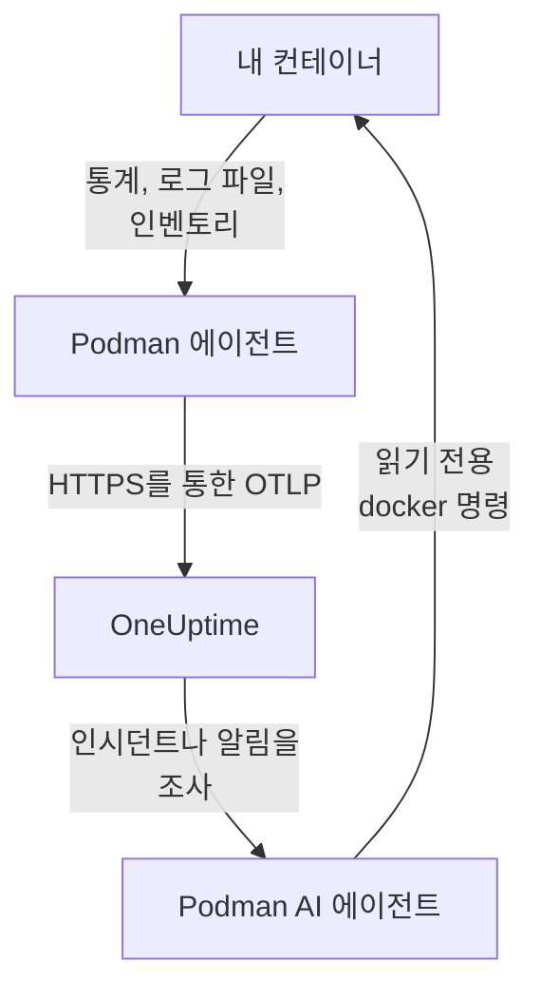

# Podman 에이전트

OneUptime Podman 에이전트는 Podman 호스트에서 실행하는 컨테이너 하나입니다. 호스트의 모든 컨테이너의 통계와 로그 파일을 읽어 OneUptime으로 보내며, OneUptime에서는 호스트가 컨테이너, 메트릭, 로그와 함께 나타납니다. 두 번째 컨테이너인 Podman AI 에이전트는 OneUptime AI가 호스트를 조사할 수 있게 합니다. [Podman 모니터](/docs/monitor/podman-monitor)는 에이전트가 보낸 데이터를 기준으로 알림을 보냅니다.

:::cards
- [에이전트 설치](#에이전트-설치): `podman run` 또는 Podman Compose로 컨테이너 두 개.
- [에이전트가 수집하는 것](#에이전트가-수집하는-것): 모든 컨테이너의 메트릭, 로그, 인벤토리.
- [컨테이너 로그에는 k8s-file이 필요](#컨테이너-로그에는-k8s-file-로그-드라이버가-필요): 전환하지 않으면 Podman은 journald에 로그를 씁니다.
- [문제 해결](#문제-해결): 재시작 루프, 누락된 메트릭, 누락된 로그.
:::

## 작동 방식

에이전트는 OneUptime 구성이 내장된 OpenTelemetry Collector입니다. Podman의 Docker 호환 API 소켓을 통해 30초마다 각 컨테이너의 통계를 읽고, 5분마다 모든 컨테이너, 이미지, 네트워크, 볼륨을 나열합니다. 컨테이너의 로그 파일을 추적하고 제공한 수집 키로 모든 것을 OTLP를 통해 OneUptime URL에 보냅니다.



호스트는 첫 데이터와 함께 `PODMAN_HOST_NAME`에 지정한 이름으로 스스로 등록됩니다. AI 에이전트는 선택 사항입니다. 빼도 Collector는 똑같이 작동합니다.

## 시작하기 전에

- Podman 4.0 이상과 호스트의 root 권한.
- `/run/podman/podman.sock`의 Podman API 소켓. `sudo systemctl enable --now podman.socket`으로 켜세요.
- 수집 키. **프로젝트 설정 → 텔레메트리 및 APM → 수집 키**에서 만들고 값을 복사합니다.
- 호스트에서 OneUptime URL로 나가는 HTTPS.
- 컨테이너 로그를 위해서는 `k8s-file` 로그 드라이버를 사용하는 컨테이너. rootful Podman은 기본적으로 `journald`에 로그를 쓰며, 에이전트는 이를 읽을 수 없습니다. [컨테이너 로그에는 k8s-file 로그 드라이버가 필요](#컨테이너-로그에는-k8s-file-로그-드라이버가-필요)를 참조하세요.

## 에이전트 설치

:::steps
### 에이전트 시작

`YOUR_ONEUPTIME_URL`을 OneUptime URL로, `YOUR_TELEMETRY_INGESTION_TOKEN`을 수집 키로, `my-podman-host`를 이 호스트의 이름(예: `prod-podman-01`)으로 바꾸세요. 호스트는 OneUptime에 이 이름으로 나타나므로 바꾸지 마세요. 새 이름은 새 호스트로 등록됩니다.

:::tabs
@tab Podman CLI
```bash
podman run -d \
  --name oneuptime-podman-agent \
  --user 0:0 \
  --restart unless-stopped \
  -v /run/podman/podman.sock:/run/podman/podman.sock:ro \
  -v /var/lib/containers/storage:/var/lib/containers/storage:ro \
  -e ONEUPTIME_URL="YOUR_ONEUPTIME_URL" \
  -e ONEUPTIME_SERVICE_TOKEN="YOUR_TELEMETRY_INGESTION_TOKEN" \
  -e PODMAN_HOST_NAME="my-podman-host" \
  oneuptime/podman-agent:release
```

그런 다음 같은 값으로 그 옆에서 [AI 에이전트](#ai-에이전트)를 시작하세요. **AI 조사는 기본적으로 켜져 있습니다.** OneUptime AI가 이 호스트의 인시던트나 알림을 조사하는 동안 AI 에이전트를 통해 Podman의 Docker 호환 API에 대해 읽기 전용 `docker` 명령을 실행하며, 수정을 허용하지 않는 한 아무것도 변경하지 않습니다. AI 조사 없이 설치하려면 이 명령을 건너뛰세요.

```bash
podman run -d \
  --name oneuptime-podman-ai-agent \
  --user 0:0 \
  --restart unless-stopped \
  --read-only --tmpfs /tmp \
  -v /run/podman/podman.sock:/run/podman/podman.sock:ro \
  -e ONEUPTIME_URL="YOUR_ONEUPTIME_URL" \
  -e ONEUPTIME_SERVICE_TOKEN="YOUR_TELEMETRY_INGESTION_TOKEN" \
  -e ONEUPTIME_AI_AGENT_RESOURCE_TYPE=podman \
  -e PODMAN_HOST_NAME="my-podman-host" \
  oneuptime/resource-ai-agent:release
```
@tab Podman Compose
이 내용을 호스트의 폴더에 `docker-compose.yml`로 저장하세요. 두 번째 서비스가 [AI 에이전트](#ai-에이전트)입니다. AI 조사 없이 Collector를 실행하려면 빼세요.

```yaml title="docker-compose.yml"
services:
  oneuptime-podman-agent:
    image: oneuptime/podman-agent:release
    container_name: oneuptime-podman-agent
    user: "0:0"
    restart: unless-stopped
    volumes:
      - /run/podman/podman.sock:/run/podman/podman.sock:ro
      - /var/lib/containers/storage:/var/lib/containers/storage:ro
    environment:
      - ONEUPTIME_URL=YOUR_ONEUPTIME_URL
      - ONEUPTIME_SERVICE_TOKEN=YOUR_TELEMETRY_INGESTION_TOKEN
      - PODMAN_HOST_NAME=my-podman-host
    logging:
      driver: json-file
      options:
        max-size: "10m"
        max-file: "3"
  oneuptime-podman-ai-agent:
    image: oneuptime/resource-ai-agent:release
    container_name: oneuptime-podman-ai-agent
    user: "0:0"
    restart: unless-stopped
    read_only: true
    tmpfs:
      - /tmp
    volumes:
      - /run/podman/podman.sock:/run/podman/podman.sock:ro
    environment:
      - ONEUPTIME_URL=YOUR_ONEUPTIME_URL
      - ONEUPTIME_SERVICE_TOKEN=YOUR_TELEMETRY_INGESTION_TOKEN
      - ONEUPTIME_AI_AGENT_RESOURCE_TYPE=podman
      - PODMAN_HOST_NAME=my-podman-host
```

그 폴더에서 시작하세요:

```bash
podman compose up -d
```
:::

### 에이전트가 실행 중인지 확인

```bash
podman ps --filter name=oneuptime-podman-agent
podman logs -f oneuptime-podman-agent
```

Collector가 시작되면 로그에 이 줄이 표시되어야 합니다:

```text
Everything is ready. Begin running and processing data.
```

### OneUptime에서 호스트 찾기

**제품 → 인프라 → Podman → 모든 호스트**를 엽니다. 1분 정도 안에 호스트가 `PODMAN_HOST_NAME`으로 컨테이너, 메트릭, 로그와 함께 나타납니다. AI 에이전트는 호스트의 **AI 에이전트** 페이지와 **개요** 하단에 연결됨으로 표시됩니다.
:::

## 환경 변수

| 변수 | 필수 | 설명 |
| --- | --- | --- |
| `ONEUPTIME_URL` | 예 | OneUptime URL(예: `https://oneuptime.com` 또는 자체 호스팅 인스턴스). 인스턴스가 HTTP 전용이면 `http://`와 해당 포트를 사용하세요. |
| `ONEUPTIME_SERVICE_TOKEN` | 예 | **프로젝트 설정 → 텔레메트리 및 APM → 수집 키**의 수집 키. |
| `PODMAN_HOST_NAME` | 아니요 | OneUptime에서의 호스트 이름. 기본값은 `podman-host`이므로 호스트마다 고유한 이름을 주세요. |
| `DOCKER_API_VERSION` | 아니요 | 에이전트가 Podman 소켓과 통신할 때 사용하는 Docker API 버전. 기본값은 `1.44`입니다. 소켓이 더 낮은 최대 버전을 보고하면 낮추거나, 빈 값으로 설정해 협상하게 하세요([문제 해결](#문제-해결) 참조). |

값을 바꾸려면 에이전트를 제거하고 명령을 다시 실행하거나(Podman CLI), `docker-compose.yml`을 편집하고 `podman compose up -d`를 실행하세요(Podman Compose).

## 에이전트가 수집하는 것

| 데이터 | 내용 |
| --- | --- |
| 컨테이너 메트릭 | 컨테이너별, 30초마다: CPU(사용량, 백분율, 스로틀링), 메모리(사용량, 한도, 백분율), 네트워크 및 블록 I/O, 가동 시간, 재시작 및 프로세스 수. |
| 컨테이너 로그 | 모든 컨테이너의 stdout과 stderr. `k8s-file` 로그 드라이버가 쓰는 `ctr.log` 파일에서 읽습니다. |
| 인벤토리 | 모든 상태의 모든 컨테이너와 모든 이미지, 네트워크, 볼륨. 5분마다. |

각 컨테이너의 메트릭과 로그는 컨테이너 이름을 딴 서비스 아래에 기록됩니다. 각 로그 줄은 `[ERROR]`, `level=warn`, `{"level":"info"}`처럼 줄에 적힌 레벨에서 심각도를 얻으며, 레벨이 없는 줄은 스트림의 심각도를 따릅니다. stderr는 `ERROR`, stdout은 `INFO`입니다. 공백이나 닫는 괄호로 시작하는 줄은 앞 줄에 합쳐지므로 스택 트레이스는 레코드 하나로 도착합니다. 에이전트 자체의 로그는 제외됩니다.

[Podman 모니터](/docs/monitor/podman-monitor#수집되는-메트릭)에 모든 메트릭과 그 의미가 나와 있습니다.

## 컨테이너 로그에는 k8s-file 로그 드라이버가 필요

에이전트는 Podman의 `k8s-file` 로그 드라이버가 쓰는 파일인 `/var/lib/containers/storage/overlay-containers/*/userdata/ctr.log`를 추적합니다(Podman에서는 `json-file`도 같은 드라이버입니다). rootful Podman의 기본 드라이버는 `journald`로 읽을 파일을 남기지 않으며, `syslog` 같은 원격 드라이버도 마찬가지입니다. 그런 컨테이너의 메트릭은 도착하지만 로그는 도착하지 않습니다.

컨테이너의 로그 드라이버와 Podman의 기본값을 확인하세요:

```bash
podman inspect <container> --format '{{.HostConfig.LogConfig.Type}}'
podman info --format '{{.Host.LogDriver}}'
```

`k8s-file`로 컨테이너를 실행하거나, Compose 서비스를 이것으로 전환하세요:

```bash
podman run --log-driver k8s-file --log-opt max-size=100m ... <image>
```

```yaml
services:
  my-app:
    image: my-app:latest
    logging:
      driver: "k8s-file"
      options:
        max-size: "100m"
```

또는 `containers.conf`(rootful은 `/etc/containers/containers.conf`, rootless는 `~/.config/containers/containers.conf`)에서 이후에 만드는 모든 컨테이너의 기본값으로 만드세요:

```toml title="containers.conf"
[containers]
log_driver = "k8s-file"
log_size_max = 104857600
```

그런 다음 컨테이너를 다시 만드세요. 컨테이너는 만들어질 때의 로그 드라이버를 유지하므로 다시 시작하는 것만으로는 충분하지 않습니다.

## 에이전트 업그레이드

에이전트가 OneUptime보다 오래되었으면 호스트의 **개요**에 있는 **에이전트 버전** 옆에 경고 표시가 나타납니다. 표시를 선택하면 이 명령들이 보입니다.

:::tabs
@tab Podman CLI
```bash
podman pull oneuptime/podman-agent:release
podman pull oneuptime/resource-ai-agent:release
podman rm -f oneuptime-podman-agent oneuptime-podman-ai-agent
```

그런 다음 [에이전트 시작](#에이전트-시작)의 `podman run` 명령 두 개를 다시 실행하세요.
@tab Podman Compose
```bash
podman compose pull
podman compose up -d
```
:::

`release` 태그는 항상 최신 릴리스를 가리킵니다. 버전을 고정하려면 `oneuptime/podman-agent:10.0.31`처럼 `oneuptime/podman-agent:<version>`을 사용하세요. 같은 이미지가 GitHub Container Registry에 `ghcr.io/oneuptime/podman-agent:release`로도 있습니다.

## 에이전트 제거

:::tabs
@tab Podman CLI
```bash
podman rm -f oneuptime-podman-agent
podman rm -f oneuptime-podman-ai-agent
```
@tab Podman Compose
```bash
podman compose down
```
:::

호스트는 보낸 데이터와 함께 OneUptime에 남습니다. 더 이상 필요 없다면 메뉴의 **호스트 삭제**로 삭제하세요.

## AI 에이전트

위의 명령과 Compose 파일, Podman 에이전트의 `install.sh`, 그리고 [PodmanAgent 디렉터리](https://github.com/OneUptime/oneuptime/tree/master/agents/PodmanAgent)의 `docker-compose.yml`은 모두 **Podman AI 에이전트**를 실행합니다. 두 번째 컨테이너인 `oneuptime-podman-ai-agent`(이미지 `oneuptime/resource-ai-agent:release`)로, OneUptime AI가 이 호스트의 인시던트나 알림을 조사하는 동안 요청하는 읽기 전용 명령을 Podman의 Docker 호환 API를 통해 `docker` CLI로 실행하고(`docker ps -a`, `docker logs --tail 200 web`, `docker container inspect web`), 허용한 경우에만 지정한 컨테이너 재시작 같은 수정을 적용합니다. Collector와 같은 `ONEUPTIME_URL`, `ONEUPTIME_SERVICE_TOKEN`, `PODMAN_HOST_NAME`을 읽으므로 정확히 이 호스트를 담당하며, OneUptime에서 호스트의 **AI 에이전트** 페이지에 나타납니다.

- **AI 조사는 기본적으로 켜져 있습니다.** 에이전트가 연결되면 OneUptime AI가 에이전트로 이 호스트의 인시던트와 알림을 조사하며, 호스트의 **개요**에 에이전트 상태가 표시됩니다. 중지하려면 에이전트가 실행되는 곳에서 `ONEUPTIME_AI_INVESTIGATION=false`를 설정하거나(AI 에이전트 페이지의 **AI가 할 수 있는 작업** 아래 **변경**에서 방법을 볼 수 있습니다) 에이전트를 빼세요.
- `ONEUPTIME_AI_ALLOW_WRITES=true`로 시작하지 않는 한 읽기 전용입니다. `ONEUPTIME_AI_WRITE_TARGETS`(예: `web-*,api-*`)가 수정이 건드릴 수 있는 컨테이너를 제한합니다. 수정 실행 방식을 정하려면 `ONEUPTIME_AI_FIXES`도 지정해 시작하세요. `ask-for-approval`(사람이 하나씩 승인), `automatic`, `bypass-approval` 중 하나이며, AI 에이전트 페이지에는 읽기 전용으로 표시됩니다([에이전트가 설정하는 AI가 할 수 있는 작업](/docs/ai/infrastructure-ai-agents#what-ai-may-do-set-by-the-agent)).
- Collector와 같은 소켓이 필요하며, 소켓을 root가 소유하므로 소켓을 마운트한 채 root로 실행됩니다. 그리고 rootful Podman에서는 `:ro`이든 아니든 소켓을 사용할 수 있는 사람은 이 호스트의 root입니다. 한계는 에이전트의 명령 정책입니다. `exec`, `run`, `rm`, `prune`은 절대 실행하지 않으며, 자기 자신, Collector, `ONEUPTIME_AI_PROTECTED_TARGETS`(컨테이너 이름 glob)에 있는 것은 절대 변경하지 않습니다.
- `install.sh --no-ai-agent`는 이를 빼고, `podman rm -f oneuptime-podman-ai-agent`는 제거합니다. 업그레이드는 Collector와 같습니다. `podman pull oneuptime/resource-ai-agent:release`를 실행하고, 제거한 다음, 다시 시작하세요.

실행할 수 있는 명령, 수정 방식, 문제 해결 방법은 [Infrastructure AI Agents](/docs/ai/infrastructure-ai-agents#docker-and-podman-hosts)를 참조하세요.

## 문제 해결

:::details 에이전트가 "client version is too new"로 다시 시작됨
에이전트의 로그에 다음이 표시됩니다:

```text
Error: cannot start pipelines: failed to start "docker_stats" receiver:
Error response from daemon: client version 1.44 is too new.
Maximum supported API version is 1.41
```

최대 클라이언트 버전을 강제하는 Docker API 서버는 더 새로운 클라이언트를 거부하므로, 리시버가 시작되지 않고 Collector도 함께 종료됩니다. Podman 소켓이 보고하는 API 버전을 확인하세요:

```bash
curl -s -o /dev/null -D - --unix-socket /run/podman/podman.sock http://localhost/_ping | grep -i '^api-version'
```

그런 다음 `podman run`에 `-e DOCKER_API_VERSION=1.41`(또는 확인한 값)을 추가하거나 Compose에서 `DOCKER_API_VERSION`을 설정하세요. 새 서버도 이전 API 버전을 계속 제공하므로 이 설정은 업그레이드 후에도 유효합니다.

번호를 찾아보고 싶지 않나요? `DOCKER_API_VERSION`을 빈 문자열로 설정하세요. 그러면 에이전트는 버전을 고정하는 대신 소켓과 협상합니다(`HEAD /_ping` 한 번, 그다음 소켓이 보고하는 최대 버전):

```bash
podman run -d ... -e DOCKER_API_VERSION= ...
```
:::

:::details Podman 소켓 권한 거부 또는 소켓 없음
에이전트는 `/run/podman/podman.sock`을 읽으려면 root로 실행되어야 합니다. `podman run` 명령에 `--user 0:0`이, Compose에는 `user: "0:0"`이 있는지, 그리고 소켓이 켜져 있는지 확인하세요: `sudo systemctl enable --now podman.socket`. rootless Podman은 소켓이 대신 `/run/user/<uid>/podman/podman.sock`에 있습니다(`systemctl --user enable --now podman.socket`). `/run/podman/podman.sock` 대신 그 경로를 마운트하세요.
:::

:::details 호스트가 연결 끊김으로 표시됨
1. 에이전트가 실행 중인지 확인하세요: `podman ps --filter name=oneuptime-podman-agent`
2. 로그에서 오류를 찾으세요: `podman logs oneuptime-podman-agent 2>&1 | grep -i error`
3. `ONEUPTIME_URL`과 `ONEUPTIME_SERVICE_TOKEN`을 확인하세요. 키는 비활성화되지 않은 유효한 수집 키여야 합니다.
4. 호스트가 네트워크를 통해 OneUptime URL에 도달할 수 있는지 확인하세요.
:::

:::details 메트릭이 나타나지 않음
1. Podman 소켓이 에이전트에 마운트되어 있는지 확인하세요. 이미지에 셸이 없으므로 같은 마운트를 공유하는 일회용 컨테이너에서 확인합니다: `podman run --rm --volumes-from oneuptime-podman-agent alpine:3.19 ls -la /run/podman/podman.sock`
2. 로그에서 내보내기 오류를 찾으세요: `podman logs oneuptime-podman-agent 2>&1 | tail -100`
3. 수집 키가 유효하고 만료되지 않았는지 확인하세요.
:::

:::details 메트릭은 도착하지만 컨테이너 로그가 없음
컨테이너가 Podman의 기본 로그 드라이버인 `journald`를 사용하고 있을 가능성이 큽니다. 에이전트가 감시하는 파일과 컨테이너가 사용하는 드라이버를 확인하세요:

```bash
podman logs oneuptime-podman-agent 2>&1 | grep -E "Started watching file|no files match"
podman inspect <container> --format '{{.HostConfig.LogConfig.Type}}'
```

에이전트가 `no files match the configured criteria`를 보고하면 [컨테이너 로그에는 k8s-file 로그 드라이버가 필요](#컨테이너-로그에는-k8s-file-로그-드라이버가-필요)에 나온 대로 컨테이너를 `k8s-file`로 전환하고 다시 만드세요.
:::

:::details 로그가 다른 호스트에 있거나 호스트 이름이 podman-host임
호스트 이름은 `PODMAN_HOST_NAME`에서 옵니다. 이것 없이 시작한 에이전트는 `podman-host`로 보고하므로 그렇게 설정한 모든 호스트가 같은 호스트처럼 보입니다. 나중에 이름을 바꾸면 OneUptime은 두 번째 호스트를 등록하고, 새 데이터는 그쪽에 들어갑니다. 각 호스트에서 `PODMAN_HOST_NAME`을 고유한 이름으로 설정하고 에이전트를 다시 만드세요. 에이전트가 보고하는 이름을 확인하려면:

```bash
podman inspect oneuptime-podman-agent --format '{{range .Config.Env}}{{println .}}{{end}}' | grep PODMAN_HOST_NAME
```
:::

## 다음 단계

:::cards
- [Podman 모니터](/docs/monitor/podman-monitor): 컨테이너 CPU, 메모리, 재시작에 대해 알림을 보냅니다.
- [데이터베이스](/docs/telemetry/databases): 호스트의 데이터베이스 컨테이너가 발견되어 전용 페이지가 생깁니다.
- [Kubernetes 에이전트](/docs/telemetry/kubernetes-agent): 대신 Kubernetes 클러스터를 모니터링합니다.
- [호스트 OpenTelemetry 수집기](/docs/telemetry/host-otel-collector): 머신 자체(CPU, 디스크, 프로세스, 로그)를 모니터링합니다.
:::
