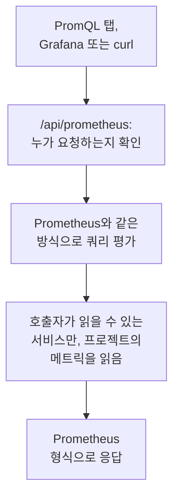

# PromQL로 메트릭 쿼리하기

PromQL은 Prometheus의 쿼리 언어이며, 메트릭을 차트로 그리는 사람이라면 대부분 이미 알고 있는 언어입니다. OneUptime은 PromQL로 프로젝트의 메트릭을 읽습니다. 메트릭의 **PromQL** 탭에서 쓸 수 있고, Grafana를 비롯해 Prometheus 데이터 소스를 지원하는 모든 도구가 연결할 수 있는 Prometheus 호환 API로도 쓸 수 있습니다.

:::cards
- [쿼리 작성](#쿼리-작성): 메트릭 페이지에서 PromQL을 실행하고 결과를 그래프나 테이블로 봅니다.
- [메트릭 이름 규칙](#메트릭-이름-규칙): OpenTelemetry의 이름과 속성을 PromQL에서 읽는 방식.
- [Grafana 연결](#grafana-연결): OneUptime을 Prometheus 데이터 소스로 추가합니다.
- [제한](#제한): 쿼리가 읽을 수 있는 양과 걸릴 수 있는 시간.
:::

## 작동 방식

PromQL 탭과 Grafana는 같은 API에 요청합니다. OneUptime은 호출자가 프로젝트의 메트릭을 읽을 수 있는지 확인하고, 호출자가 읽을 수 있는 서비스만 읽으며, Prometheus와 같은 방식으로 쿼리를 평가합니다.



## 시작하기 전에

- **도착하는 메트릭.** [OpenTelemetry](/docs/telemetry/open-telemetry)로 보내거나, [호스트용 OpenTelemetry Collector](/docs/telemetry/host-otel-collector) 같은 에이전트에서 보냅니다.
- **메트릭을 읽을 수 있는 역할.** Project Owner, Project Admin, Project Member, Viewer, Telemetry Admin, Telemetry Member, Telemetry Viewer 중 하나이거나 Read Metrics 권한이 있는 사용자 지정 역할입니다. 일부 서비스로 제한된 역할은 그 서비스의 메트릭만 읽습니다.
- **Grafana나 스크립트에서 쓸 프로젝트 API 키.** 위 역할 중 하나나 Read Metrics 권한이 있어야 합니다. [API 키 만들기](/docs/api-reference/api-reference#api-키-만들기)를 참조하세요. OneUptime Cloud에서 API 키를 쓰려면 **Growth** 요금제가 필요합니다.

## 쿼리 작성

:::steps
### PromQL 열기

**메트릭**을 열고 **PromQL** 탭을 클릭합니다.

### 쿼리 입력하기

편집기에 직접 입력하거나, **예시**에서 하나를 고르거나, 프로젝트의 메트릭을 PromQL에서 쓰는 이름으로 나열하는 **메트릭 이름 추가**에서 시작합니다.

### 실행하기

**쿼리 실행**을 클릭하거나 Ctrl+Enter(Mac에서는 ⌘+Enter)를 누릅니다. **그래프**는 시간 범위에 걸쳐 쿼리를 그리고, **테이블**은 시간 범위가 끝나는 시점의 각 시리즈 값을 보여 줍니다.
:::

시작하기 좋은 쿼리 몇 가지입니다.

```text title="PromQL"
# Requests per second, by service
sum by (job) (rate(http_requests_total[5m]))

# The 95th percentile of a latency histogram
histogram_quantile(0.95, sum by (le) (rate(http_server_request_duration_bucket[5m])))

# The five hosts using the most memory
topk(5, system_memory_usage)
```

실행되지 않는 쿼리는 무엇이 어디서 잘못되었는지 편집기가 보여 줍니다. 예를 들어 `rate(http_requests_total)`에는 이 함수에 `[5m]` 같은 범위가 필요하다고 표시됩니다.

## 메트릭 이름 규칙

OneUptime은 메트릭을 OpenTelemetry 방식으로 저장합니다. PromQL은 Prometheus 자체의 OpenTelemetry 지원이 붙이는 이름으로 메트릭을 읽으므로, Prometheus용으로 작성한 쿼리가 여기서도 그대로 동작합니다.

| OneUptime에서 | PromQL에서 |
| --- | --- |
| 게이지 `system.cpu.utilization` | `system_cpu_utilization` |
| 카운터 `http.requests` | `http_requests` 또는 `http_requests_total` |
| 히스토그램 `http.server.request.duration` | `http_server_request_duration_bucket`(`le` 포함), `_count`, `_sum` |
| 서머리 `rpc.latency` | `rpc_latency`(`quantile` 포함), `_count`, `_sum` |
| 속성 `http.route` | 레이블 `http_route` |
| 리소스 속성 `service.name` | 레이블 `resource_service_name`, 그리고 `job` |
| 리소스 속성 `service.instance.id` | 레이블 `resource_service_instance_id`, 그리고 `instance` |

- **메트릭 이름과 레이블 이름의 점과 대시는 밑줄이 됩니다.** 저장된 이름 그대로 메트릭이나 레이블을 지정하려면 Prometheus 3처럼 따옴표로 묶으세요: `{"http.server.request.duration", "http.route"="/checkout"}`.
- **델타 카운터는 쿼리 시간 범위의 시작부터 합산됩니다.** 그래서 `rate()`와 `increase()`는 델타 카운터도 다른 카운터와 똑같이 읽습니다.
- **지수 히스토그램**에는 `_count`와 `_sum`은 있지만 버킷은 없습니다.

## Grafana 연결

:::steps
### API 키 만들기

OneUptime에서 **프로젝트 설정 → 고급 → API 키**를 열고 **API 키 만들기**를 클릭합니다. 키에 텔레메트리를 읽을 수 있는 역할이나 Read Metrics 권한을 주세요.

### Prometheus 데이터 소스 추가하기

Grafana에서 **Connections → Data sources → Add data source**를 열고 **Prometheus**를 고릅니다.

### 서버 URL 입력하기

**Prometheus server URL**을 OneUptime 주소 뒤에 `/api/prometheus`를 붙인 값으로 설정합니다. OneUptime Cloud에서는 `https://oneuptime.com/api/prometheus`입니다. **PromQL** 탭에는 내 서버의 주소가 복사 버튼과 함께 표시됩니다.

### API 키 보내기

**HTTP headers**에서 `Authorization` 헤더를 추가하고, 값으로 `Bearer`와 공백 하나, API 키를 차례로 넣습니다. 기본 인증도 쓸 수 있습니다. 사용자 이름은 아무것이나 쓰고 비밀번호로 API 키를 넣으면 됩니다.

### 저장하고 테스트하기

**Save & test**를 클릭합니다. Grafana가 쿼리를 실행하고 데이터 소스가 작동한다고 알려 줍니다.
:::

다른 Prometheus 클라이언트도 같은 방식으로 작동합니다. curl로는 다음과 같습니다.

```bash title="Query OneUptime's Prometheus API"
curl -H "Authorization: Bearer $ONEUPTIME_API_KEY" \
  "https://oneuptime.com/api/prometheus/api/v1/query?query=up"
```

## API

API는 `/api/prometheus` 아래에서 Prometheus HTTP API의 경로에 `GET` 또는 `POST`로 응답합니다.

| 경로 | 응답하는 내용 |
| --- | --- |
| `/api/v1/query` | 한 시점의 쿼리(`time`, 기본값은 현재). |
| `/api/v1/query_range` | `start`부터 `end`까지 `step`마다의 쿼리. |
| `/api/v1/series` | `match[]`가 선택하는 시리즈. |
| `/api/v1/labels` | `match[]`가 선택하는 시리즈 또는 모든 메트릭의 레이블 이름. |
| `/api/v1/label/<name>/values` | 레이블 하나의 값. `__name__`은 메트릭 이름을 나열합니다. |
| `/api/v1/metadata` | 각 메트릭의 유형, 도움말, 단위. |

시각은 Unix 초 또는 RFC 3339로, 기간은 초 또는 `15s` 같은 기간으로 쓰며, 응답은 Prometheus 형식입니다. `/api/v1/status/buildinfo`는 Prometheus 3 서버로서 응답합니다. 규칙과 알림은 비어 있는데, OneUptime은 [모니터](/docs/monitor/metrics-monitor)로 알림을 보내기 때문입니다.

## 지원하는 PromQL 기능

- **선택자**: 모든 매처(`=`, `!=`, `=~`, `!~`), 범위, `offset`, `@`(`start()`와 `end()` 포함), 하위 쿼리.
- **연산자**: 산술 연산, 비교(`bool` 포함), `and`, `or`, `unless`, 그리고 `on`, `ignoring`, `group_left`, `group_right`를 사용한 벡터 매칭.
- **집계**: `sum`, `avg`, `min`, `max`, `count`, `group`, `stddev`, `stdvar`, `topk`, `bottomk`, `quantile`, `count_values`. `by`나 `without`과 함께 씁니다.
- **함수**: `rate`, `irate`, `increase`, `delta`, `idelta`, `deriv`, `predict_linear`, `histogram_quantile`, 모든 `*_over_time` 함수, `changes`, `resets`, `absent`, `label_replace`, `label_join`, `sort`, `clamp`, `round`, 수학 함수와 날짜 함수 등.

`histogram_count()` 같은 Prometheus의 네이티브 히스토그램 함수는 쓸 수 없습니다. OneUptime은 히스토그램을 버킷으로 저장하고, 이렇게 저장된 히스토그램은 `histogram_quantile()`과 `_count`, `_sum` 시리즈가 읽습니다.

## 제한

모든 쿼리에는 한도가 있어서, 패널이 많은 대시보드도 OneUptime에 과부하를 줄 수 없습니다.

| 제한 | 값 |
| --- | --- |
| 범위 쿼리의 시리즈 하나에 담기는 점 | 11,000 |
| 쿼리 하나가 읽고 보관할 수 있는 샘플 | 5,000,000 |
| 선택자 하나가 읽을 수 있는 메트릭 데이터 포인트 | 1,000,000 |
| 읽기에 걸릴 수 있는 시간 | 30초 |
| 평가에 걸릴 수 있는 시간 | 30초 |
| 선택자가 시리즈의 최신 샘플을 찾아 거슬러 올라가는 시간 | 5분 |
| 쿼리에서 생략했을 때 하위 쿼리의 스텝 | 1분 |

## 문제 해결

:::details Grafana에서 데이터 소스가 작동하지 않는다고 나올 때
URL이 `/api/prometheus`로 끝나는지, `Authorization` 헤더에 `Bearer`, 공백, API 키가 들어 있는지 확인하세요. 메트릭을 읽을 수 있는 역할이 없는 키는 거부됩니다. **프로젝트 설정 → 고급 → API 키**에서 키에 역할을 주세요.
:::

:::details 탐색기에서 본 메트릭으로 아무것도 찾을 수 없을 때
PromQL 이름에는 저장된 이름의 점 자리에 밑줄이 들어가며, 히스토그램은 `_bucket`, `_count`, `_sum`으로 읽습니다. PromQL 탭의 **메트릭 이름 추가**는 모든 이름을 PromQL에서 쓰는 형태로 나열합니다.
:::

:::details "The query reads more than 1,000,000 metric points"
쿼리가 한 번의 읽기로 담을 수 있는 것보다 많은 데이터를 요청합니다. 레이블 매처를 추가하거나, 시간 범위를 줄이거나, 더 큰 스텝을 쓰세요.
:::

## 다음 단계

:::cards
- [메트릭 탐색기](/docs/telemetry/metrics-explorer): 쿼리를 쓰지 않고 메트릭을 차트로 그립니다.
- [메트릭 모니터](/docs/monitor/metrics-monitor): 메트릭이 임곗값을 넘으면 알립니다.
- [외부 데이터 소스](/docs/dashboards/data-sources): 외부 Prometheus를 대시보드에 차트로 그립니다.
:::
