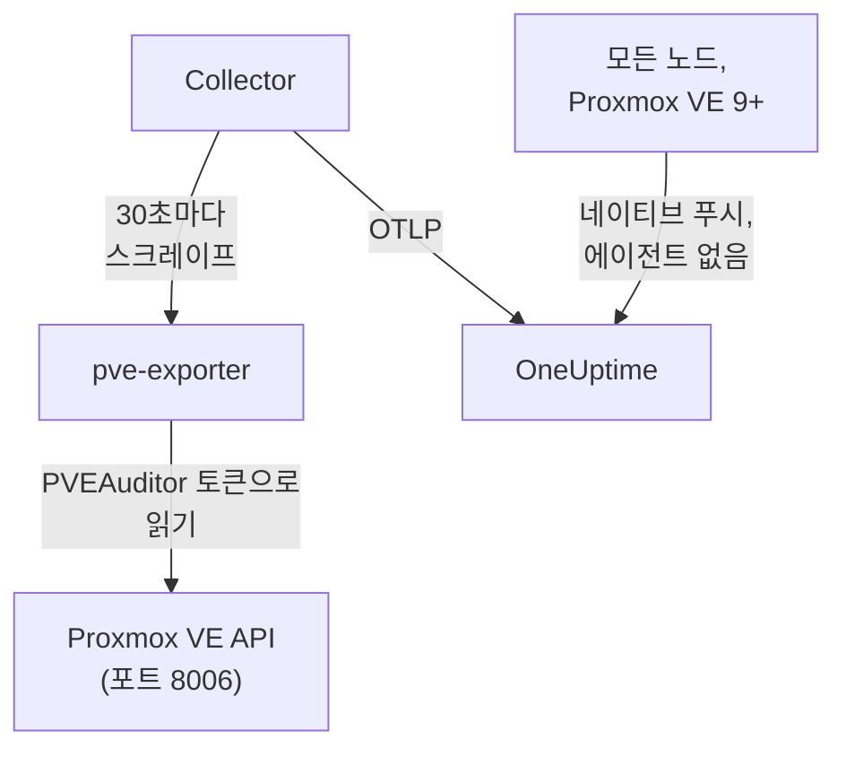

# Proxmox 에이전트

OneUptime Proxmox 에이전트는 Proxmox VE 클러스터, 즉 노드, QEMU VM, LXC 컨테이너, 스토리지, HA 상태, 백업 적용 범위, 복제를 모니터링합니다. 읽기 전용 토큰으로 Proxmox VE API를 통해 클러스터를 읽고 찾은 것을 OneUptime으로 보내며, OneUptime에서는 클러스터가 노드, 게스트, 스토리지와 함께 나타납니다. Proxmox VE 9 이상에서는 노드가 아무것도 설치하지 않고 자체 메트릭을 푸시할 수도 있습니다. [Proxmox 모니터](/docs/monitor/proxmox-monitor)는 도착한 데이터를 기준으로 알림을 보냅니다.

:::cards
- [연결 방법 선택](#연결-방법-선택): 에이전트, 또는 Proxmox VE 9 자체의 푸시.
- [에이전트 설치](#에이전트-설치): API 토큰을 만든 다음 설치 스크립트나 Docker Compose 사용.
- [네이티브 푸시](#설치가-필요-없는-대안-proxmox-ve-9-네이티브-opentelemetry-푸시): Proxmox VE 9가 메트릭을 직접 보냅니다.
- [문제 해결](#문제-해결): 진단 스크립트와 일반적인 문제.
:::

## 작동 방식

에이전트는 한 머신에서 Docker Compose로 실행하는 컨테이너 묶음입니다. [prometheus-pve-exporter](https://github.com/prometheus-pve/prometheus-pve-exporter)가 포트 8006에서 Proxmox VE API를 읽고, OpenTelemetry Collector가 30초마다 익스포터를 스크레이프해 모든 메트릭에 클러스터 이름을 붙이며, Proxmox AI 에이전트는 OneUptime AI가 조사하는 동안 클러스터를 읽을 수 있게 합니다. Proxmox VE 9의 네이티브 푸시는 대신 각 노드의 메트릭을 OneUptime으로 직접 보냅니다.



클러스터는 첫 데이터와 함께, 에이전트가 모든 메트릭에 `proxmox.cluster.name`으로 붙이는 이름으로 스스로 등록됩니다.

## 연결 방법 선택

| | 에이전트 | 네이티브 푸시 |
| --- | --- | --- |
| Proxmox VE | 지원되는 모든 버전 | 9.0 이상 |
| 설치할 것 | 머신 한 대의 Docker Compose | 없음: Proxmox 웹 UI의 메트릭 서버 |
| 노드, 게스트, 스토리지 | 예 | 예 |
| HA 상태, 부팅 시 시작, 백업 적용 범위, 복제 | 예 | 아니요 |
| Proxmox AI 에이전트 | 예 | 아니요 |

**HA Resource in Error State**, **Guest Down**, **Guest Not Backed Up**, **Replication Failing** 템플릿에는 에이전트가 필요합니다. 클러스터에는 둘 중 하나만 사용하세요. 둘 다 실행하면 모든 리소스가 두 번 보고됩니다.

## 시작하기 전에

- Docker Engine 20.10 이상과 Docker Compose v2 플러그인이 있고, 포트 8006으로 Proxmox VE API에 도달할 수 있는 머신.
- API 토큰을 만들기 위한 아무 Proxmox VE 노드의 root 셸 또는 Proxmox 웹 UI.
- 수집 키. **프로젝트 설정 → 텔레메트리 및 APM → 수집 키**에서 만들고 값을 복사합니다.
- 그 머신에서 OneUptime URL로 나가는 HTTPS.

### 에이전트를 실행할 위치

에이전트는 네트워크를 통해 Proxmox VE API를 쿼리하므로 클러스터 노드에 있을 필요가 없으며, 있어서도 안 됩니다. 노드 장애에서 살아남는 머신(별도 하드웨어의 작은 모니터링 VM, 관리 호스트)에서 실행하거나, `PVE_HOST`가 노드 하나의 주소 대신 가상 IP나 라운드 로빈 DNS 이름을 가리키게 하세요. 에이전트의 API 대상이 방금 죽은 노드라면 모니터링도 함께 죽습니다. 유일한 예외는 선택 사항인 journald 로그 파이프라인으로, Proxmox VE 노드에서 실행해야 합니다([Proxmox 서비스 로그 전송](#선택-사항-proxmox-서비스-로그-전송) 참조).

## 에이전트 설치

:::steps
### 읽기 전용 API 토큰 만들기

에이전트는 읽기만 하고 다른 것은 할 수 없는 **PVEAuditor** 역할이 있는 API 토큰으로 클러스터를 읽습니다.

:::tabs
@tab Shell
아무 Proxmox VE 노드에서 root로:

```bash
pveum user add monitoring@pam
pveum acl modify / --roles PVEAuditor --users monitoring@pam
pveum user token add monitoring@pam oneuptime --privsep 1
pveum acl modify / --roles PVEAuditor --tokens 'monitoring@pam!oneuptime'
```

첫 번째 명령은 `monitoring@pam`이 이미 있을 때만 실패하며 해는 없습니다. API 토큰은 자체 시크릿을 가지므로 사용자에게 비밀번호나 시스템 계정이 필요 없습니다. `pveum user token add`는 토큰 시크릿을 한 번만 출력하며, 토큰 ID는 `monitoring@pam!oneuptime`입니다.
@tab Proxmox web UI
1. *Datacenter → Permissions → API Tokens*로 이동해 **Add**를 클릭하세요.
2. 사용자를 고르고(또는 만들고), 토큰에 `oneuptime` 같은 ID를 주고, **Privilege Separation**은 선택된 상태로 두세요.
3. 토큰 ID(`user@realm!tokenname`)와 시크릿을 복사하세요. 시크릿은 한 번만 표시됩니다.
4. *Datacenter → Permissions*에서 경로 `/`에 **PVEAuditor** 역할을 두 번 추가하세요. 토큰에 대해 **API Token Permission**으로 한 번, 그 사용자에 대해 **User Permission**으로 한 번입니다.
:::

권한이 분리된 토큰은 사용자에게도 있는 권한만 얻으므로 역할은 토큰뿐 아니라 사용자에게도 부여합니다. 익스포터가 모든 노드, 게스트, 스토리지 객체를 읽으므로 역할은 루트 경로 `/`에 있어야 합니다. 더 좁은 경로는 클러스터의 나머지를 숨기고 `401`/`403 Permission check failed (/, Sys.Audit)`로 실패합니다.

### 에이전트 설치 및 시작

:::tabs
@tab install.sh
에이전트를 실행할 머신에서 설치 스크립트를 내려받아 실행하세요:

```bash
curl -sSL https://raw.githubusercontent.com/OneUptime/oneuptime/master/agents/ProxmoxAgent/install.sh -o install.sh
bash install.sh
```

스크립트는 OneUptime URL, 수집 키, 클러스터 이름, Proxmox VE API 호스트, 번들 익스포터를 실행할지 여부, 토큰 ID와 시크릿을 묻습니다. 또한 [AI 에이전트](#ai-에이전트)가 수정을 적용해도 되는지, 그렇다면 그 전용 토큰과 절대 변경하면 안 되는 게스트도 묻습니다. `/opt/oneuptime-proxmox-agent`에 설치하고, `0600` `.env` 파일을 쓰고, Docker Compose로 에이전트를 시작합니다. 스크립트를 다시 실행하면 다시 묻지 않고 그 `.env`의 모든 값을 재사용하며, 이것이 [에이전트를 업그레이드](#에이전트-업그레이드)하는 방법입니다.
@tab Docker Compose
[ProxmoxAgent 디렉터리](https://github.com/OneUptime/oneuptime/tree/master/agents/ProxmoxAgent)에서 `docker-compose.yml`과 `otel-collector-config.yaml`을 새 폴더로 내려받으세요:

```bash
mkdir oneuptime-proxmox-agent && cd oneuptime-proxmox-agent
curl -fsSLO https://raw.githubusercontent.com/OneUptime/oneuptime/master/agents/ProxmoxAgent/docker-compose.yml
curl -fsSLO https://raw.githubusercontent.com/OneUptime/oneuptime/master/agents/ProxmoxAgent/otel-collector-config.yaml
```

그 옆에 `.env` 파일을 만드세요. 토큰 시크릿이 들어 있으므로 `chmod 600 .env`로 비공개로 유지하세요:

```bash title=".env"
ONEUPTIME_URL=YOUR_ONEUPTIME_URL
ONEUPTIME_TELEMETRY_INGESTION_KEY=YOUR_TELEMETRY_INGESTION_TOKEN
PROXMOX_CLUSTER_NAME=my-proxmox-cluster
PVE_HOST=192.168.1.10
PVE_API_TOKEN_ID=monitoring@pam!oneuptime
PVE_API_TOKEN_SECRET=your-token-secret
COMPOSE_PROFILES=pve-exporter
```

`COMPOSE_PROFILES=pve-exporter`는 번들 익스포터도 시작합니다. 에이전트를 시작하세요:

```bash
docker compose up -d
```
:::

이미 prometheus-pve-exporter를 실행하고 있나요? 스크립트가 번들 익스포터를 실행할지 물으면 **n**으로 답하거나 `.env`에서 `COMPOSE_PROFILES`를 지우고, 에이전트가 기존 익스포터를 가리키게 하세요(`host:port`, 스킴 없음, 에이전트의 컨테이너가 도달할 수 있는 주소. `localhost`는 컨테이너 자신입니다). [AI 에이전트](#ai-에이전트)를 사용한다면 그 토큰으로 API를 호출하므로 `PVE_API_TOKEN_ID`와 `PVE_API_TOKEN_SECRET`은 유지하세요:

```bash
PVE_EXPORTER_URL=your-exporter-host:9221
```

### 에이전트가 실행 중인지 확인

```bash
docker compose ps
docker logs -f oneuptime-proxmox-agent
```

`docker compose ps`는 Collector(`oneuptime-proxmox-agent`), 번들 익스포터(자체 익스포터를 쓰지 않는 한 `oneuptime-pve-exporter`), AI 에이전트(`oneuptime-proxmox-ai-agent`)를 나열합니다. Collector가 시작되면 로그에 이 줄이 표시되어야 합니다:

```text
Everything is ready. Begin running and processing data.
```

### OneUptime에서 클러스터 찾기

**제품 → 인프라 → Proxmox → 모든 클러스터**를 엽니다. 첫 스크레이프 후 1분 정도 지나면 클러스터가 `PROXMOX_CLUSTER_NAME`으로 노드, 게스트, 스토리지와 함께 나타납니다.
:::

## 환경 변수

설치 스크립트는 이 값들을 `/opt/oneuptime-proxmox-agent/.env`에 씁니다. Docker Compose 설치는 `docker-compose.yml` 옆의 `.env`에서 읽습니다. 값을 바꾼 뒤에는 그 폴더에서 `docker compose up -d`를 실행하세요.

| 변수 | 필수 | 설명 |
| --- | --- | --- |
| `ONEUPTIME_URL` | 예 | OneUptime URL(예: `https://oneuptime.com` 또는 자체 호스팅 인스턴스). 인스턴스가 HTTP 전용이면 `http://`와 해당 포트를 사용하세요. |
| `ONEUPTIME_TELEMETRY_INGESTION_KEY` | 예 | **프로젝트 설정 → 텔레메트리 및 APM → 수집 키**의 수집 키. |
| `PROXMOX_CLUSTER_NAME` | 예 | OneUptime에서의 클러스터 이름으로, 모든 메트릭에 `proxmox.cluster.name` 리소스 속성으로 붙습니다. 바꾸지 마세요. 나중에 바꾸면 별도의 클러스터가 등록됩니다. 기본값은 `proxmox-cluster`입니다. |
| `PVE_HOST` | 예 | 익스포터와 AI 에이전트가 쿼리하는 Proxmox VE API 호스트로, 클러스터의 아무 노드나 됩니다. 예: `192.168.1.10`. |
| `PVE_EXPORTER_URL` | 아니요 | prometheus-pve-exporter의 주소(`host:port`, 스킴 없음). 기본값은 번들 익스포터인 `pve-exporter:9221`입니다. |
| `PVE_API_TOKEN_ID` | 번들 익스포터 또는 AI 에이전트 | 전체 Proxmox API 토큰 ID(예: `monitoring@pam!oneuptime`). AI 에이전트는 자체 토큰(`ONEUPTIME_AI_PVE_API_TOKEN_ID` / `ONEUPTIME_AI_PVE_API_TOKEN_SECRET`)이 없으면 이것으로 API를 읽습니다. |
| `PVE_API_TOKEN_SECRET` | 번들 익스포터 또는 AI 에이전트 | Proxmox API 토큰 시크릿. |
| `PVE_VERIFY_SSL` | 아니요 | Proxmox API의 TLS 인증서를 검증합니다(익스포터와 AI 에이전트). Proxmox가 자체 서명 인증서를 제공하므로 기본값은 `false`입니다. |
| `COMPOSE_PROFILES` | 아니요 | 번들 익스포터 컨테이너를 시작하려면 `pve-exporter`로 설정하세요. |

## 에이전트가 수집하는 것

Collector는 클러스터와 노드 수집기를 모두 켜고 30초마다 익스포터를 스크레이프하며, 이는 익스포터에서 기본으로 켜져 있는 `backup-info`(클러스터 수준)와 `replication`(노드 수준) 수집기도 포함합니다. 모든 시계열에는 리소스를 가리키는 `id` 레이블이 있습니다: `node/<name>`, `qemu/<vmid>`, `lxc/<vmid>`, `storage/<node>/<storage>`.

| 범주 | 메트릭 |
| --- | --- |
| 가용성 | `pve_up`, `pve_uptime_seconds` |
| 노드 | `pve_node_info`, `pve_cpu_usage_ratio`, `pve_cpu_usage_limit`, `pve_memory_usage_bytes`, `pve_memory_size_bytes` |
| 게스트(VM 또는 LXC) | `pve_guest_info`, 그리고 `qemu/*`와 `lxc/*` ID의 CPU, 메모리, 네트워크 시계열(`pve_network_receive_bytes`, `pve_network_transmit_bytes`) |
| 스토리지 | `pve_disk_usage_bytes`, `pve_disk_size_bytes`, `pve_storage_info` |
| HA | `pve_ha_state` |
| 백업 적용 범위 | `pve_not_backed_up_total`(어떤 백업 작업도 다루지 않는 게스트. 클러스터 수준 시계열 하나, `id` 레이블 없음)과 `pve_not_backed_up_info`(다뤄지지 않는 게스트마다 시계열 하나, `id` 포함). 다뤄진다는 것은 적어도 한 작업이 그 게스트를 선택한다는 뜻이며, 백업이 최근에 실행되었는지나 성공했는지는 익스포터가 노출하지 않습니다. |
| 복제 | 스토리지 복제 작업별 `pve_replication_failed_syncs`, `pve_replication_duration_seconds`, `pve_replication_last_sync_timestamp_seconds`, `pve_replication_last_try_timestamp_seconds`, `pve_replication_next_sync_timestamp_seconds`, `pve_replication_info`. 이 시계열의 `id` 레이블은 리소스가 아니라 작업 ID(예: `100-0`)입니다. |

모니터 조건과 속성 필터는 접두사가 아니라 일치 여부로 비교하므로, Collector의 `transform/pve-identity` 프로세서는 `id`를 세 가지 속성으로도 나눕니다. 기본 제공 Proxmox 알림 템플릿은 이 속성으로 필터링하므로, 구성을 사용자 지정하더라도 이 프로세서는 유지하세요:

| 속성 | 값 | `qemu/100`의 경우 |
| --- | --- | --- |
| `pve.scope` | `node`, `guest`, `storage`, `cluster`(`qemu`와 `lxc`는 모두 `guest`) | `guest` |
| `pve.type` | `node`, `qemu`, `lxc`, `storage` | `qemu` |
| `pve.id` | `id`의 첫 `/` 뒤의 모든 것(`pve1`, `100`, `pve1/local`) | `100` |

원래 `id` 레이블은 그대로 유지됩니다.

## 선택 사항 — Proxmox 서비스 로그 전송

기본적으로 에이전트는 메트릭만 보내므로 클러스터의 **로그** 페이지는 비어 있습니다. Proxmox VE 서비스는 여덟 개 유닛으로 systemd 저널에 로그를 씁니다: `pveproxy`, `pvedaemon`, `pve-firewall`, `pve-ha-crm`, `pve-ha-lrm`, `pvescheduler`, `pvestatd`, `qmeventd`. 제공되는 `otel-collector-config.yaml`에는 정확히 이 유닛들을 위한 주석 처리된 `journald` 리시버가 있으며, 주석 처리된 `logs` 파이프라인에 연결되어 있습니다. 이 파이프라인이 `proxmox.cluster.name`을 붙이므로 로그가 클러스터에 들어갑니다.

:::steps
### 노드에서 에이전트 실행

저널은 호스트별이므로 원격 에이전트는 읽을 수 없습니다. [에이전트를 실행할 위치](#에이전트를-실행할-위치)에 어긋나는 유일한 구성입니다. 메트릭 에이전트를 클러스터 밖에 두려면 대신 노드에서 두 번째 로그 전용 Collector를 실행하세요(구성을 복사한 다음 `prometheus` 리시버와 `metrics` 파이프라인을 삭제).

### 리시버 켜기

컨테이너가 호스트의 저널을 읽을 수 있도록 `otel-collector-config.yaml`의 `journald` 리시버와 `logs` 파이프라인, 그리고 `docker-compose.yml`의 저널 볼륨의 주석을 해제하세요:

```yaml
- /var/log/journal:/var/log/journal:ro
- /etc/machine-id:/etc/machine-id:ro
```

### Collector 이미지 교체

기본 `otel/opentelemetry-collector-contrib` 이미지는 `FROM scratch`로 빌드되어 journald 리시버가 실행하는 `journalctl`이 없고, 저널을 읽을 수 없는 사용자로 실행됩니다. 이 래퍼를 빌드하고 `docker-compose.yml`의 `image:`가 이를 가리키게 하세요:

```dockerfile title="Dockerfile"
FROM otel/opentelemetry-collector-contrib:0.161.0 AS otelcol
FROM debian:stable-slim
RUN apt-get update \
    && apt-get install -y --no-install-recommends systemd \
    && rm -rf /var/lib/apt/lists/*
COPY --from=otelcol /otelcol-contrib /otelcol-contrib
ENTRYPOINT ["/otelcol-contrib"]
CMD ["--config", "/etc/otelcol-contrib/config.yaml"]
```

`systemd` 패키지는 `journalctl`만을 위해 있으며, 이 이미지는 저널을 읽을 수 있는 root로 실행됩니다. 또는 로그에는 Docker를 쓰지 않고, `journalctl`이 이미 있는 노드 자체에서 `otelcol-contrib` 릴리스 `.deb`를 실행하세요.
:::

각 노드는 자체 저널만 보냅니다. 모든 노드의 서비스 로그를 받으려면 각 노드에서 로그 전용 Collector를 실행하세요.

### 사용자 지정 이미지 없는 대안: /var/log/syslog에 대한 filelog

기본 이미지를 유지하려면 대신 syslog를 추적하세요. 노드에 rsyslog를 설치하고(`apt install rsyslog`. Debian 12와 Proxmox VE 8 이상에는 더 이상 포함되지 않음), `/var/log` 디렉터리를 컨테이너에 마운트하고(`- /var/log:/var/log:ro`. 로그 로테이션이 오래된 파일을 붙잡지 않도록 파일이 아니라 디렉터리를 마운트), journald 리시버 대신 `filelog` 리시버를 사용하세요:

```yaml
receivers:
  filelog:
    include:
      - /var/log/syslog
    start_at: end
```

유닛별 필터는 잃게 되며(syslog에는 여덟 개 서비스만이 아니라 모든 것이 담김), 기본 이미지의 사용자가 파일을 읽을 수 있어야 합니다. 같은 주석 처리된 `logs` 파이프라인에 연결하세요(`receivers: [filelog]`).

## 설치가 필요 없는 대안: Proxmox VE 9+ 네이티브 OpenTelemetry 푸시

Proxmox VE 9.0 이상에는 노드, 게스트, 스토리지 메트릭을 OTLP/HTTP 엔드포인트로 푸시하는 OpenTelemetry 메트릭 서버가 포함되어 있어, 설치할 에이전트나 익스포터가 없습니다. Proxmox 웹 UI에서 *Datacenter → Metric Server → Add → OpenTelemetry*로 이동해 다음을 입력하세요:

| 필드 | 값 |
| --- | --- |
| Server | OneUptime 호스트(예: `oneuptime.com`) 또는 자체 호스팅 호스트 |
| Port | `443` |
| Protocol | `https` |
| Path | `/otlp/v1/metrics` |
| Headers | `{"x-oneuptime-token": "YOUR_TELEMETRY_INGESTION_TOKEN"}` |

한 번만 추가하면 클러스터의 모든 노드가 자체 메트릭을 푸시합니다. OneUptime은 푸시를 인식해 에이전트가 보내는 것과 같은 `pve_*` 시계열로 변환하므로:

- 클러스터는 Proxmox 클러스터 이름으로(독립 실행형 노드는 노드 이름으로) 스스로 등록되며, *Resource Attributes*에서 설정한 `proxmox.cluster.name`이 있으면 계속 그 값이 대신 사용됩니다.
- 노드, 게스트, 스토리지 페이지, 개요 차트, 메트릭 카탈로그, CPU·메모리·스토리지 알림 템플릿이 에이전트와 똑같이 작동합니다.
- 원래의 `proxmox_node_*`, `proxmox_vm_*`, `proxmox_storage_*` 시계열은 Proxmox VE가 보고하는 그 밖의 정보(부하 평균, 스왑, 압력 정지, NIC별 트래픽)를 위해 [메트릭 탐색기](/docs/monitor/metrics-monitor)에 남습니다.

### 노드가 보고를 멈출 때

각 노드는 자체 상태만 푸시하므로, 다운된 노드는 스스로 그 사실을 알릴 수 없습니다. 아직 살아 있는 노드가 대신 보고합니다:

- 마지막 보고 후 약 2분이 지나면 노드 페이지에서 노드가 **오프라인**으로 표시됩니다. 노드 자체 페이지의 **마지막 확인**은 자체 마지막 보고 시간을 유지합니다.
- 약 5분 후 그 노드에 대해 **Node Offline**이 발생합니다. **Cluster Quorum at Risk**도 그 노드를 오프라인으로 셉니다. 이 템플릿에는 5분 기간 전체의 보고가 필요하므로, 노드가 조용해진 지 약 7~9분 후에 발생합니다.
- 다음 보고와 함께 다시 **Online**이 되고 알림이 복구됩니다.

여기서 오프라인은 노드가 보고를 멈췄다는 뜻이지, 반드시 다운되었다는 뜻은 아닙니다. 노드가 켜져 있지만 `pvestatd`가 멈추거나 종료된 경우, 클러스터 파일 시스템(`pmxcfs`)이 다운된 경우, OneUptime으로 가는 네트워크가 끊긴 경우도 같은 방식으로 보고됩니다.

다룰 수 없는 경우:

- 독립 실행형 호스트, 또는 클러스터 전체가 한꺼번에 조용해지는 경우: 보고할 노드가 남지 않으므로 노드별 알림이 발생하지 않습니다. 대신 에이전트가 멈출 때처럼 클러스터가 **연결 끊김**으로 바뀝니다.
- 7일 넘게 조용한 노드는 더 이상 보고되지 않습니다. 알림이 해결되고 노드 페이지에서 사라집니다. 자체 호스팅 OneUptime에서는 `PVE_SILENT_NODE_RETENTION_HOURS`로 7일을 바꿀 수 있습니다.
- 클러스터에서 뺀 노드는 죽은 노드와 똑같아 보입니다. 그 페이지에서 **Remove Node**를 사용하세요. 노드가 사라지고 알림이 해결됩니다. 그렇지 않으면 최대 7일 동안 오프라인으로 남습니다.
- 노드의 게스트와 스토리지: 오프라인으로 유지되는 것은 노드 자체뿐입니다. 그 VM, 컨테이너, 스토리지는 마지막 보고 후 약 15분이 지나면 각 페이지에서 사라지며, HA가 다른 노드에서 다시 시작한 게스트는 그 노드 아래에 다시 나타납니다.

OneUptime 수집이 중단된 뒤에는, 새로 조용해진 노드는 다른 노드 중 하나가 다시 2분 동안 푸시한 뒤에야 보고되므로, 중단 자체로 모든 노드에 대해 호출이 발생하지는 않습니다. 이미 오프라인이던 노드는 짧은 중단 동안 오프라인으로 남고 알림도 유지됩니다. 5분보다 긴 중단 후에는 다른 노드가 2분 동안 푸시하면 다시 보고됩니다.

[메트릭 탐색기](/docs/monitor/metrics-monitor)에서 이 보고는 `oneuptime.proxmox.inferred` = `not-reporting` 레이블이 붙은 `pve_up` = 0 포인트이므로, 노드가 자신에 대해 말한 것과 언제든 구분할 수 있습니다.

### 네이티브 푸시로 할 수 없는 것

네이티브 푸시는 각 노드가 자신에 대해 아는 것만 보내므로, 에이전트가 수집하는 것 중 일부는 네이티브로 대응하는 것이 없습니다:

| 에이전트가 필요한 것 | 이유 |
| --- | --- |
| HA 상태 | 푸시되지 않음: **HA Resource in Error State** 템플릿에는 에이전트가 필요합니다. |
| 부팅 시 시작 플래그 | 푸시되지 않음: 부팅 시 시작하도록 설정된 게스트에 대해서만 호출하는 **Guest Down**에는 에이전트가 필요합니다. |
| 백업 적용 범위와 복제 | 푸시되지 않음: **Guest Not Backed Up**과 **Replication Failing**에는 에이전트가 필요합니다. |

이것들이 필요하다면 대신 에이전트를 실행하고 메트릭 서버를 제거하세요. 둘 다 실행하면 모든 리소스가 두 번 보고됩니다.

## systemd 서비스로 실행

머신과 함께 에이전트를 시작하고 실패하면 다시 시작하려면 systemd 유닛을 설치하세요. 설치 스크립트가 에이전트를 두는 `/opt/oneuptime-proxmox-agent`에 에이전트가 있다고 가정합니다:

```bash
sudo cp systemd/oneuptime-proxmox-agent.service /etc/systemd/system/
sudo systemctl daemon-reload
sudo systemctl enable --now oneuptime-proxmox-agent
```

## 에이전트 업그레이드

에이전트는 파일이 고정한 Collector 버전을 **에이전트 버전**으로 보고합니다. 그것이 이 OneUptime 릴리스가 고정한 버전보다 오래되었으면 클러스터의 **개요**에서 그 옆에 경고 표시가 나타납니다. 표시를 선택하면 이 명령들이 보입니다. 파일이 버전을 보고하기 전에 설치된 에이전트는 이 방법으로 업그레이드할 때까지 버전이 표시되지 않습니다.

Collector 이미지는 `docker-compose.yml`에 고정되어 있고 구성은 그 옆의 파일이므로, 가져오기만으로는 에이전트가 새 버전이 되지 않습니다. `install.sh`를 다시 실행하세요. 기존 `.env`의 모든 값을 재사용하고(아무것도 다시 묻지 않음), `docker-compose.yml`과 `otel-collector-config.yaml`을 새로 고치며(편집한 파일은 `<file>.bak.<timestamp>`로 보관), 이미지를 가져와 에이전트를 다시 만들므로 Collector가 새 구성을 읽습니다.

```bash
curl -sSL https://raw.githubusercontent.com/OneUptime/oneuptime/master/agents/ProxmoxAgent/install.sh -o install.sh
bash install.sh
```

대신 Docker Compose로 설치했나요? 에이전트의 폴더에서 두 파일을 다시 내려받고(파일에 가한 변경이 있으면 다시 적용), 이미지를 가져와 에이전트를 다시 만드세요:

```bash
curl -fsSLO https://raw.githubusercontent.com/OneUptime/oneuptime/master/agents/ProxmoxAgent/docker-compose.yml
curl -fsSLO https://raw.githubusercontent.com/OneUptime/oneuptime/master/agents/ProxmoxAgent/otel-collector-config.yaml
docker compose pull
docker compose up -d --force-recreate
```

## 에이전트 제거

```bash
cd /opt/oneuptime-proxmox-agent
docker compose down
```

그런 다음 더 이상 필요 없다면 *Datacenter → Permissions → API Tokens*에서 API 토큰을 삭제하세요.

## AI 에이전트

에이전트의 `docker-compose.yml`은 **Proxmox AI 에이전트**인 `oneuptime-proxmox-ai-agent`(이미지 `oneuptime/resource-ai-agent:release`)도 실행합니다. OneUptime AI가 이 클러스터의 인시던트나 알림을 조사하는 동안 이를 통해 읽기 전용 `pvesh` 명령(`pvesh get /cluster/status`, `pvesh get /nodes/pve1/qemu/101/status/current`, `pvesh get /nodes/pve1/tasks --errors 1 --limit 20`)을 실행하고, 허용한 경우에만 게스트 시작이나 재부팅 같은 수정을 적용합니다. 안에 `pvesh` 바이너리는 없습니다. 각 명령은 같은 `.env`의 토큰으로 `PVE_HOST`의 Proxmox VE API를 정확히 한 번 호출하는 것이 됩니다. Collector처럼 `PROXMOX_CLUSTER_NAME`이라는 이름의 클러스터로 등록되며, OneUptime에서 클러스터의 **AI 에이전트** 페이지에 나타납니다.

- **AI 조사는 기본적으로 켜져 있습니다.** 에이전트가 연결되면 OneUptime AI가 에이전트로 이 클러스터의 인시던트와 알림을 조사하며, 클러스터의 **개요**에 에이전트 상태가 표시됩니다. 중지하려면 에이전트가 실행되는 곳에서 `ONEUPTIME_AI_INVESTIGATION=false`를 설정하거나(AI 에이전트 페이지의 **AI가 할 수 있는 작업** 아래 **변경**에서 방법을 볼 수 있습니다) 에이전트를 빼세요.
- API 토큰이 절대적인 한계입니다. 조사는 읽기만 하고 다른 것은 할 수 없는 Collector의 PVEAuditor 토큰(`PVE_API_TOKEN_ID` / `PVE_API_TOKEN_SECRET`)을 사용합니다. 자체 익스포터를 실행하고 `.env`에 토큰이 없다면 추가하세요. 수정에는 게스트 전원을 제어할 수 있는 AI 에이전트 전용 토큰(`VM.PowerMgmt`, 예를 들어 `/vms`나 풀 하나에 대한 `PVEVMUser` 역할)이 필요하며, `ONEUPTIME_AI_PVE_API_TOKEN_ID` / `ONEUPTIME_AI_PVE_API_TOKEN_SECRET`으로 설정합니다.
- `ONEUPTIME_AI_ALLOW_WRITES=true`를 설정하지 않는 한 읽기 전용입니다. `ONEUPTIME_AI_WRITE_TARGETS`(`100,101` 같은 VMID와, 노드 서비스의 경우 `<node>/<service>`)가 수정이 건드릴 수 있는 대상을 제한합니다. 에이전트가 이 클러스터의 게스트에서 실행된다면 그 게스트의 VMID를 `ONEUPTIME_AI_PROTECTED_TARGETS`에 넣으세요. 같은 `.env`의 `ONEUPTIME_AI_FIXES`가 수정 실행 방식, 즉 `ask-for-approval`(사람이 하나씩 승인), `automatic`, `bypass-approval` 중 하나를 정하며, AI 에이전트 페이지에는 읽기 전용으로 표시됩니다([에이전트가 설정하는 AI가 할 수 있는 작업](/docs/ai/infrastructure-ai-agents#what-ai-may-do-set-by-the-agent)).
- 익스포터처럼 `PVE_VERIFY_SSL=true`를 설정하거나 `PVE_CA_FILE`이 클러스터의 CA(`/etc/pve/pve-root-ca.pem`, 컨테이너에 마운트)를 가리키게 하지 않는 한 API의 자체 서명 인증서를 검증하지 않습니다.
- 기능(capability) 없이 UID 1000으로 읽기 전용 루트 파일 시스템에서 실행되며, `/access`를 읽거나 콘솔을 열거나 구성을 바꾸지 않습니다. OneUptime AI를 사용하지 않는다면 `docker-compose.yml`에서 `oneuptime-proxmox-ai-agent` 서비스를 삭제하세요.

실행할 수 있는 명령, 수정 방식, 문제 해결 방법은 [Infrastructure AI Agents](/docs/ai/infrastructure-ai-agents#proxmox-clusters)를 참조하세요. 에이전트의 README에 수정용 토큰을 위한 정확한 `pveum` 명령이 있습니다.

## 문제 해결

:::details 먼저 진단 스크립트 실행
에이전트에는 전체 체인을 확인하는 스크립트 [`troubleshoot.sh`](https://github.com/OneUptime/oneuptime/blob/master/agents/ProxmoxAgent/troubleshoot.sh)가 함께 제공됩니다. 컨테이너 런타임, 익스포터 스크레이프, 모든 메트릭에 붙은 클러스터 이름, 토큰 형식, Collector 자체 메트릭, 그리고 OneUptime이 수집 키를 받아들이는지를 확인합니다. 마지막 확인이 가장 중요합니다. OneUptime은 잘못된 키를 `401`로 거부하며(비활성화된 키나 브라우저 키는 `422`), Collector는 둘 다 영구적인 오류로 취급합니다. 배치를 버리고 `Exporting failed` 오류를 하나 기록할 뿐이므로, 컨테이너가 정상인 동안에는 놓치기 쉽습니다. 스크립트는 에이전트의 네트워크 안에서 `GET <url>/otlp/v1/validate`를 요청해 `200`(유효) 또는 `401`(무효)을 직접 받으며, 이전 서버에서는 `POST /fluentd/v1/logs`로 대체합니다.

```bash
curl -sSL https://raw.githubusercontent.com/OneUptime/oneuptime/master/agents/ProxmoxAgent/troubleshoot.sh -o troubleshoot.sh
bash troubleshoot.sh    # add -d <dir> if you installed outside /opt/oneuptime-proxmox-agent
```

마지막에 가장 가능성 높은 원인을 알려 주는 판정을 출력합니다.
:::

:::details OneUptime에 클러스터가 나타나지 않음
1. Collector의 로그를 확인하세요: `docker logs oneuptime-proxmox-agent`. 내보낼 때의 `401`은 수집 키가 잘못되었다는 뜻이고, 연결 거부는 `ONEUPTIME_URL`이 잘못되었다는 뜻입니다.
2. 익스포터가 응답하는지 확인하세요. 번들 익스포터는 호스트에 포트를 게시하지 않으므로 그 네트워크 안에서 요청합니다. `docker run --rm --network container:oneuptime-pve-exporter curlimages/curl -s "http://localhost:9221/pve?target=YOUR_PVE_HOST" | head`는 `pve_*` 줄을 출력해야 합니다. 자체 익스포터라면 그 `host:9221`에 직접 요청하세요.
3. `PROXMOX_CLUSTER_NAME`이 설정되어 있는지 확인하세요. 클러스터는 `proxmox.cluster.name` 리소스 속성으로 찾습니다.
:::

:::details 익스포터가 401 또는 595 오류를 반환함
API 토큰이 잘못되었거나 권한이 부족합니다. 토큰 ID 형식(`user@realm!tokenname`), 시크릿, 그리고 토큰과 그 사용자에 대해 경로 `/`에 **PVEAuditor** 역할이 있는지 확인하세요. 익스포터 자체의 로그에 API의 응답이 나옵니다: `docker logs oneuptime-pve-exporter`.
:::

:::details 노드 메트릭만 있고 게스트 메트릭이 없음
게스트 시계열(`qemu/*`와 `lxc/*` ID)은 익스포터의 클러스터 수집기에서 오며, 제공되는 구성은 스크레이프 매개변수 `cluster=1`로 이를 켭니다. `otel-collector-config.yaml`을 사용자 지정했다면 `cluster: ["1"]` 매개변수를 다시 넣으세요.
:::

:::details 메트릭이 잘못된 클러스터에 들어감
OneUptime은 Proxmox 클러스터를 `proxmox.cluster.name`으로 등록하며, 에이전트는 이를 `PROXMOX_CLUSTER_NAME`에서 가져옵니다. 첫 데이터 이후에 이를 바꾸면 첫 번째 클러스터의 이름이 바뀌는 것이 아니라 두 번째 클러스터가 만들어집니다.
:::

:::details 네이티브 푸시에서 노드가 오프라인으로 표시됨
노드가 보고를 멈췄습니다. 다운된 노드, 멈춘 `pvestatd`, 중지된 `pmxcfs`, OneUptime으로 가는 네트워크 단절은 모두 똑같아 보입니다. 다음 보고가 오면 돌아옵니다. 노드를 클러스터에서 뺐다면 그 페이지에서 **Remove Node**를 사용하세요. 그렇지 않으면 최대 7일 동안 오프라인으로 남습니다. [노드가 보고를 멈출 때](#노드가-보고를-멈출-때)를 참조하세요.
:::

:::details 네이티브 푸시에서 Guest Down, HA, 백업 알림이 발생하지 않음
네이티브 푸시는 HA 상태, 부팅 시 시작, 백업 적용 범위, 복제를 보내지 않습니다. 이것들이 필요하다면 [에이전트를 설치](#에이전트-설치)하고 메트릭 서버를 제거하세요. 둘 다 실행하면 모든 리소스가 두 번 보고됩니다.
:::

## 다음 단계

:::cards
- [Proxmox 모니터](/docs/monitor/proxmox-monitor): 노드, 게스트, 스토리지, HA, 백업, 복제에 대해 알림을 보냅니다.
- [Ceph 에이전트](/docs/telemetry/ceph): Proxmox 클러스터 아래의 Ceph 스토리지를 모니터링합니다.
- [Infrastructure AI Agents](/docs/ai/infrastructure-ai-agents): Proxmox AI 에이전트가 실행할 수 있는 것과 수정 방식.
- [호스트 OpenTelemetry 수집기](/docs/telemetry/host-otel-collector): 각 노드의 OS 수준 보기.
:::
