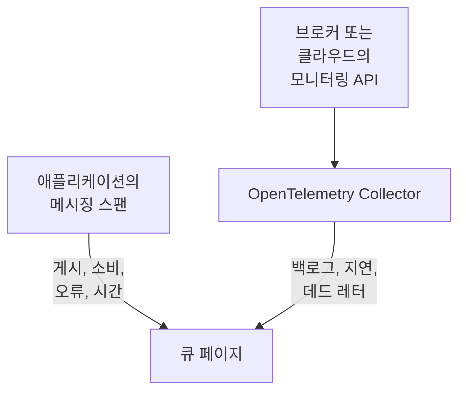

# 큐

**Queues**는 애플리케이션이 사용하는 모든 메시지 큐, 토픽, 구독에 전용 페이지를 제공합니다. 어떤 서비스가 게시하고 어떤 서비스가 소비하는지, 얼마나 많은 메시지가 오가는지, 얼마나 실패하고 처리에 얼마나 걸리는지, 그 트레이스와 메트릭을 보여 주며, 브로커 자체의 메트릭이 OneUptime에 도달하면 백로그, 컨슈머 지연, 데드 레터, 스로틀링도 보여 줍니다. 큐에는 다른 모든 리소스처럼 레이블, 소유자, 레이블 및 소유자 규칙, 보관 기능이 있습니다. **제품 → 리소스 → 큐**에서 여세요.

:::cards
- [애플리케이션 계측](#애플리케이션-계측): OpenTelemetry 계측이 이미 보내는 메시징 스팬.
- [브로커 상태 메트릭](#브로커-상태-메트릭): 브로커의 백로그, 지연, 데드 레터를 시스템별로.
- [알림](#알림): 바로 쓸 수 있는 템플릿과 늦게 도착하는 메트릭 또는 카운터.
- [문제 해결](#문제-해결): 생성되지 않은 큐, 또는 비어 있는 브로커 상태.
:::

## 작동 방식

Apache Kafka, RabbitMQ, Apache ActiveMQ 및 기타 JMS 브로커, Amazon SQS와 SNS, Google Cloud Pub/Sub, Azure Service Bus, Event Hubs, Event Grid, Apache Pulsar, Apache RocketMQ, NATS, BullMQ([지원되는 메시징 시스템](#지원되는-메시징-시스템) 참조) 등 모든 브로커에서, 그리고 스팬이 `messaging.system`으로 지정하는 다른 모든 브로커에서 같은 방식으로 작동합니다. 대부분의 큐는 두 가지 소스에서 저절로 나타납니다:

| 소스 | 필요한 것 | 큐 페이지에 추가하는 내용 |
| --- | --- | --- |
| **애플리케이션 트레이스** | 계측된 애플리케이션(OpenTelemetry). [애플리케이션 계측](#애플리케이션-계측) 참조 | 게시 및 소비된 메시지, 오류와 처리 시간, 양쪽의 서비스, 그리고 트레이스 자체 |
| **브로커 메트릭**(OpenTelemetry Collector) | 브로커용 Collector 리시버 또는 스크레이프. [브로커 상태 메트릭](#브로커-상태-메트릭) 참조 | **브로커 상태**: 백로그, 컨슈머 지연, 데드 레터, 가장 오래된 메시지의 나이, 스로틀링, 브로커 자체의 메시지 속도 |



트레이스는 큐가 존재한다는 사실과 애플리케이션이 큐를 사용하는 방식을 OneUptime에 알려 주지만, 큐가 얼마나 차 있는지는 알려 주지 않습니다. 그 정보는 브로커 자체나 해당 클라우드 공급자의 모니터링 API에서 옵니다. 작업을 Redis에 저장하고 물어볼 브로커가 없는 [BullMQ](#bullmq)의 경우에는 애플리케이션이 보고하는 게이지에서 옵니다.

큐를 직접 추가할 수도 있습니다. **Queues → Queue 만들기**에서 메시징 시스템과 대상 이름을 지정하고, Azure Service Bus와 Event Hubs의 경우 네임스페이스도 지정하세요. 양식은 첫 단계인 **메시징 시스템**에서 이를 묻고, 이어서 선택 사항인 이름과 설명을 묻습니다. 레이블은 **추가 필드**(**큐 정보**) 아래에 있습니다. 네임스페이스는 애플리케이션이 에뮬레이터나 사용자 지정 도메인 이름을 통해 접근하는 큐에서만 비워 두세요. 그런 스팬은 네임스페이스를 지정하지 않으며, Azure Monitor의 메트릭은 그런 큐에 절대 도달하지 않습니다([제한 사항](#제한-사항) 참조).

## 시작하기

:::steps
### 애플리케이션의 트레이스 보내기

게시하고 소비하는 애플리케이션을 계측하고, 그 트레이스를 OneUptime으로 보내세요([애플리케이션 계측](#애플리케이션-계측) 참조). OneUptime 전용 설정은 필요 없습니다. 계측이 이미 만드는 메시징 스팬이 큐를 지정합니다.

### 브로커의 메트릭 보내기

[브로커 상태 메트릭](#브로커-상태-메트릭)에서 메시징 시스템을 찾아 수집 키와 함께 해당 Collector 구성을 실행하세요. 각 큐의 **문서** 탭에는 해당 큐용 구성이 복사할 수 있게 준비되어 있습니다.

### 큐 열기

**제품 → 리소스 → 큐**를 여세요. 감지는 10분마다 실행됩니다. 15분 안에 큐의 스팬이 3개 이상 도착하거나 브로커 메트릭이 큐를 지정하면 큐가 나타납니다.
:::

## 지원되는 메시징 시스템

OneUptime은 아래 메시징 시스템을 이름으로 알고 있습니다. 계측이 `messaging.system`에 넣는 값을 대소문자 구분 없이 두 번째 열의 값(OpenTelemetry의 잘 알려진 값이 있으면 그 값)으로 정규화하므로 `AmazonSQS`, `aws.sqs`, `aws_sqs`는 하나의 시스템입니다. `nats`와 `bullmq`는 OpenTelemetry의 잘 알려진 값이 아닙니다. `nats`는 Java 에이전트의 NATS 계측이 보고하는 값이고, `bullmq`는 BullMQ에 설정할 값입니다([BullMQ](#bullmq) 참조).

OneUptime이 모르는 시스템도 작동합니다. 형식이 올바른 값(`ibmmq`, `solace`, `mqtt`: 소문자, 숫자, `.`, `_`, `-`로 최대 64자)은 들어온 그대로 유지되므로, 그 브로커의 큐가 감지되고 그 이름으로 표시됩니다. 브로커 자체의 메트릭에만 이 표의 시스템이 필요합니다. `spring_integration`은 무시됩니다. Spring Integration의 채널은 브로커가 아니라 하나의 프로세스 안에서 일어나는 메서드 호출이기 때문입니다.

**브로커 메트릭** 열은 시스템의 상태 메트릭을 어디에서 가져오는지 보여 줍니다: collector-contrib 리시버, Prometheus 엔드포인트(`:port/path`, Collector의 `prometheus` 리시버로 스크레이프), 클라우드 공급자의 모니터링 API, 또는 Collector 밖에서 OTLP로 메트릭을 보내는 프로그램입니다. 각 시스템은 아래의 설정으로 연결되며, 각 큐의 **문서** 탭은 이를 해당 큐용 구성으로 바꿔 줍니다.

| 시스템 | `messaging.system` | 함께 허용되는 값 | 브로커 메트릭 |
| --- | --- | --- | --- |
| [Amazon SNS](#amazon-sns) | `aws.sns` | `aws_sns`, `amazonsns`, `sns` | `aws_cloudwatch` 또는 `awsfirehose` 리시버(클라우드 모니터링) |
| [Amazon SQS](#amazon-sqs) | `aws_sqs` | `aws.sqs`, `amazonsqs`, `sqs` | `aws_cloudwatch` 또는 `awsfirehose` 리시버(클라우드 모니터링) |
| [Apache ActiveMQ](#apache-activemq) | `activemq` | `artemis`, `activemq_artemis` | OpenTelemetry JMX Scraper(OTLP로 전송) |
| [Apache Kafka](#apache-kafka) | `kafka` | — | `kafka_metrics` 리시버 |
| [Apache Pulsar](#apache-pulsar) | `pulsar` | `apache_pulsar` | Prometheus(Pulsar 브로커), `:8080/metrics/` |
| [Apache RocketMQ](#apache-rocketmq) | `rocketmq` | — | Prometheus(RocketMQ 브로커), `:5557/metrics` |
| [Azure Event Grid](#azure-event-grid) | `eventgrid` | `azure_eventgrid`, `azure.eventgrid`, `microsoft.eventgrid` | `azure_monitor` 리시버(클라우드 모니터링) |
| [Azure Event Hubs](#azure-event-hubs) | `eventhubs` | `azure_eventhubs`, `azure.eventhubs`, `microsoft.eventhub` | `azure_monitor` 리시버(클라우드 모니터링) |
| [Azure Service Bus](#azure-service-bus) | `servicebus` | `azure_servicebus`, `azure.servicebus`, `microsoft.servicebus` | `azure_monitor` 리시버(클라우드 모니터링) |
| [BullMQ](#bullmq) | `bullmq` | — | 내장 없음 |
| [Google Cloud Pub/Sub](#google-cloud-pubsub) | `gcp_pubsub` | `gcp.pubsub`, `pubsub`, `google_pubsub` | `googlecloudmonitoring` 리시버(클라우드 모니터링) |
| [JMS](#jms) | `jms` | — | 내장 없음 |
| [NATS](#nats) | `nats` | `jetstream` | Prometheus (prometheus-nats-exporter), `:7777/metrics` |
| [RabbitMQ](#rabbitmq) | `rabbitmq` | — | `rabbitmq` 리시버 |

큐는 한 시스템의 한 대상입니다. **Azure Service Bus**와 **Azure Event Hubs**에서는 네임스페이스도 큐에 포함됩니다. 두 네임스페이스에 각각 `orders`라는 큐가 있을 수 있기 때문입니다. **JMS**와 **Apache ActiveMQ**는 큐를 공유합니다. Java 애플리케이션은 JMS API를 통해 ActiveMQ에 접근하는데, 그 스팬은 브로커와 관계없이 `jms`라고 말하고, 브로커 자체의 메트릭은 `activemq`라고만 말할 수 있으므로 둘 다 하나의 큐에 들어갑니다([두 관측이 하나의 큐가 되는 기준](#두-관측이-하나의-큐가-되는-기준) 참조).

## 큐 감지 방식

각 큐는 트레이스, 브로커 메트릭, 사람 중 무엇이 큐를 생성했는지 기록합니다. 나중에 같은 큐를 지정하는 모든 것은 새 큐를 만들지 않고 그 큐에 추가됩니다([두 관측이 하나의 큐가 되는 기준](#두-관측이-하나의-큐가-되는-기준) 참조).

### 애플리케이션 트레이스에서

OneUptime은 10분마다 애플리케이션이 최근 15분 동안 보낸 스팬 중 `messaging.system`, `messaging.destination.name`, `messaging.destination`, `message_bus.destination`, `az.namespace`, `azure.resource_provider.namespace`, `aws.sqs.queue.url`, `aws.queue_url`, `aws.sns.topic.arn` 중 하나라도 가진 스팬을 요약합니다. SERVER 스팬을 제외한 모든 스팬이 포함됩니다: PRODUCER, CONSUMER, CLIENT, INTERNAL 스팬과, 트레이스 파이프라인의 **스팬 종류 리매퍼**가 다른 종류(예: Unspecified)로 바꾸었거나 종류를 없앤 스팬입니다. SERVER 스팬은 절대 큐를 지정하지 않습니다.

브로커 자체의 스팬도 SERVER 스팬입니다. [Kubernetes 에이전트](/docs/telemetry/kubernetes-agent#ebpf-트레이스의-모습)의 eBPF 트레이서는 Kafka, MQTT, NATS 브로커 쪽의 각 교환(받는 메시지, 전달하는 메시지)을 기록하고 대부분을 PRODUCER 또는 CONSUMER로 보냅니다. OneUptime은 이를 SERVER로 저장하므로, 브로커는 자신이 전달하는 토픽의 프로듀서나 컨슈머 목록에 오르지 않습니다. 구독자에게 메시지를 넘기는 MQTT 브로커는 클라이언트와 같은 PUBLISH를 쓰고 트레이서는 둘을 똑같이 보고하므로, MQTT와 NATS 게시에 대해 OneUptime은 연결 상대편의 포트를 기준으로 판단합니다. 포트 32768 이상(운영 체제가 연결하는 클라이언트의 포트를 고르는 범위입니다. Linux의 기본 범위가 여기서 시작하며, Windows와 macOS는 49152–65535를 사용합니다)이면 구독자의 포트이고, 그 스팬은 브로커의 것입니다. 따라서 무작위로 공개된 Docker 포트처럼 자신이 32768 이상의 포트에서 수신 대기하는 MQTT 또는 NATS 브로커에 게시하는 애플리케이션은 해당 토픽의 프로듀서로 표시되지 않으며, 그런 애플리케이션만 사용하는 토픽은 트레이서의 스팬으로는 전혀 감지되지 않을 수 있습니다. 32768 미만의 포트(좁혀진 포트 범위, 또는 NAT가 다시 쓴 포트)에서 브로커에 연결하는 구독자에게는 여전히 브로커가 자신에게 전달되는 토픽의 프로듀서로 표시됩니다.

OpenTelemetry의 모든 메시징 속성은 아직 개발 중으로 표시되어 있으므로, 한 프로젝트의 애플리케이션들이 같은 내용을 최대 다섯 세대의 이름으로 보고합니다. OneUptime은 최신 이름부터 모두 읽으며, 스팬 이름은 절대 파싱하지 않습니다. 스팬 이름의 형식은 시맨틱 규칙 1.27에서 바뀌었고 벤더가 자유롭게 정하기 때문입니다:

- **시스템**: [지원되는 메시징 시스템](#지원되는-메시징-시스템)에서처럼 정규화한 `messaging.system`. 이 값이 없으면 Azure SDK의 `az.namespace` 또는 `azure.resource_provider.namespace`(`Microsoft.ServiceBus`, `Microsoft.EventHub`), 이전 Azure SDK의 `component` 키, SQS 또는 SNS를 호출하는 AWS SDK 스팬(`rpc.system` = `aws-api`. Java 에이전트의 SNS 스팬에는 `messaging.system`이 없습니다), 또는 SQS 큐 URL이나 SNS 토픽 ARN 키를 사용합니다.
- **대상**: `messaging.destination.template`, `messaging.destination.name`, `messaging.source.template`, `messaging.source.name`, `messaging.destination`, `message_bus.destination` 중 스팬이 가진 첫 번째 값. 이 중 아무것도 없는 스팬은 해당 시스템 고유의 키를 사용합니다: SQS 큐 URL(`aws.sqs.queue.url`, `aws.queue_url`, 또는 `messaging.url`, `server.address`, `net.peer.name`에 있는 큐 URL), SNS 토픽 ARN(`aws.sns.topic.arn`), RabbitMQ에서는 라우팅 키(`messaging.rabbitmq.destination.routing_key` 또는 `messaging.rabbitmq.routing_key`)이며, 메시지가 기본 익스체인지를 거칠 때 이 키가 큐 이름입니다.
- **방향**: 먼저 `messaging.operation.type`, 다음으로 스팬 종류(PRODUCER는 게시, CONSUMER는 소비), 다음으로 이전의 `messaging.operation`, 다음으로 `messaging.operation.name`, 그리고 SQS와 SNS에서는 `rpc.method`에 있는 AWS SDK 작업(`SendMessage`, `ReceiveMessage`, …). 일부 계측이 이전 키를 잘못 채웠기 때문에 스팬 종류가 이전 키보다 우선합니다: Python용 confluent-kafka는 프로듀서 스팬에 `receive`를 기록했습니다.

큐는 실행이 살펴보는 15분 창 안에서 그 스팬이 3개 이상(`MESSAGE_QUEUE_MIN_SPANS`)이 되면 트레이스로부터 **생성**되며, 이는 일회성 스크립트가 큐를 만들지 않게 하기 위함입니다. 또한 프로젝트가 [자동 생성 한도](#자동-생성-한도) 미만인 동안에만 생성됩니다. 큐를 생성하지 않는 스팬도 이미 있는 큐에는 집계됩니다.

모든 메시징 스팬은 수집될 때 해당 큐로 태그도 지정되므로, 큐의 **트레이스** 탭에는 큐가 생성되기 전에 보낸 스팬을 포함해 그 큐를 지정하는 모든 스팬이 표시됩니다.

### 브로커 메트릭에서

[브로커 상태 메트릭](#브로커-상태-메트릭) 목록에 있는 브로커 메트릭은 브로커 고유의 속성(Kafka의 `topic`, RabbitMQ의 `rabbitmq.queue.name`, Azure Monitor의 `EntityName` 차원, CloudWatch의 `QueueName`)으로 큐를 지정하며, OneUptime은 수집할 때 이를 그 큐와 연결합니다. 브로커 메트릭에는 `messaging.system`이 없습니다. 각 메트릭은 이름(`kafka.consumer_group.lag_sum`)으로 인식되며, 두 시스템이 같은 이름을 쓰는 경우(Azure Monitor는 Service Bus와 Event Hubs의 메트릭에 같은 이름을 붙입니다)에는 데이터 포인트가 가진 리소스 유형으로 인식됩니다.

다음 감지 실행에서 아직 없는 큐가 생성됩니다. [자동 생성 한도](#자동-생성-한도) 안이라면 브로커 메트릭 하나로 충분합니다. 따라서 계측된 애플리케이션이 전혀 건드리지 않는 큐도 브로커가 보고하면 나타납니다.

클라우드 모니터링 API(CloudWatch, Azure Monitor, Cloud Monitoring)는 각 값을 측정 시점보다 몇 분 늦게 게시하며, 값은 그 측정 시점으로 저장됩니다. 그래서 각 실행은 스팬과 다른 메트릭을 읽는 최근 15분이 아니라 최근 1시간의 메트릭을 읽습니다. 늦게 도착한 데이터 포인트도 해당 큐를 관측한 것으로 기록되거나 큐를 생성합니다.

### 메시징 클라이언트 메트릭에서

계측된 클라이언트도 메트릭을 보고할 수 있습니다: OpenTelemetry의 메시징 클라이언트 메트릭 `messaging.client.sent.messages`, `messaging.client.consumed.messages`, `messaging.client.operation.duration`, `messaging.process.duration`, 그 이전 이름인 `messaging.publish.duration`, `messaging.receive.duration`, `messaging.publish.messages`, `messaging.receive.messages`, `messaging.process.messages`, `messaging.client.published.messages`, 그리고 Azure SDK for Java의 `messaging.servicebus.messages.sent`, `messaging.servicebus.receiver.lag`, `messaging.servicebus.settlement.request.duration`, `messaging.servicebus.settlement.sequence_number`입니다. 각 데이터 포인트는 스팬과 같은 방식으로 시스템과 대상을 지정하며(Azure SDK의 Service Bus 메트릭은 시스템을 지정하지 않으므로 메트릭 이름이 대신합니다), 수집될 때 그 큐와 연결되므로 큐의 **메트릭** 탭에 표시됩니다. 각 데이터 포인트에 `messaging.system`과 `messaging.destination.name`을 가진 직접 만든 메트릭도 마찬가지입니다(리소스에 있는 값은 읽지 않습니다). 큐 깊이 게이지가 그 예입니다([BullMQ](#bullmq) 참조).

메시징 클라이언트 메트릭은 큐를 생성하지 않습니다. 큐를 생성하는 것은 트레이스, 브로커 메트릭, 또는 사람입니다. 기존 큐를 지정하는 클라이언트 메트릭은 스팬과 마찬가지로 그 큐의 **마지막 확인**을 최신 상태로 유지합니다. 직접 만든 메트릭은 둘 다 하지 않고 큐의 **메트릭** 탭에 표시될 뿐입니다.

### 두 관측이 하나의 큐가 되는 기준

큐의 식별 기준은 **시스템**과 **대상**이며, 대소문자를 구분하지 않고 비교합니다. `Orders`와 `orders`는 하나의 큐이며, 처음 관측된 이름으로 표시됩니다. Azure Service Bus와 Event Hubs에서는 식별 기준에 **네임스페이스**도 포함됩니다:

- 스팬에서는 SDK가 연결한 호스트의 첫 번째 DNS 레이블입니다. `server.address`, `net.peer.name`, `peer.address`, `network.peer.address` 순서로 확인하며, 그 호스트가 네임스페이스 호스트(`<namespace>.servicebus.windows.net`, 또는 소버린 클라우드의 `.servicebus.usgovcloudapi.net`, `.servicebus.chinacloudapi.cn`, `.servicebus.cloudapi.de`)일 때 사용합니다. Event Hubs는 Service Bus의 도메인을 공유합니다.
- Azure Monitor 메트릭에서는 메트릭이 보고하는 네임스페이스의 `name`입니다.

그 외에는 아무것도 포함되지 않으므로, 다음 중 어느 것도 큐를 나누지 않습니다: 브로커 주소(Kafka 클라이언트는 거의 보고하지 않고, Azure 네임스페이스는 여러 주소에서 응답합니다), 컨슈머 그룹이나 구독(토픽의 컨슈머는 별도의 큐가 아닙니다), 파티션, 데드 레터 하위 큐. 이 중 큐가 유지하는 것은 표시용 브로커 주소뿐입니다.

**JMS와 ActiveMQ는 하나의 계열입니다.** 모든 JMS 스팬은 뒤에 어떤 브로커가 있든 `jms`라고 말하고, 브로커 자체의 메트릭([OpenTelemetry JMX Scraper](#apache-activemq))은 `activemq`라고만 말할 수 있으므로, OneUptime은 ActiveMQ 큐를 JMS 계열로 식별합니다. `orders`의 스팬과 브로커 메트릭은 하나의 큐에 들어갑니다. 큐는 브로커 메트릭이 도착하기 전까지는 JMS로, 그 후로는 Apache ActiveMQ로 표시되며, 그 반대로 바뀌는 일은 없습니다. 직접 Apache ActiveMQ로 만든 큐도 바로 그 큐입니다.

### 대상 이름을 읽는 방식

계측은 하나의 큐를 여러 방식으로 지정하며, OneUptime은 보고된 내용을 큐 자체의 이름으로 줄입니다:

| 시스템 | 보고되는 형태 | 큐 |
| --- | --- | --- |
| Amazon SQS | `https://sqs.us-east-1.amazonaws.com/123456789012/orders`, 큐 URL(Go용 `otelaws`는 이를 `server.address`에 넣습니다) | `orders` |
| Amazon SNS | `arn:aws:sns:us-east-1:123456789012:order-events`, 토픽 ARN | `order-events` |
| Google Cloud Pub/Sub | `projects/shop/topics/orders`, 리소스 이름 | `orders` |
| Azure Service Bus | `orders/Subscriptions/billing`, 토픽의 구독 `billing`의 엔터티 경로 | `orders` |
| Azure Service Bus | `orders/$DeadLetterQueue`, 큐의 데드 레터 하위 큐의 엔터티 경로 | `orders` |
| Azure Event Hubs | `telemetry/ConsumerGroups/$Default/Partitions/3`, 컨슈머 그룹 `$Default`에 대한 수신자의 엔터티 경로 | `telemetry` |
| Apache Pulsar | `orders-partition-3`, 짧은 이름을 가진 토픽의 파티션 | `persistent://public/default/orders` |
| Apache Pulsar | `acme/shop/orders`, 도메인이 없는 토픽 | `persistent://acme/shop/orders` |
| JMS | `queue://orders`, 대상 유형 접두사 포함 | `orders` |
| RabbitMQ | `shop:new-order:orders`, 컨슈머의 익스체인지, 라우팅 키, 큐(시맨틱 규칙 1.30 이상) | `orders` |
| RabbitMQ | `amq.default`, 라우팅 키가 `orders`인 기본 익스체인지 | `orders` |
| RabbitMQ | `,orders`, 기본 익스체인지를 거친 aio-pika의 `{exchange},{routing key}` | `orders` |
| RabbitMQ | `shop,new-order`, aio-pika의 `{exchange},{routing key}` | `shop` |

Pulsar 파티션은 해당 토픽으로 합쳐지고, 도메인이 없는 이름은 Pulsar 자체가 보완하는 방식대로(짧은 이름은 `public/default` 네임스페이스로) 보완되므로, Java 에이전트의 이름이 브로커의 정규화된 메트릭 레이블과 일치합니다. RabbitMQ 스팬은 보통 게시하는 쪽과 소비하는 쪽 모두에서 메시지가 거친 익스체인지를 지정합니다. 기본 익스체인지(`amq.default`, `<default>`, 또는 빈 이름)는 그 라우팅 키, 즉 큐 이름을 뜻합니다. 시맨틱 규칙 1.30은 익스체인지, 라우팅 키, 큐를 `:`로 연결하며(Java 에이전트의 옵트인 이름), OneUptime은 컨슈머의 연결된 이름에서 큐를, 게시자의 연결된 이름에서 익스체인지를 가져옵니다. aio-pika는 게시하는 쪽에서 익스체인지와 라우팅 키를 쉼표로 연결하며, OneUptime은 이것도 같은 방식으로 나눕니다.

### 무시되는 항목

OneUptime은 확실하지 않으면 큐를 만들지 않는 쪽을 택합니다. 그렇지 않으면 요청마다 또는 컨슈머마다 만들어지는 이름이 메시지마다 아무도 소유하지 않는 큐를 만들게 됩니다. 다음은 절대 큐가 되지 않습니다:

- **SERVER 스팬**, 그리고 `messaging.system`이 `spring_integration`인 스팬.
- **임시 또는 익명으로 표시된 대상**: `messaging.destination.temporary`, `messaging.destination.anonymous`, `messaging.source.temporary`, `messaging.source.anonymous`가 `true`로 설정된 경우. 이전의 `messaging.temp_destination`은 신뢰하지 않습니다: Python의 pika와 aio-pika 계측은 모든 게시에 이 값을 설정합니다.
- **계측이 이름 대신 보고하는 자리 표시자**: `(temporary)`, `(anonymous)`, `<generated>`, `unknown`(여러 토픽에 걸친 Kafka 배치), `aws:sqs`(Java 에이전트의 Lambda SQS 이벤트), Azure Monitor의 `-NamespaceOnlyMetric-`, 그리고 OneUptime 자체의 데이터 스크러빙이 통째로 바꾼 값(`[REDACTED]`).
- **생성된 대상과 응답용 대상**: RabbitMQ의 `amq.gen-JzTY20BRgKO-HjmUJj0wLg` 형식의 서버 명명 큐, Spring의 `spring.gen-…` 큐, 그룹이 없는 컨슈머의 Spring Cloud Stream `<destination>.anonymous.<id>` 큐, direct reply-to(`amq.rabbitmq.reply-to…`); JMS 임시 대상(`temp-queue://…`, `temp-topic://…`)과 TIBCO의 `$TMP$…`; ActiveMQ의 어드바이저리 토픽(`ActiveMQ.Advisory.…`); NATS 인박스(`_INBOX.…`)와 JetStream 확인 응답 서브젝트(`$JS.ACK.…`); Pulsar의 시스템 토픽(`__change_events`, `__transaction_…`, 그리고 `/__` 세그먼트 아래의 모든 것); 그리고 UUID만으로 된 대상.
- **SNS 문자 메시지와 모바일 푸시**: 전화번호(`+15555550123`, 또는 botocore의 `phone_number:**`)나 플랫폼 엔드포인트 ARN(`arn:aws:sns:us-east-1:123456789012:endpoint/GCM/shop-app/1234`)은 토픽이 아니라 기기입니다.
- **하나의 큐가 될 수 없는 이름**: 배치의 대상 목록(`["orders","payments"]`), 제어 문자가 들어 있는 이름, 255자보다 긴 이름.

**UUID는 템플릿으로 바뀝니다.** 대상 안의 각 UUID는 `{uuid}`로 바뀌므로, `reply-7f1c2a9e-4b1d-4c3e-9f1a-2b3c4d5e6f70` 같은 요청별 이름은 각각 별도의 큐가 아니라 하나의 큐 `reply-{uuid}`가 됩니다.

### 자동 생성 한도

트레이스와 브로커 메트릭은 프로젝트에 보관되지 않은 활성 감지 큐가 500개 미만인 동안에만 스스로 큐를 생성합니다(`MESSAGE_QUEUE_AUTO_CREATE_BUDGET`, [셀프 호스팅 조정](#셀프-호스팅-조정) 참조). 직접 만든 큐는 집계되지 않으며 차단되지도 않습니다. 보관된 큐는 집계되지 않으므로 [자동 보관](#수명-주기와-보관)이 한도에 여유를 만들며, 이미 있는 큐는 계속 연결되고 업데이트됩니다.

### 수명 주기와 보관

- **마지막 확인**은 감지가 트레이스, 메시징 클라이언트 메트릭, 브로커 메트릭 중 하나에서 큐를 마지막으로 확인한 시각입니다.
- **정리하려면 보관하세요.** 감지된 큐를 삭제해도 다시 확인될 때까지만 사라집니다. 다음에 확인되면 새 큐로 돌아옵니다. 영구적으로 정리하려면 **보관**하세요. 보관된 큐는 식별 기준을 유지하므로, 그 큐를 지정하는 것은 새 큐를 만들지 않고 보관된 큐에 계속 연결됩니다.
- **자동 보관.** 7일 동안(`MESSAGE_QUEUE_AUTO_ARCHIVE_DAYS`) 확인되지 않은 감지된 큐는 사람이 이름을 바꾸거나, 설명을 붙이거나, 레이블을 달거나, 소유자를 지정하지 않았다면 자동으로 보관됩니다. 레이블 규칙이나 소유자 규칙이 스스로 붙인 레이블과 소유자는 집계하지 않습니다.
- **복원.** 자동으로 보관된 큐는 다시 확인되면 자동으로 복원됩니다. 직접 만든 큐와 사람이 보관한 큐는 감지가 보관하거나 복원하지 않습니다. 사람이 복원한 큐는 아무것도 그 큐를 확인하지 않아도 30일 동안(또는 보관 기간이 더 길면 그 기간 동안) 복원된 상태로 유지됩니다. 다음에 확인될 때부터 다시 7일 규칙이 적용됩니다.

## 애플리케이션 계측

큐는 OpenTelemetry 계측이 이미 만들고 있는 메시징 스팬에서 나옵니다. OneUptime 전용 설정은 필요 없습니다. [OpenTelemetry](/docs/telemetry/open-telemetry)의 설명대로 트레이스를 OneUptime으로 보낸 다음, 사용하는 언어의 목록을 확인하세요.

:::tabs
@tab Java
OpenTelemetry Java 에이전트는 Kafka, RabbitMQ, JMS(ActiveMQ, Artemis, IBM MQ 및 기타 모든 JMS 브로커), Amazon SQS와 SNS, Pulsar, RocketMQ, NATS 클라이언트를 코드 변경 없이 트레이스합니다. OneUptime은 에이전트가 기본으로 내보내는 속성 이름과 `OTEL_SEMCONV_STABILITY_OPT_IN=messaging`(에이전트 2.31.0 이상)으로 내보내는 새 속성 이름을 모두 읽습니다. JMS 스팬은 뒤에 어떤 브로커가 있든 `jms`라고 말합니다([JMS](#jms) 참조).

- **Azure Service Bus와 Event Hubs**: Azure SDK for Java가 스스로 트레이스하며, Java 에이전트가 그 트레이스를 OpenTelemetry에 연결합니다.
- **Google Cloud Pub/Sub**: 클라이언트는 `Publisher`와 `Subscriber` 빌더가 OpenTelemetry 인스턴스와 트레이스 스위치(`setOpenTelemetry(GlobalOpenTelemetry.get())`와 `setEnableOpenTelemetryTracing(true)`)를 받으면 스스로 트레이스합니다. 둘 중 하나만 호출하면 아무것도 트레이스되지 않습니다.
@tab .NET
- **Azure Service Bus와 Event Hubs**(`Azure.Messaging.ServiceBus`, `Azure.Messaging.EventHubs`): Azure SDK에서 이들의 OpenTelemetry 스팬은 실험적 기능입니다. 환경 변수 `AZURE_EXPERIMENTAL_ENABLE_ACTIVITY_SOURCE=true`(또는 아래의 `Azure.Experimental.EnableActivitySource` 스위치)로 켜고, `Azure.*` 소스를 구독하세요.
- **RabbitMQ.Client** 7은 스스로 트레이스합니다: `RabbitMQ.Client.*`를 구독하세요.
- **MassTransit**은 스스로 트레이스합니다: `MassTransit`을 구독하세요(그 스팬에서 빠지는 내용은 [제한 사항](#제한-사항) 참조).
- **Confluent.Kafka**: `OpenTelemetry.Instrumentation.ConfluentKafka` 패키지.
- **Amazon SQS와 SNS**: `.AddAWSInstrumentation(opt => opt.SemanticConventionVersion = SemanticConventionVersion.Latest)`와 함께 `OpenTelemetry.Instrumentation.AWS` 패키지를 사용합니다. 기본 속성 집합(`V1_28_0`)은 SQS 큐를 URL(`aws.queue_url`, OneUptime이 읽습니다)로만 지정하고, SNS 토픽은 전혀 지정하지 않습니다.

```csharp
// Before any Azure client is created; or set AZURE_EXPERIMENTAL_ENABLE_ACTIVITY_SOURCE=true.
AppContext.SetSwitch("Azure.Experimental.EnableActivitySource", true);

builder.Services.AddOpenTelemetry()
    .WithTracing(tracing => tracing
        .AddSource("Azure.*")
        .AddSource("RabbitMQ.Client.*")
        .AddSource("MassTransit")
        .AddOtlpExporter());
```
@tab Node.js
- `@opentelemetry/auto-instrumentations-node`는 `amqplib`(RabbitMQ), `kafkajs`, AWS SDK(SQS와 SNS)를 트레이스합니다.
- **Azure Service Bus와 Event Hubs**: `@azure/opentelemetry-instrumentation-azure-sdk`의 `createAzureSdkInstrumentation()`을 등록하세요.
- **Google Cloud Pub/Sub**: `new PubSub({ enableOpenTelemetryTracing: true })`.
- **BullMQ**: [BullMQ](#bullmq)를 참조하세요. BullMQ 자체 텔레메트리에는 속성 두 개를 추가해야 합니다.
@tab Python
- Kafka: `opentelemetry-instrumentation-kafka-python`, `opentelemetry-instrumentation-confluent-kafka`, 또는 `opentelemetry-instrumentation-aiokafka`. RabbitMQ: `opentelemetry-instrumentation-pika` 또는 `opentelemetry-instrumentation-aio-pika`. SQS와 SNS: `opentelemetry-instrumentation-botocore`, 또는 SQS용 `opentelemetry-instrumentation-boto3sqs`. `opentelemetry-bootstrap -a install`은 설치된 라이브러리에 필요한 것을 고릅니다.
- **Azure Service Bus와 Event Hubs**: `azure-core-tracing-opentelemetry`를 설치하고 `settings.tracing_implementation = "opentelemetry"`(`azure.core.settings`에서)를 설정하세요.
- **Google Cloud Pub/Sub**: `PublisherOptions(enable_open_telemetry_tracing=True)`와 `SubscriberOptions(enable_open_telemetry_tracing=True)`.
- Celery의 스팬은 `messaging.system`이 없고 브로커도 지정하지 않으므로 큐를 생성하지 않습니다.
@tab Go
- **Amazon SQS와 SNS**: `otelaws`(`go.opentelemetry.io/contrib/instrumentation/github.com/aws/aws-sdk-go-v2/otelaws`)를 `otelaws.AppendMiddlewares(&cfg.APIOptions)`로 추가합니다. 그 SQS 스팬은 큐 URL을 `server.address`에 담고, OneUptime은 이를 큐로 읽습니다.
- **Google Cloud Pub/Sub**: `pubsub.ClientConfig{EnableOpenTelemetryTracing: true}`.
- **Kafka**(`segmentio/kafka-go`): OpenTelemetry Go 자동 계측(`go.opentelemetry.io/auto`, eBPF, Linux)이 코드 변경 없이 프로듀서와 컨슈머를 트레이스합니다.
- OpenTelemetry의 Go contrib 라이브러리에는 Kafka, RabbitMQ, NATS 계측이 없습니다. 다른 클라이언트에서는 클라이언트 라이브러리 자체의 OpenTelemetry 지원을 사용하거나, 보내기와 핸들러를 감싸는 스팬에 `messaging.system`, `messaging.destination.name`, 스팬 종류를 설정하세요.
:::

## 브로커 상태 메트릭

브로커는 어떤 애플리케이션도 볼 수 없는 것을 압니다: 대기 중인 메시지 수, 각 컨슈머 그룹이 얼마나 뒤처졌는지, 무엇이 데드 레터 큐로 갔는지입니다. 아래의 각 섹션에는 한 시스템용 Collector 구성이 있습니다. OneUptime으로 보내는 OTLP 익스포터로 끝나는 완전한 OpenTelemetry Collector 구성입니다. 텔레메트리 수집 키(**프로젝트 설정 → 텔레메트리 및 APM → 수집 키**)를 `x-oneuptime-token`에 넣고, 셀프 호스팅한다면 `https://oneuptime.com`을 자신의 호스트로 바꾼 다음, `otel/opentelemetry-collector-contrib` 0.161.0 이상으로 실행하세요(여기의 모든 구성은 0.161.0으로 검증했습니다). 최근 Collector는 `otlphttp`가 사용 중단되었으니 `otlp_http`를 쓰라고 로그에 남기지만, 두 이름은 같은 익스포터입니다. 여러 시스템을 수집하려면 그 리시버들을 하나의 Collector에 합치세요.

각 큐의 **브로커 상태** 섹션은 해당 시스템에 나열된 메트릭을 차트로 보여 주며(게이지는 그 값, 기간별 개수는 간격별 합계, 카운터는 초당 속도), 메트릭마다 필요한 방식으로 큐의 시리즈를 결합합니다(RabbitMQ 큐의 준비된 메시지와 확인되지 않은 메시지는 합산되고, 가장 많이 뒤처진 컨슈머 그룹이 지연이 됩니다). Collector가 보내는 모든 것은 **메트릭** 탐색기에도 있습니다. 나열된 메트릭이 아직 큐에 도착하지 않은 동안에는 이 섹션에 해당 시스템의 메트릭을 어디에서 가져오는지가 여기의 해당 섹션 링크와 함께 표시됩니다.

### Amazon SNS

Collector의 `aws_cloudwatch` 리시버로 토픽의 CloudWatch 메트릭을 읽거나, CloudWatch Metric Stream과 Amazon Data Firehose를 거쳐 그 `awsfirehose` 리시버로 스트리밍하세요.

`aws_cloudwatch` 리시버는 CloudWatch의 `GetMetricData` API를 폴링하며 리시버당 하나의 네임스페이스를 다루므로, SNS는 [Amazon SQS](#amazon-sqs)용 인스턴스 옆에 별도의 인스턴스를 둡니다. 리시버는 AWS SDK의 기본 자격 증명(환경, 공유 프로필 또는 인스턴스 역할)을 사용하며, 여기에는 `cloudwatch:ListMetrics`와 `cloudwatch:GetMetricData`가 필요합니다:

```yaml
receivers:
  aws_cloudwatch/sns:
    region: us-east-1
    metrics:
      collection_interval: 5m
      period: 1m
      delay: 10m
      discovery:
        filters:
          namespace: AWS/SNS
        limit: 500

processors:
  batch: {}

exporters:
  otlphttp:
    endpoint: https://oneuptime.com/otlp
    headers:
      x-oneuptime-token: YOUR_TELEMETRY_INGESTION_TOKEN

service:
  pipelines:
    metrics:
      receivers: [aws_cloudwatch/sns]
      processors: [batch]
      exporters: [otlphttp]
```

[Amazon SQS](#amazon-sqs)에서처럼 `stats`는 설정하지 마세요. Metric Stream은 SNS와 SQS를 함께 전달합니다: [Amazon SQS](#amazon-sqs) 설정에서 스트림의 네임스페이스에 `AWS/SNS`를 추가하세요.

토픽은 양쪽에서 같은 이름으로 지정됩니다: 스팬은 토픽의 ARN이나 이름을 보고하고, OneUptime은 ARN의 마지막 `:` 뒤의 이름을 유지합니다.

| 메트릭 | 표시 이름 | 유형 |
| --- | --- | --- |
| `amazonaws.com/aws/sns/numberofmessagespublished` (JSON 스트림: `numberofmessagespublished`) | Messages published | 기간별 개수 |
| `amazonaws.com/aws/sns/numberofnotificationsdelivered` (JSON 스트림: `numberofnotificationsdelivered`) | Notifications delivered | 기간별 개수 |
| `amazonaws.com/aws/sns/numberofnotificationsfailed` (JSON 스트림: `numberofnotificationsfailed`) | Notifications failed | 기간별 개수 |
| `amazonaws.com/aws/sns/numberofnotificationsredriventodlq` (JSON 스트림: `numberofnotificationsredriventodlq`) | Redriven to dead-letter queue | 기간별 개수 |

### Amazon SQS

Collector의 `aws_cloudwatch` 리시버로 큐의 CloudWatch 메트릭을 읽거나, CloudWatch Metric Stream과 Amazon Data Firehose를 거쳐 그 `awsfirehose` 리시버로 스트리밍하세요.

**CloudWatch 폴링**에는 AWS 쪽에서 자격 증명 외에 아무것도 필요 없습니다. 리시버는 AWS SDK의 기본 자격 증명(환경, 공유 프로필 또는 인스턴스 역할)을 사용하며, 여기에는 `cloudwatch:ListMetrics`와 `cloudwatch:GetMetricData`가 필요합니다:

```yaml
receivers:
  aws_cloudwatch/sqs:
    region: us-east-1
    metrics:
      collection_interval: 5m
      period: 1m
      delay: 10m
      discovery:
        filters:
          namespace: AWS/SQS
        # Metrics per scrape: about nine per queue. Must be set.
        limit: 500

processors:
  batch: {}

exporters:
  otlphttp:
    endpoint: https://oneuptime.com/otlp
    headers:
      x-oneuptime-token: YOUR_TELEMETRY_INGESTION_TOKEN

service:
  pipelines:
    metrics:
      receivers: [aws_cloudwatch/sqs]
      processors: [batch]
      exporters: [otlphttp]
```

- **`stats`는 설정하지 마세요.** 설정하지 않으면 각 메트릭이 기간마다 하나의 요약으로 도착하며, OneUptime은 이를 읽습니다. 설정하면 각 통계가 별도의 시리즈가 되어 차트에서 섞입니다.
- `discovery.limit`은 반드시 설정해야 하며, 스크레이프당 읽는 메트릭 수의 상한입니다. 큐당 약 아홉 개입니다. 각 메트릭은 스크레이프마다 `GetMetricData` 하위 쿼리 네 개를 사용하며, AWS가 이에 비용을 청구합니다.
- `delay`는 CloudWatch가 기간을 게시하기를 기다리므로(몇 분이 걸립니다), 이 구성에서는 큐의 브로커 메트릭이 11분에서 17분 늦게 도착합니다: 이 메트릭에 대한 모니터에는 더 긴 창이 필요합니다([알림](#알림)의 **늦게 도착하는 메트릭** 참조).
- 하나의 리시버는 하나의 리전과 하나의 네임스페이스를 읽습니다: 리전마다 인스턴스를 추가하세요.

**스트리밍**은 CloudWatch가 메트릭을 게시하는 대로 푸시합니다. `AWS/SQS`(및 `AWS/SNS`) 네임스페이스에 대해 출력 형식이 **OpenTelemetry 1.0**인 CloudWatch Metric Stream을 만들고, 대상이 HTTP 엔드포인트(액세스 키를 가진 Collector)인 Amazon Data Firehose 스트림으로 전달하세요. Firehose는 포트 443의 `https://`로만 전달하므로, Collector에는 인증서와 공개 포트 443이 필요합니다(예: 로드 밸런서 뒤):

```yaml
extensions:
  awscloudwatchmetricstreams_encoding:
    format: opentelemetry1.0

receivers:
  awsfirehose:
    # Firehose delivers to HTTPS on port 443 only: expose this port as 443,
    # for example behind a load balancer.
    endpoint: 0.0.0.0:4433
    encoding: awscloudwatchmetricstreams_encoding
    access_key: ${env:FIREHOSE_ACCESS_KEY}
    tls:
      cert_file: /etc/otelcol/tls/server.crt
      key_file: /etc/otelcol/tls/server.key

processors:
  batch: {}

exporters:
  otlphttp:
    endpoint: https://oneuptime.com/otlp
    headers:
      x-oneuptime-token: YOUR_TELEMETRY_INGESTION_TOKEN

service:
  extensions: [awscloudwatchmetricstreams_encoding]
  pipelines:
    metrics:
      receivers: [awsfirehose]
      processors: [batch]
      exporters: [otlphttp]
```

출력 형식이 **JSON**인 스트림(`format: json`)도 작동합니다: 각 메트릭을 원래 이름 그대로 보내며, OneUptime은 스트림이 붙이는 `service.name`(`SQS`, `SNS`)으로 SQS 메트릭과 SNS 메트릭을 구별합니다.

데드 레터 큐는 자체 메트릭이 있는 일반 SQS 큐이므로, OneUptime에서도 별도의 큐가 됩니다. 큐는 계정이나 리전이 아니라 이름만으로 지정됩니다([제한 사항](#제한-사항) 참조).

| 메트릭 | 표시 이름 | 유형 |
| --- | --- | --- |
| `amazonaws.com/aws/sqs/approximatenumberofmessagesvisible` (JSON 스트림: `approximatenumberofmessagesvisible`) | Messages visible | 게이지 |
| `amazonaws.com/aws/sqs/approximateageofoldestmessage` (JSON 스트림: `approximateageofoldestmessage`) | Oldest message age | 게이지 |
| `amazonaws.com/aws/sqs/approximatenumberofmessagesnotvisible` (JSON 스트림: `approximatenumberofmessagesnotvisible`) | Messages in flight | 게이지 |
| `amazonaws.com/aws/sqs/numberofmessagessent` (JSON 스트림: `numberofmessagessent`) | Messages sent | 기간별 개수 |
| `amazonaws.com/aws/sqs/numberofmessagesreceived` (JSON 스트림: `numberofmessagesreceived`) | Messages received | 기간별 개수 |
| `amazonaws.com/aws/sqs/numberofmessagesdeleted` (JSON 스트림: `numberofmessagesdeleted`) | Messages deleted | 기간별 개수 |

### Apache ActiveMQ

Collector에는 JMX 리시버가 없으므로, ActiveMQ Classic 브로커 옆에서 `OTEL_JMX_TARGET_SYSTEM=activemq`로 OpenTelemetry JMX Scraper를 실행하세요. 스크레이퍼는 브로커의 대상 메트릭을 OTLP로 푸시합니다.

1. 브로커가 JMX 연결을 받도록 하세요. `apache/activemq-classic` 이미지나 `bin/activemq` 스크립트에서는 시작하기 전에 `ACTIVEMQ_SUNJMX_START`를 설정하세요. 이 예시는 인증을 끕니다: 포트를 사설 네트워크에 두거나, 암호 파일로 `jmxremote.authenticate`를 켜고 스크레이퍼에 `OTEL_JMX_USERNAME`과 `OTEL_JMX_PASSWORD`를 전달하세요.

```bash
ACTIVEMQ_SUNJMX_START="-Dcom.sun.management.jmxremote.port=1099 -Dcom.sun.management.jmxremote.rmi.port=1099 -Dcom.sun.management.jmxremote.authenticate=false -Dcom.sun.management.jmxremote.ssl=false -Djava.rmi.server.hostname=activemq"
```

2. 그 포트에 닿을 수 있는 곳에서 Java 런타임으로 스크레이퍼를 실행하세요. 스크레이퍼는 OneUptime으로 직접 보냅니다. 대신 자신의 Collector를 거치게 하려면 `OTEL_EXPORTER_OTLP_ENDPOINT`를 Collector의 OTLP 리시버로 지정하세요.

```bash
curl -fsSLo opentelemetry-jmx-scraper.jar https://github.com/open-telemetry/opentelemetry-java-contrib/releases/latest/download/opentelemetry-jmx-scraper.jar

export OTEL_JMX_SERVICE_URL=service:jmx:rmi:///jndi/rmi://activemq:1099/jmxrmi
export OTEL_JMX_TARGET_SYSTEM=activemq
export OTEL_JMX_TARGET_SOURCE=instrumentation
export OTEL_METRIC_EXPORT_INTERVAL=30000
export OTEL_SERVICE_NAME=activemq-prod
export OTEL_EXPORTER_OTLP_PROTOCOL=http/protobuf
export OTEL_EXPORTER_OTLP_ENDPOINT=https://oneuptime.com/otlp
export OTEL_EXPORTER_OTLP_HEADERS=x-oneuptime-token=YOUR_TELEMETRY_INGESTION_TOKEN
java -jar opentelemetry-jmx-scraper.jar
```

`OTEL_JMX_TARGET_SOURCE=instrumentation`은 스크레이퍼가 1.53.0-alpha부터 사용해 온 메트릭 이름(`activemq.message.queue.size`, 대상은 `messaging.destination.name`)을 유지합니다. OneUptime은 이전 스크레이퍼의 이름과 `OTEL_JMX_TARGET_SOURCE=legacy`의 이름(`activemq.message.current`, 대상은 `destination`)도 읽습니다.

브로커의 메트릭은 JMS 클라이언트의 스팬이 생성한 큐에 합류하며, 그때부터 큐는 Apache ActiveMQ로 표시됩니다([두 관측이 하나의 큐가 되는 기준](#두-관측이-하나의-큐가-되는-기준) 참조). 스크레이퍼는 모든 대상을 보고합니다: OneUptime은 어드바이저리 토픽은 무시하지만, 데드 레터 큐(`ActiveMQ.DLQ`, 또는 개별 데드 레터 전략에서의 `DLQ.<destination>`)는 별도의 큐입니다. ActiveMQ Artemis에는 다른 MBean이 있어 이 규칙들이 읽지 않습니다: Artemis 큐는 여전히 JMS 스팬에서 나오지만, 브로커 상태는 없습니다.

| 메트릭 | 표시 이름 | 유형 |
| --- | --- | --- |
| `activemq.message.queue.size` | Queue size | 게이지 |
| `activemq.message.current` | Queue size (legacy names) | 게이지 |
| `activemq.message.enqueued` | Enqueued | 카운터, 초당으로 표시 |
| `activemq.message.dequeued` | Dequeued | 카운터, 초당으로 표시 |
| `activemq.message.expired` | Expired | 카운터, 초당으로 표시 |
| `activemq.consumer.count` | Consumers | 게이지 |
| `activemq.message.enqueue.average_duration` | Average time in queue | 게이지 |
| `activemq.message.wait_time.avg` | Average time in queue (legacy names) | 게이지 |

### Apache Kafka

Collector의 `kafka_metrics` 리시버는 브로커에서 컨슈머 그룹 지연과 파티션 오프셋을 읽습니다. `topics`와 `consumers` 스크레이퍼를 켜세요.

```yaml
receivers:
  kafka_metrics:
    brokers: ["kafka-1:9092", "kafka-2:9092"]
    # topics: each partition's log-end offset; consumers: each group's
    # committed offsets and lag. brokers: the broker count.
    scrapers: [brokers, topics, consumers]
    collection_interval: 30s
    # auth:
    #   sasl:
    #     mechanism: SCRAM-SHA-512
    #     username: ${env:KAFKA_USERNAME}
    #     password: ${env:KAFKA_PASSWORD}
    # tls:
    #   ca_file: /etc/kafka/ca.pem

processors:
  batch: {}

exporters:
  otlphttp:
    endpoint: https://oneuptime.com/otlp
    headers:
      x-oneuptime-token: YOUR_TELEMETRY_INGESTION_TOKEN

service:
  pipelines:
    metrics:
      receivers: [kafka_metrics]
      processors: [batch]
      exporters: [otlphttp]
```

SASL이나 TLS를 쓰는 클러스터에서는 `auth`와 `tls`의 주석을 해제하세요. 리시버는 각 토픽을 `topic`으로 지정하며, 메트릭은 이를 통해 토픽의 큐를 찾습니다. 컨슈머 그룹의 지연과 커밋된 오프셋은 그 그룹이 오프셋을 커밋한 토픽에 대해서만 보고하며, 이름이 `_`로 시작하는 토픽, 즉 Kafka 내부 토픽은 건너뜁니다(`topic_match`의 기본값은 `^[^_].*$`).

| 메트릭 | 표시 이름 | 유형 |
| --- | --- | --- |
| `kafka.consumer_group.lag_sum` | Consumer lag | 게이지 |
| `kafka.consumer_group.lag` | Partition lag | 게이지 |
| `kafka.consumer_group.offset_sum` | Consumed | 카운터, 초당으로 표시 |
| `kafka.partition.current_offset` | Produced | 카운터, 초당으로 표시 |

### Apache Pulsar

각 브로커는 토픽과 구독 메트릭을 웹 서비스 포트에서 제공합니다. 브로커는 현재 소유한 토픽만 보고하므로 모든 브로커를 스크레이프하세요.

```yaml
receivers:
  prometheus:
    config:
      scrape_configs:
        - job_name: pulsar-broker
          scrape_interval: 30s
          metrics_path: /metrics/
          # Every broker: each one reports only the topics it owns.
          static_configs:
            - targets: ["pulsar-broker-0:8080", "pulsar-broker-1:8080"]
          # Keeps the families the queue page charts; remove it to keep all.
          metric_relabel_configs:
            - source_labels: [__name__]
              regex: "pulsar_(msg_backlog|subscription_back_log|storage_backlog_age_seconds|in_messages_total|out_messages_total)"
              action: keep

processors:
  batch: {}

exporters:
  otlphttp:
    endpoint: https://oneuptime.com/otlp
    headers:
      x-oneuptime-token: YOUR_TELEMETRY_INGESTION_TOKEN

service:
  pipelines:
    metrics:
      receivers: [prometheus]
      processors: [batch]
      exporters: [otlphttp]
```

- 토픽과 구독 시리즈에는 `broker.conf`의 `exposeTopicLevelMetricsInPrometheus=true`가 필요하며, 이것이 기본값입니다.
- Pulsar는 각 시리즈에 토픽의 전체 이름(`persistent://public/default/orders`)을, 파티션의 시리즈에는 파티션의 이름(`persistent://public/default/orders-partition-3`)을 레이블로 붙입니다: 파티션은 해당 토픽으로 합산됩니다.
- 백로그는 엔트리 단위로 세며, Pulsar는 메시지 배치 하나를 하나의 엔트리로 셉니다.
- `exposeConsumerLevelMetricsInPrometheus=true`이면 Pulsar는 `pulsar_out_messages_total`을 컨슈머마다 반복합니다. 이 컨슈머별 시리즈는 차트에서 제외되므로 어떤 메시지도 두 번 세지 않습니다.
- 브로커가 판단할 수 없는 동안 `pulsar_storage_backlog_age_seconds`는 `-1`을 나타냅니다.
- Pulsar 3.3 이상의 네이티브 OpenTelemetry 메트릭(실험적 기능, 기본적으로 꺼짐)은 다른 이름을 사용하므로 차트에 표시되지 않습니다.

| 메트릭 | 표시 이름 | 유형 |
| --- | --- | --- |
| `pulsar_msg_backlog` | Backlog | 게이지 |
| `pulsar_subscription_back_log` | Subscription backlog | 게이지 |
| `pulsar_storage_backlog_age_seconds` | Backlog age | 게이지 |
| `pulsar_in_messages_total` | Messages in | 카운터, 초당으로 표시 |
| `pulsar_out_messages_total` | Messages out | 카운터, 초당으로 표시 |

### Apache RocketMQ

브로커의 `broker.conf`에 `metricsExporterType=PROM`을 설정해 브로커가 지연과 처리량 메트릭을 제공하게 하세요.

```text
metricsExporterType=PROM
metricsPromExporterPort=5557
metricsPromExporterHost=0.0.0.0
```

그런 다음 모든 브로커를 스크레이프하세요:

```yaml
receivers:
  prometheus:
    config:
      scrape_configs:
        - job_name: rocketmq-broker
          scrape_interval: 30s
          metrics_path: /metrics
          static_configs:
            - targets: ["rocketmq-broker-a:5557", "rocketmq-broker-b:5557"]

processors:
  batch: {}

exporters:
  otlphttp:
    endpoint: https://oneuptime.com/otlp
    headers:
      x-oneuptime-token: YOUR_TELEMETRY_INGESTION_TOKEN

service:
  pipelines:
    metrics:
      receivers: [prometheus]
      processors: [batch]
      exporters: [otlphttp]
```

이것은 RocketMQ 5의 기본 제공 익스포터입니다. RocketMQ 4에는 이것이 없으며, 대신 사용하는 별도의 `rocketmq-exporter`는 다른 메트릭 이름을 보고하므로 차트에 표시되지 않습니다. 컨슈머 그룹의 데드 레터 토픽(`%DLQ%<group>`)은 별도의 큐입니다.

| 메트릭 | 표시 이름 | 유형 |
| --- | --- | --- |
| `rocketmq_consumer_lag_messages` | Consumer lag | 게이지 |
| `rocketmq_consumer_ready_messages` | Ready messages | 게이지 |
| `rocketmq_send_to_dlq_messages_total` | Sent to dead-letter queue | 카운터, 초당으로 표시 |
| `rocketmq_messages_in_total` | Messages in | 카운터, 초당으로 표시 |

### Azure Event Grid

Azure Monitor에는 토픽의 전달 및 데드 레터 메트릭이 있으며, Collector의 `azure_monitor` 리시버가 이를 읽습니다. 아직 큐 페이지에 차트로 표시되지 않으므로 메트릭에서 살펴보세요.

리시버는 `azure_auth` 확장을 통해 로그인합니다. 서비스 주체에 구독의 **Monitoring Reader** 역할을 부여하세요:

```yaml
extensions:
  azure_auth:
    service_principal:
      tenant_id: ${env:AZURE_TENANT_ID}
      client_id: ${env:AZURE_CLIENT_ID}
      client_secret: ${env:AZURE_CLIENT_SECRET}

receivers:
  azure_monitor/eventgrid:
    subscription_ids: ["${env:AZURE_SUBSCRIPTION_ID}"]
    auth:
      authenticator: azure_auth
    collection_interval: 60s
    services:
      - Microsoft.EventGrid/topics
      - Microsoft.EventGrid/systemTopics
      - Microsoft.EventGrid/domains
    maximum_number_of_records_per_resource: 1000

processors:
  batch: {}

exporters:
  otlphttp:
    endpoint: https://oneuptime.com/otlp
    headers:
      x-oneuptime-token: YOUR_TELEMETRY_INGESTION_TOKEN

service:
  extensions: [azure_auth]
  pipelines:
    metrics:
      receivers: [azure_monitor/eventgrid]
      processors: [batch]
      exporters: [otlphttp]
```

OneUptime은 Event Grid의 메트릭을 큐 페이지에 차트로 표시하지 않습니다: Azure Monitor가 이를 Event Grid 리소스와 이벤트 구독별로 보고하며, 큐를 지정하는 형태가 아니기 때문입니다. 메트릭은 **메트릭** 탐색기에 들어옵니다: `azure_publishsuccesscount_total`, `azure_deliverysuccesscount_total`, `azure_deadletteredcount_total` 등입니다. Event Grid 네임스페이스의 경우 `services`에 `Microsoft.EventGrid/namespaces`를 추가하세요.

### Azure Event Hubs

Collector의 `azure_monitor` 리시버로 Azure Monitor에서 네임스페이스의 메트릭을 읽으세요. 리시버는 EntityName 차원으로 메트릭을 이벤트 허브별로 나눕니다.

리시버는 `azure_auth` 확장을 통해 로그인합니다. 서비스 주체에 구독의 **Monitoring Reader** 역할을 부여하세요:

```yaml
extensions:
  azure_auth:
    service_principal:
      tenant_id: ${env:AZURE_TENANT_ID}
      client_id: ${env:AZURE_CLIENT_ID}
      client_secret: ${env:AZURE_CLIENT_SECRET}

receivers:
  azure_monitor/eventhubs:
    subscription_ids: ["${env:AZURE_SUBSCRIPTION_ID}"]
    auth:
      authenticator: azure_auth
    collection_interval: 60s
    services: [Microsoft.EventHub/namespaces]
    maximum_number_of_records_per_resource: 1000
    metrics:
      "Microsoft.EventHub/namespaces":
        IncomingMessages: [Total]
        OutgoingMessages: [Total]
        ServerErrors: [Total]
        UserErrors: [Total]
        QuotaExceededErrors: [Total]
        ThrottledRequests: [Total]

processors:
  batch: {}

exporters:
  otlphttp:
    endpoint: https://oneuptime.com/otlp
    headers:
      x-oneuptime-token: YOUR_TELEMETRY_INGESTION_TOKEN

service:
  extensions: [azure_auth]
  pipelines:
    metrics:
      receivers: [azure_monitor/eventhubs]
      processors: [batch]
      exporters: [otlphttp]
```

메트릭은 네임스페이스(`name`)와 이벤트 허브(`EntityName`)로 이벤트 허브를 찾습니다. 이 네임스페이스는 스팬이 `<namespace>.servicebus.windows.net`으로 보고하는 네임스페이스입니다. `maximum_number_of_records_per_resource`는 Azure가 메트릭과 네임스페이스마다 반환하는 시리즈 수로, 늘리지 않으면 10입니다: 이벤트 허브 수보다 크게 유지하지 않으면 나머지는 보고되지 않습니다. `use_batch_api`는 기본값대로 꺼 두세요: 배치 API는 Collector 0.155.0부터 Event Hubs 네임스페이스에서 실패하고 있습니다.

Azure Monitor에는 Event Hubs의 컨슈머 지연 메트릭이 없습니다: 그 `ConsumerLag`는 Premium 및 Dedicated 계층의 애플리케이션 메트릭 로그에만 있으며, 이 리시버는 그것을 읽지 않습니다.

| 메트릭 | 표시 이름 | 유형 |
| --- | --- | --- |
| `azure_incomingmessages_total` | Incoming messages | 기간별 개수 |
| `azure_outgoingmessages_total` | Outgoing messages | 기간별 개수 |
| `azure_servererrors_total` | Server errors | 기간별 개수 |
| `azure_usererrors_total` | User errors | 기간별 개수 |
| `azure_quotaexceedederrors_total` | Quota exceeded errors | 기간별 개수 |
| `azure_throttledrequests_total` | Throttled requests | 기간별 개수 |

### Azure Service Bus

Collector의 `azure_monitor` 리시버로 Azure Monitor에서 네임스페이스의 메트릭을 읽으세요. 리시버는 EntityName 차원으로 메트릭을 큐와 토픽별로 나눕니다.

리시버는 `azure_auth` 확장을 통해 로그인합니다. 서비스 주체에 구독의 **Monitoring Reader** 역할을 부여하세요:

```yaml
extensions:
  azure_auth:
    service_principal:
      tenant_id: ${env:AZURE_TENANT_ID}
      client_id: ${env:AZURE_CLIENT_ID}
      client_secret: ${env:AZURE_CLIENT_SECRET}

receivers:
  azure_monitor/servicebus:
    subscription_ids: ["${env:AZURE_SUBSCRIPTION_ID}"]
    auth:
      authenticator: azure_auth
    collection_interval: 60s
    services: [Microsoft.ServiceBus/namespaces]
    # Series Azure returns per metric and namespace (default 10): keep it
    # above your number of queues and topics.
    maximum_number_of_records_per_resource: 1000
    metrics:
      "Microsoft.ServiceBus/namespaces":
        ActiveMessages: [Average]
        DeadletteredMessages: [Average]
        IncomingMessages: [Total]
        OutgoingMessages: [Total]
        CompleteMessage: [Total]
        AbandonMessage: [Total]
        ServerErrors: [Total]
        UserErrors: [Total]
        ThrottledRequests: [Total]

processors:
  batch: {}

exporters:
  otlphttp:
    endpoint: https://oneuptime.com/otlp
    headers:
      x-oneuptime-token: YOUR_TELEMETRY_INGESTION_TOKEN

service:
  extensions: [azure_auth]
  pipelines:
    metrics:
      receivers: [azure_monitor/servicebus]
      processors: [batch]
      exporters: [otlphttp]
```

- 메트릭은 네임스페이스(`name`)와 엔터티(`EntityName`)로 큐나 토픽을 찾습니다. SDK의 스팬은 같은 네임스페이스를 `<namespace>.servicebus.windows.net`으로 지정합니다. `orders/Subscriptions/billing` 또는 `orders/$DeadLetterQueue`에 대한 스팬은 메트릭과 마찬가지로 `orders`에 속합니다.
- `maximum_number_of_records_per_resource`는 Azure가 메트릭과 네임스페이스마다 반환하는 시리즈 수로, 늘리지 않으면 10입니다: 큐와 토픽 수보다 크게 유지하지 않으면(오류 메트릭은 각 엔터티를 결과별로 한 번 더 나눕니다) 나머지는 보고되지 않습니다.
- Azure Monitor는 토픽 구독별로 나누지 않습니다: 토픽의 개수는 그 모든 구독을 포함합니다.
- `metrics` 목록은 큐 페이지가 차트로 보여 주는 것을 정확히, 각각 차트에 쓰는 단 하나의 집계로 수집합니다. 메트릭(`ScheduledMessages`, `Size`, …)을 추가하면 그것도 수집합니다.
- 리시버는 하루에 한 번 네임스페이스 목록을 가져오므로, 새 네임스페이스가 나타나기까지 최대 24시간이 걸릴 수 있습니다.

| 메트릭 | 표시 이름 | 유형 |
| --- | --- | --- |
| `azure_activemessages_average` | Active messages | 게이지 |
| `azure_deadletteredmessages_average` | Dead-lettered messages | 게이지 |
| `azure_incomingmessages_total` | Incoming messages | 기간별 개수 |
| `azure_outgoingmessages_total` | Outgoing messages | 기간별 개수 |
| `azure_completemessage_total` | Completed messages | 기간별 개수 |
| `azure_abandonmessage_total` | Abandoned messages | 기간별 개수 |
| `azure_servererrors_total` | Server errors | 기간별 개수 |
| `azure_usererrors_total` | User errors | 기간별 개수 |
| `azure_throttledrequests_total` | Throttled requests | 기간별 개수 |

### BullMQ

BullMQ는 작업을 Redis에 저장하며 스크레이프할 브로커가 없습니다. OneUptime의 자체 워커가 `queue.size`로 하는 것처럼, `messaging.system`과 `messaging.destination.name`을 가진 메트릭으로 애플리케이션에서 큐 깊이를 보고하세요.

[Kubernetes 에이전트의 eBPF 트레이서](/docs/telemetry/kubernetes-agent#ebpf-트레이스의-모습)를 사용하면 OneUptime은 BullMQ가 보내는 Redis 명령에서 BullMQ 큐(BullMQ 5 이상)도 읽으며, 애플리케이션을 바꿀 필요가 없습니다. 작업을 추가하면 서비스가 해당 큐의 프로듀서로, 작업을 완료하면 컨슈머로 표시됩니다. 에이전트는 기본적으로 요청 밖에서 이루어진 데이터베이스 호출을 버리는데(`ebpf.dropUnlinkedDatabaseCalls`), 작업을 처리하는 워커는 요청 밖에 있으므로 이 방식으로 찾은 큐에는 처음에는 대부분 프로듀서만 표시됩니다. 컨슈머도 보려면 `ebpf.dropUnlinkedDatabaseCalls=false`를 설정하세요.

BullMQ 자체 텔레메트리(`bullmq-otel` 패키지가 구현하는 `telemetry` 옵션)는 큐를 `bullmq.queue.name`으로 지정하고 `messaging.system`을 설정하지 않으므로, 그것만으로는 큐를 생성하지 않습니다. 애플리케이션이 데이터를 보내는 Collector의 `transform` 프로세서가 작업을 추가하고 처리하는 스팬과 BullMQ 자체 메트릭에 OneUptime이 읽는 두 키를 추가합니다:

```yaml
receivers:
  otlp:
    protocols:
      grpc:
        endpoint: 0.0.0.0:4317
      http:
        endpoint: 0.0.0.0:4318

processors:
  # BullMQ names the queue in bullmq.queue.name and sets no
  # messaging.system: copy it into the keys OneUptime reads, on the spans
  # that publish (add) and process jobs, and on BullMQ's own metrics.
  transform/bullmq:
    error_mode: ignore
    trace_statements:
      - set(span.attributes["messaging.system"], "bullmq") where span.attributes["bullmq.queue.name"] != nil and span.attributes["messaging.system"] == nil and (span.kind == SPAN_KIND_PRODUCER or span.kind == SPAN_KIND_CONSUMER)
      - set(span.attributes["messaging.destination.name"], span.attributes["bullmq.queue.name"]) where span.attributes["messaging.system"] == "bullmq" and span.attributes["messaging.destination.name"] == nil
    metric_statements:
      - set(datapoint.attributes["messaging.system"], "bullmq") where datapoint.attributes["bullmq.queue.name"] != nil and datapoint.attributes["messaging.system"] == nil
      - set(datapoint.attributes["messaging.destination.name"], datapoint.attributes["bullmq.queue.name"]) where datapoint.attributes["messaging.system"] == "bullmq" and datapoint.attributes["messaging.destination.name"] == nil
  batch: {}

exporters:
  otlphttp:
    endpoint: https://oneuptime.com/otlp
    headers:
      x-oneuptime-token: YOUR_TELEMETRY_INGESTION_TOKEN

service:
  pipelines:
    traces:
      receivers: [otlp]
      processors: [transform/bullmq, batch]
      exporters: [otlphttp]
    metrics:
      receivers: [otlp]
      processors: [transform/bullmq, batch]
      exporters: [otlphttp]
```

작업을 추가하는 PRODUCER 스팬과 작업을 처리하는 CONSUMER 스팬에만 태그가 붙습니다: BullMQ의 내부 스팬(다음 작업 가져오기, 잠금 연장)도 큐를 지정하지만 메시지는 아닙니다. 큐 깊이는 애플리케이션에서 작업 수를 관측하세요. 두 키를 스스로 가진 게이지에는 변환이 필요 없습니다:

```ts
import { metrics } from "@opentelemetry/api";
import { Queue } from "bullmq";

const queue = new Queue("orders", { connection: { host: "redis" } });

metrics
  .getMeter("bullmq-queues")
  .createObservableGauge("queue.size", { unit: "{job}" })
  .addCallback(async (result) => {
    const counts = await queue.getJobCounts("waiting", "active", "delayed", "failed");
    for (const [state, count] of Object.entries(counts)) {
      result.observe(count, {
        "messaging.system": "bullmq",
        "messaging.destination.name": queue.name,
        state,
      });
    }
  });
```

이 게이지는 큐의 **메트릭** 탭에 표시됩니다. OneUptime에는 **브로커 상태**에 차트로 보여 줄 BullMQ 자체 메트릭이 없습니다.

### Google Cloud Pub/Sub

Collector의 `googlecloudmonitoring` 리시버로 Cloud Monitoring에서 토픽과 구독의 메트릭을 읽고, 각 메트릭 유형을 `metrics_list`에 나열하세요.

리시버는 애플리케이션 기본 사용자 인증 정보(`GOOGLE_APPLICATION_CREDENTIALS`, 또는 Collector가 실행되는 서비스 계정)로 로그인하며, 여기에는 프로젝트의 **Monitoring Viewer** 역할이 필요합니다:

```yaml
receivers:
  googlecloudmonitoring:
    project_id: my-gcp-project
    collection_interval: 2m
    # Only the metric types listed here are read.
    metrics_list:
      - metric_name: pubsub.googleapis.com/subscription/num_undelivered_messages
      - metric_name: pubsub.googleapis.com/subscription/oldest_unacked_message_age
      - metric_name: pubsub.googleapis.com/subscription/dead_letter_message_count
      - metric_name: pubsub.googleapis.com/subscription/ack_message_count
      - metric_name: pubsub.googleapis.com/topic/send_request_count

processors:
  batch: {}

exporters:
  otlphttp:
    endpoint: https://oneuptime.com/otlp
    headers:
      x-oneuptime-token: YOUR_TELEMETRY_INGESTION_TOKEN

service:
  pipelines:
    metrics:
      receivers: [googlecloudmonitoring]
      processors: [batch]
      exporters: [otlphttp]
```

- `metrics_list`에 없는 메트릭 유형은 절대 읽지 않으며, 목록은 Collector가 시작할 때 읽습니다: 변경한 뒤에는 Collector를 다시 시작하세요.
- `collection_interval`은 최소 1분입니다. Cloud Monitoring은 Pub/Sub의 메트릭을 2분에서 4분 늦게 게시합니다.
- 구독 메트릭은 구독의 큐(`subscription_id`)에, 토픽 메트릭은 토픽의 큐(`topic_id`)에 연결됩니다. 클라이언트 라이브러리의 스팬도 이렇게 지정합니다([제한 사항](#제한-사항) 참조).

| 메트릭 | 표시 이름 | 유형 |
| --- | --- | --- |
| `pubsub.googleapis.com/subscription/num_undelivered_messages` | Undelivered messages | 게이지 |
| `pubsub.googleapis.com/subscription/oldest_unacked_message_age` | Oldest unacked message age | 게이지 |
| `pubsub.googleapis.com/subscription/dead_letter_message_count` | Dead-lettered messages | 기간별 개수 |
| `pubsub.googleapis.com/subscription/ack_message_count` | Acknowledged messages | 기간별 개수 |
| `pubsub.googleapis.com/topic/send_request_count` | Publish requests | 기간별 개수 |

### JMS

JMS는 API이며, 그 스팬은 뒤에 있는 브로커를 지정하지 않습니다. 브로커가 Apache ActiveMQ라면 OpenTelemetry JMX Scraper를 그 브로커에 대해 실행하세요. 그러면 메트릭이 같은 큐에 합류하고 그 큐는 ActiveMQ 큐로 표시됩니다. IBM MQ 같은 다른 JMS 브로커에는 바로 쓸 수 있는 메트릭 경로가 없습니다.

JMS 애플리케이션의 큐는 브로커와 관계없이 스팬에서 나타납니다: 스크레이퍼는 [Apache ActiveMQ](#apache-activemq)를 참조하세요. 다른 브로커의 경우 각 데이터 포인트에 `messaging.system`을 `jms`로, `messaging.destination.name`을 큐 이름으로 설정해 메트릭을 보내세요: 그러면 메트릭이 스팬과 같은 큐에 연결되어 그 큐의 **메트릭** 탭에 표시됩니다.

### NATS

서버의 모니터링 포트를 대상으로 `-jsz=all`과 함께 prometheus-nats-exporter를 실행하세요. 그 JetStream 메트릭은 서브젝트별이 아니라 스트림과 컨슈머별이므로, 서브젝트 수준의 큐에는 연결되지 않습니다.

`-m 8222`(또는 구성의 `http_port: 8222`)로 서버의 모니터링 포트를 켠 다음 익스포터를 실행하세요:

```bash
prometheus-nats-exporter -varz -jsz=all http://nats:8222
```

그리고 익스포터를 스크레이프하세요:

```yaml
receivers:
  prometheus:
    config:
      scrape_configs:
        - job_name: nats
          scrape_interval: 30s
          metrics_path: /metrics
          static_configs:
            - targets: ["nats-exporter:7777"]

processors:
  batch: {}

exporters:
  otlphttp:
    endpoint: https://oneuptime.com/otlp
    headers:
      x-oneuptime-token: YOUR_TELEMETRY_INGESTION_TOKEN

service:
  pipelines:
    metrics:
      receivers: [prometheus]
      processors: [batch]
      exporters: [otlphttp]
```

NATS 큐는 Java 에이전트의 스팬이 지정하는 서브젝트(`orders.created`)이며, JetStream의 스트림과 컨슈머는 하나의 서브젝트에 대응하지 않으므로 OneUptime은 이 중 어느 것도 큐 페이지에 차트로 표시하지 않습니다. 이 메트릭은 **메트릭** 탐색기에 들어옵니다: `jetstream_consumer_num_pending`, `jetstream_consumer_num_ack_pending`, `jetstream_stream_total_messages` 등입니다.

### RabbitMQ

Collector의 `rabbitmq` 리시버는 `monitoring` 태그가 있고 각 가상 호스트에 접근할 수 있는 사용자로서, 관리 플러그인의 HTTP API에서 각 큐의 깊이, 컨슈머, 메시지 속도를 읽습니다.

관리 플러그인을 켜고 그 사용자를 만드세요. `monitoring` 태그만으로는 그 사용자에게 어떤 큐도 보이지 않습니다: 관리 API는 사용자가 접근할 수 있는 가상 호스트의 큐만 나열하므로, 모니터링할 각 가상 호스트에 대한 접근 권한을 부여하세요. 빈 패턴을 쓰면 구성, 게시, 소비 권한 없이 그 접근 권한을 부여할 수 있습니다:

```bash
rabbitmq-plugins enable rabbitmq_management
rabbitmqctl add_user otel 'a-strong-password'
rabbitmqctl set_user_tags otel monitoring
# Once per virtual host to monitor; "/" is the default one.
rabbitmqctl set_permissions -p / otel "" "" ""
```

```yaml
receivers:
  rabbitmq:
    endpoint: http://rabbitmq:15672
    username: ${env:RABBITMQ_USERNAME}
    password: ${env:RABBITMQ_PASSWORD}
    collection_interval: 30s

processors:
  batch: {}

exporters:
  otlphttp:
    endpoint: https://oneuptime.com/otlp
    headers:
      x-oneuptime-token: YOUR_TELEMETRY_INGESTION_TOKEN

service:
  pipelines:
    metrics:
      receivers: [rabbitmq]
      processors: [batch]
      exporters: [otlphttp]
```

- 리시버는 각 큐를 RabbitMQ 이름으로 보고합니다. 대부분의 계측 스팬은 게시자와 컨슈머 모두에서 대신 익스체인지를 지정하므로, OneUptime에서는 별도의 큐가 됩니다. 스팬이 큐 자체를 지정하는 경우는 기본 익스체인지를 거쳐 보낸 메시지와, Java 에이전트가 `OTEL_SEMCONV_STABILITY_OPT_IN=messaging`으로 트레이스하는 컨슈머입니다([제한 사항](#제한-사항) 참조).
- 가상 호스트에 대한 접근 권한이 없으면 리시버는 그 큐를 하나도 보지 못합니다: 해당 큐에 대해 아무것도 보내지 않으며 오류도 로그에 남기지 않습니다.
- 게시, 전달, 확인, 폐기된 메시지 카운터는 큐에서 그런 활동이 있은 뒤에야 나타납니다: 그 전까지 리시버는 아무것도 보내지 않으며, 0도 보내지 않습니다.

| 메트릭 | 표시 이름 | 유형 |
| --- | --- | --- |
| `rabbitmq.message.current` | Queue depth | 게이지 |
| `rabbitmq.message.published` | Published | 카운터, 초당으로 표시 |
| `rabbitmq.message.delivered` | Delivered | 카운터, 초당으로 표시 |
| `rabbitmq.message.acknowledged` | Acknowledged | 카운터, 초당으로 표시 |
| `rabbitmq.message.dropped` | Dropped | 카운터, 초당으로 표시 |
| `rabbitmq.consumer.count` | Consumers | 게이지 |

## 알림

큐는 브로커 메트릭에 대한 **메트릭** 모니터로 감시합니다([메트릭 모니터](/docs/monitor/metrics-monitor) 참조).

**큐 페이지에서.** **브로커 상태**의 각 게이지와 기간별 개수에는 **Create monitor**가 있습니다: 해당 메트릭에 대한 새 메트릭 모니터를 열며, 그 메트릭에서 이 큐를 지정하는 정확한 속성 값으로 필터링하고, 나빠지는 방향이 분명한 것을 측정하는 메트릭(백로그, 데드 레터, 컨슈머 지연, 가장 오래된 메시지의 나이, 스로틀링, 오류)에는 시작 임계값을 넣습니다. 그중 네 개는 고정 임계값이 오해를 부르기 때문에 임계값 없이 시작합니다: 컨슈머 그룹의 지연이 이미 다루는 Kafka의 파티션 지연(`kafka.consumer_group.lag`), 브로커가 시작된 이후의 평균이라 정체가 끝난 뒤에도 오랫동안 높게 유지되는 ActiveMQ의 큐 내 평균 시간(`activemq.message.enqueue.average_duration`, `activemq.message.wait_time.avg`), 그리고 브로커가 판단할 수 없는 동안 `-1`을 나타내는 Pulsar의 백로그 나이(`pulsar_storage_backlog_age_seconds`)입니다. 카운터에는 모니터가 없습니다: 카운터 차트는 속도를 보여 주지만, 모니터에는 속도 함수가 없습니다.

**카운터.** RabbitMQ, Apache ActiveMQ, Apache RocketMQ의 카운터는 누적 합계로 Collector에 도착하며, `cumulative_to_delta` 프로세서(이전 Collector에서는 `cumulativetodelta`)가 이를 모니터가 알림을 보낼 수 있는 델타로 바꿉니다. 카운터 자체가 아니라 별도 이름의 복사본을 변환하세요: 큐 페이지는 이 카운터들을 각각 누적 합계로 읽고 그 증가 속도를 차트로 보여 주므로, 델타로 바뀐 카운터는 **브로커 상태**와 **메트릭** 탭에서 의미 없는 차트가 되어, 꾸준한 트래픽이 초당 0개 메시지로 표시됩니다. Apache Kafka의 오프셋(`kafka.consumer_group.offset_sum`, `kafka.partition.current_offset`)과 Apache Pulsar의 `pulsar_in_messages_total`, `pulsar_out_messages_total`은 게이지로 도착하며, `cumulative_to_delta`는 이를 건드리지 않습니다: 이 시스템들에서는 대신 지연과 백로그 게이지로 알림을 설정하세요.

알림용 `rabbitmq.message.published` 복사본을 추가한 [RabbitMQ](#rabbitmq) 구성:

```yaml
receivers:
  rabbitmq:
    endpoint: http://rabbitmq:15672
    username: ${env:RABBITMQ_USERNAME}
    password: ${env:RABBITMQ_PASSWORD}
    collection_interval: 30s

processors:
  # A copy of each counter to alert on, under a name of its own: the queue
  # page keeps charting the original.
  transform/alerting:
    error_mode: ignore
    metric_statements:
      - copy_metric(name="rabbitmq.message.published.delta") where metric.name == "rabbitmq.message.published"
  # Turns only the copies into deltas. `drop` keeps back each copy's first
  # point after a start, which would otherwise be the counter's whole total.
  cumulative_to_delta/alerting:
    initial_value: drop
    include:
      metrics:
        - rabbitmq.message.published.delta
      match_type: strict
  batch: {}

exporters:
  otlphttp:
    endpoint: https://oneuptime.com/otlp
    headers:
      x-oneuptime-token: YOUR_TELEMETRY_INGESTION_TOKEN

service:
  pipelines:
    metrics:
      receivers: [rabbitmq]
      processors: [transform/alerting, cumulative_to_delta/alerting, batch]
      exporters: [otlphttp]
```

`rabbitmq.message.published.delta`의 각 포인트는 이전 스크레이프 이후 게시된 메시지 수이므로, `resource.rabbitmq.queue.name`으로 필터링하고 창 전체에서 합산하는 메트릭 모니터는 그 창에서 게시된 양을 셉니다: 15분 동안 1 미만이면 아무도 게시하지 않는 것입니다. Collector가 시작할 때마다 프로세서에는 큐의 첫 포인트에서 뺄 이전 값이 없으며, 기본적으로 그 포인트를 그대로 보냅니다: 카운터의 누적 합계 전체이며, 마치 큐가 지금까지 받은 모든 메시지가 한 번의 스크레이프에서 게시된 것처럼 보입니다. `initial_value: drop`은 그 포인트를 보류하므로, 큐의 복사본은 카운터를 보고하는 두 번째 스크레이프부터 시작합니다. 다른 카운터도 같은 방식으로, 각각 `copy_metric` 문과 `include` 항목을 하나씩 추가해 복사하세요. 이 경우 ActiveMQ의 JMX Scraper는 `rabbitmq` 대신 `otlp` 리시버가 있는 그런 Collector를 거쳐 보내야 합니다. RocketMQ의 카운터에는 그 `prometheus` 리시버의 파이프라인에 같은 두 프로세서를 사용합니다.

**직접 만들 때는** 그 메트릭에서 큐를 지정하는 속성으로 필터링하세요. 이 속성은 한 시스템의 모든 큐에서 같습니다:

| 알림 조건 | 메트릭 | 필터 | 집계 |
| --- | --- | --- | --- |
| Kafka 컨슈머 그룹이 뒤처짐 | `kafka.consumer_group.lag_sum` | `topic` = `orders` | Max |
| SQS 큐의 가장 오래된 메시지가 오래됨 | `amazonaws.com/aws/sqs/approximateageofoldestmessage` | `Dimensions.QueueName` = `orders` | Max |
| 메시지가 Service Bus 데드 레터 큐에 들어감 | `azure_deadletteredmessages_average` | `name` = `shop-prod`, `metadata_entityname` = `orders` | Max |
| Pub/Sub 구독의 백로그가 늘어남 | `pubsub.googleapis.com/subscription/num_undelivered_messages` | `resource.subscription_id` = `orders-billing` | Max |
| 아무도 RabbitMQ 큐를 소비하지 않음 | `rabbitmq.consumer.count` | `resource.rabbitmq.queue.name` = `orders` | Min |

하나의 모니터로 시스템의 모든 큐를 감시하려면 그 속성으로 필터링하는 대신 그룹화하세요: 그러면 각 큐가 따로 알림을 보냅니다([시리즈별 알림](/docs/monitor/metrics-monitor#시리즈별-알림group-by) 참조). RabbitMQ 큐의 깊이(`rabbitmq.message.current`)는 `state` = `ready`와 `state` = `unacknowledged`의 두 시리즈로 도착합니다. **Create monitor**가 만드는 모니터는 큐 페이지와 같은 방식으로 이를 합산합니다: 상태별 쿼리 `a_ready`와 `a_unacknowledged`, 그리고 수식 `a_ready + a_unacknowledged`를 사용하며, 시작 임계값은 이 수식의 별칭 `a`에 적용됩니다. 직접 만드는 모니터도 같은 방식으로, 조건을 수식에 두세요.

**늦게 도착하는 메트릭.** 클라우드 모니터링 API는 값을 측정 시점보다 몇 분 뒤에 게시합니다: `aws_cloudwatch` 리시버의 최신 포인트는 이 페이지의 구성에서 11분에서 17분 전의 것이고, 리시버의 기본 5분 `period`로는 최대 25분 전의 것입니다. `googlecloudmonitoring` 리시버는 최대 9분입니다. 따라서 SQS, SNS, Pub/Sub 메트릭에 대한 모니터에는 그보다 긴 창이 필요하며, 그렇지 않으면 데이터를 보지 못해 절대 트리거되지 않습니다. **Create monitor**는 이런 모니터를 30분과 15분 창으로 시작합니다.

## 제한 사항

- **두 클러스터나 계정에 있는 같은 이름의 대상은 하나의 큐입니다.** Kafka 토픽, RabbitMQ 큐, SQS 큐는 이름만으로 식별됩니다: 스팬은 클러스터를 거의 지정하지 않으므로(Java 에이전트, kafkajs, Confluent의 .NET 클라이언트는 브로커 주소를 보고하지 않습니다), 식별 기준에 클러스터를 넣으면 오히려 모든 토픽이 계측별로 나뉘게 됩니다. `orders`라는 토픽이 있는 두 클러스터, 또는 `orders`라는 큐가 있는 두 AWS 계정이나 리전은 프로젝트에서 하나의 큐를 공유합니다. Azure Service Bus와 Event Hubs는 예외입니다: 네임스페이스가 식별 기준에 포함됩니다.
- **Event Hubs의 Kafka 클라이언트는 Kafka입니다.** Event Hubs의 Kafka 엔드포인트에 연결된 Kafka 클라이언트는 `kafka`라고 보고하므로, 그 토픽은 Kafka 큐이며 이벤트 허브 자체의 Azure Event Hubs 큐 및 그 Azure Monitor 메트릭과는 별개입니다.
- **네임스페이스 호스트가 없는 Service Bus 스팬은 따로 식별됩니다.** 네임스페이스는 SDK가 연결한 호스트에서 가져옵니다. Service Bus 에뮬레이터로 보내거나 사용자 지정 도메인 이름을 통해 보낸 스팬은 네임스페이스를 지정하지 않으므로, 그 큐는 Azure Monitor 메트릭이 연결되는 큐와 다른 큐가 됩니다.
- **RabbitMQ 스팬은 보통 익스체인지를 지정하고, 브로커의 메트릭은 큐를 지정합니다.** 대부분의 계측(기본 설정의 Java 에이전트, Node.js용 amqplib, Python용 pika와 aio-pika, .NET용 RabbitMQ.Client)은 게시하는 쪽과 소비하는 쪽 모두에서 메시지가 거친 익스체인지를 지정합니다. 그 스팬은 익스체인지 이름을 딴 큐에 들어가고, `rabbitmq` 리시버의 메트릭은 큐 자체에 들어갑니다. 둘이 만나는 경우는 라우팅 키가 큐 이름인 기본 익스체인지를 거쳐 보낸 메시지와, `OTEL_SEMCONV_STABILITY_OPT_IN=messaging`을 쓴 Java 에이전트 2.31.0 이상이 트레이스하는 컨슈머입니다. 이 컨슈머의 스팬은 익스체인지, 라우팅 키, 큐(`shop:new-order:orders`)를 지정하며, OneUptime은 여기서 큐를 가져옵니다. MassTransit은 메시지 유형마다 익스체인지 하나(`Namespace:Type`)를 지정하고 이 이름은 그대로 유지되며, 그 수신 스팬은 `messaging.system`을 설정하지 않으므로 큐를 생성하지 않고 큐의 컨슈머로도 표시되지 않습니다.
- **Pub/Sub 게시자는 토픽을, 구독자는 구독을 지정합니다.** 모든 Google 클라이언트 라이브러리는 게시하는 쪽에서 토픽을, 소비하는 쪽에서 구독을 보고하므로, 토픽과 그 각 구독은 별도의 큐입니다: 게시 스팬과 토픽 메트릭은 한 큐에, 소비 스팬과 구독 메트릭은 다른 큐들에 들어갑니다.
- **Pulsar의 컨슈머별 시리즈는 차트에서 제외되므로**, 구독에 전달된 메시지가 두 번 집계되지 않습니다.
- **Azure Storage Queues에는 큐별 메트릭이 없습니다.** Azure Monitor는 스토리지 계정 전체의 메시지 수만 한 시간에 한 번 보고하므로, 브로커 상태가 없습니다.
- **RocketMQ의 재시도 토픽과 시스템 토픽은 브로커 메트릭에서 걸러지지 않습니다.** RocketMQ가 `is_retry` 또는 `is_system`으로 표시하는 시리즈도 다른 시리즈와 똑같이 집계됩니다.

## 셀프 호스팅 조정

셀프 호스팅 설치에서는 OneUptime 앱의 다음 환경 변수로 감지를 조정할 수 있습니다:

| 변수 | 기본값 | 제어하는 항목 |
| --- | --- | --- |
| `MESSAGE_QUEUE_MIN_SPANS` | `3` | 10분마다 실행되는 각 감지가 살펴보는 15분 창 안에서, 트레이스가 대상의 큐를 만들기 전에 그 대상에 필요한 스팬 수 |
| `MESSAGE_QUEUE_AUTO_CREATE_BUDGET` | `500` | 트레이스와 브로커 메트릭이 새 큐 생성을 멈추기 전까지 프로젝트가 가질 수 있는, 보관되지 않은 활성 감지 큐의 수. 직접 만든 큐는 제외됩니다. `0`은 자동 생성을 끕니다 |
| `MESSAGE_QUEUE_AUTO_ARCHIVE_DAYS` | `7` | 손대지 않은 감지된 큐가 보관되기까지 확인되지 않은 일수(최소 1) |

## 문제 해결

### 애플리케이션이 사용하는 큐가 생성되지 않음

- 스팬이 OneUptime이 알아볼 수 있는 메시징 시스템을 지정하지 않습니다: Celery의 스팬, BullMQ 자체 텔레메트리([BullMQ](#bullmq) 참조), 또는 직접 만든 클라이언트입니다. `messaging.system`과 `messaging.destination.name`을 추가하고, 스팬 종류를 PRODUCER 또는 CONSUMER로 지정하세요.
- 큐 이름이 OneUptime이 무시하는 이름이거나([무시되는 항목](#무시되는-항목) 참조), SERVER 스팬만 그 이름을 지정합니다.
- 최근 15분 동안 도착한 그 스팬이 3개 미만이거나, 프로젝트가 [자동 생성 한도](#자동-생성-한도)에 도달했습니다.

스팬이 실제로 큐를 지정한다면 같은 시스템과 대상으로 직접 만드세요(**Queues → Queue 만들기**): 그 **트레이스** 탭은 이미 저장된 스팬으로 채워집니다.

### 브로커 상태가 비어 있음

- Collector의 로그를 확인하세요. OneUptime은 잘못된 수집 키를 `401`로 거부하며(비활성화된 키나 브라우저 키는 `422`), Collector는 버리는 배치마다 `Exporting failed`를 로그에 남깁니다.
- 메트릭이 스팬과 다르게 큐를 지정합니다. RabbitMQ 스팬은 보통 익스체인지를 지정하지만 브로커의 메트릭은 큐를 설명합니다. Pub/Sub 토픽에는 토픽 메트릭이, 그 구독에는 구독 메트릭이 있습니다. 네임스페이스 호스트가 없는 Service Bus와 Event Hubs 스팬은 Azure Monitor 메트릭과 다른 큐에 있습니다([제한 사항](#제한-사항) 참조).
- 리시버가 그 큐를 보고하지 않습니다. Kafka는 그룹이 오프셋을 커밋한 뒤에야 컨슈머 그룹의 지연을 보고합니다. RabbitMQ는 사용자가 접근할 수 있는 가상 호스트의 큐만 보고하며, 나머지에 대해서는 오류를 로그에 남기지 않습니다([RabbitMQ](#rabbitmq) 참조). RabbitMQ의 카운터는 첫 활동과 함께 나타납니다. Azure Monitor는 `maximum_number_of_records_per_resource`를 늘리지 않으면 메트릭과 네임스페이스마다 큐 10개를 반환합니다. Cloud Monitoring은 `metrics_list`에 있는 유형만 읽습니다.
- 늦게 도착합니다. `aws_cloudwatch`는 CloudWatch가 게시하기를 `delay`(10분) 동안 기다리므로 그 포인트는 11분에서 17분 늦게 도착하며, Pub/Sub의 메트릭도 몇 분 늦게 도착합니다.
- 그 시스템에는 차트로 표시되는 메트릭이 없습니다: Azure Event Grid, NATS, ActiveMQ 외의 JMS 브로커, BullMQ입니다(각 섹션 참조). 이들의 메트릭은 **메트릭** 탐색기에 있습니다.

### 하나의 대상에 큐가 두 개

- 두 시스템이 그 대상을 지정합니다: Event Hubs의 Kafka 엔드포인트에 연결된 Kafka 클라이언트는 `kafka`를, Event Hubs SDK는 `eventhubs`를 보고합니다.
- Service Bus 또는 Event Hubs의 한 관측에 네임스페이스가 없습니다: 에뮬레이터나 사용자 지정 도메인입니다.
- RabbitMQ 스팬은 보통 익스체인지를, 브로커의 메트릭은 큐를 지정합니다: 익스체인지와 큐의 이름이 같지 않으면 OneUptime에서는 두 개의 큐가 됩니다([제한 사항](#제한-사항) 참조).

원하지 않는 큐를 보관하세요: 보관된 큐는 보관된 상태로 남으며, 그 큐를 지정하는 것이 더 이상 새 큐를 만들지 않습니다.

### 요청마다 새 큐가 생김

OneUptime이 알아보지 못하는, 요청별 또는 컨슈머별로 이름이 붙는 대상(숫자 접미사, 해시)은 이름마다 큐를 만듭니다. UUID는 이미 하나로 합쳐집니다([무시되는 항목](#무시되는-항목) 참조). 계측에서 그런 대상에 `messaging.destination.temporary=true`를 표시하거나 안정적인 이름을 붙인 다음, 이미 생성된 큐를 보관하세요.

## 다음 단계

:::cards
- [메트릭 모니터](/docs/monitor/metrics-monitor): 큐의 백로그, 지연, 데드 레터에 대해 알림을 보냅니다.
- [OpenTelemetry](/docs/telemetry/open-telemetry): 애플리케이션의 트레이스를 보내 그 큐가 나타나게 합니다.
- [서버리스 함수](/docs/telemetry/serverless-functions#azure-functions): Service Bus나 Event Hubs로 트리거되는 Azure Functions.
:::
