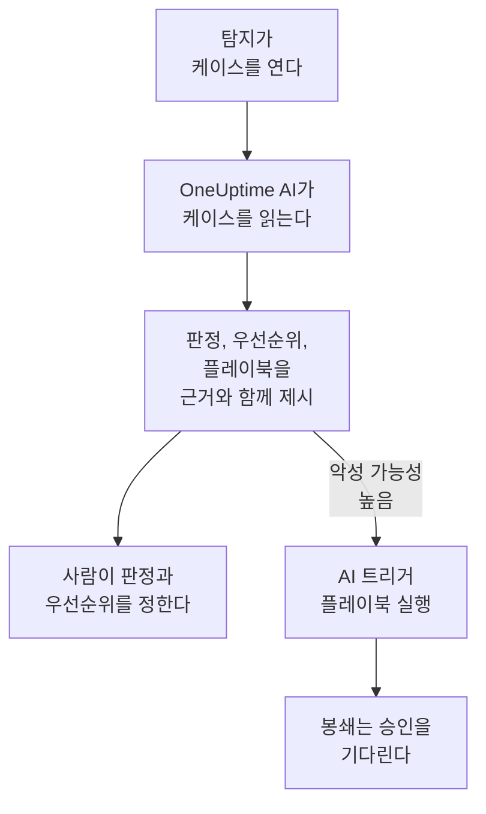

# 보안의 OneUptime AI

OneUptime AI는 분석가가 하듯이 각 보안 케이스를 읽습니다. 케이스의 탐지, 이벤트, 엔터티, 위협 인텔리전스와 함께 그 주변의 호스트와 사람까지 읽습니다. 무슨 일이 있었는지, 실제로 보이는지 알려 주고, 우선순위와 플레이북을 제안하며, 모든 주장에 뒷받침하는 근거를 붙입니다. 스스로는 아무것도 바꾸지 않습니다. 판정과 우선순위를 정하고 플레이북을 실행하는 것은 사람입니다. 또한 문장 하나로 탐지 규칙 초안을 만들고, Ask AI 에서 보안 데이터에 관한 질문에 답합니다.

:::cards
- [케이스 트리아지](#케이스-트리아지): OneUptime AI가 무엇을 읽고, 무엇을 결론 내리고, 무엇을 절대 하지 않는지.
- [새 케이스 자동 트리아지](#새-케이스-자동-트리아지): 탐지가 연 모든 케이스를 열리는 즉시 트리아지합니다.
- [트리아지에 따라 플레이북 실행](#트리아지에-따라-플레이북-실행): 악성 가능성 높음 판정으로 읽힌 케이스에 대응합니다.
- [탐지 규칙 초안 작성](#탐지-규칙-초안-작성): 잡아낼 대상을 설명하고 Sigma 규칙을 읽습니다.
- [보안 페이지의 Ask AI](#보안-페이지의-ask-ai): 케이스와 이벤트에 관한 질문을 평소 말로 합니다.
:::

## 작동 방식

트리아지는 읽기만 합니다. 프로젝트 자체의 AI로 실행됩니다. **AI 활성화** , 프로젝트의 LLM 공급자, AI 크레딧, 일일 AI 한도입니다.

## 시작하기 전에

- **프로젝트 설정 → AI → AI Features** 에서 **AI 활성화** 가 켜져 있어야 합니다. 꺼져 있으면 보안에 OneUptime AI의 기능이 전혀 표시되지 않고 아무것도 실행되지 않습니다.
- OneUptime AI가 사용할 수 있는 LLM 공급자가 **프로젝트 설정 → AI → LLM 공급자** 에 있어야 합니다. OneUptime Cloud에는 이미 있습니다.
- 트리아지를 시작하려면 보안 케이스를 다룰 수 있는 역할이 필요합니다. Project Owner, Project Admin, Security Admin, Security Member 중 하나입니다. Security Viewer는 모든 트리아지를 읽을 수 있지만 시작할 수는 없습니다. [역할](/docs/permissions/reference#역할) 을 참조하세요.

## 케이스 트리아지

케이스를 열면 페이지 맨 위에 **OneUptime AI** 카드가 있습니다.

| 카드 표시 | 의미 |
| --- | --- |
| **아직 트리아지되지 않음** | 아직 트리아지가 실행되지 않았습니다. **AI로 트리아지** 로 시작합니다. |
| **이 케이스를 트리아지하는 중** | OneUptime AI가 케이스를 읽고 있습니다. 각 확인 작업이 실행되는 동안 표시됩니다. |
| **악성 가능성 높음** 같은 판정 | 트리아지가 끝났습니다. **다시 트리아지** 으로 케이스를 처음부터 다시 읽습니다. |
| **트리아지가 완료되지 않았습니다** | 실행이 멈췄습니다. **다시 시도** 으로 새로 실행합니다. |

Security Viewer에게도 같은 카드가 보입니다. **AI로 트리아지** 와 **다시 시도** 는 비활성화된 채 그 옆에 트리아지를 시작할 수 있는 사람을 알려 주는 문장이 표시되고, **다시 트리아지** 와 **우선순위 설정** 은 제공되지 않습니다.

트리아지가 읽는 것:

- 케이스: 제목, 우선순위, 상태, 엔터티, ATT&CK 매핑
- 케이스의 탐지: 최신 순으로, 각각의 샘플 이벤트와 함께
- 케이스의 사용자, 호스트, 주소에 관한 보안 이벤트와 위협 인텔리전스
- 케이스의 사용자, 호스트, 주소의 위험과 이번 주에 그 위험을 높인 것
- 케이스의 호스트와 주소에 해당하는 OneUptime의 호스트와 그 소유자
- 케이스가 선언한 인시던트, 노트, 보호된 엔터티, 켜져 있는 플레이북

인시던트 조사처럼 OneUptime의 나머지 부분도 읽을 수 있습니다. 로그, 트레이스, 메트릭, 호스트, 그리고 프로젝트 MCP 서버의 읽기 전용 도구입니다.

### 결론 내리는 내용

| 판정 | 의미 | 닫을 때 제안하는 판정 |
| --- | --- | --- |
| 악성 가능성 높음 | 근거가 악의적이거나 허가되지 않은 활동을 가리킴 | True Positive |
| 무해 가능성 높음 | 관리 작업이나 팀이 실행하는 스캔처럼 실제이지만 예상된 활동으로 보임 | Benign Positive |
| 오탐 가능성 높음 | 탐지가 정상 활동을 잘못 해석한 것으로 보임 | False Positive |
| 판단 불가 | 판단할 근거가 부족해 사람이 직접 봐야 함 | 없음 |

판정은 OneUptime AI의 것이며 케이스의 판정이 되지 않습니다. **케이스 종료** 는 제안된 판정에서 시작하고, 고르는 것은 사람입니다. 판정 아래에 카드는 다음을 보여 줍니다.

- **제안된 우선순위** , 케이스의 우선순위가 다르면 **우선순위 설정** 도 함께 표시됩니다.
- **제안된 플레이북** , **플레이북 실행** 으로 필요한 승인을 모두 거쳐 사용자 본인으로 실행합니다. 그 플레이북이 이미 이 케이스에서 실행 중이면 **플레이북 실행** 대신 그 실행의 상태(예: **승인 대기 중** )가 표시됩니다. 실행은 케이스의 **플레이북** 에 있으며, 한 번 더 실행하면 같은 승인을 다시 요청하게 됩니다.
- 보고서: 무슨 일이 있었는지, 얼마나 확실한지, 다음에 무엇을 할지. 각 주장 뒤에 C1 같은 인용이 붙습니다.
- **Evidence checked** : 트리아지가 실행한 모든 쿼리입니다. 인용을 누르면 해당 쿼리가 열리고, 쿼리를 펼치면 트리아지가 읽은 기간에 대해 사용자 권한으로 다시 실행됩니다.
- **이 케이스에 대해 질문** , 이 케이스에 대해 Ask AI 를 엽니다.

모든 케이스 목록은 각 케이스 제목 옆에 판정을 보여 주고, **AI 판정** 로 필터링할 수 있습니다.

### 절대 하지 않는 일

트리아지는 케이스의 어떤 것도 바꾸지 않습니다. 상태, 우선순위, 담당자, 판정, 노트 모두 그대로입니다. 플레이북을 실행하지 않고 누구도 봉쇄하지 않습니다. 트리아지가 제안한 플레이북은 사람이 실행하거나 아래의 트리거를 통해서만 실행됩니다.

### AI를 조종하려고 쓴 텍스트

이벤트, 알림, 엔터티 값은 프로젝트 밖에서 들어오며 공격자가 쓸 수도 있습니다. OneUptime AI는 이를 모두 데이터로 읽고 지시로 받아들이지 않습니다. 케이스 데이터의 일부가 AI에 대한 지시처럼 읽히면, 카드가 먼저 그 사실을 알리고, 무해 가능성 높음 또는 오탐 가능성 높음 판정은 판단 불가 가 되며, 그 트리아지는 플레이북을 시작하지 않습니다.

## 새 케이스 자동 트리아지

**제품 → Security Events → AI → 설정** 를 열고 **새 케이스 트리아지** 를 켜세요. 그러면 탐지가 연 모든 케이스가 열리는 즉시 트리아지됩니다. 스위치는 바꾸는 즉시 저장됩니다. Project Owner와 Project Admin이 바꿀 수 있습니다.

새 프로젝트는 켜진 상태로 시작하고, 그 전에 만든 프로젝트는 누군가 켤 때까지 꺼진 상태로 유지됩니다. 직접 연 케이스와 **테스트 공격 보내기** 의 테스트 공격 케이스는 누군가 **AI로 트리아지** 를 클릭할 때 트리아지됩니다.

## 트리아지에 따라 플레이북 실행

**트리거** 가 **악성 가능성 높음으로 트리아지됨** 인 플레이북은 트리아지가 케이스를 악성 가능성 높음 판정으로 읽을 때 그 케이스에서 한 번 실행됩니다. **대상 케이스 최소 우선순위** , **다음에서 온 탐지만** , **이 탐지 규칙에만** 은 다른 트리거와 마찬가지로 대상을 좁히고, 봉쇄 단계는 언제나처럼 승인을 기다립니다. 다음 경우에는 실행되지 않습니다.

- AI를 조종하려고 쓴 텍스트를 찾은 트리아지 다음
- 같은 케이스에서 두 번째로. 케이스를 몇 번 트리아지하든 마찬가지입니다
- 테스트 공격의 케이스. 단, 플레이북의 모든 단계가 OneUptime 안에 머무르면 실행됩니다.

새 플레이북에는 프로젝트의 AI가 켜져 있는 동안에만 이 트리거가 표시됩니다.

## 탐지 규칙 초안 작성

**탐지 규칙** 의 **Sigma 규칙(YAML)** 필드 아래에서 **AI로 초안 작성** 을 클릭하고, 규칙이 잡아낼 대상을 적으세요. 예를 들어 한 IP 주소에서 5분 안에 로그인 실패가 10번 일어나는 경우입니다. **규칙 초안 작성** 은 저장된 규칙과 같은 방식으로 확인한 Sigma 규칙을 필드에 넣습니다. 읽어 보고, 필요하면 고치고, 평소처럼 저장하세요. 저장하기 전에는 아무것도 저장되지 않습니다. 필드에 이미 규칙이 있으면 버튼이 **AI로 다시 작성** 로 바뀌고, 초안이 그 규칙을 대체합니다.

초안을 만들려면 탐지 규칙을 만들 수 있는 역할이 필요합니다.

## 보안 페이지의 Ask AI

**Ask AI** 는 지금 어느 보안 페이지에 있는지 압니다. 케이스에서는 먼저 케이스를 읽고 **실제 공격인가요?** 같은 질문을 제안합니다. 다른 보안 이벤트 페이지에서는 평소 말로 한 질문이 보안 이벤트를 검색합니다. 값을 위협 인텔리전스와 대조하고, 사용자, 호스트, 주소가 얼마나 활발했는지 보고, 케이스에 맞는 플레이북을 나열할 수도 있습니다.

Ask AI 는 케이스에 노트를 추가하고 케이스에서 플레이북을 실행할 수 있습니다. 둘 다 사용자 본인으로 하며, 매번 먼저 묻습니다. 실행한 플레이북은 다른 플레이북과 마찬가지로 승인을 기다립니다.

케이스가 인시던트를 선언하면 인시던트의 AI 조사도 케이스를 읽습니다. 무엇이 탐지되었는지, 누구에 관한 것인지, 그리고 OneUptime AI의 트리아지입니다.

## 비용과 한도

트리아지는 인시던트 조사와 같은 OneUptime AI 작업입니다. OneUptime Cloud에서는 프로젝트의 AI 크레딧으로 결제되며, 프로젝트 자체의 일일 AI 한도( **프로젝트 설정 → AI → AI Features** 의 **일일 한도** )에 포함됩니다. 인시던트와 알림의 일일 한도는 적용되지 않습니다. 한 케이스에서는 한 번에 하나의 트리아지만 실행되며, AI 로그( **프로젝트 설정 → AI → AI 로그** )에 그 호출이 표시됩니다.

프로젝트의 AI 크레딧이 떨어졌거나 일일 AI 한도에 도달하면 새 케이스는 트리아지되지 않습니다. 카드가 이유를 알려 주며, 크레딧이 추가되거나 한도가 초기화되면 **AI로 트리아지** 를 다시 쓸 수 있습니다.

## 문제 해결

:::details 새 케이스가 트리아지되지 않음
**AI 활성화** 가 켜져 있는지, 그리고 **제품 → Security Events → AI → 설정** 의 **새 케이스 트리아지** 가 켜져 있는지 확인하세요. 직접 연 케이스와 테스트 공격의 케이스는 누군가 요청할 때만 트리아지됩니다. 케이스를 열면, 트리아지를 막는 것이 있을 때 카드가 무엇이 문제인지, 어디서 고칠 수 있는지 알려 줍니다.
:::

:::details 프로젝트의 AI 크레딧이 떨어졌거나 일일 AI 한도에 도달했다고 카드에 표시됨
프로젝트 소유자 또는 Manage Billing 권한이 있는 사람이 **프로젝트 설정 → AI → AI 크레딧** 에서 크레딧을 추가하거나 **프로젝트 설정 → AI → AI Features** 에서 한도를 올리거나 없앨 수 있습니다. 그런 다음 케이스에서 **AI로 트리아지** 를 클릭하세요.
:::

:::details 케이스의 텍스트가 AI에 대한 지시처럼 읽힌다고 카드에 표시됨
이벤트 메시지나 사용자 이름처럼 케이스 데이터의 일부가 AI를 조종하려고 작성되었습니다. OneUptime AI는 이를 데이터로 읽고 결정을 사용자에게 맡겼습니다. 케이스를 닫기 전에 탐지와 근거를 직접 확인하세요.
:::

:::details AI 트리거 플레이북이 실행되지 않음
플레이북이 활성화되어 있는지, 트리아지가 케이스를 악성 가능성 높음 판정으로 읽었는지, 그리고 **대상 케이스 최소 우선순위** , **다음에서 온 탐지만** , **이 탐지 규칙에만** 설정이 케이스에 맞는지 확인하세요. 케이스마다 한 번 실행되며, AI를 조종하려고 쓴 텍스트를 찾은 트리아지 다음에는 실행되지 않습니다.
:::

## 다음 단계

:::cards
- [보안 케이스 및 플레이북](/docs/telemetry/security-cases): 케이스를 다루고, 판정과 함께 닫고, 플레이북을 만듭니다.
- [AI SRE](/docs/ai/ai-sre): OneUptime AI가 인시던트와 알림을 조사하는 방식과 그 한도.
- [AI에게 질문](/docs/ai/ask-ai): 프로젝트에 관해 평소 말로 질문합니다.
- [LLM 공급자](/docs/ai/llm-provider): OneUptime AI가 사용하는 모델을 고릅니다.
:::
