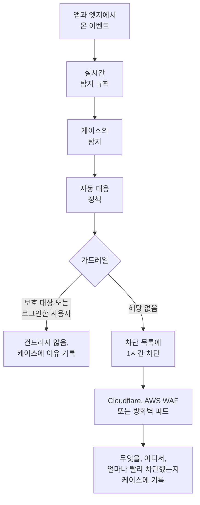

# 자동 대응

자동 대응 정책은 탐지가 이루어지는 순간, 누군가 케이스를 분류하기 전에 공격하는 주소에 챌린지를 적용하거나 차단합니다. 앱을 살피는 스캐너와 비밀번호를 하나씩 계속 시도하는 봇은 첫 요청 후 몇 분 안에 돌려보내집니다. 모든 프로젝트에는 기본 제공 정책 세 개가 있으며, 각 정책은 켜기 전까지 꺼져 있고, 했을 조치를 기록만 하는 일주일의 시험 운영으로 시작합니다. 가드레일 덕분에 정책을 켜 둔 채로 두어도 안전합니다. 정책은 내 주소나 로그인한 사용자가 쓰는 주소를 절대 건드리지 않으며, 공격이 혼자 처리할 규모를 넘으면 멈추고 사람을 호출합니다.

:::cards
- [정책 켜기](#정책-켜기): 먼저 일주일의 시험 운영, 그다음 클릭 한 번.
- [가드레일](#가드레일): 정책이 절대 하지 않는 일과 멈추는 때.
- [차단까지 걸린 시간](#차단까지-걸린-시간): 각 정책이 얼마나 빨리 차단하는지, 정책 카드와 케이스에서 확인합니다.
- [내 정책](#내-정책): 선택한 기법, 규칙 또는 위협 인텔리전스에 대응합니다.
:::

## 작동 방식

정책은 탐지가 케이스에 기록되는 순간, 즉 규칙이 발동한 지 몇 초 뒤에 대응합니다. 정책의 차단은 플레이북 단계 **주소 차단** 과 같은 방식으로 [차단 목록](/docs/telemetry/security-cases#차단-목록)에 추가되며, 만든 주체로 정책 이름이 붙습니다. 차단 목록을 적용하는 대상이 이를 유지하고, 케이스의 타임라인과 감사 로그에 표시되며, 기간이 지나면 저절로 만료됩니다. 누구의 승인도 필요하지 않습니다. 정책을 켠 사람이 그 차단을 승인한 것입니다.

## 시작하기 전에

- 차단 목록을 적용하는 대상: Cloudflare, AWS WAF 또는 [차단 목록 피드](/docs/telemetry/blocklist-feeds)를 읽는 방화벽이나 프록시. 아무것도 적용하지 않는 동안에는 페이지에 그렇게 표시되며, 정책의 차단은 어디에서도 효력이 없습니다.
- 정책의 규칙이 읽는 이벤트: 앱의 접근 로그나 트레이스, 또는 Cloudflare 방화벽 이벤트 같은 엣지의 이벤트, 그리고 로그인. [보안 이벤트](/docs/telemetry/security-events)를 참고하세요.
- 정책을 켤 수 있는 역할: 보안 관리자, 프로젝트 관리자 또는 프로젝트 소유자. 보안 구성원과 보안 뷰어는 정책과 정책이 한 일을 볼 수 있습니다. [역할](/docs/permissions/reference#역할)을 참고하세요.

## 기본 제공 정책

| 정책 | 대상 | 동작 | 첫 차단 |
| --- | --- | --- | --- |
| **스캐너** | 웹 스캔과 공격 시도(ATT&CK T1595, T1190): SQL 인젝션, 경로 탐색, Log4Shell 시도와 한 주소에서 발생한 다수의 Cloudflare 관리형 규칙 적중. 해당 주소의 요청이 모두 거부된 동안에 한합니다 | 챌린지 | 1시간 |
| **비밀번호 추측** | 무차별 대입과 비밀번호 스프레이(ATT&CK T1110): 한 주소에서의 로그인 실패, 그리고 같은 주소에서 로그인 실패 뒤의 성공 | 차단 | 1시간 |
| **알려진 악성 주소** | [위협 인텔리전스](/docs/telemetry/threat-intelligence)에 올라 있는 주소에 관한 모든 탐지 | 차단 | 24시간 |

사람은 챌린지를 통과하지만 스크립트와 봇은 통과하지 못합니다. 스캐너는 주소의 요청이 앱에 하나도 닿지 않은 동안에만 챌린지를 적용합니다. 요청이 통과한 주소는 사람이 다뤄야 할 케이스입니다.

스캐너나 비밀번호 추측을 켜면(시험 운영이든 실제 운영이든) 정책이 대응하는 **규칙 라이브러리** 규칙이 실시간으로 실행되고, 프로젝트에 없는 규칙은 추가됩니다. 실시간 규칙은 이벤트가 도착한 지 몇 초 만에 발동하지만, 일정에 따라 실행되는 규칙은 몇 분 늦게 읽습니다. 누군가 끈 규칙은 꺼진 채로 남습니다. 프로젝트는 최대 50개의 규칙을 실시간으로 실행합니다. 그 이상이면 규칙은 일정에 따라 남고, 정책 카드에 **일정에 따라 실행** 이 함께 표시됩니다.

## 정책 켜기

:::steps
### 자동 대응 열기

**제품 → 보안 이벤트 → 플레이북 → 자동 대응** 을 엽니다. 각 정책에는 카드가 있으며, 정책이 하는 일, **꺼짐**, **시험 운영**, **시험 운영 종료**, **켜짐** 중 하나를 표시하는 칩, 그리고 스위치가 있습니다.

### 시험 운영 시작

정책의 스위치를 전환합니다. 7일 동안 정책은 했을 조치를 기록만 하고 트래픽은 건드리지 않습니다. 케이스에는 "Trial run: the Scanners policy would have challenged 35.205.11.131 for 1 hour." 라고 표시됩니다. 카드는 지금까지의 주소 수와 가드레일이 건드리지 않은 주소를 셉니다.

### 켜기

일주일이 지나면 카드에 정책이 했을 일이 표시됩니다. 예를 들어 "7일 동안 주소 1,283개에 챌린지를 적용했을 것입니다. 로그인한 사용자가 있던 주소도, 내 주소도 없었습니다. 켤까요?" 와 같이 표시되며, 보안 담당자도 같은 내용을 이메일로 받습니다. **켜기** 를 클릭하면 그때부터 정책이 대응합니다.
:::

일주일의 시험 운영 없이 정책을 켜려면 카드의 **추가 설정** 을 열고 **시험 운영 없이 켜기** 를 클릭합니다. 가드레일은 계속 적용됩니다. 정책을 끄려면 스위치를 다시 전환합니다. 일주일의 시험 운영을 모두 마친 뒤 다시 켜면 바로 대응합니다.

## 가드레일

- **내 주소나 보호된 주소는 절대 건드리지 않습니다.** **보호 대상 엔티티** 의 항목과 OneUptime이 스스로 보호하는 모든 것: 호스트, 클라우드 리소스, 프로브, 인터넷에 없는 범위, 그리고 앱 앞의 엣지입니다. [차단 목록](/docs/telemetry/security-cases#차단-목록)을 참고하세요.
- **최근 30일 동안 로그인한 사용자가 사용한 주소는 절대 건드리지 않습니다.** 사무실 네트워크, 고객의 프록시, 개인의 집 같은 곳입니다. OneUptime은 ID 공급자의 로그인과 앱이 로그인한 사용자에게 응답한 요청(트레이스나 로그에 사용자 ID가 있는 요청)에서 주소를 찾습니다. 그 이벤트를 읽을 수 없거나 스크럽 규칙이 대조할 수 없는 방식으로 주소를 숨겨서 확인할 수 없는 주소는 사람에게 맡깁니다.
- **다시 나타난 주소는 더 오래 차단합니다.** 첫 차단은 1시간, 30일 안에 다시 차단되는 주소는 24시간, 그다음은 7일입니다. 알려진 악성 주소는 24시간부터 시작합니다.
- **자동 차단은 시간당 최대 50건입니다.** 그 이상이면 정책은 차단을 멈추고 보안 담당자를 호출합니다. 그만큼 큰 공격에는 사람이 필요합니다. 그동안 페이지에 그렇게 표시됩니다.
- **의심스러우면 되돌립니다.** 정책이 차단한 주소에서 로그인한 사용자가 확인되면, 정책은 차단을 해제하고 보안 담당자에게 알립니다.

보안 담당자는 프로젝트의 보안 관리자이며, 없으면 프로젝트 소유자입니다. 가드레일이 건드리지 않은 주소는 그 이유와 함께 케이스에 기록됩니다.

## 대상이 챌린지를 할 수 없는 경우

Cloudflare와 AWS WAF는 챌린지를 할 수 있습니다. 차단 목록 피드를 읽는 방화벽은 할 수 없으므로, 그곳에서는 정책의 챌린지가 같은 기간의 차단이 되며, 정책 카드와 케이스에 그렇게 표시됩니다. 예: "FortiGate feed cannot challenge, so it blocks the address there for the same time." 직접 설정한 챌린지는 절대 차단으로 바뀌지 않습니다.

## 차단까지 걸린 시간

차단까지 걸린 시간은 주소의 첫 요청(그 탐지의 가장 이른 이벤트)부터 엣지에서 차단이 적용될 때까지입니다. 각 정책 카드는 최근 30일 동안의 50번째와 95번째 백분위수를 날짜별로 보여 줍니다. 자동 대응이 차단한 케이스는 **개요** 의 **봉쇄까지 걸린 시간** 아래에 "첫 요청 후 41초 만에 자동으로 차단됨" 처럼 표시되고, 타임라인에는 무엇을, 어디서, 얼마나 빨리 차단했는지 기록됩니다: "OneUptime challenged 35.205.11.131 at Cloudflare for 1 hour (Scanners policy), 41 seconds after its first request." 케이스의 **대응 계획** 에 있는 주소 단계는 완료되며, 옆에 **차단 해제** 가 표시됩니다.

## 내 정책

기본 제공 정책 아래의 **정책 만들기** 를 클릭합니다. 내 정책에는 **이름** 과 대응할 대상이 필요합니다.

| 필드 | 하는 일 |
| --- | --- |
| **ATT&CK 기법** | 탐지가 가져야 할 기법을 쉼표로 구분해 지정합니다(예: `T1110, T1190`). 기법은 하위 기법을 포함합니다. |
| **작업** | **차단** 또는 **챌린지**. |
| **첫 차단 기간** | **추가 필드** 안: 1시간, 24시간 또는 7일. 다시 나타난 주소는 더 오래 차단됩니다. |
| **탐지 규칙** | **추가 필드** 안: 또는 이 규칙 중 하나가 만든 탐지. |
| **위협 인텔리전스에 올라 있는 주소만** | **추가 필드** 안: 위협 인텔리전스에 올라 있는 주소에만 대응합니다. 단독으로 쓰면 그런 주소에 관한 모든 탐지에 대응합니다. |
| **모든 요청이 거부된 동안만** | **추가 필드** 안: 주소의 요청이 앱에 하나도 닿지 않은 동안에만 대응합니다. |

내 정책은 꺼진 상태로 시작하며, 기본 제공 정책처럼 일주일의 시험 운영을 거치고 같은 가드레일을 가집니다. **정책 편집** 과 **정책 삭제** 는 카드에 있습니다. 정책을 삭제해도 그 차단은 만료될 때까지 차단 목록에 남습니다.

## 문제 해결

:::details 정책이 켜져 있는데 주소를 차단하지 않았습니다
케이스의 타임라인을 확인하세요. 주소를 건드리지 않은 정책은 로그인한 사용자가 그 주소를 사용했다는 등의 이유를 기록합니다. 대상이 차단 목록을 적용하는지, 그리고 정책 카드에서 규칙이 **실시간** 으로 표시되는지 확인하세요.
:::

:::details 그 시간의 자동 차단을 모두 썼다고 페이지에 표시됩니다
최근 1시간 동안 정책이 자동 차단 50건을 만들고 보안 담당자를 호출했습니다. 그 시간의 차단이 오래될수록 다시 시작합니다. 공격의 케이스를 확인하고, 공격이 하나의 네트워크에서 온다면 **차단 목록** 에서 범위를 차단하세요.
:::

## 다음 단계

:::cards
- [보안 케이스와 플레이북](/docs/telemetry/security-cases): 정책이 대응하는 케이스를 처리하고 직접 차단합니다.
- [차단 목록 피드](/docs/telemetry/blocklist-feeds): 방화벽이나 프록시에서 차단 목록을 적용합니다.
- [위협 인텔리전스](/docs/telemetry/threat-intelligence): 알려진 악성 주소가 대응하는 피드.
:::
