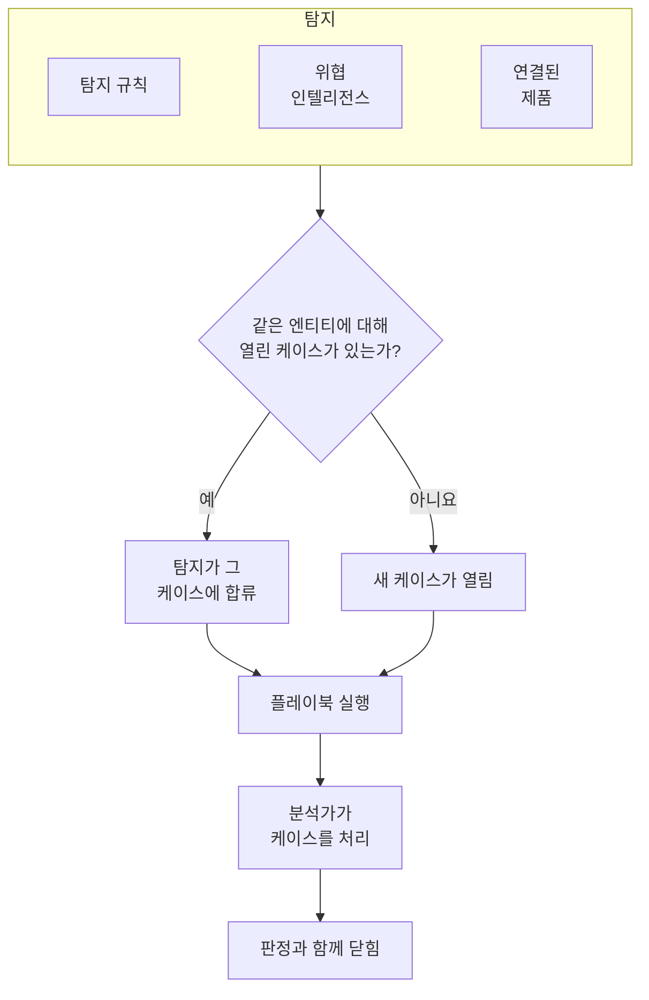

# 보안 케이스 및 플레이북(SOAR)

Security Events는 탐지 규칙, 위협 인텔리전스, 연결된 보안 제품이 찾아낸 것을 케이스로 만듭니다. 살펴볼 가치가 있는 대상마다 케이스가 하나씩 생기고, 같은 사용자, 호스트, 주소에 관한 탐지는 모두 그 케이스로 묶입니다. 분석가는 대기열에서 케이스를 처리하고, 플레이북은 자동으로 또는 클릭 한 번으로 케이스에 대응합니다.

:::cards
- [케이스가 생기는 곳](#케이스가-생기는-곳): 탐지 규칙, 위협 인텔리전스, 연결된 제품, 그리고 사람.
- [케이스 처리하기](#케이스-처리하기): 담당자를 지정하고, 엔티티를 조사하고, 판정과 함께 닫습니다.
- [케이스 우선순위와 상태](#케이스-우선순위와-상태): 이름, 색, 순서를 바꾸고 직접 추가합니다.
- [알림](#알림): 새 케이스, 할당, 승인을 기다리는 단계에 대해 누가 알림을 받는지.
- [플레이북](#플레이북): 케이스에 대해 실행되는 단계. 중요한 곳에서는 승인을 거칩니다.
- [개요 페이지](#개요-페이지): 지금 누군가 손을 써야 하는 것과, 케이스가 얼마나 빨리 처리되는지.
:::

## 작동 방식

대기열을 보려면 **제품 → Security Events → 보안 케이스 → 열린 케이스** 를 엽니다. **나에게 할당됨**, **미할당**, **종료된 케이스**, **모든 케이스** 는 그 옆의 별도 페이지이며, 각각 이름 그대로의 케이스를 보여 줍니다.

## 시작하기 전에

케이스와 플레이북은 세 가지 Security 역할을 따릅니다. Project Owner와 Project Admin은 모든 것을 할 수 있습니다.

| 역할 | 할 수 있는 일 |
| --- | --- |
| Security Admin | 케이스 삭제와 플레이북 설정을 포함한 모든 것 |
| Security Member | 케이스 열기, 담당자 지정, 변경, 닫기, 노트 작성, 플레이북 실행과 그 단계의 승인 또는 거부 |
| Security Viewer | 케이스, 탐지, 노트, 플레이북과 그 실행 읽기 |

케이스 생성부터 플레이북 단계 승인까지, 이 권한들은 각각 따로 부여할 수도 있습니다. [권한 레퍼런스](/docs/permissions/reference) 를 참고하세요.

## 케이스가 생기는 곳

| 소스 | 케이스가 열리는 때 | 끄는 방법 |
| --- | --- | --- |
| 탐지 규칙 | 규칙이 일치할 때 | 규칙의 **일치 시** 단계에 있는 **Open a Case on Match** |
| 위협 인텔리전스 | 이벤트에 알려진 지표가 들어 있을 때 | 피드의 **일치 시** 단계에 있는 **Open a Case on Match** |
| 연결된 제품 | 연결의 임곗값 이상인 제품 자체의 알림을 가져올 때 | 연결의 **Polling** 단계에서 **Open Cases From** 을 **없음** 으로 설정 |
| 사람 | 누군가 **보안 케이스** 에서, 또는 이벤트 패널의 **Open Case** 로 직접 열 때 | 없음 |

모든 소스는 기본적으로 켜져 있습니다. 연결은 다른 수준을 고르지 않는 한 **높음 이상** 의 알림에 대해 케이스를 엽니다. 그보다 낮은 알림도 이벤트로는 계속 가져옵니다.

### 탐지를 묶는 방식

탐지는 하나의 엔티티에 관한 것입니다. 엔티티란 무차별 대입 규칙의 IP 주소처럼 규칙이 그룹화에 쓰는 값이나, 위협 인텔리전스 일치가 가리키는 지표입니다. 엔티티가 없는 탐지는 따로 남습니다.

- 그 엔티티에 관한 열린 케이스가 이미 있으면, 탐지는 그 케이스에 합류합니다. 케이스의 엔티티와 ATT&CK 매핑이 늘어나고, 우선순위는 탐지의 우선순위까지 올라가며 내려가지는 않습니다.
- 그런 케이스가 없으면, 탐지의 이름을 딴 새 케이스가 탐지의 우선순위로 열립니다.
- 다시 발동한 탐지는 행을 하나 더 추가하는 대신 그 행의 횟수를 올립니다.

케이스의 우선순위는 탐지의 심각도에서 정해집니다. 그 수준에 해당하는 프로젝트의 기본 제공 우선순위가 되며, 이름을 바꿔도 마찬가지입니다.

| 심각도 | 우선순위 |
| --- | --- |
| Critical 또는 Fatal | Critical |
| High | High |
| Medium, Unknown 또는 Other | Medium |
| Low | Low |
| Informational | Informational |

## 케이스 처리하기

새 프로젝트의 케이스는 네 가지 상태를 거치며, 이름을 바꾸거나 직접 추가할 수 있습니다([케이스 우선순위와 상태](#케이스-우선순위와-상태) 참고). 신규에서 곧바로 닫히는 오탐처럼 상태를 건너뛸 수도 있고, 닫은 케이스를 다시 열 수도 있습니다.

| 상태 | 의미 |
| --- | --- |
| 신규 | 아직 아무도 보지 않음 |
| 조사 중 | 누군가 무슨 일이 있었는지 파악하는 중 |
| Contained | 위협이 더는 피해를 줄 수 없지만, 정리는 아직 남아 있음 |
| 닫힘 | 완료되었으며, 무엇이었는지에 대한 판정이 붙어 있음 |

케이스에는 인시던트처럼 자체 사이드 메뉴가 있고, 케이스의 각 부분이 각자의 페이지로 나뉘어 있습니다.

| 사이드 메뉴 섹션 | 페이지 |
| --- | --- |
| **개요** | **개요**, **타임라인** |
| **조사** | **Detections**, **엔티티**, **플레이북 실행** |
| **노트** | **비공개 노트** |
| **고급** | **감사 로그**, **케이스 삭제** — **고급**을 클릭할 때까지 접혀 있습니다 |

모든 페이지 상단에는 케이스 헤더가 그대로 있습니다. 번호, 우선순위, 상태, 제목, **Assign to Me**, **Run Playbook**, **인시던트 선언**, **Close Case** 버튼, 그리고 그 옆 ⋯ 메뉴의 **우선순위 설정**, **케이스 편집**, **케이스 삭제**입니다. 그래서 케이스는 어느 페이지에서든 처리할 수 있고, 케이스 링크는 여전히 **개요**를 엽니다.

- **개요**: 케이스의 설명, 레이블, 상태 단계, 담당자와 케이스를 연 출처, 그리고 케이스의 수치: 탐지 수, 열려 있는 기간, 확인과 격리까지 걸린 시간.
- **OneUptime AI** (**개요**에 있음): OneUptime AI가 케이스를 어떻게 읽었는지, 제안하는 우선순위와 플레이북, 그리고 그 근거. [보안의 OneUptime AI](/docs/telemetry/security-ai) 를 참조하세요.
- **MITRE ATT&CK** (**개요**에 있음): 탐지가 매핑된 전술과 기법. 각각 attack.mitre.org의 해당 페이지로 연결됩니다.
- **타임라인**: 케이스에 일어난 모든 일을 누가 했는지와 함께 보여 줍니다.
- **Detections**: 케이스를 열었거나 케이스에 합류한 탐지, 그 발동 횟수, 일치한 최신 이벤트.
- **엔티티**: 케이스가 다루는 사용자, 호스트, 주소와, 최근 7일 동안 모든 보안 이벤트에 걸친 그 활동. 각각 **상관 분석** 에서 열 수 있습니다.
- **플레이북 실행**: 각 플레이북이 케이스에서 한 일을 단계별로 보여 주고, 승인을 기다리는 단계도 보여 줍니다. 승인을 기다리는 실행이 있는 동안 메뉴의 **플레이북 실행** 옆에 그 수가 표시됩니다.
- **비공개 노트**: 팀이 케이스에 대해 쓴 내용.
- **감사 로그**: 케이스에 대한 모든 변경과 변경한 사람. [감사 로그](/docs/configuration/audit-logs) 를 참조하세요.
- **케이스 삭제**: 케이스를 탐지, 노트, 타임라인, 플레이북 실행과 함께 영구히 삭제합니다. 기록을 남기려면 대신 판정과 함께 케이스를 닫으세요.

여러 케이스를 한꺼번에 처리하려면 대기열에서 선택한 뒤 **Assign to Me**, **Change Status**, **Change Priority** 중 하나를 사용하세요.

### 케이스 닫기

**Close Case** 는 판정과, 선택 사항인 닫기 노트를 묻습니다.

| 판정 | 의미 |
| --- | --- |
| True Positive | 악의적이거나 승인되지 않은 활동이 실제로 일어남 |
| Benign Positive | 활동은 실제였지만 침투 테스트나 관리 작업처럼 예상된 것이었음 |
| False Positive | 탐지가 틀렸음. 규칙이나 데이터가 정상 활동을 잘못 해석함 |
| Undetermined | 판단할 정보가 충분하지 않았음 |

판정은 개요 페이지에서 집계됩니다. 케이스가 계속 False Positive로 닫히는 규칙은 조정이 필요한 규칙입니다.

Google SecOps 알림에서 열린 케이스는 연결에 **케이스가 닫히면 알림도 닫기** 가 켜져 있으면, 판정과 종료 메모와 함께 Google SecOps에서도 그 알림을 닫습니다. [Google SecOps](/docs/integrations/google-secops#케이스가-닫히면-알림도-닫기) 를 참조하세요.

### 인시던트 선언하기

**인시던트 선언** 은 선택한 심각도로 케이스에 대한 OneUptime 인시던트를 열고, 둘을 서로 연결합니다. 인시던트의 설명에는 케이스가 적히고, 케이스의 머리글에는 인시던트로 가는 링크가 표시됩니다. 그다음은 온콜, 상태 페이지, 포스트모템이 이어받습니다. 케이스를 처리할 수 있고 인시던트도 만들 수 있는 역할이 필요합니다.

## 케이스 우선순위와 상태

프로젝트마다 자체 케이스 우선순위와 상태가 있으며, **제품 → Security Events → 설정 → 케이스 우선순위** 와 **케이스 상태** 에서 관리합니다. 이름과 색을 바꾸고, 끌어서 순서를 바꾸고, "Triage" 상태나 **심각** 위의 "Emergency" 우선순위처럼 직접 추가할 수 있습니다. 새 이름은 대기열, 케이스 페이지와 개요, 알림, Slack과 Microsoft Teams, 플레이북 메시지 어디에나 바로 반영됩니다.

일부는 기본 제공입니다. OneUptime이 그 의미를 읽기 때문입니다. 이름과 색은 바꿀 수 있지만 삭제하거나 보관할 수는 없으며, 순서도 유지됩니다.

| 기본 제공 | OneUptime이 하는 일 |
| --- | --- |
| 신규 상태 | 새 케이스가 이 상태에서 시작함 |
| 확인된 상태 | 이 상태에 이르면 케이스가 확인된 시각이 기록되고, **Reopen** 은 닫힌 케이스를 이 상태로 되돌림 |
| 격리된 상태 | 이 상태에 이르면 케이스가 격리된 시각이 기록됨 |
| 닫힌 상태 | **Close Case** 는 판정과 함께 케이스를 이 상태로 옮김 |
| 심각, High, Medium, Low, 정보성 우선순위 | 탐지는 그 심각도의 우선순위로 케이스를 열고, 사람이 연 케이스는 Medium에서 시작함 |

- 상태의 위치가 그 상태에 있는 케이스를 무엇으로 간주할지 정하며, **간주** 열에 표시됩니다. 확인된 상태부터 아래는 확인됨, 격리된 상태부터 아래는 격리됨, 닫힌 상태부터 아래는 닫힘으로 간주합니다. 직접 추가한 상태는 닫힌 상태 바로 위에 들어가고, 케이스를 닫는 상태로 케이스를 옮기면 먼저 판정을 묻습니다.
- 우선순위의 순위는 긴급도이며, 가장 긴급한 것이 맨 앞입니다. **For Cases At Least**, 알림 선택지, Slack과 Microsoft Teams 규칙은 이 순서를 읽습니다. 직접 추가한 우선순위는 맨 뒤에 들어가고, **탐지 심각도** 열에는 어떤 탐지가 어떤 기본 제공 우선순위로 케이스를 여는지 표시됩니다.

직접 만든 상태나 우선순위를 그만 쓰려면 그 행의 **보관** 을 사용하세요. 아무도 다시 고를 수 없고 API, Terraform, MCP도 거부하지만, 그 값을 가진 케이스는 계속 유지하며 그 값으로 필터링할 수도 있습니다. 보관된 값은 표 아래의 접힌 **보관된 케이스 상태** 또는 **보관된 케이스 우선순위** 섹션에 나열되며, 거기서 **보관 취소** 로 되돌릴 수 있습니다. 케이스가 그 값을 가지고 있거나 플레이북이 그 우선순위부터 실행되는 동안에는 **삭제** 가 거부됩니다.

## 알림

OneUptime은 케이스에 관한 세 가지 일을 사람들에게 알립니다. 아무도 따로 설정할 필요가 없습니다. **추천 항목 켜기**만 클릭한 프로젝트도 High와 Critical 케이스에 대해 이메일과 푸시로 알림을 받습니다.

| 알림 | 알림을 받는 사람 | 기본값 |
| --- | --- | --- |
| 새 보안 케이스 | 프로젝트의 케이스를 볼 수 있는 모든 사람. 케이스가 각자 고른 우선순위 이상으로 열리거나 그 이상으로 올라갈 때 | 이메일과 푸시, High와 Critical 케이스에 대해 |
| 나에게 할당된 보안 케이스 | 케이스를 할당받은 사람과, 케이스를 할당받은 팀의 멤버 | 이메일과 푸시 |
| 내 승인을 기다리는 플레이북 단계 | 케이스 관계자 중 그 단계를 승인할 수 있는 사람: 케이스를 할당받은 사람과 그 팀의 멤버. 그중 아무도 승인할 수 없으면, 프로젝트에서 승인할 수 있는 모든 사람 | 이메일과 푸시 |

- 케이스를 볼 수 있는 사람만 그 케이스에 대해 알림을 받습니다. Project Owner, Project Admin, 그리고 Security Admin, Security Member, Security Viewer 역할입니다. 일부 레이블로 제한된 역할은 그 레이블이 붙은 케이스에 대해서만 알림을 받습니다.
- 자기가 한 일에 대해서는 아무도 알림을 받지 않습니다. 케이스를 직접 연 사람, 할당한 사람, 실행을 시작한 사람은 그에 대한 알림을 받지 않습니다.
- 각 사람은 한 케이스에 대해 한 번만 알림을 받습니다. Medium으로 열렸다가 나중에 Critical로 올라간 케이스는 올라갈 때 High나 Critical을 고른 사람에게 전달되고, Medium을 고른 사람에게는 다시 전달되지 않습니다. 그들은 케이스가 열릴 때 이미 알림을 받았습니다.
- **테스트 공격 보내기**로 보낸 테스트 공격은 아무에게도 알리지 않는 케이스를 엽니다.
- Critical 케이스와 승인을 기다리는 단계는 즉시 보내지며, [이메일 요약](/docs/emails/notification-rollup)에 묶여 미뤄지는 일이 없습니다.
- 케이스의 **타임라인**에는 누가 언제 알림을 받았는지 표시됩니다.

### 알림 받을 내용 고르기

각자 **사용자 설정 → 알림 설정 → 보안**에서 직접 고릅니다. 알림마다 채널(이메일, SMS, 전화, 푸시, Telegram, Slack, Microsoft Teams, Webhook)을 고르고, **새 보안 케이스** 아래에서 알림을 받을 우선순위를 고릅니다.

| 선택 | 알림을 받는 케이스의 우선순위 |
| --- | --- |
| 심각만 | Critical |
| 높음 이상 | Critical과 High(기본값) |
| 보통 이상 | Critical, High, Medium |
| 낮음 이상 | Informational을 제외한 모든 우선순위 |
| 모든 케이스 | 모든 우선순위 |

선택지는 프로젝트의 케이스 우선순위를 그 이름 그대로 따릅니다. 위는 새 프로젝트의 선택지입니다.

보안 케이스에 대해서는 WhatsApp 메시지를 보내지 않습니다. 푸시 알림은 OneUptime 앱을 열고, 그 링크는 브라우저에서 케이스를 엽니다.

### Slack 및 Microsoft Teams 채널에 게시하기

채널에 게시하려면 **제품 → Security Events → 워크스페이스 → Slack**(또는 **Microsoft Teams**)에 규칙을 추가합니다. 둘 다 연결되어 있지 않으면 이 섹션의 항목은 **Slack 또는 Teams 연결** 하나뿐입니다. 규칙은 게시할 채널(Microsoft Teams에서는 채팅도)과, 원하면 대상 케이스를 지정합니다.

| 조건 | 일치 대상 |
| --- | --- |
| 보안 케이스 우선순위 | 프로젝트의 케이스 우선순위 중 하나(예: 심각, High) |
| 보안 케이스 제목, 보안 케이스 설명 | 케이스 제목이나 설명에 포함된 텍스트, 또는 그 시작이나 끝에 오는 텍스트 |
| 보안 케이스 상태 | 프로젝트의 케이스 상태 중 하나(예: 신규, 닫힘) |
| 보안 케이스 소스 | Detection Rule, Threat Intel, Connected Product, Manual 중 하나 |
| 보안 케이스 레이블 | 케이스의 레이블 |

세 가지 알림은 각각 그 시점에 케이스가 일치하는 모든 규칙의 채널에 게시됩니다. **보안 케이스 우선순위**가 **심각**, **High** 중 하나를 포함하는 규칙은 High와 Critical 케이스를 열릴 때 게시하고, Medium 케이스는 High로 올라갈 때 게시합니다. 보안 케이스에 전용 채널이 생기는 일은 없습니다.

## 플레이북

플레이북은 케이스에 대해 실행되는 단계의 목록입니다. **제품 → Security Events → Playbooks** 에서 템플릿으로 또는 빈 상태로 만들고, 그 페이지에서 단계를 추가합니다. 플레이북이 없는 프로젝트에는 빈 목록 대신 템플릿이 표시됩니다. 플레이북이 있으면 목록의 **템플릿에서 생성** 으로 템플릿을 열 수 있으며, 프로젝트에 이미 있는 템플릿에는 **추가됨** 이 표시됩니다.

### 플레이북이 실행되는 시점

| 실행 조건 | 시점 |
| --- | --- |
| Case Opened | 케이스가 열릴 때 한 번 |
| Detection Added | 열린 케이스에 새 탐지가 합류할 때마다 |
| 악성 가능성 높음으로 트리아지됨 | OneUptime AI의 트리아지가 케이스를 악성 가능성 높음 판정으로 읽을 때 한 번 |
| Manual | 누군가 케이스에서 직접 실행할 때만 |

활성화된 플레이북은 케이스의 **Run Playbook** 으로 직접 실행할 수도 있습니다. 자동으로 실행되는 플레이북은 대상을 좁힐 수 있습니다.

- **For Cases At Least**: 이 우선순위 이상의 케이스만.
- **Only For Detections From**: 케이스의 근거가 된 탐지가 이 소스에서 왔을 때만.
- **Only For These Detection Rules**: 탐지가 이 규칙들 중 하나에서 왔을 때만.

비활성화된 플레이북은 자동으로도, 직접으로도 실행되지 않습니다.

### 단계

| 범주 | 단계 | 하는 일 |
| --- | --- | --- |
| 케이스 | Assign the case | 케이스를 사람, 팀, 또는 둘 다에게 지정 |
| 케이스 | Set the priority | 케이스의 우선순위를 올리거나 내림 |
| 케이스 | Set the status | 케이스를 프로젝트의 다른 상태로 옮기며, 그 상태가 케이스를 닫으면 선택한 판정을 붙임 |
| 케이스 | Add a note | 분석가를 위한 체크리스트 같은 노트를 케이스에 작성 |
| 케이스 | Add labels | 케이스에 레이블을 붙임 |
| 조사 | Check entities against threat intel | 각 엔티티를 위협 인텔리전스에서 조회하고, 일치하면 우선순위를 올릴 수 있음 |
| 조사 | Look up entity activity | 각 엔티티의 최근 기간 보안 이벤트를 세어 케이스에 기록 |
| 알림 | Email people | 케이스 요약을 케이스 링크와 함께 사용자와 팀에 이메일로 보냄 |
| 알림 | Post to Slack | 케이스 요약을 Slack 채널에 게시 |
| 알림 | Post to Microsoft Teams | 케이스 요약을 Microsoft Teams 채널에 게시 |
| 에스컬레이션 | Page on-call | 온콜 정책을 실행 |
| 에스컬레이션 | Declare an incident | 케이스와 연결된 OneUptime 인시던트를 엶 |
| 봉쇄 | Suspend the user in Okta | 케이스가 다루는 사용자를 Okta에서 일시 중지 |
| 봉쇄 | End the user's Okta sessions | 케이스가 다루는 사용자를 Okta에서 로그아웃시키고 토큰을 폐기 |
| 봉쇄 | Contain the host in CrowdStrike | 케이스가 다루는 호스트를 CrowdStrike Falcon으로 네트워크에서 봉쇄 |
| 봉쇄 | Isolate the device in Microsoft Defender | 케이스가 다루는 호스트를 Microsoft Defender for Endpoint로 격리 |
| 봉쇄 | Unsuspend the user in Okta | 케이스가 다루는 사용자의 Okta 일시 중지를 해제 |
| 봉쇄 | Lift containment in CrowdStrike | 케이스가 다루는 호스트에 대한 CrowdStrike Falcon의 네트워크 봉쇄를 해제 |
| 봉쇄 | Release the device in Microsoft Defender | 케이스가 다루는 호스트를 Microsoft Defender for Endpoint의 격리에서 해제 |
| 자동화 | Send a webhook | 케이스를 JSON으로 URL에 POST |
| 자동화 | Run a workflow | 케이스를 입력으로 OneUptime 워크플로를 시작 |

플레이북에는 단계를 최대 25개까지 둘 수 있습니다. 단계는 순서대로, 앞 단계가 끝날 때마다 하나씩 실행됩니다. 모든 단계에서 다음도 설정할 수 있습니다.

- **Needs Approval**: 누군가 케이스에서 승인할 때까지 그 단계 앞에서 실행을 멈춥니다. 누군가를 차단하는 네 가지 단계에서는 Security Admin이 끄지 않는 한 항상 켜져 있습니다.
- **Only If Threat Intel Matched**: 같은 실행의 앞선 **Check entities against threat intel** 단계가 알려진 지표를 찾지 않았다면 이 단계를 건너뜁니다.
- **Carry On If It Fails**: 이 단계가 실패해도 다음 단계를 실행합니다. 꺼져 있으면 실패한 단계에서 실행이 멈춥니다.

### 봉쇄

봉쇄 단계는 제품에 대한 [보안 이벤트 연결](/docs/telemetry/security-events#보안-제품-연결하기) 을 통해 동작하며, 그 연결에는 읽기 이상의 권한이 필요합니다.

| 단계 | 연결 | 필요한 것 |
| --- | --- | --- |
| Suspend the user in Okta, End the user's Okta sessions, Unsuspend the user in Okta | Okta System Log | 사용자 관리가 허용된 API 토큰 |
| Contain the host in CrowdStrike, Lift containment in CrowdStrike | CrowdStrike Falcon | Hosts 쓰기 범위가 있는 API 클라이언트 |
| Isolate the device in Microsoft Defender, Release the device in Microsoft Defender | Microsoft Defender XDR | Machine.Isolate 권한이 있는 앱 |

봉쇄 단계는 케이스에 이름이 나오는 모든 사용자나 호스트가 아니라, 케이스가 다루는 다음 사용자나 호스트에 대해서만 동작합니다.

- 케이스의 탐지가 그룹화에 쓰는 값. 예를 들어 불가능한 이동 규칙이 그룹화에 쓰는 계정이나, 연결된 제품의 알림이 가리키는 호스트입니다.
- 케이스의 사용자나 호스트 중 위협 인텔리전스가 지표로 알고 있는 것.

VPN에 대한 무차별 대입처럼 주소로 그룹화된 케이스는 어느 쪽에도 해당하지 않습니다. 그런 케이스에서는 봉쇄 단계를 건너뛰며, 공격이 노린 계정과 공격받은 게이트웨이는 건드리지 않습니다. 단계는 사용자나 호스트 최대 10개에 대해 동작합니다. 각각을 제품에서 이름으로 찾고, 각각에 무엇을 했는지 실행에 남깁니다. 완료, 이미 완료됨, 찾지 못함, 거부됨, 보호됨 중 하나입니다.

#### 보호된 엔티티

메뉴의 **Playbooks** 아래에 있는 **Protected Entities** 는 비상 접근 계정, 도메인 컨트롤러, VPN 게이트웨이처럼 어떤 플레이북도 봉쇄하지 않는 사용자와 호스트를 나열합니다. 값은 대소문자와 관계없이 일치하며, `*` 는 임의의 문자열을 나타냅니다. `svc-*` 는 모든 서비스 계정을 보호합니다. 단계는 보호된 사용자나 호스트를 보호됨으로 보고하고 건드리지 않습니다. 이 목록은 Security Admin이 관리합니다.

#### 승인

누군가를 차단하는 네 가지 단계는 승인을 기다립니다. 그중 하나의 **Needs Approval** 을 끌 수 있는 사람은 Security Admin뿐이며, OneUptime은 누가 껐는지 기록합니다. 승인할 때는 단계가 동작할 사용자나 호스트가 **Act On** 아래에 모두 선택된 상태로 나열됩니다. 단계가 건드리지 말아야 할 대상은 선택을 해제하세요. 보호된 대상은 선택지에 나오지 않습니다. 실행을 시작한 사람은 그 실행의 단계를 승인할 수 없고 다른 사람이 승인하지만, 거부는 여전히 할 수 있습니다.

#### 되돌리기

되돌리기 단계는 자신이 되돌리는 단계와 마찬가지로 케이스가 다루는 사용자나 호스트에 대해 동작합니다. 실행이 멈춘 뒤에는 봉쇄된 사용자나 호스트의 단계에 그 대상만의 버튼도 생깁니다. **Unsuspend**, **Lift Containment**, **해제** 중 하나입니다. 종료된 Okta 세션은 되돌릴 수 없습니다. 모든 되돌리기는 케이스의 타임라인과 프로젝트의 감사 로그에 남습니다.

### 메시지

노트, 이메일, Slack 게시물, Teams 게시물에서는 케이스의 값을 사용할 수 있습니다.

| 자리 표시자 | 바뀌는 값 |
| --- | --- |
| `{{case.number}}` | CASE-42 같은 케이스 번호 |
| `{{case.title}}` | 케이스 제목 |
| `{{case.priority}}` | 프로젝트에서 부르는 이름 그대로의 케이스 우선순위(예: High) |
| `{{case.status}}` | 프로젝트에서 부르는 이름 그대로의 케이스 상태(예: Investigating) |
| `{{case.assignee}}` | 케이스 담당자 |
| `{{case.url}}` | OneUptime에 있는 케이스로 가는 링크 |
| `{{case.entities}}` | 케이스가 다루는 사용자, 호스트, 주소 |
| `{{case.detections}}` | 케이스에 담긴 탐지 수 |

자체 메시지가 없는 이메일이나 게시물은 케이스 요약을 보냅니다.

### 실행과 승인

모든 실행은 해당 케이스와 **제품 → Security Events → Playbooks → 플레이북 실행** 에 단계별로 나열됩니다.

| 실행 상태 | 의미 |
| --- | --- |
| Queued | 워커를 기다리는 중 |
| 실행 중 | 단계를 실행하는 중 |
| Waiting for Approval | 승인이 필요한 단계 앞에서 대기 중 |
| 성공함 | 모든 단계가 실행되었거나 건너뛰어짐 |
| 실패 | 단계가 실패해 실행이 멈춤 |
| 취소됨 | 누군가 취소했거나 단계를 거부함 |

승인을 기다리는 단계에는 실행에 **Approve** 와 **Reject** 가 표시되며, 선택적으로 코멘트를 남길 수 있습니다. 승인하면 그 단계부터 실행이 이어지고, 거부하면 실행이 끝납니다. 결정, 결정한 사람, 코멘트는 단계, 케이스의 타임라인, 프로젝트의 감사 로그에 남습니다. 메뉴의 **Playbooks** 아래에 있는 **승인 대기 중** 은 결정을 기다리는 실행을 보여 주고 그 개수를 세며, **플레이북 실행** 은 모든 실행을 보여 줍니다. **플레이북 실행** 과 플레이북 페이지에서는 각 실행이 어디까지 진행되었는지, 또는 어느 단계에서 멈췄는지를 알려 주는 한 줄로 표시되며, **단계 보기** 로 단계를 열 수 있습니다. 승인을 기다리는 실행은 저절로 열립니다.

재시작 등으로 워커로부터 응답이 끊긴 실행은 다시 처리됩니다. 대기열에 있던 실행은 2분 뒤 다시 대기열에 들어가고, 30분 동안 아무 응답이 없는 실행은 실패 처리됩니다.

## 개요 페이지

**제품 → Security Events → 개요** 는 이 제품을 열면 처음 나타나는 페이지입니다.

- 나에게 지정된 열린 케이스, 아무도 맡지 않은 열린 케이스, 승인을 기다리는 플레이북 단계. 각 숫자는 그것을 보여 주는 페이지를 엽니다.
- 최근 30일 동안 열린 케이스에 대한 **평균 확인 시간**, **평균 격리 시간**, **평균 종료 시간**. 각각 케이스가 열린 뒤 누군가 맡을 때까지(담당자를 지정하거나 확인됨으로 간주되는 상태로 옮길 때까지), 격리됨으로 간주되는 상태가 될 때까지, 닫힘으로 간주되는 상태가 될 때까지의 시간입니다. 아직 기다리는 케이스는 평균에 포함되지 않습니다.
- 최근 30일간 날마다 열린 케이스 수(우선순위별)와, 최근 14일간 날마다 발생한 탐지 수(소스별).
- 열린 케이스의 우선순위별, 상태별 수, 최근 30일의 판정, 케이스의 바탕이 된 ATT&CK 전술, 가장 많이 발동한 탐지, 가장 많은 탐지 결과에 이름이 오른 엔티티.

그 위의 띠에는 보안이 어떻게 설정되어 있는지 표시됩니다. 소스, 탐지, 케이스, 플레이북이 각각의 수치와 함께 나옵니다. 아직 설정하지 않은 프로젝트에서는 그곳에 **추천 항목 켜기**와 **테스트 공격 보내기**가 표시됩니다. [보안 시작하기](/docs/telemetry/security-getting-started)를 참고하세요. 아무도 대응할 필요가 없으면 페이지에 **모두 조용합니다**가 표시되고, 차트는 보여 줄 것이 생기면 나타납니다.

## 위협 찾기

- **엔티티** 는 지난 하루, 일주일, 한 달 동안 탐지 결과에 가장 많이 등장한 사용자, 호스트, 주소, 해시의 순위를 매기고, 어떤 값이든 30일치 이벤트에서 조회합니다. 엔티티를 선택하면 **상관 분석** 에서 열립니다.
- **Rule Library** 에는 ID, 엔드포인트, 클라우드, 네트워크, 웹, Kubernetes 위협을 위한 기성 탐지 규칙이 있습니다. 각각 모든 연결된 소스가 정규화되는 필드에 맞춰 작성된 Sigma 규칙입니다. 각 행에는 규칙이 찾는 것, 태그된 MITRE ATT&CK 전술과 기법, 읽는 이벤트와 최근 7일 동안 그 이벤트가 들어왔는지 여부(**수신 중** 또는 **수신 안 됨**), 심각도가 표시됩니다. 카테고리, 규칙이 읽는 데이터, 추가 여부로 목록을 좁히거나 이름, ATT&CK 기법, 심각도로 검색할 수 있으며, 필터는 페이지 주소에 유지됩니다. 규칙을 선택하면 읽는 이벤트를 보내기 시작하는 방법, 실행 방식, Sigma 규칙이 담긴 세부 정보가 열립니다. **추가** 는 그 규칙을 여러분의 탐지 규칙으로, 켜진 상태로, 알림 대신 케이스를 여는 설정으로 만듭니다. 다른 규칙처럼 **Detection Rules** 에서 바꿀 수 있습니다. **추천** 표시가 붙은 규칙은 OneUptime이 이미 가진 데이터에서 위협을 찾으며, 버튼 하나로 아직 없는 규칙을 추가할 수 있습니다.
- **ATT&CK Coverage** 는 MITRE ATT&CK 전술을 나열하고, 전술마다 활성화된 규칙이 다루는 기법의 수와 **Rule Library** 에 규칙이 있는 기법이 몇 개 더 있는지를 보여 줍니다. 전술을 열면 그 기법이 표시되고, **매트릭스** 로 전환하면 전체 매트릭스가 표시됩니다. 기법을 선택하면 그 기법을 다루는 라이브러리 규칙을 보고, 그 규칙으로 **Rule Library** 를 열 수 있습니다.

## 자동화하기

- **워크플로**: 케이스나 노트가 생성, 업데이트, 삭제될 때 워크플로를 시작할 수 있습니다. **Run a workflow** 단계는 트리거가 웹훅인 워크플로를 시작합니다.
- **API**: 케이스, 노트, 탐지, 플레이북, 실행, 보호된 엔티티, 케이스 우선순위와 상태에는 OneUptime의 나머지 부분과 같은 REST API가 `/security-case`, `/security-case-note`, `/security-detection`, `/security-playbook`, `/security-playbook-run`, `/security-protected-entity`, `/security-case-priority`, `/security-case-status` 아래에 있습니다. [API 참조](/docs/api-reference/api-reference) 를 참고하세요.
- AI 에이전트: MCP 서버에는 케이스, 노트, 탐지, 플레이북, 케이스 우선순위와 상태를 위한 도구가 있습니다. [MCP 서버](/docs/ai/mcp-server) 를 참고하세요.
- Terraform: `oneuptime_security_case_priority` 와 `oneuptime_security_case_status` 리소스로 프로젝트의 우선순위와 상태를 코드로 관리합니다.

## 문제 해결

:::details 규칙은 일치하는데 케이스가 열리지 않음
규칙의 **일치 시** 단계에서 **Open a Case on Match** 를 확인하세요. 이미 열린 케이스가 있는 엔티티에 관한 탐지는 다른 케이스를 여는 대신 그 케이스에 합류합니다. 열린 케이스의 **Detections** 에서 찾아보세요.
:::

:::details 케이스에 대해 아무도 알림을 받지 않음
케이스의 **타임라인**을 보세요. 누가 알림을 받았는지 표시됩니다. **새 보안 케이스** 알림은 케이스가 각자 고른 우선순위에 이르는 사람에게 가므로, Medium 케이스는 기본값인 **높음 이상**을 그대로 둔 사람 누구에게도 알리지 않습니다. 알림을 받아야 할 사람이 보안 케이스를 볼 수 있는지(Security 역할, 또는 Project Owner나 Project Admin), 그리고 그 사람의 **사용자 설정 → 알림 설정 → 보안**에서 그 알림이 켜져 있는지 확인하세요.
:::

:::details 플레이북이 실행되지 않음
플레이북이 활성화되어 있는지, **트리거** 설정이 맞는지(Case Opened는 케이스가 열릴 때 한 번만 실행됩니다), 그리고 케이스가 **For Cases At Least**, **Only For Detections From**, **Only For These Detection Rules** 설정을 충족하는지 확인하세요. 직접 연 케이스에는 탐지가 없으므로, 소스나 규칙으로 제한된 플레이북은 그 케이스에서 실행되지 않습니다.
:::

:::details 봉쇄 단계가 실패함
케이스에서 실행을 여세요. 단계에는 사용자나 호스트마다 제품이 거부했는지, 찾지 못했는지, 제품에 연결할 수 없었는지가 표시됩니다. 연결의 자격 증명으로 그 변경을 할 수 있는지 확인하고, 연결 행의 **연결 테스트** 를 사용하세요.
:::

:::details 봉쇄 단계를 건너뜀
케이스가 다루는 사용자나 호스트가 없거나(예를 들어 주소만 다루는 경우), 케이스가 다루는 사용자나 호스트가 모두 보호되어 있습니다. 케이스에서 실행을 여세요. 단계에 어느 쪽인지 표시됩니다.
:::

:::details 상태나 우선순위를 삭제하거나 보관할 수 없음
기본 제공 값은 이름과 색을 바꿀 수 있지만 삭제하거나 보관할 수는 없습니다. 그 **보관** 은 잠겨 있고 이유가 표시됩니다. 직접 만든 값은 케이스가 가지고 있거나 플레이북이 그 값부터 실행되는 동안에는 삭제할 수 없습니다. 먼저 케이스를 다른 값으로 옮기거나 보관하세요.
:::

## 다음 단계

:::cards
- [보안 이벤트](/docs/telemetry/security-events): 이벤트를 보내고, 탐지 규칙을 작성하고, 보안 제품을 연결합니다.
- [위협 인텔리전스](/docs/telemetry/threat-intelligence): 이벤트를 STIX/TAXII 피드와 대조합니다.
- [보안의 OneUptime AI](/docs/telemetry/security-ai): AI로 케이스를 트리아지하고, 탐지 규칙 초안을 만들고, 보안에 관해 질문합니다.
- [권한 레퍼런스](/docs/permissions/reference): Security 역할과 각 역할이 할 수 있는 일.
:::
