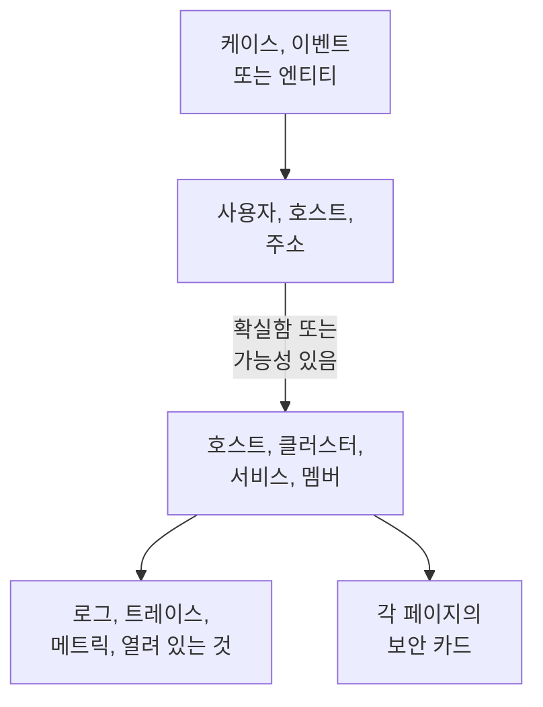

# 연결된 신호

보안 케이스는 어떤 사용자, 호스트, 주소에 관한 것인지 알려 줍니다. 연결된 신호는 그중 OneUptime이 이미 알고 있는 것(호스트, 컨테이너 호스트, Kubernetes 클러스터, 네트워크 장치, 서비스, 멤버)과 케이스 전후에 각각에서 일어난 일(로그, 트레이스, 메트릭, 열려 있는 인시던트와 알림, 감시 중인 모니터, 변경된 내용)을 알려 줍니다. 반대로 호스트, 클러스터, 서비스, 멤버의 페이지는 Security Events가 그것에 대해 찾은 내용을 알려 줍니다.

:::cards
- [표시되는 곳](#표시되는-곳): 케이스 페이지, 이벤트 탭, 엔티티 페이지, 그리고 이들이 가리키는 대상의 페이지.
- [값을 맞추는 방법](#값을-맞추는-방법): 같은 레코드로 보는 것과 가능성만 있는 것.
- [각 레코드에 표시되는 내용](#각-레코드에-표시되는-내용): 케이스 전후의 신호와 열려 있는 것.
- [누가 무엇을 보는가](#누가-무엇을-보는가): 모든 레코드는 읽는 사람의 역할로 읽습니다.
:::

## 작동 방식

OneUptime은 각 값을 프로젝트의 레코드에서 찾고, 각 일치가 얼마나 확실한지 알려 주며, 케이스 전후에 각 레코드에서 일어난 일을 보여 줍니다.

## 시작하기 전에

- 보안 이벤트가 들어오고 있고, 그것이 가리킬 수 있는 호스트, Kubernetes 클러스터, 서비스 또는 멤버가 프로젝트에 있어야 합니다. [보안 시작하기](/docs/telemetry/security-getting-started)를 참조하세요.
- 보안 이벤트를 읽을 수 있는 역할과, 보려는 종류의 레코드를 읽을 수 있는 역할.

## 표시되는 곳

- **연결된 신호**: 모든 보안 케이스의 페이지입니다. **제품 → Security Events → 보안 케이스 → 열린 케이스**에서 케이스를 연 다음, 메뉴에서 **엔티티** 다음에 있는 **연결된 신호**를 엽니다.
- **연결됨**: 모든 보안 이벤트의 탭입니다. **제품 → Security Events → 이벤트**에서 이벤트를 엽니다. 이벤트 전후 1시간 동안 이벤트가 가리키는 대상을 나열합니다.
- **제품 → Security Events → 엔티티 위험**의 엔티티 페이지: 마지막 보안 이벤트 전후에 OneUptime이 그 사용자, 호스트 또는 주소를 어디에서 알고 있는지 보여 줍니다.
- 호스트, Docker 호스트, Podman 호스트, Kubernetes 클러스터, 네트워크 장치, 서비스, 멤버, 인벤토리 항목의 각 페이지에 있는 **보안** 카드: 그것을 가리키는 열린 보안 케이스, 지난 7일 동안 그것을 가리킨 보안 이벤트와 발견 항목의 수, 그중 가장 심각한 것, 그리고 위험도입니다. **Security Events에서 열기**로 그곳에서 엽니다.
- 인시던트 페이지의 **보안** 카드: 보안 케이스가 인시던트를 선언했거나(**선언 출처**) 열린 케이스가 인시던트가 영향을 주는 호스트나 클러스터를 가리킬 때(**영향을 받는 대상을 가리키는 열린 케이스**) 표시됩니다.

## 값을 맞추는 방법

케이스나 이벤트가 가리키는 각 사용자, 호스트, 주소는 프로젝트의 레코드에서 찾습니다.

| 케이스나 이벤트가 가리키는 것 | 맞춘 대상 | 확실성 |
| --- | --- | --- |
| 호스트, 컨테이너 호스트, 클러스터 또는 네트워크 장치가 보고하는 이름과 같은 호스트 이름이나 도메인 이름 | 그 레코드 | 확실함 |
| 호스트라고 밝히지 않은 같은 이름 | 그 레코드 | 가능성 있음 |
| 레코드 이름의 짧은 형식이나 전체 형식(예: `web-1`과 `web-1.acme.internal`) | 그 레코드 | 가능성 있음 |
| 하나의 레코드만 가진 공인 IP 주소 | 그 레코드 | 확실함 |
| 사설 IP 주소 또는 둘 이상의 레코드가 가진 IP 주소 | 그 주소를 가진 각 레코드 | 가능성 있음 |
| 멤버의 이메일 | 그 멤버 | 확실함 |
| 로그에서 읽은 이벤트의 경우, 로그 줄을 보낸 레코드 | 그 호스트, 클러스터 또는 서비스 | 확실함 |
| 사용자 이름만 있는 값, URL, 파일 해시 또는 프로세스 | 없음: 이것으로 키가 지정된 레코드는 없습니다 | - |

- 가능성 있는 일치는 이름 옆에 **일치 가능성**를 표시하고 이유를 알려 줍니다. 레코드 페이지에서 집계되지 않으며, 케이스가 선언하는 인시던트에 연결되지도 않습니다.
- 찾았지만 프로젝트의 레코드가 아닌 것은 **OneUptime에 없음** 아래에 나열됩니다. 값이 될 수 있는 종류의 레코드를 읽지 못했다면 그 값은 그곳에 나열되지 않습니다.
- 케이스 하나에 레코드는 최대 10개까지 나열되며, 확실한 것이 먼저 나옵니다.

## 각 레코드에 표시되는 내용

- 신호(각각 레코드와 케이스의 기간으로 열림): **로그**, **트레이스**, **메트릭**, 서비스의 **예외**, 클러스터의 **Kubernetes 이벤트**, 레코드의 **토폴로지**, 그리고 인벤토리에 항목이 있으면 그 **Inventory** 항목.
- 지금 그 레코드에 열려 있는 인시던트와 알림, 그리고 그것을 감시하는 모니터. 각각 자신의 페이지를 엽니다.
- 기간 동안 그 레코드에서 변경된 내용: 서비스의 배포, 클러스터의 롤아웃, 호스트의 수정.

| 위치 | 기간 |
| --- | --- |
| 케이스 | 첫 탐지 30분 전부터 마지막 탐지 30분 후까지, 최대 케이스의 마지막 24시간 |
| 이벤트 | 이벤트 전후 30분 |
| 엔티티 페이지 | 마지막 보안 이벤트 전후 30분 |
| 레코드의 **보안** 카드 | 지난 7일 |

## 누가 무엇을 보는가

- 연결된 신호와 레코드의 **보안** 카드에는 보안 이벤트를 읽을 수 있는 역할이 필요합니다: Security Admin, Security Member, Security Viewer, Project Owner 또는 Project Admin. 그 밖의 사람은 어떤 페이지에서도 보안 데이터를 볼 수 없습니다. [역할](/docs/permissions/reference#역할)을 참조하세요.
- 인시던트의 **보안** 카드에는 보안 케이스를 읽을 수 있는 역할이 필요합니다.
- 각 레코드는 자신의 역할로 읽습니다. 역할로 읽을 수 없는 종류의 레코드는 빠지고 페이지가 그렇다고 알려 줍니다. 지금 읽지 못한 종류도 **다시 시도**과 함께 그렇다고 알려 줍니다.
- 레코드 페이지에 **보안** 카드는 Security Events를 사용하는 프로젝트, 즉 지난 7일 동안 보안 이벤트를 받은 프로젝트에서만 표시됩니다.

## 케이스가 선언하는 인시던트

케이스의 **인시던트 선언** 또는 인시던트를 선언하는 플레이북 단계는 케이스가 확실하게 연결된 호스트, Docker 및 Podman 호스트, Kubernetes 클러스터, 서비스에 인시던트를 연결합니다. 인시던트는 그 페이지에 표시되고 그 소유자의 규칙이 적용되며, 피드에는 케이스와 연결된 대상이 기록됩니다. 가능성 있는 일치는 연결되지 않습니다.

## OneUptime AI

OneUptime AI의 케이스 분류는 그 케이스의 연결된 신호, 즉 케이스가 가리키는 호스트, 서비스, 멤버에서 열려 있는 것과 변경된 내용을 읽습니다. 인시던트 조사는 그 인시던트를 선언한 보안 케이스와 인시던트가 영향을 주는 대상을 가리키는 열린 케이스를 읽습니다. [보안의 OneUptime AI](/docs/telemetry/security-ai)를 참조하세요.

## 문제 해결

:::details 케이스가 가리키는 호스트가 목록에 없음
케이스가 호스트 스스로 부르는 이름으로 호스트를 가리키는지, 또는 그 호스트만 가진 공인 주소를 가리키는지 확인하세요. `web-1.acme.internal`에 대한 `web-1` 같은 짧은 이름은 가능성 있는 일치로 나열되며, 사용자 이름만 있는 값, URL, 파일 해시, 프로세스는 아예 찾지 않습니다.
:::

:::details 올바른 호스트가 가능성 있는 일치로 나열됨
가능성 있는 일치는 집계되거나 연결되지 않습니다. 두 머신이 함께 쓰는 이름이 잘못된 머신에 대해 무언가를 알려 주는 일이 없도록 하기 위해서입니다. 로그와 탐지가 호스트가 보고하는 이름으로 호스트를 가리키게 하세요.
:::

:::details 호스트 페이지에 보안 카드가 없음
이 카드는 보안 이벤트를 읽을 수 있는 역할에게, 지난 7일 동안 보안 이벤트를 받은 프로젝트에서 표시됩니다. 그 기간에 아무것도 가리키지 않은 호스트는 그렇다고 알려 주는 한 줄을 표시합니다.
:::

:::details 페이지에 역할로 볼 수 없는 종류의 레코드가 있다고 표시됨
각 레코드는 자신의 역할로 읽습니다. Project Owner 또는 Project Admin에게 그 종류의 레코드를 읽을 수 있는 역할을 요청하세요.
:::

## 다음 단계

:::cards
- [보안 케이스 및 플레이북](/docs/telemetry/security-cases): 케이스를 처리하고 그로부터 인시던트를 선언합니다.
- [보안 이벤트(SIEM)](/docs/telemetry/security-events): 케이스 뒤에 있는 이벤트와 그 이벤트를 읽어 온 로그.
- [엔티티 위험 (위험 기반 알림)](/docs/telemetry/security-entity-risk): 엔티티 페이지, 그 위험도, 그리고 OneUptime에서 그것이 있는 곳.
- [보안의 OneUptime AI](/docs/telemetry/security-ai): 분류가 케이스가 가리키는 것을 읽는 방법.
:::
