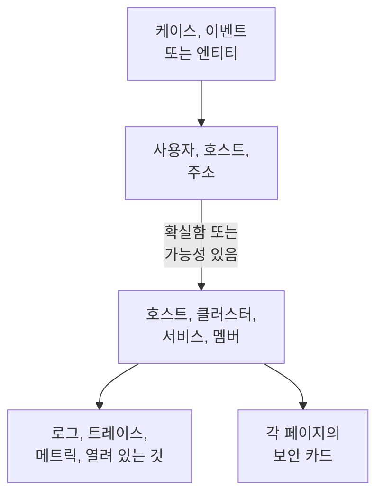

# 연결된 신호

보안 케이스는 어떤 사용자, 호스트, 주소에 관한 것인지 알려 줍니다. 연결된 신호는 그중 OneUptime이 이미 알고 있는 것(호스트, 컨테이너 호스트, Kubernetes 클러스터, 네트워크 장치, 클라우드 리소스, 서버리스 함수, 서비스, 그것을 확인하는 모니터, 멤버)과 케이스 전후에 각각에서 일어난 일(로그, 트레이스, 메트릭, 열려 있는 인시던트와 알림, 감시 중인 모니터, 변경된 내용)을 알려 줍니다. 로그와 트레이스 자체에서도 그것을 찾습니다(웹 서버 접근 로그의 공격자 주소, 애플리케이션 오류의 유출된 이메일 등). 반대로 호스트, 클러스터, 클라우드 리소스, 서비스, 모니터, 멤버의 페이지는 Security Events가 그것에 대해 찾은 내용을 알려 줍니다.

:::cards
- [표시되는 곳](#표시되는-곳): 케이스 페이지, 이벤트 탭, 엔티티 페이지, 그리고 이들이 가리키는 대상의 페이지.
- [값을 맞추는 방법](#값을-맞추는-방법): 같은 레코드로 보는 것과 가능성만 있는 것.
- [각 레코드에 표시되는 내용](#각-레코드에-표시되는-내용): 케이스 전후의 신호와 열려 있는 것.
- [로그 및 트레이스에서](#로그-및-트레이스에서): 가리키는 주소, 도메인, 이메일이 로그 줄과 스팬의 어디에 나타나는지.
- [누가 무엇을 보는가](#누가-무엇을-보는가): 모든 레코드는 읽는 사람의 역할로 읽습니다.
:::

## 작동 방식

OneUptime은 각 값을 프로젝트의 레코드에서 찾고, 각 일치가 얼마나 확실한지 알려 주며, 케이스 전후에 각 레코드에서 일어난 일을 보여 줍니다.

## 시작하기 전에

- 보안 이벤트가 들어오고 있고, 그것이 가리킬 수 있는 호스트, Kubernetes 클러스터, 클라우드 리소스, 서비스, 모니터 또는 멤버가 프로젝트에 있어야 합니다. [보안 시작하기](/docs/telemetry/security-getting-started)를 참조하세요.
- 보안 이벤트를 읽을 수 있는 역할과, 보려는 종류의 레코드를 읽을 수 있는 역할.

## 표시되는 곳

- **연결된 신호**: 모든 보안 케이스의 페이지입니다. **제품 → 보안 이벤트 → 보안 케이스 → 열린 케이스**에서 케이스를 연 다음, 메뉴에서 **엔티티** 다음에 있는 **연결된 신호**를 엽니다.
- **연결됨**: 모든 보안 이벤트의 탭입니다. **제품 → 보안 이벤트 → 이벤트**에서 이벤트를 엽니다. 이벤트 전후 1시간 동안 이벤트가 가리키는 대상을 나열합니다.
- **제품 → 보안 이벤트 → 엔티티 위험**의 엔티티 페이지: 마지막 보안 이벤트 전후에 OneUptime이 그 사용자, 호스트 또는 주소를 어디에서 알고 있는지 보여 줍니다.
- 호스트, Docker 호스트, Podman 호스트, Kubernetes 클러스터, 네트워크 장치, 클라우드 리소스, 서버리스 함수, 서비스, 모니터, 멤버, 인벤토리 항목의 각 페이지에 있는 **보안** 카드: 그것을 가리키는 열린 보안 케이스, 지난 7일 동안 그것을 가리킨 보안 이벤트와 발견 항목의 수, 그중 가장 심각한 것, 그리고 위험도입니다. **Security Events에서 열기**로 그곳에서 엽니다. 모니터의 카드는 그 모니터가 확인하는 호스트와 주소에 관한 것입니다.
- 인시던트 페이지의 **보안** 카드: 보안 케이스가 인시던트를 선언했거나(**선언 출처**) 열린 케이스가 인시던트가 영향을 주는 호스트나 클러스터를 가리킬 때(**영향을 받는 대상을 가리키는 열린 케이스**) 표시됩니다.

## 값을 맞추는 방법

케이스나 이벤트가 가리키는 각 사용자, 호스트, 주소는 프로젝트의 레코드에서 찾습니다.

| 케이스나 이벤트가 가리키는 것 | 맞춘 대상 | 확실성 |
| --- | --- | --- |
| 호스트, 컨테이너 호스트, 클러스터 또는 네트워크 장치가 보고하는 이름과 같은 호스트 이름이나 도메인 이름, 또는 클라우드 리소스가 응답하는 이름 | 그 레코드 | 확실함 |
| 호스트라고 밝히지 않은 같은 이름 | 그 레코드 | 가능성 있음 |
| 레코드 이름의 짧은 형식이나 전체 형식(예: `web-1`과 `web-1.acme.internal`) | 그 레코드 | 가능성 있음 |
| 하나의 호스트나 네트워크 장치만 가진, 또는 하나의 클라우드 리소스만 응답하는 공인 IP 주소 | 그 레코드 | 확실함 |
| 사설 IP 주소 또는 둘 이상의 레코드가 가진 IP 주소 | 그 주소를 가진 각 레코드 | 가능성 있음 |
| 클라우드 리소스 자체의 ID: AWS ARN, Azure 리소스 ID 또는 Google Cloud 리소스 이름 | 그 클라우드 리소스 | 확실함 |
| 모니터가 확인하는 호스트, 공인 IP 주소 또는 URL의 호스트 | 그 모니터 | 확실함 |
| 모니터가 확인하는 사설 IP 주소 | 그 모니터 | 가능성 있음 |
| 멤버의 이메일 | 그 멤버 | 확실함 |
| 로그에서 읽은 이벤트의 경우, 로그 줄을 보낸 레코드 | 그 호스트, 클러스터, 클라우드 리소스, 서버리스 함수 또는 서비스 | 확실함 |
| 사용자 이름만 있는 값, 파일 해시 또는 프로세스 | 없음: 이것으로 키가 지정된 레코드는 없습니다 | - |

- 가능성 있는 일치는 이름 옆에 **일치 가능성**을 표시하고 이유를 알려 줍니다. 레코드 페이지에서 집계되지 않으며, 케이스가 선언하는 인시던트에 연결되지도 않습니다.
- 찾았지만 프로젝트의 레코드가 아닌 것은 **일치하는 레코드 없음** 아래에 나열됩니다. 값이 될 수 있는 종류의 레코드를 읽지 못했다면 그 값은 그곳에 나열되지 않습니다.
- 케이스 하나에 레코드는 최대 10개까지 나열되며, 확실한 것이 먼저 나옵니다.

## 각 레코드에 표시되는 내용

- 신호(각각 레코드와 케이스의 기간으로 열림): **로그**, **트레이스**, **메트릭**, 서비스의 **예외**, 클러스터의 **Kubernetes 이벤트**, 레코드의 **토폴로지**, 그리고 인벤토리에 항목이 있으면 그 **인벤토리** 항목.
- 지금 그 레코드에 열려 있는 인시던트와 알림, 그리고 그것을 감시하는 모니터. 각각 자신의 페이지를 엽니다. 모니터는 이름 옆에 상태를 표시하며, 그 **로그**는 각 확인에서 본 내용입니다.
- 멤버의 온콜 스케줄(지금 온콜을 맡고 있는 스케줄 옆에는 **지금 온콜 중**이 표시됨)과 멤버가 속한 팀.
- 기간 동안 그 레코드에서 변경된 내용: 서비스의 배포, 클러스터의 롤아웃, 호스트의 수정.

| 위치 | 기간 |
| --- | --- |
| 케이스 | 첫 탐지 30분 전부터 마지막 탐지 30분 후까지, 최대 케이스의 마지막 24시간 |
| 이벤트 | 이벤트 전후 30분 |
| 엔티티 페이지 | 마지막 보안 이벤트 전후 30분 |
| 레코드의 **보안** 카드 | 지난 7일 |

## 로그 및 트레이스에서

레코드 아래에서 연결된 신호는 같은 기간의 로그와 트레이스에서, 가리키는 값 중 한 가지 의미만 가질 수 있는 값을 찾습니다. IP 주소(`127.0.0.1` 등 모든 머신에 있는 주소 제외), 전체 호스트 이름 또는 도메인 이름, 이메일, URL, 클라우드 리소스의 ID, 파일 해시입니다. 호스트 이름만 있는 값, 사용자 이름만 있는 값, 프로세스는 찾지 않습니다. 로그 줄은 어떤 이유로든 그것을 담을 수 있기 때문입니다. 최대 10개의 값을 찾습니다.

| 위치 | 값을 가리키는 경우 |
| --- | --- |
| 로그 줄의 메시지 | 대소문자와 상관없이 값 전체를 담은 경우: `10.0.0.1`은 `from 10.0.0.1:52144`에서는 해당하고, `10.0.0.12`나 `110.0.0.1`에서는 해당하지 않음 |
| 로그 줄 또는 스팬의 속성 | 값이 그 값과 정확히 같은 경우: 쓰인 그대로, 소문자 또는 대문자, 또는 짧은 형식의 IPv6 주소 |

- 찾은 각 값에는 그 값을 가리키는 로그 줄과 스팬의 수, 그 안의 위치(**메시지에서** 또는 키로 표시한 속성으로, 각각 해당 줄이나 스팬과 기간으로 **로그** 또는 **트레이스**를 엽니다), 그리고 그것을 보낸 레코드가 많은 순서로 표시됩니다.
- `resource.host.name` 같은 리소스 속성은 어떤 레코드가 줄을 보냈는지만 알려 주며, 세지 않습니다.
- 찾았지만 둘 중 어디에서도 가리키지 않은 값은 **로그나 트레이스에 없음** 아래에 나열됩니다.
- 검색은 사용자 본인의 역할로 이루어집니다. 역할이 읽을 수 없는 로그나 트레이스는 그렇다고 알려 주고 검색하지 않으며, 지금 검색하지 못한 것은 **다시 시도**와 함께 그렇다고 알려 줍니다. 15초보다 오래 걸리는 검색은 중지되고 그렇다고 알려 줍니다.

## 누가 무엇을 보는가

- 연결된 신호와 레코드의 **보안** 카드에는 보안 이벤트를 읽을 수 있는 역할이 필요합니다: Security Admin, Security Member, Security Viewer, Project Owner 또는 Project Admin. 그 밖의 사람은 어떤 페이지에서도 보안 데이터를 볼 수 없습니다. [역할](/docs/permissions/reference#역할)을 참조하세요.
- 인시던트의 **보안** 카드에는 보안 케이스를 읽을 수 있는 역할이 필요합니다.
- 각 레코드는 자신의 역할로 읽으며, 그 위에 있는 것도 마찬가지입니다. 온콜 스케줄을 읽을 수 없는 역할에는 멤버의 온콜 스케줄이 표시되지 않습니다. 역할로 읽을 수 없는 종류의 레코드는 빠지고 페이지가 그렇다고 알려 줍니다. 지금 읽지 못한 종류도 **다시 시도**와 함께 그렇다고 알려 줍니다.
- 레코드 페이지에 **보안** 카드는 Security Events를 사용하는 프로젝트, 즉 지난 7일 동안 보안 이벤트를 받은 프로젝트에서만 표시됩니다.

## 케이스가 선언하는 인시던트

케이스의 **인시던트 선언** 또는 인시던트를 선언하는 플레이북 단계는 케이스가 확실하게 연결된 호스트, Docker 및 Podman 호스트, Kubernetes 클러스터, 클라우드 리소스, 서비스에 인시던트를 연결합니다. 인시던트는 그 페이지에 표시되고 그 소유자의 규칙이 적용되며, 피드에는 케이스와 연결된 대상이 기록됩니다. 가능성 있는 일치는 연결되지 않으며, 모니터도 연결되지 않습니다. 모니터의 인시던트는 그 상태를 바꾸고 그 상태 페이지에 표시될 수 있기 때문입니다.

## OneUptime AI

OneUptime AI의 케이스 분류는 그 케이스의 연결된 신호, 즉 케이스가 가리키는 호스트, 서비스, 모니터, 멤버에서 열려 있는 것과 변경된 내용, 멤버의 온콜 스케줄과 팀, 그리고 그 값이 로그와 트레이스의 어디에 나타나는지를 읽습니다. 인시던트 조사는 그 인시던트를 선언한 보안 케이스와 인시던트가 영향을 주는 대상을 가리키는 열린 케이스를 읽습니다. [보안의 OneUptime AI](/docs/telemetry/security-ai)를 참조하세요.

## 문제 해결

:::details 케이스가 가리키는 호스트가 목록에 없음
케이스가 호스트 스스로 부르는 이름으로 호스트를 가리키는지, 또는 그 호스트만 가진 공인 주소를 가리키는지 확인하세요. `web-1.acme.internal`에 대한 `web-1` 같은 짧은 이름은 가능성 있는 일치로 나열되며, 사용자 이름만 있는 값, 파일 해시, 프로세스는 아예 찾지 않습니다. URL은 그 호스트를 확인하는 모니터 사이에서만 찾습니다.
:::

:::details 케이스가 가리키는 주소가 로그와 트레이스에 없음
케이스의 기간만, 그리고 역할이 읽을 수 있는 로그와 트레이스만 검색합니다. 메시지는 주소 전체를 담을 때만 그 주소를 가리킵니다. `10.0.0.12`는 다른 주소이지만, 로그 탐색기의 메시지 검색은 그것도 찾습니다. 속성은 값이 그 주소와 정확히 같을 때만 그 주소를 가리키며, 리소스 속성은 가리키지 않습니다.
:::

:::details 올바른 호스트가 가능성 있는 일치로 나열됨
가능성 있는 일치는 집계되거나 연결되지 않습니다. 두 머신이 함께 쓰는 이름이 잘못된 머신에 대해 무언가를 알려 주는 일이 없도록 하기 위해서입니다. 로그와 탐지가 호스트가 보고하는 이름으로 호스트를 가리키게 하세요.
:::

:::details 호스트 페이지에 보안 카드가 없음
이 카드는 보안 이벤트를 읽을 수 있는 역할에게, 지난 7일 동안 보안 이벤트를 받은 프로젝트에서 표시됩니다. 그 기간에 아무것도 가리키지 않은 호스트는 그렇다고 알려 주는 한 줄을 표시합니다.
:::

:::details 모니터 페이지에 보안 카드가 없음
이 카드는 호스트, 주소 또는 URL을 확인하는 모니터, 즉 웹사이트, API, Ping, 포트, SSL 인증서, DNS 또는 도메인 모니터에 표시됩니다. 하트비트, 스크립트 또는 텔레메트리 모니터는 호스트를 확인하지 않으므로 카드가 없습니다.
:::

:::details 페이지에 역할로 볼 수 없는 종류의 레코드가 있다고 표시됨
각 레코드는 자신의 역할로 읽습니다. Project Owner 또는 Project Admin에게 그 종류의 레코드를 읽을 수 있는 역할을 요청하세요.
:::

## 다음 단계

:::cards
- [보안 케이스 및 플레이북](/docs/telemetry/security-cases): 케이스를 처리하고 그로부터 인시던트를 선언합니다.
- [보안 이벤트(SIEM)](/docs/telemetry/security-events): 케이스 뒤에 있는 이벤트와 그 이벤트를 읽어 온 로그.
- [엔티티 위험 (위험 기반 알림)](/docs/telemetry/security-entity-risk): 엔티티 페이지, 그 위험도, 그리고 OneUptime에서 그것이 있는 곳.
- [보안의 OneUptime AI](/docs/telemetry/security-ai): 분류가 케이스가 가리키는 것을 읽는 방법.
:::
