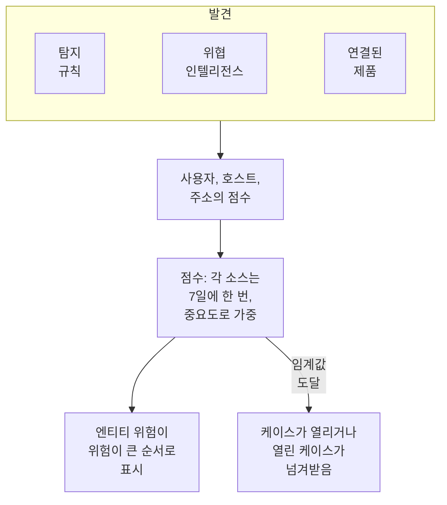

# 엔티티 위험 (위험 기반 알림)

발견 하나만으로는 대개 많은 것을 알 수 없습니다. 연이은 로그인 실패, 호스트의 첫 sudo, 새 국가에서의 로그인은 각각 한 번 볼 만합니다. 같은 계정이 일주일 안에 세 가지 모두에 나타나면 케이스로 다룰 만합니다. 엔티티 위험은 탐지 규칙, 위협 인텔리전스, 연결된 제품이 각 사용자, 호스트, IP 주소에 대해 찾은 것을 합산하고, 위험이 큰 순서로 보여 주며, 위험이 프로젝트 임계값에 도달한 엔티티에 대해 케이스를 엽니다.

:::cards
- [점수를 세는 방법](#점수를-세는-방법): 심각도별 점수와, 일주일에 한 번만 세는 각 소스.
- [위험 수준과 케이스](#위험-수준과-케이스): 점수를 읽는 방법과 케이스가 열리는 시점.
- [엔티티 중요도](#엔티티-중요도): 중요한 것은 더 많이, 덜 중요한 것은 더 적게 셉니다.
- [엔티티 페이지](#엔티티-페이지): 위험한 이유, 한 달의 추이, 관련 케이스.
- [탐지 규칙의 위험 점수](#탐지-규칙의-위험-점수): 점수에 대한 규칙 자체의 비중.
:::

## 작동 방식

**제품 → Security Events → 엔티티 위험**을 열면 현재 위험이 있는 모든 사용자, 호스트, IP 주소가 위험이 큰 순서로 수준, 중요도, 발견한 소스, 시점과 함께 표시됩니다. 각각은 자체 페이지에서 열립니다.

## 시작하기 전에

- 보안 이벤트가 들어오고 있고, 그 안에서 무언가를 찾는 탐지 규칙, 위협 인텔리전스 또는 연결된 제품이 있어야 합니다. [보안 시작하기](/docs/telemetry/security-getting-started)를 참고하세요.
- 누군가를 가리키는 필드로 그룹화하는 탐지 규칙: **Group By Field**(예: `principalUser`, `principalHost`, `principalIp`) 또는 상관 규칙이 그룹화하는 필드. 아무것으로도 그룹화하지 않는 규칙은 위험을 더하지 않습니다.
- **위험 점수 매기기**을 변경하려면: 스위치와 임계값은 Project Owner 또는 Project Admin, 엔티티 목록은 탐지 규칙을 만들 수 있는 역할이 필요합니다. Security Viewer는 모두 읽을 수 있습니다. [역할](/docs/permissions/reference#역할)을 참고하세요.

## 점수를 세는 방법

발견마다 해당 사용자, 호스트, IP 주소에 위험 점수가 더해집니다:

| 발견의 심각도 | 더해지는 점수 |
| --- | --- |
| 낮음 | 10점 |
| 중간 | 25점 |
| 높음 | 50점 |
| 심각 | 75점 |

- 정보 수준의 발견은 아무것도 더하지 않으며, 심각도를 알 수 없는 발견은 중간으로 셉니다.
- 탐지 규칙의 점수는 규칙이 그룹화하는 값에 더해집니다. 위협 인텔리전스 일치는 지표가 가리키는 IP 주소에 더해집니다. 연결된 제품의 경고는 그것이 가리키는 사용자와 호스트에, 없으면 그 IP 주소에 더해집니다.
- 각 소스는 한 번만 셉니다. 탐지 규칙, 위협 인텔리전스 피드, 연결된 제품의 규칙은 몇 번 발생하든 7일에 한 번, 더한 최댓값으로 셉니다. 시끄러운 규칙 하나가 서로 다른 세 규칙보다 엔티티를 더 나빠 보이게 할 수는 없습니다.
- 7일 동안 아무것도 찾지 않은 소스는 더 이상 세지 않으며 점수가 내려갑니다. 점수는 15분마다 확인되므로 새 발견이 없어도 제때 내려갑니다.

엔티티의 점수는 소스의 합계를 중요도로 가중한 값입니다. **테스트 공격 보내기**의 테스트 공격과 누군가 직접 연 케이스는 위험을 더하지 않습니다.

## 위험 수준과 케이스

각 점수는 프로젝트 임계값(변경하지 않으면 100)에 대한 수준으로 읽힙니다:

| 위험 점수 | 수준 | 일어나는 일 |
| --- | --- | --- |
| 1~49 | 낮음 | 엔티티 위험에 표시 |
| 50~99 | 중간 | 엔티티 위험에 표시 |
| 100~199 | 높음 | 높음 케이스가 열림 |
| 200 이상 | 심각 | 심각 케이스가 열림 |

엔티티의 위험이 임계값에 도달하면 소스가 엔티티 위험인 탐지가 해당 엔티티에 대해 발생합니다. 이 탐지는 엔티티에 대한 열린 케이스에 합류하거나 `High risk — k.morgan@acme-commerce.example`처럼 엔티티 이름을 딴 케이스를 열고, 위험에 가장 많이 기여한 소스를 최대 10개까지 점수, 발생 횟수, 마지막 발생 시점과 함께 나열합니다.

엔티티의 위험으로 케이스가 열린 뒤에는 그 뒤에 있던 것을 다시 세지 않습니다. 다음 케이스는 그 이후의 새 소스가 다시 임계값에 도달할 때만 열립니다. 처리됨으로 닫힌 케이스는 같은 발견으로 다시 열리지 않습니다.

임계값은 **제품 → Security Events → 설정 → 위험 점수 매기기 → 위험 임계값**에서 변경합니다. 10부터 10000까지의 정수입니다. 중간은 그 절반부터, 심각은 그 두 배부터 시작하며, 모든 페이지에서 같습니다.

### 위험 케이스 켜기 또는 끄기

**설정 → 위험 점수 매기기**의 **위험 케이스**는 위험이 케이스를 여는지를 정하며, 전환하는 즉시 저장됩니다. 새 프로젝트는 켜진 상태로 시작합니다. 엔티티 위험보다 먼저 만들어진 프로젝트는 누군가 켤 때까지 꺼진 상태로 유지되며, **엔티티 위험**는 목록 위에 이를 알립니다. 위험은 어느 경우든 점수가 매겨지고 표시됩니다.

## 엔티티 중요도

어떤 엔티티는 다른 것보다 중요합니다. 도메인 컨트롤러, 임원의 계정, 결제 서버 같은 것들입니다. 스캔이 예상되는 취약점 스캐너처럼 덜 중요한 것도 있습니다. **설정 → 위험 점수 매기기 → 엔티티 중요도**에서 **엔티티 추가**로 등록하세요:

| 중요도 | 위험을 세는 방식 |
| --- | --- |
| 낮음 | ×0.5 |
| 등록 안 됨 | ×1 |
| 높음 | ×1.5 |
| 최상 | ×2 |

항목은 값이나 `*` 패턴이며 대소문자를 구분하지 않습니다. `dc-*`는 모든 도메인 컨트롤러를, `*@contractors.example`은 모든 외부 계약자를 가리킵니다. **유형**은 사용자, 호스트 또는 IP 주소로 좁히며, 비워 두면 모두에 해당합니다. 여러 항목이 한 엔티티를 가리키면 가장 구체적인 항목이 적용됩니다. 패턴보다 전체 값이, 짧은 패턴보다 긴 패턴이 우선합니다. 변경 사항은 몇 분 안에 모든 엔티티의 점수에 반영됩니다.

## 엔티티 페이지

**엔티티 위험**의 행에서 **보기**를 클릭하거나, 케이스의 **엔티티** 페이지에서 엔티티 옆의 위험을 클릭하세요:

| 부분 | 표시 내용 |
| --- | --- |
| 헤더 | 종류와 중요도, 점수와 수준, 점수 계산 방식 |
| **활동** | 지난 7일간의 보안 이벤트와 발견 |
| **위험을 높이는 요인** | 각 소스, 그 심각도, 더하는 점수, 발생 횟수, 마지막 발생 시점 |
| **지난 30일의 위험** | 매일 끝의 점수로, 수준별로 색이 표시됨 |
| **관련 케이스** | 이 엔티티에 대해 열린 보안 케이스로, 최신순 |

**Open in Correlate**는 이벤트 그래프를 그리고, **이벤트 검색**는 해당 주의 **이벤트**를 엽니다. **위험 초기화**는 계획된 테스트 후처럼 점수와 소스를 지웁니다. 다음에 발견되는 것은 0부터 세며, 케이스는 바뀌지 않습니다. 초기화에는 보안 데이터를 삭제할 수 있는 역할이 필요하며, [감사 로그](/docs/configuration/audit-logs)에 기록됩니다.

OneUptime AI는 케이스를 분류할 때 케이스 엔티티의 위험을 읽습니다. [보안의 OneUptime AI](/docs/telemetry/security-ai)를 참고하세요.

## 탐지 규칙의 위험 점수

탐지 규칙은 Sigma `level`에서 얻은 수준의 점수를 더합니다. 규칙 자체의 비중을 주려면 규칙의 양식을 열고 **일치 시**로 이동해 **추가 필드**를 연 다음 **위험 점수**를 0(위험을 더하지 않음)부터 100 사이로 설정하세요. 비워 두면 수준의 점수가 적용됩니다.

## 문제 해결

:::details 엔티티가 엔티티 위험에 없음
지난 7일 동안 탐지 규칙, 위협 인텔리전스 피드 또는 연결된 제품이 해당 엔티티에 대해 무언가를 찾았는지, 그리고 규칙이 엔티티를 가리키는 필드로 그룹화하는지 확인하세요. 정보 수준의 발견은 아무것도 더하지 않으며, 7일 동안 아무것도 찾지 않은 소스는 더 이상 세지 않습니다.
:::

:::details 엔티티의 위험이 임계값에 도달했는데 케이스가 열리지 않음
**설정 → 위험 점수 매기기**에서 **위험 케이스**가 켜져 있는지 확인하세요. 엔티티의 위험으로 이전에 케이스가 열린 적이 있다면, 다음 케이스에는 그 이후의 새 소스만 셉니다.
:::

:::details 규칙이 계속 발생하는데 엔티티의 점수가 오르지 않음
그것이 세는 방식입니다. 소스는 7일에 한 번, 더한 최댓값으로 셉니다. 시끄러운 규칙의 **위험 점수**를 낮추거나, 발견이 예상되는 엔티티의 중요도를 낮음으로 표시하세요.
:::

:::details 점수가 소스의 합계와 다름
중요도로 가중되기 때문입니다. 엔티티 페이지에 소스의 합계와 가중치가 표시됩니다(예: 소스에서 100 × 2 = 200).
:::

## 다음 단계

:::cards
- [보안 케이스 및 플레이북](/docs/telemetry/security-cases): 위험이 여는 케이스를 처리하고 판정과 함께 닫습니다.
- [보안 이벤트(SIEM)](/docs/telemetry/security-events): 탐지 규칙, 상관 분석, 모든 발견 뒤의 이벤트.
- [위협 인텔리전스(STIX/TAXII)](/docs/telemetry/threat-intelligence): 주소의 위험을 더하는 일치.
- [보안의 OneUptime AI](/docs/telemetry/security-ai): 분류가 케이스 엔티티의 위험을 읽는 방법.
:::
