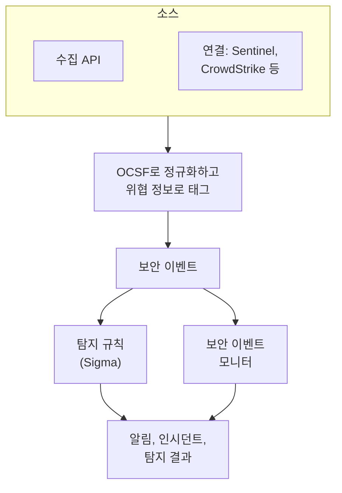
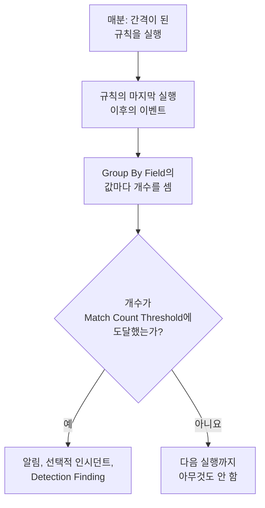

# 보안 이벤트(SIEM)

OneUptime은 보안 이벤트를 로그, 트레이스, 메트릭 옆에 보관하며, 어떤 형식으로 도착했든 모두 같은 형태인 [OCSF](https://schema.ocsf.io/)(Open Cybersecurity Schema Framework)로 맞춥니다. 어떤 소스에서든 이벤트를 보내고, 검색하고, 중요한 것은 Sigma 탐지 규칙, 위협 인텔리전스, 모니터로 알림으로 바꾸세요.

:::cards
- [이벤트 보내기](#보안-이벤트-보내기): HTTPS POST, Fluent Bit 출력, 또는 보안 제품과의 연결.
- [검색과 상관 분석](#보안-이벤트-탐색하기): 이벤트 탐색기와 상관 분석 그래프.
- [탐지 규칙](#탐지-규칙): 알림을 여는 Sigma 규칙.
- [모니터](#보안-이벤트-모니터): 롤링 윈도우의 개수와, 다시 회복되는 상태.
:::

## 작동 방식



**관측 가능성** 아래의 **제품 → Security Events** 를 엽니다. 탭은 다음과 같습니다.

| 탭 | 용도 |
| --- | --- |
| **이벤트** | 모든 이벤트를 검색하고 필터링하며, 이벤트 하나를 열어 모든 필드를 확인 |
| **상관 분석** | 같은 호스트, 사용자, IP 주소를 공유하는 이벤트의 그래프 |
| **Detection Rules** | 일정에 따라 실행되어 알림을 여는 Sigma 규칙 |
| **Threat Intel** | 알려진 악성 지표의 STIX/TAXII 피드 |
| **모니터** | 프로젝트의 보안 이벤트 모니터 |
| **Connections** | OneUptime이 새 레코드를 폴링하는 보안 제품 |
| **설정 가이드** | 이벤트를 보내는 스니펫. 수집 키가 미리 채워져 있음 |

## 시작하기 전에

보안 데이터는 Project Owner와 Project Admin 역할, 그리고 세 가지 Security 역할만 읽을 수 있으며, 다른 역할에는 Security Events에 아무것도 보이지 않습니다. [역할](/docs/permissions/reference#역할) 을 참고하세요.

| 역할 | 할 수 있는 일 |
| --- | --- |
| Security Admin | 모든 것: 이벤트, 탐지 규칙, 위협 인텔리전스 피드, 연결 |
| Security Member | 이벤트와 위협 인텔리전스 읽기, 탐지 규칙과 피드의 생성, 변경, 삭제. 연결을 설정하거나 보안 데이터를 삭제할 수는 없음. |
| Security Viewer | 이벤트, 규칙, 피드, 지표, 연결 읽기 |

## 보안 이벤트 보내기

:::steps
### 수집 키 만들기

**프로젝트 설정 → 텔레메트리 및 APM → 수집 키** 를 열고 **수집 키 생성** 을 클릭합니다. 보안 이벤트는 나머지 텔레메트리와 같은 키를 사용합니다.

### 이벤트 전송하기

키를 `x-oneuptime-token` 에 넣어 JSON을 `/security-events/v1/ingest` 로 보냅니다.

:::tabs
@tab OCSF
```bash
curl -X POST "https://oneuptime.com/security-events/v1/ingest?format=ocsf" \
  -H "Content-Type: application/json" \
  -H "x-oneuptime-token: YOUR_INGESTION_TOKEN" \
  -H "x-oneuptime-service-name: my-security-source" \
  -d '{ "events": [ { "class_uid": 3002, "severity_id": 4, "status": "Failure", "message": "Failed logon for alice", "actor": { "user": { "name": "alice" } }, "src_endpoint": { "ip": "203.0.113.7", "hostname": "laptop-alice" } } ] }'
```
@tab Google UDM
```bash
curl -X POST "https://oneuptime.com/security-events/v1/ingest?format=udm" \
  -H "Content-Type: application/json" \
  -H "x-oneuptime-token: YOUR_INGESTION_TOKEN" \
  -d '{ "events": [ { "metadata": { "event_type": "USER_LOGIN" }, "principal": { "hostname": "laptop-alice", "user": { "userid": "alice" }, "ip": ["203.0.113.7"] }, "security_result": [{ "severity": "HIGH", "action": ["BLOCK"] }] } ] }'
```
@tab Generic JSON
```bash
curl -X POST "https://oneuptime.com/security-events/v1/ingest" \
  -H "Content-Type: application/json" \
  -H "x-oneuptime-token: YOUR_INGESTION_TOKEN" \
  -d '{ "events": [ { "severity": "high", "event_type": "ssh_brute_force", "message": "12 failed SSH logins in 60s", "username": "root", "hostname": "web-01", "src_ip": "203.0.113.7" } ] }'
```
:::

이벤트가 대기열에 들어가면 엔드포인트가 `200` 을 반환합니다. 이 예시처럼 시간 없이 보낸 이벤트는 도착한 순간에 놓입니다.

### 이벤트 탭에서 찾기

**제품 → Security Events → 이벤트** 를 엽니다. 몇 초 안에 이벤트가 표시되며, 심각도, 클래스, 사용자, 호스트, IP 주소가 채워져 있습니다.
:::

### 형식

| `format` | 읽는 것 | 함께 허용되는 값 |
| --- | --- | --- |
| `ocsf` | OCSF 이벤트 JSON(`class_uid`, `severity_id` 등) | 없음 |
| `udm` | Google SecOps(Chronicle) UDM 이벤트(`metadata.event_type` 등) | `chronicle`, `google-secops` |
| `google-secops-alert` | Google SecOps 탐지와 알림: SOAR 웹훅과 탐지 스트림 | `secops-alert`, `detection` |
| `generic` | 그 밖의 모든 JSON. 일반적인 필드 이름으로 읽음 | 없음 |

형식은 `?format=`, `x-oneuptime-security-event-format` 헤더, 또는 최상위 `"format"` 필드로 지정합니다. 지정하지 않으면 이벤트마다 형식을 따로 판단하므로, 웹훅 하나에 탐지와 원시 이벤트를 섞어 보낼 수 있습니다.

- 본문은 이벤트 하나, 이벤트 배열, 또는 `{ "events": [...] }` 일 수 있습니다.
- `x-oneuptime-service-name` 헤더는 이벤트가 속한 텔레메트리 서비스를 지정합니다. 없으면 첫 이벤트의 제품이나 공급업체 이름을 딴 서비스, 또는 `Security Events` 에 속합니다.
- 매핑되지 않았다고 버려지는 것은 없습니다. 소스의 모든 필드가 이벤트의 속성에 들어갑니다.

### 일반 JSON 필드

일반 이벤트는 흔히 쓰이는 필드 이름으로 읽습니다.

| 이벤트의 필드 | 다음 중 처음 발견된 것에서 읽음 |
| --- | --- |
| `message` | `message`, `msg`, `summary`, `description`, `title` |
| `severityName` | `severity`, `severity_name`, `level`, `priority`, `risk_level` |
| `time` | `timestamp`, `time`, `@timestamp`, `event_time`, `created_at` |
| `principalUser` | `user`, `username`, `user_name`, `account`, `actor` |
| `principalHost` | `host`, `hostname`, `computer`, `device`, `machine` |
| `principalIp` | `source_ip`, `src_ip`, `client_ip`, `ip` |
| `targetIp` | `destination_ip`, `dest_ip`, `dst_ip`, `target_ip` |
| `className` | `event_type`, `category`, `type`, `action` |
| `ruleName` | `rule`, `rule_name`, `signature`, `detection` |
| `productName` | `product`, `product_name`, `source`, `log_source` |

심각도를 나타내는 단어는 OCSF 수준이 됩니다. `info` 는 Informational, `warning` 은 Low, `error` 는 Medium, `alert` 는 Critical, `emergency` 는 Fatal로 읽힙니다.

### Fluent Bit로 전달하기

auditd, syslog, Falco처럼 이미 수집하고 있는 보안 로그를 보내려면 Fluent Bit에 `http` 출력을 추가합니다.

```ini title="fluent-bit.conf"
[OUTPUT]
    Name             http
    Match            security.*
    Host             oneuptime.com
    Port             443
    tls              On
    URI              /security-events/v1/ingest
    Format           json
    Json_date_key    timestamp
    Json_date_format iso8601
    Header           x-oneuptime-token YOUR_INGESTION_TOKEN
    Header           x-oneuptime-service-name my-security-source
    Retry_Limit      5
```

**설정 가이드** 탭에는 여러분의 호스트와 키가 채워진 이 스니펫이 있습니다.

### 보안 제품 연결하기

**Connections** 는 보안 제품을 대신 폴링해 새 레코드를 보안 이벤트로 가져옵니다. 연결은 제품의 설정과 암호화된 자격 증명을 보관하며, 워커가 설정한 간격으로 폴링하고 이미 가져온 레코드는 건너뜁니다.

| 제품 | 가져오는 것 | 설정 가이드 |
| --- | --- | --- |
| Google SecOps (Chronicle) | 규칙 탐지, 큐레이션된 탐지, 알림을 Detection Finding으로 | [Google SecOps](/docs/integrations/google-secops) |
| Microsoft Sentinel | 인시던트를 Incident Finding으로 | [Microsoft Sentinel](/docs/integrations/microsoft-sentinel) |
| Microsoft Defender XDR | 알림을 Detection Finding으로 | [Microsoft Defender XDR](/docs/integrations/microsoft-defender-xdr) |
| CrowdStrike Falcon | 알림을 Detection Finding으로 | [CrowdStrike Falcon](/docs/integrations/crowdstrike-falcon) |
| Splunk Enterprise Security | Notable 이벤트 또는 모든 검색을 Detection Finding으로 | [Splunk Enterprise Security](/docs/integrations/splunk) |
| Elastic Security | 탐지 알림을 Detection Finding으로 | [Elastic Security](/docs/integrations/elastic-security) |
| AWS Security Hub | Finding을 Detection Finding과 Compliance Finding으로 | [AWS Security Hub](/docs/integrations/aws-security-hub) |
| Okta System Log | 로그인, MFA, 계정, 정책 이벤트 | [Okta System Log](/docs/integrations/okta) |

- 연결은 레코드가 설명하는 활동 시각이 아니라, 제품이 레코드를 만든 시각을 기준으로 읽습니다. 매시간 실행되는 SIEM 규칙은 일치한 이벤트보다 한참 뒤에 탐지를 만들지만, 그것도 가져옵니다.
- 첫 폴링은 24시간 전까지 거슬러 올라가므로, 새 연결에서 최근 레코드가 바로 보입니다.
- 연결 행의 **연결 테스트** 는 제품에 대한 접근과 OneUptime 자체 워커의 실행 여부를 확인하며, 아무것도 가져오지 않습니다. **Run now** 는 즉시 폴링합니다.

## 이벤트에 담기는 것

모든 이벤트는 타입이 지정된 필드와 소스의 페이로드와 함께 저장됩니다.

| 그룹 | 필드 |
| --- | --- |
| 분류 | `categoryName`, `className`, `activityName`, `statusName` 과 각각의 OCSF ID(`categoryUid`, `classUid`) |
| 심각도 | `severityName`(Unknown, Informational, Low, Medium, High, Critical, Fatal, Other 중 하나)과 `severityId` |
| 누가 했는지 | `principalUser`, `principalHost`, `principalIp`, `principalProcess` |
| 무엇에 영향을 주었는지 | `targetUser`, `targetHost`, `targetIp`, `targetPort`, `targetResource` |
| 소스 | `productName`, `vendorName`, `ruleId`, `ruleName`, `eventUid` |
| 내용 | `message`, `mitreTactics`, `mitreTechniques`, `observables`: 이벤트에서 뽑아낸 모든 사용자, 호스트, IP 주소, 도메인, 해시 |
| 속성 | 소스의 페이로드 전체를 점으로 구분한 키로 평탄화한 것 |

## 보안 이벤트 탐색하기

**이벤트** 는 로그와 트레이스 탐색기 같은 텔레메트리 탐색기입니다. 창 안의 이벤트를 심각도별로 보여 주는 차트, 패싯 사이드바, 목록, 그리고 연 이벤트의 모든 필드와 속성을 보여 주는 패널이 있습니다. 창, 필터, 검색은 모두 URL에 저장되므로, 필터링한 화면을 공유할 수 있고 새로 고쳐도 유지됩니다.

### 검색

검색창은 다른 텔레메트리 탐색기와 같은 문법을 씁니다([검색 구문](/docs/telemetry/search-syntax) 참고).

| 구문 | 의미 | 예 |
| --- | --- | --- |
| 자유 텍스트 | 메시지에 포함됨 | `failed logon` |
| `"quoted phrase"` | 단어를 한 덩어리로 | `"brute force"` |
| `<field>:<value>` | 타입이 지정된 필드 | `severity:Critical` |
| `@<attribute>:<value>` | 소스 속성 | `@threat.matched:true` |
| `-<filter>` | 이것을 제외 | `-severity:Informational` |
| `<field>:(a OR b)` | 이 값들 중 하나 | `severity:(High OR Critical)` |
| `<field>:a*` | `*` 는 임의의 텍스트, `?` 는 임의의 한 글자 | `host:web-*` |
| `@<attribute>:*` | 속성이 있음 | `@threat.indicator_id:*` |
| `@<attribute>:~text` | 속성이 텍스트를 포함함 | `@finding_info.title:~ransom` |

필드는 짧은 이름(`severity`, `class`, `category`, `activity`, `status`, `vendor`, `product`, `rule`, `user`, `host`, `ip`, `targetuser`, `targethost`, `targetip`, `observable`, `tactic`, `technique`)이거나, `severityName` 이나 `principalHost` 같은 필드 자체의 이름입니다. 그 밖의 이름은 소스 속성으로 읽힙니다. `observable:<value>` 는 활동의 어느 쪽에 있었든 그 값을 언급하는 모든 이벤트를 찾습니다.

### 패싯

사이드바는 창 안의 이벤트를 **소스**, **심각도**, **이벤트 클래스**, **Category**, **활동**, **상태**, **공급업체**, **제품**, **Detection Rule**, **원본 사용자**, **원본 호스트** 별로 셉니다. 값을 클릭하면 그 이벤트만 남기고, 옆의 빼기 표시를 클릭하면 제외합니다. 차트와 모든 개수는 목록에 있는 이벤트를 정확히 나타냅니다.

### 상관 분석

**상관 분석** 은 호스트, 사용자, IP 주소를 중심으로 이벤트를 그립니다. 검색한 값 주위에 이벤트 클래스를 가장 높은 심각도로 표시하고, 같은 이벤트에서 본 다른 값을 바깥 고리에 놓습니다. 클래스를 클릭하면 그 이벤트 목록을, 값을 클릭하면 그 값으로 다음 상관 분석을 합니다. **이벤트** 에서 이벤트 패널의 observable은 모두 그 값으로 **상관 분석** 을 엽니다.

## 탐지 규칙

탐지 규칙은 의심스러운 활동을 설명하는 개방형 YAML 형식인 [Sigma](https://sigmahq.io/) 규칙으로, OneUptime이 일정에 따라 여러분의 이벤트에 대해 실행합니다. 일치하면 알림을 열고, 원하면 인시던트도 열고, Detection Finding을 이벤트에 다시 기록합니다.



### 규칙 만들기

:::steps
1. **제품 → Security Events → Detection Rules** 를 열고 **Detection Rule 만들기** 를 클릭합니다.
2. **기본 정보** 에서 **이름** 을 정하고, **활성화됨** 은 켠 채로 둡니다.
3. **Sigma Rule** 에서 규칙의 YAML을 **Sigma Rule (YAML)** 에 붙여 넣습니다. 저장할 때 구문을 분석하므로, 오류는 양식에 표시됩니다.
4. **평가** 에서 실행 빈도와 필요한 일치 횟수를 설정합니다. [평가 설정](#평가-설정) 을 참고하세요.
5. **일치 시** 에서 일치했을 때 할 일을 고릅니다. **Create Alert on Match**(켜짐), **Create Incident on Match**(꺼짐), **Write Detection Finding on Match**(켜짐)와, 선택 사항인 **알림 심각도** 와 **인시던트 심각도** 입니다.
:::

`10.x.x.x` 밖에서 온 로그인 실패에 일치하는 첫 규칙:

```yaml title="failed-logon-burst.yml"
title: Failed logon burst
description: Repeated authentication failures from one source.
level: high
tags:
  - attack.t1110
  - attack.ta0006
detection:
  selection:
    className: Authentication
    statusName: Failure
  filter_internal:
    principalIp|startswith: '10.'
  condition: selection and not filter_internal
```

### 규칙으로 표현할 수 있는 것

OneUptime은 Sigma의 불리언 핵심을 실행합니다.

- 셀렉션은 필드 맵(모든 필드가 일치해야 하며, 값의 목록은 그중 하나와 일치)이거나, 메시지 어디에서나 일치하는 키워드 목록입니다.
- 조건은 `and`, `or`, `not` 과 괄호, 또는 `1 of selection_*`, `all of selection_*`, `any of them`, `all of them` 으로 셀렉션을 결합합니다.
- 필드 수식어: `contains`, `startswith`, `endswith`, `all`, `re`, `cased`, `gt`, `gte`, `lt`, `lte`, `cidr`, `exists`, `windash`. 텍스트는 `cased` 를 붙이지 않는 한 대소문자를 구분하지 않고 비교합니다.
- 필드는 타입이 지정된 필드(`principalUser`), 그 필드의 흔한 Sigma 표기(`CommandLine`, `src_ip`, `Hostname`), 또는 이벤트에 적힌 그대로의 모든 속성 키(`threat.matched`)입니다.
- `level` 은 심각도를 정합니다. `informational`, `low`, `medium`, `high`, `critical` 중 하나이며, 없으면 `medium` 입니다. `tags` 의 ATT&CK ID(`attack.t1110`, `attack.ta0006`)는 탐지 결과의 MITRE 필드를 채웁니다.

`| count() by principalIp > 5` 같은 집계는 저장할 때 거부됩니다. 대신 **Group By Field** 와 **Match Count Threshold** 를 사용하세요. `logsource` 는 참고용일 뿐 아무것도 좁히지 않습니다. 그 필터는 `className: Authentication` 처럼 셀렉션에 넣으세요. `timeframe` 은 무시됩니다. 윈도우는 규칙의 간격이 정하기 때문입니다.

### 평가 설정

| 필드 | 하는 일 |
| --- | --- |
| **Evaluation Interval (Minutes)** | 규칙의 실행 빈도. 분 단위 정수로 1~1440. 새 규칙의 양식은 5에서 시작합니다. |
| **Group By Field** | 선택 사항. `principalHost` 처럼 이 필드의 값이 같은 일치는 함께 세고, 알리고, 중복을 제거합니다. 알림 수백 개 대신 호스트당 하나가 됩니다. |
| **Distinct Count Field** | 선택 사항. 일치한 이벤트 대신 이 필드의 서로 다른 값을 셉니다. 빈 값은 세지 않습니다. |
| **Match Count Threshold** | 한 번의 실행 안에서 개수가 이 수에 도달할 때만 그룹이 발동합니다. 1~1000000이며, 1이면 일치할 때마다 발동합니다. |

Group By와 Distinct Count는 규칙과 같은 필드 이름을 받습니다. 이것들을 쓰면 임곗값은 "같은 대상에서, 한 번의 실행 안에, 이만큼"을 뜻하며, 위에 모니터를 따로 둘 필요가 없습니다.

| 목표 | Group By Field | Distinct Count Field | 임곗값 |
| --- | --- | --- | --- |
| 모든 일치에 알림 | 비어 있음 | 비어 있음 | 1 |
| 호스트당 알림 하나 | `principalHost` | 비어 있음 | 1 |
| 무차별 대입: 한 IP에서 로그인 실패 5회 | `principalIp` | 비어 있음 | 5 |
| 패스워드 스프레이: 한 IP가 서로 다른 계정 5개에 실패 | `principalIp` | `principalUser` | 5 |
| 포트 스캔: 한 IP가 서로 다른 포트 20개에 접근 | `principalIp` | `targetPort` | 20 |

### 규칙이 실행되는 시점

OneUptime은 매분, 마지막 실행 이후 간격이 지난 활성화된 규칙을 확인합니다. 각 실행은 이벤트 시각이 이전 실행과 지금 사이에 있는 이벤트를 읽고 다음으로 넘어갑니다.

- 윈도우는 이어져 있으며 미끄러지지 않습니다. 간격이 10분이면 09:58과 10:01의 실패가 서로 다른 실행에 들어가 따로 세어질 수 있으므로, 임곗값을 고를 때 여유를 두세요.
- 워커 중단이나 규칙 재활성화 같은 공백 뒤에는, 다음 실행이 최대 최근 24시간까지 공백 전체를 처리합니다.
- 규칙의 마지막 실행보다 이전 시각을 달고 늦게 도착한 이벤트는 저장되고 검색도 되지만, 그 규칙은 그 이벤트를 절대 읽지 않습니다.
- 한 번의 실행에서 발동하는 그룹은 최대 100개이며, 개수가 가장 많은 그룹이 선택됩니다.

### 심각도

규칙의 `level` 은 탐지 결과의 심각도입니다. `informational`, `low`, `medium`, `high`, `critical` 은 각각 Informational, Low, Medium, High, Critical이 됩니다. 규칙의 알림과 인시던트에는 프로젝트의 심각도 중 하나가 다음 순서로 지정됩니다.

1. 설정되어 있다면 규칙의 **알림 심각도**(또는 **인시던트 심각도**).
2. 수준과 같은 이름을 가진 여러분의 심각도. 예를 들어 High이며, 대소문자는 가리지 않습니다.
3. 순위에 따라: `critical` 과 `high` 규칙은 가장 무거운 심각도를, 나머지는 가장 가벼운 심각도를 받습니다.

> [!TIP]
> 알림 심각도의 이름을 Sigma 수준(Critical, High, Medium, Low, Informational)에 맞춰 두면, 규칙마다 설정하지 않아도 모든 규칙이 알맞은 심각도에 배정됩니다.

### 알림과 탐지 결과

발동한 그룹마다 제목이 `[Detection] <rule name> — <group value>` 인 알림이, Group By Field가 없는 규칙에서는 `[Detection] <rule name>` 인 알림이 열립니다. 알림이 열려 있는 동안에는 그 그룹의 일치가 더 있어도 새 알림이 열리지 않습니다. 규칙은 일치만 볼 뿐 공격이 멈췄는지는 알 수 없으므로, 알림은 누군가 해결할 때까지 열려 있습니다.

Detection Finding은 제품 `OneUptime Detections` 에서 나온 `Detection Finding` 클래스(OCSF 클래스 2004)의 보안 이벤트로, 규칙의 MITRE 태그, `observables` 맨 앞의 그룹 값, 그리고 다음 속성을 담습니다.

| 속성 | 값 |
| --- | --- |
| `oneuptime.detection.rule_id` | 발동한 규칙의 ID |
| `oneuptime.detection.rule_name` | 규칙 이름 |
| `oneuptime.detection.match_count` | 탐지 결과의 근거가 된 이벤트 수 |
| `oneuptime.detection.distinct_count` | 근거가 된 서로 다른 값의 수(Distinct Count Field가 있는 규칙의 경우) |
| `oneuptime.detection.group_value` | 그룹의 값(Group By Field가 있는 규칙의 경우) |
| `oneuptime.detection.sigma_id` | Sigma 규칙 자체의 `id` |

탐지 결과는 일반 이벤트입니다. **이벤트** 에서 검색하고 **상관 분석** 에서 파고들 수 있습니다. 새 규칙을 조용히 시험하려면, 믿을 수 있을 때까지 탐지 결과를 뺀 모든 동작을 꺼 두세요.

## 보안 이벤트 모니터

보안 이벤트 모니터는 필터에 일치하는 이벤트를 롤링 윈도우에서 세고, 그 개수에 일반적인 모니터 조건을 적용합니다. 모니터 상태를 바꾸고, 알림이나 인시던트를 열고, 온콜 담당자를 호출합니다. **모니터 → 모니터 생성** 에서 유형으로 **Security Events** 를 골라 만듭니다. **Security Events → 모니터** 에 모두 나열됩니다.

양식에는 **Monitor events that include this text**, **Monitor Security Events for (time)**, **Event Severity**, **이벤트 클래스** 가 표시됩니다. **텔레메트리 서비스로 필터링** 과 **속성으로 필터링** 은 **추가 필드** 아래에 있으며, 그 머리글에는 모니터가 쓰는 항목이 표시됩니다. 조건은 **Security Event Count** 를 확인합니다.

| | 탐지 규칙 | 보안 이벤트 모니터 |
| --- | --- | --- |
| 일치 대상 | Sigma 규칙 | 심각도, 클래스, 메시지, 서비스, 속성 필터 |
| 윈도우 | 이어진 윈도우, 실행마다 하나 | 롤링: 최근 5초부터 24시간까지 |
| 그룹별 개수 | 예, **Group By Field** 사용 | 아니요: 일치하는 모든 것에 대해 개수 하나 |
| 여는 것 | 알림, 인시던트, 탐지 결과 | 상태, 알림, 인시던트 |
| 회복 | 아니요: 해결될 때까지 알림이 열려 있음 | 예: 개수가 돌아오면 상태도 돌아옴 |

탐지 자체는 임곗값과 함께 규칙으로 작성하세요. 롤링 윈도우, 스스로 회복되는 상태, 상태 페이지, 또는 조건마다 다른 온콜 정책이 필요할 때 모니터를 사용하세요.

### 탐지 지켜보기

탐지 결과도 이벤트이므로, 모니터로 규칙 자체를 지켜볼 수 있습니다.

- 폭풍: `Detection Finding` 클래스에 대한 모니터로 모든 탐지 결과를 셉니다. 한 시간 안에 서로 다른 규칙 스무 개가 발동하는 것은 어떤 규칙도 혼자서는 볼 수 없는 신호입니다.
- 빈도 변화: 한 규칙의 `oneuptime.detection.rule_id` 로 필터링합니다. 매주 한 번 발동하던 규칙이 한 시간에 쉰 번 발동한다면 다른 대응이 필요합니다.
- 침묵: 평소 몇 개씩 보이던 탐지 결과가 0으로 떨어졌다면, 대개 소스가 전송을 멈춘 것입니다. 개수가 어떤 수보다 낮은지 확인하는 조건을 사용하세요.

규칙 행의 **모니터 생성** 동작은 이미 이렇게 설정된 새 모니터를 엽니다. `Detection Finding` 클래스, 규칙의 ID(이름을 바꾸면 달라지는 이름은 쓰지 않음), 그리고 최근 한 시간입니다. 이런 모니터는 그 뒤의 이벤트가 아니라, 실행마다 그룹마다 하나인 탐지 결과를 셉니다. 무언가 발동하기 전에 일정 수의 이벤트를 요구하려면 규칙의 **Match Count Threshold** 를 사용하세요.

## 위협 인텔리전스

**Threat Intel** 은 알려진 악성 IP 주소, 도메인, URL, 이메일 주소, 파일 해시의 STIX/TAXII 피드를 구독합니다. 그중 하나를 언급하는 이벤트에는 도착할 때 규칙과 모니터가 필터링에 쓸 수 있는 `threat.*` 속성이 붙고, 매분 최근 이벤트를 피드와 대조해 규칙처럼 알림과 탐지 결과를 엽니다. [위협 인텔리전스](/docs/telemetry/threat-intelligence) 를 참고하세요.

## 보존과 청구

보안 이벤트는 나머지 텔레메트리처럼 수집된 GB 단위로 청구되며, 텔레메트리 보존 기간 동안 보관됩니다. 보존 기간은 **프로젝트 설정 → 텔레메트리 및 APM → 데이터 보존** 에 있는 프로젝트의 **기본 보존(일)**, 또는 이벤트가 속한 텔레메트리 서비스에 설정한 보존 기간입니다. 이벤트의 보존 기간이 끝나면 삭제됩니다.

## 문제 해결

:::details 이벤트가 나타나지 않음
`x-oneuptime-token` 의 키와 경로 `/security-events/v1/ingest` 를 확인하세요. 그다음 **이벤트** 의 창을 확인하세요. 바꾸지 않았다면 지난 하루입니다. 이벤트는 자신의 시각에 놓이므로, 타임스탬프가 오래된 이벤트는 창 밖으로 벗어납니다.
:::

:::details 규칙이 전혀 일치하지 않음
규칙이 **활성화됨** 상태인지 확인하고, 그 행의 **Last Evaluated** 와 **Last Error** 를 읽어 보세요. 일치할 것으로 예상한 이벤트를 열어 규칙과 필드별로 비교하세요. 일반 값은 필드 전체와 같아야 하므로, 일부만 맞추려면 `contains` 나 `*` 를 쓰세요. 속성은 이벤트에 적힌 이름 그대로 씁니다(`attributes.threat.matched` 가 아니라 `threat.matched`). 임곗값이 1보다 크면 일치가 한 번의 실행 안에 들어가야 합니다.
:::

:::details 규칙이 일치했는데 알림이 열리지 않음
**Create Alert on Match** 가 꺼져 있거나, 같은 규칙과 그룹 값의 알림이 아직 열려 있어 이후 일치가 그 알림에 합쳐지고 있습니다. 규칙이 알림을 열려면 프로젝트에 알림 심각도가 하나 이상 있어야 합니다.
:::

:::details 규칙이 알림을 너무 많이 엶
**Group By Field** 의 값마다 알림이 따로 열립니다. 더 큰 단위로 그룹화하거나, 임곗값을 올리거나, Distinct Count Field를 추가하세요. 일치 하나하나보다 빈도가 중요하다면 **Create Alert on Match** 를 끄고 규칙의 탐지 결과에 모니터를 두세요.
:::

## 다음 단계

:::cards
- [위협 인텔리전스](/docs/telemetry/threat-intelligence): 이벤트를 STIX/TAXII 피드와 대조합니다.
- [Google SecOps](/docs/integrations/google-secops): Chronicle의 탐지와 이벤트를 가져옵니다.
- [검색 구문](/docs/telemetry/search-syntax): 검색창이 이해하는 모든 것.
- [권한 레퍼런스](/docs/permissions/reference): Security 역할과 각 역할이 할 수 있는 일.
:::
