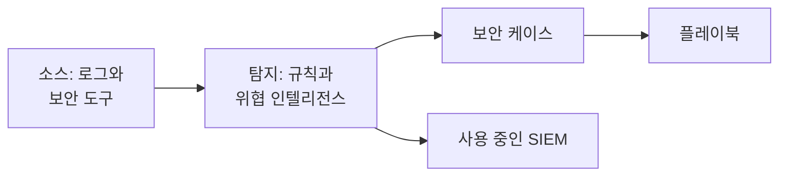

# 보안 시작하기

OneUptime은 이미 가지고 있는 데이터 - 로그, 사용 중인 보안 도구, OneUptime에 보내는 모든 것 - 에서 위협을 찾고, 찾은 것을 케이스로 묶고, 플레이북으로 대응합니다. 두 번의 클릭으로 설정이 끝나며 설치할 것은 없습니다.

:::cards
- [설정하기](#설정하기): 대부분의 팀에 필요한 것을 켜고, 테스트 공격이 케이스를 여는 것을 확인합니다.
- [작동 방식](#작동-방식): 소스, 탐지, 케이스, 플레이북과 각각이 하는 일.
- [로그](#로그에서-보안-이벤트-찾기): OneUptime에 보내는 로그에 이미 들어 있는 보안 이벤트.
- [SIEM](#oneuptime이-찾은-것을-siem으로-보내기): OneUptime이 찾은 것을 Google SecOps로 보냅니다.
:::

## 시작하기 전에

보안을 설정하려면 Project Owner, Project Admin 또는 Security Admin 역할이 필요합니다. Security Member와 Security Viewer 역할은 찾은 것을 읽을 수 있습니다. [역할](/docs/permissions/reference#역할)을 참고하세요.

## 설정하기

:::steps
### 대부분의 팀에 필요한 것 켜기

**제품 → Security Events**를 엽니다. **개요**에서 **추천 항목 켜기**를 클릭합니다. 세 가지가 한 번에 켜집니다. **로그에서 보안 이벤트 찾기**, 권장 탐지 규칙, 그리고 새 케이스마다 위협 인텔리전스와 대조하고 분류용 체크리스트를 남기는 플레이북인 **Enrich New Cases**입니다.

### 테스트 공격 보내기

**테스트 공격 보내기**를 클릭합니다. 문서용 주소 하나에서 발생한 12번의 로그인 실패가 실제 처리 과정을 거칩니다. 저장되고, 무차별 대입 규칙이 이를 탐지하고, 케이스가 열립니다. 아무도 호출되지 않으며 어떤 SIEM도 이를 받지 않습니다.

### 케이스 열기

**케이스 열기**를 클릭합니다. 실제 탐지 결과는 이렇게 보입니다. 그 뒤에 있는 이벤트, 관련된 주소, **Enrich New Cases**가 찾은 내용이 나옵니다. 다 보고 나면 테스트로 닫으세요.
:::

그 이후로 **개요**는 누군가의 대응을 기다리는 것부터 **확인 필요** 아래에 보여 줍니다. 내 열린 케이스, 아무도 맡지 않은 케이스, 승인을 기다리는 플레이북 단계입니다. 아무것도 없으면 **모두 조용합니다**가 표시됩니다.

## 작동 방식

| 구성 요소 | 위치 | 하는 일 |
| --- | --- | --- |
| **소스** | **Connections** | 로그, OneUptime이 가져오는 보안 제품, 그리고 보내는 모든 것 |
| **Detections** | **Detections** | 모든 이벤트에서 위협을 찾는 Sigma 규칙과 위협 인텔리전스 피드 |
| **보안 케이스** | **보안 케이스** | 찾은 것을 관련된 사용자, 호스트 또는 주소별로 묶은 것 |
| **Playbooks** | **Playbooks** | 새 케이스에서 실행되는 단계: 정보 보강, 알림, 인시던트 생성, 격리 |

**개요** 상단에는 대응을 기다리는 항목 아래에 각 구성 요소가 수치와 함께 표시됩니다. 소스와 최근 24시간의 이벤트, 켜져 있는 규칙, 열린 케이스, 대응하는 플레이북입니다. 설정되지 않은 구성 요소는 그렇다고 표시되고, 설정하는 페이지를 엽니다.

## 로그에서 보안 이벤트 찾기

**Connections** 상단의 **내 로그**는 설치가 필요 없습니다. **로그에서 보안 이벤트 찾기**를 켜면 OneUptime이 매분 프로젝트의 새 로그를 읽고, 알아본 줄을 보안 이벤트로 만듭니다.

| 로그 | 보안 이벤트가 되는 것 |
| --- | --- |
| SSH 로그인 | 서버의 인증 로그, journal 또는 syslog에 있는 SSH 로그인 실패와 성공 |
| sudo | 다른 사용자로 실행한 명령, 잘못된 sudo 비밀번호, sudo 사용이 허용되지 않은 사람 |
| Kubernetes 감사 로그 | 클러스터 변경, Pod에서 열린 셸, 읽힌 시크릿, 거부된 요청 |
| AWS CloudTrail | 콘솔 로그인, AWS 계정에서의 변경, AWS가 거부한 호출 |
| 웹 공격 | 웹 서버의 액세스 로그 중 SQL 인젝션, 경로 탐색 또는 Log4Shell을 시도하는 요청 |

로그는 그대로 남습니다. 보안에 중요한 줄만 이벤트가 되며, 웹 서버가 제공한 모든 페이지나 API의 모든 읽기가 이벤트가 되지는 않습니다.

## OneUptime이 찾은 것을 SIEM으로 보내기

팀이 이미 SIEM을 사용하고 있다면 OneUptime은 찾은 것을 그곳에도 보냅니다. **Connections → SIEM으로 보내기**에서 **대상 추가**를 클릭하고, Google SecOps의 리전, 인스턴스, 서비스 계정 키를 입력한 다음 저장하기 전에 **테스트 이벤트 보내기**를 클릭합니다. [Google SecOps로 보안 이벤트 보내기](/docs/integrations/google-secops#google-secops로-보안-이벤트-보내기)를 참고하세요.

## 문제 해결

:::details Turn on recommended가 비활성화되어 있음
역할에 탐지 규칙, 플레이북 또는 로그 소스를 추가할 권한이 없습니다. Project Owner, Project Admin 또는 Security Admin에게 요청하거나 Security Admin 역할을 부여해 달라고 하세요.
:::

:::details Turn on recommended가 모든 항목을 켜지 못함
카드에 켜지 못한 항목과 그 이유가 표시됩니다. 이유는 역할, 요금제 또는 OneUptime 쪽 문제입니다. 나머지는 모두 켜져 있습니다. 표시된 문제를 해결한 다음 **다시 시도**를 클릭합니다. 아직 없는 항목만 켜지며, 같은 항목이 두 번 추가되지 않습니다.
:::

:::details 테스트 공격이 케이스를 열지 않음
보통은 버튼이 응답하기 전에 케이스가 열립니다. 규칙이 아직 따라잡는 중이면 그렇게 표시되고 1분 안에 케이스가 열립니다. **보안 케이스**를 다시 확인하고, **Detections**에서 무차별 대입 규칙이 켜져 있는지 확인하세요.
:::

:::details 로그에서 보안 이벤트가 나오지 않음
**로그에서 보안 이벤트 찾기**가 켜져 있고 **내 로그**에 마지막으로 확인한 시각이 표시되는지 확인하세요. 위 표에 있는 종류의 줄만 이벤트가 됩니다. SSH, sudo, 감사, CloudTrail, 액세스 로그 중 어느 것도 보내지 않는 서버에서는 찾을 것이 없습니다.
:::

:::details 개요에 마지막 보안 이벤트가 며칠 전에 도착했다고 표시됨
그 이후로 Security에 아무것도 도착하지 않았습니다. **Connections**를 열고 **내 로그**와 각 연결이 아직 켜져 있는지, 각각 마지막으로 언제 확인했는지 확인하세요.
:::

:::details Security를 켜는 카드가 사라짐
누군가 **닫기**로 치웠습니다. 아직 위협을 감시하는 대상이 없는 동안에는 **개요**에 **Security 설정**이 표시되며, 이를 누르면 카드가 다시 나타납니다.
:::

## 다음 단계

:::cards
- [보안 이벤트(SIEM)](/docs/telemetry/security-events): 이벤트를 보내고, 검색하고, 탐지 규칙을 작성합니다.
- [보안 케이스 및 플레이북(SOAR)](/docs/telemetry/security-cases): 케이스를 처리하고 플레이북으로 대응합니다.
- [위협 인텔리전스(STIX/TAXII)](/docs/telemetry/threat-intelligence): 이벤트를 알려진 악성 지표와 대조합니다.
- [Google SecOps](/docs/integrations/google-secops): Google SecOps의 탐지를 가져오고, OneUptime이 찾은 것을 보냅니다.
:::
