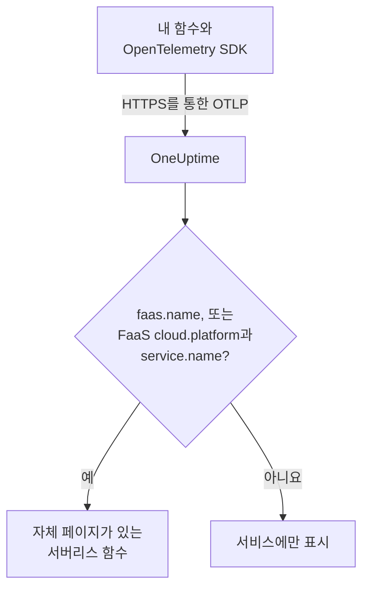

# 서버리스 함수

OneUptime은 서버리스 함수에서 OpenTelemetry 데이터를 받는 순간 그 함수를 인식하고, 트레이스, 로그, 메트릭과 함께 **서버리스 함수**에 표시합니다. AWS Lambda, Google Cloud Functions, Azure Functions, Cloudflare Workers를 비롯해 OpenTelemetry를 보낼 수 있는 모든 FaaS 런타임에서 동작합니다. 직접 만들 것은 없습니다. 함수를 해당 런타임용 OpenTelemetry SDK로 계측하고 OTLP 익스포터가 OneUptime을 가리키게 하세요.

:::cards
- [OneUptime이 함수를 식별하는 방법](#oneuptime이-함수를-식별하는-방법): `faas.name`, 또는 FaaS `cloud.platform`과 `service.name`의 조합.
- [함수의 텔레메트리 보내기](#함수의-텔레메트리-보내기): 익스포터 설정과 Lambda 레이어.
- [Azure Functions](#azure-functions): Functions 호스트에서, Function App마다 함수 하나.
- [문제 해결](#문제-해결): 나타나지 않는 함수, 또는 페이지가 비어 있는 함수.
:::

## 작동 방식

OneUptime은 각 배치가 도착하는 대로 그 리소스 속성을 읽습니다. `faas.name`이 있는 리소스, 또는 `aws_lambda`나 `azure_functions` 같은 FaaS `cloud.platform`과 `service.name`이 함께 있는 리소스는 서버리스 함수입니다. OneUptime은 첫 데이터로 그 함수를 만들고 텔레메트리를 그 아래에 정리합니다.



## 시작하기 전에

- 수집 키. **프로젝트 설정 → 텔레메트리 및 APM → 수집 키**에서 만들고 값을 복사합니다.
- 함수 언어용 OpenTelemetry SDK 또는 자동 계측 레이어.

## OneUptime이 함수를 식별하는 방법

OneUptime은 각 함수를 `faas.name` 리소스 속성으로 식별합니다. 일부 플랫폼의 리소스 감지기는 이 속성을 설정하지 않습니다([Azure Functions](#azure-functions)가 흔한 경우입니다). 그래서 리소스에 `faas.name`이 없지만 `cloud.platform`이 FaaS 플랫폼이면, OneUptime은 대신 그 `service.name`을 함수의 ID로 사용하고, 저장하는 모든 스팬, 로그, 메트릭, 프로파일에 그 값을 `faas.name`으로 채워 넣어 함수의 페이지가 모든 텔레메트리를 찾을 수 있게 합니다:

| 속성 | 필수 | 용도 |
| --- | --- | --- |
| `faas.name` | 다음 두 속성을 설정하지 않으면 **예** | 함수 ID(예: `checkout-handler`) |
| `cloud.platform` | `faas.name`이 없을 때 `service.name`과 함께 | `aws_lambda`, `gcp_cloud_functions`, `azure_functions`, `tencent_cloud_scf` 또는 `alibaba_cloud_fc` |
| `service.name` | `faas.name`이 없는 FaaS `cloud.platform`에서 | 함수 ID. 텔레메트리에 `faas.name`으로 기록됨 |
| `faas.version` | 아니요 | 개요에 표시됨 |
| `faas.instance` | 아니요 | **인스턴스** 페이지에서 인스턴스별로 추적됨 |
| `cloud.provider` / `cloud.region` / `cloud.account.id` | 아니요 | 개요에 표시됨 |
| `process.runtime.name` / `process.runtime.version` | 아니요 | 개요에 런타임으로 표시됨 |

직접 설정한 `faas.name`은 절대 바뀌지 않습니다. `cloud.platform` 값은 목록에 있는 그대로 써야 하며(일부 Azure 감지기가 보내는 점 표기 `azure.functions`도 허용됩니다), `service.name`은 리소스 속성이어야 합니다. `x-oneuptime-service-name` 헤더는 함수가 아니라 서비스의 이름을 정합니다.

> [!NOTE]
> `service.name`도 설정하는 함수는 계속 **서비스**에도 나타납니다. **서버리스 함수**는 함수를 위해 만든 보기이며, 범위는 `faas.name`으로 정해집니다.

## 함수의 텔레메트리 보내기

:::steps
### OTLP 익스포터 환경 변수 설정하기

대부분의 언어 자동 계측은 표준 OpenTelemetry 환경 변수를 읽습니다:

```bash
OTEL_EXPORTER_OTLP_ENDPOINT="https://oneuptime.com/otlp"
OTEL_EXPORTER_OTLP_HEADERS="x-oneuptime-token=YOUR_TELEMETRY_INGESTION_TOKEN"
OTEL_RESOURCE_ATTRIBUTES="faas.name=checkout-handler,faas.version=1.4.2"
```

OneUptime을 직접 호스팅한다면 엔드포인트를 `https://YOUR-ONEUPTIME-HOST/otlp`로 바꾸세요. Azure Functions에서는 `faas.name`을 `OTEL_RESOURCE_ATTRIBUTES`에서 빼세요. [Azure Functions](#azure-functions)를 참고하세요.

> [!WARNING]
> 수집 키는 비밀입니다. **서버** 수집 키를 함수의 환경 변수로 설정해 사용하세요. 브라우저에 닿은 키는 페이지 소스를 보는 누구나 읽을 수 있습니다.

### OpenTelemetry Lambda 레이어 추가하기(AWS Lambda)

AWS Lambda에서는 [OpenTelemetry Lambda 레이어](https://opentelemetry.io/docs/faas/lambda-auto/)가 가장 간단한 방법입니다. 함수 런타임용 레이어를 연결하고 다음을 설정하세요:

```bash
AWS_LAMBDA_EXEC_WRAPPER=/opt/otel-handler
OTEL_EXPORTER_OTLP_ENDPOINT=https://oneuptime.com/otlp
OTEL_EXPORTER_OTLP_HEADERS=x-oneuptime-token=YOUR_TELEMETRY_INGESTION_TOKEN
```

레이어는 함수 이름으로 `faas.name`을 설정하고, 레이어의 리소스 감지기가 `cloud.platform`, `cloud.region`, `cloud.account.id`를 채웁니다. 다른 플랫폼에서는 이 단계를 건너뛰세요.

### 함수를 호출하고 데이터가 들어오는지 확인하기

OneUptime이 키를 받아들이는지 확인하세요:

```bash
curl -i https://oneuptime.com/otlp/v1/validate \
  -H "x-oneuptime-token: YOUR_TELEMETRY_INGESTION_TOKEN"
```

`"valid": true`와 함께 `200`이 오면 OneUptime이 키를 받아들인다는 뜻이고, `401`은 키가 알 수 없거나, 취소되었거나, 비활성화되었거나, 만료되었다는 뜻입니다. 그런 다음 함수를 호출하세요. 함수가 스팬, 로그 또는 메트릭을 보내면 **제품 → 인프라 → 서버리스 → 모든 함수**에 나타납니다.
:::

## Azure Functions

Azure Functions 호스트는 OpenTelemetry를 직접 보낼 수 있으므로, Function App은 어떤 언어로 작성되었든 코드 변경 없이 호출(트레이스, 로그, 메트릭)을 보고합니다. Microsoft의 가이드는 [Use OpenTelemetry with Azure Functions](https://learn.microsoft.com/en-us/azure/azure-functions/opentelemetry-howto)입니다.

### Function App이 표시되는 방식

Azure의 리소스 감지기(Functions 호스트 자체의 감지기, `Microsoft.Azure.Functions.Worker.OpenTelemetry`에 있는 .NET 격리 작업자의 감지기, `@opentelemetry/resource-detector-azure`에 있는 Node.js용 감지기)는 개별 함수가 아니라 **Function App**을 설명하며, 어느 것도 `faas.name`을 설정하지 않습니다:

| 속성 | 값 |
| --- | --- |
| `service.name` | Function App의 이름. `WEBSITE_SITE_NAME`에서 가져옴 |
| `cloud.provider` | `azure` |
| `cloud.platform` | `azure_functions`. Node.js 감지기는 `azure.functions`로 쓰며, OneUptime이 이를 바꿔 씀 |
| `cloud.region` | 앱의 지역. `REGION_NAME`에서 가져옴 |
| `cloud.resource_id` | `/subscriptions/<subscription>/resourceGroups/<group>/providers/Microsoft.Web/sites/<app>` |
| `faas.instance` | 인스턴스. `WEBSITE_INSTANCE_ID`에서 가져옴. Node.js 감지기만 해당 |

그래서 OneUptime은 `service.name`으로 함수를 식별하고, `faas.name`을 Function App의 이름으로 채우며, **Function App마다 서버리스 함수 하나**를 표시합니다. 리소스는 함수 하나가 아니라 앱을 설명합니다. 모든 인스턴스는 앱의 어느 함수를 실행하든 같은 앱 수준 속성을 보고하며, Flex Consumption 플랜에서는 일부 함수가 자체 인스턴스로 확장되기도 합니다. 개별 함수는 텔레메트리 자체에 있습니다:

- 호스트는 호출마다 실행한 함수의 이름을 붙인 스팬을 시작합니다. 함수의 **트레이스** 페이지에서 그 이름으로 검색하세요.
- 호스트는 초 단위 히스토그램인 `faas.invoke_duration`을 기록하며, 함수 이름을 데이터 포인트 속성 `faas.name`에 넣습니다. **메트릭** 페이지나 대시보드에서 이 속성으로 메트릭을 그룹화하면 함수별 지연 시간을 볼 수 있습니다.

일반적인 [첫 번째 단계](#otlp-익스포터-환경-변수-설정하기) 예처럼 Function App에서 `faas.name`을 `OTEL_RESOURCE_ATTRIBUTES`에 추가하지 마세요. 애플리케이션 설정은 앱의 모든 프로세스에 전달되므로 모든 함수의 텔레메트리가 그 하나의 이름을 갖게 되고, OneUptime은 주어진 `faas.name`을 절대 바꾸지 않습니다. Microsoft의 가이드도 같은 말을 합니다. 함수별 값을 리소스에 넣지 마세요. 설정하지 않고 두면 함수 이름은 앱 이름을 따릅니다.

호스트와 .NET 격리 작업자는 `OTEL_SERVICE_NAME`이 설정되어 있으면 앱 이름 대신 그것을 사용합니다. 한 앱의 모든 프로세스를 같은 `service.name`으로 맞추세요. 호스트와 언어 작업자는 둘 다 텔레메트리를 보내며, 두 번째 이름을 보고하는 작업자는 두 번째 서버리스 함수를 만듭니다. 리소스에 FaaS `cloud.platform`이 없는 작업자는 어떤 서버리스 함수에도 속하지 않습니다. [함수 코드 계측하기](#함수-코드-계측하기선택-사항)를 참고하세요.

:::steps
### Functions 호스트에서 OpenTelemetry 켜기

앱의 `host.json` 최상위에 `"telemetryMode": "OpenTelemetry"`를 추가하세요:

```json title="host.json"
{
  "version": "2.0",
  "telemetryMode": "OpenTelemetry"
}
```

그러면 호스트는 앱의 언어와 관계없이 자체 트레이스(호출당 스팬 하나와, 트리거된 함수 뒤에 있는 Service Bus 및 Event Hubs 프로세서 스팬), 로그, 그리고 `faas.invoke_duration`을 포함한 메트릭을 보냅니다.

### 호스트가 OneUptime을 가리키게 하기

익스포터를 애플리케이션 설정으로 지정하세요:

```bash
az functionapp config appsettings set \
  --name my-function-app \
  --resource-group my-rg \
  --settings \
    OTEL_EXPORTER_OTLP_ENDPOINT=https://oneuptime.com/otlp \
    OTEL_EXPORTER_OTLP_PROTOCOL=http/protobuf \
    "OTEL_EXPORTER_OTLP_HEADERS=x-oneuptime-token=YOUR_TELEMETRY_INGESTION_TOKEN"
```

OneUptime을 직접 호스팅한다면 엔드포인트를 `https://YOUR-ONEUPTIME-HOST/otlp`로 바꾸세요. `OTEL_EXPORTER_OTLP_PROTOCOL=http/protobuf`가 중요합니다. 호스트의 .NET 익스포터는 기본적으로 gRPC를 사용하며, `http/protobuf`로 설정하면 엔드포인트 아래의 `/otlp/v1/traces`, `/otlp/v1/metrics`, `/otlp/v1/logs`로 보냅니다. 호스트는 `OTEL_EXPORTER_OTLP_ENDPOINT`가 설정되어 있는 동안에만 OTLP를 보냅니다.

> [!WARNING]
> 이 토큰은 비밀입니다. **서버** 수집 키를 사용하세요. 애플리케이션 설정은 저장 시 암호화됩니다. 대신 토큰을 Key Vault에 두려면 `OTEL_EXPORTER_OTLP_HEADERS`를 `@Microsoft.KeyVault(SecretUri=https://my-vault.vault.azure.net/secrets/oneuptime-otlp-headers/)` 같은 Key Vault 참조로 설정하고, 앱의 관리 ID에 자격 증명 모음에 대한 **Key Vault Secrets User** 역할을 부여하세요. 참조는 저장된 그대로의 비밀 값으로 확인되므로, 토큰만이 아니라 헤더 전체인 `x-oneuptime-token=YOUR_TELEMETRY_INGESTION_TOKEN`을 저장하세요.

Application Insights를 계속 쓰려면 `APPLICATIONINSIGHTS_CONNECTION_STRING`을 유지하세요. 둘 다 설정하면 호스트는 같은 OpenTelemetry 데이터를 Application Insights와 OneUptime에 보냅니다. OneUptime에만 보내려면 이를 제거하세요.

### 함수 코드 계측하기(선택 사항)

호스트는 이미 모든 호출을 추적합니다. 자신의 코드에서 호스트의 것과 연결된 스팬과 로그를 추가하려면 언어 작업자에서도 OpenTelemetry를 켜세요. 작업자는 같은 `OTEL_EXPORTER_OTLP_*` 설정으로 보냅니다:

- **C# (isolated worker)**: NuGet 패키지 `Microsoft.Azure.Functions.Worker.OpenTelemetry`, `OpenTelemetry.Extensions.Hosting`, `OpenTelemetry.Exporter.OpenTelemetryProtocol`을 추가한 다음 `Program.cs`에서: `builder.Services.AddOpenTelemetry().UseFunctionsWorkerDefaults().UseOtlpExporter();`
- **JavaScript / TypeScript**: OpenTelemetry Node.js SDK 및 OTLP 익스포터와 함께 `npm install @azure/functions-opentelemetry-instrumentation`을 실행하고, `package.json`의 `main` 필드가 포함하는 파일에서 `AzureFunctionsInstrumentation`을 등록하세요.
- **Java**: Maven 종속성 `com.microsoft.azure.functions:azure-functions-java-opentelemetry`를 추가하세요.
- **Python**: 애플리케이션 설정 `PYTHON_ENABLE_OPENTELEMETRY=true`를 설정하고, Microsoft가 나열하는 OpenTelemetry 패키지(그중 `opentelemetry-sdk`와 `opentelemetry-exporter-otlp`)를 `requirements.txt`에 추가한 다음, `function_app.py`에서 익스포터를 구성하세요.
- **PowerShell**: 애플리케이션 설정 `OTEL_FUNCTIONS_WORKER_ENABLED=True`를 설정하고 `profile.ps1`에서 `AzureFunctions.PowerShell.OpenTelemetry.SDK` 모듈을 로드하세요.

Microsoft의 가이드에는 언어별 전체 코드가 있습니다. .NET 작업자(`UseFunctionsWorkerDefaults()`를 통해)와 Python 작업자(`PYTHON_ENABLE_OPENTELEMETRY`를 통해)는 자신의 로그를 자신에게 맡기라고 호스트에 알리므로, 그 로그는 두 번 전송되지 않습니다.

작업자의 스팬과 로그는 그 리소스가 호스트의 리소스와 같은 방식으로 앱을 설명할 때만 함수의 페이지에 도달합니다. 즉 같은 `service.name`과 FaaS `cloud.platform`이 있어야 합니다. .NET 격리 작업자(`UseFunctionsWorkerDefaults()`를 통해)와 Microsoft의 Node.js 예제(`getResourceDetectors()`에 포함된 Azure 감지기를 통해)는 둘 다 보고합니다. Microsoft의 Python 예제는 Azure 감지기 없이 리소스를 만들기 때문에, 기본 상태로는 둘 다 보고하지 않으며 그 텔레메트리는 함수에 도달하지 못합니다. Python, 또는 Azure Functions 리소스 감지기 없이 설정한 작업자에서는 애플리케이션 설정을 두 개 더 추가하세요. 호스트를 포함한 앱의 모든 프로세스가 이를 읽으므로 모두 같은 ID를 보고합니다:

```bash
az functionapp config appsettings set \
  --name my-function-app \
  --resource-group my-rg \
  --settings \
    OTEL_SERVICE_NAME=my-function-app \
    "OTEL_RESOURCE_ATTRIBUTES=cloud.provider=azure,cloud.platform=azure_functions"
```

`OTEL_SERVICE_NAME`을 Function App 자체의 이름으로 설정하세요. 이 설정이 없을 때 호스트와 Node.js 감지기가 보고하는 이름이므로, 함수는 이미 가진 ID를 유지합니다.
:::

### 제한 사항

- **C# 인프로세스 앱**은 OpenTelemetry를 사용할 수 없습니다. 먼저 격리 작업자 모델로 옮기세요.
- Azure Portal의 **로그 스트리밍**은 호스트가 OpenTelemetry 모드인 동안 작동하지 않으며, 포털의 _Recent function invocations_ 목록에는 Application Insights의 텔레메트리가 필요합니다. 대신 OneUptime에서 함수의 **로그** 및 **트레이스** 페이지를 사용하세요.
- `telemetryMode`가 `OpenTelemetry`가 되면 `host.json`의 `logging.applicationInsights` 섹션은 더 이상 적용되지 않습니다.
- **인스턴스**에는 `faas.instance` 값이 나열됩니다. 위의 감지기 중 Node.js 감지기만 이 값을 설정하므로, 호스트와 .NET 작업자의 텔레메트리에서는 이 페이지가 비어 있습니다.

## 받게 되는 것

함수가 스팬, 로그 또는 메트릭을 보내면 **서버리스 함수**에 나타납니다. 함수의 **개요**에는 다음이 표시됩니다:

- **호출**, **오류율**, **p95 지속 시간**. 선택한 시간 범위의 트레이스로 계산되며 추세 차트가 함께 표시됩니다.
- **인스턴스**: 함수가 보고하는 `faas.instance` 값의 실시간 목록.
- 이 함수로 범위가 지정된 전체 **로그**, **트레이스**, **메트릭** 페이지.

## 함수에 레이블 붙이기 및 소유자 지정하기

`oneuptime.label.`로 시작하는 리소스 속성은 함수의 프로젝트 레이블이 됩니다. `oneuptime.label.team=payments`는 레이블 `team:payments`를 추가합니다. 속성을 `OTEL_RESOURCE_ATTRIBUTES`에 추가하세요:

```bash
OTEL_RESOURCE_ATTRIBUTES="faas.name=checkout-handler,oneuptime.label.team=payments,oneuptime.label.env=production"
```

대신 이름에 따라 함수에 레이블을 붙이거나 소유자를 지정하려면 **제품 → 인프라 → 서버리스**를 열고 사이드 메뉴의 **레이블 규칙**와 **소유자 규칙**를 사용하세요. 규칙은 자동으로 발견된 함수를 포함해 함수가 만들어질 때 실행됩니다. 이미 있는 함수에 규칙을 적용하려면 그 규칙의 **Run Now**를 사용하세요([기존 리소스에 규칙 실행](/docs/configuration/run-rules-now) 참고).

## 문제 해결

:::details 함수가 서버리스 함수에 나타나지 않음
다음 순서로 확인하세요.

1. 변수를 설정한 뒤 함수가 호출되었는지 확인하세요. 함수는 실행되는 동안에만 텔레메트리를 보냅니다.
2. AWS Lambda에서는 함수 런타임용 레이어가 연결되어 있고 `AWS_LAMBDA_EXEC_WRAPPER`가 `/opt/otel-handler`인지 확인하세요. 래퍼가 없으면 레이어의 계측이 시작되지 않습니다.
3. 그 밖의 환경에서는 함수 코드가 OpenTelemetry SDK 또는 자동 계측을 로드하는지 확인하세요. 변수만으로는 아무것도 전송되지 않습니다.
4. 리소스에 `faas.name`, 또는 FaaS `cloud.platform`과 `service.name`이 있는지 확인하세요. 이것이 없으면 텔레메트리는 대신 **서비스** 아래에 서비스로 정리됩니다.
5. 함수가 OneUptime URL에 연결할 수 있는지 확인하세요. 사설 네트워크에 있는 함수에는 NAT 게이트웨이 같은, 그곳으로 나가는 경로가 필요합니다.
:::

:::details 함수는 목록에 있지만 페이지가 비어 있음
함수의 **개요**, **로그**, **트레이스**, **메트릭**에는 `faas.name`이 대소문자까지 함수 이름과 정확히 같은 텔레메트리가 표시됩니다. FaaS `cloud.platform`과 `service.name`으로 이름이 정해지는 함수에는 자체 `faas.name`이 필요 없습니다. OneUptime은 텔레메트리가 도착하는 대로 `service.name`을 `faas.name`으로 기록합니다. OneUptime이 `faas.name`을 채우기 시작하기 전에 저장된 텔레메트리는 업데이트되지 않으며 페이지에 나타나지 않습니다. 함수를 호출해 새 텔레메트리를 보내세요. 페이지 상단의 시간 범위도 확인하세요.
:::

:::details 함수가 연결 끊김으로 표시됨
OneUptime이 15분 동안 함수에서 아무것도 받지 못하면 함수는 연결 끊김 상태가 됩니다. OneUptime은 5분마다 확인하며, OneUptime 자체가 데이터를 받지 못한 시간은 계산하지 않습니다. 가끔만 실행되는 함수는 실행 사이에 연결 끊김 상태가 되며, 다음 텔레메트리가 들어오면 다시 연결됨 상태가 됩니다.
:::

## 다음 단계

:::cards
- [OpenTelemetry](/docs/telemetry/open-telemetry): 어떤 애플리케이션에서든 트레이스, 로그, 메트릭을 보냅니다.
- [큐](/docs/telemetry/queues): 함수가 게시하고 소비하는 큐와 토픽.
- [트레이스 모니터](/docs/monitor/traces-monitor): 함수 호출의 실패나 지연에 대해 알림을 보냅니다.
:::
