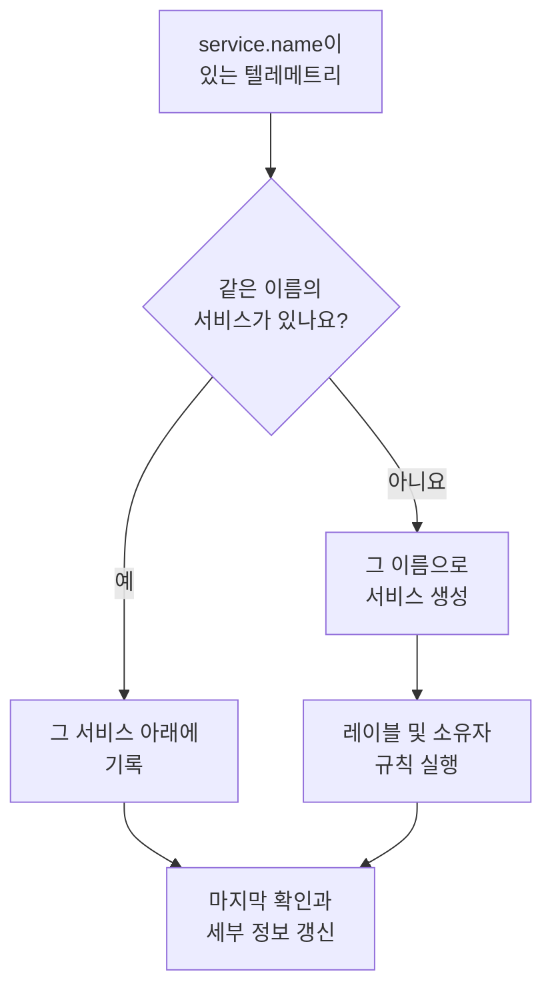

# 서비스 카탈로그

서비스 카탈로그는 운영 중인 애플리케이션과 마이크로서비스를 나열합니다. OneUptime은 서비스의 텔레메트리가 처음 도착하면 서비스를 추가하고, 그 서비스의 로그, 트레이스, 메트릭, 예외, 인시던트, 소유자를 한 페이지에 모읍니다. 그래서 누구나 서비스가 무엇을 하는지, 누가 소유하는지, 상태가 어떤지 알 수 있습니다.

:::cards
- [서비스가 카탈로그에 들어오는 방식](#서비스가-카탈로그에-들어오는-방식): 첫 텔레메트리에 담긴 `service.name`.
- [서비스 찾기](#서비스-찾기): 목록과 필터, 열.
- [서비스의 페이지](#서비스의-페이지): 서비스 하나에 관한 모든 것.
- [서비스 보관 또는 삭제](#서비스-보관-또는-삭제): 기록을 남기거나 없앱니다.
:::

## 서비스가 카탈로그에 들어오는 방식

서비스를 직접 만들 필요는 없습니다. 텔레메트리의 각 배치는 `service.name` 리소스 속성에 자신을 보낸 서비스의 이름을 담습니다. OneUptime은 배치를 그 이름의 서비스 아래에 두고, 프로젝트에 그런 서비스가 없으면 새로 만듭니다.

- **이름이 곧 서비스의 정체성입니다.** 대소문자를 구분하지 않고 비교하므로 `Checkout-API`와 `checkout-api`는 같은 서비스입니다. 새로운 `service.name`은 새 서비스가 됩니다.
- **컨테이너는 스스로 이름을 붙입니다.** Docker와 Podman 에이전트에서 온 텔레메트리에 `service.name`이 없으면, 서비스는 컨테이너의 이름을 따릅니다.
- **수집 키로 서비스를 정할 수 있습니다.** **고정된 서비스 이름**이 설정된 키로 보낸 OpenTelemetry 데이터는 `service.name`이 무엇이든 그 이름의 서비스 아래에 기록됩니다. [수집 키](/docs/telemetry/ingestion-keys#브라우저-키-잠그기)를 참고하세요.
- **브라우저와 휴대폰은 서비스가 아닙니다.** 브라우저나 모바일 앱에서 온 텔레메트리는 대신 [RUM 애플리케이션](/docs/rum/applications)에 속합니다.
- **레이블이 텔레메트리와 함께 올 수 있습니다.** `oneuptime.label.<name>`이라는 리소스 속성은 서비스에 `<name>:<value>` 레이블을 추가합니다. 예를 들어 `oneuptime.label.team=payments`는 `team:payments`가 됩니다.

텔레메트리가 도착할 때마다 서비스의 **마지막 확인**이 앞으로 이동하고, 함께 온 리소스 속성으로 세부 정보가 갱신됩니다.

| 세부 정보 | 가져오는 속성 |
| --- | --- |
| 서비스 버전 | `service.version` |
| 배포 환경 | `deployment.environment.name` 또는 `deployment.environment` |
| 서비스 네임스페이스 | `service.namespace` |
| 런타임 | `process.runtime.name`과 `process.runtime.version` |
| 기술 | `telemetry.sdk.language` 또는 런타임 |
| 클라우드 | `cloud.provider`, `cloud.platform`, `cloud.region`, `cloud.account.id` |

## 시작하기 전에

- **도착하는 텔레메트리**에 `service.name`이 있어야 합니다. [OpenTelemetry](/docs/telemetry/open-telemetry)를 참고하세요. `OTEL_SERVICE_NAME`으로 설정합니다.
- **서비스를 읽을 수 있는 역할.** Project Owner, Project Admin, Project Member, Viewer, Settings Admin, Settings Member, Settings Viewer 중 하나이거나 Read Service 권한이 있는 사용자 지정 역할입니다. 서비스를 만들고, 변경하고, 삭제하려면 Project Owner, Project Admin, Project Member, Settings Admin, Settings Member 중 하나이거나 그에 맞는 서비스 권한이 필요합니다.

## 서비스 찾기

**제품 → 리소스 → 서비스**로 이동합니다. **모든 서비스**에는 모든 서비스가 **이름**, **설명**, **Technology**, **마지막 확인**, **레이블**, **소유자**와 함께 나열됩니다.

- 이름이나 설명으로 검색하고, 목록 위의 막대에서 소유자나 레이블로 필터링합니다.
- 여러 서비스를 선택하면 한 번에 레이블이나 소유자를 추가하거나 보관할 수 있습니다.
- 서비스를 클릭하면 그 서비스의 페이지가 열립니다.

텔레메트리가 도착하기 전에 서비스를 추가하려면(예를 들어 소유자를 먼저 정하려는 경우) **서비스 만들기**를 클릭하고 **이름**에 `service.name`이 될 값을 그대로 입력합니다. 레이블 및 소유자 규칙은 발견된 서비스와 마찬가지로 이 서비스에도 실행됩니다. 저장하면 모든 스니펫에 그 이름이 들어간 OpenTelemetry 설정 가이드가 열리며, 마지막 단계인 **연결 대기**가 서비스의 첫 데이터가 도착하는 시점을 알려 줍니다.

## 서비스의 페이지

서비스의 사이드 메뉴에는 다섯 개의 섹션이 있습니다.

| 섹션 | 페이지 |
| --- | --- |
| **기본** | **개요**: 스팬에서 계산한 요청 수, 오류율, p95 지연 시간, 차트와 세부 정보. **권장 사항**: 서비스의 언어에 맞춰 고른, 바로 쓸 수 있는 모니터. **소유자**: 서비스를 책임지는 사람과 팀. **피드**: 생성부터 이후의 모든 변경까지, 서비스에 일어난 모든 일. |
| **텔레메트리** | 이 서비스로 이미 필터링된 **로그**, **트레이스**, **메트릭**, **성능 프로파일**, **예외**, **Source Maps**. |
| **활동** | 서비스에 영향을 주는 **인시던트**, **알림**, **예정된 유지 관리** 이벤트. |
| **개발자** | **Terraform**, **API**, **AI 어시스턴트**: 코드로 관리하는 서비스. 처음에 접혀 있습니다. |
| **고급** | **설정**, **감사 로그**, **서비스 삭제**. **고급**은 처음에 접혀 있으므로 먼저 펼치세요. |

소유자는 이 페이지 밖에서도 의미가 있습니다. 범위가 Owned(소유)인 역할은 본인이나 본인의 팀이 소유한 서비스의 텔레메트리를 읽습니다. [텔레메트리](/docs/permissions/index#텔레메트리)를 참고하세요.

## 서비스 변경

:::steps
### 설정 열기

서비스를 열고, 사이드 메뉴에서 **고급**을 펼친 다음 **설정**을 클릭합니다.

### 이름 바꾸기 또는 설명 달기

**서비스 세부 정보**에서 **세부 정보 편집**을 클릭해 **이름**, **설명**, **레이블**을 바꿉니다. 이름은 텔레메트리가 보고하는 `service.name`과 계속 일치해야 합니다. OpenTelemetry 설정에서도 바꾸지 않으면 다음 텔레메트리가 새 서비스를 만듭니다.

### 색상과 기술 스택 고르기

**서비스 설정**에서 **설정 편집**을 클릭합니다. **서비스 색상**은 차트와 목록에서 서비스를 표시합니다. 새 서비스는 고유한 색상을 받습니다. **기술 스택**은 선택 사항입니다. 비워 두면 텔레메트리에서 감지한 언어가 표시됩니다.
:::

같은 페이지의 **추가 설정**에서 서비스의 보존 기간도 정합니다. **텔레메트리 데이터 보존**과 **텔레메트리 유형별 보존** 카드는 서비스의 텔레메트리를 프로젝트의 기본 보존 기간보다 길게 또는 짧게 보관합니다. 이 카드들은 [Enterprise Edition](/docs/self-hosted/enterprise)과 OneUptime Cloud의 Scale 요금제에 포함됩니다. 사용할 수 없으면 페이지에 이 카드들이 무엇을 더하는지 표시되고, 서비스는 프로젝트의 보존 기간을 따릅니다.

## 레이블과 소유자 자동 지정

규칙은 새 서비스가 만들어질 때, 발견된 서비스를 포함해 레이블과 소유자를 붙입니다. 규칙은 **서비스 → 설정 → 소유자 규칙**과 **서비스 → 설정 → 레이블 규칙**에 있습니다. 사이드 메뉴의 **설정**은 처음에 접혀 있습니다. [레이블 및 소유자 규칙](/docs/configuration/label-and-owner-rules)을 참고하세요.

## 서비스 보관 또는 삭제

더 이상 지켜보지 않지만 기록은 남기고 싶은 서비스는 보관합니다. 보관한 서비스는 **모든 서비스**에서 숨겨지지만, 텔레메트리는 계속 수집합니다. 서비스의 **설정** 페이지에서 보관하거나, 목록에서 여러 개를 선택합니다. 다시 되돌리려면 **서비스 → 고급 → 보관됨**을 엽니다.

> [!WARNING]
> 서비스를 삭제하면 그 서비스의 소스 맵과, 그 서비스에 설정한 메트릭 파이프라인 규칙 및 LLM 비용 예산도 함께 삭제됩니다. OneUptime이 여전히 그 서비스의 텔레메트리를 받고 있으면 서비스가 다시 추가되지만, 붙였던 레이블, 소유자, 설정은 사라집니다. 목록에서 치우면서 모든 것을 남기려면 대신 보관하세요.

## 문제 해결

:::details 서비스가 두 번 표시됩니다
OneUptime에 두 개의 `service.name` 값이 도착했습니다. 예를 들어 설정의 두 버전에서 왔거나, 한쪽에서만 이름을 바꾼 경우입니다. 텔레메트리는 이름으로 매칭됩니다. 모든 인스턴스가 같은 `service.name`을 보고하게 한 다음, 더 이상 필요 없는 서비스를 보관하거나 삭제하세요.
:::

:::details 서비스가 카탈로그에 없습니다
텔레메트리에 `service.name`이 있는지 확인하세요. 브라우저나 모바일 앱에서 온 텔레메트리는 대신 Real User Monitoring으로 가고, 서비스 이름이 없는 호스트나 클러스터의 텔레메트리는 그 호스트나 클러스터 아래에 기록됩니다.
:::

:::details 마지막 확인이 늦습니다
**마지막 확인**은 배치마다가 아니라 약 1분에 한 번 갱신되므로, 실시간 텔레메트리보다 1분 정도 늦을 수 있습니다.
:::

## 다음 단계

:::cards
- [로그 탐색기](/docs/telemetry/logs-explorer): 서비스의 로그를 검색합니다.
- [트레이스 탐색기](/docs/telemetry/traces-explorer): 서비스의 요청을 따라갑니다.
- [예외 추적](/docs/telemetry/exceptions): 서비스가 던지는 오류를 분류합니다.
- [레이블 및 소유자 규칙](/docs/configuration/label-and-owner-rules): 새 서비스에 레이블과 소유자를 붙입니다.
:::
