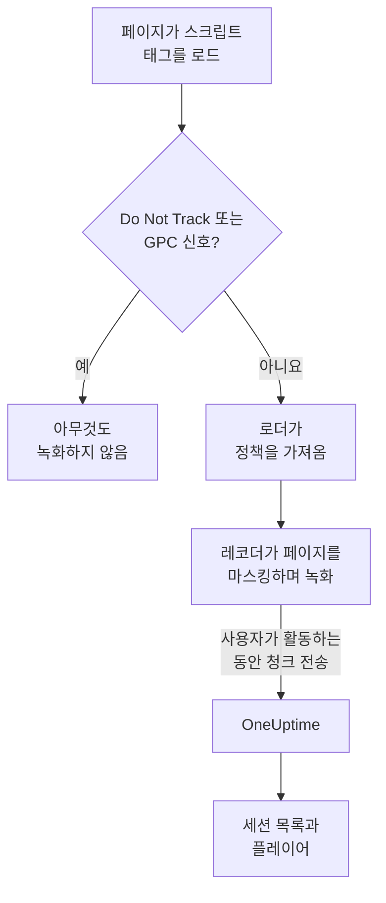
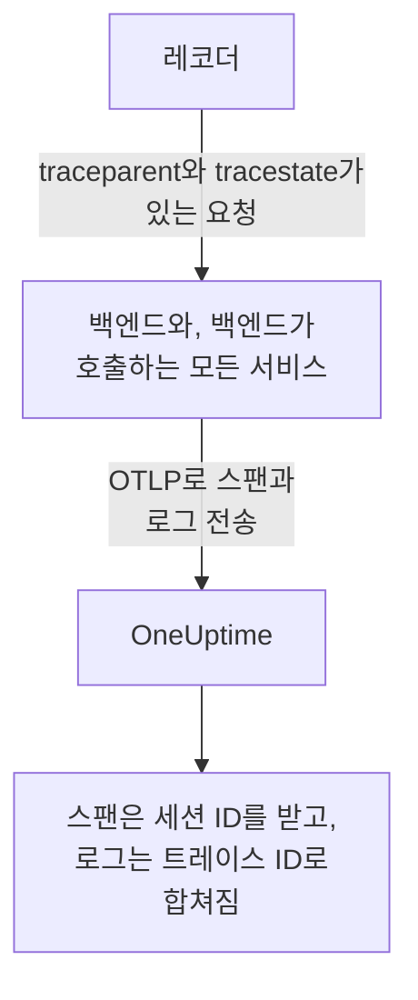
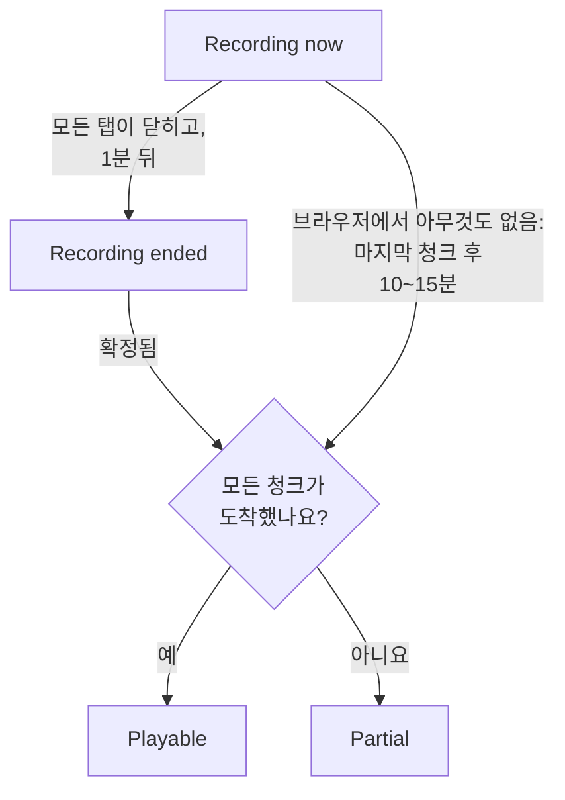
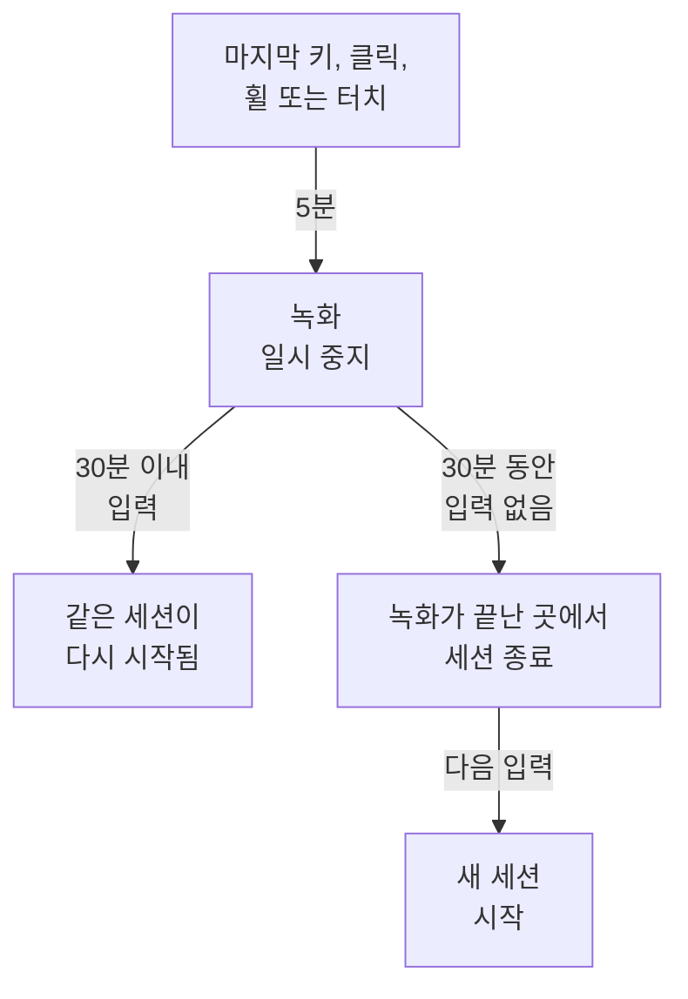

# 세션 리플레이

세션 리플레이는 실제 사용자가 웹 앱이나 React Native 앱에서 본 것을 녹화하고, 같은 세션의 오류, 트레이스, 로그와 나란히 재생합니다. 스크립트 태그를 추가하고 무엇을 마스킹할지 고르면, RUM 애플리케이션에서 어떤 세션이든 시청할 수 있습니다.

:::cards
- [작동 방식](#작동-방식): 로더, 정책, 그리고 진행하면서 업로드하는 레코더.
- [설치](#설치): 모든 페이지의 스크립트 태그 하나, 또는 React Native SDK.
- [개인정보 보호](#개인정보-보호): 무엇을 마스킹하는지, 동의, 누가 녹화를 보낼 수 있는지.
- [나머지 텔레메트리와 연결하기](#나머지-텔레메트리와-연결하기): 백엔드 트레이스, 로그, 오류를 코드 없이 연결합니다.
- [세션 시청하기](#세션-시청하기): 세션 목록, 사용자 페이지, 사용자 흐름, 플레이어.
- [녹화 상태](#녹화-상태): 아무것도 도착하지 않는 이유와, 예산이 바닥나기 전의 알림.
:::

## 작동 방식

페이지의 스크립트는 작은 로더입니다. 브라우저의 개인정보 보호 신호를 확인하고, OneUptime에서 애플리케이션의 정책을 가져온 다음에야 레코더를 로드합니다. 레코더는 페이지를 녹화하면서 마스킹하고, 사용자가 활동하는 동안 청크 단위로 업로드합니다.



기본적으로 문제가 생긴 세션만이 아니라 모든 세션을 녹화하고 진행하면서 업로드합니다. 아무도 끝내지 못한 결제, 모두가 포기한 양식, 고객 말로는 "이상해 보였던" 페이지를 찾게 되는 곳은 아무 문제도 없었던 세션입니다.

저장량을 줄이려면 애플리케이션 정책의 두 설정을 함께 사용합니다.

| 설정 | 기본값 | 바뀌는 것 |
| --- | --- | --- |
| **샘플 비율** | 100 | 녹화 대상이 되는 세션의 수입니다. 절반으로 줄이면 저장되는 바이트와 저장되는 최종 사용자 데이터가 모두 절반이 됩니다. 결정은 세션 ID의 해시로 세션마다 한 번 내려지므로, 세션이 절반만 녹화되는 일은 없습니다. |
| **녹화 업로드 시점** | _Always_ | _On error or frustration_ 값으로 설정하면 레코더가 메모리에 순환 버퍼를 유지하다가 무언가 잘못될 때만 업로드합니다. 그러면 모든 사람을 녹화할 때보다 약 15배 적은 비용으로 실패한 세션 거의 전부에 녹화가 남지만, 실패하지 않은 세션은 시청할 수 없습니다. |

## 시작하기 전에

- RUM 애플리케이션. **제품 → 리소스 → 실제 사용자 모니터링**에서 만들거나, 텔레메트리가 만들게 하세요. [애플리케이션 관리](/docs/rum/applications)를 참고하세요.
- **프로젝트 설정 → 텔레메트리 및 APM → 수집 키**의 **브라우저** 수집 키. Browser 키는 키에 지정한 출처에서만 작동합니다. [프로덕션에서 허용된 출처 설정하기](#프로덕션에서-허용된-출처-설정하기)를 참고하세요.

세션 리플레이는 기본적으로 켜져 있습니다. 설정은 세 곳에 있습니다.

| 위치 | 내용 |
| --- | --- |
| 애플리케이션의 **Replay Policy** 페이지 | 정책(녹화, 마스킹, 동의, 트레이싱, 한도), **녹화 상태** 요약, **녹화에 담기는 내용** 카드, **Test your installation** 패널, **Record a specific user's next session**. |
| 애플리케이션의 **상태** 페이지 | 녹화가 도착하는지, 도착하지 않는다면 그 이유. [녹화 상태](#녹화-상태)를 참고하세요. |
| **실제 사용자 모니터링 → 설정 → 세션 리플레이** | 모든 애플리케이션을 한꺼번에 멈추는 프로젝트 전체 스위치와, 모든 애플리케이션 정책의 읽기 전용 목록. |

## 설치

녹화하려는 모든 페이지에 스크립트 태그를 추가합니다.

:::steps
### Browser 키 만들기

**프로젝트 설정 → 텔레메트리 및 APM → 수집 키**에서 **수집 키 생성**을 클릭하고, **키 유형**으로 **브라우저**를 고른 뒤 **허용된 출처**에 사이트의 출처를 입력합니다. 그런 다음 키의 **시크릿 키**를 복사합니다. 각 화면은 [브라우저 설정](/docs/rum/browser-setup#설정하기)에서 보여 줍니다.

### 스크립트 태그 추가하기

키와 애플리케이션 식별자를 넣어 모든 페이지에 태그를 배치합니다.

```html
<script
  src="https://oneuptime.com/telemetry/session-replay/v1/recorder.js"
  data-oneuptime-token="YOUR_TELEMETRY_INGESTION_KEY"
  data-oneuptime-app-identifier="storefront-web"
  crossorigin="anonymous"
  async
></script>
```

`data-oneuptime-app-identifier`는 RUM 애플리케이션의 식별자, 즉 `service.name`에 쓰는 것과 같은 값과 일치해야 합니다. 애플리케이션 사이드 메뉴의 **세션 리플레이** 섹션에 있는 **문서** 페이지는 두 값이 이미 채워진 이 스니펫을 Next.js / React와 Google Tag Manager용 변형과 함께 보여 줍니다.

### 녹화가 도착하는지 확인하기

페이지 중 하나를 열고 몇 초 동안 여기저기 클릭하세요. 약 1분 안에 세션이 애플리케이션의 **세션 리플레이** 페이지에 **지금 녹화 중** 표시와 함께 나타납니다. 나타나지 않으면 애플리케이션의 **상태** 페이지가 이유를 알려 줍니다. [녹화 상태](#녹화-상태)를 참고하세요.
:::

`/v1/recorder.js`의 스크립트는 작은 로더입니다. Do Not Track을 확인하고, 애플리케이션의 정책을 가져온 다음에야 `/latest/recorder.js`를 로드합니다. 정책과 레코더는 `no-store`로 제공되므로, 둘 중 어느 쪽을 바꾸든 브라우저 캐시가 만료되기를 기다리지 않고 다음 페이지 로드에 반영됩니다.

### 스크립트 태그 속성

| 속성 | 필수 | 하는 일 |
| --- | --- | --- |
| `data-oneuptime-token` | 예 | 텔레메트리 수집 토큰. |
| `data-oneuptime-app-identifier` | 예 | RUM 애플리케이션의 식별자. |
| `data-oneuptime-host` | 아니요 | OneUptime 출처. 생략하면 스크립트 자체의 `src`에서 알아내므로, 자신의 도메인을 통해 스크립트를 제공할 때만 필요합니다. |
| `data-oneuptime-user-ref` | 아니요 | 페이지 로드 시점에 알고 있는 최종 사용자 참조(사용자 ID이며, 저장하고 싶지 않은 이메일 주소는 쓰지 마세요). 나중에 `identify()`가 설정하는 것과 같으며, [특정 사용자의 다음 세션 녹화하기](#특정-사용자의-다음-세션-녹화하기)에서 작동하는 유일한 형태입니다. |
| `data-oneuptime-respect-do-not-track` | 아니요 | 기본적으로 Do Not Track과 Global Privacy Control을 존중합니다. 신호와 관계없이 녹화하려면 `"false"`로 설정하세요. [Do Not Track](#do-not-track)을 참고하세요. |
| `data-oneuptime-debug` | 아니요 | `"true"`이면 레코더의 결정을 콘솔에 출력합니다. [세션 리플레이 문제 해결](/docs/rum/session-replay-troubleshooting)을 참고하세요. |
| `data-oneuptime-offline-storage` | 아니요 | `"false"`로 설정하면 방문자가 오프라인인 동안 녹화한 청크를 브라우저의 IndexedDB에도 저장하지 않고 메모리에만 둡니다. [오프라인 모드](#오프라인-모드)를 참고하세요. |

같은 옵션을 태그 대신 전역 객체로 줄 수도 있으며, 태그 관리자와 번들 설치에서는 이 방법을 사용합니다.

```js
window.__ONEUPTIME_SESSION_REPLAY__ = {
  host: "https://oneuptime.com",
  token: "YOUR_TELEMETRY_INGESTION_KEY",
  appIdentifier: "storefront-web",
  userRef: "user-123", // optional
  respectDoNotTrack: true, // optional
  debug: false, // optional
  offlineStorage: true, // optional; false keeps offline chunks in memory only
};
```

### 정상적인 설치의 모습

DevTools → Network를 열고 `session-replay`로 필터링하세요. 작동하는 페이지에서는 다음이 보입니다.

1. 페이지 로드마다 **`GET .../session-replay/v1/config` 하나**. 정책을 가져오는 요청입니다.
2. **사용자가 무언가를 하는 동안 약 15초마다 `POST .../session-replay/v1/chunk`**, 또는 256 KB 분량의 이벤트가 쌓이면 그보다 일찍. 유휴 상태의 탭은 이벤트를 만들지 않으므로 POST도 없습니다. Network 탭으로 설치를 판단하기 전에 마우스를 움직이거나 클릭하세요.
3. 탭이 숨겨질 때, 그리고 페이지가 사라질 때 다시 한 번, `keepalive`로 보내는 `POST`. 페이지를 떠나는 것 — 탭을 닫거나, 새로고침하거나, 다른 페이지로 이동하거나, 페이지가 브라우저의 뒤로/앞으로 캐시에 들어가는 것(모든 `pagehide`) — 은 이를 마지막 요청으로 표시해, 탭의 녹화가 끝났음을 OneUptime에 알립니다. 사용자가 뒤로/앞으로 캐시에서 되살린 페이지는 같은 세션의 새 탭으로 녹화를 이어 갑니다. 그냥 숨겨진 탭은 열린 상태로 남으므로, 사용자가 돌아오면 녹화가 계속됩니다. 전체 본문은 56 KB 미만 — 출처당 64 KB인 브라우저 keepalive 할당량 중 레코더의 몫 — 으로 유지되며, 하나의 요청에 여러 청크를 프레임으로 실을 수 있습니다. 마지막 청크, 큰 마지막 청크를 나눈 조각들(프레임 헤더가 여전히 들어가도록 각각 최대 48 KB의 이벤트), 그리고 아직 재시도를 기다리던 모든 청크입니다. 탭이 그냥 숨겨질 때 이미 이 예산보다 큰 청크는, 페이지가 아직 살아 있어 보낼 수 있는 동안 일반 경로로 대신 보냅니다.

트리거가 _On error or frustration_ 값이면 트리거가 발생할 때까지 2단계가 일어나지 않습니다. [문제 해결](#문제-해결)을 참고하세요.

## React Native에 설치하기

React Native SDK는 네이티브 뷰 계층을 rrweb 호환 합성 이벤트로 녹화하므로, 모바일 녹화도 웹 녹화와 같은 세션 목록과 같은 플레이어에서 열립니다. 스크린샷은 찍지 않습니다. 플레이어는 각 녹화에 React Native 앱이라는 표시를 붙이며, 그 **Fidelity** 탭이 재현할 수 없었던 네이티브 표면을 설명합니다.

:::steps
### SDK 설치하기

SDK는 iOS와 Android용 React Native 앱을 지원합니다. 영구 보낼 편지함을 위한 피어 의존성과 함께 설치하세요.

```bash
npm install @oneuptime/react-native-replay @react-native-async-storage/async-storage
```

Expo를 쓰지 않는 iOS 프로젝트에서는 패키지를 추가한 뒤 평소처럼 CocoaPods 설치를 실행하세요. 현재 React Native 버전은 수동 등록 없이 Android를 자동으로 연결합니다. 레코더는 Async Storage 외에 뷰 트리용 자체 네이티브 모듈이 있으므로, Expo 프로젝트는 사용자 지정 개발 빌드나 프로덕션 빌드(예: EAS Build 또는 prebuild)를 사용해야 합니다. Expo Go는 두 네이티브 모듈 모두 고정된 바이너리에 추가할 수 없으므로 이 SDK를 실행할 수 없습니다.

### 레코더를 시작하고 앱 감싸기

싱글턴을 한 번 시작하고, 녹화하려는 앱 부분 위에 프로바이더를 배치합니다.

```tsx
import {
  OneUptimeReplay,
  OneUptimeReplayProvider,
} from "@oneuptime/react-native-replay";

OneUptimeReplay.start({
  host: "https://oneuptime.com",
  token: "YOUR_TELEMETRY_INGESTION_KEY",
  appIdentifier: "storefront-mobile",
  mobileAppIdentifier: "com.example.storefront",
  appName: "Storefront", // optional, shown in session details
  appVersion: "4.2.0", // optional, shown in session details
});

export default function App() {
  return (
    <OneUptimeReplayProvider>
      <Navigation />
    </OneUptimeReplayProvider>
  );
}
```

`appIdentifier`는 RUM 애플리케이션의 식별자입니다. `mobileAppIdentifier`는 표시 이름이 아니라 바이너리에 포함된 Android 애플리케이션 ID 또는 iOS 번들 식별자입니다. [`app://` 허용된 출처 목록](#프로덕션에서-허용된-출처-설정하기)에도 같은 값을 사용하세요. SDK는 `host`에서 애플리케이션의 리플레이 정책을 가져오며, 샘플링, 트리거, 동의, 보존, 업로드 예산은 계속 서버가 관리합니다.
:::

프로바이더는 접히지 않는 네이티브 루트를 가지며, 그 뷰 트리와 터치 시작, 이동, 끝 이벤트를 녹화합니다. 이미 레코더 인스턴스를 직접 만든다면 `<OneUptimeReplayProvider recorder={recorder}>`로 전달하세요. `MobileReplayRecorder`도 격리된 통합이나 여러 클라이언트 통합을 위해 내보내지지만, 대부분의 앱은 싱글턴을 사용해야 합니다.

### React Native API

`OneUptimeReplay`를 직접 가져오거나, 프로바이더 아래에서 `useOneUptimeReplay()`를 호출하세요. 싱글턴은 다음을 제공합니다.

| 메서드 | 하는 일 |
| --- | --- |
| `start(options)` | 정책을 가져오고 녹화를 시작합니다. 필수 옵션은 `host`, `token`, `appIdentifier`, `mobileAppIdentifier`이며, `appName`과 `appVersion`은 선택적 표시 메타데이터이고, `connectivity`는 [오프라인 모드](#오프라인-모드)를 위한 선택적 네트워크 상태 소스입니다. |
| `stop()` | 보낼 수 있는 것을 비우고, 녹화를 멈추고, 수명 주기 핸들러를 분리합니다. |
| `identify(userRef, traits?)` | 로그인한 사용자와 선택적 특성을 연결하며, **최종 사용자 신원 캡처**를 따릅니다. |
| `setTags(tags)` / `addTag(key, value)` | 검색 가능한 세션 태그를 모두 바꾸거나, 다른 태그를 바꾸지 않고 태그 하나를 추가합니다. |
| `track(name, properties?)` | 애플리케이션 이벤트를 리플레이 타임라인에 놓습니다. |
| `setRoute(route)` | 탐색 후 정리된 논리적 화면이나 경로를 기록합니다. 내비게이터의 경로 변경 콜백에서 호출하세요. |
| `captureSession(reason?)` | _On error or frustration_ 설정에서, 사용자가 "문제 신고"를 누르는 것처럼 앱이 정한 이유로 순환 버퍼를 업로드합니다. |
| `captureError(error)` | 처리된 JavaScript 오류를 기록하고 오류 기반 녹화를 활성화합니다. |
| `grantConsent()` / `revokeConsent()` | 업로드를 허용하거나, 메모리 버퍼, 저장된 보낼 편지함, 세션, 방문자 ID를 즉시 지웁니다. 이후의 동의는 새 식별자로 시작합니다. |
| `getSessionId()` / `onSessionChange(listener)` | 트레이스와 로그를 연결하기 위해 동의된 현재 리플레이 세션 ID를 읽거나 구독합니다. 녹화나 동의가 끝나면 리스너는 `null`도 받습니다. |
| `getDiagnostics()` | 녹화된 뷰 내용은 반환하지 않고, 레코더 상태와 최근 결정을 반환합니다. |

SDK는 React Native의 `AppState`를 지켜봅니다. 백그라운드로 가면 동의된 이벤트를 닫고 비우며, 동의 전의 녹화는 메모리에만 남습니다. 포그라운드에서 녹화를 다시 시작하기 전에 SDK는 캐시된 응답을 쓰지 않고 정책을 새로 고칩니다. 활성 상태인 동안에도 주기적으로 정책을 새로 고치므로, 비활성화, 동의, 샘플링, 대상 지정, 신원 변경이 오래 열려 있는 앱에서도 적용됩니다. 통합이 영구적으로 언마운트될 때 `stop()`을 호출하세요. 일반적인 화면 간 탐색은 레코더를 멈췄다 다시 시작하는 대신 `setRoute()`를 사용해야 합니다.

**모바일 세션이 유휴 상태로 끝나는 경우.** 입력 없이 5분이 지나면 이미 녹화가 일시 중지됩니다([유휴 시간](#유휴-시간) 참고). 터치도 없고 녹화 중에 이루어진 SDK 호출(`track()`, `setTags()`, `identify()` 등)도 없이 30분이 지나면 세션이 끝납니다. 세션은 녹화가 끝난 마지막 활동 지점, 일시 중지된 세션이라면 일시 중지 지점에서 끝나며, 앱이 돌아오거나 레코더가 알아챈 시점이 아닙니다. 그래서 백그라운드나 일시 중지 시간이 세션 끝에 더해지는 일은 없습니다. 포그라운드에 열려 있는 앱이 반 시간마다 새 세션을 시작하지도 않습니다. 다음 세션은 사용자가 돌아올 때 시작됩니다. 첫 터치, 화면 키보드가 나타나거나 사라지는 것, 앱이 포그라운드로 돌아오는 것, 또는 `captureSession()` 호출입니다. 세션은 새 화면 스냅샷으로 열립니다. 그때까지 `getSessionId()`는 `null`을 반환하고 `onSessionChange()`는 `null`로 호출됩니다. 그 사이의 오류, 탐색, `track()` 호출은 녹화되지 않습니다.

모바일 텔레메트리를 리플레이와 연결하려면 `onSessionChange()`로 구독하고, 반환된 값을 OpenTelemetry 계측의 `session.id` 속성으로 설정하세요. 콜백이 호출될 때마다 그 속성을 바꾸고, 값이 `null`일 때도 지우세요. 리플레이 SDK는 네이티브 네트워크를 바꾸지 않으며, 스스로 OpenTelemetry 프로바이더를 바꾸지도 않습니다.

### React Native 개인정보 보호와 마스킹

모바일 녹화는 의도적으로 웹 마스킹 모드보다 엄격합니다. 네이티브 UI 텍스트, 접근성 값, 입력 값, 이미지 픽셀은 절대 직렬화되지 않으며, 애플리케이션의 웹 마스킹 모드가 읽을 수 있는 텍스트를 허용하더라도 서버는 와이어프레임 구조를 받습니다. 사용자 참조, 이벤트 이름, 경로, 검색 가능한 태그처럼 호출자가 제공하는 메타데이터는 API 계약을 따르므로, 이런 필드에 비밀을 넣지 마세요. 특히 민감한 하위 트리는 `<ReplayMask>`로 감싸면, 그 영역이 개인정보 보호 자리 표시자로 바뀌고 주변 레이아웃은 유지됩니다.

동의는 운영 체제 권한이나 동의 배너에서 추론하지 않습니다. _Require explicit_ 모드에서는 앱이 필요한 동의를 받았을 때만 `grantConsent()`를 호출하세요. `revokeConsent()`를 호출하면 대기열의 전송되지 않은 데이터와 저장된 데이터, 그리고 이후 세션을 취소된 세션과 연결할 수 있는 식별자가 모두 버려집니다.

모바일 레코더는 뷰 경계와 유형, 터치 위치, 논리적 경로, 사용자 지정 이벤트, JavaScript 오류를 캡처합니다. 다음 제한은 항상 플레이어의 Fidelity 탭에 보고됩니다.

- 네이티브 `Image` 픽셀은 불투명하며, 틀만 그려집니다.
- `WebView` 내용은 React Native 트리 밖에 있습니다. 자체 녹화가 필요하다면 호스팅된 페이지에 웹 레코더를 설치하세요.
- Canvas, Skia, OpenGL, 지도, 카메라 미리 보기, 동영상, 기타 특수하게 그려지는 표면은 불투명합니다.
- `ReplayMask`나 불투명한 표면 안의 터치 경로는 녹화되지 않습니다. 네이티브 브리지는 터치의 실제 대상과 그 조상을 확인하며, 그 개인정보 보호 확인을 마칠 수 없으면 제스처를 억제합니다.
- Reanimated, native-driver, UI 스레드 애니메이션은 프레임마다 재현되지 않고 뷰 트리 스냅샷 시점에 샘플링됩니다.
- 비우기 전에 JavaScript를 종료시키는 네이티브 충돌에는 네이티브 충돌 SDK가 필요합니다. `captureError()`는 처리된 JavaScript 오류를 다루며, 프로세스 수준의 충돌 덤프는 다루지 않습니다.

## 사용자 식별하기

페이지가 세션의 주인을 알려 주기 전까지 모든 세션은 익명입니다. 그렇지 않아도 목록은 한 브라우저의 세션을 익명 방문자 ID 아래에 묶을 수 있지만(아래 [익명 방문자](#익명-방문자) 참고), 그 사람의 이름을 알려 주거나 그 사람의 다른 브라우저를 첫 번째 브라우저와 연결해 주는 것은 없습니다. 알게 되는 즉시 `identify()`를 호출하거나, 스크립트가 로드되기 전에 대기열에 넣으세요. 어느 쪽이든 첫 청크가 업로드되기 전에 적용되므로, 세션은 나타나는 순간부터 사용자로 검색할 수 있습니다.

```js
// After the script has loaded:
OneUptimeReplay.identify("user-123", { plan: "pro", tenant: "acme" });

// Or at any time, whether or not the script has loaded yet:
(window.OneUptimeReplayQueue = window.OneUptimeReplayQueue || []).push([
  "identify",
  "user-123",
  { plan: "pro", tenant: "acme" },
]);
```

- 참조는 세션 목록에 표시되고 `user:` 검색이 일치시키는 값입니다. 특성은 플레이어 헤더와 세션 세부 정보 패널에 표시됩니다.
- **신원은 페이지가 아니라 세션에 속합니다.** 세션은 방문의 모든 페이지 로드와 모든 탭에 걸쳐 있으며, 그 페이지 중 하나가 `identify()`를 호출하는 순간 세션 전체가 그 사용자의 것이 됩니다. 같은 방문이므로 로그인 전의 페이지도 포함됩니다. 세션의 이후 모든 페이지와 탭도, 스스로 `identify()`를 호출하지 않는 페이지(로그인 후 리디렉션 도착 페이지, 새 탭에서 연 링크)까지 사용자를 표시합니다. **최종 사용자 신원 캡처**가 켜져 있는 동안 레코더는 현재 세션이 누구의 것인지 `localStorage`의 `oneuptime.replay.user` 아래에 기억합니다. 세션 ID와 참조만 저장하며, 동의가 _Require explicit_ 모드일 때는 동의를 받은 뒤에만, 그리고 그 세션에 대해서만 저장합니다. 다음 세션(30분 유휴 또는 4시간 한도 이후)은 그 세션을 시작한 페이지가 스스로 사용자를 식별하지 않았다면, 어떤 페이지가 식별할 때까지 익명으로 시작합니다. 그러니 로그인 직후만이 아니라, 앱이 사용자를 아는 모든 페이지 로드에서 `identify()`를 호출하세요.
- **다른 사용자는 자신의 세션을 받습니다.** `identify()`가 세션이 이미 속한 사용자가 아닌 다른 사람을 가리키면 — 같은 브라우저의 이 탭이나 다른 탭에서 한 사람이 로그아웃하고 다른 사람이 로그인한 경우 — 현재 세션은 첫 번째 사용자 아래에 기록된 채 끝나고, 두 번째 사용자를 위한 새 세션이 시작됩니다. `onSessionChange` 리스너에 알림이 가며, 플레이어는 이 전환을 한 녹화의 끝과 다음 녹화의 시작으로 보여 줍니다. 같은 사용자를 다시 식별하면 아무것도 바뀌지 않습니다. 참조는 서버와 똑같이 양 끝의 공백을 제거한 뒤 대소문자를 구분해 비교합니다.
- `identify()`가 레코더에 전달하는 것은 애플리케이션에서 **최종 사용자 신원 캡처**가 켜져 있는 동안(기본값)에만 녹화와 함께 업로드됩니다. 꺼져 있으면 레코더는 청크에서 참조와 특성을 빼며, 서버는 그 사람에 대해 **아무것도** 저장하지 않습니다. 참조도, 그 키 기반 해시도, 특성도 없습니다. 그런 세션은 진짜로 가명 처리된 것이며, 그 대가로 _사용자별_ 삭제가 불가능합니다. 삭제 요청이 일치시킬 대상이 없으므로 대신 `BySessionId`, `ByDateRange`, `ByRumApplication`을 사용하세요([세션 삭제하기](#세션-삭제하기) 참고). 식별자를 전혀 저장하지 않는 것보다 사용자별 삭제 요청에 응할 수 있는 것이 더 중요하다면 스위치를 켜 두세요. 저장되는 키는 비교할 수는 있어도 읽을 수는 없는 단방향 키 기반 해시이며, 참조 자체는 별도의 레이블만 담고 있습니다.
- 이 스위치와 관계없이, 의도적으로 참조 하나는 브라우저를 떠납니다. 페이지가 **로드할 때** `data-oneuptime-user-ref` 또는 init 전역 객체의 `userRef`로 제공하는 참조는 페이지 로드마다 정책을 가져올 때 요청 헤더로 전송됩니다. [특정 사용자의 다음 세션 녹화하기](#특정-사용자의-다음-세션-녹화하기)가 레코더가 존재하기 전에 방문자를 알아보는 방법이 이것이기 때문입니다. 서버는 이를 활성화된 대상과 비교한 뒤 버립니다. 신원 캡처가 켜져 있고 레코더가 녹화와 함께 다시 보내지 않는 한 세션에 기록되지 않습니다. `identify()`에 전달한 참조는 이런 방식으로 전송되지 않습니다.
- 특성은 키 20개, 키당 40자, 값당 200자로 제한되고, 문자열로 바뀌며, 애플리케이션의 마스킹 모드를 거칩니다. _Mask all text_ 모드에서는 업로드 전에 마스킹됩니다.
- 대시보드에서 신원을 다시 읽으려면 녹화를 시청하는 것과 같은 권한이 필요합니다([녹화를 시청할 수 있는 사람](#녹화를-시청할-수-있는-사람) 참고). 다른 역할에는 "Identity hidden"이 표시됩니다.

### 익명 방문자

`identify()`를 한 번도 호출하지 않는 페이지도 세션을 묶을 수 있어야 합니다. 그렇지 않으면 _Anonymous_ 행이 마흔 개인 목록으로는 한 사람이 같은 오류를 마흔 번 겪었는지, 마흔 명이 한 번씩 겪었는지 알 수 없습니다. 그래서 레코더는 브라우저 프로필별, 출처별로 무작위 방문자 ID를 만듭니다. 소문자 16진수 32자이며, 세션 기록 옆의 `localStorage`에 `oneuptime.replay.visitor` 아래로 저장됩니다. 따라서 두 호스트 이름이나 포트에서 제공되는 사이트는 방문자 두 명으로 보이며, 이를 합치는 것은 `identify()`뿐입니다. 레코더는 이를 메타데이터를 담는 모든 청크, 즉 첫 청크, 마지막 청크, `identify()` 또는 `setTags()` 호출 다음의 청크에 `meta.visitorId`로 보냅니다. 서버는 그 형식을 확인하고, 세션 헤더의 나머지와 같은 접근 규칙으로 세션에 저장합니다. 이 ID는 의도적으로 세션 ID보다 오래 남습니다. 30분 유휴와 4시간 한도에 따른 전환은 새 세션을 시작하지만, 새 세션은 같은 방문자 ID를 가지므로, 같은 브라우저에서 일주일 간격으로 한 두 번의 방문이 [사용자 페이지](#사용자-페이지)와 플레이어의 다른 세션 메뉴에 함께 표시됩니다([플레이어](#플레이어) 참고).

그것이 무엇이 아닌지 분명히 해 둡니다.

- **신원이 아닙니다.** 무작위이며, 브라우저에서 만들어지고, 페이지가 제공한 것이나 기기의 어떤 것에서도 도출되지 않습니다. 같은 노트북의 두 브라우저나, 휴대폰과 데스크톱을 쓰는 같은 사람은 방문자 두 명입니다. 이들을 합치는 것은 `identify()`뿐입니다. 시크릿 창은 창과 함께 사라지는 새 ID를 받으며, 저장소에 아무것도 쓸 수 없는 곳(Safari의 비공개 모드, 차단된 사이트 데이터)에서는 ID가 페이지 로드 한 번 동안만 유지됩니다.
- **Capture end-user identity에 좌우되지 않습니다.** 그 스위치는 참조와 특성이 브라우저를 떠나는지를 정하며, 방문자 ID는 누구도 가리키지 않으므로 어느 쪽이든 전송됩니다. ID가 아예 만들어지지 않기를 원한다면 답은 레코더를 쓰지 않는 것입니다. 애플리케이션의 세션 리플레이를 끄거나, [Do Not Track](#do-not-track)을 존중하게 하세요.
- **세션 ID와 같은 동의 규칙을 따릅니다.** `revokeConsent()`는 세션과 함께 이를 저장소에서 지우고, 동의가 취소된 동안에는 아무것도 기록되지 않으며, 이후의 `grantConsent()`는 새 ID를 만듭니다. 그러므로 동의를 취소했다가 돌아온 사용자는 잊어 달라고 요청한 세션과 다시 연결되지 않습니다. Do Not Track이나 Global Privacy Control에서는 레코더가 실행되지 않으므로 ID도 만들어지지 않습니다.
- **자신의 요청과 함께 전송되지 않습니다.** 레코더가 페이지 자체 출처로 가는 요청에 추가하는 트레이스 컨텍스트는 방문자가 아니라 세션을 가리킵니다([자신의 요청에 담기는 것](#자신의-요청에-담기는-것) 참고). 방문자 ID는 녹화와 함께 OneUptime으로만 갑니다.
- **삭제 요청의 대상이 될 수 없습니다.** 요청 유형은 바뀌지 않았습니다([세션 삭제하기](#세션-삭제하기) 참고). `visitor:` 검색으로 목록을 한 브라우저의 세션으로 좁히고, 거기서 삭제할 세션 ID를 가져오세요.

`OneUptimeReplay.getVisitorId()`는 현재 ID를 반환하며, 레코더가 시작되기 전, `stop()` 이후, `revokeConsent()`와 다음 `grantConsent()` 사이에는 빈 문자열을 반환합니다. 이 기능 이전에 빌드된 레코더는 아무것도 보내지 않았으므로, 그 레코더가 녹화한 세션의 `visitorId`는 비어 있습니다. 목록은 이를 _Anonymous_ 로 표시하고, 사용자 페이지는 **Unlinked sessions** 아래에 둡니다. ID를 만드는 레코더는 `getDiagnostics()`와 **상태** 페이지에서 `capabilities`에 `visitor-id`를 나열합니다.

## JavaScript API

레코더는 `window.OneUptimeReplay`를 공개합니다. 비동기로 로드되므로, 레코더가 도착하기 전에 페이지가 호출하는 모든 것은 명령 대기열을 거쳐야 합니다. `window.OneUptimeReplayQueue`는 `[command, ...arguments]` 항목의 일반 배열로, 레코더가 시작하자마자 비우며, 아래의 모든 명령을 이름으로 받습니다.

```js
(window.OneUptimeReplayQueue = window.OneUptimeReplayQueue || []).push(
  ["grantConsent"],
  ["identify", "user-123", { plan: "pro" }],
  ["setTags", { build: "1.4.2" }],
  ["onSessionChange", (sessionId, tabId) => console.log(sessionId)],
);
```

`grantConsent`, `revokeConsent`, `stop`, `identify`, `setTags`, `addTag`는 레코더가 시작되기 전에 적용되므로, 대기열의 동의 결정이 무엇이든 업로드될지를 정하고, 대기열의 신원은 첫 청크부터 함께 전송됩니다. `track`, `captureSession`, `onSessionChange`는 시작 직후에 실행됩니다.

| 메서드 | 하는 일 |
| --- | --- |
| `identify(userRef, traits?)` | 최종 사용자를 세션에, 즉 그 모든 페이지와 탭에 처음부터 연결합니다([사용자 식별하기](#사용자-식별하기) 참고). `traits`는 문자열, 숫자, 불리언 값을 가진 객체(키 ≤ 20개, 키 ≤ 40자, 값 ≤ 200자)이며, _Mask all text_ 모드에서 마스킹되고 **최종 사용자 신원 캡처**가 켜져 있을 때만 업로드됩니다. 같은 사용자로 다시 호출하면 다음 청크에서 신원(그리고 새 특성이 있다면 그것도)을 다시 보내며, 다른 사용자를 지정하면 세션이 끝나고 그 사람을 위한 새 세션이 시작됩니다. |
| `track(name, properties?)` | 비즈니스 이벤트(`"checkout_failed"`)를 타임라인에 기록합니다. `name` ≤ 64자, 속성 키 ≤ 20개이며 값 제한은 특성과 같습니다. 15초 청크당 최대 50개이며, 그보다 많으면 청크에 개수와 함께 "events dropped" 마커 하나가 담깁니다. |
| `setTags(tags)` / `addTag(key, value)` | 세션 단위 태그(`{ build: "1.4.2", experiment: "new-checkout" }`), 태그 ≤ 20개, 키 ≤ 32자, 값 ≤ 128자. 세션 목록에서 `tag:key=value`로 검색할 수 있고 세션 세부 정보에 표시됩니다. `setTags`는 매핑 전체를 **바꾸므로**, 두 번째 `setTags({ experiment })`는 첫 번째가 설정한 `build` 태그를 지웁니다. `addTag`는 키 하나를 설정하고 나머지는 유지합니다. 매핑은 `setTags` 한 번의 호출로 만들거나, 각 값을 알게 될 때마다 `addTag`를 사용하세요. |
| `captureSession(reason?)` | _On error or frustration_ 설정에서는 이 세션이 순환 버퍼부터 업로드하도록 강제합니다. _Always_ 설정에서는 업로드를 바꾸지 않지만, `reason`(≤ 80자)은 여전히 타임라인에 표시됩니다. 자신의 "문제 신고" 버튼에서 사용하세요. |
| `onSessionChange(listener)` | `listener(sessionId, tabId)`는 세션이 있으면 즉시 호출되고, ID가 바뀔 때마다 다시 호출됩니다. 사용자가 30분 유휴 후 돌아올 때, 4시간 한도에서, `identify()`가 다른 사용자를 지정할 때, 또는 같은 방문자의 다른 탭이 먼저 세션을 바꿨을 때입니다. 구독 해제 함수를 반환합니다. **선택 사항**입니다. 자신의 출처로 가는 요청은 이것 없이도 백엔드의 스팬, 로그, 예외를 녹화에 연결합니다([나머지 텔레메트리와 연결하기](#나머지-텔레메트리와-연결하기) 참고). OpenTelemetry 브라우저 SDK의 스팬처럼 페이지 자체가 만드는 텔레메트리에 `session.id`를 설정할 때 사용하세요. [페이지 자체의 브라우저 텔레메트리](#페이지-자체의-브라우저-텔레메트리)를 참고하세요. |
| `grantConsent()` | 동의 모드 _Require explicit_ 설정에서 업로드를 허용합니다. 그 전에는 아무것도 업로드되지 않습니다. |
| `revokeConsent()` | 버퍼의 모든 것을 버리고 업로드를 멈춥니다. 레코더는 메모리에서만 계속 실행되므로, 이후의 `grantConsent()`는 새 세션 ID로 이어집니다. |
| `getSessionId()` | 현재 세션 ID, 또는 아무것도 녹화하지 않을 때는 `null`. 세션 전환도 따라가는 `onSessionChange()`를 우선 사용하세요. |
| `getVisitorId()` | [익명 방문자 ID](#익명-방문자)입니다. 십육진수 32자로, 브라우저 프로필마다 하나이며 세션이 바뀌어도 같습니다. 레코더가 시작되기 전, `stop()` 이후, 동의가 취소된 동안에는 `""`입니다. 무작위이며 신원이 아니고, **최종 사용자 신원 캡처**에 좌우되지 않습니다. |
| `stop()` | 마지막 청크를 업로드하고, 세션을 봉인하며, 페이지가 남아 있는 동안 멈춥니다. |
| `setDebug(enabled)` | 지금부터 레코더의 결정을 콘솔에 출력합니다. |
| `getDiagnostics()` | 진단이 켜져 있었든 아니든 레코더가 결정한 모든 것. 아래를 참고하세요. |

### `getDiagnostics()`

지원 티켓에 가장 먼저 붙여 넣을 것입니다. 구조상 페이지 내용은 담지 않습니다([진단에 절대 들어가지 않는 것](/docs/rum/session-replay-troubleshooting#진단에-절대-들어가지-않는-것) 참고).

```js
copy(JSON.stringify(OneUptimeReplay.getDiagnostics(), null, 2));
```

| 필드 | 의미 |
| --- | --- |
| `state` | `none`(레코더가 만들어지지 않음), `not-started`, `recording`(메모리에만), `uploading`, `paused`(오 분 동안 아무도 페이지를 건드리지 않아 다음 입력까지 아무것도 캡처하지 않음. [유휴 시간](#유휴-시간) 참고), `not-sampled`, `stopped` 중 하나. |
| `stopReason` | 멈췄다면 그 이유. `api`(자신의 `stop()`), `server-directive`, `transport-failure`, `chunk-cap` 중 하나. |
| `bootstrapDecision` | 아티팩트가 레코더를 만들었거나 만들지 않은 이유. `started`, `privacy-signal`, `directive-stop`, `already-started`, `cancelled-before-start`(대기열의 `revokeConsent`/`stop`), `not-started` 중 하나. |
| `decisions` | 각 관문의 답. `isSampled`, `captureTrigger`, `consentMode`, `consentState`, `uploadsAllowed`, `uploadBlockedBy`(`consent`, `transport`, `null`), `lastDirective`와 그 이유, 그리고 `startDecision`(`recording-and-uploading`, `recording-into-memory`, `not-sampled`, `not-started`). |
| `capabilities` | 이 레코더 빌드가 캡처하는 것. `click-events`, `web-vitals`, `custom-events`, `traits`, `tags`, `visibility`, `visitor-id`. 대시보드의 **상태** 페이지가 최신 세션에 대해 같은 목록을 보여 주므로, 오래 열려 있던 옛 페이지에서 온 녹화를 쉽게 알아볼 수 있습니다. |
| `tags`, `hasTraits`, `triggerReason`, `isRecording`, `isUploading`, `sessionId`, `tabId`, `visitorId`, `version` | 세션의 현재 상태. `isRecording`은 레코더가 실제로 녹화하는 동안에만 true입니다. `visitorId`는 레코더가 생기기 전에는 `null`, 동의가 취소된 동안에는 `""`입니다. |
| `records` | 안정적인 코드가 붙은 최근 250개의 결정. 아티팩트가 존재하기 전 로더의 결정도 포함합니다. 각 코드는 [세션 리플레이 문제 해결](/docs/rum/session-replay-troubleshooting#코드)에서 설명합니다. |

## 개인정보 보호

**마스킹은 녹화할 때, 최종 사용자의 기기에서, 무엇이든 업로드되기 전에 일어납니다.** 서버는 마스킹된 것을 절대 받지 않으므로, 마스킹 결정은 나중에 되돌릴 수도, 소급해 적용할 수도 없습니다. 웹에서는 무엇이 마스킹되는지가 모드에 달려 있으며, React Native는 [React Native 개인정보 보호와 마스킹](#react-native-개인정보-보호와-마스킹)에서 설명하는 더 엄격한 와이어프레임 구조를 항상 보냅니다. 애플리케이션의 **Replay Policy** 페이지에 있는 **녹화에 담기는 내용** 카드가 구성한 내용에 대해 이 결정들을 쉬운 문장으로 다시 설명해 줍니다.

정책의 개인정보 보호 설정, **정책 편집**에서 붙는 이름 그대로:

| 설정 | 기본값 | 하는 일 |
| --- | --- | --- |
| **이 애플리케이션의 세션 녹화** | 켜짐 | 애플리케이션 자체의 스위치. 이 애플리케이션의 녹화를 멈추려면 끄세요. |
| **마스킹 모드** | _Mask sensitive inputs only_ | 비밀번호, 카드, 일회용 코드 필드가 마스킹됩니다. 페이지의 나머지, 그 정적 텍스트와 일반 입력 값은 보였던 그대로 녹화됩니다. [마스킹 모드를 신중하게 고르기](#마스킹-모드를-신중하게-고르기)를 참고하세요. |
| **동의** | _Not required_ | 업로드가 바로 시작됩니다. 모든 세션에 동의 교환이 필요하다면 _Require explicit_ 값을 고르세요. 대부분의 EU 배포에서 필요합니다. |
| **녹화 업로드 시점** | _Always_ | 샘플링된 모든 세션이 첫 이벤트부터 업로드됩니다. 무언가 잘못될 때만 업로드하려면 _On error or frustration_ 값을 고르세요. |
| **샘플 비율** | 100% | 녹화될 수 있는 세션의 비율이자 비용 조절 장치. _Always_ 설정과 함께 0%면 아무것도 녹화하지 않으며, 그렇게 설정하면 정책 페이지가 경고합니다. |
| **허용된 출처** | 비어 있음: 모든 출처 | 녹화를 보낼 수 있는 곳을 제한하려면 도메인을 나열하세요. [프로덕션에서 허용된 출처 설정하기](#프로덕션에서-허용된-출처-설정하기)를 참고하세요. |
| **최종 사용자 신원 캡처** | 켜짐 | 페이지가 제공하는 최종 사용자 참조와 특성을 저장해, 이름이 알려진 고객의 세션을 찾을 수 있게 합니다. 녹화를 가명으로 유지하려면 끄세요. 끄면 그 사람에 대해 아무것도 저장되지 않으며, 사용자별 삭제 요청이 일치시킬 키조차 저장되지 않습니다([사용자 식별하기](#사용자-식별하기)). 무작위이고 아무도 가리키지 않으며 어느 쪽이든 전송되는 [익명 방문자 ID](#익명-방문자)에는 영향을 주지 않습니다. |
| **동일 출처 트레이스 전파** | 켜짐 | 세션이 업로드하는 동안 페이지 자체 출처로 가는 요청이 W3C `traceparent`와 세션을 가리키는 `tracestate`를 담으므로, 백엔드 텔레메트리가 코드 없이 녹화에 연결됩니다. 백엔드의 OpenTelemetry는 호출하는 모든 서비스에 둘 다 전달합니다. [자신의 요청에 담기는 것](#자신의-요청에-담기는-것)을 참고하세요. |
| **국가 캡처** | 켜짐 | 국가만이며, IP 주소는 절대 아닙니다. |
| **캔버스 내용 녹화** | 꺼짐 | Canvas와 WebGL은 녹화되지 않습니다. |
| **보존** | 7일 | 의도적으로 나머지 텔레메트리보다 짧습니다. 1, 14, 30, 90일도 있습니다. |
| **월 예산(GB)** | 비어 있음 | 이 애플리케이션의 달력 월당 업로드 바이트에 대한 선택적 한도. 비워 두거나 0이면 한도가 없습니다. |

### 마스킹 모드를 신중하게 고르기

> [!WARNING]
> 와이어프레임만으로는 디버깅에 부족한 경우가 많아, 기본값은 읽을 수 있는 페이지를 녹화합니다. 페이지에 표시되는 모든 것이 녹화에 들어갑니다. 주문 번호, 헤더의 이메일 주소, 사용자 데이터를 인용하는 오류 배너 등입니다. 그리고 마크업이 민감하다고 선언하지 않은 필드에 입력된 모든 것도 들어갑니다. 마스킹은 업로드 전에 브라우저에서 일어나므로, 나중에 더 엄격한 모드로 바꿔도 이미 만들어진 녹화는 지워지지 않습니다.

세 가지 모드를 가장 덜 비공개적인 것부터 정리하면 다음과 같습니다.

| 모드 | 페이지의 정적 텍스트 | 일반 입력 값 | 비밀번호, 카드, OTP 필드 |
| --- | --- | --- | --- |
| Mask sensitive inputs only *(기본값)* | 녹화됨 | 녹화됨 | 마스킹됨 |
| Mask inputs only | 녹화됨 | 마스킹됨 | 마스킹됨 |
| Mask all text | 마스킹됨 | 마스킹됨 | 마스킹됨 |

_Mask all text_ 모드에서 리플레이는 와이어프레임입니다. 텍스트 노드, 레코더가 클릭에 붙이는 레이블, `identify()`의 특성, `track()`의 속성은 업로드 전에 마스킹되며, 플레이어는 페이지의 이미지도 웹 글꼴도 그 주소에서 로드하지 않습니다. 녹화는 여전히 그 주소를 보관하며, 이 모드로 녹화된 세션은 그것들 없이 재생됩니다. 예외가 하나 있습니다. 페이지가 `data:` URL로 가지고 있던 이미지는 녹화 자체에 들어 있으므로 여전히 표시됩니다. 사용자가 업로드하는 문서의 미리 보기처럼, 이런 식으로 개인적인 이미지를 보여 줄 수 있는 요소는 차단하세요. 스타일시트는 여전히 로드되므로 레이아웃의 모양은 유지됩니다([재생 중 이미지, 스타일, 글꼴](#재생-중-이미지-스타일-글꼴) 참고).

페이지가 개인 데이터를 보여 준다면 모드를 올리거나, 해당 요소에 마스킹 또는 차단 선택자를 추가하세요. [자신의 콘텐츠 표시하기](#자신의-콘텐츠-표시하기)를 참고하세요. 민감한 영역이 몇 군데뿐이라면 선택자가 알맞은 도구이고, 그런 영역을 나열할 수 없다면 더 엄격한 모드가 알맞은 도구입니다.

### 프로덕션에서 허용된 출처 설정하기

세션 리플레이는 허용된 출처 목록이 비어 있는 상태, 즉 모든 출처의 녹화를 받는 상태로 바로 작동합니다. 시작할 때는 편리하지만 프로덕션에는 맞지 않습니다.

수집 토큰은 페이지의 JavaScript나 모바일 앱 바이너리 안에서 클라이언트에 전달되므로, 관문이 두 개 있고 둘이 함께 작동합니다.

- **키에서.** **키 유형**을 **브라우저**로 해서 수집 키를 만드세요. 웹이라면 그 **허용된 출처**(`https://app.example.com`, 또는 하위 도메인 한 단계라면 `https://*.example.com`)를 설정하세요. React Native라면 `app://com.example.storefront`처럼 앱의 정확한 신원을 추가하세요. 키에 **만료 시각**도 주세요. 그러면 복사된 토큰이 영원히가 아니라 정한 날짜에 작동을 멈춥니다.
- **애플리케이션에서.** **Replay Policy → 허용된 출처**는 어떤 키가 제시되든 이 애플리케이션에 녹화를 쓸 수 있는 곳을 제한합니다. 같은 웹 출처와 정확한 모바일 `app://` 신원을 여기에 추가하세요.

`app://` 항목은 문자 그대로의 접두사에, `mobileAppIdentifier`로 제공된 정규화된 Android 애플리케이션 ID 또는 iOS 번들 식별자를 더한 것입니다. 일치 비교는 공백을 제거하고 유효한 역방향 DNS 식별자를 소문자로 바꾼 뒤 대소문자를 구분하지 않고 합니다. 모바일 신원은 와일드카드를 받지 **않습니다**. `app://*.example.com`은 유효하지 않습니다. 모바일 SDK는 브라우저 `Origin`을 보내지 않으며, 레코더 종류와 앱 신원을 자체 헤더로 보냅니다. 요청에 진짜 `Origin`이 있으면 항상 그 출처가 우선하므로, 모바일 헤더로 브라우저의 출처 검사를 우회할 수는 절대 없습니다.

모바일 신원은 스스로 선언한 HTTP 메타데이터이며, Apple/Google의 플랫폼 증명도, 요청이 서명된 바이너리에서 왔다는 증거도 아닙니다. 클라이언트에서 토큰을 추출한 사람은 같은 앱 신원 헤더로 브라우저가 아닌 요청을 보낼 수 있습니다. 정확한 `app://` 항목은 그래도 앱 간의 우발적 사용을 막고 받아들이려는 모바일 신원을 구분해 주지만, 진위의 경계라고 부르지는 마세요. 남용을 제한하려면 만료를 설정하고, 노출된 키는 교체하며, 속도와 바이트 예산을 켜 두세요. 서버 비밀은 추출될 수 있으므로 보호 수단으로 앱에 넣지 마세요.

요청은 두 허용 목록을 모두 통과해야 합니다. 웹 요청에서는 브라우저가 통제하는 `Origin` 검사가 한 사이트가 다른 사이트의 키를 재사용하지 못하게 하고, 네이티브 요청에서는 위의 검사가 스스로 선언한 신원을 제한하고 구분합니다. 어느 레코더에든 실제 트래픽을 보내기 전에 두 목록을 모두 설정하세요. 거부된 업로드는 **상태** 페이지에 `origin-not-allowed`로 표시됩니다.

### 항상 마스킹되는 것

모드와 관계없이 항상 마스킹되며, 구성할 수 없습니다.

- **비밀번호**. "비밀번호 표시" 버튼을 누른 뒤에도 마찬가지입니다. 한 번 비밀번호 필드였던 필드는 마스킹된 채로 남으며, 유형 변경 자체도 억제됩니다.
- **카드 필드**. `autocomplete`(`cc-number`, `cc-csc`, `cc-exp`)로 알아봅니다. 카드 입력은 `type="text"`이므로 그렇지 않으면 유형 기반 마스킹에 보이지 않기 때문입니다.
- **일회용 코드**(`autocomplete="one-time-code"`).
- **파일 입력 값**. 브라우저가 실제 파일 이름을 노출하며, 파일 이름은 개인적인 경우가 많습니다.
- **쿼리 문자열과 프래그먼트**. 녹화가 보관하는 페이지 URL과 모든 네트워크 요청의 URL에서 제거되며, 식별자처럼 보이는 경로 세그먼트(UUID, 이메일 주소, 긴 숫자열, 긴 불투명 토큰)는 대체됩니다. 텍스트 마스킹이 다루지 않는 유일한 경로이며, 그렇지 않으면 비밀번호 재설정 링크가 세션 목록에 들어가게 됩니다. 페이지 안의 주소는 별개입니다. 링크의 대상은 _Mask all text_ 모드에서만 이렇게 정리되며, 다른 두 모드에서는 페이지의 나머지처럼 녹화됩니다. 이미지, 스타일시트, 글꼴의 주소는 리플레이가 거기서 로드하므로 모든 모드에서 페이지가 쓴 그대로, 쿼리 문자열까지 보관됩니다(_Mask all text_ 모드에서는 스타일시트만. [재생 중 이미지, 스타일, 글꼴](#재생-중-이미지-스타일-글꼴) 참고). 서명된 토큰처럼 민감한 것을 이미지 주소에 담은 요소는 차단하세요.
- **클립보드 이벤트**. 절대 녹화되지 않습니다.
- **키 입력 리듬**은 양자화됩니다. 값이 마스킹되어도 키 입력 사이의 간격이 입력한 내용을 드러내기 때문입니다.
- **요청과 응답의 본문과 헤더**. 절대 녹화되지 않습니다. 플레이어의 네트워크 행에는 메서드, URL, 상태, 타이밍, 바이트 수, 트레이스 ID만 담깁니다. (레코더는 자신의 출처로 가는 요청에 트레이스 컨텍스트를 _추가합니다_. [자신의 요청에 담기는 것](#자신의-요청에-담기는-것)을 참고하세요.)
- **클릭 레이블**. 요소의 `aria-label`이나 보이는 텍스트에서 가져오며, 양식 컨트롤의 값에서는 절대 가져오지 않고, 마스킹된 영역 안에서는 완전히 생략됩니다.

마스킹된 값은 길이를 유지하지 않습니다. 마스킹된 필드는 고정 너비의 자리 표시자이므로, 비밀번호나 카드 번호의 길이를 추론하는 데 쓸 수 없습니다.

### 자신의 콘텐츠 표시하기

```html
<!-- Not recorded at all: the element and its subtree are omitted. -->
<div class="oneuptime-block">...</div>

<!-- Recorded, but all text inside is masked. -->
<div class="oneuptime-mask">...</div>

<!-- Recorded, but input events inside are dropped. -->
<div class="oneuptime-ignore">...</div>
```

마크업을 바꾸지 않고 애플리케이션의 **Replay Policy** 페이지에서 **추가 마스킹 선택자**와 **차단 선택자**를 추가할 수도 있습니다. 기본 마스킹 모드에서는 이것이 마크업이 민감하다고 선언하지 않은 콘텐츠를 보호하는 주된 도구입니다.

### 자신의 요청에 담기는 것

레코더는 요청의 헤더나 본문을 절대 녹화하지 않지만, 페이지 자체 요청 일부에 트레이스 컨텍스트를 **추가하며**, 이는 OneUptime이 아니라 백엔드로 갑니다. 이것이 백엔드 텔레메트리를 녹화에 연결합니다([나머지 텔레메트리와 연결하기](#나머지-텔레메트리와-연결하기) 참고).

```text
traceparent: 00-<32 hex trace id>-<16 hex parent id>-01
tracestate:  oneuptime=sid:<32 hex session id>;p:<16 hex parent id>
```

- **어떤 요청인가.** 세션이 **업로드하는** 동안 페이지가 **자체 출처**로 보내는 `fetch`와 `XMLHttpRequest` 호출이며, 페이지 자체의 OpenTelemetry 내보내기(`/v1/traces`, `/v1/logs`, `/v1/metrics`로 끝나는 경로로 가는 `POST` 요청)는 제외합니다. _Require explicit_ 모드에서 동의 전, `revokeConsent()` 이후, _On error or frustration_ 설정에서 트리거가 발생하기 전, 샘플링되지 않은 세션, [페이지에 아무도 없어서 일시 중지된](#유휴-시간) 동안, 또는 `stop()` 이후에는 아무것도 추가되지 않습니다. 요청에 이미 있는 `traceparent`나 `tracestate`는 절대 대체되지 않습니다. 요청은 자기 것을 유지하고, 레코더는 빠진 것만 추가합니다. `;p:`는 레코더가 직접 `traceparent`를 만들었을 때만 나타납니다. 다른 출처로 가는 요청에는 그 출처를 **트레이스 전파 출처**에 나열하지 않으면 아무것도 붙지 않으며, 나열해도 세션 ID를 담지 않는 `traceparent`만 붙습니다.
- **세션 ID란 무엇인가.** 녹화가 저장되는 것과 같은 32자 16진수 무작위 ID입니다. 그 사람에 대해 아무것도 말해 주지 않으며, 30분 유휴나 4시간 한도로 세션이 끝나거나, `identify()`가 다른 사용자를 지정하거나, `revokeConsent()` 다음의 `grantConsent()`가 새 ID를 만들 때까지 방문 내내 같습니다. 유휴로 끝난 세션은 사용자가 돌아와 다음 세션이 시작될 때까지 ID를 보내지 않습니다. [익명 방문자 ID](#익명-방문자), 사용자 참조, 특성은 이런 식으로 전송되지 않습니다.
- **어디로 가는가.** 백엔드의 OpenTelemetry는 `tracestate`를 트레이스와 함께 유지하며, 트레이스 ID와 똑같이 하는 모든 호출에서 다른 서비스와 트레이스 컨텍스트와 함께 호출하는 모든 제3자 API로 전달합니다. OneUptime은 수집 시 모든 스팬의 멤버를 읽어 세션 ID를 스팬의 세션 ID 열에 저장하고, 저장하는 trace state에서는 멤버를 제거합니다.
- **무엇을 연결하는가.** 사용자를 가리키는 백엔드 스팬, 로그, 예외(`enduser.id` 속성, 로그 줄의 이메일 주소)는 **최종 사용자 신원 캡처**가 꺼져 있어도 녹화에서 클릭 한 번 거리에 있게 됩니다. 그 스위치는 녹화가 보관하는 것을 정할 뿐, 백엔드가 로그에 남기는 것을 정하지 않습니다. 녹화가 사용자가 누구였는지와 연결되면 안 된다면 **동일 출처 트레이스 전파**도 끄세요.
- **누가 이를 주장할 수 있는가.** 모든 트레이스 컨텍스트와 마찬가지로 멤버는 클라이언트가 씁니다. 세션 ID를 아는 사람은 그 ID를 API로 보내 자기 요청의 스팬을 그 세션 아래에 저장되게 할 수 있습니다. 세션 ID는 128비트 무작위 값이므로, 먼저 ID를 알아야 합니다. 클라이언트가 지정하는 트레이스도 마찬가지입니다. 알고 있는 트레이스의 `traceparent`를 자기 세션의 멤버와 함께 보내는 요청은, 그 트레이스의 백엔드 행을 자기 세션의 패널과 그 세션의 삭제 범위로 끌어들입니다. 삭제는 트레이스가 삭제되는 세션에만 속할 때만 트레이스 전체를 제거하며, 다른 세션과 공유되는 트레이스에서는 삭제되는 ID가 찍힌 행만 제거합니다([세션 삭제하기](#세션-삭제하기) 참고).

애플리케이션별로 끄려면 **Replay Policy** 페이지의 **동일 출처 트레이스 전파**를 사용하세요. [자동 연결 끄기](#자동-연결-끄기)를 참고하세요.

### 동의

```js
// After the user accepts. Nothing is uploaded before this.
window.OneUptimeReplay.grantConsent();

// Drops everything buffered and stops uploading. A later grantConsent()
// continues on a fresh session.
window.OneUptimeReplay.revokeConsent();
```

배너는 보통 레코더 스크립트가 로드되기 전에 결정되므로, 전역 객체를 기다리지 말고 결정을 대기열에 넣으세요.

```js
(window.OneUptimeReplayQueue = window.OneUptimeReplayQueue || []).push(["grantConsent"]);
```

_Require explicit_ 모드에서는 레코더가 첫 이벤트부터 메모리에 녹화하고 동의가 오는 즉시 버퍼 전체를 업로드하므로, 배너가 수락되기 전의 몇 초도 잃지 않습니다. 동의가 오기 전까지 **상태** 페이지는 "waiting for consent"를 표시하며, 이는 오류가 아니라 정책의 답입니다.

`revokeConsent()`는 세 가지를 잊으며, 이후의 `grantConsent()`는 앞의 두 가지를 다시 만듭니다.

- 세션 ID. 동의를 취소했다가 돌아온 사용자가 같은 세션에 다시 연결되지 않도록 합니다.
- [익명 방문자 ID](#익명-방문자). 세션과 함께 저장소에서 지워집니다. 동의가 취소된 동안에는 아무것도 기록되지 않으며, `getVisitorId()`는 다음 동의까지 `""`를 반환합니다. 그래서 다시 동의한 뒤 녹화된 세션은 서로 묶이며, 사용자가 잊어 달라고 한 세션과는 절대 묶이지 않습니다.
- 세션이 누구의 것이었는지(`oneuptime.replay.user`). 세션과 함께 저장소에서 지워집니다. `identify()`를 호출한 페이지는 참조를 메모리에 유지하며, 이후의 동의가 시작하는 세션은 다시 그 사용자의 것이 됩니다. 취소된 세션의 사용자에 대해 이후 페이지가 집어 들 수 있는 것은 아무것도 남지 않습니다.

같은 관문이 [레코더가 자신의 요청에 추가하는 트레이스 컨텍스트](#자신의-요청에-담기는-것)도 다스립니다. `grantConsent()` 전이나 `revokeConsent()` 후에는 세션 ID가 전송되지 않으며, 다시 동의한 뒤의 요청은 취소된 세션이 아니라 새 세션의 ID를 담습니다.

### Do Not Track

`navigator.doNotTrack`과 `navigator.globalPrivacyControl`은 구성 요청을 보내기 전에 존중됩니다. 스크립트 태그에 아무것도 지정하지 않은 페이지는 두 신호 중 하나를 보내는 사용자에 대해서는 녹화를 물러나며, 녹화되었을지를 알아보려고 그 사람에 대한 요청을 보내지도 않습니다. 로더는 `privacy-signal`을 로그에 남기며, 그 밖에는 아무 일도 일어나지 않습니다.

이 규칙에는 예외가 하나 있습니다. 법적 근거가 정말로 신호에 좌우되지 않는다면, `data-oneuptime-respect-do-not-track="false"`(또는 init 전역 객체의 `respectDoNotTrack: false`)를 설정해 신호와 관계없이 녹화하세요. 이를 정할 수 있는 것은 페이지 자체의 마크업뿐입니다. 대시보드 정책의 어떤 것도 이를 완화하지 않으며, 아무것도 지정하지 않은 페이지는 신호를 존중합니다.

## Content Security Policy

> [!IMPORTANT]
> 사이트가 Content Security Policy를 보낸다면, 이를 허용할 때까지 레코더는 조용히 실패합니다. 사용자의 브라우저에서 OneUptime으로 오류가 전혀 오지 않으므로, 녹화가 나타나지 않을 때 가장 먼저 확인할 것입니다.

이미 가지고 있는 지시문에 OneUptime 출처를 추가하세요. 대체하지 마세요. 대체하면 자신의 스크립트가 페이지에서 차단됩니다.

```text
script-src  'self' https://oneuptime.com;
connect-src 'self' https://oneuptime.com;
```

OneUptime을 직접 운영한다면 대신 자신의 호스트를 사용하세요.

CSP와 관련된 것이 하나 더 있는데, 정책이 아니라 스타일시트에 관한 것입니다. 레코더는 읽을 수 있는 스타일시트만 보관할 수 있습니다. 다른 출처의 스타일시트는 그 서버가 사이트를 허용하는 `Access-Control-Allow-Origin` 헤더를 보내고, **또한** `<link>`에 `crossorigin="anonymous"`가 있을 때만 읽을 수 있습니다. 그렇지 않으면 녹화는 주소만 보관하고, 리플레이는 시청자의 브라우저에서 그 주소로부터 이를 로드합니다. [재생 중 이미지, 스타일, 글꼴](#재생-중-이미지-스타일-글꼴)을 참고하세요. 속성은 헤더가 준비된 뒤에만 추가하세요. 헤더 없이 `crossorigin`만 있으면 자신의 페이지가 그 스타일시트를 거부합니다.

애플리케이션의 **Replay Policy** 페이지에 있는 **Test your installation** 패널로 서버 측에서 토큰, 정책 스위치, 허용된 출처 목록을 확인하세요. CSP는 확인할 수 없습니다. CSP는 자신의 사이트가 자신의 방문자에게 보내는 헤더이므로, 서버 측에서는 이를 볼 수 없습니다. CSP 차단은 그 패널에 간접적으로만 나타납니다. `script-src`가 레코더를 차단하면 패널의 _Recorder loaded on your site_ 행이 계속 대기하고, `connect-src`가 업로드를 차단하면 그 행은 통과하지만 아래의 받은 녹화 행이 계속 대기합니다. 어느 경우든 차단된 페이지의 브라우저 콘솔이 거부를 기록하며, 그것이 유일한 확실한 증거입니다.

## 나머지 텔레메트리와 연결하기

녹화를 백엔드의 트레이스, 로그, 예외와 연결하는 데는 레코더를 설치하는 것만으로 충분합니다. 페이지나 서비스에 추가할 코드는 없습니다.



세션이 업로드하는 동안, 페이지가 **자체 출처로** 보내는 모든 `fetch`와 `XMLHttpRequest`는 세션의 W3C 트레이스 컨텍스트를 담습니다.

- 레코더가 만든 `traceparent`. 단, 요청에 이미 있거나 페이지의 다른 트레이싱 에이전트가 그 요청을 트레이스하도록 구성된 경우는 제외하며, 그때 레코더는 이를 에이전트에 양보합니다.
- `tracestate` 멤버 `oneuptime=sid:<session id>`. 단, 요청에 이미 `tracestate`가 있는 경우는 제외합니다.

레코더가 `traceparent`를 다른 에이전트에 양보하는 것은 그 에이전트가 요청을 트레이스하도록 구성된 경우뿐입니다. OpenTelemetry 브라우저 SDK의 fetch 또는 XMLHttpRequest 계측, 시작되어 세션을 추적 중이고 요청 URL과 일치하는 `allowedTracingUrls`의 첫 항목이 `tracecontext` 전파기를 사용하는 Datadog RUM(`propagatorTypes`가 없는 항목은 이를 사용), 분산 트레이싱이 켜져 있고 기본 헤더 이름 `traceparent`(`distributedTracingHeaderName`)를 쓰는 활성 Elastic APM RUM 에이전트, 또는 분산 트레이싱이 켜진 New Relic입니다. 그래도 레코더는 자신의 `tracestate` 멤버를 추가합니다. 앞의 세 가지에서는 그 에이전트가 실제로 요청과 함께 W3C `traceparent`를 보낼 때만 요청이 연결되며, Datadog는 트레이스 샘플링 대상인 추적 중인 Datadog 세션에서만 이를 보냅니다. New Relic은 자신의 `traceparent`와 함께 자체 `tracestate`를 보내 멤버의 자리를 차지하므로, New Relic 요청에는 세션 표시가 절대 찍히지 않고 트레이스 ID로만 연결됩니다([자동으로 연결되지 않는 것](#자동으로-연결되지-않는-것) 참고). 로드되기만 한 에이전트는 레코더가 헤더를 만드는 것을 막지 않습니다. 자신의 출처에 대한 `allowedTracingUrls` 항목이 없는 Datadog RUM, 시작되기 전이나 `trackingConsent`가 주어지기 전, 또는 추적하지 않는 세션의 경우입니다.

같은 출처 요청은 CORS 사전 요청을 하지 않으므로, 이 헤더가 API의 CORS 규칙을 건드리지 않습니다. 유일한 예외는 [다른 출처로의 리디렉션](#다른-출처로의-리디렉션)입니다.

백엔드의 OpenTelemetry SDK는 두 헤더를 추출하고, 요청에 대해 기록하는 모든 스팬이 trace state를 이어받으며, 다른 서비스로의 모든 호출에서 이를 전달합니다. 그래서 OneUptime은 수집 시 **W3C 트레이스 컨텍스트를 이어 가는 모든 서비스**의 스팬과, 그 스팬에 기록된 예외에 세션 ID를 찍습니다. OTLP 로그 레코드는 trace state를 담지 않으므로, 백엔드 로그와 로그로 보고된 예외는 녹화를 열 때 **트레이스 ID로** 녹화와 합쳐집니다. 레코더가 `traceparent`를 만들었다면 멤버는 부모 ID(`;p:<parent id>`)도 담습니다. 그 브라우저 스팬은 내보내지지 않으므로, 수집 과정은 이 ID를 사용해 백엔드의 진입 스팬을 부모가 없는 스팬이 아니라 루트 스팬으로 유지합니다. 멤버와 `session.id` 속성을 모두 담은 스팬은 멤버의 ID 아래에 저장됩니다. `session.id`는 여러 LLM SDK에서 대화 키이기도 하기 때문입니다.

그러면 플레이어의 **로그**, **트레이스**, **오류** 탭이 이 행들을 녹화의 시계에 맞춰 보여 주고, **네트워크** 탭의 각 요청 행은 백엔드 트레이스로 연결됩니다. 이 헤더가 개인정보 보호에 어떤 의미인지는 [자신의 요청에 담기는 것](#자신의-요청에-담기는-것)에서 설명합니다.

### 다른 출처의 API

다른 출처로 가는 요청에는 기본적으로 아무것도 붙지 않습니다. 어떤 헤더든 추가하면 단순 교차 출처 요청이 사전 요청이 필요한 요청으로 바뀌며, 그 헤더를 허용하지 않는 API는 레코더를 설치했다는 이유로 실패하기 시작할 것이기 때문입니다. 그런 API를 연결하려면 **정책 편집**의 **성능 및 추적** 단계에서, **Replay Policy** 페이지의 **트레이스 전파 출처**에 그 출처를 추가하세요. `Access-Control-Allow-Headers`에서 `traceparent`를 허용하는 API의 출처만 나열하세요. 명시적인 목록인 이유가 바로 이것입니다.

목록에 있는 출처로 가는 요청에는 `traceparent`만 붙고 `tracestate`는 붙지 않으므로 세션 ID도 없으며, 그 백엔드 텔레메트리는 녹화가 관찰한 트레이스 ID를 통해 **트레이스 ID로** 녹화와 매칭됩니다. 이미 `traceparent`가 있는 요청과, URL 대신 `Request` 객체로 한 `fetch` 호출은 이 경로에서 건드리지 않습니다.

### 브라우저에서 시작된 트레이스의 샘플링

레코더는 샘플링 플래그를 설정한(`-01`) `traceparent`를 만듭니다. 그렇지 않으면 부모의 결정을 따르는 백엔드가 요청의 모든 스팬을 버리기 때문입니다. 그 대가로, 백엔드가 자체 루트 트레이스를 예컨대 10%로 샘플링하더라도 기본 `ParentBased` 샘플러는 레코더가 시작하는 모든 트레이스를 유지합니다. 업로드하는 모든 세션의 같은 출처 요청과, 녹화 여부와 관계없이 레코더가 실행되는 모든 세션의 **트레이스 전파 출처** 출처로 가는 요청입니다. 페이지에서 레코더를 실행하면 트레이스 양과 수집 비용이 늘어날 수 있습니다. `OTEL_TRACES_SAMPLER=parentbased_traceidratio`도 똑같이 동작하며, 비율은 루트 스팬에만 적용됩니다.

브라우저에서 시작된 트레이스에서 비율 기반 샘플링을 유지하려면, 샘플링된 원격 부모에 대한 비율 기반 샘플러를 **페이지가 직접 호출하는 서비스에만** 주세요. 그 서비스가 호출하는 모든 서비스에는 기본 `ParentBased` 샘플러를 남겨, 첫 홉의 결정을 따르게 하세요.

:::tabs
@tab Node.js
```js
import {
  ParentBasedSampler,
  TraceIdRatioBasedSampler,
} from "@opentelemetry/sdk-trace-base";

const sampler = new ParentBasedSampler({
  root: new TraceIdRatioBasedSampler(0.1),
  remoteParentSampled: new TraceIdRatioBasedSampler(0.1),
});
```
@tab Java
```java
Sampler sampler = Sampler.parentBasedBuilder(Sampler.traceIdRatioBased(0.1))
    .setRemoteParentSampled(Sampler.traceIdRatioBased(0.1))
    .build();
```
@tab Python
```python
from opentelemetry.sdk.trace.sampling import ParentBased, TraceIdRatioBased

sampler = ParentBased(
    root=TraceIdRatioBased(0.1),
    remote_parent_sampled=TraceIdRatioBased(0.1),
)
```
@tab Go
```go
sampler := sdktrace.ParentBased(
    sdktrace.TraceIDRatioBased(0.1),
    sdktrace.WithRemoteParentSampled(sdktrace.TraceIDRatioBased(0.1)),
)
```
:::

이 델리게이트를 하위 서비스에 설정하지 마세요. `TraceIdRatioBased`는 언어별 SDK마다 트레이스 ID를 다르게 해시합니다. JavaScript는 32비트 워드를 XOR하고, Go와 Python은 하위 64비트를 사용하며, Java는 부호 있는 하위 64비트의 절댓값을 사용합니다. 다른 언어로 된 하위 서비스는 첫 홉이 유지한 트레이스의 스팬을 버리고, 백엔드에서 시작하는 트레이스도 다시 샘플링하게 됩니다. OpenTelemetry 사양은 이 샘플러를 루트 스팬에만 권장합니다. 서비스 전반에 걸쳐 균일한 샘플링 비율을 원한다면 대신 OpenTelemetry Collector의 테일 샘플링을 사용하세요.

그 뒤에 백엔드가 버린 트레이스는 OneUptime에 도달하지 않으므로 연결되지도 않습니다. 또는 [자동 연결](#자동-연결-끄기)을 끄세요. 페이지 자체 계측이 설정한 `traceparent`는 레코더가 아니라 그 계측의 결정을 담습니다.

### 자동 연결 끄기

**Replay Policy** 페이지의 **트레이스 전파 출처** 옆에 있는 **동일 출처 트레이스 전파**는 모든 애플리케이션에서 기본적으로 켜져 있습니다. 끄면 다음 페이지 로드부터 레코더가 같은 출처 요청에 아무것도 추가하지 않으며, **트레이스 전파 출처**는 거기 있는 각 출처에 대해 이전처럼 계속 작동합니다. 그러니 자신의 출처를 그곳에 추가했다면(이 페이지의 이전 버전에서 그렇게 하라고 안내했음) 그것도 제거하세요. 그렇지 않으면 자신의 요청에 계속 `traceparent`가 붙습니다. 진단을 켜면 레코더는 시작할 때 어느 쪽이 적용되는지 알려 줍니다. `enabled`와 `reason`이 있는 `same-origin-propagation`입니다([세션 리플레이 문제 해결](/docs/rum/session-replay-troubleshooting#코드) 참고).

### 다른 출처로의 리디렉션

서버가 다른 출처로 리디렉션하는 같은 출처 요청(S3, GCS, Azure Blob의 미리 서명된 URL로 보내는 다운로드, CDN에서 제공하는 아바타)은 추가된 헤더를 가지고 가며, 그러면 브라우저는 먼저 CORS 사전 요청으로 그 출처에 허락을 구해야 합니다. 그 출처가 `traceparent`와 `tracestate`를 허용하지 않으면 요청은 실패합니다.

레코더는 이를 알아챕니다. 헤더를 추가한 요청이 네트워크 수준에서 실패하면, 페이지 로드의 나머지 동안 헤더 추가를 멈추고 `same-origin-propagation-tripped`를 로그에 남깁니다. 본문 없는 `fetch` `GET` 또는 `HEAD`는 페이지가 보낸 그대로 한 번 재시도되며, 페이지는 재시도 결과를 받습니다. 그 밖에는 재시도하지 않습니다. `XMLHttpRequest`는 재시도할 수 없고, 다른 메서드나 본문이 있는 `fetch`도 마찬가지이므로 그 요청은 실패합니다. 영구적으로 고치려면 다른 출처의 CORS 구성에서 `traceparent`와 `tracestate`를 허용하거나(S3에서는 버킷의 `AllowedHeaders`), **동일 출처 트레이스 전파**를 끄고 자신의 출처를 **트레이스 전파 출처**에 추가했다면 거기서도 제거하세요.

### 자동으로 연결되지 않는 것

- **레코더가 보지 못하는 요청:** 문서 탐색과 양식 제출, 페이지의 서버 렌더링, WebSocket과 server-sent events, `navigator.sendBeacon`, Web Workers나 Service Workers의 요청.
- **페이지 로드마다 레코더가 시작되기 전에 보낸 요청.** 레코더는 비동기로 로드되며, 페이지의 첫 요청이 나간 뒤인 경우가 많습니다.
- **세션이 업로드하지 않는 동안 보낸 요청:** _Require explicit_ 모드에서 동의 전, `revokeConsent()` 이후, _On error or frustration_ 설정에서 트리거 전(트리거 전에 버퍼된 몇 초는 자신의 페이지가 설정한 `traceparent`로만 연결됨), 그리고 샘플링되지 않은 세션.
- **이미 `tracestate`가 있는 요청**. Datadog RUM, Elastic RUM, 자신의 계측에서 온 것, 그리고 New Relic이 트레이스하는 모든 요청입니다. 레코더는 다른 공급업체의 헤더에 쓰지 않습니다. 이 요청들도 녹화가 그 `traceparent`를 관찰했다면 트레이스 ID로 연결됩니다. 분산 트레이싱이 켜진 New Relic은 자신이 추가하는 모든 `traceparent`와 함께 멤버 대신 자체 `tracestate`를 보내므로, 그 요청에는 세션 표시가 찍히지 않습니다. 그 `XMLHttpRequest` 호출과 `Request` 객체로 한 `fetch` 호출은 여전히 트레이스 ID로 연결됩니다. URL로 호출한 `fetch`는 New Relic이 먼저 로드되면(스니펫이 페이지의 `<head>`에 있는 경우) 전혀 연결되지 않습니다. 그때 New Relic은 레코더가 보지 못하는 요청 옵션의 사본에 헤더를 추가하기 때문입니다.
- **`traceparent`가 없는 요청.** trace state는 트레이스와 함께만 전달되므로, 자신의 계측이 의도적으로 트레이스하지 않는 요청(그 `ignoreUrls`에 있는 URL)은 연결되지 않습니다.
- **다른 트레이싱 에이전트가 트레이스해야 했지만 W3C `traceparent` 없이 보낸 요청.** Datadog RUM이 세션을 추적하고 그 `allowedTracingUrls`에 URL이 있거나, 분산 트레이싱이 켜진 Elastic APM RUM 에이전트가 활성이라면, 레코더는 `traceparent`를 그 에이전트에 양보하고 자신의 `tracestate` 멤버만 추가합니다. 그 뒤 에이전트가 `traceparent`를 보내지 않으면 백엔드는 홀로 남은 `tracestate`를 버리고, 아무것도 연결되지 않습니다. Datadog는 트레이스 샘플링하는 세션에서만 이를 보냅니다. `traceSampleRate`가 100 미만이고 기본값 `traceContextInjection: "sampled"`이면, 다른 세션의 요청은 연결되지 않습니다. `traceSampleRate: 100`은 Datadog가 추적하는 모든 세션을 연결합니다. `traceContextInjection: "all"`은 Datadog가 다른 세션에서도 `traceparent`를 보내게 하지만 샘플링되지 않음으로 표시되므로, 백엔드가 그 트레이스를 유지할 때만 연결됩니다(기본 `ParentBased` 샘플러는 버림). 진단을 켜면, 레코더가 페이지 로드 중 처음으로 물러날 때 `reason: "agent-stand-down"`이 있는 `same-origin-propagation`이 그 에이전트를 알려 줍니다. 에이전트가 다른 이유로 요청을 건너뛰었다면(Elastic에서는 `disableInstrumentations`에 있는 `fetch` 또는 `xmlhttprequest`), 자신의 출처로 W3C `traceparent`를 보내도록 구성하세요.
- **페이지 자체의 OpenTelemetry 내보내기.** 경로가 `/v1/traces`, `/v1/logs`, `/v1/metrics`로 끝나는 같은 출처로의 `POST`(자신의 출처에 있는 프록시를 통해 보내는 브라우저 내보내기 도구)는 레코더의 같은 출처 경로에서 아무것도 받지 않으므로, 브라우저 텔레메트리를 내보내도 배치마다 백엔드 트레이스가 녹화에 더해지지 않습니다. 자신의 API에 대한 `GET /api/v1/logs`처럼 그런 경로로 가는 다른 요청은 평소처럼 연결됩니다. 자신의 출처가 **트레이스 전파 출처**에도 있다면(이 페이지의 이전 버전에서 그곳에 추가하라고 안내했음), 그 내보내기에는 여전히 그 목록의 `traceparent`가 붙으므로 목록에서 자신의 출처를 제거하세요.
- **W3C 트레이스 컨텍스트를 이어 가지 않는 백엔드:** 전파기에 W3C `tracecontext`가 없는 서비스(Go용 OpenTelemetry SDK는 `otel.SetTextMapPropagator(propagation.TraceContext{})`를 호출하기 전까지 아무것도 전파하지 않음, B3 전용이나 X-Ray 전용 구성), 그리고 백엔드가 보기 전에 `traceparent`와 `tracestate`를 제거하는 프록시나 CDN.
- [Trace propagation origins](#다른-출처의-api)에 나열하지 않은 **다른 출처의 API**.
- **진짜 자체 출처가 없는 페이지:** 샌드박스된 iframe, `about:blank`, `srcdoc`, `file:` 페이지.
- **React Native.** SDK가 네트워크를 계측하지 않으므로, `onSessionChange()`로 모바일 텔레메트리를 직접 연결하세요([React Native API](#react-native-api) 참고).

### 페이지 자체의 브라우저 텔레메트리

백엔드 텔레메트리에는 이 중 어느 것도 필요하지 않습니다. 페이지에서 [OpenTelemetry 브라우저 SDK](/docs/rum/browser-setup)도 실행한다면, 그 SDK 자체의 스팬(문서 로드, 경로 변경, 보고하는 오류)은 헤더가 건드리지 않는 별도의 텔레메트리입니다. 이것들도 녹화 아래에 저장하려면, 세션이 있으면 즉시, 그리고 세션이 바뀔 때마다 다시 호출되는 `onSessionChange`를 사용해 각 스팬이 시작될 때 `session.id`를 찍으세요.

```js
let replaySessionId = null;

(window.OneUptimeReplayQueue = window.OneUptimeReplayQueue || []).push([
  "onSessionChange",
  (sessionId) => {
    replaySessionId = sessionId;
  },
]);

// Add to the spanProcessors of your WebTracerProvider.
const replaySessionSpanProcessor = {
  onStart: (span) => {
    if (replaySessionId) {
      span.setAttribute("session.id", replaySessionId);
    }
  },
  onEnd: () => {},
  forceFlush: () => Promise.resolve(),
  shutdown: () => Promise.resolve(),
};
```

스팬 프로세서는 각 스팬에 그 스팬이 시작될 때 유효했던 ID를 찍습니다. 대신 `resource.attributes`에 ID를 쓰면, 세션이 바뀔 때 아직 내보내기 배치에서 기다리는 스팬의 표시가 바뀌게 됩니다. 자동 헤더와 달리 리스너는 레코더가 시작되자마자, 동의나 트리거 전에 ID를 받으므로, 중요하다면 표시를 자신의 동의 상태에 따라 하세요. [브라우저 설정](/docs/rum/browser-setup#트레이스를-세션-리플레이에-연결하기)에서 전체 설정 중 이것이 어디에 들어가는지 보여 줍니다.

### 연결이 있는 곳

대시보드의 예외는 그 오류가 있었던 세션의 녹화가 있으면 **Watch what the user saw** 카드를 보여 주며, 오류 탭이 선택된 상태로 예외 10초 전부터 플레이어를 엽니다. 스팬의 세부 정보는 **Watch session at this span**을 제공합니다. 로그 줄의 세부 정보는 로그 자체가 세션 ID를 담고 있으면 그 줄의 시각에 **View session replay**를 제공하며, 트레이스 ID로 연결된 로그는 자신의 트레이스를 통해 녹화에 도달합니다. 반대 방향으로는, 플레이어의 모든 네트워크, 로그, 트레이스, 오류 행이 트레이스 보기, 그 시각의 세션으로 범위가 좁혀진 로그 탐색기, 또는 예외 그룹으로 연결됩니다.

## 세션 시청하기

### 세션 목록

애플리케이션의 **세션 리플레이** 페이지는 선택한 기간(기본값은 지난 24시간)의 세션을 최신순으로 나열합니다. 지금 녹화가 도착하고 있는지, 그렇지 않다면 왜 그런지는 애플리케이션의 **상태** 페이지에 있습니다([녹화 상태](#녹화-상태) 참고). 목록이 비어 있으면 빈 상태 화면이 같은 원인을 알려 줍니다.

각 행에는 다음이 표시됩니다.

| 열 | 표시 내용 |
| --- | --- |
| **세션** | 진입 경로와 그 아래에 이후 방문한 페이지 최대 세 개("→ /cart → /checkout → /pay +2"), 이어서 시작 시각과, 공간이 있으면 짧은 세션 ID. 깜박이는 점은 아직 녹화 중인 세션을 나타냅니다. |
| **User & device** | 아바타와 이름. 식별된 사용자의 참조, 현재 레코더가 만든 식별되지 않은 세션이라면 _Visitor a1b2c3_ ([익명 방문자 ID](#익명-방문자)의 처음 여섯 자), 세션에 둘 다 없으면 _Anonymous_, 역할이 신원을 읽을 수 없으면 _Hidden_ 입니다. 그다음 브라우저, 운영 체제, 기기 유형, 국가가 이어집니다. 이름을 클릭하면 목록이 그 사람으로 좁혀집니다. 식별된 사용자는 `user:` 토큰(검색 상자에 표시됨), 방문자는 `visitor:` 토큰, 레이블이 숨겨진 경우에는 가명 키 필터입니다. |
| **기간** | 지속 시간, 페이지 수, 클릭 수, 유휴 비율("idle 40%"). 숫자는 측정된 뒤에만 표시되며, 아직 확정되지 않은 세션은 "counting"을 표시합니다. |
| **신호** | 오류, 분노 클릭, 반응 없는 클릭, 오류 클릭, 분노 새로고침, 트레이스, 예외 그룹, 그리고 _Slow_ (성능 예산 초과). 각 배지는 이벤트 패널의 해당 탭에서 플레이어를 엽니다. 알릴 것이 없는 확정된 세션은 _Clean_, 아직 확정되지 않은 세션은 _Not counted yet_ 을 표시합니다. |
| **녹화** | 시청할 녹화가 있는지 솔직하게 알려 주는 배지와 트리거 이유("Always-on", "Sampled (25%)", "Error", "Frustration", "Slow page", "Manual"). |
| **작업** | **Watch**가 행의 버튼입니다. 행의 **⋯** 메뉴에는 세션의 전체 ID를 복사할 수 있는 **ID 표시**가 있고, 세션에 오류가 있었다면 **Watch from first error**도 있어 오류 탭이 선택된 상태로 첫 오류에서 플레이어를 엽니다. **Watch**는 녹화가 있을 때만 제공되며, 그렇지 않으면 행에 _Signals only_ 가 표시됩니다. 행의 아무 곳이나 클릭하면 열리고, Cmd/Ctrl 클릭은 새 탭에서 엽니다. |

녹화 배지의 상태:

| 배지 | 의미 |
| --- | --- |
| **지금 녹화 중** | 세션이 아직 녹화 중일 수 있습니다. 녹화는 도착하는 대로 재생되며, 플레이어는 30초마다 새로 고칩니다. 세션의 모든 탭이 닫히고 약 일 분 뒤에 _Recording ended_ 상태로 바뀝니다. 지속 시간, 페이지, 신호는 세션이 확정될 때 집계됩니다(아래 참고). |
| **녹화 종료** — 확정 중 | 세션의 모든 탭이 닫혀 더 이상 아무것도 녹화되지 않습니다. 녹화는 이미 재생할 수 있으며, 지속 시간, 페이지, 신호는 세션이 확정되어 행이 _Playable_ 또는 _Partial_ 상태가 되면 곧 집계됩니다. |
| **재생 가능** — 6d 후 만료 | 녹화가 저장되어 있으며, 보존 기간이 끝나는 날짜가 함께 표시됩니다. |
| **부분** — 약 45s 누락 | 도착하지 않은 청크가 있습니다. 플레이어는 구멍을 건너뛰고 타임라인에 표시합니다. |
| **메타데이터만** | 세션의 메타데이터 — 신호, 기기, 페이지 목록 — 만 남았으며, 녹화는 더 이상 저장되어 있지 않습니다. |
| **녹화 손실** | 세션은 열렸지만 녹화가 도착하지 않았거나, 처리되기 전에 만료되었습니다. 신호와 숫자는 여전히 정확하지만, 재생할 것은 없습니다. |



**세션이 유휴 상태로 끝나는 경우.** 세션의 어느 탭에서도 키 입력, 클릭, 마우스 이동, 휠, 터치가 없이 30분이 지나면 세션이 끝납니다. 레코더가 알아챈 시점이 아니라 녹화가 끝난 지점에서 끝나므로, 책상 위에 열어 둔 페이지는 누군가 실제로 쓴 시간만큼 목록에 표시되고, 지속 시간은 재생할 수 있는 녹화와 일치합니다. 녹화는 그중 25분 동안 이미 [일시 중지](#유휴-시간)되어 있었으므로, 그 시간에는 아무것도 캡처되거나 저장되지 않았습니다. 그 뒤로 탭은 사용자가 돌아올 때까지 아무것도 녹화하지 않으며, 첫 클릭, 스크롤, 키 입력이 같은 방문자 ID로 새 스냅샷에서 새 세션을 시작합니다. 그래서 밤새 열어 둔 탭은 반 시간마다 하나가 아니라 세션 하나를 만듭니다.

**세션이 확정되는 시점.** 더 이상 도착할 것이 없게 되는 즉시 세션의 지속 시간, 페이지, 신호가 집계되고, 배지가 _Playable_ 또는 _Partial_ 상태로 정해집니다. 탭이 닫혔다는 것은 페이지가 사라졌다는 것 — 닫히거나, 새로고침되거나, 다른 페이지로 이동하거나, 뒤로/앞으로 캐시에 들어감 — 또는 청크 한도(청크 480개, 연속 녹화 약 2시간)에 도달했다는 뜻이며, 한도 이후 OneUptime은 그 탭에서 아무것도 받지 않습니다. 세션의 모든 탭이 닫히면 OneUptime은 같은 앱의 다음 페이지가 세션을 이어받을 경우를 대비해 1분쯤 기다립니다. 이어받는 페이지가 없으면 행에 **녹화 종료**가 표시되고, 세션은 보통 1분쯤 더 지나 확정됩니다. 브라우저가 탭이 닫혔다고 알리지 않는 경우 — 스와이프해 닫은 모바일 브라우저, 충돌하거나 백그라운드 탭을 버린 브라우저 — 에는 대신 마지막 청크 후 10~15분이 지나 세션이 확정되며, 그때까지는 **지금 녹화 중**을 표시합니다. 이 OneUptime 버전이 게시하는 것보다 오래된 레코더가 아직 실행 중인 페이지가 뒤로/앞으로 캐시에 들어갈 때도 마찬가지입니다. 이전 레코더는 이를 종료로 표시하지 않았습니다.

보고 있는 목록 페이지에 확정되지 않은 세션이 있는 동안, 목록은 필터와 페이지를 유지한 채 30초마다 스스로 새로 고칩니다. 단, 브라우저 탭이 보이는 동안에만, 그리고 마지막으로 목록을 로드했거나 탭으로 돌아온 뒤 최대 10분까지입니다. 그 뒤에는 **⋯** 메뉴의 **새로고침**이 목록을 다시 읽고 10분을 다시 시작합니다. 포인터가 목록 위에 있거나 행에 포커스가 있는 동안에는 새로 고침을 기다리므로, 열려던 행이 손 밑에서 움직이지 않습니다.

목록 위의 칩 한 줄이 필드마다 하나씩 목록을 좁힙니다. **신호**는 세션을 한 종류로 좁힙니다: Errors, Frustration, Identified(페이지가 `identify()`를 호출함), Playable, Slow(성능 트리거), Live(아직 확정되지 않음: 아직 녹화 중이거나, 끝났지만 아직 집계 중), Traced(백엔드 트레이스 ID를 하나 이상 가짐). **브라우저**, **OS**, **디바이스**, **국가**, **트리거**, **기간**은 각각 값 하나로 좁힙니다. 줄 끝의 **모두 지우기**는 이들을 모두 비웁니다. 검색 상자 옆 **⋯** 메뉴의 **정렬** 섹션은 최신순, 가장 긴 값, 오류 많은 순, 불만 신호 많은 순 기준으로 목록을 정렬합니다. 페이지 크기는 20, 50, 100입니다.

**검색.** 검색 상자는 목록 헤더의 **검색…** 필드입니다. 페이지 어디서든 `/`를 누르면 열리고, 비어 있는 동안에는 받을 수 있는 토큰을 보여 줍니다. 자유 텍스트와 토큰을 받으며, 둘을 함께 쓸 수 있습니다.

| 토큰 | 일치 대상 |
| --- | --- |
| `user:jane@acme.com` | 식별된 사용자의 참조. URL에는 절대 기록되지 않습니다. |
| `visitor:<id>` | 전체 [익명 방문자 ID](#익명-방문자)로 찾는, 한 브라우저의 모든 세션. _Visitor_ 이름이나 사용자 페이지 행의 **세션**을 클릭하면 설정되며, URL에는 `visitor`로 기록됩니다. |
| `url:/checkout` 또는 `page:/checkout` | 진입 URL이나 방문한 경로가 그 경로로 시작하는 세션(전체 `https://` URL도 작동함). |
| `tag:build=1.4.2` | `setTags()` / `addTag()`로 설정한 태그. 여러 태그는 토큰을 반복하세요. |
| `browser:Chrome` `os:macOS` `device:mobile` `country:DE` | 기기 정보. `device:`는 `desktop`, `mobile`, `tablet` 중 하나입니다. |
| `trigger:error` | 트리거 이유. `error`, `frustration`(또는 `rage`), `slow`(또는 `performance`), `sampled`(또는 `always`), `manual`. |
| `min:2m` | 최소 지속 시간. `90`, `90s`, `2m`, `1h30m`, `1:30`. |
| `id:<sessionId>` | 그 접두사를 가진 ID로 목록을 좁힙니다. `Enter`를 누르면 세션이 바로 열립니다. |

토큰이 없는 텍스트는 모양으로 판단합니다. `/` 또는 `http`로 시작하면 URL 접두사, `@`가 있으면 사용자 참조이고, 그 밖의 것은 세션 ID 접두사, 진입 및 이탈 URL, 방문한 경로, 정확한 트레이스 ID, 그리고 역할이 읽을 수 있다면 사용자의 레이블에 대한 자유 텍스트 검색입니다. 자유 텍스트는 200자와 30일 범위로 제한되며, 그보다 넓은 기간에는 빈 목록 대신 "narrow the range"로 응답합니다. 공백이 있는 값은 따옴표로 감싸세요. 상자에는 검색한 내용이 남고 나머지는 칩이 보여 줍니다. `browser:`, `os:`, `device:`, `country:`, `trigger:` 또는 `min:` 토큰은 입력하는 동안 목록을 좁히고, `Enter`를 누르면 해당 칩으로 옮겨집니다. **⋯** 메뉴의 **필터**는 같은 필드를 양식으로 열며, 상자로는 할 수 없는 정확한 경로 필터도 제공합니다.

목록의 URL은 전체 상태 — `signal`, `browser`, `os`, `device`, `country`, `route`, `urlPrefix`, `tag`(반복 가능), `minDuration`, `trigger`, `sort`, `q`, `visitor`, `userKey`, `range` 또는 절대 `startTime`/`endTime` 쌍, 그리고 `page` — 를 담으므로, 필터링된 보기를 인시던트에서 링크할 수 있습니다. URL에 절대 기록되지 않는 필터는 사용자의 참조뿐입니다. 기록되는 두 사람 필터는 그 자체로는 아무도 가리키지 않습니다. `visitor`는 레코더의 무작위 ID이고, `userKey`는 서버가 식별된 사용자를 저장하는 가명 키로, 역할에 _Hidden_ 으로 보이는 이름을 클릭할 때 목록이 사용하는 필터입니다. 원시 키는 절대 표시되지 않으며, 필터의 레이블은 "pseudonymous key"로 표시됩니다.

역할이 최종 사용자의 신원을 읽을 수 없다면, 서버는 `user:` 필터를 버리고, 목록은 모두에 대해 조용히 답하는 대신 **User filter ignored** 알림을 표시합니다. `visitor:`와 가명 키 필터에는 이런 관문이 없습니다. 어느 토큰도 그 사람이 누구인지 말해 주지 않기 때문입니다.

**모든 세션이 익명일 때.** 페이지의 모든 행이 식별되지 않았다면, 목록 위의 눈에 띄지 않는 안내가 이를 알려 주고 — _No session here is linked to a signed-in user_ — 페이지가 누가 로그인했는지 알게 될 때 `OneUptimeReplay.identify()`를 호출하면 여기와 플레이어에서 세션을 사람별로 묶고, 그때까지는 같은 브라우저의 세션을 방문자 ID로 묶는다고 설명합니다. 설정 가이드와 사용자 페이지로 연결되며, 닫으면 그 탭에서는 더 이상 표시되지 않습니다. 표시되려면 적어도 행이 세 개 필요하며, 어떤 행의 신원이 역할에 숨겨졌을 뿐일 때는 표시되지 않습니다. 그 행은 식별된 사람일 수 있기 때문입니다.

### 사용자 페이지

사용자 페이지는 세션 목록 옆의 별도 페이지입니다. 애플리케이션 사이드 메뉴의 **세션 리플레이** 섹션에 있는 **Replay Users**이며, `.../session-replay-users`에 있고, 세션 목록 위의 `identify()` 배너에서 열 수 있습니다. 같은 기간을 사람별로 묶어 보여 줍니다. 세션 목록이 "무슨 일이 있었나"에 답한다면, 사용자 페이지는 "누가 문제를 겪었고, 얼마나 자주인가"에 답합니다. 식별된 사용자마다 한 행, [익명 방문자](#익명-방문자)마다 한 행, 그리고 방문자 ID를 보내지 않은 레코더의 녹화를 위한 **Unlinked sessions** 행이 최대 하나 있습니다. 행은 그 사람을 마지막으로 본 시각 순으로 정렬됩니다. 그룹화가 지원하지 않으므로 페이지에는 검색, 정렬, 필터 컨트롤이 없습니다. 적용되는 것은 기간뿐이며, 두 페이지가 공유하는 유일한 것입니다. URL이 같은 `range` 또는 `startTime`/`endTime` 키로 기간을 담으므로, 한 페이지로의 링크가 다른 페이지를 같은 기간으로 엽니다.

방문자 행은 아무도 식별되지 않은 세션만 셉니다. 그 세션을 열면 그 사람이 로그인한 뒤 녹화된 것을 포함해 그 브라우저의 모든 세션이 표시되므로, 목록의 행 수가 숫자보다 많을 수 있습니다.

| 열 | 표시 내용 |
| --- | --- |
| **사용자** | 세션 목록과 같은 규칙에 따른 아바타와 이름 — 참조, _Visitor a1b2c3_, 또는 _Hidden_ — 과 함께, 그 사람의 최신 세션의 브라우저, 운영 체제, 국가, 그리고 식별된 사용자라면 담긴 특성의 수. |
| **세션** | 기간 내 세션 수와 그중 아직 녹화 중인 수("2 live"), 또는 세션이 없다면 그 사람을 처음 본 시각. |
| **마지막 확인** | 최신 세션이 시작된 시각. |
| **시간** | 세션 전체에 걸쳐 합산한 녹화 시간과 총 페이지 수. |
| **신호** | 세션 전체의 오류와 좌절 합계(오류 배지는 오류가 생긴 세션 수를 알려 줌). 없으면 _Clean_. |
| **작업** | **세션**은 같은 기간으로 그 사람에게 필터링된 세션 목록을 엽니다. 식별된 사용자라면 목록이 검색 상자에 `user:<reference>`를 표시하고, 방문자라면 `visitor:`를, 레이블이 숨겨진 경우에는 가명 키를 사용합니다. 참조 자체는 URL로 전달되지 않습니다. 링크는 가명 키만 담으며, 목록은 자신의 브라우저 탭에서 이름을 찾습니다. **Watch latest**는 최신 세션을 플레이어에서 엽니다. **세션**이 제공되면 행의 **⋯** 메뉴에서, 그렇지 않으면 행 자체의 링크로 엽니다. |

식별된 사용자는 서버가 참조를 저장하는 가명 키로 묶이므로, 신원을 읽을 수 없는 역할에서도 그룹화가 작동합니다. 레이블과 특성은 읽을 수 있는 역할에만 전송되며, 그렇지 않으면 행에 _Hidden_ 이 표시됩니다. 방문자는 방문자 ID로 묶입니다. 이것이 이 페이지의 솔직한 한계이기도 합니다. 익명으로 둘러본 뒤 같은 브라우저에서 로그인한 사람은 `identify()` 전의 세션은 방문자 행에서, 그 뒤의 세션은 사용자 행에서 셉니다. 플레이어의 다른 세션 메뉴는 둘을 합치지만, 그룹화는 합치지 않습니다. **Unlinked sessions** 행은 **세션** 필터를 제공하지 않습니다. 그 세션들에는 하나의 그룹으로 고를 수 있게 해 주는 것이 없기 때문입니다. 그래도 **Watch latest**는 최신 세션을 엽니다.

그룹화는 브라우저에서 세션 목록을 묶는 것이 아니라 서버에서 계산됩니다(`POST /telemetry/rum/session-replay/users`, 목록과 같은 권한). 목록이 키셋으로 페이지를 나누므로, 세션 20개짜리 페이지는 30개를 가진 사람에 대해 "3 sessions"라고 말하고, 나머지 27개는 가져오지 않은 페이지에 있게 되기 때문입니다. 서버는 기간 전체를 묶고, 대신 사람 단위로 페이지를 나눕니다.

### 사용자 흐름

**User Flows**는 애플리케이션 사이드 메뉴의 **세션 리플레이** 섹션, `.../user-flows`에 있습니다. 선택한 기간(기본값은 일주일)의 녹화에서, 사람들이 앱의 페이지에서 페이지로 어떻게 이동하는지 그립니다. 어디로 들어오는지, 다음에 어느 페이지로 가는지, 어디서 떠나는지, 어디서 맴도는지입니다.

흐름 지도에는 단계마다 열이 하나 있습니다. 페이지는 그 단계의 세션 수를 높이로 하는 상자이며, 두 상자 사이의 띠는 그 이동을 한 세션 수만큼 두껍습니다. 상자에서 나오는 빨간 짧은 선은 거기서 앱을 떠난 세션이며, 회색으로 흐려지는 것은 경로가 마지막 열 너머로 이어진다는 뜻입니다. 호박색 띠는 대부분의 세션이 이미 본 페이지로 돌아간 띠입니다. 상자의 빨간 점은 세션이 그 페이지에서 오류를 겪었다는 뜻입니다. 상자나 띠에 포인터를 올리면 지도에서 트래픽을 따라갈 수 있고, 클릭하면 세부 정보 패널이 열립니다.

| 컨트롤 | 하는 일 |
| --- | --- |
| **From session start** | 1단계는 각 세션의 진입 페이지입니다. |
| **After a page** | 지도를 한 페이지에 고정하고, 세션이 그 페이지에 처음 도달한 때부터 따라갑니다. "`/pricing` 다음에 사람들은 어디로 가나?" |
| **Before a page** | 세션이 어떤 페이지에 처음 도달한 때부터 거꾸로 따라갑니다. "사람들은 어떻게 `/checkout`에 도달하나?" 기준 페이지는 오른쪽에 그려집니다. |
| **단계** / **Pages per step** | 그릴 열의 수와, 나머지를 **Other pages**로 모으기 전에 한 열이 나열하는 페이지 수(클릭하면 무엇이 들어 있는지 보임). |
| **세션** | 모든 세션, 오류가 있는 세션만, 또는 좌절 신호(분노 클릭, 반응 없는 클릭, 오류 클릭, 분노 새로고침)가 있는 세션만. |
| **디바이스** | 데스크톱, 모바일, 태블릿의 세션만. |
| **Group IDs in URLs** | 기본적으로 켜져 있습니다. `/orders/1042`와 `/orders/1043`은 하나의 페이지 `/orders/:id`입니다. 숫자, 십육진수 ID, 문자와 숫자로 된 긴 토큰은 레코더가 이미 `[redacted]`로 바꾼 모든 세그먼트처럼 묶입니다. |
| **Hide this page** | 페이지의 세부 정보 패널에 있습니다. 모든 경로에서 그 페이지를 빼서, 로그인이나 동의를 위한 중간 페이지가 경로를 둘로 가르지 않게 합니다. 숨긴 페이지는 지도 위에 나열되며 다시 표시할 수 있습니다. |

페이지의 세부 정보 패널은 그 단계에서 그 페이지에 도달한 세션 수, 거기서 떠난 수, 거기서 오류를 겪은 수, 기간 전체에서 방문자가 어디서 왔고 다음에 어디로 갔는지, 시청할 세션 최대 다섯 개, 그리고 그 페이지를 방문한 모든 세션으로 필터링된 세션 목록 링크를 보여 줍니다. 띠의 경우에는 각 페이지의 비율과 정확히 그 이동을 한 세션을 보여 줍니다.

지도 위에는 먼저 살펴볼 페이지를 알려 주는 몇 가지 발견이 표시됩니다. 방문자가 오류를 겪은 비율이 가장 높은 페이지, 어딘가로 가던 경로가 가장 많이 끊기는 페이지(주문 확인처럼 거의 아무도 이어 가지 않는 페이지는 자연스러운 끝으로 취급되어 표시되지 않음), 좌절이 가장 많은 페이지, 그리고 사람들이 오가는 페이지 쌍(A → B → A)입니다. 각 발견에는 적어도 세션 세 개가 필요합니다. 하나를 클릭하면 지도가 그 페이지를 향합니다. 지도 아래에서는 **Top paths**가 전체 경로를 그 경로를 지난 세션 수 순으로 보여 주고, **Pages**에는 각 페이지의 진입, 이탈, 이탈률, 오류, 좌절이 있으며, **Back and forth**는 반복되는 오감을 보여 줍니다.

모든 컨트롤은 URL에 유지되므로, 지도는 공유할 수 있는 링크입니다.

지도가 무엇으로 만들어지는지: 각 녹화 청크는 열려 있는 동안 방문한 페이지를 순서대로 담으며, 청크는 탭 전체에 걸쳐 시간순으로 정렬됩니다(레코더는 전체 페이지 로드마다 새 탭을 시작함). 연달아 반복된 페이지 — 새로고침, 또는 한 페이지의 청크 두 개 — 는 한 번으로 세고, 한 청크 안에서 같은 페이지를 두 번 방문한 것도 한 번으로 세므로, 지도는 정확한 페이지 조회 수가 아니라 경로를 보여 줍니다. 오류와 좌절은 청크가 비워진 페이지에 귀속됩니다. 이 페이지는 기간 내 녹화된 세션 중 최신 5000개를 읽으며, 기간에 그보다 많으면 그렇게 알려 줍니다. 녹화된 세션만 표시되므로, 샘플링과 녹화 트리거가 세션 목록과 똑같이 이 페이지를 좌우합니다. 이 페이지는 세션 목록과 같은 권한과 같은 구독으로 `POST /telemetry/rum/session-replay/user-flow`에서 제공됩니다.

### 플레이어

플레이어는 기본적으로 넓은 모드로 열립니다. RUM 사이드 메뉴가 물러나 스테이지와 이벤트 패널이 너비를 차지합니다. 되돌리려면 `W`를 누르거나 헤더의 **Wide**를 사용하세요. 헤더는 요약 카드가 아니라 간결한 띠입니다. 헤더가 차지하지 않는 모든 행은 녹화가 차지하기 때문입니다. 첫 줄에는 **All recordings**(필터를 유지한 채 목록으로 돌아감), 사용자([방문자 ID](#익명-방문자)가 있는 익명 세션이라면 _Visitor a1b2c3_, 없으면 _Anonymous_, 역할이 신원을 읽을 수 없으면 _Identity hidden_), 이 사람의 다른 세션, 그리고 **링크 복사**, **세션 세부 정보**, **Wide**, **Theater** 버튼이 있습니다. 둘째 줄에는 브라우저, 운영 체제, 뷰포트, 국가, 세션이 녹화된 시각, 짧은 세션 ID, 그리고 오프셋과 실제 시각으로 표시한 재생 위치가 있어, 패널을 한눈에 대조할 수 있습니다.

너비 1280px 이상에서는 플레이어가 창에 맞춰집니다. 스테이지가 헤더, 타임라인, 컨트롤이 쓰지 않는 모든 픽셀을 차지하므로, 녹화는 고정된 상자가 아니라 화면이 허락하는 만큼 크게 그려집니다. 높이는 720px보다 작아지지 않으므로, 낮은 노트북 창에서는 녹화를 틀이 남긴 좁은 띠에 밀어 넣는 대신 페이지가 조금 스크롤됩니다. 컨트롤 메뉴에서 타임라인의 신호 레인을 숨기면 약 90px이 이미지로 돌아옵니다. 그보다 좁으면 페이지는 일반 흐름으로 돌아갑니다. 스테이지는 녹화의 가로세로 비율을 유지하되 창 높이의 최대 70%이며, 이벤트 패널은 그 아래로 내려갑니다.

**이 사람의 다른 세션.** 신원 옆에 헤더가 세션 수를 표시합니다. 예를 들어 _3 sessions_ 는 이 세션 이전 30일부터 지금까지 같은 사람의 모든 세션입니다. 식별된 사용자는 가명 사용자 키로, 그렇지 않으면 방문자 ID로, 세션이 둘 다 가지고 있으면 둘 다로 일치시키므로, 사용자가 같은 브라우저에서 로그인하기 전에 녹화된 세션도 포함됩니다. 30일은 조회를 가볍게 유지하는 고정된 기간입니다. 보존 기간은 90일에 이를 수 있으며, 더 오래된 세션도 목록의 `user:`와 `visitor:` 필터로 찾을 수 있습니다. 숫자를 누르면 최신순으로 나열하는 드롭다운이 열리며 — 시각, 진입 페이지, 브라우저와 기기, 지속 시간, 오류 수, 아직 녹화 중인 것에는 빨간 점, 화면에 있는 것에는 _Watching_ — 옆의 **Older** / **Newer** 버튼으로 차례로 이동합니다. `{`와 `}`는 키보드로 같은 일을 하며, `?` 바로 가기 목록에 있습니다. 기간 안에 다른 세션이 없는 세션은 _Only session in 30 days_ 를 표시합니다. 사용자 키도 방문자 ID도 없는 세션 — 아무도 식별하지 않은 페이지에서 이전 레코더가 녹화한 것 — 은 다른 세션을 찾을 기준이 없으므로 _Not linked to other sessions_ 를 표시합니다. 녹화가 끝까지 재생되고 같은 사람에게 더 새로운 세션이 있으면, 스테이지 위의 종료 카드가 **Watch again** 옆에 **Next session by this user**를 제공하며, 이는 `}`가 열었을 것과 같은 녹화를 엽니다.

스테이지 위에는 URL 막대가 재생 위치에서 사용자가 있던 페이지를 복사와 열기 버튼과 함께 보여 주고, 레이블이 녹화된 뷰포트와 그려지는 배율을 보여 줍니다. 그 옆의 스테이지 맞춤에는 세 가지 선택지가 있습니다. **Fit**은 페이지 전체를 스테이지에 맞춰 줄이고, **너비**는 스테이지 너비를 채우고 녹화를 세로로 스크롤합니다 — 긴 페이지를 축소판이 아니라 자세히 읽는 방법입니다 — **1:1**은 녹화된 픽셀 그대로 그리고 양방향으로 스크롤합니다(1:1은 정의상 100%이므로 그때 레이블은 백분율을 생략함). `Z`로 셋을 전환하며, 선택은 다음에 여는 녹화까지 유지됩니다. 모바일 녹화는 휴대폰 모양의 틀 안에 그려집니다.

그 막대의 **Select text**를 사용하면 재생을 일시 중지하고, 녹화된 페이지의 보이는 텍스트를 버그 보고서, 검색, 터미널로 복사할 수 있습니다. 페이지는 읽기 전용으로 유지됩니다. 링크는 이동하지 않고, 컨트롤과 미디어는 작동하지 않으며, 편집, 붙여넣기, 잘라내기, 끌어서 놓기, 양식 제출이 차단됩니다. 살펴보는 동안의 스크롤은 나갈 때 모두 복원되며, 재생 시작, 시간 이동, 녹화된 탭 전환은 먼저 선택 모드를 종료합니다. 복사로 녹화 시 마스킹되거나 차단된 내용이 드러나지는 않습니다. _Mask all text_ 모드의 녹화에는 여전히 원래 단어 대신 자리 표시자가 들어 있습니다.

재생이 일시 중지된 동안 스테이지 오른쪽 아래의 스크린샷 도크가 **Copy image**와 **다운로드**를 제공합니다. 둘 다 스테이지의 이미지를 PNG로 찍습니다. 녹화된 뷰포트의 크기, 또는 고밀도 화면에서는 최대 두 배 크기이며, 포인터는 스테이지가 그리는 위치에 있습니다. 축소판으로 무엇을 찍었는지 확인할 수 있습니다. **Copy image**는 이를 클립보드에 넣어 이슈나 채팅에 붙여 넣을 수 있게 하고, **다운로드**는 세션과 재생 위치(세션에 탭이 둘 이상이면 탭도)에 따라 이름 붙인 `session-replay-<session>-<offset>.png`로 저장합니다. 이미지는 재생 자체에서 브라우저가 다시 그리며 만들기 위해 아무것도 가져오지 않으므로, 스테이지보다 단순할 수 있습니다. 스테이지가 다른 사이트에서 로드한 이미지 대부분은 브라우저가 페이지에 그 픽셀을 읽게 하지 않으므로 같은 크기의 회색 상자로 그려지고, CSS 배경 이미지와 웹 글꼴은 빠지므로 텍스트는 대체 글꼴로 그려지며, 브라우저가 페이지에 읽게 하지 않는 다른 사이트의 스타일시트 규칙은 빠집니다. 단, 그 규칙이 `display: none`이나 `visibility`로 숨기는 것은 숨겨진 채로 남습니다. 그래서 화면 읽기 프로그램만을 위한 텍스트나, 그 스타일시트가 잘라 내거나 변형하거나 화면 밖으로 옮기는 것이 스테이지에는 보이지 않아도 이미지에는 나타날 수 있습니다. 스테이지가 로드하지 못한 이미지는 깨진 모양으로 그려지고, 아직 로드 중인 이미지는 비어 있습니다. 스테이지가 아직 이전 이미지를 보여 주는 동안 주소가 막 바뀐 이미지도 마찬가지입니다. 녹화 시 마스킹되거나 차단된 내용은 마스킹된 채로 남습니다. 브라우저는 보안 페이지(`https`)에서만 이미지 복사를 허용하므로, 일반 http 설치에서는 **Copy image**가 그렇게 알리고 대신 **다운로드**를 제공합니다. **Select text**가 켜져 있는 동안 도크는 자리를 옮깁니다.

스테이지 아래의 컨트롤은 한 줄에 있습니다. 재생/일시 중지, 현재 시간과 지속 시간, −10s / +10s, 속도 메뉴(0.25×에서 8×), **Skip idle**, 이전 / 다음 오류, 다음 좌절, 모든 단축키를 보여 주는 **?** 버튼, 그리고 마우스 궤적, 패널 따라가기, 타임라인 신호 레인, 탭을 넘어 재생을 이어 갈지에 대한 메뉴입니다.

**타임라인**은 어떤 녹화가 있고 그 안에서 무슨 일이 있었는지 보여 줍니다.

- 타임라인 자체는 로드된 것과 아직 서버에 있는 것으로 색이 나뉩니다. **Gaps** — 레코더가 전달하지 못한 구간 — 은 호박색 빗금과 레이블("18s missing")로 표시되며, 재생은 구멍 너머로 변경 사항을 재생하는 대신 2초짜리 알림과 함께 그 구간을 건너뜁니다. **유휴** 구간(마우스, 스크롤, 입력, 클릭이 없는 5초 이상)은 회색 빗금과 레이블로 표시되며, **Skip idle**로 건너뛸 수 있고, 재생 위치가 그 안에 있으면 스테이지 위의 레이블이 같은 이동을 제안합니다. 탭이 백그라운드에 있던 구간(사용자가 탭을 전환함)은 점선으로 그려집니다. 아무도 페이지를 건드리지 않아 레코더가 멈춘 **Recording paused** 구간([유휴 시간](#유휴-시간) 참고)은 세로 줄무늬와 점선 테두리로 그려집니다. 거기서는 아무것도 녹화되지 않았으므로 재생은 항상 _Skipped 23m: recording paused while the page was idle_ 같은 알림과 함께 그 구간을 건너뛰며, 이벤트 패널은 녹화가 일시 중지된 곳과 다시 시작된 곳을 표시합니다.
- 활동 레인은 각 세그먼트에서 얼마나 많은 일이 있었는지 보여 줍니다. 세 개의 마커 레인은 Errors(클라이언트 오류, 서버 예외, 오류 로그), Network / Traces(4xx, 5xx, 실패한 요청, 느린 요청, 오류가 있는 스팬), Navigation / Frustration(경로 변경, 분노 클릭, 반응 없는 클릭, 오류 클릭, 분노 새로고침)을 보여 줍니다. 겹치는 마커는 숫자가 있는 알약으로 묶입니다. 속이 빈 마커는 대략적인 위치입니다. 속한 세그먼트가 아직 디코딩되지 않았으며, 로드되면 채워집니다. 컨트롤 메뉴의 **Hide signal lanes**는 세 레인과 범례를 없애 그 높이를 녹화에 돌려줍니다. 타임라인에는 구간을 재생할 수 없다고 경고하는 색과 마커가 남으며, 선택은 기억됩니다.
- 포인터를 올리면 시간, 가장 가까운 경로, 2초 이내의 신호를 미리 보여 줍니다. 마커를 클릭하면 그 1초 전으로 이동하고 이벤트 패널에서 선택되며, 끌어서 탐색하고, 휠로 1초씩 이동합니다.

**탭.** 세션에는 탭마다 녹화가 하나 있으며, 레코더는 페이지 로드마다 새 탭 ID를 시작합니다. 그래서 네 페이지를 거친 방문자는 한 세션의 "탭" 네 개로 들어오고, 창 두 개를 연 방문자는 더 추가합니다. 헤더의 선택기는 아직 열린 탭을 먼저 — 각각 아직 녹화 중임을 나타내는 초록 점과 함께 — 그다음 닫힌 탭을 보여 줍니다. 각 알약은 탭이 있던 페이지와 지속 시간("Tab 3 · /checkout · 30s")을 알려 주고, 그 위의 줄이 개수를 셉니다("3 tabs · 1 open · 2 closed"). 탭을 바꿔도 재생 위치는 세션 시계의 같은 자리에 머뭅니다. 알약은 가로로 스크롤하지 않고 추가 줄로 넘어가며, 저장된 녹화가 없는 탭은 비활성화되고 그렇게 표시됩니다.

탭이 여섯 개를 넘으면 띠가 더 늘어나지 않습니다. 열린 탭과 보고 있는 탭을 보여 주고, _All 11 tabs_ 는 모두를 나열하는 선택기를 엽니다. 선택기는 탭을 열림, 닫힘, 녹화 없음으로 나눠 각 제목에 개수를 붙이고, 페이지나 탭 번호를 입력하는 동안 필터링하며, 각 행에 페이지, 탭이 열린 시각, 지속 시간, 오류와 좌절 신호, 탭을 세션 시계 위에 놓는 선 — "고장 났을 때 열려 있던 탭"을 위치로 찾을 수 있게 함 — 을 보여 주고, 화면에 있는 탭에는 **Watching**을 표시합니다. 세션이 끝나면 열린 것이 없으므로 제목이 하나의 목록으로 합쳐집니다.

**방문 전체 재생하기.** 페이지 로드마다 다른 탭이므로, 그렇지 않으면 재생이 방문의 페이지마다 멈출 것입니다. 그렇지 않습니다. 보고 있는 탭이 끝나고 다른 탭에 더 늦은 녹화가 있으면, 플레이어는 그 탭으로 넘어가 재생을 이어 가며 어느 탭으로 갔는지 알려 줍니다. 그래서 네 페이지짜리 방문도 재생 한 번으로 처음부터 끝까지 재생됩니다. 진행은 세션 시계를 따르고, 각 탭에는 최대 한 번만 들어가며, 뒤에 아무것도 없으면 멈춥니다. 그곳에서 종료 카드가 **Watch again**과, 같은 사람에게 있다면 **Next session by this user**를 제공합니다.

이 동작은 강요되지 않습니다. 끝에서 일시 중지한 탭은 일시 중지된 채로 남고, 선택기에서 직접 탭을 고르면 그 구간의 진행 주도권이 돌아옵니다. 페이지 로드를 하나씩 보려면 컨트롤 드롭다운의 **Stop at the end of each tab**으로 끄세요. 선택은 기억되며, 그러면 헤더와 종료 카드의 _Continue in Tab 2_ 레이블로 계속 진행합니다. 한 번의 클릭으로 탭을 바꾸고 이어 갑니다. 진행이 이동을 거부하는 곳 — 위에서 말한 일시 중지, 그리고 이미 한 번 들어간 탭 — 에서도 이 레이블이 나타납니다. 사용자가 브라우저의 뒤로/앞으로 캐시로 돌아간 페이지는 별도의 탭으로 표시됩니다.

**라이브 세션.** 세션이 아직 녹화 중인 동안 헤더에 빨간 **실시간** 알약이 표시되며, 플레이어는 접근 로그에 추가 항목을 쓰지 않고 30초마다 새 녹화를 가져옵니다. 알약은 세션의 모든 탭이 닫히고 약 1분 뒤에 사라지며, 플레이어는 세션이 확정될 때까지 30초마다 계속 확인하므로 숫자가 새로고침 없이 나타납니다.

**극장 모드와 링크.** `F` 또는 **Theater**는 이벤트 패널을 옆에 둔 전체 화면으로 전환하고, `Esc`로 나갑니다. **링크 복사**(또는 `C`)는 이벤트 패널에서 선택한 행과 탭을 포함해 현재 순간의 URL을 복사하므로, 동료가 보고 있는 것을 정확히 엽니다. URL 매개변수는 `t`(시작부터의 초), `at`(Unix 밀리초 단위의 절대 시각 — 로그와 예외에서 오는 링크가 사용하며 `t`보다 우선), `tab`, `rail`, `signal`, `q`(이벤트 패널 검색)입니다.

**세션 세부 정보**(`I`)는 탭이 세 개인 사이드 패널을 엽니다. **세션**(정보, 관찰된 트레이스 ID와 예외 그룹, 세션의 태그와 특성), **개인 정보**(마스킹 모드, 동의 상태, 세션을 녹화한 레코더 버전), **Fidelity**(녹화가 캡처하지 못한 것에 대한 모든 알림 — 다른 출처의 스타일시트, canvas, iframe, 저장하기에 너무 큰 스냅샷, 레코더 오류 — 와 각각이 재생에 어떤 의미인지, 그리고 **Missing assets** 아래에 시청하는 동안 브라우저에서 로드되지 않은 이미지와 스타일시트)입니다.

### 이벤트 패널

스테이지 옆에서 패널은 일어난 모든 일을 녹화의 시계에 맞춰 보여 주며, 재생 위치를 따라가는 고정된 "now" 구분선이 있습니다. 행을 클릭하면 그 1초 전으로 이동하고, 펼치면 세부 정보가 보입니다. 각 탭은 가져오자마자 개수를 보여 주며, 추정한 0을 보여 주지 않습니다. `R`은 어떤 너비에서든 패널을 숨겼다가 다시 보여 주며, 숨기면 가장자리에 다시 여는 좁은 **이벤트** 띠가 남습니다. (패널 자체 헤더의 접기 버튼은 데스크톱용이므로, 좁은 화면에서는 `R`을 사용하세요.)

| 탭 | 표시 내용 |
| --- | --- |
| **전체** | 아래의 모든 것을 합친 것. |
| **콘솔** | `console.error`와 `console.warn`의 출력. 인수는 얕게 직렬화되고 마스킹됩니다. |
| **네트워크** | 모든 `fetch`와 XHR. 메서드, URL, 상태, 지속 시간, 요청 및 응답 바이트, 시작자. 요청에 대한 백엔드 트레이스가 있으면 행이 이를 그 자리에서 보여 줍니다. 루트 스팬, 서비스, 지속 시간, 상태, 스팬 수, 그 트레이스의 오류 로그입니다. 레코더는 세션당 최대 500개의 요청을 캡처합니다. |
| **탐색** | 경로 변경, 전체 페이지 로드, 뒤로/앞으로 캐시에서의 복원과, 측정되었다면 페이지의 LCP. |
| **상호작용** | 요소의 선택자와 레이블이 있는 클릭, 그리고 분노 클릭, 반응 없는 클릭, 오류 클릭, 분노 새로고침. 클릭 레이블이 생기기 전의 녹화는 좌표만 보여 줍니다. |
| **성능** | Web Vitals(등급이 있는 LCP, CLS, INP, FCP, TTFB)와 성능 예산 초과 이벤트. |
| **오류** | 녹화의 클라이언트 측 오류와, 세션에 연결된 서버 측 예외 — 세션 ID가 찍혔거나 세션의 트레이스 중 하나에 있는 것 — 를 합친 것. 메시지가 같고 서로 이 초 이내인 클라이언트 오류와 서버 예외는 서로 연결되지만, 절대 병합되지 않습니다. |
| **로그** | 이 세션의 트레이스에 있는 백엔드 로그를 트레이스 ID로 합친 것과, 로그 탐색기에 있는, 세션 ID를 스스로 담은 모든 로그. [나머지 텔레메트리와 연결하기](#나머지-텔레메트리와-연결하기)를 참고하세요. |
| **트레이스** | 이 세션에 연결된 백엔드 트레이스. 수집 시 세션 ID가 찍힌 스팬과, 세션의 요청이 담은 트레이스입니다. 트레이스마다 한 행이며, 세부 정보에 작은 워터폴이 있습니다. |

로그와 트레이스 탭, 그리고 오류 탭의 서버 쪽 절반은 로그, 트레이스, 예외 페이지와 같은 권한으로 읽습니다. 그 권한이 없는 역할은 권한 이름이 적힌 잠긴 탭을 봅니다. 서버가 표시한 행은 녹화 자체가 관찰한 트레이스에 고정해 녹화의 시계 위에 놓입니다. 패널은 고정이 성공했는지("server times anchored via 6 traces"), 또는 행의 시각이 대략적인지 알려 줍니다.

패널의 검색 상자(`/`)는 자유 텍스트와 토큰을 받습니다. `status:500`, `status:>=400`, `status:5xx`, `status:failed`, `level:error`, `kind:network`, `trace:<id>`, `method:post`, `url:/api/orders`, `service:payment`. 범위 선택기로 어떤 탭이든 재생 위치 앞뒤 ±30초로 좁힐 수 있습니다. 패널은 직접 스크롤하기 전까지 재생 위치를 따라가며, **Resume following** 레이블(또는 `M`)이 따라가기를 다시 켭니다.

### 키보드 단축키

플레이어에서 `?`를 누르면 이 목록이 나타납니다. 필드에 입력하는 동안에는 단축키가 작동하지 않습니다.

| 키 | 동작 |
| --- | --- |
| `Space`, `K` | 재생 또는 일시 중지 |
| `J` / `L` | 10초 뒤로 / 앞으로 |
| `ArrowLeft` / `ArrowRight` | 5초 뒤로 / 앞으로 |
| `Shift + ArrowLeft` / `Shift + ArrowRight` | 30초 뒤로 / 앞으로 |
| `,` / `.` | 1초 뒤로 / 앞으로 |
| `0` … `9` | 세션의 0%에서 90% 지점으로 이동 |
| `Home` / `End` | 처음 / 끝으로 이동 |
| `<` / `>` | 느리게 / 빠르게 |
| `S` | 현재 유휴 구간 건너뛰기 |
| `Shift + S` | 유휴 건너뛰기 켜기 또는 끄기 |
| `E` / `Shift + E` | 다음 / 이전 오류 |
| `N` | 다음 좌절 |
| `[` / `]` | 패널의 현재 탭에서 이전 / 다음 행 |
| `{` / `}` | 이 사용자의 이전 / 더 새로운 세션 |
| `J` / `K` (패널에 포커스) | 패널의 다음 / 이전 행 |
| `Enter` (패널에 포커스) | 패널에서 선택한 행으로 이동 |
| `Escape` | 선택 해제 또는 모달 닫기 |
| `F` | 극장 모드 |
| `W` | 넓은 레이아웃 |
| `M` | 패널에서 재생 위치 따라가기 |
| `R` | 이벤트 패널 표시 또는 숨기기 |
| `Z` | 스테이지 맞춤 전환(Fit, Width, 1:1) |
| `/` | 패널 검색 |
| `C` | 이 순간으로의 링크 복사 |
| `I` | 세션 세부 정보 |
| `?` | 단축키 목록 |

## 녹화 상태

사이드 메뉴의 **세션 리플레이** 섹션에 있는 애플리케이션의 **상태** 페이지는 "무언가 녹화되고 있는가, 아니라면 왜인가?"에 서버 측에서 답하며, **Replay Policy** 페이지는 정책 위에 진단을 한 줄로 반복합니다. 진단은 원인 하나를 말하고, 그 원인을 숫자로 보여 주며, 조치 하나를 제안합니다. 이유 없이 "disconnected"라고만 말하는 일은 없습니다. 상태는 확인하는 순서대로 다음과 같습니다.

| 상태 | 의미 | 할 일 |
| --- | --- | --- |
| `disabled-project` | 프로젝트 전체의 마스터 스위치가 꺼져 있습니다. | **실제 사용자 모니터링 → 설정 → 세션 리플레이**에서 켜세요. |
| `disabled-app` | 이 애플리케이션에서 세션 리플레이가 꺼져 있습니다. | **Replay Policy**에서 켜세요. |
| `budget-paused` | 애플리케이션의 월간 예산이나 배포의 일일 바이트 한도를 다 썼으며, 활성 레코더에 멈추라는 지시가 내려졌습니다. | 예산을 올리거나 다음 날 / 다음 달까지 기다리세요. 미리 알려면 [스토리지 예산 알림](#스토리지-예산-알림)을 설정하세요. |
| `refusing` | 업로드가 도착하지만 거부되고 있습니다. 진단은 주된 이유와 지난 24시간의 건수를 알려 줍니다. 예를 들어 `origin-not-allowed`(허용된 출처에 없는 출처에서 온 업로드 212건)나 `not-sampled`입니다. | 이유를 따르세요. 허용된 출처를 편집하거나, 샘플링 비율을 올리는 식입니다. |
| `never-loaded` | 이 애플리케이션의 정책을 가져간 브라우저가 한 번도 없습니다. 스크립트 태그가 페이지에 없거나, 식별자가 일치하지 않습니다. | 애플리케이션의 **문서** 페이지 **세션 리플레이** 섹션에 있는 설정 가이드가 안내합니다. |
| `loaded-never-uploaded` | 레코더가 최근 정책을 가져갔지만, 청크가 한 번도 도착하지 않았습니다. 세부 정보가 정책으로 이를 설명합니다. 샘플링이 0%이거나, 동의 모드가 _Require explicit_ 값인데 페이지가 동의를 주지 않았거나, 트리거가 _On error or frustration_ 값인데 아무것도 발생하지 않았거나, 정상적인 정책인데 CSP나 광고 차단기가 수집 URL을 거부하는 경우입니다. | 조치는 원인에 맞춥니다. |
| `stale` | 레코더가 계속 정책을 가져가지만, 여섯 시간 넘게 청크가 도착하지 않았습니다. | 예전에는 작동하던 페이지에서 위와 같은 원인입니다. 무엇이 바뀌었는지 확인하세요. |
| `healthy-quiet` | 여섯 시간 넘게 청크가 없고, **또한** 지난 24시간 동안 정책을 가져간 페이지도 없지만, 꺼진 것도, 예산 초과도, 거부된 것도 없습니다. 지금 이 애플리케이션에서 실행 중인 레코더가 없습니다. 트래픽이 적은 앱이나 스테이징 앱이거나, 더 이상 페이지에 없는 스니펫입니다. 페이지는 두 가지 조용함을 모두 숫자로 보여 줍니다. | 페이지가 제공되고 있다면 스크립트 태그가 여전히 있는지 확인하세요. 그렇지 않다면 할 일이 없습니다. |
| `healthy` | 청크가 도착하고 있습니다. 진단은 최신 청크의 경과 시간, 오늘의 세션, 샘플링 비율을 보여 줍니다. | 할 일이 없습니다. |
| `unknown` | 상태 엔드포인트를 읽을 수 없었습니다. | 다시 시도하고, 페이지가 보여 주는 권한 오류를 확인하세요. |

진단 아래에서 페이지는 녹화를 네 단계 — **Recorder loaded**, **Recording allowed**, **Chunks received**, **Sessions in 24h** — 로 나누고, 서버가 아는 바에 따라 각각을 초록, 호박, 빨강으로 표시합니다. 그래서 처음으로 호박이나 빨강인 단계가 녹화가 멈추는 곳입니다. 그 아래에는 관문에서 거부된 업로드와 받아들인 뒤 버려진 청크를 이유별로, 오늘과 이번 달에 쓴 바이트를 한도와 함께, 레코더가 받는 그대로의 정책, 게시된 레코더 아티팩트의 레이블, 그리고 마지막으로 보고한 레코더의 기능을 보여 줍니다. Valkey에서 오는 카운터는 Valkey에 연결할 수 없으면 0이 아니라 **알 수 없음**을 표시합니다. 맨 아래의 **Ask the browser**는 `getDiagnostics()`의 출력을 받아 그 안의 모든 코드를 설명합니다.

### 스토리지 예산 알림

두 스토리지 예산 — 프로젝트의 일일 업로드 한도와 애플리케이션의 선택적 **월 예산(GB)** — 은 조용히 적용됩니다. 하나가 소진되는 즉시 레코더에 멈추라는 지시가 내려지고, 녹화는 그냥 도착하지 않게 됩니다. 누군가 이를 알 수 있도록, 가능하면 일어나기 전에 알 수 있도록, OneUptime은 5분마다 각 예산의 사용량을 메트릭으로 기록하며, 일반 [메트릭 모니터](/docs/monitor/metrics-monitor)가 이를 기준으로 알립니다.

**설정하기.** 애플리케이션의 **세션 리플레이** 아래 **권장 사항** 탭에서, 기성 알림 네 개가 이 예산들을 지켜봅니다.

| 권장 사항 | 심각도 | 알리는 조건 |
| --- | --- | --- |
| **Session Replay Daily Budget Nearly Spent** | 경고 | 프로젝트가 오늘 한도의 80%를 썼습니다. |
| **Session Replay Daily Budget Spent** | 심각 | 프로젝트의 일일 한도를 다 썼습니다. 프로젝트의 모든 레코더에 00:00 UTC까지 멈추라는 지시가 내려졌습니다. |
| **Session Replay Monthly Budget Nearly Spent** | 경고 | 애플리케이션이 월간 예산의 80%를 썼습니다. |
| **Session Replay Monthly Budget Spent** | 심각 | 애플리케이션의 월간 예산을 다 썼습니다. 레코더에 다음 달 1일(UTC)까지, 또는 예산이 올라갈 때까지 멈추라는 지시가 내려졌습니다. |

애플리케이션에서 세션 리플레이가 켜져 있는 한, 일일 쌍은 애플리케이션이 리플레이를 녹화하는 즉시 제안되고, 월간 쌍은 **Replay Policy** 페이지에 **월 예산(GB)** 값도 있으면 제안됩니다. 세션 리플레이를 쓰는 애플리케이션에서 둘 중 하나가 없다면 탭이 그 이유를 알려 줍니다. 일일 쌍이 제안되면, **상태** 페이지의 **Storage budget** 패널에 있는 **경고 설정**이 이미 만든 것을 포함해 예산 알림으로 필터링된 탭을 엽니다. 만드는 모든 알림은 애플리케이션의 일반 메트릭 모니터이며, 그것이 여는 인시던트와 알림이 무엇을 해야 하는지 알려 줍니다. 예산을 오래 쓰려면 **샘플 비율**을 낮추거나, _On error or frustration_ 설정으로만 업로드하거나, **Replay Policy**에서 **허용된 출처**를 좁히세요. 어느 쪽이든 업로드가 집계되기 전에 막습니다. 또는 **월 예산(GB)** 값을 올리세요. 일일 한도는 대시보드에서 올릴 수 없으며, 자체 호스팅 설치에서는 `SESSION_REPLAY_MAX_BYTES_PER_PROJECT_PER_DAY`입니다([자체 호스팅 참고 사항](#자체-호스팅-참고-사항) 참고).

**일일 모니터 하나가 프로젝트 전체를 다룹니다.** 일일 한도는 애플리케이션이 아니라 프로젝트에 속합니다. 모든 애플리케이션이 함께 쓰며, 녹화하는 모든 애플리케이션이 프로젝트의 숫자를 담으므로, 일일 쌍은 그 모든 애플리케이션에서 제안되고, 그중 어느 애플리케이션의 일일 모니터든 전체를 다룹니다. 세션 리플레이를 켜 두는 애플리케이션 하나에서 일일 쌍을 만들고(그 모니터는 그 애플리케이션을 위해 기록된 지점만 봄), 다른 애플리케이션의 일일 카드는 닫으세요. 그렇지 않으면 한도를 다 쓴 하루가 애플리케이션마다 알림 하나씩을 만듭니다. 월간 쌍은 각 애플리케이션에 속하므로, 예산을 설정하는 모든 곳에서 만드세요.

**메트릭.**

| 메트릭 | 단위 | 집계 | 담긴 내용 |
| --- | --- | --- | --- |
| `oneuptime.rum.session.replay.budget.project.daily.used.bytes` | `By` | Max | 00:00 UTC 이후 프로젝트의 일일 한도에 대해 집계된 세션 리플레이 업로드 바이트로, 모든 애플리케이션을 합친 값이며 레코더가 보낸 그대로(보통 압축됨)입니다. |
| `oneuptime.rum.session.replay.budget.project.daily.used.percent` | `%` | Max | 같은 값을 일일 한도에 대한 백분율로 나타낸 것. 100 이상이면 프로젝트의 모든 레코더에 00:00 UTC까지 멈추라는 지시가 내려집니다. |
| `oneuptime.rum.session.replay.budget.application.monthly.used.bytes` | `By` | Max | 이번 달 1일(UTC) 이후 애플리케이션의 월간 예산에 대해 집계된 세션 리플레이 업로드 바이트. |
| `oneuptime.rum.session.replay.budget.application.monthly.used.percent` | `%` | Max | 같은 값을 그 **월 예산(GB)** 값에 대한 백분율로 나타낸 것. 100 이상이면 레코더에 다음 달 1일(UTC)까지, 또는 예산이 올라갈 때까지 멈추라는 지시가 내려집니다. |

백분율은 0.01 단위로 내림하므로, 100 이상은 업로드 관문이 소진으로 보는 것과 정확히 같습니다. 상한은 없습니다. 한도를 넘기는 업로드는 거부되지만 집계에는 남으므로, 소진된 예산은 100을 조금 넘게 표시될 수 있고, 이미 쓴 양보다 낮게 내린 월간 예산은 훨씬 넘게 표시됩니다.

각 지점은 그것이 기록된 RUM 애플리케이션 아래에 저장되며, 권장 사항에서 만든 모니터가 자신의 애플리케이션만 지켜보는 것도 이 때문입니다. 그래서 프로젝트의 일일 숫자는 녹화하는 애플리케이션마다 한 번씩, 각각 같은 값으로 기록됩니다. Max로 집계하고, 절대 합산하지 마세요.

| 속성 | 대상 | 값 |
| --- | --- | --- |
| `projectId` | 네 개 모두 | 프로젝트의 ID. |
| `rumApplicationId` | 월간 쌍 | 애플리케이션의 ID. 절대 바뀌지 않으므로 이것으로 필터링하세요. |
| `rumApplicationName` | 월간 쌍 | 지점이 기록될 때의 애플리케이션 이름. 비어 있으면 생략됩니다. |

일일 쌍은 `projectId`만 담습니다. 숫자는 프로젝트의 것이며, 일일 지점의 어떤 것도 어느 애플리케이션이 그것을 썼는지 말해 주지 않습니다.

**지점이 기록되지 않는 경우.** 빠진 지점은 그래프의 구멍이며, 절대 0이 아닙니다.

- 오늘, 또는 월간 쌍이라면 이번 달에 아직 집계된 업로드가 없는 경우. 예를 들어 00:00 UTC와 오늘 첫 업로드 사이입니다.
- 사용량 카운터를 Valkey에서 읽을 수 없는 경우. 알 수 없는 숫자는 절대 0으로 기록되지 않으며, Health 페이지가 0 대신 **알 수 없음**을 표시하는 것과 같습니다. 열린 알림은 그 기간에 지점이 없어지는 즉시 해결되며, 카운터를 읽을 수 있게 되고 예산이 여전히 임계값을 넘으면 새 알림과 함께 다시 열립니다.
- 애플리케이션(**Replay Policy**)이나 프로젝트 전체(**실제 사용자 모니터링 → 설정 → 세션 리플레이**)에서 세션 리플레이가 꺼진 경우.
- 애플리케이션이 리플레이를 한 번도 녹화하지 않은 경우.
- 애플리케이션에 월간 예산이 없는 경우. 설정되지 않은 예산에 대해서는 아무것도 집계되지 않으므로, 월간 쌍이 아예 없습니다. 예산을 제거하면 월간 모니터가 조용해지며, 월간 숫자는 예산이 설정된 동안 이루어진 업로드만 셉니다. 달 중간에 처음 설정한 예산은 1일부터가 아니라 그 순간부터 세고, 같은 달에 제거했다가 다시 설정한 예산은 그달의 이전 집계를 이어 갑니다.

**자신의 모니터 만들기.** 직접 만드는 [메트릭 모니터](/docs/monitor/metrics-monitor)에는 권장 사항이 쓰는 것과 같은 설정이 필요합니다.

- 첫 지점이 기록된 뒤, 프로젝트의 메트릭 탐색기(기본 탐색의 **메트릭**)와 모니터의 메트릭 선택기에서 메트릭을 찾으세요. 애플리케이션 자체의 **메트릭** 탭에는 없습니다.
- [롤링 시간 범위](/docs/monitor/metrics-monitor#이동-시간-창)를 15분 이상으로 설정하세요. 지점은 5분마다 오므로, 더 짧은 범위에는 지점이 하나만 있거나 없을 수 있으며, 빈 범위는 알림을 해결해 버립니다. 실행이 한 번만 늦어도 알림이 깜박이게 됩니다.
- 쿼리의 집계를 **최대**로, 조건의 집계를 **Maximum Value**로 설정하세요. **합계**는 읽은 값 — 녹화하는 애플리케이션마다 하나씩인 일일 숫자의 사본, 그리고 조건에서는 범위 안의 모든 읽은 값 — 을 더하고, **개수**는 값을 쓰는 대신 읽은 값의 개수를 셉니다.
- 애플리케이션 하나를 지켜보려면 월간 쌍을 `rumApplicationId`로 필터링하고, 애플리케이션마다 알림 하나를 받으려면 그것으로 [그룹화](/docs/monitor/metrics-monitor#시리즈별-알림group-by)하세요. 일일 쌍에는 필터가 필요 없습니다. 모니터 하나가 프로젝트를 다룹니다.
- **데이터가 없는 경우**(조건의 **추가 필드** 아래)를 **Ignore**로 두세요. 여기서는 구멍이 정상입니다. 그날이나 그달의 첫 업로드 전, 또는 카운터를 읽을 수 없는 동안에는 아무것도 기록되지 않으며, **트리거**로 두면 그때마다 알릴 것입니다.
- 바이트가 아니라 백분율로 알리세요. 한도는 이진 단위로 계산되며(Health 페이지의 "GB"는 1024³ 바이트), 그래프는 바이트를 십진 단위로 표시하므로, 기본 한도 1 GB를 다 쓴 날은 그래프에서 약 1.07 GB로 보입니다.

**알림이 열리고 해결되는 시점.** 초과는 다음 5분 주기 실행에서 기록되므로, 알림은 약 6분 안에 열립니다. 값이 다시 임계값 아래로 내려간 뒤 10~15분이 지나, 임계값 이상의 마지막 읽은 값이 15분 범위를 벗어나면 해결됩니다. 일일 알림은 00:10~00:15 UTC 무렵 저절로, 월간 알림은 그달 1일의 같은 시각에, 또는 예산을 올린 뒤 10~15분이 지나 해결됩니다. 00:00 UTC 직전 몇 분 사이에 다 쓴 일일 한도는 알림을 전혀 만들지 않을 수 있습니다. 다음 실행이 기록하기 전에 하루가 끝나기 때문입니다.

**보존과 사용량.** 이 시리즈는 모니터 메트릭과 같은 기간 동안 보존됩니다. 기본값은 **30일**이며, 자체 호스팅 설치에서는 Admin Dashboard의 **데이터 보존** 설정에 있는 **모니터 메트릭 보존 기간(일)** 값으로 정합니다. 텔레메트리 사용량으로 집계되지 않습니다. 대소문자와 관계없이 `oneuptime.rum.session.replay.`로 시작하는 메트릭 이름은 이 시리즈를 위해 예약되어 있습니다. 자신의 애플리케이션이 그런 이름으로 보내거나 메트릭 파이프라인 규칙으로 그런 이름을 붙인 메트릭은 수집 시 버려지며, 그런 이름을 출력으로 하는 녹화 규칙은 저장할 수 없습니다.

## 성능 녹화 트리거

기본 트리거인 _Always_ 설정에서는 샘플링된 모든 세션이 업로드되므로, 이 예산들은 녹화되는 것을 바꾸지 않습니다. 예산을 넘은 이벤트를 타임라인과 **성능** 탭에 표시할 뿐입니다. 트리거가 _On error or frustration_ 값일 때는, 이 예산들이 트리거를 그저 *느렸던* 세션까지 넓힙니다. **정책 편집**의 **성능 및 추적** 단계에서 **Replay Policy** 페이지에 설정하세요.

| 예산 | 발생 조건 | 권장 시작값 |
| --- | --- | --- |
| **Largest Contentful Paint 예산(ms)** | 페이지의 LCP가 예산을 넘음 | 4000 — "poor" LCP의 경계 |
| **긴 작업 예산(ms)** | 메인 스레드의 단일 작업이 예산 이상 차단함 | 200 이상 — 브라우저는 50 ms가 넘는 작업만 보고함 |
| **느린 요청 예산(ms)** | `fetch`/XHR이 성공하지만 예산 이상 걸림 | API의 예상 시간 초과 |

각 예산은 `0`(기본값)에서 꺼집니다. 이렇게 캡처된 세션은 트리거 이유 `performance`(목록에서는 _Slow_)로 표시됩니다. 실패하거나 중단된 요청은 여기서 세지 않습니다. 5xx나 네트워크 오류는 이미 오류 경로로 발생하기 때문입니다.

예산과 별개로, 레코더는 모든 페이지의 Core Web Vitals — good / needs-improvement / poor 등급이 있는 LCP, CLS, INP, FCP, TTFB — 를 **성능** 행으로 보고합니다. Vitals만으로는 업로드가 시작되지 않습니다. CLS와 INP는 페이지의 전체 수명을 다룹니다. 방문자가 탭으로 돌아온 뒤 둘 중 하나가 커지면 새 행으로 다시 보고되며, 두 행의 세부 정보는 서로 연결됩니다.

레코더는 Google의 `web-vitals` 라이브러리와 같은 방식으로 모든 Vitals를 측정하므로, 같은 방문에 대해 녹화는 여러분의 web-vitals 원격 측정과 같은 숫자를 보여 줍니다. 세 가지 페이지 로드는 일반 페이지 로드와 다르게 측정됩니다.

- 방문자가 열기 전에 브라우저가 미리 렌더링한 페이지(Chrome이 주소 표시줄에서 열릴 것으로 예상하는 페이지에 하는 것처럼)는 열린 순간부터 측정됩니다. 그 FCP, LCP, TTFB에는 보이지 않은 채 기다린 시간이 빠지며, LCP 예산도 마찬가지입니다. 그 페이지의 각 Vitals 세부 정보에도 그렇게 표시됩니다.
- 백그라운드 탭에서 열린 페이지는 FCP, LCP, CLS를 보고하지 않습니다. 브라우저는 숨겨진 페이지를 표시될 때에야 그리므로, 그 숫자는 페이지가 아니라 탭을 측정하게 됩니다.
- 뒤로/앞으로 캐시에서 복원된 페이지는 자체 값을 보고합니다. TTFB 0, 화면에 돌아온 첫 프레임까지의 FCP와 LCP, 그다음 그 방문의 CLS와 INP입니다. 각각의 세부 정보에도 그렇게 표시됩니다.

INP는 페이지 로드가 아니라 뷰마다 보고됩니다. 단일 페이지 앱에서는 모든 경로 변경(`pushState`, `replaceState`, 뒤로/앞으로, 또는 해시 경로 `#/`)이 현재 뷰를 닫고 새 뷰를 시작하므로, 경로 다섯 개를 거치는 방문은 각각 경로가 표시된 INP 행을 최대 다섯 개 받습니다. 상호 작용은 그것이 시작된 뷰에 속합니다. `/products`에서 `/cart`로 이동한 클릭은 응답이 느렸던 페이지인 `/products`에 집계됩니다. 각 INP 행은 느린 상호 작용이 무엇이었는지도 알려 줍니다. 포인터인지 키보드인지, 요소(`div#checkout > button.pay` 같은 구조적 선택자로, 클릭의 선택자처럼 만들어지며 텍스트나 속성 값을 절대 담지 않음), 그리고 시간이 입력 지연, 처리, 표시에 어떻게 나뉘었는지입니다. 뷰는 사용자가 떠난 뒤 약 1초, 또는 탭이 숨겨질 때 보고됩니다.

오류는 너무 시끄러운 트리거일 수 있습니다. 모든 페이지에서 오류를 던지는 제3자 스크립트가 있으면 모든 세션이 업로드됩니다. **정책 편집**의 **녹화** 단계에서 그 메시지를 **무시할 오류 패턴**에 나열하세요. 이 항목은 영향을 주는 유일한 트리거인 _On error or frustration_ 일 때만 표시됩니다. 각각 최대 200자인 정규식을 최대 20개 담은 JSON 배열이며, 잡히지 않은 오류의 메시지와 소스 URL에 대해 비교합니다. 예를 들어 `["ResizeObserver loop"]`입니다. 일치하는 오류도 세션에는 여전히 녹화되며, 업로드를 시작하지 않을 뿐입니다. 다른 출처에서 오는 스택 없는 `Script error.` 소음은 자동으로 무시됩니다.

## 특정 사용자의 다음 세션 녹화하기

이름이 알려진 고객이 재현할 수 없는 문제를 보고하면, 오류를 기다리는 대신 일회성 대상을 활성화하세요.

:::steps
### 정책 열기

애플리케이션의 **Replay Policy** 페이지를 열고 **Record a specific user's next session**을 찾으세요.

### 대상 활성화하기

페이지가 제공하는 것과 같은 최종 사용자 참조를 입력하고 **Record next session**을 클릭하세요.

### 방문 기다리기

그 사용자의 다음 방문이 트리거 이유 `manual`로 첫 이벤트부터 녹화됩니다.
:::

"활성화됨"이 "보장됨"으로 읽히지 않도록, 제한 사항은 다음과 같습니다.

- 페이지가 **로드할 때** 참조를 제공해야 합니다 — `data-oneuptime-user-ref` 속성 또는 init 전역 객체의 `userRef`. 대상은 정책을 가져올 때, 즉 레코더 아티팩트가 존재하기 전에 비교되기 때문입니다. 나중에 `identify()`로 설정한 참조는 그 페이지 로드에는 너무 늦지만, 여전히 세션을 `user:`로 검색할 수 있게 해 줍니다.
- 동의는 여전히 적용됩니다. _Require explicit_ 모드의 대상 세션은 페이지가 동의를 줄 때까지 아무것도 업로드하지 않습니다.
- 대상은 24시간 뒤 만료되고, 처음 일치하는 페이지 로드에서 소모되며, 서버에는 참조의 키 기반 해시만 저장됩니다.

## 유휴 시간

아무도 쓰지 않는 탭은 5분 뒤부터 비용이 들지 않습니다.



- **누군가 있다고 보는 것.** 키 누름, 마우스 버튼, 움직이는 마우스, 스크롤 휠, 페이지 터치입니다. 페이지가 스스로 하는 일은 페이지를 아무리 많이 바꿔도 세지 않습니다. 쿼리마다 다시 그려지는 대시보드, 째깍거리는 시계, 스스로 넘어가는 캐러셀, 필드에 값을 쓰는 프레임워크, 애니메이션, 재생 중인 동영상 등입니다.
- **처음 5분은 평소처럼 녹화됩니다.** 사용자가 떠났는지는 한동안 자리를 비운 뒤에야 알 수 있으므로, 그때까지는 페이지를 다른 순간과 똑같이 녹화합니다. 바뀌지 않는 페이지는 그동안 아무것도 업로드하지 않습니다. 레코더는 바뀐 것만 보내기 때문입니다. 스스로 바뀌는 페이지는 그 변경 사항을 업로드합니다.
- **입력 없이 5분이 지나면 녹화가 일시 중지됩니다.** 레코더는 녹화 끝에 _Recording paused_ 마커를 두고, 가지고 있던 것을 보낸 뒤, 페이지 관찰을 멈춥니다. DOM 변경도, 스냅샷도, 콘솔, 네트워크, 오류 캡처도, 업로드도 없고, 아무것도 저장되지 않으며, 페이지에서 하는 작업도 없습니다. 일시 중지된 동안 페이지가 자체 출처로 보내는 요청에는 세션 ID가 붙지 않습니다. 백그라운드의 오류나 5xx는 세션에 집계되지 않고, _On error or frustration_ 설정에서 업로드를 시작하지도 않으며, `track()` 호출은 버려집니다. 일시 중지하기 전에 레코더는 탭이 숨겨질 때처럼 페이지의 Web Vitals를 보고하므로, 자리를 뜬 사람이 나중에 닫은 탭에도 그 값이 남습니다.
- **다음 입력이 같은 세션을 다시 시작합니다.** 마지막 입력 후 30분 안에 사용자의 다음 키, 클릭, 스크롤, 터치가 있으면, 같은 세션과 같은 탭에서 그 시점 페이지의 새 스냅샷으로 녹화가 다시 시작되고, _Recording resumed_ 마커가 뒤따릅니다. 30분이 지나면 세션은 녹화 끝에서 이미 끝났으며, 그 입력은 같은 방문자 ID로 새 세션을 시작합니다. 어느 경우든 일시 중지 뒤의 첫 스냅샷은 사용자가 돌아왔을 때 본 페이지를 보여 줍니다. 아무도 없는 동안 바뀐 것은 녹화되지 않습니다.
- **지속 시간은 부재가 아니라 녹화를 셉니다.** 일시 중지 중에 끝난 세션은 탭이 닫히든, `stop()`이 호출되든, 30분이 지나든 _Recording paused_ 마커에서 끝나므로, 점심시간 내내 열어 둔 탭이 목록에서 한 시간짜리로 보이지 않습니다. 이어진 세션은 첫 녹화부터 마지막 녹화까지, 일시 중지 구간을 안에 품은 채 표시되며, 목록의 유휴 비율은 그 구간을 유휴로 셉니다.
- **재생은 일시 중지 구간을 건너뜁니다.** 플레이어는 그 구간을 타임라인에 _Recording paused_ 구간으로 그리고, 볼 녹화가 없으므로 **Skip idle** 설정과 관계없이 알림과 함께 스스로 건너뜁니다. 아무 일도 없었던 녹화인 일반 유휴 구간은 이전처럼 **Skip idle**을 따릅니다.
- **저장과 비용.** 일시 중지 중에는 아무것도 업로드되지 않으므로, 처음 5분을 넘는 유휴 시간은 저장된 바이트에도, 일일 및 월간 예산에도, 사용자 브라우저가 보내는 데이터에도 아무것도 더하지 않습니다. 보존 기간은 세션 시작부터 계산되며 유휴 시간과 관계없습니다.
- **설정이 아닙니다.** 5분과 30분은 고정되어 있습니다. 5분은 스크롤하거나 마우스를 움직이지 않고 한 화면을 읽는 가장 긴 시간보다 훨씬 길며, 그 뒤에 아무도 보지 않는 페이지가 하는 일은 리플레이의 목적이 아닙니다. 페이지에 아무도 없는 동안의 순간을 녹화하려면 `OneUptimeReplay.captureSession()`을 호출하세요. 녹화가 바로 다시 시작되며, 여전히 아무도 없으면 다음 확인 때 녹화가 다시 일시 중지됩니다.
- **React Native**도 같은 방식으로 일시 중지합니다. 터치 없이 5분이 지나면 뷰 트리 샘플링이 멈추며(`getDiagnostics().status`가 `paused`를 표시), 다음 터치, 화면 키보드가 나타나거나 사라지는 것, 또는 앱이 포그라운드로 돌아오는 것이 같은 세션에서 다시 시작합니다. 화면 키보드가 열려 있는 동안에는 일시 중지하지 않습니다. 키보드로 입력하는 내용은 SDK가 볼 수 있는 어떤 뷰에도 닿지 않기 때문입니다.

페이지는 다음에 로드될 때 이 동작을 적용합니다. OneUptime이 업데이트되기 전부터 열려 있던 탭은 새로고침될 때까지 유휴 시간을 계속 녹화합니다.

## 오프라인 모드

두 레코더 모두 기기가 연결을 잃어도 계속 녹화하며, 연결이 돌아오면 녹화한 모든 것을 순서대로, 같은 세션으로 업로드합니다. 설정할 것은 없습니다.

- **연결 끊김은 실패가 아닙니다.** OneUptime에 도달하지 못한 요청은 연결 끊김이 얼마나 오래가든 레코더의 서킷 브레이커에도, 청크에도 집계되지 않습니다. 서버의 속도 제한도 같은 방식으로 기다립니다. (브라우저 레코더는 첫 업로드에 성공하기 전의 실패는 여전히 셉니다. 업로드 URL을 거부하는 광고 차단기도 그렇게 보이기 때문입니다.)
- **가능해지는 즉시 업로드합니다.** 브라우저 레코더는 브라우저가 오프라인이라고 보고하는 동안 아무것도 보내지 않으며, 브라우저의 `online` 이벤트에서 밀린 것을 비웁니다. React Native SDK는 완만한 백오프로 재시도하고, 앱이 포그라운드로 돌아올 때도 재시도하며, NetInfo 같은 `connectivity` 소스를 주면 즉시 재시도합니다: `connectivity: { subscribe: (listener) => NetInfo.addEventListener((state) => listener(state.isConnected)) }`.
- **닫힌 탭이나 종료된 앱도 아무것도 잃지 않습니다.** 브라우저 레코더는 대기 중인 것을 브라우저의 IndexedDB(데이터베이스 `oneuptime-session-replay`)에도 기록하며, 여기에는 오프라인 상태에서 닫힌 탭의 마지막 몇 초도 포함됩니다. 연결된 상태로 로드되는 앱의 다음 페이지가 이를 업로드합니다. React Native SDK는 대기열을 압축해 AsyncStorage에 보관하고 다음 실행 때 업로드합니다. 연결 없이 실행된 앱은 마지막으로 받은 정책(최대 사흘 전 것)으로 녹화하며, 가능해지면 새 정책을 가져옵니다.
- **녹화는 실제 시각을 유지합니다.** 비행 중에 녹화되어 착륙 후 업로드된 세션은 도착한 시각이 아니라 실제로 일어난 시각으로 세션 목록에 표시됩니다.
- **제한되며 비공개입니다.** 브라우저 대기열은 최대 240개 청크 또는 4 MB, 모바일 보낼 편지함은 압축 기준 240개 청크 또는 3 MB를 담습니다. 그것을 넘으면 가장 오래된 청크가 버려지고 플레이어가 공백을 보여 줍니다. 저장되는 것은 업로드되었을 것과 같은 마스킹된 콘텐츠이며, 끝내 전송되지 않으면 사흘 뒤에 삭제되고, `revokeConsent()`로 즉시 삭제됩니다. 동의를 받지 않은 페이지는 이전 페이지가 저장한 것을 아무것도 업로드하지 않습니다. 대기 중인 청크를 메모리에만 두려면 `data-oneuptime-offline-storage="false"`를 설정하세요.

오프라인 상태에서 _로드되는_ 웹 페이지는 녹화되지 않습니다. 레코더는 시작하기 전에 OneUptime에서 애플리케이션의 정책을 가져와야 하기 때문입니다.

## 녹화되지 않는 것

이 중 대부분은 아무 말 없이 비워 두는 대신 플레이어의 **Fidelity** 탭에서 알려 주며, 같은 탭의 **Missing assets** 목록은 시청하는 동안 로드되지 않은 이미지와 스타일시트를 알려 줍니다.

| 캡처되지 않는 것 | 이유 |
| --- | --- |
| Canvas / WebGL | 기본적으로 꺼져 있습니다. 애플리케이션별로 켤 수 있지만, 비용이 크고 그려진 사용자 데이터를 캡처할 수 있습니다. |
| 다른 출처의 iframe | 결제 iframe은 검은 상자로 남습니다. 의도된 것입니다. |
| 닫힌 shadow root | 탐색할 수 없으므로, 마스킹 없이 녹화하는 대신 녹화하지 않습니다. |
| 이미지 | 파일이 아니라 주소로 보관되며, 시청하는 동안 원래 사이트에서 로드됩니다. 단, _Mask all text_ 모드에서는 로드하지 않습니다. `data:` URL로 삽입된 이미지는 녹화의 일부이며 모든 모드에서 표시됩니다. [재생 중 이미지, 스타일, 글꼴](#재생-중-이미지-스타일-글꼴)을 참고하세요. |
| 웹 글꼴 | 녹화하기에는 너무 큽니다. 재생은 글꼴 서버가 허용하면 원래 주소에서 로드하고(_Mask all text_ 모드에서는 로드하지 않음), 허용하지 않으면 시스템 글꼴로 대체합니다. [재생 중 이미지, 스타일, 글꼴](#재생-중-이미지-스타일-글꼴)을 참고하세요. |
| `<video>` / `<audio>` | 리플레이에서 재생되지 않습니다. 소스는 만료되는 서명된 URL인 경우가 많고, 재생 위치를 동기화할 수 없습니다. 페이지가 포스터 이미지를 설정했다면 표시하며(_Mask all text_ 모드에서는 아님), 페이지가 상대 경로로 쓴 포스터 주소는 먼저 녹화된 페이지의 주소를 기준으로 해석되므로 OneUptime이 아니라 자신의 사이트에서 가져옵니다. |
| 다른 출처의 스타일시트 | `Access-Control-Allow-Origin`과 함께 제공되고 `crossorigin`으로 연결되지 않으면 녹화되지 않습니다. 재생은 대신 원래 주소에서 로드하며, 알림이 이를 알려 줍니다. [다른 출처의 스타일시트 녹화하기](#다른-출처의-스타일시트-녹화하기)를 참고하세요. |
| 아주 큰 DOM 스냅샷 | 레코더가 저장할 수 없었던 스냅샷은 보고되며, 재생은 다음 스냅샷부터 시작합니다. |
| 한도를 넘는 신호 | 콘솔 출력, 네트워크 요청, 클릭은 세션별 또는 청크별로 한도가 있으며, 이벤트 패널이 캡처가 멈춘 곳을 표시합니다. |
| React Native의 이미지 픽셀 | 이미지의 틀은 불투명한 자리 표시자로 보관되며, 사용자의 사진과 다운로드한 픽셀은 복사되지 않습니다. |
| React Native의 WebView | 네이티브 뷰 트리 밖에 있습니다. 필요하다면 호스팅된 페이지를 웹 레코더로 따로 녹화하세요. |
| React Native의 Canvas와 사용자 지정 그리기 | Skia, OpenGL, 지도, 카메라/동영상 미리 보기와 비슷한 표면은 불투명한 자리 표시자입니다. |
| React Native의 애니메이션 프레임 | 네이티브 움직임과 UI 스레드 움직임은 프레임마다 재현되지 않고 스냅샷 시점에 샘플링됩니다. |

## 재생 중 이미지, 스타일, 글꼴

녹화는 페이지의 구조, 텍스트, 스타일을 보관하지만, 페이지가 로드한 파일은 보관하지 않습니다. 이미지에 대해서는 주소 — `src`, `srcset`, 동영상의 `poster`, 페이지 CSS의 `url()` — 를 보관하며, 이미지 자체는 절대 보관하지 않습니다. 레코더가 읽을 수 있는 스타일시트는 녹화에 통째로 복사되고, 읽을 수 없는 것, 즉 CORS로 페이지와 공유되지 않는 다른 출처의 스타일시트는 주소로만 보관됩니다. 웹 글꼴은 그 `@font-face` 규칙이 가리키는 주소로 보관됩니다. 레코더는 저장하려고 이미지나 글꼴을 다운로드하지 않습니다(페이지가 `data:` URL로 삽입한 이미지는 마크업의 일부이며 마크업과 함께 녹화됨).

**재생은 그 파일들을 원래 주소에서, 시청하는 동안 자신의 브라우저로 로드합니다.** 이미지(`srcset` 후보, 동영상 포스터, CSS 배경 이미지 포함), 레코더가 읽지 못한 스타일시트, 웹 글꼴은 페이지가 그것을 로드한 사이트에서, 사용자의 브라우저가 가져왔던 것처럼 가져옵니다. 다만 요청은 자신의 브라우저에서, OneUptime 출처로 나갑니다. 페이지가 상대 경로로 주소를 쓴 동영상 포스터(`poster="/media/hero.jpg"`)는 그대로 녹화되므로, 재생 전에 플레이어가 녹화가 보관한 녹화된 페이지의 주소(출처와 경로)를 기준으로 이를 해석합니다. 이 요청도 OneUptime이 아니라 자신의 사이트로 가며, 플레이어에 해석 기준이 될 페이지 주소가 없으면 포스터는 생략됩니다. OneUptime이 재생 중에 이 파일들을 로드하기 전에 만들어진 녹화를 포함해, 이미 가진 녹화에서도 작동합니다. 로드하는 것은 플레이어이므로 녹화에서 바꿀 것은 없습니다.

그 밖의 모든 것은 리플레이 안에서 차단된 채로 남습니다. 스크립트, `fetch`, XHR, WebSocket 연결, 프레임으로의 페이지 로드, `<object>`와 `<embed>`, 동영상과 오디오, 양식 제출입니다. 녹화된 페이지는 시청하는 동안 코드를 실행하거나, 연결을 열거나, 다른 페이지를 삽입하거나, 양식을 보낼 수 없습니다.

_Mask all text_ 모드에서 플레이어는 이미지도 웹 글꼴도 그 주소에서 로드하지 않습니다. 녹화는 그 주소를 보관하지만, 리플레이는 그 모드가 약속하는 와이어프레임으로 남으며, 플레이어 아래의 녹화 메모에는 _Images and web fonts are not loaded_ 문구가 표시됩니다. 스타일시트는 여전히 로드되어 레이아웃의 모양이 유지되며, 브라우저는 여전히 스타일시트가 오는 사이트에 접속합니다([리플레이 시청이 드러내는 것](#리플레이-시청이-드러내는-것) 참고). 페이지가 `data:` URL로 가지고 있던 이미지는 예외입니다. 주소가 아니라 녹화의 일부이므로, 다른 모드와 마찬가지로 이 모드에서도 여전히 표시됩니다. 사용자가 업로드하는 문서의 미리 보기처럼, 이런 식으로 개인적인 이미지를 보여 줄 수 있는 요소는 차단하세요([자신의 콘텐츠 표시하기](#자신의-콘텐츠-표시하기) 참고).

마스킹 모드가 보고되지 않았거나 이 대시보드가 인식하지 못하는 모드인 세션도, 만약을 위해 이미지와 웹 글꼴 없이 재생되며, 텍스트는 녹화된 그대로 재생됩니다. 플레이어는 세션이 보고한 마스킹 모드, 즉 마지막 페이지 로드의 모드를 따릅니다. 녹화하는 동안 정책이 완화된 세션은 완화된 모드로 재생되며 이미지를 로드합니다.

### 파일이 리플레이에 표시되려면 필요한 것

요청이 사용자의 브라우저가 아니라 자신의 브라우저에서, 사이트의 출처가 아니라 OneUptime 출처로 나가므로, 파일은 다음 경우에만 표시됩니다.

- **로그인이 필요하지 않습니다.** 자신의 브라우저에는 사용자의 세션이 전혀 없으므로, 로그인한 사용자만 가져올 수 있는 파일 — 비공개 아바타, 첨부 파일, 로그인 뒤에 있는 이미지 — 은 로드되지 않습니다.
- **자신의 사이트에서 온 `Referer`가 필요하지 않습니다.** 리플레이의 이미지와 스타일시트 요청에는 `Referer`가 없으며, 페이지 CSS의 요청(배경 이미지, 글꼴)은 Chrome과 Edge에서 자신의 OneUptime 출처를 담으므로, 자신의 사이트 주소만 받아들이는 핫링크 보호는 이를 거부합니다. `Referer`가 없는 요청과 `Referer`가 자신의 OneUptime 출처인 요청을 받아들이게 하세요.
- **서버가 다른 사이트의 사용을 허용합니다.** `Cross-Origin-Resource-Policy: same-origin` 또는 `same-site`는 리플레이를 포함한 다른 모든 사이트를 거부합니다. 정적 파일에는 `cross-origin`을 보내거나, 그런 헤더를 아예 보내지 마세요. 웹 글꼴과, 페이지가 `crossorigin` 속성으로 로드하는 이미지에는 `*` 또는 자신의 OneUptime 출처로 설정한 `Access-Control-Allow-Origin`도 필요합니다.
- **아직 존재합니다.** 리플레이는 지금의 파일을 요청합니다. 해시된 파일의 이름을 바꾼 배포, 삭제된 이미지, 만료된 서명 링크는 사용자가 파일을 봤던 자리에 구멍을 남깁니다. 녹화를 보관하는 동안 이전 배포의 파일을 사용할 수 있게 두면 이를 피할 수 있습니다.
- **자신의 브라우저가 도달할 수 있습니다.** 인트라넷, VPN 뒤, 또는 IP 허용 목록 뒤에 있는 파일은 그 파일에 도달할 수 있는 네트워크에서만 로드됩니다.
- **대시보드와 마찬가지로 `https`로 제공됩니다.** `https` 대시보드에서 브라우저는 `http://` 스타일시트, 글꼴, `srcset` 후보, `<picture>` 안의 이미지를 혼합 콘텐츠로 차단하고, 다른 `http://` 이미지(일반 ``, 동영상 포스터, CSS 배경)는 `https://`로 업그레이드하며, 호스트가 `https`에 응답하지 않으면 실패합니다.
- **자신의 브라우저에서 거부하는 것이 없습니다.** 광고 차단기나 추적기 차단기, 또는 다른 확장 프로그램은 다른 모든 곳에서처럼 리플레이에서도 목록에 있는 호스트의 파일을 거부합니다. 사용자가 그 파일을 봤더라도 마찬가지입니다.

SVG 스프라이트 파일(`<use href="/icons.svg#close">`)에서 그려지는 아이콘은 절대 렌더링되지 않습니다. 브라우저는 `<use>`가 페이지 자체 출처의 파일만 가리키게 하며, 리플레이의 출처는 OneUptime의 것이므로, 자신의 도메인에 있는 스프라이트도 닿지 않습니다. 페이지에 인라인으로 넣은 스프라이트(`<use href="#close">`)는 작동합니다.

**자체 호스팅:** OneUptime 앞의 리버스 프록시가 대시보드에 `Content-Security-Policy` 헤더를 추가한다면, 그 정책은 리플레이 안에도 적용됩니다. 그 `img-src`, `style-src`, `font-src`가 녹화된 페이지가 파일을 로드하는 사이트를 허용해야 하며(`https:`면 모두 포함), 그렇지 않으면 그 파일이 표시되지 않습니다.

### 다른 출처의 스타일시트 녹화하기

레코더가 읽을 수 있었던 스타일시트는 녹화의 일부이므로, 시청자의 브라우저가 무엇에 도달할 수 있든 그 규칙이 재생됩니다(그것이 가리키는 이미지와 글꼴은 여전히 그 주소에서 로드됨). 다른 출처의 스타일시트를 녹화하려면, 사이트를 허용하는 `Access-Control-Allow-Origin` 헤더(`*` 또는 사이트의 출처)와 함께 제공하고, **또한** `<link>`에 `crossorigin="anonymous"`를 추가하세요.

```html
<link rel="stylesheet" href="https://cdn.example.com/app.css" crossorigin="anonymous" />
```

헤더를 먼저 설정하고, 속성만 따로 추가하지는 마세요. `crossorigin`은 있고 헤더가 없으면, 사용자에게도 리플레이에서도 자신의 페이지가 스타일시트를 거부합니다.

### 리플레이 시청이 드러내는 것

이 파일들을 로드하면 브라우저가 녹화된 페이지가 사용한 사이트에 접속합니다.

- 그 사이트들은 자신의 IP 주소와 사용자 에이전트, 그리고 시청한 시각을 봅니다.
- 이미지와 스타일시트 요청에는 `Referer`가 없습니다. 플레이어는 재생하기 전에 녹화된 페이지 자체의 referrer 설정 — `referrerpolicy` 속성, `<meta name="referrer">` 태그 — 도 녹화에서 제거하므로, 페이지의 어떤 것도 이를 되돌릴 수 없습니다. 녹화된 페이지 CSS의 요청 — 배경 이미지와 글꼴 — 은 Chrome과 Edge에서 자신의 OneUptime 출처(`https://oneuptime.com/` 또는 자신의 호스트)를 담으며, 자체 주소에서 로드된 스타일시트가 보내는 요청은 사이트에서와 마찬가지로 최대 그 스타일시트의 주소를 담습니다. 다른 사이트로 가는 요청 중 리플레이의 URL이나 세션 ID를 담는 것은 없습니다. 예외는 페이지의 CSS가 OneUptime 호스트 자체로 되돌아가 보내는 요청으로, Chrome과 Edge는 이를 플레이어의 전체 주소와 함께 보냅니다.
- 추적 픽셀과 전환 픽셀이 흔히 그렇듯 `width`와 `height` 속성이 모두 1 이하인 ``는 재생 중에 절대 가져오지 않습니다. 페이지가 추적기로 쓰는 그 밖의 모든 이미지(예: CSS로 축소하거나 숨긴 것)는 리플레이를 볼 때마다 자신의 브라우저에서 다시 가져오며, 브라우저가 그 서비스를 위해 저장한 쿠키와 함께 전송되어 그 서비스에서 새 페이지 조회, 전환, 판매로 집계될 수 있습니다. 그런 요소는 **차단 선택자** 또는 `.oneuptime-block`으로 녹화에서 빼세요.
- 주소는 페이지가 쓴 그대로, 쿼리 문자열까지 로드되므로, 아직 유효한 서명 링크는 작동합니다. 요소의 주소를 녹화에서 완전히 빼려면 `.oneuptime-block` 또는 **차단 선택자** 항목으로 차단하세요([자신의 콘텐츠 표시하기](#자신의-콘텐츠-표시하기) 참고). 차단된 요소는 전혀 녹화되지 않습니다. 차단은 스타일시트에 쓰인 주소에는 닿지 않습니다. 그 주소는 요소가 아니라 스타일시트의 일부이기 때문입니다.

### 파일이 로드되지 않을 때

플레이어가 알려 줍니다. 이미지나 스타일시트가 브라우저에서 로드되지 않으면, 플레이어 아래의 첫 녹화 메모가 이를 알려 주며 — _2 images didn't load in this replay_ — 그 파일이 온 사이트와, 사용자의 로그인부터 자신의 브라우저에 있는 광고 차단기나 추적기 차단기까지 파일을 막을 수 있는 것을 알려 줍니다. **세션 세부 정보**(`I`) → **Fidelity** → **Missing assets**에는 각 주소가 나열됩니다. 메모와 목록 모두 스테이지에 있는 페이지만이 아니라, 세션을 연 뒤 플레이어가 재생한 모든 탭을 대상으로 합니다. 목록은 처음 200개의 주소를 보관합니다. 그보다 많으면 메모가 그렇게 알려 주며 — 예를 들어 _At least 200 images didn't load in this replay_ — 목록은 _More failed than this; only the first 200 are listed._ 문구로 끝납니다. 메모와 목록 모두 원인과 바꿀 것을 설명하는 [리플레이에 이미지, 아이콘, 스타일이 없음](/docs/rum/session-replay-troubleshooting#리플레이에-이미지-아이콘-스타일이-없음)으로 연결됩니다. 목록은 `` 이미지와 `<link>` 스타일시트를 다룹니다. 실패한 CSS 배경 이미지나 글꼴, shadow root나 프레임 안의 것은 표시되지 않으므로 브라우저의 개발자 도구에서 찾으세요. 페이지가 브라우저에서 만든 이미지(업로드 미리 보기와 토큰으로 가져온 이미지에 흔한 `blob:` 주소)는 그 주소가 사용자의 탭 안에서만 의미가 있으므로 리플레이에서 절대 로드되지 않으며, 표시되지도 않습니다.

## 보존과 삭제

녹화는 기본적으로 7일 동안 보존되며, 애플리케이션별로 1, 14, 30, 90일도 선택할 수 있습니다. 만료는 각 청크가 도착한 시각이 아니라 세션 시작부터 계산되므로, 세션은 마지막 몇 분부터 잃는 것이 아니라 통째로 만료됩니다. 세션 목록은 모든 행에 만료를 표시합니다("expires in 6d").

세션 행은 녹화와 함께 만료된다는 점에 유의하세요. 오류 수, 좌절 신호, 기기 정보, 나머지 메타데이터는 녹화의 보존 기간을 공유하며, 녹화가 사라지면 함께 사라집니다. 반면 세션 ID가 찍힌 스팬과 예외는 애플리케이션의 텔레메트리 보존 기간을 따르며, 각자의 탐색기에서 여전히 세션 ID로 검색할 수 있습니다. 트레이스 ID로 연결된 백엔드 로그는 여전히 그 트레이스 ID로 검색할 수 있습니다. 제거는 백그라운드에서 실행되므로, 만료 직후에는 플레이어가 녹화가 만료되었다고 설명하는 동안에도 세션이 목록에 남아 있을 수 있습니다. 행이 사라지면, 저장해 둔 링크는 "expired on ⟨date⟩ under the application's N-day retention"으로 응답합니다.

### 세션 삭제하기

삭제 요청에 응하려면 OneUptime API로 삭제 요청을 제출하세요. 리소스는 `/rum-session-erasure-request`이며, 대시보드에는 아직 이를 위한 양식이 없습니다. 요청에는 `CreateRumSessionErasureRequest`(또는 프로젝트 소유자 / 관리자)가 필요하며, 다음을 받습니다.

| 필드 | 값 |
| --- | --- |
| `requestType` | `BySessionId`, `ByIdentifiedUserKey`, `ByDateRange`, `ByRumApplication` 중 하나. |
| `targetValue` | 세션 ID, 세션에 저장된 그대로의 최종 사용자 키(참조의 단방향 파생값이며, 원시 참조는 의도적으로 절대 받지 않음), 또는 애플리케이션의 ID. 날짜 범위에는 쓰지 않습니다. |
| `startDate` / `endDate` | `ByDateRange`의 기간. |
| `rumApplicationId` | 요청이 대상으로 하는 애플리케이션. |

`ByIdentifiedUserKey`에는 솔직히 말해 두 가지 제한이 있습니다. 키는 대시보드 어디에도 표시되지 않습니다. 세션 목록 API(`POST /telemetry/rum/session-replay/list`)의 모든 행에 `identifiedUserKey`로 돌아오므로, 지금은 사용자별 삭제가 그곳에서의 `user:` 검색과 그 필드의 복사로 시작합니다. 그리고 **최종 사용자 신원 캡처**가 꺼져 있는 동안 녹화된 세션에는 키가 전혀 없습니다. 그 사람에 대해 아무것도 저장되지 않았으므로, 세션 ID, 날짜 범위, 애플리케이션으로만 대상을 정할 수 있습니다.

각 요청은 `status`(`Pending`, `InProgress`, `Completed`, `Failed`), `sessionsDeleted`와 `chunksDeleted` 숫자, 그리고 있다면 `failureReason`을 기록하며, `ReadRumSessionErasureRequest`로 이를 검토할 수 있습니다. 삭제는 녹화와 그 세션들에 연결된 텔레메트리를 제거하며, 요청이 완료될 때 아직 전송 중인 녹화는 기록되지 않고 버려집니다. 삭제된 세션으로의 링크는 "not found" 대신 "erased"로 응답합니다. 연결된 텔레메트리는 다음과 같습니다.

- 세션 ID가 찍힌 모든 스팬과 모든 예외. 트레이스 컨텍스트를 전달한 모든 서비스에서 [자동으로](#나머지-텔레메트리와-연결하기) 찍힌 백엔드 스팬과, ID를 스스로 담은 모든 로그를 포함합니다.
- 삭제되는 세션에만 속한 모든 트레이스의 로그, 예외, 스팬. 즉 트레이스의 표시된 모든 스팬이 그 세션들의 ID 중 하나를 담고, 트레이스의 어떤 것도 그 스팬들의 첫 번째보다 십 분 넘게 먼저, 또는 마지막 것보다 십 분 넘게 나중에 시작되지 않은 트레이스입니다. 여기에는 페이지가 자체 출처로 보낸 요청의 백엔드 로그가 포함되며, 이 로그는 표시된 스팬과 트레이스 ID를 공유합니다.

삭제는 트레이스 ID를 그 이상 따라가지 않으므로, 다음은 남깁니다.

- 녹화가 관찰한 트레이스 ID로만 플레이어가 녹화와 매칭한 텔레메트리. 그 트레이스의 어떤 것도 세션 ID를 담지 않기 때문입니다. [Trace propagation origins](#다른-출처의-api)에 나열한 다른 출처의 API로 가는 요청, 이미 `tracestate`를 담은 요청, 그리고 세션 ID가 없는 요청에 페이지가 설정한 다른 트레이스 ID입니다.
- 다른 세션과 공유되는 트레이스, 또는 첫 표시된 스팬보다 십 분 넘게 먼저 시작했거나 마지막 것보다 십 분 넘게 이어진 트레이스(페이지가 방문자 간에 재사용하는 트레이스 ID, 요청이 합류한 오래 지속되는 트레이스)의 나머지. 다른 행은 다른 사람의 것일 수 있으므로, 삭제되는 ID가 찍힌 행만 제거됩니다.
- 삭제가 서로 다른 배치에서 처리하는, 삭제되는 세션들만 공유하는 트레이스의 나머지. 삭제는 최대 1000개 세션의 배치마다 소유 관계를 판단하므로, 그보다 많은 세션을 다루는 삭제(보통 애플리케이션별이나 날짜 범위별)에서는 두 세션이 공유하는 트레이스가 각 배치에서 공유된 것으로 간주될 수 있으며, 삭제되는 ID가 찍힌 행만 제거됩니다.

그런 텔레메트리는 트레이스 ID로 직접 삭제하거나, 텔레메트리 보존 기간이 제거하게 두세요. 삭제는 이 프로젝트의 행만 제거합니다. 또한 세션이 삭제될 때 아직 열려 있는 탭은 그 세션이 끝날 때까지(30분 유휴 또는 4시간 한도) 요청에 삭제된 ID를 계속 보내므로, 삭제 후에 찍힌 백엔드 스팬은 제거되지 않으며, 텔레메트리 보존 기간이 이를 제거합니다.

표시가 브라우저 요청이 거친 모든 서비스에 닿으므로, 애플리케이션별이나 날짜 범위별 삭제는 위의 제한 안에서 그 브라우저 트래픽의 백엔드 스팬, 로그, 예외도 제거하며, 바쁜 애플리케이션에서는 이것이 매우 많은 행입니다. 사용자 키, 날짜 범위, 애플리케이션에 따른 삭제는 녹화와 함께 만료되는 세션 목록에서 세션을 찾습니다(위 참고). 녹화가 만료된 뒤에는 ID가 표시된 스팬에 남아 있으므로 `BySessionId`로 텔레메트리를 삭제하거나, 텔레메트리 보존 기간이 제거하게 두세요.

## 녹화를 시청할 수 있는 사람

녹화 시청은 세션 목록 보기와 다른 권한이며, 둘 다 프로젝트 전체의 Viewer 역할로는 주어지지 않습니다. 프로젝트 소유자와 관리자는 모두 가집니다.

| 권한 | 여는 것 |
| --- | --- |
| `ReadRumSessionReplay` (_List Session Replays_) | 세션 목록, 사용자 페이지, 그리고 모든 세션의 메타데이터. 숫자, 신호, 기기, 방문자 ID입니다. 단, 녹화와 사용자가 누구였는지는 포함하지 않습니다. 지원 담당자는 누구의 화면도 재생하지 않고 어떤 세션에 오류가 있었는지 분류할 수 있습니다. |
| `ReadRumSessionReplayPayload` (_Watch Session Replays_) | 녹화 재생과, 목록, 플레이어, `user:` 필터에서 식별된 사용자의 참조와 특성 읽기. |
| `ReadRumSessionReplayAudit` (_Read Session Replay Audit_) | **리플레이 접근 로그** — 누가 무엇을 시청했는지. |
| `DeleteRumSessionReplay` (_Delete Session Replays_) | 녹화 삭제. |
| `CreateRumSessionErasureRequest` / `ReadRumSessionErasureRequest` | 삭제 요청 제출과 검토. |

레이블 기반 접근이 적용됩니다. 레이블 집합으로 제한된 멤버는 그중 하나가 있는 애플리케이션에만 접근할 수 있으며, 신원 관문도 같은 범위를 따릅니다. 부여 범위가 **Owned**로 제한된 멤버는 자신이나 자신의 팀 중 하나가 소유한 애플리케이션에 접근하며, 이 권한 중 하나에 레이블을 단 차단은 멤버가 그 밖에 무엇을 가졌든 그 레이블이 있는 애플리케이션을 빼앗습니다. 사용자, 팀 및 권한의 [텔레메트리](/docs/permissions/index)를 참고하세요.

모든 재생은 애플리케이션의 **리플레이 접근 로그** 페이지의 감사 기록에 남습니다. 누가 어떤 세션을, 언제, 어떤 IP 주소와 사용자 에이전트에서, 얼마나 오래(플레이어가 실제로 재생하는 동안 15초 단위로 보고되므로, "< 15s"는 열었다가 닫았다는 뜻) 시청했는지, 그리고 이유 — 시청자가 들어온 인시던트나 예외가 있었다면 그것 — 입니다. 라이브 세션을 새로 고쳐도 항목이 추가되지 않으며, 플레이어를 열 때마다 하나가 추가됩니다.

## 문제 해결

기본 트리거인 _Always_ 설정에서 작동하는 페이지는 사용자가 무언가를 하는 동안 약 15초마다 청크를 보냅니다. 유휴 상태의 페이지는 아무것도 보내지 않으므로, 설치가 고장 났다고 판단하기 전에 페이지와 상호 작용하세요. _On error or frustration_ 설정에서 정상적인 페이지는 페이지 로드마다 OneUptime에 정확히 한 번의 요청 — 구성 가져오기 — 을 보내며, 오류, 5xx, 좌절 신호, 성능 예산 초과가 일어날 때까지 아무것도 보내지 않습니다. Network 탭에서 보면 작동하지 않는 설치와 똑같아 보입니다.

어느 쪽인지는 두 가지로 알 수 있습니다.

- **서버 측에서는** 애플리케이션의 **상태** 페이지([녹화 상태](#녹화-상태) 참고)와 **Replay Policy**의 **Test your installation** 패널.
- **브라우저 측에서는** 레코더 자체의 진단. 켜고 새로고침하세요.

  ```js
  localStorage.setItem("oneuptime.sessionReplay.debug", "true");
  // then reload the page
  ```

  그러면 레코더가 내리는 모든 결정이 안정적인 코드와 함께 출력되며, `OneUptimeReplay.getDiagnostics()`는 결정이 일어났을 때 진단이 켜져 있었든 아니든 최근 250개를 레코더의 `state`, `decisions`, `capabilities`와 함께 반환합니다. 페이지 내용은 담지 않으므로 지원 티켓에 안전하게 붙여 넣을 수 있으며, **상태** 페이지에는 이를 대신 설명해 주는 상자가 있습니다.

[세션 리플레이 문제 해결](/docs/rum/session-replay-troubleshooting)에서 각 코드와 대처 방법을 설명합니다. 녹화는 도착해 재생되지만 이미지, 아이콘, 스타일이 빠져 있다면 [리플레이에 이미지, 아이콘, 스타일이 없음](/docs/rum/session-replay-troubleshooting#리플레이에-이미지-아이콘-스타일이-없음)을 참고하세요.

## 자체 호스팅 참고 사항

- 세션 리플레이는 배포 수준에서 기본적으로 켜져 있습니다. 인스턴스 전체에서 끄려면 `SESSION_REPLAY_ENABLED_BY_DEFAULT=false`를 설정하세요. 그러면 고객 페이지에서 이미 실행 중인 레코더는 업로드만이 아니라 녹화도 멈춥니다.
- 디스크 사용량을 제한하려면 `SESSION_REPLAY_MAX_BYTES_PER_PROJECT_PER_DAY`를 설정하세요. 리플레이는 시스템에서 가장 큰 테이블이며, 한도가 없는 구성은 ClickHouse를 용량 정리로 몰아갈 수 있습니다. 한도를 다 쓰면 **상태** 페이지에 "Uploads paused for today"가 표시됩니다. 한도를 적용하는 것은 앱이며, [스토리지 예산 알림](#스토리지-예산-알림) 뒤의 백분율은 백그라운드 워커가 자신이 가진 변수 사본으로 계산하므로, 둘 다 같은 값이 필요합니다. Docker Compose에서는 `config.env`에 설정하세요. `app` 컨테이너 하나가 둘 다 실행합니다. Helm에서는 차트의 공통 `extraEnv`에 설정하고, `app.extraEnv`나 `worker.extraEnv`를 설정한다면 거기에도 설정하세요. 자체 `extraEnv`를 설정하는 구성 요소는 차트의 공통 목록에 더하지 않고 그것을 대체하기 때문입니다. 사용량 카운터는 Valkey에 보관되며, Valkey는 기본적으로 영속성 없이 실행되므로 Valkey를 다시 시작하면 카운터가 초기화됩니다. 오늘의 사용량과 각 애플리케이션의 월 사용량이 0부터 다시 시작합니다.
- 녹화는 ClickHouse에 저장됩니다. 객체 스토리지는 필요하지 않습니다.
- 리버스 프록시가 OneUptime 대시보드에 추가하는 `Content-Security-Policy` 헤더는 리플레이 안에도 적용되므로, 그 `img-src`, `style-src`, `font-src`가 녹화된 페이지가 이미지, 스타일시트, 글꼴을 로드하는 사이트를 허용해야 합니다. [재생 중 이미지, 스타일, 글꼴](#재생-중-이미지-스타일-글꼴)을 참고하세요.
- `SESSION_REPLAY_DEBUG=true`는 이 배포가 제공하는 모든 레코더가 결정을 브라우저 콘솔에 출력하게 합니다. 문제가 생기는 브라우저 앞에 아무도 없어도 되는 유일한 진단 스위치이므로, 콘솔을 열 수 없는 페이지에서 고객이 "아무 일도 일어나지 않는다"고 보고할 때 유용합니다. 샘플링, 마스킹, 동의 등 어떤 정책도 바꾸지 않지만, 레코더가 실행되는 모든 페이지에서 로그를 남기므로, 켜고, 새 로드 한 번 분량을 모은 뒤, 다시 끄세요.

## 다음 단계

:::cards
- [세션 리플레이 문제 해결](/docs/rum/session-replay-troubleshooting): 레코더의 모든 코드와 대처 방법.
- [브라우저 설정](/docs/rum/browser-setup): 같은 페이지에 OpenTelemetry 트레이스, 로그, Core Web Vitals를 추가합니다.
- [애플리케이션 관리](/docs/rum/applications): 보존, 레이블, 녹화를 시청할 수 있는 사람.
- [메트릭 모니터](/docs/monitor/metrics-monitor): 스토리지 예산 메트릭이나 앱이 보내는 다른 무엇이든으로 알립니다.
:::
