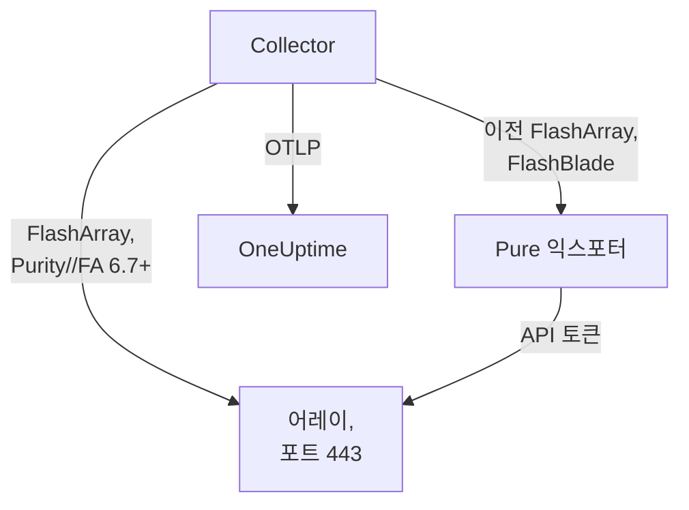

# 스토리지 어레이 에이전트

OneUptime Storage Array 에이전트는 스토리지 어레이를 모니터링합니다. 대상은 용량과 데이터 절감, 지연 시간, IOPS와 대역폭, 볼륨, 호스트, 포드와 복제, 하드웨어 상태, 파일 시스템과 버킷입니다. 이 에이전트는 표준 OpenTelemetry Collector로, 읽기 전용 사용자의 API 토큰으로 어레이의 OpenMetrics 엔드포인트를 스크레이프하고, 모든 메트릭에 어레이의 식별 정보를 붙여 OneUptime으로 보냅니다. 들어온 데이터에는 [스토리지 어레이 모니터](/docs/monitor/storage-array-monitor)로 알림을 보낼 수 있습니다.

:::cards
- [에이전트 설치](#에이전트-설치): 읽기 전용 사용자, 그다음 설치 스크립트 또는 Docker Compose.
- [에이전트가 수집하는 항목](#에이전트가-수집하는-것): 모든 엔드포인트와, 그것으로 만드는 페이지.
- [여러 어레이 모니터링](#여러-어레이-모니터링): 어레이마다 에이전트 하나, 머신 한 대에서.
- [문제 해결](#문제-해결): 진단 스크립트와 일반적인 문제.
:::

## 작동 방식

Storage Arrays는 모든 벤더에서 같은 방식으로 동작하는 제품입니다. 지원 대상은 다음과 같습니다:

| 어레이 | 에이전트가 읽는 방식 | Collector 구성 |
| --- | --- | --- |
| **Pure Storage FlashArray**, Purity//FA 6.7 이상 | 어레이 자체의 OpenMetrics 엔드포인트(`https://<array>/metrics/...?namespace=purefa`). Collector 옆에서 실행되는 것은 없습니다 | `otel-collector-config.yaml`(기본값) |
| **Pure Storage FlashArray**, 이전 Purity//FA | Pure의 FlashArray OpenMetrics 익스포터. 같은 Compose 파일이 `pure-fa-exporter` 서비스로 실행합니다 | `otel-collector-config.flasharray-exporter.yaml` |
| **Pure Storage FlashBlade** | Pure의 FlashBlade OpenMetrics 익스포터. 같은 Compose 파일이 `pure-fb-exporter` 서비스로 실행합니다 | `otel-collector-config.flashblade.yaml` |

Pure Storage는 2026년 2월에 이름을 **Everpure**로 바꿨습니다. FlashArray, FlashBlade, Purity는 이름을 유지했고 `purefa_*` 및 `purefb_*` 메트릭도 그대로이므로, 이 페이지의 모든 내용은 어느 이름으로 판매된 어레이에도 적용됩니다.



에이전트 하나는 어레이 하나를 모니터링합니다. 어레이마다 에이전트를 하나씩 실행하세요([여러 어레이 모니터링](#여러-어레이-모니터링) 참고). 어레이는 첫 데이터와 함께 스스로 등록되며, 그 이름은 에이전트가 모든 메트릭에 `storage.array.name`으로 붙이는 이름입니다.

## 시작하기 전에

- Docker Compose v2 플러그인이 있는 Docker Engine 20.10 이상. 머신은 HTTPS(TCP 443)로 어레이의 관리 인터페이스에 연결할 수 있어야 합니다.
- 어레이의 관리자 계정. 기본 제공 **readonly** 역할을 가진 사용자와 그 사용자의 API 토큰을 만드는 데 씁니다.
- 수집 키. **프로젝트 설정 → 텔레메트리 및 APM → 수집 키**에서 만들고 값을 복사합니다.

### 에이전트를 실행할 위치

에이전트는 HTTPS로 어레이의 관리 인터페이스와 통신하므로, Docker가 있고 TCP 443으로 관리 네트워크에 가는 경로가 있는 어떤 머신에서든 실행할 수 있습니다. 모니터링 호스트나 작은 관리용 VM이 그 예입니다. 자체 스토리지가 모니터링 대상 어레이에 있지 않은 머신을 고르세요. 어레이가 다운되더라도 모니터링까지 함께 다운되어서는 안 됩니다. 선택 사항인 syslog 리스너를 쓰려면 어레이가 syslog 포트로 에이전트에 연결할 수 있어야 합니다([어레이의 syslog 보내기](#선택-사항-어레이의-syslog-보내기) 참고).

## 에이전트 설치

:::steps
### 읽기 전용 사용자와 API 토큰 만들기

에이전트는 읽기만 합니다. 관리자가 아니라 기본 제공 **readonly** 역할을 가진 전용 사용자와 그 사용자의 API 토큰을 주세요. 토큰은 **만료 없이** 만드세요. 그렇지 않으면 토큰이 만료되는 날 에이전트가 멈춥니다.

:::tabs
@tab Purity CLI
관리자로 FlashArray에 SSH로 접속하세요. 첫 번째 명령은 새 사용자의 암호를 묻고, 두 번째 명령은 그 사용자의 API 토큰(UUID)을 출력합니다:

```bash
pureadmin create --role readonly oneuptime
pureadmin create --api-token oneuptime
```
@tab FlashArray GUI
1. _Settings → Users and Policies_ 메뉴를 여세요(이전 릴리스에서는 _Settings → Access_ 메뉴).
2. **Users** 패널의 ⋮ 메뉴에서 **Create User…** 항목을 선택하고, 사용자 이름을 `oneuptime`으로 정한 뒤 readonly 역할을 주세요.
3. 새 사용자의 ⋮ 메뉴에서 **Create API Token…** 항목을 선택하고, **Expires In** 필드는 비워 둔 채 토큰을 복사하세요.
@tab FlashBlade
같은 방식으로 **readonly** 역할을 가진 사용자와 그 사용자의 API 토큰을 만드세요. FlashBlade GUI의 사용자 설정에서 만들거나, Purity//FB CLI에서 `pureadmin`으로 만듭니다. 로컬 사용자가 없는 릴리스에서는 그룹이 readonly 역할에 매핑된 디렉터리 서비스(LDAP 또는 Active Directory) 계정을 사용하세요. FlashBlade API 토큰은 `T-`로 시작합니다.
:::

### FlashArray가 자체 메트릭을 제공하는지 확인하기

Pure는 네이티브 OpenMetrics 엔드포인트를 **Purity//FA 6.7.0 이상**용으로 문서화합니다(Pure의 FlashArray 익스포터 지원 중단 공지에는 6.6.11 이상이라고 되어 있습니다). 가장 빨리 알아보는 방법은 에이전트를 실행할 머신에서 어레이에 물어보는 것입니다:

```bash
curl -k 'https://<array>/metrics/array?namespace=purefa' --header 'Authorization: Bearer <api-token>' | grep purefa_info
```

`purefa_info{...} 1` 줄이 나오면 어레이가 메트릭을 네이티브로 제공한다는 뜻이므로 기본 구성을 사용하세요. `404`가 나오면 제공하지 않는다는 뜻이므로 익스포터 구성을 사용하세요. 이 구성은 Collector 옆에서 Pure의 익스포터를 실행합니다. Pure는 이 익스포터의 지원을 중단했으므로, 어레이를 업그레이드하면 네이티브 구성으로 옮기세요. FlashBlade는 항상 Pure의 FlashBlade 익스포터를 거치므로 이 단계를 건너뛰세요.

### 에이전트 설치 및 시작

:::tabs
@tab install.sh
에이전트를 실행할 머신에서 설치 스크립트를 내려받아 실행하세요:

```bash
curl -sSL https://raw.githubusercontent.com/OneUptime/oneuptime/master/agents/StorageArrayAgent/install.sh -o install.sh
bash install.sh
```

스크립트는 어떤 어레이인지(네이티브 메트릭을 제공하는 FlashArray, 이전 Purity//FA의 FlashArray, 또는 FlashBlade) 묻고, 이어서 OneUptime URL, 수집 키, 어레이 이름, 어레이의 관리 주소, 읽기 전용 사용자의 API 토큰(화면에 표시하지 않고 읽음)을 묻습니다. `/opt/oneuptime-storage-array-agent`에 설치하고, Compose 파일과 Collector 구성 세 개를 모두 내려받고, 알맞은 구성과 Compose 프로필을 담은 `0600` 권한의 `.env` 파일을 쓰고, Docker Compose로 에이전트를 시작합니다. 각 값을 입력한 그대로 Docker Compose용 따옴표로 감쌉니다. 다시 실행하면 다시 묻는 대신 기존 `.env`의 내용을 모두 재사용하며, 수정한 파일은 교체하기 전에 `<file>.bak.<timestamp>`로 보관합니다.
@tab Docker Compose
`docker-compose.yml`과 `otel-collector-config*.yaml` 파일 세 개를 [StorageArrayAgent 디렉터리](https://github.com/OneUptime/oneuptime/tree/master/agents/StorageArrayAgent)에서 새 폴더로 내려받으세요:

```bash
curl -fsSLO https://raw.githubusercontent.com/OneUptime/oneuptime/master/agents/StorageArrayAgent/docker-compose.yml
curl -fsSLO https://raw.githubusercontent.com/OneUptime/oneuptime/master/agents/StorageArrayAgent/otel-collector-config.yaml
curl -fsSLO https://raw.githubusercontent.com/OneUptime/oneuptime/master/agents/StorageArrayAgent/otel-collector-config.flasharray-exporter.yaml
curl -fsSLO https://raw.githubusercontent.com/OneUptime/oneuptime/master/agents/StorageArrayAgent/otel-collector-config.flashblade.yaml
```

그 옆에 `.env` 파일을 만드세요. API 토큰이 들어 있으므로 `chmod 600 .env`로 비공개로 유지하세요. 네이티브 메트릭을 제공하는 FlashArray라면:

```bash title=".env"
ONEUPTIME_URL=YOUR_ONEUPTIME_URL
ONEUPTIME_TELEMETRY_INGESTION_KEY=YOUR_TELEMETRY_INGESTION_TOKEN
STORAGE_ARRAY_NAME=my-storage-array
STORAGE_SYSTEM=purestorage.flasharray
STORAGE_ARRAY_COLLECTOR_CONFIG=otel-collector-config.yaml
COMPOSE_PROFILES=
PURE_FA_ENDPOINT=fa-prod-01.example.com
PURE_FA_API_TOKEN=YOUR_READ_ONLY_API_TOKEN
PURE_FB_ENDPOINT=
PURE_FB_API_TOKEN=
STORAGE_ARRAY_INSECURE_SKIP_VERIFY=true
```

이전 Purity//FA의 FlashArray라면 `STORAGE_ARRAY_COLLECTOR_CONFIG=otel-collector-config.flasharray-exporter.yaml`과 `COMPOSE_PROFILES=flasharray-exporter`를 설정하세요. FlashBlade라면 `STORAGE_SYSTEM=purestorage.flashblade`, `STORAGE_ARRAY_COLLECTOR_CONFIG=otel-collector-config.flashblade.yaml`, `COMPOSE_PROFILES=flashblade`를 설정하고, `PURE_FB_ENDPOINT`와 `PURE_FB_API_TOKEN`을 채우세요(`PURE_FA_*` 쌍 대신). 에이전트를 시작하세요:

```bash
docker compose up -d
```
:::

### 에이전트가 실행 중인지 확인

```bash
docker compose ps
docker logs -f oneuptime-storage-array-agent
```

`docker compose ps`에는 Collector(`oneuptime-storage-array-agent`)와, 익스포터 구성이라면 익스포터(`pure-fa-exporter` 또는 `pure-fb-exporter`)가 표시됩니다. Collector가 시작되면 로그에 다음 줄이 보여야 합니다:

```text
Everything is ready. Begin running and processing data.
```

### OneUptime에서 어레이 찾기

**제품 → 인프라 → Storage Arrays → All Storage Arrays** 메뉴를 여세요. 첫 스크레이프(약 1분) 후에 어레이가 용량, 성능, 열린 알림, 하드웨어와 함께 표시됩니다. 볼륨, 호스트, 포드는 2분 안에, FlashBlade의 파일 시스템과 버킷은 5분 안에, FlashArray 디렉터리는 30분 안에 뒤따릅니다.
:::

## 환경 변수

설치 스크립트는 이 값들을 `/opt/oneuptime-storage-array-agent/.env`에 씁니다. Docker Compose 설치는 이 값들을 `.env`(`docker-compose.yml` 옆의 파일)에서 읽습니다. 값을 바꾼 뒤에는 그 폴더에서 `docker compose up -d`를 실행하세요.

| 변수 | 필수 | 설명 |
| --- | --- | --- |
| `ONEUPTIME_URL` | 예 | OneUptime URL(예: `https://oneuptime.com` 또는 자체 호스팅 인스턴스). 인스턴스가 HTTP 전용이면 `http://`와 해당 포트를 사용하세요. |
| `ONEUPTIME_TELEMETRY_INGESTION_KEY` | 예 | **프로젝트 설정 → 텔레메트리 및 APM → 수집 키**의 수집 키. |
| `STORAGE_ARRAY_NAME` | 예 | OneUptime에서 어레이가 등록되는 이름으로, 모든 메트릭에 `storage.array.name` 리소스 속성으로 붙습니다. 바꾸지 마세요. 나중에 바꾸면 별도의 어레이가 등록됩니다. 이 값이 없으면 Collector가 시작을 거부합니다. |
| `STORAGE_SYSTEM` | 아니요 | `storage.system` 리소스 속성으로 붙는 플랫폼. `purestorage.flasharray` 또는 `purestorage.flashblade`입니다. 기본값은 `purestorage.flasharray`입니다. |
| `STORAGE_ARRAY_COLLECTOR_CONFIG` | 아니요 | 실행할 기본 제공 Collector 구성. `otel-collector-config.yaml`(FlashArray, 네이티브. 기본값), `otel-collector-config.flasharray-exporter.yaml`(이전 FlashArray), 또는 `otel-collector-config.flashblade.yaml`(FlashBlade)입니다. |
| `COMPOSE_PROFILES` | 아니요 | 선택한 구성이 스크레이프하는 익스포터를 시작합니다. 네이티브 FlashArray 구성에서는 비워 두고, 나머지 구성에서는 `flasharray-exporter` 또는 `flashblade`입니다. |
| `PURE_FA_ENDPOINT` | FlashArray | FlashArray의 관리 주소. 호스트 이름 또는 IP이며 `https://`는 붙이지 않습니다. |
| `PURE_FA_API_TOKEN` | FlashArray | readonly 역할을 가진 FlashArray 사용자의 API 토큰. |
| `PURE_FB_ENDPOINT` | FlashBlade | FlashBlade의 관리 주소. 호스트 이름 또는 IP이며 `https://`는 붙이지 않습니다. |
| `PURE_FB_API_TOKEN` | FlashBlade | readonly 역할을 가진 FlashBlade 사용자의 API 토큰. |
| `STORAGE_ARRAY_INSECURE_SKIP_VERIFY` | 아니요 | `true`는 네이티브 엔드포인트에서 어레이의 자체 서명 인증서를 받아들이고, `false`는 이를 검증합니다. 기본값은 `true`입니다. Pure의 익스포터는 어레이의 인증서를 검증하지 않으므로 익스포터에는 적용되지 않습니다. |

## 에이전트의 스크레이프 방식

- **엔드포인트마다 전용 스크레이프 작업이 있고, 각각 필요한 만큼만 자주 읽습니다.** FlashArray: `/metrics/array`는 60초마다, `/metrics/volumes`, `/metrics/hosts`, `/metrics/pods`는 2분마다, `/metrics/directories`는 30분마다 읽습니다. 디렉터리 사용량은 어레이가 계산하기에 부담이 크기 때문이며, 이는 Pure 자체의 권장 사항입니다. FlashBlade: `/metrics/array`는 60초마다, `/metrics/filesystems`와 `/metrics/objectstore`는 5분마다 읽습니다. 이 역시 파일 시스템과 오브젝트 스토어 엔드포인트를 어레이보다 덜 자주 읽으라는 Pure의 권장 사항을 따른 것입니다.
- **각 작업은 자신의 시리즈에 `scrape_endpoint: <endpoint>` 레이블을 붙입니다.** 각 엔드포인트는 `purefa_info` 또는 `purefb_info`도 내보내므로, OneUptime은 배치가 어떤 패밀리의 전체 목록인지 압니다. 이 덕분에 삭제된 볼륨, 호스트, 포드, 파일 시스템, 버킷이 남아 있지 않고 인벤토리에서 빠집니다. 레이블은 제공된 그대로 두세요.
- **볼륨별, 호스트별 지연 시간은 세 가지 차원만 유지합니다.** 각 볼륨과 호스트는 최대 열여섯 가지 `dimension`으로 지연 시간을 내보냅니다. `metric_relabel_configs` 규칙이 `usec_per_read_op`, `usec_per_write_op`, `usec_per_mirrored_write_op`를 유지하고, 큰 어레이의 시리즈 수를 몇 배로 늘리는 QoS 속도 제한, 큐, SAN, 서비스 시간 내역은 버립니다. `purefa_array_performance_latency_usec`의 어레이 전체 내역은 유지됩니다. 볼륨별 내역도 유지하려면 이 규칙을 삭제하세요.
- **API 토큰은 Bearer 토큰입니다.** 네이티브 구성은 이 토큰을 어레이 자체로 보냅니다. 익스포터 구성은 Compose 네트워크 안에서만 익스포터로 보내며, 익스포터의 포트는 절대 게시되지 않습니다.
- **`send_batch_max_size`가 없습니다.** OneUptime은 요청마다 스크레이프 한 번 전체로 인벤토리를 다시 만들기 때문에, 함께 제공되는 `batch` 프로세서는 스크레이프를 여러 내보내기로 나누지 않습니다. batch 설정은 제공된 그대로 두세요.

## 에이전트가 수집하는 것

Pure의 시맨틱 규칙은 FlashArray 네이티브 엔드포인트와 두 익스포터가 공유합니다. 모든 값은 어레이가 직접 계산한 게이지(지연 시간은 작업당 마이크로초, 처리량은 초당)이므로 비율을 계산할 필요가 없으며, 객체는 **데이터 포인트 레이블**로 이름이 붙습니다. 볼륨, 포드, 디렉터리, 파일 시스템, 버킷은 `name`, 호스트는 `host`, FlashArray 하드웨어는 `component_name`입니다. 에이전트가 `storage.array.name`과 `storage.system` 리소스 속성을 추가하므로 OneUptime은 모든 것을 어레이 아래로 정리합니다:

| 엔드포인트 | 메트릭 패밀리 | OneUptime이 이것으로 만드는 것 |
| --- | --- | --- |
| FlashArray `/metrics/array` | `purefa_info`, `purefa_alerts_open`, `purefa_array_space_*`, `purefa_array_performance_*`, `purefa_hw_component_status`, `purefa_hw_component_temperature_celsius`, `purefa_hw_controller_info`, `purefa_drive_capacity_bytes`, `purefa_network_interface_*` | 어레이의 이름, Purity 버전, 시스템 ID. 용량, 사용 공간, 데이터 절감. 열린 알림 수. 어레이의 상태. **Hardware** 페이지(구성 요소, 드라이브, 컨트롤러, 네트워크 인터페이스) |
| FlashArray `/metrics/volumes` | `purefa_volume_performance_*`, `purefa_volume_space_*`, `purefa_volume_qos_*` | **볼륨** 페이지: 볼륨별 프로비저닝 크기와 물리 크기, 데이터 절감, 읽기 및 쓰기 지연 시간, IOPS와 대역폭 |
| FlashArray `/metrics/hosts` | `purefa_host_connectivity_info`, `purefa_host_connections_info`, `purefa_host_performance_*`, `purefa_host_space_*` | **호스트** 페이지: 호스트별 연결 상태(중복 경로 여부), 연결된 볼륨, 지연 시간, IOPS와 대역폭 |
| FlashArray `/metrics/pods` | `purefa_pod_performance_*`, `purefa_pod_space_*`, `purefa_pod_replica_links_*`, `purefa_pod_mediator_status` | **Replication** 페이지: ActiveCluster와 ActiveDR 포드, 복제본 링크 상태와 지연 |
| FlashArray `/metrics/directories` | `purefa_directory_performance_*`, `purefa_directory_space_*` | **Directories** 페이지(FlashArray File Services) |
| FlashBlade `/metrics/array` | `purefb_info`, `purefb_alerts_open`, `purefb_array_space_*`, `purefb_array_performance_*`, `purefb_hardware_health` | FlashBlade의 이름, Purity 버전, 시스템 ID. 용량과 데이터 절감. 열린 알림 수. 어레이의 상태. **Hardware** 페이지 |
| FlashBlade `/metrics/filesystems` | `purefb_file_systems_space_*`, `purefb_file_systems_performance_*` | **File Systems** 페이지: 파일 시스템별 프로비저닝 공간과 사용 공간, 데이터 절감, 지연 시간, IOPS와 대역폭 |
| FlashBlade `/metrics/objectstore` | `purefb_buckets_space_*`, `purefb_buckets_quota_space_bytes`, `purefb_buckets_object_count`, `purefb_buckets_performance_*`, `purefb_object_store_accounts_*` | **Buckets** 페이지: 버킷별 공간, 할당량, 객체 수, 성능. 계정별로 묶어 표시 |

어레이의 **개요** 페이지에 표시되는 상태는, 열린 심각 알림이 있거나 하드웨어 구성 요소, 드라이브, 컨트롤러가 심각, 실패, 누락, 비정상 상태라고 보고하는 동안에는 **심각**, 열린 경고 알림이 있거나 저하 또는 알 수 없는 상태의 구성 요소를 보고하는 동안에는 **Warning**, 그 밖에는 **OK**입니다. 모니터 조건에서 어레이의 속성에는 `resource.` 접두사가 붙고(`resource.storage.array.name`, `resource.storage.system`), 데이터 포인트 레이블은 접두사 없이 그대로 씁니다(`name`, `host`, `dimension`, `space`).

## 선택 사항 — 어레이의 syslog 보내기

기본적으로 에이전트는 메트릭만 보내므로 어레이의 **로그** 페이지는 비어 있습니다. 어레이는 알림과 감사 이벤트를 syslog로 전달하며, 함께 제공되는 모든 Collector 구성에는 주석 처리된 `syslog` 리시버 쌍(포트 5514의 TCP와 UDP, RFC 3164)이 있고, 이는 주석 처리된 `logs` 파이프라인에 연결되어 있습니다. 이 파이프라인이 `storage.array.name`을 붙이므로 로그가 어레이로 들어갑니다.

:::steps
### 리시버 켜기

사용하는 Collector 구성에서 `syslog/*` 리시버 두 개와 `logs` 파이프라인의 주석을 해제하세요. RFC 3164 타임스탬프에는 시간대가 없습니다. 어레이의 시계가 UTC로 동작하지 않는다면 `location`을 어레이의 시간대로 설정하세요.

### 포트 열기

`ports:` 블록(`docker-compose.yml`에 있음)의 주석을 해제해 머신이 `5514/tcp`와 `5514/udp`를 게시하게 한 다음 `docker compose up -d`를 실행하세요. 머신의 방화벽에서 어레이의 관리 네트워크에 대해 포트를 여세요.

### 어레이가 에이전트를 가리키게 하기

이 작업은 읽기 전용 모니터링 사용자가 아니라 관리자로 하세요. FlashArray에서는 _Settings → System → Syslog Servers_ 메뉴를 열고 `udp://<agent-host>:5514`(또는 `tcp://<agent-host>:5514`)를 추가한 뒤 테스트 메시지를 보내세요. FlashBlade에서는 syslog 설정에서 같은 URI로 syslog 서버를 추가하세요. 두 어레이 모두 `PROTOCOL://HOST:PORT` 형식을 받으며, REST API(`syslog-servers`)에서도 마찬가지입니다.
:::

syslog 리시버는 한 가지 전송 방식에서만 수신하므로 TCP와 UDP가 두 개의 리시버로 나뉘어 있습니다. 하나만 필요하면 다른 하나는 주석 처리된 채로 두세요. 표준 Collector 이미지는 syslog를 그대로 읽으므로 사용자 지정 이미지가 필요 없습니다.

## 프로젝트 레이블로 어레이에 태그 붙이기

`oneuptime.label.`로 시작하는 리소스 속성은 스토리지 어레이의 프로젝트 레이블이 됩니다. `oneuptime.label.<dimension>=<value>`는 레이블 `<dimension>:<value>`입니다. 사용하는 Collector 구성의 `resource` 프로세서에 `storage.array.name`과 나란히 속성을 추가하세요:

```yaml
processors:
  resource:
    attributes:
      # ...existing attributes...
      - key: oneuptime.label.team
        value: storage
        action: upsert
      - key: oneuptime.label.env
        value: production
        action: upsert
```

Collector는 시작할 때만 구성을 읽습니다. `docker compose restart oneuptime-storage-array-agent`를 실행하세요. 그러면 어레이에 `team:storage`와 `env:production` 레이블이 표시됩니다. 레이블은 대소문자를 구분하지 않고 비교되므로 기존 `Production` 레이블은 중복되지 않고 재사용되며, 에이전트는 누군가 OneUptime에서 추가한 레이블을 절대 제거하지 않습니다.

## 여러 어레이 모니터링

에이전트 하나는 어레이 하나를 읽습니다. 같은 머신에서 여러 어레이를 모니터링하려면 각각을 전용 `.env`가 있는 전용 폴더에 설치하고(예: `INSTALL_DIR=/opt/oneuptime-storage-array-agent-fa02 bash install.sh`), 각각에 전용 `container_name`을 주세요(`docker-compose.yml`에서. 예: `oneuptime-storage-array-agent-fa02`). 두 컨테이너가 같은 이름을 가질 수는 없습니다. 진단 스크립트에는 `-d`로 폴더를 넘기세요.

## systemd 서비스로 실행

머신과 함께 에이전트를 시작하고 실패하면 다시 시작하게 하려면 systemd 유닛을 설치하세요. 이 유닛은 설치 스크립트가 에이전트를 두는 `/opt/oneuptime-storage-array-agent`에 에이전트가 있다고 가정합니다:

```bash
sudo curl -fsSL https://raw.githubusercontent.com/OneUptime/oneuptime/master/agents/StorageArrayAgent/systemd/oneuptime-storage-array-agent.service -o /etc/systemd/system/oneuptime-storage-array-agent.service
sudo systemctl daemon-reload
sudo systemctl enable --now oneuptime-storage-array-agent
```

## 에이전트 업그레이드

에이전트는 파일이 고정한 Collector 버전을 **에이전트 버전**으로 보고합니다. 그 버전이 이 OneUptime 릴리스가 고정한 버전보다 오래되었으면, 어레이의 **개요** 페이지에서 그 옆에 경고 표시가 나타납니다. 이를 선택하면 다음 명령을 볼 수 있습니다. 파일이 버전을 보고하기 전에 설치된 에이전트는 이 방법으로 업그레이드할 때까지 버전을 표시하지 않습니다.

Collector 이미지는 `docker-compose.yml`에 고정되어 있고 구성은 그 옆의 파일이므로, 가져오기만으로는 에이전트가 새 버전이 되지 않습니다. `install.sh`를 다시 실행하세요. 기존 `.env`의 모든 값을 재사용하고(아무것도 다시 묻지 않음), `docker-compose.yml`과 Collector 구성 세 개를 새로 고치고(수정한 파일은 `<file>.bak.<timestamp>`로 보관), 에이전트를 다시 만들어 Collector가 새 구성을 읽게 합니다. `/opt/oneuptime-storage-array-agent` 밖에 설치한 에이전트는 폴더를 지정해야 합니다: `INSTALL_DIR=<folder> bash install.sh`.

```bash
curl -sSL https://raw.githubusercontent.com/OneUptime/oneuptime/master/agents/StorageArrayAgent/install.sh -o install.sh
bash install.sh
```

Docker Compose로 설치했다면, 에이전트의 폴더에서 Compose 파일과 Collector 구성 세 개를 다시 내려받고(파일에 가한 변경이 있으면 다시 적용), 이미지를 가져와 에이전트를 다시 만드세요:

```bash
curl -fsSLO https://raw.githubusercontent.com/OneUptime/oneuptime/master/agents/StorageArrayAgent/docker-compose.yml
curl -fsSLO https://raw.githubusercontent.com/OneUptime/oneuptime/master/agents/StorageArrayAgent/otel-collector-config.yaml
curl -fsSLO https://raw.githubusercontent.com/OneUptime/oneuptime/master/agents/StorageArrayAgent/otel-collector-config.flasharray-exporter.yaml
curl -fsSLO https://raw.githubusercontent.com/OneUptime/oneuptime/master/agents/StorageArrayAgent/otel-collector-config.flashblade.yaml
docker compose pull
docker compose up -d --force-recreate
```

## 에이전트 제거

```bash
cd /opt/oneuptime-storage-array-agent
docker compose down
```

그런 다음 더 이상 필요하지 않다면 어레이에서 읽기 전용 사용자와 그 API 토큰을 삭제하세요.

## 문제 해결

:::details 먼저 진단 스크립트 실행
에이전트에는 전체 체인을 확인하는 스크립트 [`troubleshoot.sh`](https://github.com/OneUptime/oneuptime/blob/master/agents/StorageArrayAgent/troubleshoot.sh)가 함께 제공됩니다. 컨테이너 런타임, Collector가 도달하는 방식 그대로의 어레이 엔드포인트(네이티브 엔드포인트 또는 Pure의 익스포터. DNS, TLS, FlashArray에 네이티브 엔드포인트가 아예 있는지, 어레이가 API 토큰을 받아들이는지. 토큰은 스크립트가 stdin으로 curl에 넘깁니다), 모든 메트릭에 붙은 어레이 이름, 토큰 형식, Collector 자체 메트릭, 그리고 OneUptime이 수집 키를 받아들이는지를 확인합니다. 마지막 확인이 가장 중요합니다. OneUptime은 잘못된 키를 `401`로 거부하며(비활성화된 키나 브라우저 키는 `422`), Collector는 둘 다 영구적인 오류로 취급합니다. 배치를 버리고 `Exporting failed` 오류를 하나 기록할 뿐이므로, 컨테이너가 정상인 동안에는 놓치기 쉽습니다. 스크립트는 에이전트의 네트워크 안에서 `GET <url>/otlp/v1/validate`를 요청해 `200`(유효) 또는 `401`(무효)을 직접 받고, 이전 서버에서는 `POST /fluentd/v1/logs`로 대체합니다.

```bash
curl -sSL https://raw.githubusercontent.com/OneUptime/oneuptime/master/agents/StorageArrayAgent/troubleshoot.sh -o troubleshoot.sh
bash troubleshoot.sh    # add -d <dir> if you installed outside /opt/oneuptime-storage-array-agent
```

마지막에 가장 가능성 높은 원인을 알려 주는 판정을 출력합니다.
:::

:::details OneUptime에 어레이가 나타나지 않음
1. Collector의 로그를 확인하세요: `docker logs oneuptime-storage-array-agent`. `server returned HTTP status 401`은 어레이가 API 토큰을 거부했다는 뜻이고, `404`는 FlashArray에 네이티브 엔드포인트가 없다는 뜻이며, `x509`는 어레이의 자체 서명 인증서에 대해 TLS 검증이 켜져 있다는 뜻이고, `no such host` 또는 `connection refused`는 `PURE_FA_ENDPOINT` 또는 `PURE_FB_ENDPOINT`가 잘못되었다는 뜻이며, 내보낼 때의 `401`은 수집 키가 잘못되었다는 뜻입니다.
2. 에이전트의 네트워크에서 어레이에 요청해 보세요. Collector 이미지에는 셸도 curl도 없으므로 같은 네트워크의 컨테이너에서 요청하세요: `docker run --rm --network container:oneuptime-storage-array-agent curlimages/curl -sk -H 'Authorization: Bearer <api-token>' 'https://<array>/metrics/array?namespace=purefa'`를 실행하면 `purefa_*` 줄이 출력되어야 합니다.
3. `STORAGE_ARRAY_NAME`이 설정되어 있는지 확인하세요. 어레이는 `storage.array.name` 리소스 속성으로 찾으며, 이 값이 없으면 Collector가 시작을 거부합니다.
:::

:::details 어레이가 연결 끊김으로 표시됨
OneUptime이 15분 동안 어레이에서 아무것도 받지 못하면 어레이는 연결 끊김 상태가 됩니다. OneUptime은 5분마다 확인하며, OneUptime 자체가 데이터를 받지 못한 시간은 계산하지 않습니다. Collector가 실행 중인지(`docker compose ps`), 로그에 스크레이프나 내보내기 오류가 없는지, 머신이 여전히 어레이와 OneUptime URL에 연결되는지 확인하세요. 다음 데이터가 들어오면 어레이는 다시 연결됨 상태가 됩니다.
:::

:::details FlashArray가 404로 응답함
그 Purity//FA에는 네이티브 OpenMetrics 엔드포인트가 없습니다. `install.sh`를 다시 실행해 이전 Purity 옵션을 고르거나, `STORAGE_ARRAY_COLLECTOR_CONFIG=otel-collector-config.flasharray-exporter.yaml`과 `COMPOSE_PROFILES=flasharray-exporter`를 설정하고(`.env`에서) `docker compose up -d`를 실행하세요. 어레이를 Purity//FA 6.7 이상으로 업그레이드한 뒤에는 네이티브 구성으로 돌아가고 프로필을 빼세요.
:::

:::details 어레이가 API 토큰을 거부함
사용자의 암호가 아니라 API 토큰을 붙여 넣었는지, 사용자가 아직 있고 readonly 역할을 가지고 있는지, 토큰이 만료되지 않았는지 확인하세요. 새 토큰을 만들어(FlashArray에서는 `pureadmin create --api-token oneuptime`) `.env`에 넣고 `docker compose up -d`를 실행하세요. Pure의 익스포터를 거치는 경우, 거부된 토큰은 Collector 로그에 익스포터가 보낸 HTTP `400`으로 나타나며 그 본문은 `failed to login`입니다.
:::

:::details x509 또는 TLS 오류
어레이는 기본적으로 자체 서명 인증서를 제시하며, 어떤 Docker 이미지도 이를 신뢰하지 않습니다. `STORAGE_ARRAY_INSECURE_SKIP_VERIFY=true`를 설정하거나(사설 관리 네트워크에서는 실용적인 선택), Collector 이미지가 신뢰하는 CA의 인증서를 어레이에 설치하세요.
:::

:::details pure-fa-exporter 또는 pure-fb-exporter의 이름을 확인할 수 없음
익스포터가 실행되고 있지 않습니다. `COMPOSE_PROFILES`는 `STORAGE_ARRAY_COLLECTOR_CONFIG`와 맞아야 합니다(FlashArray 익스포터 구성에는 `flasharray-exporter`, FlashBlade 구성에는 `flashblade`). `.env`를 고치고 `docker compose up -d`를 실행하면 `docker compose ps`에 익스포터가 표시됩니다.
:::

:::details 삭제한 볼륨이나 호스트가 인벤토리에 남아 있음
OneUptime은 엔드포인트의 전체 스크레이프에 더 이상 객체가 없으면 그 객체를 제거하며, 이를 `scrape_endpoint` 레이블로 알아봅니다. 함께 제공된 Collector 구성을 직접 만든 구성으로 바꿨다면 그 스크레이프 작업에 `scrape_endpoint` 레이블을 유지하세요. 그렇지 않으면 객체는 오래되어야만 인벤토리에서 빠집니다.
:::

:::details 메트릭이 엉뚱한 어레이에 들어감
OneUptime은 스토리지 어레이를 `storage.array.name`으로 등록하며, 에이전트는 이 값을 `STORAGE_ARRAY_NAME`에서 가져옵니다. 첫 데이터 이후에 바꾸면 첫 어레이의 이름이 바뀌는 대신 두 번째 어레이가 만들어집니다.
:::

:::details 에이전트 없이 메트릭 보내기
에이전트는 표준 Collector 구성 하나이므로, 이미 운영 중인 Collector로도 같은 일을 할 수 있습니다. 스크레이프 작업과 `resource` 프로세서를 함께 제공되는 구성에서 자신의 구성으로 복사하세요. `storage.array.name` 리소스 속성이 OneUptime에 어레이를 등록하고, `service.name` / `service.instance.id` 삭제는 데이터가 서비스 아래로 정리되지 않게 합니다. 둘 다 유지하고, `scrape_endpoint` 레이블도 유지하세요.
:::

## 다음 단계

:::cards
- [스토리지 어레이 모니터](/docs/monitor/storage-array-monitor): 어레이 알림, 용량, 지연 시간, 하드웨어, 호스트 경로, 복제, 파일 시스템에 대해 알림을 보냅니다.
- [VMware 에이전트](/docs/telemetry/vmware): 이 어레이에서 VMware를 실행한다면 데이터스토어와 VM도 확인하세요.
- [호스트 OpenTelemetry 수집기](/docs/telemetry/host-otel-collector): 어레이를 사용하는 머신을 운영체제 관점에서 봅니다.
:::
