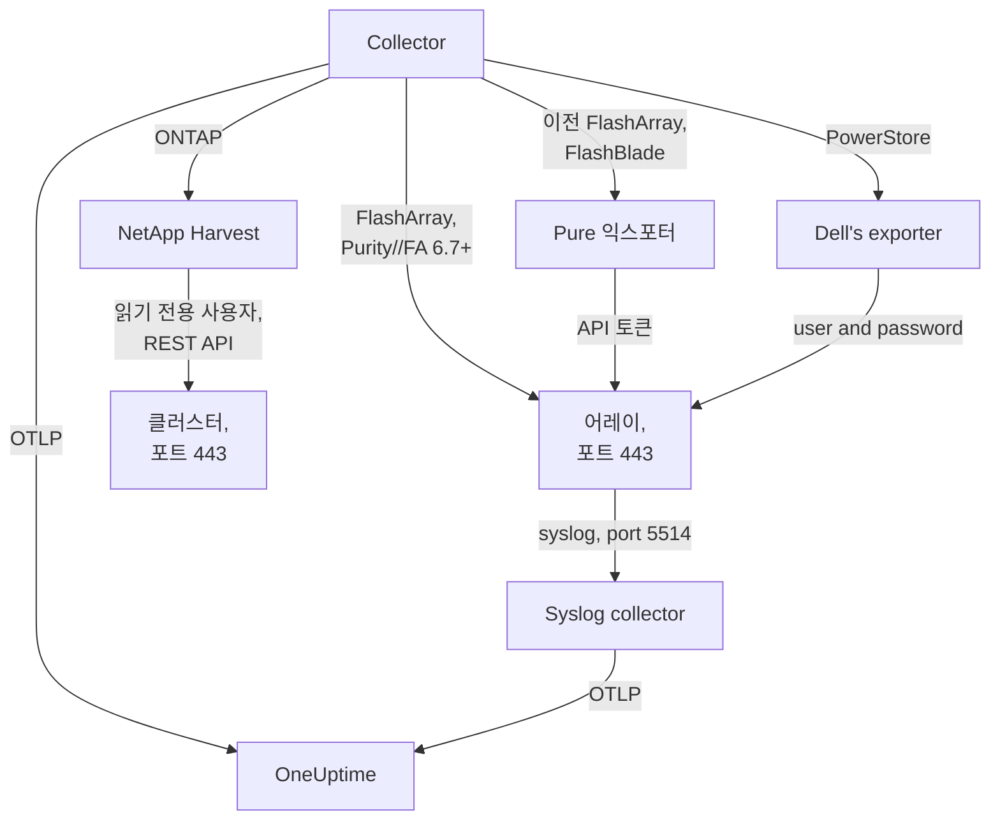

# 스토리지 어레이 에이전트

OneUptime Storage Array 에이전트는 스토리지 어레이를 모니터링합니다. 대상은 용량과 데이터 절감, 지연 시간, IOPS와 대역폭, 볼륨, 호스트, 포드와 복제, 하드웨어 상태, 파일 시스템과 버킷, 그리고 NetApp ONTAP에서는 애그리게이트, SVM, LUN, SnapMirror 관계입니다. 이 에이전트는 표준 OpenTelemetry Collector로, 읽기 전용 사용자의 API 토큰으로 어레이의 OpenMetrics 엔드포인트를 스크레이프하고(ONTAP에서는 옆에서 실행되는 NetApp 자체의 Harvest 익스포터를 스크레이프합니다), 모든 메트릭에 어레이의 식별 정보를 붙여 OneUptime으로 보냅니다. 들어온 데이터에는 [스토리지 어레이 모니터](/docs/monitor/storage-array-monitor)로 경고를 보낼 수 있습니다.

:::cards
- [에이전트 설치](#에이전트-설치): 읽기 전용 사용자, 그다음 설치 스크립트 또는 Docker Compose.
- [Dell PowerScale](#dell-powerscale): 클러스터의 SNMP, 모든 노드 폴링, 그리고 페이지에 표시되는 내용.
- [에이전트가 수집하는 항목](#에이전트가-수집하는-것): 모든 엔드포인트와, 그것으로 만드는 페이지.
- [여러 어레이 모니터링](#여러-어레이-모니터링): 어레이마다 에이전트 하나, 머신 한 대에서.
- [Dell PowerMax](#dell-powermax): 에이전트 불필요. 프로브가 Unisphere 뒤의 모든 어레이를 읽습니다.
- [문제 해결](#문제-해결): 진단 스크립트와 일반적인 문제.
:::

## 작동 방식

Storage Arrays는 모든 벤더에서 같은 방식으로 동작하는 제품입니다. 지원 대상은 다음과 같습니다:

| 어레이 | `storage.system` | 에이전트가 읽는 방식 | Collector 구성 |
| --- | --- | --- | --- |
| **Pure Storage FlashArray**, Purity//FA 6.7 이상 | `purestorage.flasharray` | 어레이 자체의 OpenMetrics 엔드포인트(`https://<array>/metrics/...?namespace=purefa`). Collector 옆에서 실행되는 것은 없습니다 | `otel-collector-config.yaml`(기본값) |
| **Pure Storage FlashArray**, 이전 Purity//FA | `purestorage.flasharray` | Pure의 FlashArray OpenMetrics 익스포터. 같은 Compose 파일이 `pure-fa-exporter` 서비스로 실행합니다 | `otel-collector-config.flasharray-exporter.yaml` |
| **Pure Storage FlashBlade** | `purestorage.flashblade` | Pure의 FlashBlade OpenMetrics 익스포터. 같은 Compose 파일이 `pure-fb-exporter` 서비스로 실행합니다 | `otel-collector-config.flashblade.yaml` |
| **Dell PowerStore** | `dell.powerstore` | Dell의 PowerStore Metrics Exporter. 같은 Compose 파일이 `powerstore-exporter` 서비스로 빌드하고 실행합니다. 클러스터의 경고는 syslog로 `powerstore-syslog` 서비스에 도착합니다 | `otel-collector-config.powerstore.yaml` |
| **NetApp ONTAP** 9.12.1 이상(AFF, FAS, ASA, ONTAP Select, Cloud Volumes ONTAP) 및 **Amazon FSx for NetApp ONTAP** | `netapp.ontap` | [NetApp Harvest](https://github.com/NetApp/harvest) 26.11. 같은 Compose 파일이 `netapp-harvest` 서비스로 실행하며, 읽기 전용 사용자와 암호로 클러스터의 REST API에 로그인합니다 | `otel-collector-config.netapp-ontap.yaml` |
| **Dell PowerScale** (Isilon), OneFS 8.0 이상 | `dell.powerscale` | 각 노드를 SNMP로(Dell의 ISILON-MIB), Collector 자체의 SNMP 리시버로 읽습니다. Collector 옆에서 실행되는 것은 없습니다 | `otel-collector-config.powerscale.yaml` |

ONTAP에는 자체 메트릭 엔드포인트가 없으므로, 에이전트는 NetApp의 오픈 소스 익스포터인 Harvest를 Collector 옆에서 실행합니다. Harvest는 클러스터의 REST API를 읽고 읽은 내용을 Compose 네트워크에서 제공하며, 모든 시리즈의 이름은 `netapp_<object>_<counter>` 형식입니다. Collector는 이를 스크레이프해 전달합니다. Harvest는 클러스터에 절대 쓰지 않으며, NetApp으로 보내는 AutoSupport 보고는 꺼져 있습니다.

**Dell PowerMax**(`dell.powermax`)에는 에이전트가 필요 없습니다. OneUptime 프로브가 읽기 전용 계정으로 Unisphere for PowerMax가 관리하는 모든 어레이를 읽습니다. [Dell PowerMax](#dell-powermax)를 참고하세요.

Pure Storage는 2026년 2월에 이름을 **Everpure**로 바꿨습니다. FlashArray, FlashBlade, Purity는 이름을 유지했고 `purefa_*` 및 `purefb_*` 메트릭도 그대로이므로, 이 페이지의 모든 내용은 어느 이름으로 판매된 어레이에도 적용됩니다.

**Dell PowerScale** 클러스터는 다른 방식으로 읽습니다. 에이전트는 읽기 전용 커뮤니티 또는 SNMPv3 사용자로 각 노드를 SNMP로 폴링하며, API 토큰은 쓰지 않습니다. SNMP를 켜는 방법부터 페이지에 표시되는 내용까지는 [Dell PowerScale](#dell-powerscale)에서 다룹니다. 아래 설치 단계는 Pure Storage용입니다.



에이전트 하나는 어레이 하나를 모니터링합니다. 어레이마다 에이전트를 하나씩 실행하세요([여러 어레이 모니터링](#여러-어레이-모니터링) 참고). 어레이는 첫 데이터와 함께 스스로 등록되며, 그 이름은 에이전트가 모든 메트릭에 `storage.array.name`으로 붙이는 이름입니다.

## 시작하기 전에

- Docker Compose v2 플러그인이 있는 Docker Engine 20.10 이상. 머신은 HTTPS(TCP 443)로 어레이의 관리 인터페이스에 연결할 수 있어야 합니다.
- 어레이의 관리자 계정. 기본 제공 **readonly** 역할을 가진 사용자와 그 사용자의 API 토큰을 만드는 데 씁니다. ONTAP에서는 암호가 있는 읽기 전용 REST 사용자를 만들 클러스터 관리자(Amazon FSx for NetApp ONTAP에서는 `fsxadmin`)가 필요합니다.
- Dell PowerStore라면 x86-64 머신(Dell은 익스포터를 x86-64용으로만 빌드합니다)과 에이전트용 PowerStore 사용자: [Dell PowerStore](#dell-powerstore)를 참고하세요.
- 수집 키. **프로젝트 설정 → 텔레메트리 및 APM → 수집 키**에서 만들고 값을 복사합니다.

### 에이전트를 실행할 위치

에이전트는 HTTPS로 어레이의 관리 인터페이스와 통신하므로, Docker가 있고 TCP 443으로 관리 네트워크에 가는 경로가 있는 어떤 머신에서든 실행할 수 있습니다. 모니터링 호스트나 작은 관리용 VM이 그 예입니다. 자체 스토리지가 모니터링 대상 어레이에 있지 않은 머신을 고르세요. 어레이가 다운되더라도 모니터링까지 함께 다운되어서는 안 됩니다. 선택 사항인 syslog 리스너를 쓰려면 어레이가 syslog 포트로 에이전트에 연결할 수 있어야 합니다([어레이의 syslog 보내기](#선택-사항-어레이의-syslog-보내기) 참고).

## 에이전트 설치

:::steps
### 읽기 전용 사용자와 API 토큰 만들기

에이전트는 읽기만 합니다. 관리자가 아니라 기본 제공 **readonly** 역할을 가진 전용 사용자와 그 사용자의 API 토큰을 주세요. 토큰은 **만료 없이** 만드세요. 그렇지 않으면 토큰이 만료되는 날 에이전트가 멈춥니다.

:::tabs
@tab Purity CLI
관리자로 FlashArray에 SSH로 접속하세요. 첫 번째 명령은 새 사용자의 암호를 묻고, 두 번째 명령은 그 사용자의 API 토큰(UUID)을 출력합니다:

```bash
pureadmin create --role readonly oneuptime
pureadmin create --api-token oneuptime
```
@tab FlashArray GUI
1. _Settings → Users and Policies_ 메뉴를 여세요(이전 릴리스에서는 _Settings → Access_ 메뉴).
2. **Users** 패널의 ⋮ 메뉴에서 **Create User…** 항목을 선택하고, 사용자 이름을 `oneuptime`으로 정한 뒤 readonly 역할을 주세요.
3. 새 사용자의 ⋮ 메뉴에서 **Create API Token…** 항목을 선택하고, **Expires In** 필드는 비워 둔 채 토큰을 복사하세요.
@tab FlashBlade
같은 방식으로 **readonly** 역할을 가진 사용자와 그 사용자의 API 토큰을 만드세요. FlashBlade GUI의 사용자 설정에서 만들거나, Purity//FB CLI에서 `pureadmin`으로 만듭니다. 로컬 사용자가 없는 릴리스에서는 그룹이 readonly 역할에 매핑된 디렉터리 서비스(LDAP 또는 Active Directory) 계정을 사용하세요. FlashBlade API 토큰은 `T-`로 시작합니다.
@tab ONTAP CLI
관리자로 클러스터 관리 주소에 SSH로 접속하세요. 첫 번째 명령은 모든 API를 읽기만 할 수 있는 REST 역할을 만들고, 두 번째 명령은 그 역할을 가진 HTTP 사용자를 만들며 그 사용자의 암호를 묻습니다:

```bash
security login rest-role create -role oneuptime-readonly -api /api -access readonly
security login create -user-or-group-name oneuptime -application http -authentication-method password -role oneuptime-readonly
```

에이전트는 이 사용자와 암호로 로그인합니다. API 토큰은 쓰지 않습니다.
@tab ONTAP System Manager
1. _Cluster → Settings → Users and Roles_ 메뉴를 여세요.
2. **Roles**에서 **Add**를 선택하고, 역할 이름을 `oneuptime-readonly`로 정한 뒤 **REST API path**에 `/api`를 입력하고 **Read-Only** 액세스를 선택하세요.
3. **Users**에서 **Add**를 선택하고, 사용자 이름을 `oneuptime`으로 정한 뒤 새 역할을 주고, **Password**를 쓰는 **HTTP** 로그인 방법을 추가한 다음 암호를 설정하세요.
@tab Amazon FSx for NetApp ONTAP
`fsxadmin`으로 파일 시스템의 관리 엔드포인트(FSx 콘솔에 표시되는 DNS 이름 또는 IP)에 SSH로 접속하고, FSx에 미리 정의된 읽기 전용 역할로 사용자를 만드세요. 명령이 그 사용자의 암호를 묻습니다:

```bash
security login create -user-or-group-name oneuptime -application http -authentication-method password -role fsxadmin-readonly
```

파일 시스템의 하드웨어는 AWS가 운영하므로, FSx는 디스크, 쉘프, 센서에 대해 누구에게도 답하지 않습니다. 어레이의 **하드웨어** 페이지는 노드와 포트를 나열하고 그 사실을 알려 줍니다.
:::

### FlashArray가 자체 메트릭을 제공하는지 확인하기

Pure는 네이티브 OpenMetrics 엔드포인트를 **Purity//FA 6.7.0 이상**용으로 문서화합니다(Pure의 FlashArray 익스포터 지원 중단 공지에는 6.6.11 이상이라고 되어 있습니다). 가장 빨리 알아보는 방법은 에이전트를 실행할 머신에서 어레이에 물어보는 것입니다:

```bash
curl -k 'https://<array>/metrics/array?namespace=purefa' --header 'Authorization: Bearer <api-token>' | grep purefa_info
```

`purefa_info{...} 1` 줄이 나오면 어레이가 메트릭을 네이티브로 제공한다는 뜻이므로 기본 구성을 사용하세요. `404`가 나오면 제공하지 않는다는 뜻이므로 익스포터 구성을 사용하세요. 이 구성은 Collector 옆에서 Pure의 익스포터를 실행합니다. Pure는 이 익스포터의 지원을 중단했으므로, 어레이를 업그레이드하면 네이티브 구성으로 옮기세요. FlashBlade는 항상 Pure의 FlashBlade 익스포터를, ONTAP 클러스터는 NetApp Harvest를 거치므로 둘 다 이 단계를 건너뛰세요.

### 에이전트 설치 및 시작

각 OneUptime은 자기 릴리스의 에이전트 설치 스크립트와 파일을 제공합니다. 아래 명령은 `https://oneuptime.com`에서 내려받으므로, 자체 호스팅 OneUptime에서는 이 주소를 사용자의 URL로 바꾸세요. 설치 스크립트는 먼저 `install.sh`로 저장되므로, 실행하기 전에 읽어 볼 수 있습니다.

:::tabs
@tab install.sh
에이전트를 실행할 머신에서 설치 스크립트를 내려받아 실행하세요:

```bash
curl -fsSL https://oneuptime.com/install/storage-array-agent -o install.sh
bash install.sh
```

스크립트는 어떤 어레이인지(네이티브 메트릭을 제공하는 FlashArray, 이전 Purity//FA의 FlashArray, FlashBlade 또는 NetApp ONTAP 클러스터) 묻고, 이어서 OneUptime URL, 수집 키, 어레이 이름, 어레이의 관리 주소, 읽기 전용 사용자의 API 토큰(ONTAP에서는 읽기 전용 사용자의 이름과 암호. 화면에 표시하지 않고 읽음)을 묻습니다. `/opt/oneuptime-storage-array-agent`에 설치하고, Compose 파일, 모든 Collector 구성, Harvest 파일 네 개를 내려받고, 알맞은 구성과 Compose 프로필을 담은 `0600` 권한의 `.env` 파일을 쓰고, Docker Compose로 에이전트를 시작합니다. 각 값을 입력한 그대로 Docker Compose용 따옴표로 감쌉니다. 다시 실행하면 다시 묻는 대신 기존 `.env`의 내용을 모두 재사용하며, 수정한 파일은 교체하기 전에 `<file>.bak.<timestamp>`로 보관합니다.
@tab Docker Compose
`docker-compose.yml`과 `otel-collector-config*.yaml` 파일 세 개를 사용 중인 OneUptime에서 새 폴더로 내려받으세요:

```bash
curl -fsSLO https://oneuptime.com/install/storage-array-agent/docker-compose.yml
curl -fsSLO https://oneuptime.com/install/storage-array-agent/otel-collector-config.yaml
curl -fsSLO https://oneuptime.com/install/storage-array-agent/otel-collector-config.flasharray-exporter.yaml
curl -fsSLO https://oneuptime.com/install/storage-array-agent/otel-collector-config.flashblade.yaml
```

그 옆에 `.env` 파일을 만드세요. API 토큰이 들어 있으므로 `chmod 600 .env`로 비공개로 유지하세요. 네이티브 메트릭을 제공하는 FlashArray라면:

```bash title=".env"
ONEUPTIME_URL=YOUR_ONEUPTIME_URL
ONEUPTIME_TELEMETRY_INGESTION_KEY=YOUR_TELEMETRY_INGESTION_TOKEN
STORAGE_ARRAY_NAME=my-storage-array
STORAGE_SYSTEM=purestorage.flasharray
STORAGE_ARRAY_COLLECTOR_CONFIG=otel-collector-config.yaml
COMPOSE_PROFILES=
PURE_FA_ENDPOINT=fa-prod-01.example.com
PURE_FA_API_TOKEN=YOUR_READ_ONLY_API_TOKEN
PURE_FB_ENDPOINT=
PURE_FB_API_TOKEN=
POWERSCALE_ENDPOINT=
POWERSCALE_SNMP_COMMUNITY=
STORAGE_ARRAY_INSECURE_SKIP_VERIFY=true
POWERSTORE_ENDPOINT=
POWERSTORE_PASSWORD=
POWERSTORE_USERNAME=
POWERSTORE_BULK_METRICS=
POWERSTORE_API_VERSION=
POWERSTORE_REQUEST_LIMIT=
POWERSTORE_SYSLOG_PORT=
STORAGE_ARRAY_AGENT_CONTAINER_NAME=oneuptime-storage-array-agent
```

Dell PowerStore라면 `otel-collector-config.powerstore.yaml`, `powerstore-exporter.Dockerfile`, `powerstore-syslog.yaml`도 내려받고, `STORAGE_SYSTEM=dell.powerstore`, `STORAGE_ARRAY_COLLECTOR_CONFIG=otel-collector-config.powerstore.yaml`, `COMPOSE_PROFILES=powerstore`를 설정한 다음 `POWERSTORE_ENDPOINT`, `POWERSTORE_USERNAME`, `POWERSTORE_PASSWORD`를 채우세요. 비밀번호는 작은따옴표로 감쌉니다.

이전 Purity//FA의 FlashArray라면 `STORAGE_ARRAY_COLLECTOR_CONFIG=otel-collector-config.flasharray-exporter.yaml`과 `COMPOSE_PROFILES=flasharray-exporter`를 설정하세요. FlashBlade라면 `STORAGE_SYSTEM=purestorage.flashblade`, `STORAGE_ARRAY_COLLECTOR_CONFIG=otel-collector-config.flashblade.yaml`, `COMPOSE_PROFILES=flashblade`를 설정하고, `PURE_FB_ENDPOINT`와 `PURE_FB_API_TOKEN`을 채우세요(`PURE_FA_*` 쌍 대신).

NetApp ONTAP 클러스터나 Amazon FSx for NetApp ONTAP이라면 ONTAP 구성과 Harvest 파일 네 개도 내려받으세요:

```bash
curl -fsSLO https://oneuptime.com/install/storage-array-agent/otel-collector-config.netapp-ontap.yaml
curl -fsSLO https://oneuptime.com/install/storage-array-agent/netapp-harvest.yml
curl -fsSLO https://oneuptime.com/install/storage-array-agent/netapp-harvest-rest.yaml
curl -fsSLO https://oneuptime.com/install/storage-array-agent/netapp-harvest-keyperf.yaml
curl -fsSLO https://oneuptime.com/install/storage-array-agent/netapp-harvest-restperf.yaml
```

그리고 다음 `.env`를 사용하세요. 여기처럼 암호를 작은따옴표로 감싸 두면, Docker Compose가 내용과 관계없이 쓴 그대로 읽습니다. `'`가 들어 있는 암호는 대신 큰따옴표로 감싸고, `\"`, `\\`, `$$`를 각각 `"`, `\`, `$` 대신 쓰세요:

```bash title=".env"
ONEUPTIME_URL=YOUR_ONEUPTIME_URL
ONEUPTIME_TELEMETRY_INGESTION_KEY=YOUR_TELEMETRY_INGESTION_TOKEN
STORAGE_ARRAY_NAME=ontap-prod-01
STORAGE_SYSTEM=netapp.ontap
STORAGE_ARRAY_COLLECTOR_CONFIG=otel-collector-config.netapp-ontap.yaml
COMPOSE_PROFILES=netapp-ontap
NETAPP_ONTAP_ENDPOINT=ontap-prod-01.example.com
NETAPP_ONTAP_USERNAME=oneuptime
NETAPP_ONTAP_PASSWORD='YOUR_READ_ONLY_USER_PASSWORD'
STORAGE_ARRAY_INSECURE_SKIP_VERIFY=true
STORAGE_ARRAY_AGENT_CONTAINER_NAME=oneuptime-storage-array-agent
```

에이전트를 시작하세요:

```bash
docker compose up -d
```
:::

### 에이전트가 실행 중인지 확인

```bash
docker compose ps
docker logs -f oneuptime-storage-array-agent
```

`docker compose ps`에는 Collector(`oneuptime-storage-array-agent`)와, 익스포터 구성이라면 익스포터(`pure-fa-exporter`, `pure-fb-exporter` 또는 `netapp-harvest`)가 표시됩니다. Collector가 시작되면 로그에 다음 줄이 보여야 합니다:

```text
Everything is ready. Begin running and processing data.
```

### OneUptime에서 어레이 찾기

**제품 → 인프라 → 스토리지 어레이 → 모든 스토리지 어레이** 메뉴를 여세요. 첫 스크레이프(약 1분) 후에 어레이가 용량, 성능, 열린 경고, 하드웨어와 함께 표시됩니다. 볼륨, 호스트, 포드는 2분 안에, FlashBlade의 파일 시스템과 버킷은 5분 안에, FlashArray 디렉터리는 30분 안에 뒤따릅니다. ONTAP 클러스터는 Harvest가 읽으면 나타나고, 전체 인벤토리는 Harvest가 구성을 폴링하는 주기인 약 3분 안에 채워집니다. 어레이의 **토폴로지** 페이지는 호스트, 볼륨, 파일 시스템, 하드웨어를 하나의 지도로 그립니다. [토폴로지](/docs/telemetry/topology#리소스별-지도-열기)를 참고하세요.
:::

## Dell PowerStore

에이전트는 Dell의 PowerStore Metrics Exporter(릴리스 `powerstore-metrics-exporter_v1.0.3`)를 통해 PowerStore 클러스터를 읽습니다. Dell은 이를 이미지가 아닌 바이너리로 배포하므로, `powerstore-exporter` 서비스는 처음 시작할 때 Dell이 문서화한 이미지를 `powerstore-exporter.Dockerfile`로 빌드하고 바이너리의 SHA-256을 확인합니다. 이 빌드에는 한 번만 `quay.io`와 `github.com`이 필요합니다.

PowerStore에는 API 토큰이 없으므로 Dell의 익스포터는 사용자 이름과 비밀번호로 로그인합니다. PowerStore Manager의 *Settings → Users*에서 에이전트 전용 로컬 사용자를 **Storage Operator** 역할로 추가하세요. 익스포터는 PowerStore의 5분 단위 대량 메트릭 아카이브에서 성능을 읽는데, 이 아카이브는 익스포터가 직접 켜고 PowerStoreOS 4.1 이상에서는 필수이며, Dell의 README에 따르면 Operator 역할로는 켤 수 없습니다. 이전 PowerStoreOS에서는 `POWERSTORE_BULK_METRICS=false`와 함께 읽기 전용 **Operator** 역할로 충분합니다. 비밀번호는 익스포터만 `.env`에서 읽습니다.

Dell의 익스포터는 경고를 읽지 않으므로 클러스터가 직접 보냅니다. `powerstore-syslog` 서비스가 포트 5514에서 TCP와 UDP로 원격 syslog를 받아 각 줄을 어레이의 **로그** 페이지에 기록하며, PowerStore의 레코드는 속성(`powerstore.alert.id`, `powerstore.alert.state`, `powerstore.event.code`)에, Dell의 이벤트 코드에 따른 심각도는 (`powerstore.alert.severity`)에 담습니다. PowerStore Manager에서 *Settings → Security → Remote Logging*을 열고 이 머신을 포트 5514로 추가한 뒤 방화벽에서 그 포트를 여세요. 포트 6514의 TLS syslog는 `powerstore-syslog.yaml`에 설명되어 있습니다.

Dell의 익스포터는 호스트도 복제 세션도 보고하지 않으므로 이 버전에는 둘 다 없습니다.

## 환경 변수

설치 스크립트는 이 값들을 `/opt/oneuptime-storage-array-agent/.env`에 씁니다. Docker Compose 설치는 이 값들을 `.env`(`docker-compose.yml` 옆의 파일)에서 읽습니다. 값을 바꾼 뒤에는 그 폴더에서 `docker compose up -d`를 실행하세요.

| 변수 | 필수 | 설명 |
| --- | --- | --- |
| `ONEUPTIME_URL` | 예 | OneUptime URL(예: `https://oneuptime.com` 또는 자체 호스팅 인스턴스). 인스턴스가 HTTP 전용이면 `http://`와 해당 포트를 사용하세요. |
| `ONEUPTIME_TELEMETRY_INGESTION_KEY` | 예 | **프로젝트 설정 → 텔레메트리 및 APM → 수집 키**의 수집 키. |
| `STORAGE_ARRAY_NAME` | 예 | OneUptime에서 어레이가 등록되는 이름으로, 모든 메트릭에 `storage.array.name` 리소스 속성으로 붙습니다. 바꾸지 마세요. 나중에 바꾸면 별도의 어레이가 등록됩니다. 이 값이 없으면 Collector가 시작을 거부합니다. |
| `STORAGE_SYSTEM` | 아니요 | `storage.system` 리소스 속성으로 붙는 플랫폼. `purestorage.flasharray`, `purestorage.flashblade` 또는 `netapp.ontap`입니다. 기본값은 `purestorage.flasharray`입니다. |
| `STORAGE_ARRAY_COLLECTOR_CONFIG` | 아니요 | 실행할 기본 제공 Collector 구성. `otel-collector-config.yaml`(FlashArray, 네이티브. 기본값), `otel-collector-config.flasharray-exporter.yaml`(이전 FlashArray), `otel-collector-config.flashblade.yaml`(FlashBlade) 또는 `otel-collector-config.netapp-ontap.yaml`(ONTAP)입니다. |
| `COMPOSE_PROFILES` | 아니요 | 선택한 구성이 스크레이프하는 익스포터를 시작합니다. 네이티브 FlashArray 구성에서는 비워 두고, 나머지 구성에서는 `flasharray-exporter`, `flashblade` 또는 `netapp-ontap`입니다. |
| `PURE_FA_ENDPOINT` | FlashArray | FlashArray의 관리 주소. 호스트 이름 또는 IP이며 `https://`는 붙이지 않습니다. |
| `PURE_FA_API_TOKEN` | FlashArray | readonly 역할을 가진 FlashArray 사용자의 API 토큰. |
| `PURE_FB_ENDPOINT` | FlashBlade | FlashBlade의 관리 주소. 호스트 이름 또는 IP이며 `https://`는 붙이지 않습니다. |
| `PURE_FB_API_TOKEN` | FlashBlade | readonly 역할을 가진 FlashBlade 사용자의 API 토큰. |
| `POWERSTORE_ENDPOINT` | PowerStore | PowerStore 클러스터의 관리 주소. 호스트 이름 또는 IP이며 `https://`는 붙이지 않습니다. |
| `POWERSTORE_USERNAME` | PowerStore | Dell의 익스포터가 로그인할 때 쓰는 PowerStore 사용자. |
| `POWERSTORE_PASSWORD` | PowerStore | 그 사용자의 비밀번호. 익스포터만 읽습니다. |
| `POWERSTORE_BULK_METRICS` | 아니요 | `true`는 PowerStore의 대량 메트릭 아카이브에서 성능을 읽고, `false`는 객체를 하나씩 읽습니다. 기본값은 `true`입니다. |
| `POWERSTORE_API_VERSION` | 아니요 | PowerStoreOS 3.6 이상은 `v3`, 그 밖에는 `v1`. 기본값은 `v3`입니다. |
| `POWERSTORE_REQUEST_LIMIT` | 아니요 | 익스포터가 클러스터에 한 번에 보내는 요청 수. 기본값은 `16`입니다. |
| `POWERSTORE_SYSLOG_PORT` | 아니요 | 이 머신이 클러스터의 syslog를 TCP와 UDP로 받는 포트. 기본값은 `5514`입니다. |
| `NETAPP_ONTAP_ENDPOINT` | ONTAP | 클러스터 관리 주소(FSx에서는 파일 시스템의 관리 엔드포인트). 호스트 이름 또는 IP이며 `https://`는 붙이지 않습니다. |
| `NETAPP_ONTAP_USERNAME` | ONTAP | 읽기 전용 REST 사용자(예: `oneuptime`). |
| `NETAPP_ONTAP_PASSWORD` | ONTAP | 그 사용자의 암호. Harvest만 쓴 그대로 읽습니다. |
| `POWERSCALE_NODES` | PowerScale | 모든 노드의 주소(쉼표로 구분). SmartConnect 영역 이름은 쓰지 않습니다. 설치 스크립트는 이 값으로 아래 폴링을 씁니다. |
| `POWERSCALE_ENDPOINT` | PowerScale | 클러스터 자체의 상태, 용량, 할당량을 읽을 때 거치는 노드로, `POWERSCALE_NODES`의 첫 번째 노드입니다. |
| `POWERSCALE_SNMP_RECEIVERS` | PowerScale | Collector가 실행하는 폴링: `snmp/cluster`, `snmp/quotas`, 그다음 `snmp/node-1`부터 노드마다 하나씩. |
| `POWERSCALE_NODE_<n>` | PowerScale | 노드 `<n>`의 주소로, `1`부터 `252`까지입니다. IPv6 주소는 `[fd00::11]`처럼 대괄호로 묶습니다. |
| `POWERSCALE_SNMP_VERSION` | 아니요 | `v2c` 또는 `v3`. 기본값은 `v2c`입니다. |
| `POWERSCALE_SNMP_COMMUNITY` | SNMP v2c | 클러스터의 읽기 전용 커뮤니티. |
| `POWERSCALE_SNMP_USER` | SNMPv3 | 클러스터의 SNMPv3 읽기 전용 사용자. |
| `POWERSCALE_SNMP_SECURITY_LEVEL` | 아니요 | `auth_priv`, `auth_no_priv` 또는 `no_auth_no_priv`. 기본값은 `auth_priv`입니다. |
| `POWERSCALE_SNMP_AUTH_PROTOCOL` | 아니요 | `MD5`, `SHA`, `SHA224`, `SHA256`, `SHA384` 또는 `SHA512`로, `isi snmp settings view`에 표시되는 그대로입니다. 기본값은 `SHA`입니다. |
| `POWERSCALE_SNMP_AUTH_PASSWORD` | SNMPv3 | SNMPv3 사용자의 인증 비밀번호. |
| `POWERSCALE_SNMP_PRIVACY_PROTOCOL` | 아니요 | `DES`, `AES`, `AES192`, `AES256`, `AES192C` 또는 `AES256C`. 기본값은 `AES`입니다. |
| `POWERSCALE_SNMP_PRIVACY_PASSWORD` | SNMPv3 | SNMPv3 사용자의 개인정보 보호 비밀번호로, `auth_priv` 수준에서 씁니다. |
| `STORAGE_ARRAY_INSECURE_SKIP_VERIFY` | 아니요 | `true`는 네이티브 엔드포인트와 Harvest에서 어레이의 자체 서명 인증서를 받아들이고, `false`는 이를 검증합니다. 기본값은 `true`입니다. Pure의 익스포터는 어레이의 인증서를 검증하지 않으므로 익스포터에는 적용되지 않습니다. |
| `STORAGE_ARRAY_AGENT_CONTAINER_NAME` | 아니요 | 에이전트의 컨테이너 이름입니다. 기본값은 `oneuptime-storage-array-agent`입니다. 같은 머신에 있는 두 번째 어레이의 에이전트에는 고유한 이름이 필요합니다. [여러 어레이 모니터링](#여러-어레이-모니터링)을 참고하세요. 설치 스크립트는 이 값을 설정하지 않으면 새 에이전트의 이름을 폴더 이름을 따서 짓고, 스크립트를 다시 실행해도 그 이름을 유지합니다. |

## 에이전트의 스크레이프 방식

- **엔드포인트마다 전용 스크레이프 작업이 있고, 각각 필요한 만큼만 자주 읽습니다.** FlashArray: `/metrics/array`는 60초마다, `/metrics/volumes`, `/metrics/hosts`, `/metrics/pods`는 2분마다, `/metrics/directories`는 30분마다 읽습니다. 디렉터리 사용량은 어레이가 계산하기에 부담이 크기 때문이며, 이는 Pure 자체의 권장 사항입니다. FlashBlade: `/metrics/array`는 60초마다, `/metrics/filesystems`와 `/metrics/objectstore`는 5분마다 읽습니다. 이 역시 파일 시스템과 오브젝트 스토어 엔드포인트를 어레이보다 덜 자주 읽으라는 Pure의 권장 사항을 따른 것입니다.
- **각 작업은 자신의 시리즈에 `scrape_endpoint: <endpoint>` 레이블을 붙입니다.** 각 엔드포인트는 `purefa_info` 또는 `purefb_info`도 내보내므로, OneUptime은 배치가 어떤 패밀리의 전체 목록인지 압니다. 이 덕분에 삭제된 볼륨, 호스트, 포드, 파일 시스템, 버킷이 남아 있지 않고 인벤토리에서 빠집니다. 레이블은 제공된 그대로 두세요.
- **볼륨별, 호스트별 지연 시간은 세 가지 차원만 유지합니다.** 각 볼륨과 호스트는 최대 열여섯 가지 `dimension`으로 지연 시간을 내보냅니다. `metric_relabel_configs` 규칙이 `usec_per_read_op`, `usec_per_write_op`, `usec_per_mirrored_write_op`를 유지하고, 큰 어레이의 시리즈 수를 몇 배로 늘리는 QoS 속도 제한, 큐, SAN, 서비스 시간 내역은 버립니다. `purefa_array_performance_latency_usec`의 어레이 전체 내역은 유지됩니다. 볼륨별 내역도 유지하려면 이 규칙을 삭제하세요.
- **API 토큰은 Bearer 토큰입니다.** 네이티브 구성은 이 토큰을 어레이 자체로 보냅니다. 익스포터 구성은 Compose 네트워크 안에서만 익스포터로 보내며, 익스포터의 포트는 절대 게시되지 않습니다.
- **PowerStore는 5분마다.** Dell의 익스포터는 클러스터의 각 부분을 `/metrics/<cluster>/<part>`에서 제공합니다. 설정은 `cluster`(하트비트)를 60초마다, `appliance`, `capacity`, `hardware`, `port`, `volume`, `volumeGroup`, `nas`, `file`을 5분마다 읽습니다. PowerStore가 이 값들을 5분 샘플로 계산하기 때문입니다.
- **`send_batch_max_size`가 없습니다.** OneUptime은 요청마다 스크레이프 한 번 전체로 인벤토리를 다시 만들기 때문에, 함께 제공되는 `batch` 프로세서는 스크레이프를 여러 내보내기로 나누지 않습니다. batch 설정은 제공된 그대로 두세요.
- **ONTAP: Harvest가 클러스터를 폴링하고, Collector가 Harvest를 스크레이프합니다.** Harvest는 클러스터의 구성과 상태를 3분마다, 성능을 매분(지연 시간은 작업당 마이크로초, 작업 수와 바이트는 초당), EMS 이벤트를 3분마다 읽고, 모든 최신 값을 `netapp-harvest:12990`에서 제공합니다. Collector는 이를 60초마다 `scrape_endpoint: harvest` 레이블과 함께 스크레이프합니다. `netapp-harvest-*.yaml` 파일 세 개는 Harvest가 OneUptime이 읽는 것만 읽도록 제한합니다. Harvest 자체의 `netapp_metadata_*` 시리즈가 어떤 객체를 빠짐없이 나열했는지 알려 주므로, 삭제된 볼륨은 인벤토리에서 빠지고 Harvest가 읽지 못한 객체는 마지막 개수를 유지합니다. Collector는 Harvest 자체의 측정값과 디스크별 성능 시리즈를 버리고, 각 SnapMirror 관계의 일정을 `netapp_snapmirror_schedule_seconds`(1시간마다인 일정은 3600)로 바꿉니다. SnapMirror Behind Schedule은 이 값을 지연과 비교합니다.

## 에이전트가 수집하는 것

Pure의 시맨틱 규칙은 FlashArray 네이티브 엔드포인트와 두 익스포터가 공유합니다. ONTAP의 규칙은 Harvest의 것으로, 표 뒤에서 설명합니다. 모든 값은 어레이가 직접 계산한 게이지(지연 시간은 작업당 마이크로초, 처리량은 초당)이므로 비율을 계산할 필요가 없으며, 객체는 **데이터 포인트 레이블**로 이름이 붙습니다. 볼륨, 포드, 디렉터리, 파일 시스템, 버킷은 `name`, 호스트는 `host`, FlashArray 하드웨어는 `component_name`입니다. 에이전트가 `storage.array.name`과 `storage.system` 리소스 속성을 추가하므로 OneUptime은 모든 것을 어레이 아래로 정리합니다:

| 엔드포인트 | 메트릭 패밀리 | OneUptime이 이것으로 만드는 것 |
| --- | --- | --- |
| FlashArray `/metrics/array` | `purefa_info`, `purefa_alerts_open`, `purefa_array_space_*`, `purefa_array_performance_*`, `purefa_hw_component_status`, `purefa_hw_component_temperature_celsius`, `purefa_hw_controller_info`, `purefa_drive_capacity_bytes`, `purefa_network_interface_*` | 어레이의 이름, Purity 버전, 시스템 ID. 용량, 사용 공간, 데이터 절감. 열린 경고 수. 어레이의 상태. **하드웨어** 페이지(구성 요소, 드라이브, 컨트롤러, 네트워크 인터페이스) |
| FlashArray `/metrics/volumes` | `purefa_volume_performance_*`, `purefa_volume_space_*`, `purefa_volume_qos_*` | **볼륨** 페이지: 볼륨별 프로비저닝 크기와 물리 크기, 데이터 절감, 읽기 및 쓰기 지연 시간, IOPS와 대역폭 |
| FlashArray `/metrics/hosts` | `purefa_host_connectivity_info`, `purefa_host_connections_info`, `purefa_host_performance_*`, `purefa_host_space_*` | **호스트** 페이지: 호스트별 연결 상태(중복 경로 여부), 연결된 볼륨, 지연 시간, IOPS와 대역폭 |
| FlashArray `/metrics/pods` | `purefa_pod_performance_*`, `purefa_pod_space_*`, `purefa_pod_replica_links_*`, `purefa_pod_mediator_status` | **복제** 페이지: ActiveCluster와 ActiveDR 포드, 복제본 링크 상태와 지연 |
| FlashArray `/metrics/directories` | `purefa_directory_performance_*`, `purefa_directory_space_*` | **디렉터리** 페이지(FlashArray File Services) |
| FlashBlade `/metrics/array` | `purefb_info`, `purefb_alerts_open`, `purefb_array_space_*`, `purefb_array_performance_*`, `purefb_hardware_health` | FlashBlade의 이름, Purity 버전, 시스템 ID. 용량과 데이터 절감. 열린 경고 수. 어레이의 상태. **하드웨어** 페이지 |
| FlashBlade `/metrics/filesystems` | `purefb_file_systems_space_*`, `purefb_file_systems_performance_*` | **파일 시스템** 페이지: 파일 시스템별 프로비저닝 공간과 사용 공간, 데이터 절감, 지연 시간, IOPS와 대역폭 |
| FlashBlade `/metrics/objectstore` | `purefb_buckets_space_*`, `purefb_buckets_quota_space_bytes`, `purefb_buckets_object_count`, `purefb_buckets_performance_*`, `purefb_object_store_accounts_*` | **버킷** 페이지: 버킷별 공간, 할당량, 객체 수, 성능. 계정별로 묶어 표시 |
| PowerStore `cluster`, `appliance`, `capacity` | `powerstore_cluster`, `powerstore_metro_*`, `powerstore_appliance`, `powerstore_perf_*`, `powerstore_cap_*` | 클러스터의 이름과 상태. **어플라이언스** 페이지: 어플라이언스별 용량, 데이터 절감, 지연 시간, IOPS, 대역폭 |
| PowerStore `hardware`, `port` | `powerstore_hardware_*`, `powerstore_wear_metrics_by_drive`, `powerstore_fc_port_*`, `powerstore_eth_port_*`, `powerstore_metricFcPort_*`, `powerstore_metricEthPort_*` | **하드웨어** 페이지: 노드, 팬, 전원 공급 장치, 배터리, 드라이브, 프런트엔드 포트와 각각의 어플라이언스 |
| PowerStore `volume`, `volumeGroup`, `nas`, `file` | `powerstore_volume_*`, `powerstore_metricVolume_*`, `powerstore_volumegroup_*`, `powerstore_metricVg_*`, `powerstore_nas_server_operational_status`, `powerstore_metricNas_*`, `powerstore_filesystem_*`, `powerstore_metricFilesystem_*` | **볼륨**, **볼륨 그룹**, **NAS 서버**, **파일 시스템** 페이지 |
| ONTAP, Harvest 경유 | `netapp_cluster_*`, `netapp_node_*`, `netapp_aggr_*`, `netapp_svm_*`, `netapp_volume_*`, `netapp_lun_*`, `netapp_snapmirror_*` | 클러스터의 이름, 릴리스, UUID. 용량(데이터 애그리게이트의 합계)과 데이터 절감. **볼륨** 페이지. **애그리게이트**, **SVM**, **LUN**, **SnapMirror** 페이지와 객체마다의 페이지 |
| ONTAP 하드웨어, Harvest 경유 | `netapp_disk_*`, `netapp_shelf_*`, `netapp_environment_sensor_*`, `netapp_net_port_*`, `netapp_nic_*`, `netapp_fcp_*` | **하드웨어** 페이지: 노드, 디스크, 쉘프와 그 전원 공급 장치, 팬, 모듈, 센서, 노드의 센서, Ethernet 및 Fibre Channel 포트 |
| ONTAP의 열린 문제와 이벤트 | `netapp_health_*`, `netapp_ems_events` | 열린 경고 수와 **활성 경고** 카드(손상된 디스크, 쉘프 장애, HA 테이크오버, 다운된 포트, 시스템 상태 경고), 그리고 EMS 템플릿 |
| PowerScale `snmp/cluster` | `powerscale_cluster_*`, `powerscale_ifs_*` | 클러스터의 이름, OneFS 버전, 상태, 노드 수. `/ifs`의 용량. 클러스터 전체의 처리량, 네트워크, CPU |
| PowerScale `snmp/quotas` | `powerscale_quota_*` | **쿼터** 페이지: 각 할당량의 사용량, 한도, 한도에 얼마나 가까운지 |
| PowerScale `snmp/node-<n>` | `powerscale_node_*`, `powerscale_protocol_*`, `powerscale_drive_*`, `powerscale_fan_*`, `powerscale_temperature_*`, `powerscale_power_sensor_*`, `powerscale_interface_*`, `powerscale_chassis_*` | **노드** 페이지: 각 노드의 상태, CPU, 처리량, 프로토콜 성능. **하드웨어** 페이지: 그 노드의 드라이브, 센서, 포트 |

ONTAP에서는 모든 시리즈가 Harvest의 것입니다. 객체는 레이블로 이름이 붙습니다. `volume`(그 `svm` 안에서), `aggr`, `lun`, `node`, `disk`, `shelf`, SnapMirror 관계는 `destination_location`입니다. 상태는 1 또는 0인 `netapp_*_new_status`이거나 레이블이 상태를 알려 주는 `netapp_*_labels` 시리즈이며, 열린 문제는 각각 계속되는 동안에만 존재하는 `netapp_health_*_alerts` 시리즈입니다.

**모든 스토리지 어레이**의 **상태** 열은 어레이의 최신 데이터에서 어레이 자체의 알림과 하드웨어를 읽습니다. 열린 심각 알림이 있거나 하드웨어 구성 요소, 드라이브, 컨트롤러가 심각, 실패, 누락, 비정상 상태라고 보고하는 동안에는 **심각**, 열린 경고 알림이 있거나 저하 또는 알 수 없는 상태의 구성 요소를 보고하는 동안에는 **경고**, 그 밖에는 **OK**, 에이전트 연결이 끊긴 동안에는 **알 수 없음**입니다. 어레이의 **개요**는 다음 섹션처럼 더 많은 것을 판단합니다. 모니터 조건에서 어레이의 속성에는 `resource.` 접두사가 붙고(`resource.storage.array.name`, `resource.storage.system`), 데이터 포인트 레이블은 접두사 없이 그대로 씁니다(`name`, `host`, `dimension`, `space`).

PowerStore의 경고는 로그로 들어오므로 PowerStore의 상태는 하드웨어의 상태입니다. 에이전트는 `powerstore_cap_physical_used_percent`와 `powerstore_filesystem_logical_used_percent`를 직접 계산하고, 노드의 상태는 Healthy인 동안 1로 읽습니다.

## 어레이 페이지에 표시되는 내용

어레이의 **개요**는 주의가 필요한 항목에 따라 상태를 **정상**, **저하됨** 또는 **비정상**으로 나타내고, 그 항목을 **확인 필요**에 가장 급한 것부터, 각각 살펴볼 곳까지 한 단계로 갈 수 있게 나열합니다:

- **어레이 자체.** 어레이가 심각 수준으로 발생시킨 열린 경고는 심각이고, 경고 수준의 경고는 확인이 필요합니다. 사용 가능 용량의 80%를 넘으면 확인이 필요하고 90%를 넘으면 심각이며, 이는 Capacity Above 80%와 Capacity Above 90% 경고가 발생하는 수준입니다. 평균 읽기 또는 쓰기 지연 시간이 5ms를 넘는 FlashArray나 읽기가 10ms보다 오래 걸리는 FlashBlade는 확인이 필요합니다.
- **하드웨어.** 어레이가 심각, 실패, 누락, 비정상으로 보고하는 구성 요소, 드라이브, 컨트롤러, 네트워크 인터페이스는 심각입니다. 부품을 교체할 때까지 이중화가 사라진 상태입니다. 저하됨, 알 수 없음, 인식되지 않음, 준비 안 됨으로 보고되는 것은 확인이 필요합니다. 설치되지 않았거나 전원이 꺼졌거나 사용하지 않는 부품은 나열되지 않습니다.
- **호스트.** 더 이상 두 컨트롤러를 통해 어레이에 닿지 않는 호스트는 확인이 필요하며, 이유도 함께 표시됩니다. 컨트롤러 하나만 통하는 경우, 경로가 고르지 않은 경우, 경로가 전혀 없는 경우입니다.
- **Pod.** 어레이가 복제본 링크를 비정상으로 보고하는 Pod는 심각이고, 1분 넘게 뒤처진 Pod는 확인이 필요합니다.
- **파일 시스템.** 프로비저닝 크기의 여유가 10% 미만인 FlashBlade 파일 시스템은 확인이 필요합니다.
- **ONTAP 클러스터 자체의 객체.** ONTAP이 오프라인으로 보고하는 볼륨, 애그리게이트, LUN, 손상된 디스크, 오류 상태의 쉘프 부품, 심각 임계값을 넘은 노드 센서, 다운된 포트는 심각입니다. 중지된 SVM, 팬이나 전원 공급 장치가 고장 난 노드, 경고 임계값을 넘은 센서는 확인이 필요하며, 이유는 ONTAP 자체의 표현으로 표시됩니다. ONTAP이 비정상으로 보고하는 SnapMirror 관계는 심각이고, 일정 간격의 1.5배를 넘게 뒤처진 관계는 확인이 필요합니다.

**호스트**, **복제**, **파일 시스템** 목록은 같은 규칙으로 각 부분의 상태를 보여 주며 그 아래에 이유가 표시됩니다. ONTAP 클러스터의 **볼륨**, **애그리게이트**, **SVM**, **LUN**, **SnapMirror** 목록도 마찬가지이며, 모든 행이 전용 페이지를 엽니다. 그 페이지에는 상태, 주의가 필요한 항목, 열린 항목, 그것을 감시하는 클러스터 경고, ONTAP이 그것에 대해 보고하는 내용, 차트가 있습니다. 각 플랫폼의 페이지는 그 플랫폼의 표현을 씁니다. ONTAP 볼륨은 SVM, 애그리게이트, 얼마나 찼는지를 목록에 보여 주고, 그 페이지는 ONTAP의 시리즈를 차트로 그립니다. Amazon FSx for NetApp ONTAP에서는 **하드웨어** 페이지가 노드와 포트를 나열하고 디스크나 쉘프가 없는 이유를 알려 줍니다. 호스트와 파일 시스템의 개별 페이지는 주의가 필요한 항목과 그것을 감시하는 어레이 경고를 보여 주며, 나머지를 켜는 것도 한 단계면 됩니다. 볼륨과 버킷을 포함한 모든 부분의 페이지는 열린 항목을 보여 줍니다. 에이전트 연결이 끊긴 동안 상태는 **상태: 알 수 없음**으로 표시됩니다. 어레이의 마지막 보고가 더 이상 사실이 아니기 때문입니다. 위의 각 기준선은 [스토리지 어레이 모니터](/docs/monitor/storage-array-monitor)에 나열된 대로 해당 경고 템플릿이 발생하는 수준입니다.

PowerStore에서는 **어플라이언스**, **볼륨 그룹**, **NAS 서버** 탭에 PowerStore에만 있는 부분이 나열되고, **하드웨어** 페이지에는 각 부분의 어플라이언스가 표시됩니다. 모든 어플라이언스가 부분에 같은 이름을 붙이기 때문입니다.

## 선택 사항 — 어레이의 syslog 보내기

PowerStore의 syslog 수집기는 제공된 그대로 실행됩니다([Dell PowerStore](#dell-powerstore) 참고). 이 섹션은 Pure의 어레이용입니다.

기본적으로 에이전트는 메트릭만 보내므로 어레이의 **로그** 페이지는 비어 있습니다. 어레이는 경고와 감사 이벤트를 syslog로 전달하며, 함께 제공되는 모든 Collector 구성에는 주석 처리된 `syslog` 리시버 쌍(포트 5514의 TCP와 UDP, RFC 3164)이 있고, 이는 주석 처리된 `logs` 파이프라인에 연결되어 있습니다. 이 파이프라인이 `storage.array.name`을 붙이므로 로그가 어레이로 들어갑니다.

:::steps
### 리시버 켜기

사용하는 Collector 구성에서 `syslog/*` 리시버 두 개와 `logs` 파이프라인의 주석을 해제하세요. RFC 3164 타임스탬프에는 시간대가 없습니다. 어레이의 시계가 UTC로 동작하지 않는다면 `location`을 어레이의 시간대로 설정하세요.

### 포트 열기

`ports:` 블록(`docker-compose.yml`에 있음)의 주석을 해제해 머신이 `5514/tcp`와 `5514/udp`를 게시하게 한 다음 `docker compose up -d`를 실행하세요. 머신의 방화벽에서 어레이의 관리 네트워크에 대해 포트를 여세요.

### 어레이가 에이전트를 가리키게 하기

이 작업은 읽기 전용 모니터링 사용자가 아니라 관리자로 하세요. FlashArray에서는 _Settings → System → Syslog Servers_ 메뉴를 열고 `udp://<agent-host>:5514`(또는 `tcp://<agent-host>:5514`)를 추가한 뒤 테스트 메시지를 보내세요. FlashBlade에서는 syslog 설정에서 같은 URI로 syslog 서버를 추가하세요. 두 어레이 모두 `PROTOCOL://HOST:PORT` 형식을 받으며, REST API(`syslog-servers`)에서도 마찬가지입니다.
:::

syslog 리시버는 한 가지 전송 방식에서만 수신하므로 TCP와 UDP가 두 개의 리시버로 나뉘어 있습니다. 하나만 필요하면 다른 하나는 주석 처리된 채로 두세요. 표준 Collector 이미지는 syslog를 그대로 읽으므로 사용자 지정 이미지가 필요 없습니다.

## 프로젝트 레이블로 어레이에 태그 붙이기

`oneuptime.label.`로 시작하는 리소스 속성은 스토리지 어레이의 프로젝트 레이블이 됩니다. `oneuptime.label.<dimension>=<value>`는 레이블 `<dimension>:<value>`입니다. 사용하는 Collector 구성의 `resource` 프로세서에 `storage.array.name`과 나란히 속성을 추가하세요:

```yaml
processors:
  resource:
    attributes:
      # ...existing attributes...
      - key: oneuptime.label.team
        value: storage
        action: upsert
      - key: oneuptime.label.env
        value: production
        action: upsert
```

Collector는 시작할 때만 구성을 읽습니다. `docker compose restart oneuptime-storage-array-agent`를 실행하세요. 그러면 어레이에 `team:storage`와 `env:production` 레이블이 표시됩니다. 레이블은 대소문자를 구분하지 않고 비교되므로 기존 `Production` 레이블은 중복되지 않고 재사용되며, 에이전트는 누군가 OneUptime에서 추가한 레이블을 절대 제거하지 않습니다.

## 여러 어레이 모니터링

에이전트 하나는 어레이 하나를 읽습니다. 같은 머신에서 여러 어레이를 모니터링하려면 두 컨테이너가 같은 이름을 가질 수는 없으므로 각각을 전용 `.env`와 전용 컨테이너 이름을 가진 전용 폴더에 설치하세요(예: `INSTALL_DIR=/opt/oneuptime-storage-array-agent-fa02 STORAGE_ARRAY_AGENT_CONTAINER_NAME=oneuptime-storage-array-agent-fa02 bash install.sh`). `STORAGE_ARRAY_AGENT_CONTAINER_NAME`을 지정하지 않으면 스크립트가 폴더 이름을 따서 컨테이너 이름을 짓는데, 이 예에서는 같은 이름이 됩니다. 스크립트는 그 이름을 해당 에이전트의 `.env`에 보관하므로 에이전트를 업그레이드하려고 스크립트를 다시 실행해도 이름이 유지되며, `container_name`을 예전에 `docker-compose.yml`에서 직접 수정한 에이전트도 그 이름을 유지합니다. Docker Compose를 쓴다면 대신 `STORAGE_ARRAY_AGENT_CONTAINER_NAME`을 각 에이전트의 `.env`에 설정하세요. 진단 스크립트에는 `-d`로 폴더를 넘기세요.

두 번째 PowerStore 에이전트에도 자체 syslog 포트가 필요합니다. `POWERSTORE_SYSLOG_PORT`를 예를 들어 `5515`로, 그 에이전트의 `.env`에서 설정하세요.

## systemd 서비스로 실행

머신과 함께 에이전트를 시작하고 실패하면 다시 시작하게 하려면 systemd 유닛을 설치하세요. 이 유닛은 설치 스크립트가 에이전트를 두는 `/opt/oneuptime-storage-array-agent`에 에이전트가 있다고 가정합니다:

```bash
sudo curl -fsSL https://oneuptime.com/install/storage-array-agent/systemd/oneuptime-storage-array-agent.service -o /etc/systemd/system/oneuptime-storage-array-agent.service
sudo systemctl daemon-reload
sudo systemctl enable --now oneuptime-storage-array-agent
```

## 에이전트 업그레이드

에이전트는 파일이 고정한 Collector 버전을 **에이전트 버전**으로 보고합니다. 그 버전이 이 OneUptime 릴리스가 고정한 버전보다 오래되었으면, 어레이의 **개요** 페이지에서 그 옆에 경고 표시가 나타납니다. 이를 선택하면 다음 명령을 볼 수 있습니다. 파일이 버전을 보고하기 전에 설치된 에이전트는 이 방법으로 업그레이드할 때까지 버전을 표시하지 않습니다.

Collector 이미지는 `docker-compose.yml`에 고정되어 있고 구성은 그 옆의 파일이므로, 가져오기만으로는 에이전트가 새 버전이 되지 않습니다. `install.sh`를 다시 실행하세요. 기존 `.env`의 모든 값을 재사용하고(아무것도 다시 묻지 않음), `docker-compose.yml`, 모든 Collector 구성, Harvest 파일을 새로 고치고(수정한 파일은 `<file>.bak.<timestamp>`로 보관), 에이전트를 다시 만들어 Collector가 새 구성을 읽게 합니다. `/opt/oneuptime-storage-array-agent` 밖에 설치한 에이전트는 폴더를 지정해야 합니다: `INSTALL_DIR=<folder> bash install.sh`. 에이전트의 컨테이너 이름은 그대로 유지됩니다.

```bash
curl -fsSL https://oneuptime.com/install/storage-array-agent -o install.sh
bash install.sh
```

Docker Compose로 설치했다면, 에이전트의 폴더에서 Compose 파일과 Collector 구성을 다시 내려받고(ONTAP이라면 ONTAP 구성과 Harvest 파일 네 개도. 파일에 가한 변경이 있으면 다시 적용), 이미지를 가져와 에이전트를 다시 만드세요:

```bash
curl -fsSLO https://oneuptime.com/install/storage-array-agent/docker-compose.yml
curl -fsSLO https://oneuptime.com/install/storage-array-agent/otel-collector-config.yaml
curl -fsSLO https://oneuptime.com/install/storage-array-agent/otel-collector-config.flasharray-exporter.yaml
curl -fsSLO https://oneuptime.com/install/storage-array-agent/otel-collector-config.flashblade.yaml
curl -fsSLO https://oneuptime.com/install/storage-array-agent/otel-collector-config.powerstore.yaml
curl -fsSLO https://oneuptime.com/install/storage-array-agent/powerstore-exporter.Dockerfile
curl -fsSLO https://oneuptime.com/install/storage-array-agent/powerstore-syslog.yaml
curl -fsSLO https://oneuptime.com/install/storage-array-agent/otel-collector-config.netapp-ontap.yaml
curl -fsSLO https://oneuptime.com/install/storage-array-agent/netapp-harvest.yml
curl -fsSLO https://oneuptime.com/install/storage-array-agent/netapp-harvest-rest.yaml
curl -fsSLO https://oneuptime.com/install/storage-array-agent/netapp-harvest-keyperf.yaml
curl -fsSLO https://oneuptime.com/install/storage-array-agent/netapp-harvest-restperf.yaml
curl -fsSLO https://oneuptime.com/install/storage-array-agent/otel-collector-config.powerscale.yaml
docker compose pull
docker compose up -d --force-recreate
```

PowerStore 에이전트는 `otel-collector-config.powerstore.yaml`, `powerstore-exporter.Dockerfile`, `powerstore-syslog.yaml`도 다시 내려받습니다. 새 릴리스가 태그를 옮기면 `docker compose up`이 익스포터의 이미지를 다시 빌드합니다.

## 에이전트 제거

```bash
cd /opt/oneuptime-storage-array-agent
docker compose down
```

그런 다음 더 이상 필요하지 않다면 어레이에서 읽기 전용 사용자와 그 API 토큰을 삭제하세요. ONTAP에서는 `security login delete -user-or-group-name oneuptime -application http -authentication-method password`를 실행한 다음 `security login rest-role delete -role oneuptime-readonly -api /api`를 실행하세요.

PowerStore에서는 `docker compose --profile powerstore down`을 실행해 익스포터와 syslog 수집기도 멈추게 하세요.

## Dell PowerMax

Dell PowerMax에는 에이전트가 필요 없습니다. OneUptime 프로브가 5분마다 읽기 전용 계정으로 Unisphere for PowerMax의 REST API에 로그인하여, 그 Unisphere가 관리하는 모든 어레이를 읽습니다. 각 어레이는 **스토리지 어레이**에 Symmetrix ID(예: `000220200269`)로 표시되며, 이름은 바꿀 수 있습니다. 비밀번호는 암호화되어 저장되고, 다시는 표시되지 않으며, 선택한 프로브에만 전송됩니다.

- **Unisphere for PowerMax 10.1 이상**으로, PowerMaxOS 10 또는 5978을 실행하는 어레이를 관리해야 합니다. Unisphere 10.3부터는 읽기 전용 계정도 포트와 SRDF 그룹을 볼 수 있습니다.
- **TCP 8443으로 Unisphere에 연결할 수 있는 프로브**. 보통 Unisphere 네트워크에 있는 [사용자 지정 프로브](/docs/probe/custom-probe)입니다. OneUptime Cloud에서는 공유 프로브가 스토리지 비밀번호를 받지 않으므로, 프로젝트 자체의 프로브를 선택하세요.
- **Monitor 역할을 가진 Unisphere 사용자**: 읽을 각 어레이에서 이 역할이 있어야 하며, 성능을 보려면 **PerfMonitor** 역할도 필요합니다. 그 이상은 필요 없습니다. OneUptime은 어레이를 절대 변경하지 않습니다.

:::steps
### 읽기 전용 사용자 만들기

Unisphere for PowerMax의 **Settings → Users and Groups**에서 로컬 사용자를 만들거나 디렉터리 사용자를 선택합니다. 각 어레이에서 **Monitor** 역할을, 성능용으로 **PerfMonitor**를 부여합니다.

### Unisphere가 성능을 수집하는지 확인하기

**Settings → Performance → System Registrations**에서 각 어레이에 **Diagnostic** 수집이 켜져 있는지 확인합니다. 꺼져 있으면 OneUptime은 어레이의 인벤토리와 경고는 표시하지만 성능 차트는 그리지 않습니다. 스토리지 그룹을 5초마다 보려면 같은 곳에서 **Real Time**에도 등록하세요(어레이당 최대 100개).

### Unisphere 연결하기

**제품 → 인프라 → 스토리지 어레이 → 연결**로 이동하여 **Unisphere 연결**을 클릭합니다. Unisphere를 여는 주소(예: `https://unisphere.example.com:8443`), 사용자 이름과 비밀번호를 입력하고 프로브를 선택합니다.

### 연결 테스트하기

**연결 테스트**를 누르면 프로브가 로그인하여 계정이 볼 수 있는 것을 읽습니다. 각 어레이, 그 스토리지 그룹과 볼륨, 그리고 Unisphere가 성능을 수집하는지 여부입니다. Unisphere는 기본적으로 자체 서명 인증서를 씁니다. 테스트가 그 인증서를 보여 주고, **이 인증서 신뢰**를 누르면 SHA-256 지문이 양식에 입력됩니다. 먼저 지문을 Unisphere 자체의 지문과 비교하세요. 예를 들어 프로브의 머신에서 `openssl s_client -connect unisphere.example.com:8443`을 실행합니다.

### 이름을 지정하고 연결하기

연결에 이름을 지정하거나 호스트 이름을 그대로 두고 **연결**을 클릭합니다. 연결 페이지에는 몇 분 안에 첫 수집과 찾은 모든 어레이가 표시되며, 각 어레이는 **스토리지 어레이**의 해당 페이지로 연결됩니다.
:::

프로브는 Unisphere의 문서화된 REST 엔드포인트를 읽습니다. 어레이, 용량, 상태, 경고, 풀에는 기존 `/univmax/restapi`를, 스토리지 그룹, 볼륨, 디렉터, 포트, SRDF 그룹, 성능에는 대량 조회용 `/univmax/rest/v1`을 씁니다. 모든 호출은 읽기입니다. 읽은 내용은 다음 시리즈로 보내며, Unisphere의 밀리초는 마이크로초로, 초당 MB는 초당 바이트로 바꿉니다:

| 시리즈 | 담긴 내용 |
| --- | --- |
| `powermax_array_*` | 어레이: 모델과 마이크로코드, 사용 가능·사용 중·구독된 용량, 데이터 절감, 상태 점수, Unisphere의 성능 수집 여부, 그리고 5분 단위 응답 시간, IOPS, 처리량, 캐시, 사용률 |
| `powermax_alert_open` | Unisphere가 어레이에 대해 열어 둔 Minor 이상 경고마다 시리즈 하나. 누군가 인지하거나 해제할 때까지 유지 |
| `powermax_storage_group_*` | 각 스토리지 그룹: 용량과 볼륨, 5분 단위 응답 시간, IOPS, 처리량, 그리고 실시간 수집에 등록된 경우 5초 단위 값 |
| `powermax_volume_*` | 스토리지 그룹의 각 볼륨: 용량, 그리고 해당 스토리지 그룹이 실시간 수집에 등록된 경우의 값 |
| `powermax_srp_*` | 각 스토리지 리소스 풀: 용량과 응답 시간 |
| `powermax_director_*` | 각 디렉터: 역할, 상태, 사용률, 그리고 온라인이 아닌 동안의 `powermax_director_offline` |
| `powermax_port_*` | 각 포트: 프로토콜, 속도, 광 레벨, 사용률, 그리고 누군가 사용하는 포트가 다운된 동안의 `powermax_port_offline` |
| `powermax_srdf_group_*` | 각 SRDF 그룹: 원격 어레이와 모드, 지연과 처리량, 그리고 일시 중단되거나 오프라인인 동안의 `powermax_srdf_group_not_healthy` |

- **5분마다**, 또는 바쁜 Unisphere의 부담을 줄이려면 10분마다(연결 양식의 **추가 필드**). Unisphere는 5분마다 성능을 계산합니다.
- **Unisphere가 직접 관리하는 어레이만.** SRDF로 보이는 원격 어레이는 연결 페이지에 나열되며, 해당 사이트의 Unisphere가 읽습니다. 그 Unisphere도 연결하세요.
- **어레이당 스토리지 그룹 최대 5,000개와 볼륨 최대 10,000개**, 그리고 수집당 새 경고 200개(나머지는 다음 수집에서 들어옵니다). 목록이 잘리면 연결 페이지에 그렇게 표시됩니다.
- **Unisphere 10.1과 10.2**는 읽기 전용 계정에 포트나 SRDF 그룹을 보여 주지 않습니다. 프로브는 디렉터를 하나씩 읽고, SRDF 그룹은 스토리지 그룹에서 가져오며, 그 사실을 표시합니다.

## Dell PowerScale

에이전트는 Dell PowerScale(Isilon) 클러스터를 SNMP로, Dell의 ISILON-MIB에서, Collector 자체의 SNMP 리시버로 읽습니다. API 토큰이 필요 없고, Collector 옆에서 실행되는 것도 없습니다. 클러스터 하나가 스토리지 어레이 하나이며, 그 노드, 할당량, 드라이브, 센서, 포트가 인벤토리입니다.

- **각 노드는 자체 주소로 폴링합니다.** 노드는 자신의 드라이브, 센서, 포트에 대해서만 SNMP에 응답하므로, 에이전트는 에이전트가 닿는 네트워크에서 각 노드의 주소로 폴링합니다. SmartConnect 영역 이름은 쓰지 않습니다. 영역 이름은 각 폴링을 자신이 고른 아무 노드에나 넘기기 때문입니다. 클러스터에는 노드가 최대 252개 있습니다.
- **클러스터 자체의 객체는 첫 번째 노드를 거쳐 한 번만 읽습니다:** 상태, 용량, 처리량, CPU, 노드 수는 60초마다(`snmp/cluster`), SmartQuotas는 5분마다(`snmp/quotas`) 읽습니다. 각 노드의 상태, CPU, 프로토콜 성능(NFS, SMB, S3, HDFS 등), 드라이브, 센서, 포트는 그 노드에서 60초마다 읽습니다(`snmp/node-<n>`).
- **OneFS가 텍스트나 다른 단위로 주는 측정값**(센서 측정값, 0.1% 단위의 CPU, 비트 단위의 처리량)은 Collector가 보내기 전에 숫자로 바꾸므로, 모든 차트와 템플릿이 단순한 게이지를 읽습니다.

### 클러스터에서 SNMP 켜기

관리자로 아무 노드에나 SSH로 접속합니다. OneFS는 SNMP 설정을 클러스터 전체에 적용합니다. 클러스터가 이미 다른 도구를 위해 SNMP에 응답하고 있다면 에이전트에도 같은 읽기 전용 커뮤니티나 SNMPv3 사용자를 주고 이 단계를 건너뛰세요. 그렇지 않으면 OneFS 기본값인 `I$ilonpublic`이 아닌 자체 읽기 전용 커뮤니티로 SNMP 서비스와 SNMP v2c를 켜세요:

```bash
isi snmp settings modify --service yes
isi snmp settings modify --snmp-v1-v2c-access yes -c '<read-only-community>'
```

또는 모든 폴링을 인증하고 암호화하는 SNMPv3를 켜세요. OneFS에는 SNMPv3 읽기 전용 사용자가 하나 있으며, 이름을 바꾸기 전까지는 `general`입니다. 공백 없이 8자 이상의 비밀번호를 지정하세요:

```bash
isi snmp settings modify --service yes
isi snmp settings modify --snmp-v3-access yes -u '<read-only-user>' --snmp-v3-password '<authentication-password>' --snmp-v3-priv-password '<privacy-password>'
```

`isi snmp settings view`는 사용자의 인증 및 개인정보 보호 프로토콜을 포함한 설정을 보여 줍니다. 에이전트 머신에서 모든 노드로 가는 UDP 161을 허용하고, `isi network interfaces list`로 노드 주소를 나열하세요.

### PowerScale 클러스터에 에이전트 설치

PowerScale 구성으로 설치 스크립트를 실행하세요:

```bash
curl -fsSL https://oneuptime.com/install/storage-array-agent -o install.sh
STORAGE_ARRAY_COLLECTOR_CONFIG=otel-collector-config.powerscale.yaml bash install.sh
```

스크립트는 OneUptime URL, 수집 키, 클러스터 이름을 묻고, 이어서 모든 노드의 주소(쉼표로 구분)와 SNMP 버전을, 그다음 읽기 전용 커뮤니티 또는 SNMPv3 사용자와 그 비밀번호 두 개를 묻습니다. 각각 화면에 표시하지 않고 읽습니다. 프로토콜이 SHA와 AES가 아닌 사용자는 `POWERSCALE_SNMP_AUTH_PROTOCOL`과 `POWERSCALE_SNMP_PRIVACY_PROTOCOL`을 `bash install.sh` 앞에 붙여야 하고, 개인정보 보호가 없는 사용자는 `POWERSCALE_SNMP_SECURITY_LEVEL=auth_no_priv`가 필요합니다. 스크립트는 노드마다 폴링 하나씩을 `.env`에 씁니다:

```bash title=".env"
STORAGE_SYSTEM=dell.powerscale
STORAGE_ARRAY_COLLECTOR_CONFIG=otel-collector-config.powerscale.yaml
POWERSCALE_ENDPOINT='10.20.0.11'
POWERSCALE_SNMP_COMMUNITY='YOUR_READ_ONLY_COMMUNITY'
POWERSCALE_SNMP_VERSION='v2c'
POWERSCALE_NODES='10.20.0.11,10.20.0.12,10.20.0.13'
POWERSCALE_SNMP_RECEIVERS='[snmp/cluster, snmp/quotas, snmp/node-1, snmp/node-2, snmp/node-3]'
POWERSCALE_NODE_1='10.20.0.11'
POWERSCALE_NODE_2='10.20.0.12'
POWERSCALE_NODE_3='10.20.0.13'
```

클러스터에 노드가 추가되면 `POWERSCALE_NODES`에 주소를 추가하고(`.env` 안), `install.sh`를 다시 실행하세요. 노드의 폴링을 쓰고 에이전트를 다시 만듭니다. Docker Compose라면 `docker-compose.yml`과 `otel-collector-config.powerscale.yaml`을 내려받고, 빠른 시작의 `.env`에서 `STORAGE_SYSTEM`, `STORAGE_ARRAY_COLLECTOR_CONFIG`, `POWERSCALE_*` 줄을 이 줄들로 바꾸세요. `troubleshoot.sh`는 머신에 `snmpget`이 있으면 그것으로 각 노드에 클러스터 이름을 묻습니다.

### PowerScale의 페이지에 표시되는 내용

클러스터의 **개요**는 OneFS 자체의 상태를 그대로 가져오고, 노드와 할당량을 세며, 각 프로토콜의 지연 시간과 부하, 처리량, 가장 바쁜 노드, 사용된 용량을 그립니다. **노드**에는 각 노드가 상태, 모델, OneFS 버전, CPU, 처리량과 함께 나열되고, **쿼터**에는 각 할당량이 한도를 얼마나 쓰는지와 함께 큰 순서대로 나열됩니다. **하드웨어**에는 각 노드의 드라이브, 팬, 온도 및 전원 센서와 그 측정값, 포트가 나열됩니다. 용량은 `/ifs`의 용량이며, OneFS가 가상 핫 스페어용으로 남겨 두는 공간은 사용 중으로 셉니다. 쓰기에 쓸 수 없기 때문입니다.

### 에이전트가 아직 읽지 않는 것

- **OneFS의 이벤트와 스토리지 풀.** SNMP는 둘 다 전달하지 않습니다. 이 둘은 OneFS API에서 나오며, OneUptime 프로브가 읽을 예정입니다([#11249](https://github.com/OneUptime/oneuptime/issues/11249)). 그때까지는 이벤트를 SNMP 트랩으로 [사용자 지정 프로브](/docs/probe/custom-probe)에 보내고, 클러스터의 노드를 그 프로브에 [네트워크 디바이스](/docs/monitor/network-device-monitor)로 추가하세요. 트랩은 UDP 162로 들어오며, **SNMP 트랩 수신(트랩 OID)** 조건으로 경고할 수 있습니다. SNMPv3 트랩이라면 네트워크 디바이스에 클러스터의 SNMPv3 사용자를 지정하세요([SNMPv3 트랩과 inform](/docs/monitor/network-device-monitor#snmpv3-트랩과-inform)). 클러스터에서 채널을 만들고 그 채널로 경고를 보내세요:

```bash
isi event channels create oneuptime snmp --host <probe-address> --community '<trap-community>' --use-snmp-trap true
isi event alerts modify <alert> --channel oneuptime
```

- **데이터 절감**은 OneFS가 API로만 보고하므로, 같은 프로브로 제공됩니다.

## 문제 해결

:::details 먼저 진단 스크립트 실행
에이전트에는 전체 체인을 확인하는 스크립트 [`troubleshoot.sh`](https://oneuptime.com/install/storage-array-agent/troubleshoot.sh)가 함께 제공됩니다. 컨테이너 런타임, Collector가 도달하는 방식 그대로의 어레이 엔드포인트(네이티브 엔드포인트 또는 Pure의 익스포터. DNS, TLS, FlashArray에 네이티브 엔드포인트가 아예 있는지, 어레이가 API 토큰을 받아들이는지. 토큰은 스크립트가 stdin으로 curl에 넘깁니다), 모든 메트릭에 붙은 어레이 이름, 토큰 형식, Collector 자체 메트릭, 그리고 OneUptime이 수집 키를 받아들이는지를 확인합니다. 마지막 확인이 가장 중요합니다. OneUptime은 잘못된 키를 `401`로 거부하며(비활성화된 키나 브라우저 키는 `422`), Collector는 둘 다 영구적인 오류로 취급합니다. 배치를 버리고 `Exporting failed` 오류를 하나 기록할 뿐이므로, 컨테이너가 정상인 동안에는 놓치기 쉽습니다. 스크립트는 에이전트의 네트워크 안에서 `GET <url>/otlp/v1/validate`를 요청해 `200`(유효) 또는 `401`(무효)을 직접 받고, 이전 서버에서는 `POST /fluentd/v1/logs`로 대체합니다.

```bash
curl -fsSL https://oneuptime.com/install/storage-array-agent/troubleshoot.sh -o troubleshoot.sh
bash troubleshoot.sh    # add -d <dir> if you installed outside /opt/oneuptime-storage-array-agent
```

마지막에 가장 가능성 높은 원인을 알려 주는 판정을 출력합니다.
:::

:::details OneUptime에 어레이가 나타나지 않음
1. Collector의 로그를 확인하세요: `docker logs oneuptime-storage-array-agent`. `server returned HTTP status 401`은 어레이가 API 토큰을 거부했다는 뜻이고, `404`는 FlashArray에 네이티브 엔드포인트가 없다는 뜻이며, `x509`는 어레이의 자체 서명 인증서에 대해 TLS 검증이 켜져 있다는 뜻이고, `no such host` 또는 `connection refused`는 `PURE_FA_ENDPOINT` 또는 `PURE_FB_ENDPOINT`가 잘못되었다는 뜻이며, 내보낼 때의 `401`은 수집 키가 잘못되었다는 뜻입니다.
2. 에이전트의 네트워크에서 어레이에 요청해 보세요. Collector 이미지에는 셸도 curl도 없으므로 같은 네트워크의 컨테이너에서 요청하세요: `docker run --rm --network container:oneuptime-storage-array-agent curlimages/curl -sk -H 'Authorization: Bearer <api-token>' 'https://<array>/metrics/array?namespace=purefa'`를 실행하면 `purefa_*` 줄이 출력되어야 합니다.
3. `STORAGE_ARRAY_NAME`이 설정되어 있는지 확인하세요. 어레이는 `storage.array.name` 리소스 속성으로 찾으며, 이 값이 없으면 Collector가 시작을 거부합니다.
:::

:::details 어레이가 연결 끊김으로 표시됨
OneUptime이 15분 동안 어레이에서 아무것도 받지 못하면 어레이는 연결 끊김 상태가 됩니다. OneUptime은 5분마다 확인하며, OneUptime 자체가 데이터를 받지 못한 시간은 계산하지 않습니다. Collector가 실행 중인지(`docker compose ps`), 로그에 스크레이프나 내보내기 오류가 없는지, 머신이 여전히 어레이와 OneUptime URL에 연결되는지 확인하세요. 다음 데이터가 들어오면 어레이는 다시 연결됨 상태가 됩니다.
:::

:::details FlashArray가 404로 응답함
그 Purity//FA에는 네이티브 OpenMetrics 엔드포인트가 없습니다. `install.sh`를 다시 실행해 이전 Purity 옵션을 고르거나, `STORAGE_ARRAY_COLLECTOR_CONFIG=otel-collector-config.flasharray-exporter.yaml`과 `COMPOSE_PROFILES=flasharray-exporter`를 설정하고(`.env`에서) `docker compose up -d`를 실행하세요. 어레이를 Purity//FA 6.7 이상으로 업그레이드한 뒤에는 네이티브 구성으로 돌아가고 프로필을 빼세요.
:::

:::details 어레이가 API 토큰을 거부함
사용자의 암호가 아니라 API 토큰을 붙여 넣었는지, 사용자가 아직 있고 readonly 역할을 가지고 있는지, 토큰이 만료되지 않았는지 확인하세요. 새 토큰을 만들어(FlashArray에서는 `pureadmin create --api-token oneuptime`) `.env`에 넣고 `docker compose up -d`를 실행하세요. Pure의 익스포터를 거치는 경우, 거부된 토큰은 Collector 로그에 익스포터가 보낸 HTTP `400`으로 나타나며 그 본문은 `failed to login`입니다.
:::

:::details x509 또는 TLS 오류
어레이는 기본적으로 자체 서명 인증서를 제시하며, 어떤 Docker 이미지도 이를 신뢰하지 않습니다. `STORAGE_ARRAY_INSECURE_SKIP_VERIFY=true`를 설정하거나(사설 관리 네트워크에서는 실용적인 선택), Collector 이미지가 신뢰하는 CA의 인증서를 어레이에 설치하세요.
:::

:::details pure-fa-exporter, pure-fb-exporter 또는 netapp-harvest의 이름을 확인할 수 없음
익스포터가 실행되고 있지 않습니다. `COMPOSE_PROFILES`는 `STORAGE_ARRAY_COLLECTOR_CONFIG`와 맞아야 합니다(FlashArray 익스포터 구성에는 `flasharray-exporter`, FlashBlade 구성에는 `flashblade`, ONTAP 구성에는 `netapp-ontap`). `.env`를 고치고 `docker compose up -d`를 실행하면 `docker compose ps`에 익스포터가 표시됩니다.
:::

:::details ONTAP: Harvest가 로그인하지 못하거나 객체가 빠져 있음
Harvest의 로그를 확인하세요: `docker compose logs netapp-harvest`. `401` 또는 `Unauthorized`는 클러스터가 사용자나 그 암호를 거부했다는 뜻입니다. 사용자에게 **http** 로그인 방법과 읽기 전용 REST 역할이 있는지 확인하고(`security login show -user-or-group-name oneuptime`), `.env`를 고친 뒤 `docker compose up -d`를 실행하세요. 객체 하나에서 `403` 또는 `not authorized`가 나오면 역할이 그 API에 닿지 않는다는 뜻입니다. 위의 역할은 `/api` 전체에 닿습니다. Amazon FSx for NetApp ONTAP에서는 누가 묻든 FSx가 디스크, 쉘프, 센서에 대해 그렇게 답합니다. 이는 예상된 동작이며, **하드웨어** 페이지에도 그렇게 표시됩니다. `connection refused` 또는 `no such host`는 `NETAPP_ONTAP_ENDPOINT`가 잘못되었다는 뜻입니다. 이 값은 노드나 SVM의 주소가 아니라 클러스터 관리 주소(FSx에서는 관리 엔드포인트)입니다. 진단 스크립트도 이 모든 것을 확인합니다.
:::

:::details PowerStore가 아무것도 보내지 않음
`docker compose logs powerstore-exporter`로 익스포터의 로그를 읽으세요. `401`은 사용자 이름이나 비밀번호가 틀렸다는 뜻이고, `403`이 `latest_five_min_metrics`에서 반환되면 사용자의 역할이 대량 메트릭 아카이브를 켤 수 없다는 뜻입니다(**Storage Operator**를 부여하거나, 4.1보다 오래된 PowerStoreOS에서는 `POWERSTORE_BULK_METRICS=false`를 설정하세요). 익스포터는 시작 후 응답하기까지 1분이 걸립니다. **로그** 페이지에 경고가 없다면 클러스터의 _Remote Logging_ 설정, 포트 5514의 방화벽, `docker compose logs powerstore-syslog`를 확인하세요.
:::

:::details PowerScale 클러스터나 노드가 아무것도 보내지 않음
Collector 로그에 `Error scraping metrics`와 `request timeout`이 나오면, 이름이 표시된 노드가 에이전트 머신에서 보낸 SNMP에 응답하지 않는 것입니다. 에이전트가 쓰는 버전의 SNMP가 꺼져 있거나, 커뮤니티 또는 SNMPv3 사용자가 클러스터의 것이 아니거나, UDP 161이 차단된 경우입니다. `bash troubleshoot.sh`는 `snmpget`으로 각 노드에 묻습니다. 응답은 하지만 **노드**에 없는 노드는 `POWERSCALE_NODES`에 없는 것입니다. 추가하고 `install.sh`를 다시 실행하세요.
:::

:::details 삭제한 볼륨이나 호스트가 인벤토리에 남아 있음
OneUptime은 엔드포인트의 전체 스크레이프에 더 이상 객체가 없으면 그 객체를 제거하며, 이를 `scrape_endpoint` 레이블로 알아봅니다. 함께 제공된 Collector 구성을 직접 만든 구성으로 바꿨다면 그 스크레이프 작업에 `scrape_endpoint` 레이블을 유지하세요. 그렇지 않으면 객체는 오래되어야만 인벤토리에서 빠집니다.
:::

:::details 메트릭이 엉뚱한 어레이에 들어감
OneUptime은 스토리지 어레이를 `storage.array.name`으로 등록하며, 에이전트는 이 값을 `STORAGE_ARRAY_NAME`에서 가져옵니다. 첫 데이터 이후에 바꾸면 첫 어레이의 이름이 바뀌는 대신 두 번째 어레이가 만들어집니다.
:::

:::details 에이전트 없이 메트릭 보내기
에이전트는 표준 Collector 구성 하나이므로, 이미 운영 중인 Collector로도 같은 일을 할 수 있습니다. 스크레이프 작업과 `resource` 프로세서를 함께 제공되는 구성에서 자신의 구성으로 복사하세요. `storage.array.name` 리소스 속성이 OneUptime에 어레이를 등록하고, `service.name` / `service.instance.id` 삭제는 데이터가 서비스 아래로 정리되지 않게 합니다. 둘 다 유지하고, `scrape_endpoint` 레이블도 유지하세요.
:::

:::details 연결 테스트에서 Unisphere의 인증서를 신뢰할 수 없다고 표시됨
Unisphere for PowerMax는 누군가 인증 기관의 인증서를 설치하지 않는 한 자체 서명 인증서를 씁니다. 테스트에 표시된 지문을 Unisphere 자체의 지문과 비교한 다음 **이 인증서 신뢰**를 클릭하고 다시 테스트하세요. Unisphere의 인증서가 갱신되면 새 인증서를 신뢰할 때까지 수집이 **서버의 인증서가 변경되었습니다** 상태로 멈추며, 그 전에는 Unisphere로 아무것도 보내지 않습니다.
:::

:::details 연결 테스트에서 계정이 어레이를 읽을 수 없다고 표시됨
Unisphere는 어레이에 대한 역할이 없는 계정에 `403`을 반환합니다. **Settings → Users and Groups**에서 사용자에게 각 어레이의 **Monitor** 역할을, 성능용으로 **PerfMonitor**를 부여하세요. 계정에 역할이 없는 어레이는 그 이유와 함께 연결 페이지에 나열되고, 나머지 어레이는 읽힙니다.
:::

:::details PowerMax에 응답 시간이나 IOPS가 표시되지 않음
Unisphere가 어레이의 성능을 수집하지 않거나, 계정에 **PerfMonitor**가 없습니다. 어느 쪽인지는 연결 페이지에 표시됩니다. **Settings → Performance → System Registrations**에서 **Diagnostic** 수집을 켜세요. 볼륨의 값과 스토리지 그룹의 5초 단위 값을 보려면 그 스토리지 그룹을 같은 곳에서 **Real Time**에도 등록해야 합니다.
:::

## 다음 단계

:::cards
- [스토리지 어레이 모니터](/docs/monitor/storage-array-monitor): 어레이 경고, 용량, 지연 시간, 하드웨어, 호스트 경로, 복제, 파일 시스템에 대해 경고를 보냅니다.
- [VMware 에이전트](/docs/telemetry/vmware): 이 어레이에서 VMware를 실행한다면 데이터스토어와 VM도 확인하세요.
- [호스트 OpenTelemetry 수집기](/docs/telemetry/host-otel-collector): 어레이를 사용하는 머신을 운영체제 관점에서 봅니다.
:::
