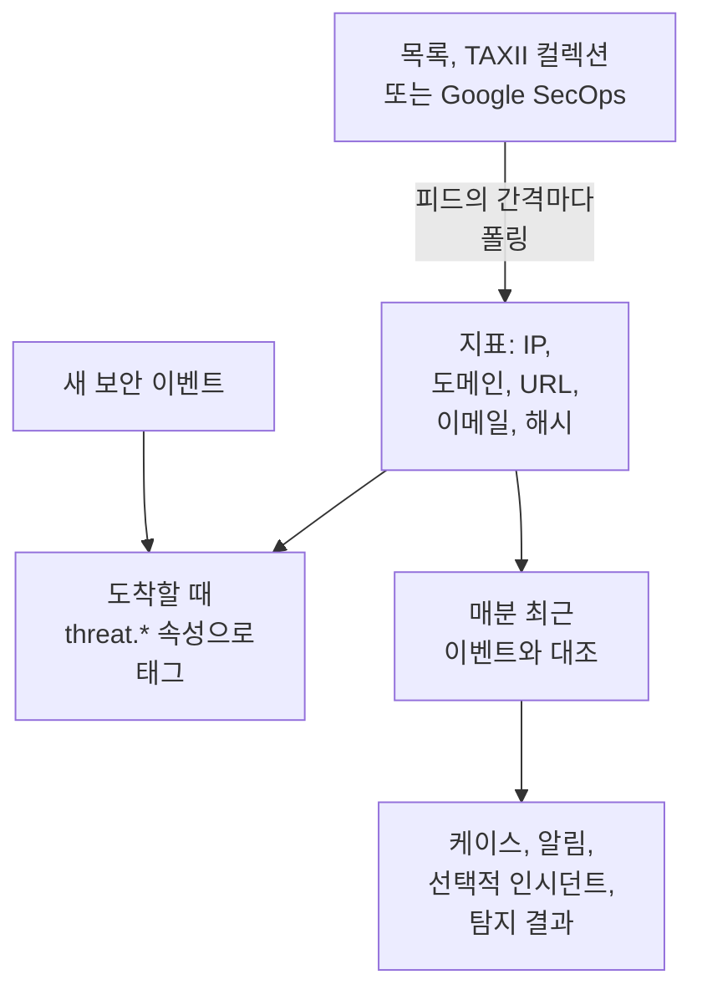

# 위협 인텔리전스(STIX/TAXII)

위협 인텔리전스 피드는 알려진 악성 IP 주소, 도메인, URL, 이메일 주소, 파일 해시를 OneUptime으로 가져와, 여러분의 [보안 이벤트](/docs/telemetry/security-events) 가 그중 하나를 언급하면 알려 줍니다. 피드는 소스 하나를 읽습니다. OneUptime이 클릭 한 번으로 추가하는 무료 목록처럼 https 주소에 있는 지표 목록, 직접 운영하는 MISP, OpenCTI, OpenTAXII 서버나 공급자의 STIX 2.1 지표를 담은 TAXII 2.1 컬렉션, 또는 Google SecOps가 여러분의 이벤트에서 찾은 지표입니다.

:::cards
- [무료 목록 추가하기](#무료-목록-추가하기): Feodo Tracker, Emerging Threats, Tor 출구 노드를 클릭 한 번으로.
- [피드 구독하기](#피드-구독하기): 목록의 주소, TAXII 컬렉션, 또는 Google SecOps 연결.
- [수집되는 것](#수집되는-것): OneUptime이 보관하는 지표 패턴과 보관 기간.
- [일치를 찾는 방법](#일치를-찾는-방법): 이벤트가 도착할 때 태그하고, 매분 대조합니다.
- [위협 수준](#위협-수준): 지표의 confidence가 심각도가 되는 방식.
:::

## 작동 방식



## 시작하기 전에

- 목록이라면 한 줄에 지표 하나씩 적힌 텍스트 파일을 내려받는 `https` 주소.
- TAXII 피드라면 STIX 2.1 `indicator` 객체를 게시하는 TAXII 2.1 서버와, 폴링할 컬렉션의 ID. TAXII 피드는 익명, bearer 토큰, 또는 HTTP Basic 인증으로 로그인합니다.
- Google SecOps 피드라면 서비스 계정이 지표 일치를 검색할 수 있는 [Google SecOps 연결](/docs/integrations/google-secops#관리형-커넥터-설정). `roles/chronicle.viewer` 역할이면 검색할 수 있습니다.
- CISA AIS처럼 TLS 클라이언트 인증서(상호 TLS)를 요구하는 서버는 지원하지 않습니다. MITRE의 공개 ATT&CK 서버는 지표가 아니라 기법과 그룹을 게시하므로, 그 서버를 가리키는 피드는 비어 있게 됩니다.
- 피드를 만들 수 있는 역할: Project Owner, Project Admin, Security Admin, Security Member. Security Viewer는 피드와 지표를 읽을 수 있습니다. [역할](/docs/permissions/reference#역할) 을 참고하세요.

## 무료 목록 추가하기

**위협 인텔리전스** 의 **무료 목록** 카드는 무료 차단 목록을 클릭 한 번으로 추가합니다. 목록에서 **목록 추가** 를 클릭하면 OneUptime이 목록의 일정대로 그 목록을 내려받는 피드를 만듭니다. 프로젝트가 이미 읽고 있는 목록에는 **추가됨** 이 표시됩니다.

| 목록 | 게시자 | 읽기 | 신뢰도 | 일치하면 여는 것 |
| --- | --- | --- | --- | --- |
| Feodo Tracker 봇넷 C2 서버 | abuse.ch | 매시간 | 90, Critical | 케이스와 알림 |
| Emerging Threats 침해된 호스트 | Proofpoint Emerging Threats | 매일 | 70, High | 케이스와 알림 |
| Tor 출구 노드 | The Tor Project | 매시간 | 30, Low | 케이스 |

목록의 타일에는 이용 약관 링크가 있습니다. Feodo Tracker는 어떤 용도로든 무료이며(CC0), Emerging Threats 목록은 BSD 라이선스입니다. 목록에서 추가한 피드도 다른 피드처럼 편집하고 삭제합니다.

## 피드 구독하기

:::steps
### Threat Intel로 이동하기

**제품 → Security Events → 탐지 → 위협 인텔리전스** 을 엽니다.

### 피드 만들기

**위협 인텔리전스 피드 만들기** 를 클릭하고 **소스** 로 **지표 목록**, **TAXII 컬렉션**, **Google SecOps** 중 하나를 고릅니다. 다음 단계는 그 소스에 필요한 것만 묻습니다. 목록이면 **목록 URL**, 컬렉션이면 **TAXII 서버** 와 **로그인**, Google SecOps면 **Google SecOps 연결** 입니다. **일치 시** 는 마지막입니다. 필드는 아래 표에 있습니다.

### 첫 폴링 확인하기

1~2분 안에 피드 행에 **마지막 폴링** 가 표시되고, **마지막 폴링 요약** 가 폴링으로 가져온 내용을 알려 줍니다. 지표는 피드 아래의 **지표** 표에 나타납니다.
:::

| 필드 | 입력할 내용 |
| --- | --- |
| **소스** | 지표를 가져오는 곳. 피드를 만들 때 정해지며, 다른 소스의 피드는 새 피드입니다. |
| **목록 URL** | 목록이라면: 한 줄에 IP 주소, 도메인, URL, 파일 해시 하나씩 적힌 텍스트 파일의 `https` 주소. |
| **신뢰도** | 목록이라면: 목록의 확실성으로, 1~100입니다. 목록의 모든 지표가 이 값을 받으며, 이 값이 [위협 수준](#위협-수준) 을 정합니다. 비워 두면 Medium입니다. |
| **Google SecOps 연결** | Google SecOps라면: Google SecOps가 찾은 지표를 키로 읽는 연결. 연결이 없으면 **Google SecOps 연결** 이 **연결** 을 엽니다. |
| **TAXII API 루트 URL** | 서버의 TAXII 2.1 API 루트. 예: `https://taxii.example.com/api1/`. 컬렉션은 그 아래에서 주소가 지정됩니다. |
| **컬렉션 ID** | 지표를 게시하는 컬렉션. |
| **폴링 간격(분)** | 소스를 읽는 빈도. 1~1440분이며 기본값은 60입니다. 목록은 많아야 15분마다 한 번 읽습니다. |
| **최소 신뢰도** | TAXII 컬렉션이나 Google SecOps라면: confidence가 이보다 낮은 지표는 건너뜁니다. 0~100이며, 0이면 모두 남깁니다. confidence가 없는 지표는 항상 통과합니다. |
| **로그인** | OneUptime의 로그인 방식입니다. 공개 컬렉션에는 **로그인 없음**, 서버 운영자에게 받은 토큰에는 **Bearer 토큰**, HTTP Basic 인증에는 **사용자 이름과 비밀번호** 를 고릅니다. |
| **API 토큰**, **Basic Auth 사용자 이름**, **Basic Auth 비밀번호** | 고른 로그인 방식에 필요한 것만 묻습니다. |
| **일치 시 케이스 열기** | 기본적으로 켜짐: 지표가 들어 있는 이벤트마다 그 지표에 관한 [케이스](/docs/telemetry/security-cases) 를 열거나, 이미 그 지표에 관해 열려 있는 케이스에 합류합니다. |
| **알림 및 인시던트** | 기본값은 **알림 생성**: 일치한 지표마다 알림을 엽니다. |
| **알림 심각도** | 이 피드가 여는 모든 알림의 심각도. 비워 두면 각 지표의 위협 수준을 사용합니다. |
| **인시던트 선언** 또는 **둘 다** | **알림 및 인시던트** 에 있습니다. 인시던트는 온콜 에스컬레이션, SLA, 상태 페이지를 움직이며, 지표 일치에는 보통 알림으로 충분합니다. |
| **인시던트 심각도** | **알림 심각도** 와 같으며, 인시던트용입니다. |
| **일치 시 Detection Finding 기록** | 기본적으로 켜짐: 일치할 때마다 이벤트 스트림에 탐지 결과를 기록합니다. |

TAXII 피드의 토큰과 비밀번호는 암호화되며, 저장한 뒤에는 다시 표시되지 않습니다. 바꾸려면 피드 행에서 **자격 증명 업데이트** 를 고른 뒤 **Bearer 토큰**, **사용자 이름과 비밀번호**, 저장된 것을 지우는 **로그인 없음** 중 하나를 선택하세요. 선택한 것이 피드의 로그인 방식을 대체하므로, 토큰을 저장하면 저장된 비밀번호가 지워지고 그 반대도 마찬가지입니다.

### 피드를 폴링하는 방식

각 폴링은 TAXII의 `added_after` 커서로 이전 폴링 이후 추가된 객체를 요청하고, 객체 500개짜리 페이지를 최대 10페이지까지 읽습니다. 그래서 큰 컬렉션은 여러 번의 폴링에 걸쳐 동기화되며, 남은 페이지가 있으면 **마지막 폴링 요약** 가 알려 줍니다. 큰 첫 동기화를 더 빨리 끝내려면 따라잡을 때까지 **폴링 간격(분)** 을 최소 1까지 낮추세요.

폴링은 사용자 에이전트 `OneUptime/<version> (+https://oneuptime.com)` 로 자신을 밝힙니다. 공급자의 방화벽이 `403` 을 반환하면 이 에이전트를 허용해 달라고 요청하세요. 많은 방화벽이 이름 없는 스크립트처럼 보이는 요청을 차단합니다.

비활성화된 피드는 폴링도 대조도 하지 않습니다. 이미 가진 지표는 만료될 때까지 새 이벤트에 계속 태그를 붙입니다.

### 목록을 읽는 방식

- 폴링할 때마다 목록 전체를 내려받아 한 줄씩 읽습니다. 각 줄의 첫 번째 값을 공백, 탭, 쉼표, 세미콜론 앞까지 읽습니다. `#`, `;`, `//` 로 시작하는 줄은 주석이고, 주소나 도메인 뒤의 포트는 떼어 내며, `198.51.100.0/24` 같은 주소 범위는 건너뜁니다.
- 값은 마지막으로 그 값을 읽은 폴링 후 2일 동안 활성 지표로 남고, 목록에서 빠진 값은 다음 폴링부터 일치하지 않습니다. 바뀌지 않은 목록도 하루에 한 번 다시 기록됩니다.
- 목록 하나에는 지표가 최대 50,000개 들어갑니다. **마지막 폴링 요약** 가 읽은 개수, 건너뛴 줄 수, 제외된 개수를 알려 줍니다.
- 주소는 `https` 를 써야 하며 연결과 같은 아웃바운드 규칙을 따릅니다. OneUptime Cloud에서는 사설 주소가 거부됩니다.

### Google SecOps를 읽는 방식

- 폴링할 때마다 이전 폴링 이후 Google SecOps가 기록한 지표 일치를 Mandiant의 속성과 함께 읽습니다. 일치한 도메인, 주소, 파일 해시와 그 신뢰도, 카테고리, 관련된 캠페인과 행위자입니다. 첫 폴링은 최근 7일을 읽습니다.
- 지표는 Google SecOps가 마지막으로 본 뒤 30일 동안, 또는 소스가 더 이상 활성이 아니라고 할 때까지 활성 상태이며, 분석가가 Google SecOps에서 음소거한 지표는 여기서도 더 이상 일치하지 않습니다.
- Google SecOps가 활성 침해로 표시한 일치는 Critical이고, 우선순위가 높은 일치는 최소 High입니다.

## 수집되는 것

TAXII 컬렉션에서 OneUptime은 패턴이 다음 유형 중 하나에 대한 단순한 동등 비교인 STIX `indicator` 객체를 보관합니다. 목록과 Google SecOps도 같은 유형을 제공합니다.

| 유형 | 패턴 예 |
| --- | --- |
| IPv4 주소(`ipv4-addr`) | `[ipv4-addr:value = '198.51.100.7']` |
| IPv6 주소(`ipv6-addr`) | `[ipv6-addr:value = '2001:db8::7']` |
| 도메인 이름(`domain-name`) | `[domain-name:value = 'evil.example']` |
| URL(`url`) | `[url:value = 'http://evil.example/payload']` |
| 이메일 주소(`email-addr`) | `[email-addr:value = 'billing@evil.example']` |
| 파일 해시, SHA-256(`file-hash-sha256`) | `[file:hashes.'SHA-256' = 'e3b0…b855']` |
| 파일 해시, SHA-1(`file-hash-sha1`) | `[file:hashes.'SHA-1' = 'da39…0709']` |
| 파일 해시, MD5(`file-hash-md5`) | `[file:hashes.MD5 = 'd41d…427e']` |

`OR` 로 이은 비교는 `[...]` 하나 안에서든 여러 개에 걸쳐서든 괜찮으며, 각 값이 별개의 지표가 됩니다.

```text
[domain-name:value = 'evil.example' OR domain-name:value = 'evil2.example']
[ipv4-addr:value = '198.51.100.7'] OR [url:value = 'http://evil.example/x']
```

그 밖의 패턴, 즉 `AND`, `FOLLOWEDBY`, `NOT`, `LIKE`, `MATCHES`, `WITHIN` 같은 시간 한정자, 또는 다른 객체 유형이 들어간 패턴은 통째로 건너뛰고 **마지막 폴링 요약** 에서 지원하지 않는 것으로 셉니다. `AND` 패턴의 일부만 변환하면 피드 작성자가 의도한 것보다 훨씬 많이 일치하기 때문입니다.

### 지표가 활성 상태로 남는 기간

- 지표는 `valid_from` 부터 `valid_until` 까지 일치합니다. `valid_until` 이 없으면 `valid_from` 부터 365일 동안 활성 상태이며, 다시 폴링해도 연장되지 않습니다.
- 철회된 지표나 과거의 `valid_until` 로 업데이트된 지표는 그 업데이트를 폴링하는 즉시 일치하지 않게 됩니다. 공급자가 업데이트된 패턴에서 뺀 값도 마찬가지입니다.
- 값은 소문자로 저장되며, 대소문자에 관계없이 일치합니다.

**지표** 표는 저장된 그대로의 지표를 **활성**, **만료됨**, **취소됨** 중 하나인 **상태** 와 함께 나열합니다. 다시 폴링한 지표는 한동안 두 번 보일 수 있고, 만료되거나 철회된 행은 저장소 정리로 제거될 때까지, 만료 후 최대 약 한 달 동안 목록에 남습니다. 대조할 때는 항상 유효 기간과 철회 여부를 확인하므로, 그런 행이 일치하는 일은 없습니다.

## 일치를 찾는 방법

### 이벤트가 도착할 때 태그하기

수집 API나 연결에서 들어오는 모든 보안 이벤트는 저장되기 전에 활성 지표와 대조됩니다. 이벤트의 observable(이벤트에서 뽑아낸 IP, 호스트, 도메인, 해시, 사용자) 중 하나가 지표의 값과 같으면, 이벤트에 다음 속성이 붙습니다.

| 속성 | 값 |
| --- | --- |
| `threat.matched` | 태그된 이벤트에서는 항상 `"true"` |
| `threat.indicator_id` | STIX 지표의 ID, 또는 그 소스라면 `list` 나 `google-secops` |
| `threat.indicator_type` | 지표의 유형. 예: `ipv4-addr` 또는 `file-hash-sha256` |
| `threat.indicator_value` | 일치한 값(소문자) |
| `threat.feed` / `threat.feed_id` | 지표를 가져온 피드 |
| `threat.confidence` | 지표의 STIX confidence |
| `threat.match_count` | 이벤트의 observable 중 지표와 일치한 수 |

여러 지표가 한 이벤트와 일치하면, confidence가 가장 높은 지표가 이 값들을 채웁니다. 일반 속성이므로 **이벤트** 에서 검색하고, 보안 이벤트 모니터를 필터링하고, 탐지 규칙에서 사용할 수 있습니다.

```yaml title="threat-intel-logon.yml"
title: High-confidence indicator in a successful logon
level: critical
detection:
  selection:
    threat.matched: 'true'
    threat.confidence|gte: 80
    className: Authentication
    statusName: Success
  condition: selection
```

태그는 이벤트가 도착한 시점에 있는 지표만 압니다. 이벤트에 나중에 다시 태그를 붙이는 일은 없습니다.

### 매분 대조하기

매분, 활성화된 각 피드의 활성 지표를 이벤트 시각이 그 피드의 이전 확인 이후인 이벤트와 대조합니다. 이렇게 하면 이벤트가 태그된 뒤에 도착한 인텔리전스도 잡아냅니다.

- 첫 확인은 최근 15분을 대상으로 합니다. 장애가 있었다면 다음 확인이 최대 최근 24시간까지 따라잡습니다.
- 각 윈도우는 한 번만 확인합니다. 윈도우가 확인된 뒤 도착한 인텔리전스는 그 이후의 이벤트에만 적용됩니다.
- 이전 확인보다 앞선 시각을 달고 늦게 도착한 이벤트는 도착할 때 태그는 되지만 대조되지는 않습니다.
- 각 확인은 일치한 모든 지표 값을 Detection Finding으로 기록하며, 피드마다 최대 10,000개입니다. 알림, 인시던트, 케이스는 가장 많은 이벤트에서 보인 100개 값에 대해 열리고, 나머지는 피드에 관한 케이스 하나를 함께 씁니다. 피드의 **마지막 일치 오류** 에 일치한 수가 표시됩니다.

### 일치하면 일어나는 일

- 제목이 `[Threat Intel] <feed name> — <indicator value>` 인 알림. 열려 있는 동안에는 피드와 값마다 하나입니다. 해결되면 다음 일치가 새 알림을 엽니다. 알림은 자동으로 해결되지 않습니다.
- 인시던트. **알림 및 인시던트** 가 **인시던트 선언** 또는 **둘 다** 인 경우에만 열리며, 같은 방식으로 중복이 제거됩니다.
- Threat Intel 탐지 결과. **일치 시 Detection Finding 기록** 을 켠 경우, 제품 `OneUptime Threat Intel` 에서 나온 `Detection Finding` 이벤트(OCSF 클래스 2004)가 지표의 위협 수준을 심각도로 삼아 다음 속성과 함께 기록됩니다.

| 속성 | 값 |
| --- | --- |
| `oneuptime.threat.feed_id` / `oneuptime.threat.feed_name` | 피드 |
| `oneuptime.threat.indicator_id` | STIX 지표의 ID, 또는 그 소스라면 `list` 나 `google-secops` |
| `oneuptime.threat.indicator_type` / `oneuptime.threat.indicator_value` | 일치한 것 |
| `oneuptime.threat.confidence` | 지표의 confidence |
| `oneuptime.threat.match_count` | 이 탐지 결과의 근거가 된 이벤트 수 |

탐지 결과 자체는 대조되지 않으므로, 일치 하나가 다른 일치를 일으키는 일은 없습니다.

## 위협 수준

지표에는 Sigma 수준이 없습니다. 대신 STIX `confidence` 가 위협 수준을 정합니다.

| 지표의 confidence | 위협 수준 |
| --- | --- |
| 90~100 | Critical |
| 70~89 | High |
| 40~69 | Medium |
| 1~39 | Low |
| 점수 없음(0 또는 누락) | Medium |

점수가 없는 지표는 Medium으로 칩니다. 그래도 누군가 그 지표를 피드에 넣기로 했기 때문입니다. 위협 수준은 탐지 결과의 심각도이며, 알림의 심각도를 프로젝트의 심각도 중에서 다음 순서로 고릅니다.

1. 설정되어 있다면 피드의 **알림 심각도**(또는 **인시던트 심각도**). 피드에서 나온 모든 일치에 적용됩니다.
2. 위협 수준과 같은 이름을 가진 여러분의 심각도. 예를 들어 High이며, 대소문자는 가리지 않습니다.
3. 순위에 따라: Critical과 High는 가장 무거운 심각도를, Medium과 Low는 가장 가벼운 심각도를 받습니다.

위협 수준은 피드가 아니라 각 지표에 속하므로, 피드 하나가 같은 분에 Critical 알림과 Low 알림을 함께 열 수도 있습니다. **최소 신뢰도** 는 같은 숫자로 필터링합니다. 최솟값을 70으로 하면 High와 Critical 지표, 그리고 항상 통과하는 점수 없는 지표만 남습니다.

## 피드의 일치 지켜보기

피드 행의 **모니터 생성** 동작은 그 피드의 탐지 결과를 세는 새 보안 이벤트 모니터를 엽니다. 이벤트 클래스는 `Detection Finding` 이고, `oneuptime.threat.feed_id` 의 피드 ID(이름을 바꾸면 달라지는 이름은 쓰지 않음)로 필터링하며, 대상은 최근 한 시간입니다. 일치가 갑자기 몰릴 때나, 활발하던 피드가 조용해질 때를 알아차리는 데 쓰세요.

## 보존과 청구

지표는 텔레메트리가 아니라 구성이므로, 수집된 데이터로 청구되지 않습니다. 일치가 기록하는 탐지 결과는 일반 보안 이벤트이며, 나머지와 똑같이 청구되고 보관됩니다. [보안 이벤트](/docs/telemetry/security-events#보존과-청구) 를 참고하세요.

## 문제 해결

:::details 폴링 후 Last Error가 설정됨
`401` 또는 `403`: 자격 증명이 틀렸거나 없습니다. **자격 증명 업데이트** 로 바꾸세요. `403` 은 공급자의 방화벽이 사용자 에이전트를 차단하는 경우일 수도 있습니다. `404`: 보통 `/api1/` 같은 경로로 끝나는 **TAXII API 루트 URL** 과 **컬렉션 ID** 를 확인하세요. 다음 폴링이 성공하면 오류가 사라집니다.
:::

:::details 피드는 폴링되지만 지표가 나타나지 않음
**마지막 폴링 요약** 을 읽어 보세요. 가져온 객체 없음: 컬렉션이 비어 있거나 지표를 게시하지 않습니다. 지원하지 않는 패턴: 공급자가 이 페이지에서 건너뛴다고 설명한 패턴 기능을 쓰고 있습니다. 최소 confidence 미만: **최소 신뢰도** 를 낮추세요. 이미 비활성: 공급자가 이미 철회되었거나 만료된 지표를 보냈습니다.
:::

:::details 지표는 있는데 아무것도 일치하지 않음
대조는 지표의 값을 이벤트의 모든 필드가 아니라 observable과 비교합니다. 일치할 것으로 예상한 이벤트를 **이벤트** 에서 열어, 그 observable에 값이 들어 있는지 확인하세요. 상태가 **활성** 인 지표만 일치합니다. 피드의 **상태** 가 **매칭 실패** 이면 그 행의 **오류 보기** 에서 이유를 확인할 수 있습니다.
:::

:::details 목록 피드의 마지막 오류에 주소가 웹 페이지로 응답했다고 나옴
**목록 URL** 이 목록이 아니라 로그인 페이지나 오류 페이지 같은 페이지를 엽니다. 브라우저에서 열어 파일 자체의 주소를 복사하세요. IP 주소, 도메인, URL, 파일 해시가 하나도 없는 목록도 같은 방식으로 거부되며, 피드의 지표는 그대로 유지됩니다.
:::

:::details Google SecOps 피드의 마지막 오류에 HTTP 403이 나옴
연결의 서비스 계정이 지표 일치를 검색할 수 없습니다. `roles/chronicle.viewer` 를 부여하세요. 연결이 삭제되었으면 피드에 그렇게 표시되니, 피드를 편집해 다른 **Google SecOps 연결** 을 고르세요.
:::

:::details 일치했는데 알림이 열리지 않음
**알림 및 인시던트** 가 **인시던트 선언** 또는 **둘 다 아님** 으로 설정되어 있거나, 같은 피드와 값의 알림이 아직 열려 있어 이후 일치가 그 알림에 합쳐지고 있습니다. 피드가 알림을 열려면 프로젝트에 알림 심각도가 하나 이상 있어야 합니다.
:::

## 다음 단계

:::cards
- [보안 이벤트](/docs/telemetry/security-events): 이벤트를 보내고, 검색하고, 탐지 규칙을 작성합니다.
- [Google SecOps](/docs/integrations/google-secops): Chronicle의 탐지와 이벤트를 가져옵니다.
- [권한 레퍼런스](/docs/permissions/reference): Security 역할과 각 역할이 할 수 있는 일.
:::
