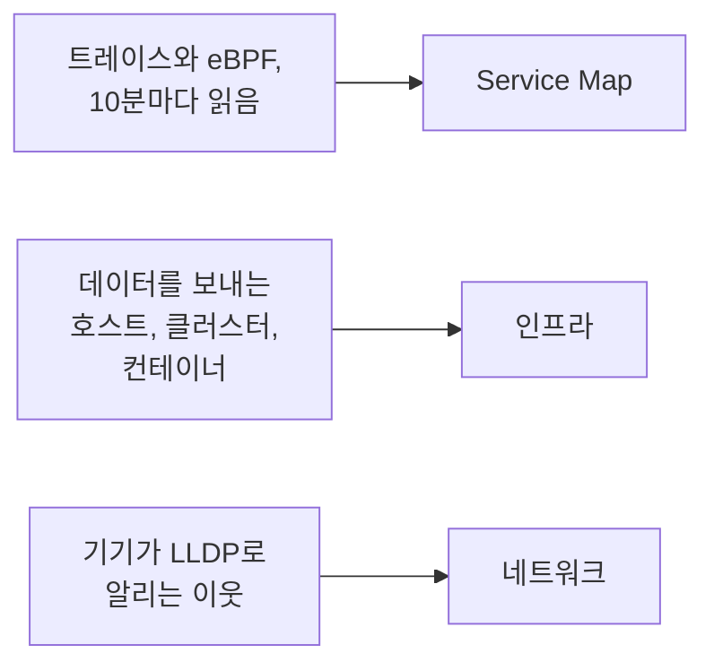

# 토폴로지

토폴로지는 시스템이 어떻게 연결되어 있는지 그립니다. 어떤 서비스가 어떤 서비스를 호출하는지, 무엇이 어디에서 실행되는지, 네트워크 장치가 어떻게 연결되어 있는지입니다. OneUptime은 이미 보내고 있는 텔레메트리로 토폴로지를 만들기 때문에 손으로 그릴 것이 없으며, 오류와 인시던트가 어디에 있는지 한눈에 보여 줍니다.

:::cards
- [토폴로지 열기](#토폴로지-열기): 한 페이지의 세 가지 보기.
- [서비스 맵 읽기](#서비스-맵-읽기): 누가 누구를 호출하는지, 그 호출이 얼마나 건강한지.
- [인프라 살펴보기](#인프라-살펴보기): 각 서비스가 실행되는 곳.
- [리소스별 지도 열기](#리소스별-지도-열기): vCenter, 클러스터, 호스트 하나를 자세히.
- [네트워크 보기](#네트워크-보기): 장치와 그 연결을 실시간으로.
:::

## 맵을 만드는 방식

토폴로지의 각 보기는 서로 다른 종류의 텔레메트리로 만들어집니다.

- **활성 상태였던 것만 그립니다.** 보기에는 시간 범위 안에 데이터를 보낸 서비스와 리소스, 그리고 그 범위에서 관찰된 연결이 표시됩니다. 조용했던 것까지 그리려면 **비활성 항목 표시** 옵션을 켭니다.
- **호출은 최근 구간을 기준으로 셉니다.** OneUptime은 10분마다 서비스 간 호출을 찾고, 트래픽 수치는 전체 시간 범위가 아니라 최근 15분을 기준으로 합니다.
- **네트워크 보기는 실시간입니다.** 지금 연결된 그대로 장치를 보여 주므로 시간 범위가 없습니다.

## 시작하기 전에

- **들어오는 텔레메트리.** 서비스 맵에는 트레이스가 필요합니다. [OpenTelemetry](/docs/telemetry/open-telemetry)를 참고하세요. 인프라 보기에는 데이터를 보내는 호스트나 클러스터가 필요합니다. [Kubernetes 에이전트](/docs/telemetry/kubernetes-agent)를 참고하세요. 네트워크 보기에는 네트워크 장치가 필요합니다. [네트워크 장치 모니터](/docs/monitor/network-device-monitor)를 참고하세요.
- **텔레메트리를 읽는 역할.** Project Owner, Project Admin, Project Member, Viewer, Telemetry Admin, Telemetry Member, Telemetry Viewer, 또는 Read Telemetry Service 권한이 있는 사용자 지정 역할입니다.

## 토폴로지 열기

**제품 → 관측 가능성 → 토폴로지**로 이동합니다. **인벤토리 → Topology Map** 메뉴도 같은 페이지를 엽니다. 페이지는 **지난 1일** 범위의 **Service Map** 화면으로 열립니다.

| 보기 | 답하는 질문 |
| --- | --- |
| **Service Map** | 어떤 서비스가 서로 의존하나요? |
| **인프라** | 인프라의 어디에서 무엇이 실행되나요? |
| **네트워크** | 네트워크 장치는 어떻게 연결되어 있나요? |

시간 선택기 옆의 **비활성 항목 표시** 옵션은 범위 안에 데이터를 보내지 않은 것까지 추가하고, 새로 고침 버튼은 보기를 다시 불러옵니다. **표시 내용 · 이 데이터 정보** 항목은 보기가 무엇을 그리고 얼마나 자주 계산되는지 설명합니다. 주소 표시줄이 현재 보기를 기억하므로, 공유한 링크도 같은 보기를 엽니다.

## 서비스 맵 읽기

**Service Map** 화면은 데이터를 보낸 모든 서비스와, 그 서비스가 호출하는 데이터베이스, API, 메시지 브로커를 그립니다. 이들이 자체 텔레메트리를 보내지 않아도 마찬가지입니다. 화살표는 호출하는 쪽에서 호출받는 쪽을 가리키며, 선이 두꺼울수록 요청이 많습니다. 위쪽의 수치는 그려진 서비스, 의존성, 연결의 수와 그중 확인이 필요한 수를 알려 줍니다.

각 서비스에는 최근 15분 동안 받은 호출로 계산한 상태가 표시됩니다.

| 상태 | 조건 |
| --- | --- |
| **정상** | 받은 호출 중 실패한 비율이 1% 이하입니다. |
| **Some errors** | 1% 초과 5% 미만이 실패했습니다. |
| **High error rate** | 5% 이상이 실패했습니다. |
| **Entry point** | 호출을 받지는 않았지만 호출은 했습니다. 웹 프런트엔드나 예약된 작업이 그 예입니다. |
| **No calls observed** | 호출을 하지도 받지도 않았습니다. |

활성 인시던트나 알림이 있는 서비스는 대신 그 수를 표시하며, **Some errors** 또는 **High error rate** 상태인 서비스처럼 확인이 필요한 것으로 셉니다.

:::steps
### 확인이 필요한 서비스 찾기

**확인 필요**를 클릭하면 해당 서비스와 그 직접 연결만 남습니다. 또는 맵 위의 상자에서 이름으로 검색합니다.

### 서비스 열기

서비스를 클릭하면 최근 15분의 요청, 오류, 평균 지연 시간과 **활성 인시던트** 및 **활성 알림**, 그리고 **이 서비스의 트레이스** 링크와 **인벤토리 세부 정보** 링크가 표시됩니다.

### 연결 열기

화살표를 클릭하면 요청 비율, 오류율, 평균 지연 시간이 표시됩니다. 직접 계측한 두 서비스 사이의 연결에는 호출, 오류, 지연 시간의 **History** 탭도 있습니다.
:::

**연결 레이블** 옵션은 각 화살표에 수치를 씁니다. **요청 비율**, **오류율**, **평균 지연 시간** 중 하나이며, 포인터를 올리기 전까지 아무것도 쓰지 않을 수도 있습니다. **테이블**에는 같은 서비스가 **요청**, **오류율**, **평균 지연 시간**, **연결** 값과 함께 나열되며, **지도에 표시** 버튼으로 그중 하나를 맵에 그립니다.

## 인프라 살펴보기

**인프라** 보기는 서비스가 실행되는 곳을 보여 줍니다. 클러스터, 호스트, 파드, 컨테이너, 그리고 데이터를 보내는 그 밖의 리소스입니다. 같은 워크로드의 복제본은 하나의 항목으로 묶이며, 무엇이든 열어서 안을 볼 수 있습니다.

- **원하는 방식으로 둘러보세요.** **목록** 또는 **지도** 형태로, 전체 인프라부터 파드 하나까지 볼 수 있습니다. 위쪽의 수치는 그려진 리소스와 워크로드의 수, 배치할 수 있는 서비스의 수, 제외된 조용한 리소스의 수를 알려 줍니다.
- **리소스를 찾으세요.** 이름으로 검색하고 **세부 정보 보기** 버튼을 클릭하면 해당 페이지가 열립니다.
- **보기 사이를 오가세요.** 리소스에 표시된 서비스는 **Service Map** 화면에서 열리고, 서비스가 실행되는 리소스는 **인프라** 보기에서 열립니다.

## 리소스별 지도 열기

vCenter, Kubernetes 클러스터, 호스트, Docker 또는 Podman 호스트, Docker Swarm·Proxmox·Ceph 클러스터, 스토리지 어레이에는 각각 고유한 **토폴로지** 페이지가 있습니다. 이 페이지는 해당 리소스를 자체 인벤토리로부터 자세히 그립니다. 무엇이 무엇 안에 있는지, 각 부분의 상태를 색으로, 열린 인시던트와 알림은 각각 해당 부분에 표시합니다.

- **트리처럼 읽으세요.** 리소스는 맨 위에 있고, 각 부분의 하위 부분은 그 오른쪽에 그려지며 선으로 연결됩니다. 확인이 필요한 것이 있는 쪽의 선은 빨간색이나 주황색으로 바뀝니다. 문제가 있는 부분은 저절로 열리고, 부분의 둥근 버튼으로 열거나 닫을 수 있으며, 화살표 키로 지도 안을 이동할 수 있습니다.
- **확인이 필요한 것을 찾으세요.** **확인 필요**는 문제가 있는 부분과 그곳까지의 경로만 남기며, 검색으로 리소스 어디에 있는 부분이든 찾을 수 있습니다.
- **더 자세히 보세요.** 부분을 클릭하면 그것이 무엇인지와 해당 페이지 링크가 표시되고, **여기에 집중**을 클릭하면 그 부분과 그 안에 있는 것, 관련된 것만 그립니다.
- **양방향으로 오가세요.** **토폴로지에서 열기**는 리소스를 **인프라** 보기에서 열고, 거기서 **vCenter 토폴로지 열기**, **클러스터 토폴로지 열기**, **호스트 토폴로지 열기** 또는 **스토리지 어레이 토폴로지 열기** 버튼으로 돌아올 수 있습니다.

## 네트워크 보기

**네트워크** 보기는 네트워크 장치의 실시간 맵입니다. 장치가 LLDP로, Cisco 장치에서는 CDP로 알리는 이웃 정보로 만들어집니다. 시간 선택기가 없으며, 연결은 저절로 새로 고쳐집니다.

장치를 사이트로 묶어 두었다면 보기는 사이트 목록으로 열립니다. 사이트 하나를 고르거나 **All devices** 보기로 전환합니다. **Map options** 메뉴는 맵의 배치와 포함할 항목을 정하고, **PDF 내보내기**는 보고 있는 맵을 저장합니다. 네트워크 장치 페이지에도 같은 맵이 그려집니다. [네트워크 토폴로지](/docs/monitor/network-device-monitor#네트워크-토폴로지)를 참고하세요.

## 문제 해결

:::details 서비스 맵에 서비스는 보이지만 연결이 없습니다
OneUptime은 10분마다 트레이스에서 서비스 간 호출을 찾습니다. OpenTelemetry의 HTTP와 gRPC 계측처럼 요청이 트레이스 컨텍스트, 즉 `traceparent` 헤더를 계측된 서비스에서 다음 서비스로 전달할 때, 서비스가 호출하는 데이터베이스와 API에 대한 클라이언트 스팬을 보고할 때, 또는 Kubernetes 에이전트가 eBPF와 함께 실행될 때 호출을 인식합니다.
:::

:::details 제거한 서비스가 아직 맵에 있습니다
그 서비스는 시간 범위 안에 데이터를 보냈습니다. 더 짧은 범위를 고르거나, 마지막 텔레메트리가 범위 밖으로 벗어날 때까지 기다리세요. **비활성 항목 표시** 옵션이 켜져 있으면 데이터 전송을 멈춘 것도 맵에 그려집니다.
:::

:::details 맵의 일부만 표시된다는 안내가 나옵니다
아주 큰 프로젝트는 맵의 한도에 도달하며, 표시 중인 리소스나 연결의 수를 알려 주는 안내가 나옵니다. 서비스를 검색하거나 테이블의 **지도에 표시** 버튼을 써서 읽을 수 있는 일부를 그리세요.
:::

## 다음 단계

:::cards
- [서비스 카탈로그](/docs/telemetry/services): 서비스 하나에 관한 모든 것.
- [트레이스 탐색기](/docs/telemetry/traces-explorer): 각 화살표 뒤에 있는 요청.
- [인벤토리 개요](/docs/inventory/overview): 맵이 그리는 모든 리소스.
- [네트워크 장치 모니터](/docs/monitor/network-device-monitor): 네트워크를 맵에 올립니다.
:::
