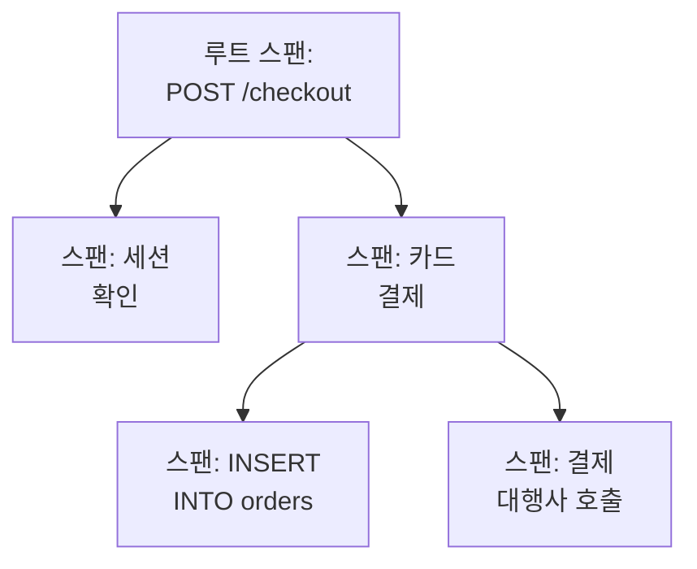

# 트레이스 탐색기

트레이스 탐색기는 서비스를 거쳐 간 요청을 찾아 줍니다. 느린 요청, 실패한 요청, 특정 고객의 계정을 건드린 요청 같은 것입니다. 서비스가 보내는 스팬을 검색하고 필터링한 다음, 트레이스를 열어 요청의 모든 단계를 워터폴, 플레임 그래프, 서비스 맵으로 확인하세요.

:::cards
- [요청 찾기](#요청-찾기): 스팬을 검색한 다음 서비스, 상태, 종류로 필터링합니다.
- [트레이스 읽기](#트레이스-읽기): 시간이 어디에 쓰였고 어느 단계가 실패했는지.
- [스팬 차트 그리기](#스팬-차트-그리기): 원하는 방식으로 그룹화한 요청 수와 응답 시간.
- [트레이스 인사이트](#트레이스-인사이트): 오류율, 지연 시간, 가장 느린 요청.
- [AI로 느리거나 실패하는 작업 찾아 수정하기](#ai로-느리거나-실패하는-작업-찾아-수정하기): 이를 수정하고 트레이스에 부족한 트레이싱을 추가하는 풀 리퀘스트.
:::

## 트레이스와 스팬

트레이스는 시스템을 지나가는 요청 하나입니다. HTTP 핸들러, 데이터베이스 쿼리, 다른 서비스 호출처럼 요청이 거치는 각 단계가 스팬이며, 스팬은 자신을 시작한 스팬 안에 중첩됩니다. 부모가 없는 트레이스의 첫 스팬이 루트 스팬이고, 요청의 진입점입니다.

탐색기의 각 행은 스팬입니다. 기본적으로 목록에는 요청이나 메시지가 서비스로 들어오는 스팬인 **Entry spans**가 표시되므로, 하나의 요청은 도달한 서비스마다 한 번씩 나타나고 데이터베이스 쿼리와 내부 호출은 목록에서 제외됩니다. 요청마다 한 행만 보려면 사이드바의 **스팬 유형**에서 **Root spans**를 고르고, 모든 작업을 보려면 **All spans**를 고릅니다.

탐색기에는 다섯 개의 탭이 있습니다.

| 탭 | 용도 |
| --- | --- |
| **뷰어** | 스팬을 검색하고 필터링하고, 그 트레이스를 엽니다. 지난 한 시간의 스팬을 최신순으로, 페이지당 50개씩 보여 주며 열립니다. |
| **인사이트** | 서비스별 요청률, 오류율, 지연 시간과 살펴볼 만한 요청. |
| **AI** | OneUptime이 트레이스에서 찾은 느리거나 실패하는 작업과 부족한 트레이싱, 그리고 OneUptime AI가 그에 대해 한 일. [AI로 느리거나 실패하는 작업 찾아 수정하기](#ai로-느리거나-실패하는-작업-찾아-수정하기)를 참조하세요. |
| **설정 가이드** | [수집 키](/docs/telemetry/ingestion-keys) 중 하나로 OpenTelemetry를 사용해 트레이스를 보내는 방법. |
| **설정** | 도착한 스팬에 일어나는 일: **파이프라인**, **드롭 필터**, **스크럽 규칙**, **기록 규칙**. |

## 시작하기 전에

- **도착하는 트레이스.** [OpenTelemetry](/docs/telemetry/open-telemetry)로 서비스를 계측합니다. **설정 가이드** 탭에 사용하는 언어에 맞는 코드가 표시됩니다.
- **텔레메트리를 읽을 수 있는 역할.** Project Owner, Project Admin, Project Member, Viewer, Telemetry Admin, Telemetry Member, Telemetry Viewer 중 하나이거나 Read Telemetry Service Traces 권한이 있는 사용자 지정 역할입니다. 역할의 범위에 따라 누구의 스팬을 볼 수 있는지가 정해집니다. [텔레메트리](/docs/permissions/index#텔레메트리)를 참고하세요.

## 요청 찾기

:::steps
### 뷰어 열기

**제품 → 관측 가능성 → 트레이스**로 이동합니다. **뷰어**에 지난 1시간의 스팬이 최신순으로, 각각의 상태, 서비스, 이름, 소요 시간과 함께 나열됩니다.

### 시간 범위 고르기

시간 선택기에서 범위를 고르거나, 목록 위의 차트를 드래그해 급증한 구간을 확대합니다. 차트를 두 번 클릭하면 다시 축소됩니다. [시간 범위 확대](/docs/telemetry/charts-and-time-ranges)를 참고하세요.

### 검색

쿼리를 입력하고 Enter를 누릅니다. 예를 들면 `service:checkout status:error duration:>500`입니다. 단어만 쓰면 스팬 이름을 검색하고, `@key:value`는 `@http.route:/orders` 같은 속성을 검색합니다. [검색 구문](/docs/telemetry/search-syntax#트레이스)을 참고하세요.

### 필터로 좁히기

**필터** 사이드바에서 값을 클릭하면 칩으로 추가됩니다. 사이드바는 **서비스**, 스팬을 보낸 호스트, 클러스터 같은 리소스, **상태**, **스팬 유형**, **예외 있음**, **스팬 종류**, **스팬 이름**, **서비스 인스턴스**, **호스트 이름**으로 필터링합니다.

### 스팬 열기

행을 클릭하면 펼쳐져서 속성과, 그 스팬이 기록한 로그와 예외가 보입니다. **See full trace**를 클릭하면 트레이스 전체가 열립니다.
:::

검색, 칩, 시간 범위는 페이지 주소에 저장되므로 새로 고침, 북마크, 공유한 링크로 같은 스팬을 열 수 있습니다.

## 트레이스 읽기

트레이스 페이지는 요청의 숫자로 시작합니다.

| 숫자 | 의미 |
| --- | --- |
| 소요 시간 | 요청 전체에 걸린 시간. |
| 스팬 | 트레이스에 있는 스팬의 수. |
| 서비스 | 요청이 거쳐 간 서비스의 수. |
| 오류 | 오류 상태로 끝난 스팬의 수. 클릭하면 그 스팬만 보여 줍니다. |
| 깊이 | 중첩된 스팬의 가장 깊은 사슬. |

그 아래에서 네 가지 보기 중 하나를 고릅니다.

| 보기 | 보여 주는 것 |
| --- | --- |
| **Waterfall** | 모든 스팬을 타임라인 위에, 자신을 시작한 스팬 아래에 중첩해 보여 줍니다. **Critical path**를 켜면 요청의 소요 시간을 결정한 스팬 사슬이 강조됩니다. |
| **플레임 그래프** | 같은 트리를 쌓인 막대로 보여 주며, 가장 넓은 막대가 가장 오래 걸린 것입니다. |
| **Service map** | 요청이 거쳐 간 서비스와 그 사이의 호출. |
| **Operations** | 서비스와 스팬 이름마다 한 행으로, 호출 수, 오류, 자체 시간, 전체 시간을 보여 줍니다. 같은 부모 스팬에서 10번 이상 호출된 작업은 표시됩니다. 대개 N+1 쿼리이거나 일괄 처리할 수 있는 반복문입니다. |

어느 보기에서든 스팬을 클릭하면 패널이 열리며, 속성, 이벤트, 로그, 예외, 링크 탭과, 있으면 프로파일이나 LLM 호출 탭이 있습니다. 보기 옆의 검색 상자(`/` 누르기)로 트레이스의 스팬을 이름, ID, 서비스로 검색하고, **Errors only**를 켜면 실패한 스팬만 남습니다.

큰 트레이스는 한 번에 500개의 스팬을 불러옵니다. 트레이스 맨 아래의 버튼을 클릭하면 더 불러오거나 전부 불러옵니다.

> [!TIP]
> **AI로 성능 문제 수정**은 고칠 가치가 있는 트레이스에만 나타납니다. N+1 쿼리, 병렬로 실행할 수 있는데 차례로 실행된 호출, 요청의 대부분을 차지하는 호출 하나가 있고, 그것이 실제로 시간을 쓰는 경우입니다(호출을 모두 합쳐 100 ms 이상, 호출 하나는 500 ms 이상, 그리고 요청의 10분의 1 이상). 찾은 내용을 "ReportService.build에서 같은 데이터베이스 쿼리가 40번 실행되었습니다"처럼 알려 주고, 이를 고치는 pull request를 여는 AI 작업을 시작합니다. 여러 저장소가 연결되어 있고 트레이스의 서비스나 코드와 일치하는 것이 없으면, 먼저 코드가 어느 저장소에 있는지 묻습니다. 이 트레이스의 수정이 이미 작업을 마쳤다면 두 번째 수정을 제안하지 않고 그 작업으로 연결합니다. 요금제, 모두 사용한 AI 크레딧, 온라인 Runner가 없는 것처럼 다른 이유로 AI가 작업할 수 없으면 그 이유와 해결할 수 있는 링크를 보여 줍니다. [코드](/docs/ai/ai-agent)를 참고하세요.

## 스팬 차트 그리기

목록 위의 차트는 시간에 따른 스팬 수를 상태별로 나누어 그립니다. 차트 머리글에서 다른 측정값을 고르면 대신 평균, 중앙값(P50), P95 응답 시간을 그립니다.

더 보려면 목록을 **스팬**에서 **Analytics**로 바꿉니다. 시계열, 상위 목록, 표 중 하나를 고르고, 요청 수, 오류 수, 응답 시간(평균, P50, P90, P95, P99, 최솟값, 최댓값)을 측정하고, 스팬 이름, 서비스, 상태, 스팬 종류 또는 아무 속성으로 그룹화한 다음 두 번째 필드로 다시 그룹화합니다. 상위 목록이나 표는 상위 5개에서 100개까지의 그룹을 보여 줍니다.

## 따라가기, 저장, 공유

- 목록 위의 **일시 중지됨**을 클릭하면 실시간 업데이트가 켜집니다. 그러면 버튼이 **실시간**으로 바뀌고, 목록은 10초마다 새 스팬을 확인합니다. 다시 클릭하면 일시 중지됩니다.
- **저장된 보기**는 검색, 필터, 시간 범위를 이름 아래에 프로젝트의 모든 사람을 위해 남깁니다. 저장된 보기는 [로그 탐색기](/docs/telemetry/logs-explorer#보기-저장)에서와 똑같이 동작합니다.
- **로그**와 **메트릭** 버튼은 같은 시간 창으로 그 탐색기를 열고, 쓸 수 있는 만큼 필터를 가져갑니다. 버튼에 포인터를 올리면 가져갈 수 없는 것이 표시됩니다.

## 트레이스 인사이트

**인사이트** 탭은 어떤 시간 범위의 요청을 요약합니다.

- 요청 수, 오류율, P50, P95, P99 지연 시간
- 오류율 순으로 정렬해 주의가 필요한 서비스가 먼저 오는 서비스 상태 표
- 가장 최근에 실패한 요청과 가장 느린 요청

시간 선택기 옆의 드롭다운으로 일부 서비스로 범위를 좁힐 수 있습니다.

## AI로 느리거나 실패하는 작업 찾아 수정하기

OneUptime은 매시간 각 서비스의 지난 한 시간 트레이스에서 느리거나 실패하거나 트레이스로 그 이유를 알 수 없는 작업을 찾아, 발견한 내용을 근거와 함께 AI 인사이트로 기록합니다. 그런 다음 OneUptime AI가 각각을 살펴보고 이를 수정하는 풀 리퀘스트를 엽니다. 병합은 절대 하지 않으며, 팀이 모든 풀 리퀘스트를 검토합니다.

작업은 `GET /orders`처럼 한 서비스에서 같은 이름을 가진 스팬들입니다. OneUptime은 지난 한 시간 동안 스팬을 100개 이상 보낸 서비스를 읽고, 세 가지 발견 사항을 기록합니다.

| 발견 사항 | OneUptime이 기록하는 경우 | 풀 리퀘스트 |
| --- | --- | --- |
| **느린 작업** | 스팬 20개 이상에서 작업의 P99가 1초 이상이고, 가장 느린 요청이 실제로 시간을 쓰는 패턴을 반복하는 경우: 같은 호출의 반복, 병렬로 실행할 수 있는데 차례로 하는 호출, 또는 요청의 대부분을 차지하는 단일 호출. | 작업을 더 빠르게 만듭니다. |
| **실패하는 작업** | 작업의 스팬 중 20개 이상, 5% 이상이 실패했고, 최근 실패가 예외나 오류 메시지로 그 이유를 알려 주는 경우. | 실패하는 원인을 수정합니다. |
| **부족한 트레이싱** | 트레이스로 이유를 알 수 없는 경우: 서비스의 스팬 500개 이상이 모두 트레이스의 루트였고 그 아래에 서비스의 스팬이 없거나, 느린 요청이 시간의 60% 이상(그리고 500ms 이상)을 아래에 아무것도 트레이스되지 않은 단일 스팬에서 썼거나, 작업의 실패가 오류 메시지도 예외도 기록하지 않은 경우. | 부족한 트레이싱을 추가합니다. |

OneUptime AI는 실패하는 작업의 풀 리퀘스트를 원인 코드를 찾은 경우에만 스스로 엽니다. 다운된 의존성처럼 다른 곳에서 오는 실패는 누군가 **AI로 수정**으로 요청하지 않는 한 풀 리퀘스트를 받지 않습니다.

### 켜기

**트레이스 → AI → 설정**에 **느리거나 실패하는 작업 찾아 수정** 스위치가 있으며, 새 프로젝트에서는 켜져 있습니다. **AI 활성화**가 꺼져 있으면 느리거나 실패하는 작업은 계속 발견되지만 OneUptime AI는 아무것도 하지 않습니다. 풀 리퀘스트를 열려면 OneUptime AI에 [코드](/docs/ai/ai-agent)에서 연결한 저장소가 필요합니다. 부족한 것은 페이지가 먼저 알려 줍니다. 각 저장소의 코드는 그 저장소가 코드에서 선택한 Runner에서 변경됩니다.

OneUptime AI는 하루(UTC)에 스스로 최대 5개의 풀 리퀘스트를 발견 사항마다 하나씩 열며, 저장소의 열린 AI 풀 리퀘스트 한도를 넘지 않습니다.

### AI 규칙

규칙이 없으면 OneUptime AI는 트레이스에서 발견한 모든 문제를 즉시 살펴보고 수정할 수 있는 문제마다 풀 리퀘스트를 엽니다. **추가 설정**의 **AI 규칙**은 이를 세 단계로 좁힙니다.

| 단계 | 결정하는 것 |
| --- | --- |
| **일치** | 대상 서비스: 선택한 서비스, 특정 레이블이 있는 서비스 또는 이름이 패턴과 일치하는 서비스. |
| **조사** | **즉시** 또는 **대기 후에도 발견되는 경우에만**: 대기 중에 사라진 문제는 살펴보지 않습니다. |
| **수정** | **수정하지 않음**, **수정 전에 승인 요청** 또는 **승인 없이 수정**. 먼저 승인을 요청하면 풀 리퀘스트는 사람에게 맡겨지며, 발견 사항에 **AI로 수정**이 표시됩니다. |

**추가 필드**에서 규칙마다 OneUptime AI가 사용할 수 있는 코드 저장소, MCP 서버, LLM 공급자를 고릅니다. 아무것도 고르지 않으면 모두 사용할 수 있으며 프로젝트의 기본 LLM 공급자를 사용합니다.

### 한 일 확인하기

- **트레이스 → AI → 인사이트**에는 OneUptime이 찾은 것이 표시되며, 각 발견 사항에 근거와 **트레이스에서 열기**가 있습니다. 이 버튼은 발견된 시간대의 해당 스팬을 **뷰어**에서 엽니다. 실패하는 작업에서는 **모니터 생성**으로 실패한 스팬을 대상으로 하는 트레이스 모니터를 만들 수 있습니다.
- **트레이스 → AI → 로그**에는 모든 조사와 풀 리퀘스트가 최신순으로 각각의 상태 및 각 조사에서 찾은 내용과 함께 표시됩니다.
- 코드에서는 작업에 OneUptime이 시작했다는 내용이 발견 사항 링크와 함께 표시되고, 풀 리퀘스트에는 그것을 연 이유가 적힙니다.

## 도착한 스팬에 일어나는 일

**설정** 탭에는 로그와 마찬가지로 OneUptime이 도착한 스팬에 적용하는 규칙이 있습니다. 규칙은 이후에 도착하는 스팬에 작용하며, 이미 저장된 스팬에는 작용하지 않습니다. 각 스팬을 얼마나 보관할지도 도착할 때 정해집니다. [데이터 보존](/docs/telemetry/data-retention)을 참고하세요.

| 규칙 | 하는 일 |
| --- | --- |
| **드롭 필터** | 보관하고 싶지 않은 스팬을 버리거나, 그 일부 샘플만 남깁니다. [레코드 버리기 또는 샘플링](/docs/telemetry/drop-filters-and-scrub-rules#레코드-버리기-또는-샘플링)을 참고하세요. |
| **스크럽 규칙** | 스팬 속성의 민감한 데이터를 가립니다. [민감한 데이터 스크럽](/docs/telemetry/drop-filters-and-scrub-rules#민감한-데이터-스크럽)을 참고하세요. |
| **파이프라인** | 스팬을 바꾸고 보강합니다. 각 파이프라인은 필터로 스팬을 고른 다음 프로세서를 차례로 실행합니다. |
| **기록 규칙** | 스팬 수, 오류 수, 소요 시간을 매분 새 메트릭으로 바꿉니다. [로그 기록 규칙](/docs/telemetry/log-recording-rules)을 참고하세요. |

## 문제 해결

:::details 트레이스에서 스팬을 찾을 수 없다고 합니다
스팬은 보통 요청이 끝나고 1분 안에 도착합니다. 트레이스 페이지에서 **새로고침**을 클릭해 다시 확인하세요.
:::

:::details 일부 스팬이 워터폴의 최상위에 있습니다
이 스팬들은 OneUptime이 받지 못한 부모 스팬을 가리킵니다. 대개 부모를 기록한 서비스가 아직 OneUptime에 트레이스를 보내지 않기 때문입니다. 그 서비스도 계측하세요.
:::

:::details 목록의 행이 요청보다 훨씬 많습니다
각 행은 요청이 아니라 스팬입니다. 기본값인 **Entry spans**에서는 하나의 요청이 도달한 서비스마다 한 번씩, **All spans**에서는 작업마다 한 번씩 나타납니다. 요청마다 한 행만 보려면 사이드바의 **스팬 유형**에서 **Root spans**를 고릅니다.
:::

## 다음 단계

:::cards
- [검색 구문](/docs/telemetry/search-syntax): 검색 상자가 이해하는 모든 필터.
- [트레이스 모니터](/docs/monitor/traces-monitor): 실패하거나 느린 요청에 대한 알림을 받습니다.
- [예외 추적](/docs/telemetry/exceptions): 스팬이 기록한 오류를 분류합니다.
- [로그 탐색기](/docs/telemetry/logs-explorer): 요청이 남긴 로그 줄을 읽습니다.
:::
