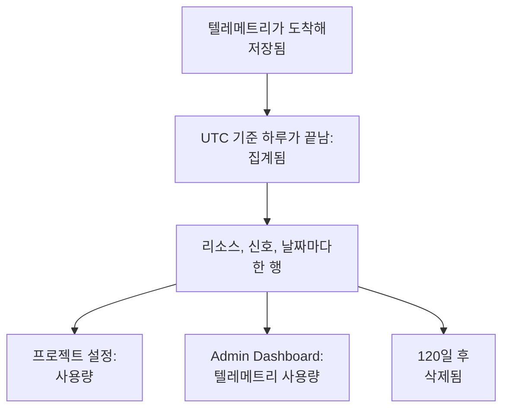

# 텔레메트리 사용량

각 프로젝트와 그 안의 각 서비스나 리소스가 보내는 텔레메트리 양을 확인합니다. 로그, 메트릭, 트레이스, 예외, 프로파일, 세션 리플레이, 보안 이벤트가 대상입니다. 사용량은 결제 여부와 관계없이 모든 OneUptime 설치에서 집계되므로, ClickHouse에 쿼리하지 않고도 스토리지를 채우는 것을 찾을 수 있습니다.

:::cards
- [사용량 집계 방식](#사용량-집계-방식): 하루에 한 번, 리소스와 신호마다.
- [프로젝트의 사용량 보기](#프로젝트의-사용량-보기): 프로젝트 설정 → 텔레메트리 및 APM → 사용량.
- [모든 프로젝트의 사용량 보기](#모든-프로젝트의-사용량-보기): 인스턴스 관리자를 위한 Admin Dashboard.
- [사용량 보관 기간](#사용량-보관-기간): 바꾸지 않으면 120일.
:::

## 사용량 집계 방식

하루에 한 번, UTC 기준으로 하루가 끝나면 OneUptime은 각 프로젝트의 각 리소스가 그날 보낸 양을 신호마다 집계하고, 그 결과를 리소스, 신호, 날짜마다 한 행으로 보관합니다.



- **하루는 끝난 뒤에 집계됩니다.** 각 날짜는 다음 날 08:00 UTC쯤까지 집계되므로, 오늘의 사용량은 내일 표시됩니다. 집계하지 못한 날은 일주일 동안 다시 시도합니다.
- **크기는 저장된 크기입니다.** 각 신호는 저장되는 행의 압축 전 크기로 집계됩니다. 세션 리플레이는 레코더가 업로드한 바이트 수로 집계됩니다.
- **예외는 따로 표시됩니다.** 스팬과 로그에서 기록된 예외에는 고유한 합계, 열, 차트 영역이 있으며, **트레이스**는 스팬을 집계합니다. 예외만의 행은 없으며, 각 트레이스 행에 그중 예외가 차지한 양이 표시됩니다. 예외가 따로 표시되기 전에 집계된 날에는 예외가 예전처럼 **트레이스** 안에 그대로 들어 있습니다.
- **프로파일에는 샘플이 포함됩니다.**
- **OneUptime 자체의 텔레메트리는 집계되지 않습니다.** 모니터, 알림, 인시던트, SLO 측정값, 데이터 관측 가능성 측정값, 세션 리플레이 예산 메트릭은 OneUptime이 직접 기록합니다.
- **OneUptime Cloud에서는 이 행들을 기준으로 텔레메트리가 청구됩니다.** 결제가 없는 설치에서는 사용량이 무료로 집계되며, 나중에 결제를 켜더라도 그 사용량에는 아무것도 청구되지 않습니다.
- **예외는 트레이스의 일부로 청구됩니다.** OneUptime Cloud에서는 트레이스가 늘 그래 왔듯이 스팬과 예외를 합쳐 트레이스 가격으로 청구됩니다. 예외를 따로 표시해도 청구되는 내용은 전혀 바뀌지 않으며, 예외가 두 번 청구되는 일은 없습니다.
- **예산은 사용량과 별도로 집계됩니다.** [수집 예산](/docs/telemetry/ingestion-budgets)은 텔레메트리를 도착할 때 압축 해제된 크기로 집계하므로, 그날의 텔레메트리를 그날 바로 멈출 수 있습니다. 예산이 설정되어 있는 동안에는 이 페이지 맨 위에 오늘의 예산이 표시됩니다. 예외에는 자체 예산이 없으며, 예외를 담아 도착한 트레이스나 로그의 예산에 포함되어 집계됩니다.

## 시작하기 전에

- **프로젝트의 텔레메트리를 읽는 역할.** 프로젝트 소유자, 프로젝트 관리자, 프로젝트 구성원, 뷰어, 텔레메트리 관리자, 텔레메트리 구성원 또는 텔레메트리 뷰어, 또는 결제 역할 중 하나. 역할이 프로젝트 전체에 적용되어야 하며, 일부 레이블로 제한된 역할에는 사용량이 표시되지 않습니다.
- **프로젝트의 텔레메트리.** 사용량은 프로젝트의 [수집 키](/docs/telemetry/ingestion-keys)가 보내는 텔레메트리에 대해 집계됩니다.

## 프로젝트의 사용량 보기

:::steps
### 사용량 열기

**프로젝트 설정 → 텔레메트리 및 APM → 사용량**으로 이동합니다. 사이드 메뉴의 **텔레메트리 및 APM**은 처음에 접혀 있으니 클릭해서 엽니다.

### 기간 선택

페이지는 **지난 30일**로 열립니다. **텔레메트리 사용량** 카드 오른쪽 위의 상자에서 **지난 7일** 또는 **지난 90일**을 선택합니다. 기간은 집계가 끝난 가장 최근 날짜인 어제로 끝납니다.

### 늘어난 것 찾기

**리소스별 사용량** 카드에는 기간 중 무언가를 보낸 모든 서비스와 리소스가 양이 많은 순서로 나열됩니다. 열 제목을 클릭하면 그 열로 정렬되고, 리소스 이름을 클릭하면 해당 페이지가 열립니다.
:::

페이지에는 카드가 세 개 있습니다.

| 카드 | 표시 내용 |
| --- | --- |
| **텔레메트리 사용량** | 기간의 총합인 **전체**, 신호별 합계, 그리고 신호를 쌓아 올린 날짜별 차트. |
| **리소스별 사용량** | 각 **리소스**와 그 종류, 신호별 열, **전체**, 그리고 텔레메트리가 보관되는 기간인 **보존**. |
| **텔레메트리 사용 기록** | 제품, 리소스, 날짜마다 한 행이며, **제품**, **일**, **서비스** 필터가 있습니다. **트레이스** 행에는 트레이스가 청구되는 방식대로 스팬과 예외가 함께 들어 있으며, **수집된 데이터(GB)** 아래에 그중 예외가 차지한 양이 표시됩니다. |

서비스를 지정하지 않은 텔레메트리는 **알 수 없는 서비스**로 표시됩니다. 그 뒤 삭제되었거나 역할이 그 종류를 읽을 수 없는 리소스는 종류와 ID의 앞부분으로 표시됩니다.

## 누가 무엇을 보는지

| 역할 | 보는 내용 |
| --- | --- |
| 프로젝트 소유자, 프로젝트 관리자, 결제 관리자, 결제 구성원, 결제 뷰어, Manage Billing | 각 리소스가 보낸 양과 보관 기간, 그리고 OneUptime Cloud에서는 비용 |
| 프로젝트 구성원, 뷰어, 텔레메트리 관리자, 텔레메트리 구성원, 텔레메트리 뷰어 | 각 리소스가 보낸 양과 보관 기간 |

사용량의 비용은 OneUptime Cloud에서만 표시됩니다. 결제가 없는 설치에서는 사용량에 요금이 청구되지 않습니다. 가격은 [결제 및 사용량](/docs/configuration/billing#사용-기록)을 참고하세요.

## 모든 프로젝트의 사용량 보기

자체 호스팅 설치에서는 인스턴스 관리자가 Admin Dashboard에서 모든 프로젝트의 사용량을 봅니다.

:::steps
### 텔레메트리 사용량 열기

Admin Dashboard에서 메뉴를 열고 **텔레메트리 사용량**을 클릭합니다. 목록에는 기간 중 무언가를 보낸 각 프로젝트가 양이 많은 순서로 표시되며, 신호별 열과 **전체** 열이 있습니다.

### 가장 많이 보낸 프로젝트 찾기

카드 오른쪽 위에서 기간을 고르고, 열 제목을 클릭해 그 열로 정렬합니다. **전체**, 신호, 또는 이름순으로 정렬하는 **프로젝트**를 클릭할 수 있습니다.

### 프로젝트 열기

프로젝트 이름을 클릭합니다. Admin Dashboard의 **프로젝트** 아래에 있는 그 프로젝트의 **텔레메트리 사용량** 페이지에 구성원이 보는 것과 똑같이 날짜, 신호, 리소스별 사용량이 표시됩니다.
:::

## 사용량 보관 기간

사용량은 결제가 켜져 있든 꺼져 있든, 바꾸지 않으면 120일 동안 보관됩니다. 이것은 사용량 집계를 보관하는 기간이며, 텔레메트리 자체의 보관 기간은 [데이터 보존](/docs/telemetry/data-retention)을 참고하세요.

:::steps
### 데이터 보존 열기

Admin Dashboard에서 **설정 → 데이터 보존**으로 이동합니다.

### 일수 정하기

**텔레메트리 사용량 보존** 카드에서 **텔레메트리 사용량 보존 편집**을 클릭하고, **텔레메트리 사용량 보존 기간(일)**에 30에서 1095 사이의 값을 입력한 다음, **변경 사항 저장**을 클릭합니다. 120일로 두려면 비워 둡니다.
:::

그보다 오래된 사용량은 하루에 한 번 삭제됩니다. 보존 기간은 30일보다 짧아지지 않으므로, 집계된 날이 삭제된 뒤 다시 집계되는 일은 없습니다.

## API로 사용량 읽기

`GET /api/telemetry-usage/project`는 UTC 기준 날짜 범위에 대한 한 프로젝트의 사용량을 페이지에 표시되는 그대로 반환합니다. 위의 역할 중 하나가 있는 [API 키](/docs/permissions/index#api-키)로 호출하세요.

```bash
curl 'https://oneuptime.com/api/telemetry-usage/project?startDay=2026-10-01&endDay=2026-10-31' \
  -H "ApiKey: $ONEUPTIME_API_KEY"
```

`startDay`와 `endDay`는 `YYYY-MM-DD` 형식의 날짜이며 둘 다 포함되고, 범위는 최대 1095일입니다. 응답에는 합계, 신호별 각 날짜, 신호별 각 리소스가 GB 단위로 들어 있으며, 비용은 결제가 켜져 있고 키가 결제를 읽을 수 있을 때만 포함됩니다. 예외는 `Traces`와 별도로 `Exceptions` 아래에 있으며, 예외가 따로 표시되기 전에 집계된 날에는 `Traces` 안에 들어 있습니다.

## 문제 해결

:::details 사용량 페이지에 '아직 텔레메트리 사용량이 없습니다'가 표시됨
하루는 UTC 기준으로 끝난 뒤, 다음 날 08:00 UTC쯤까지 집계됩니다. 오늘 보내기 시작한 프로젝트는 내일 첫날이 표시됩니다. 탐색기에서 프로젝트가 텔레메트리를 받고 있는지 확인하세요.
:::

:::details 숫자가 ClickHouse 디스크 사용량보다 큼
사용량은 압축 전 행의 크기입니다. ClickHouse는 저장하는 데이터를 압축하므로, 실제로 쓰는 디스크는 몇 배 더 작습니다.
:::

:::details 리소스가 종류와 ID로 표시됨
리소스가 텔레메트리를 보낸 뒤 삭제되었거나, 역할이 그 종류의 리소스를 읽을 수 없습니다. 그 사용량은 계속 집계됩니다.
:::

:::details 예외가 나타난 날 트레이스가 줄어듦
예외는 이전에 **트레이스** 안에서 집계되었습니다. 예외를 따로 집계한 첫날부터 **트레이스**는 스팬을, **예외**는 예외를 집계합니다. 둘을 합친 것이 이전의 **트레이스**며, 트레이스가 청구되는 대상입니다.
:::

## 다음 단계

:::cards
- [드롭 필터 및 스크럽 규칙](/docs/telemetry/drop-filters-and-scrub-rules): 필요 없는 텔레메트리를 저장하지 않습니다.
- [데이터 보존](/docs/telemetry/data-retention): 텔레메트리를 필요한 만큼만 보존합니다.
- [결제 및 사용량](/docs/configuration/billing): OneUptime Cloud의 텔레메트리 비용.
- [수집 키](/docs/telemetry/ingestion-keys): 프로젝트로 텔레메트리를 보냅니다.
- [수집 예산](/docs/telemetry/ingestion-budgets): 프로젝트가 하루에 보내는 신호별 양에 상한을 둡니다.
:::
